# 【苏黎世联邦理工学院】信息检索-｜-Information-Retrieval-｜-Eth-Zurich-2025-p16-P16_6._索引压缩_(3_3)--BV1ndsBzdEss_p16-

Welcome back， everybody， to the second part。 So where are we， Yes。

 we are trying to squeeze large lists of soed ingers into as little space as possible。

 into as few bits as possible。😊。

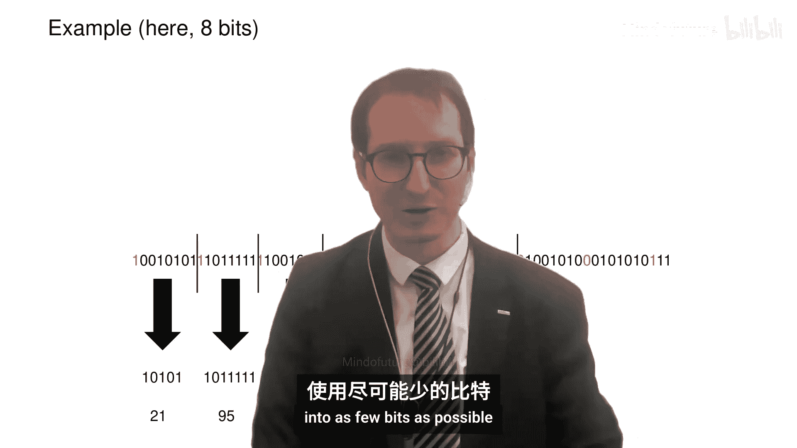

And so far， what we have is a combination of two tricks。

 The first trick is that we encode the gaps between the numbers and not the numbers themselves。

 and that we can do because it's a salted disk。 So there's no negative numbers。嗯。

And the second thing is that we found a way。To make it elastic。

 the fact that small numbers would have few bits and larger numbers would have many bits。

 and it grows。As much as you want， there is no limit to to the integers we can encode。Alright。

 And plus， it's a prefix code， which has the very nice property that if you just fit the memories with these encodings。

 you don't even need any pointers or anything to tell you where it starts and where it ends。

 because you can just figure it out， just scanning through the bits from the left to the right。😊，O。

I'm repeating myself， but no freeance。 This encoding is going to cost a bit of CPU。

 So you you have to， the CPU needs to to work a little bit。

But the benefit is that it takes less space in the on this and in in the memory， right。

 And so it's always the compromise to find。 you know， sometimes if you notice， typically that。

You know， whenever。I'm， I'm going to try to explain it without it actually starting an hour or lecture on that。

 but。When something is slow in a， in a system that you build。Usually， or even almost always。

It's either CPU。Otherder memory， other disk， other network。 It's one of these four。

And so the way you make things faster depends on who is to blame for beings。 So。

 And very often in this kind， in this kind of situations， is the disk that he's at fault。

And when it's the disk， that is too slow because you're trying to read and you， you， you。

 you have a maximum number of bits per second you're reading and the CPU is id。

This is when you want to compress， because the CPU is either anyway。

 So if you ask it to start decompressing data， then that's fine because it had nothing to do anyway。

And then because you reduce the number of bits that you need to store the data。

 then you solve the problem that the disk was slowing you down because now you have less bits to read per second。

 right， Who is with me。Right， so it's a great fitat right here， right。

We squeezed so that that makes it easier and quicker to read from disk。It takes more time。

 but this is fine because the CPU had didn't have anything to do anyway。 So it's a， it's a great fit。

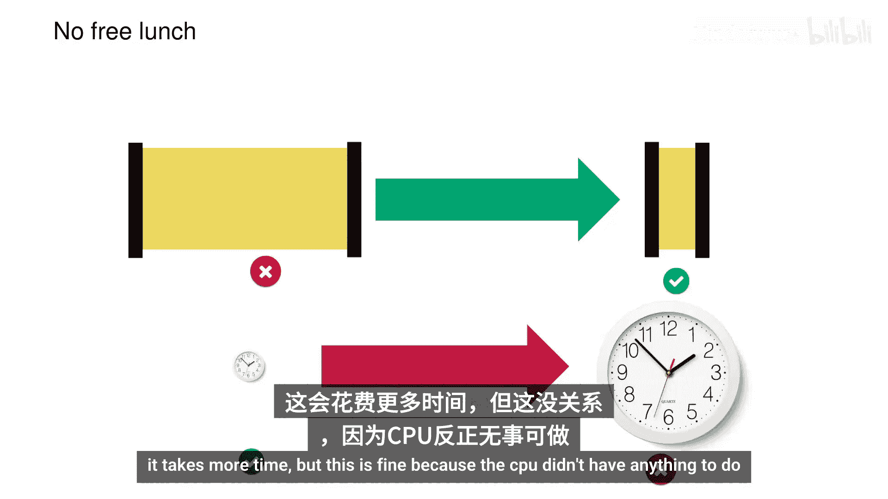

Alright。Now， I told you， it's a parameterized encoding。

 meaning that you have a choice on the size of the packets。 And， of course。

 having too much choice can be can not be not so good， right， And that's what marketing people know。

 if you have too many products and too many colors and too many sizes， then the customers are lost。

 But if you only provide them with few choices， then you increase the sets of the product， right， So。

 so here that's kind of the problem of a parameterized encoding like that is that you need to specify。

 you need to specify a parameter。So now the compromise the is like this。 You have either big packets。

 but in that case， it doesn't compress that much， right。

 because you anyway your store on on many bits。But it has the advantage of little overhead for the CPU。

On the other hand， if you have very small packets， let's say4，2 would also work。 But I told you。

2 is ridiculous， right， But let's say four packets， Fox，4 bit packets。

 Then it's very compressed because the very small integers are going to be super。

 super small in the s in bit。 But it's more。 it's putting more efforts on the CPU to to decode all of that。

Where do you put the slider on the on， on this to pick the size， I would say。Two factors to consider。

The first factor is this balance between the CPU and the disk。Right， basically。

 what's going to happen is that if you don't compress enough。 So that would be on the left side。

 Then it takes forever to read from disk and the CPU has nothing to do。

 But if you go too extreme and go to the other side that you compress so much that now the CPU is basically too slow and the disk is either。

 Then you went too much to that size。 So you need to find the sweet spot in the middle where the CPU and the disk are mostly balanced。

 And then you found the the sweet spot and the the right parameter。So this is。

 it's basically a bit of tried and error， right。And the other factor to consider has to do with information theory and entropy。

 And that depends on the distribution of your integers。 But that I'm leaving far later。

 right So to show you that， because if you are in a system that has a lot of very small integers。

 Then you probably want to go for a lot of compression。

 because most of your integers are going to be very small。 So your your saving space。

 But if you are in a system that has a lot of very large integers。

 then maybe you would be more on the left， right， So it really depends。 This is the shock answer。

 it depends on the distribution of the integers， and it depends on this balance between the CPU being either and the disk being either。

Who's with me。Right， so it's nice because there's a lot of very generic principles of computer science in there。

 right， even though it's a very specific thing right here。Okay。But can we do even better than that。

Because I told you the going to。Small packets of just two bits is ridiculous。

 Well it's ridiculous if you use the variable byte encoding。

 but it turns out we have something that does go bitwise， and that is incredibly powerful。

 And as we will see， it's even optimal from an informationterical perspective。

 It's like the holy grail of the encodings in terms of integers。

 But I will show that to you it's known as the gamma encoding。

 Who has ever heard of the gamma encoding。😊，Who has never heard of it。Are youre going to love it。

 This is， this is absolutely fantastic。😊，嗯。😊，But before I show you the gamma encoding。

 I would like to show you。The urary encoding。It's also called the thermometer encoding for a reason that you will very soon understand。

嗯。The Uni code。Basically， includess a number。By writing just as many ones followed by a 0。

 So you want to encode 12。 That's fine。 You encode 1，1，1，1，1，12 times， and then a 0。

 We would be able to encode that for every integer I give you。😊，It's very easy， right。

Who thinks it's a waste of space。Right，It looks like it's a waste of space。

 We actually see that that and that encoding is actually optimal for some distributions。

 very surprisingly。 But anyway， yes， that's the unary codes。

 That's the thermometer encoding where we just encode code like this。

 Who agrees that it's a prefix code。 If I give you plenty of numbers and sequences of it。

 You would be able to decrypt， right？ You just look for the zeros。😊，That's。

 that's basically how you tell。Alright， so that's the temperature encodeding Unary record is the。

 the formal way。 Themeter is just the nickname that people give to it because that's basically a thermometer。

 right， It's， it's， it's like reading the temperature。Okay。

 so that's how it looks like in the codinging。 But of course， that's not it。 We are not。 Don't worry。

 we are not going to encode the posting list with this。

 but this will be an ingredients of the gamma encoing so。These unary goods。嗯。

So you told me youre able to decrypt that。 Are you。

 So who is able to decrypt that if I tell you that a temperature encoding would be able to tell me the integers。

😊，Right， you just locate the zeroes。 and that's it， right。That's easy。 So again。

 what I like about the term， the thermometer encoding is that it's a prefix code。😊。

That's very important。 It's a prefix good。ok。I was thinking a world in which these would be a full numbers。

 but that would take a while to actually call people， right？Okay。

So the author of the gamma encoding is Peter Eliliaas that you see right here from MI I T。

And he had this brilliant idea on how to apply this thermometer encoding to encode any integer。

In a bitwise fashion。Highly compressed and optimal compressed， even。Up to a constant factor。

 but I'll come back to that。So here's how we encode 19。

 So probably you guess the first thing that you do。

 it's this irresistible urge is to turn it into base 2， right， You want。

 you want to encode it2 beats， right， That's what every computer scientist immediately wants to do。

 So let's do that。19 would be 1，0，0，1，1， right in base 2。No。Who agrees that。In base 2。Any integer。

Except 0， so higher than 0，13 with one。What is the first bit。Of the base2 en quoing of any integer。

When it's going to be when， right。Sadly， doesn't work in base 10。

 If I tell you what is the first digit of any integer then you don't know because there's 9 possibilities。

 right。But what's really cool about base，2 is that。If you don't waste any zeros at first， you know。

 for sure， the first bit that comes is any going to be a web。

Why is that interesting is because we don't need to actually encode it because we know it's a one anyway。

So the first trick of the。Gmaco。Is to。Special to， to。

 to have special treatment for the initial bits that is always a one in any case， right。

 It's always a one。 So we just remove it and we can add it back when we decode， right。

 So now I want to encode this sequence of bits 0，0，1，1。

 That could actually be any sequence of bits for any integer I want， right。

 So it's just an arbitrary sequence of0s and ones。😊。

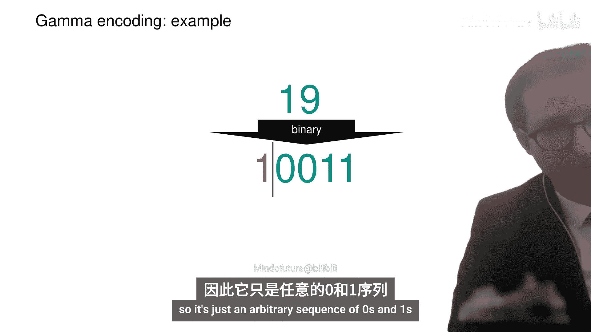

So I'm going to take that sequence of zero and ones just without the reading bit。

 That's the only thing that I'm reviewing is the reading bits。 That's always a one。

That here is one half of my gamma encoding。 I'm already done with one half。 That's the right half。

 right， So I put all of the， all of the bits， except the leading bit。Now。嗯。Its said a stick， right。

 So I need a way to make it a prefix code。 So I need a way for somebody to know that these are going to be forbid to decode。

 How do we do that， You might have guess temperature andcoding， thermometer encoing。So。Decise for。

We encode as 1，1，1，1， right， as many ones as there are bits on the right， followed by a 0。

 That is the thermometer encoding of that length， right。And that gives me the。G my quit。That's it。

 We'd be able to do it for any integer。Greater than0， right。Awesome， so that's it。 That's the。

 that's the gamma including。😊，嗯。What comments can I make here well。Who sees that the。

 the bit that is in the middle。Is always going to be a 0。You see that， right。

 Who sees that the gamma encoding is always going to have an odd number of bits。You see that， too。

 right， It's never going to be even always odd， okay。And， in fact。

 it's always going to be plenty of ones on the left side， then a 0。 And then the。

 the bits of the integer without the leading one。 That's it。 That's the， that's the gammin codinging。

Now， also as a very rough rule of thumb。Who agrees that very， very roughly。

The size of that encoding is going to be double the size of the base2 representation。Very roughly。

 right， very roughly。 We would just double。 And in fact。

 the way you see it is just that you technically take the base to representation and then you just mirror it with plenty of what。

 That's what it does。 So just to give you the impression of the， of the gamin coding， right。

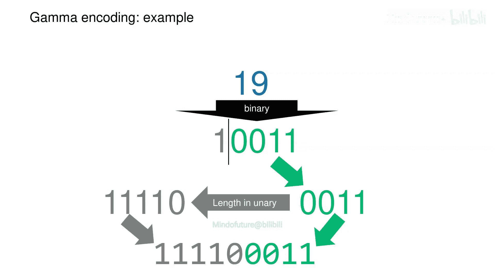

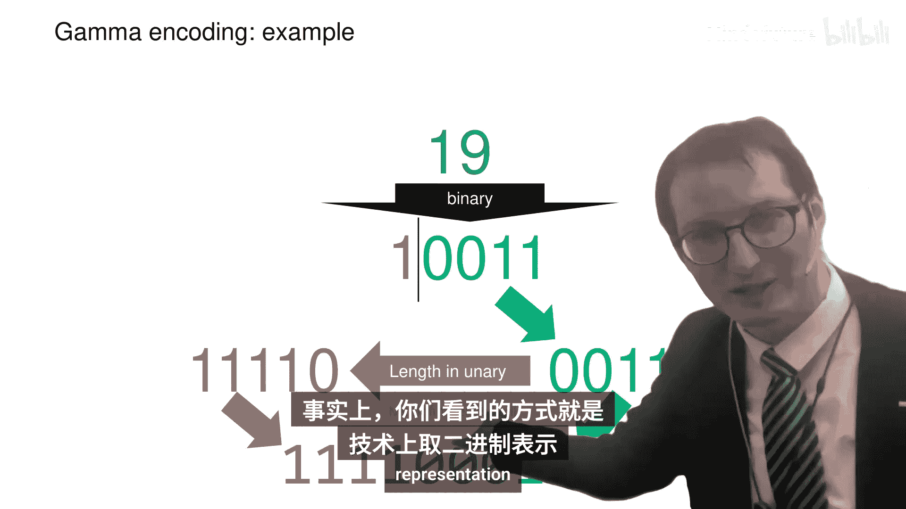

Okay。😊，Now， let's do it on the list of all of the smaller integer。 So let's encode。0，1，2，3。

So in binary form， that's 0，1，1，0，1，1， right。The binary form without the reading one is going to be for 2 and 3。

 That's going to be 0 and 1， right？ And now you already start noticing， we have a problem with 0。

 right，0 and 1， that kind of collide。So， in fact， that's the reason why 0， in fact。

 is not included in the gamma encoding。 You just do not encode 0， right， So we are。

 we are just going to encode to encode one。The length of the， of the， of the phma sequence。

 So that's basically the number of bits -1 of the， the total representation。In unary。

 So that would be the unary encoding of the length。Right， so they have a length of one。

 So that is one times11 a1， right。And then the gam I quote。 So again， I told you 0 doesn't exist。

 We just don't encode it。1 is just encoded with a 0。Right。It's still an odd size。

 and it still has a0 in the middle， which is the only bit that it has， right， So it's。

 it still fulfills the where the probability I told you right， But when is just a 0。

 then you have 2 and 3， It's incredible because3 B，2 and3 fits on 3 B， just that super efficient。😊。

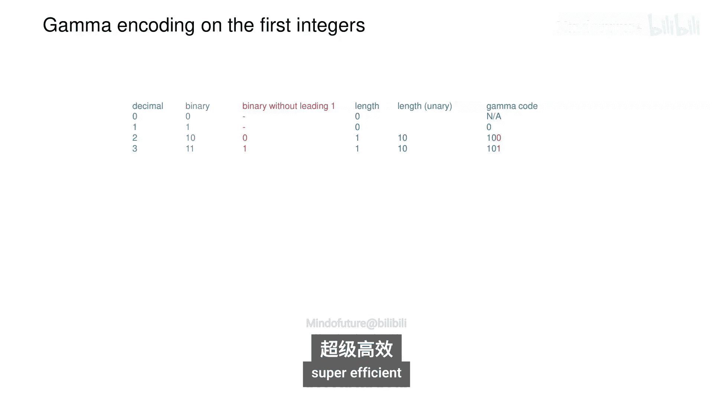

Then you have the next so4，5，6，7， these are the binary representations。

 And you see they have three bits。 So I remove the reading one。 You see it's always a one。

 the first one。 So I remove it。 How many bits are there two。 and the temperature encoding of that，1。

10。 and that gives me the gam I could now and 5 bits for these4。 Then I have the next8。

 which we are going to be4 bits，3 without the reading 1 temperature encoding。

 that's now 7 bits for the gam I code and so on and so on and so on。

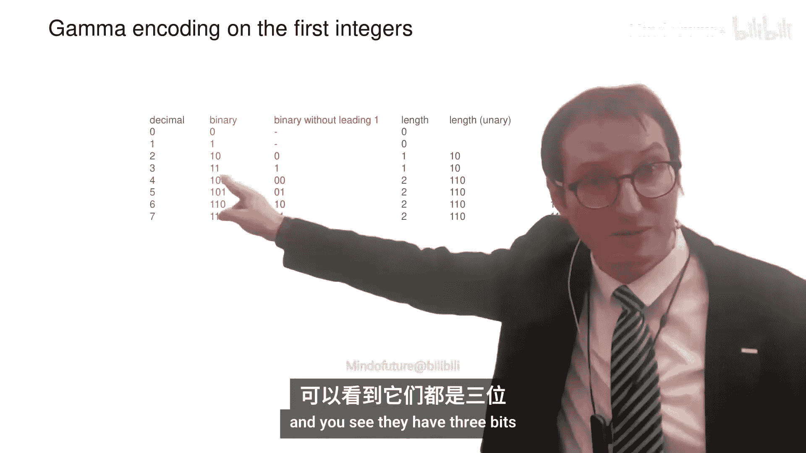

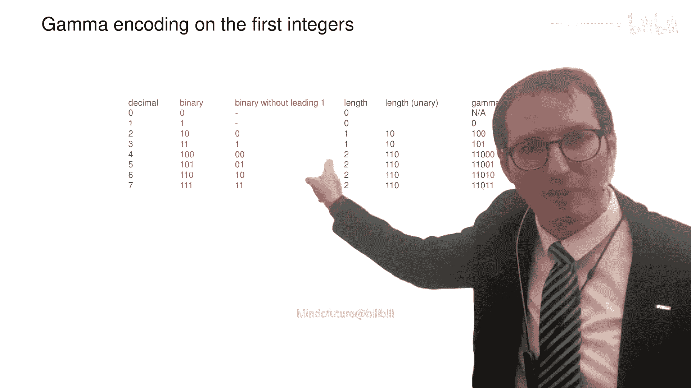

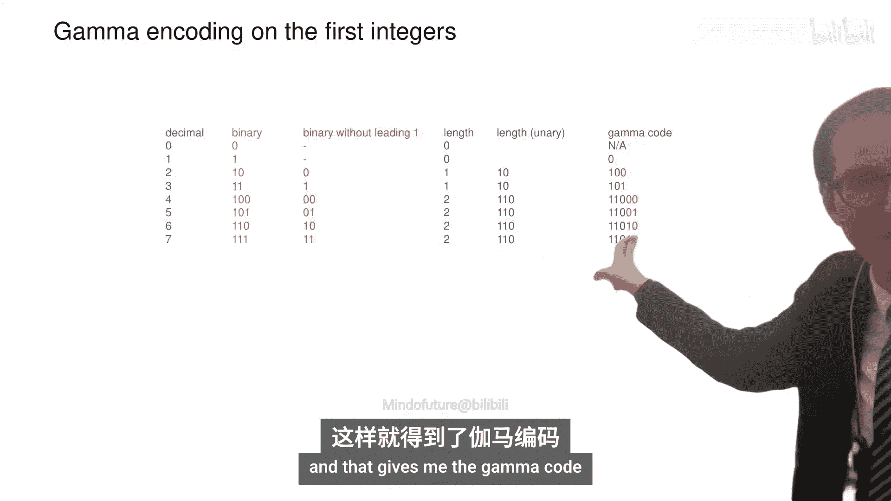

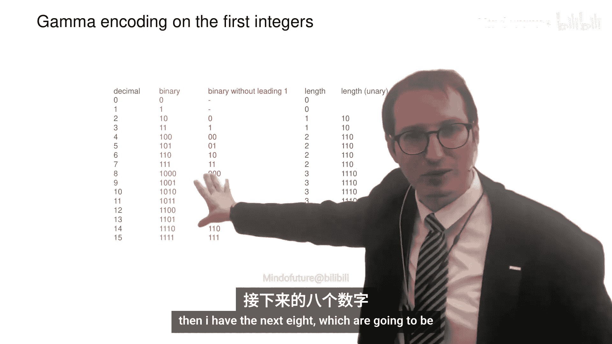

You see how it's elastic。 It just elastically grows with the integer。

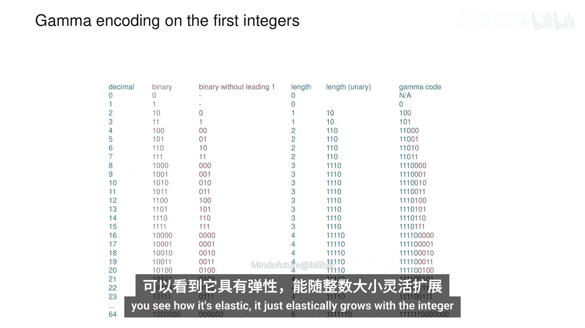

Now， also to give you a very to make you think about it。

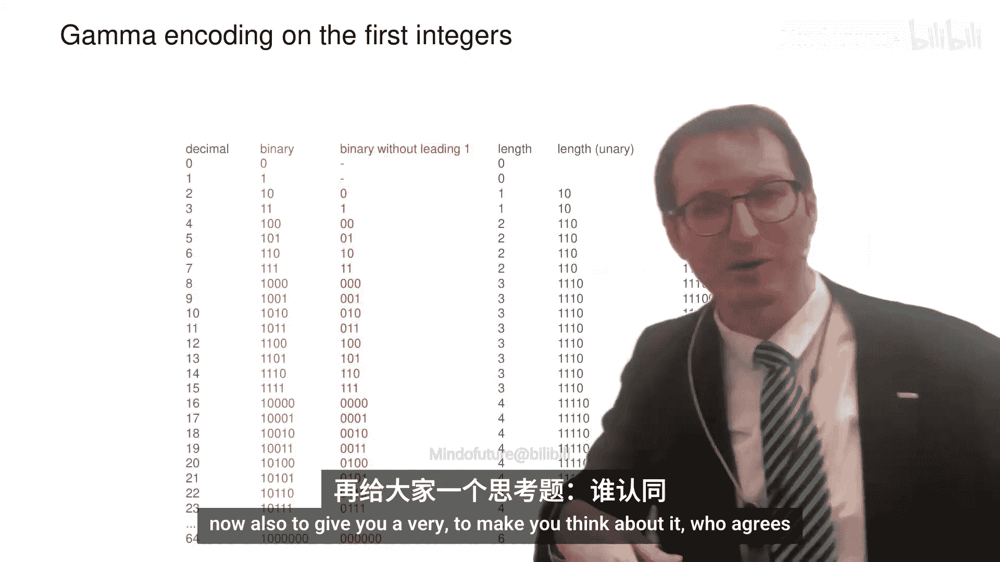

Who agrees that this here。Is basically the log in base 2， the logarithm in base 2。

Rounded or approximately to an integer。

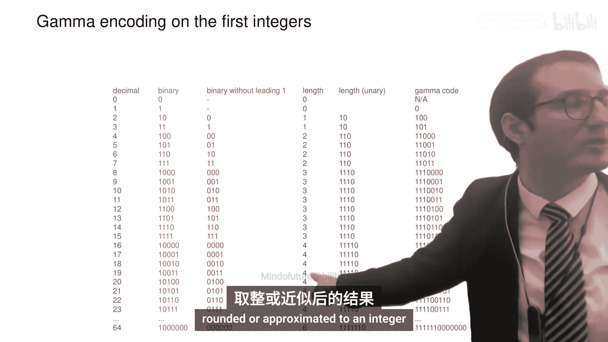

Right， you know that what the logarithm gives you is the size of the decimal representation for the logarithm in base 10。

 the size of the binary representation。 If you take the， the logarithm in base2， right。

 So this is very roughly the logarithm。

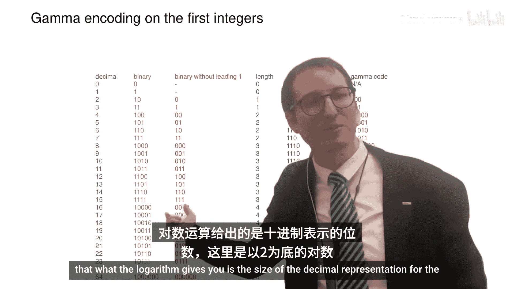

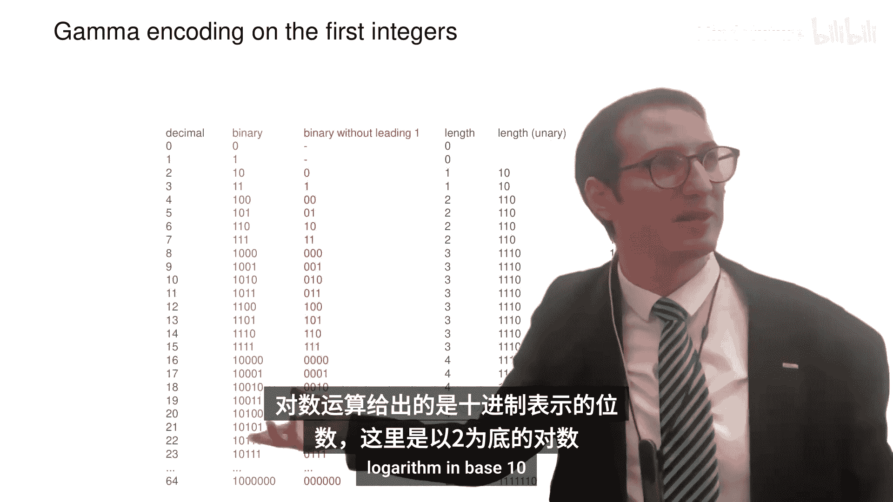

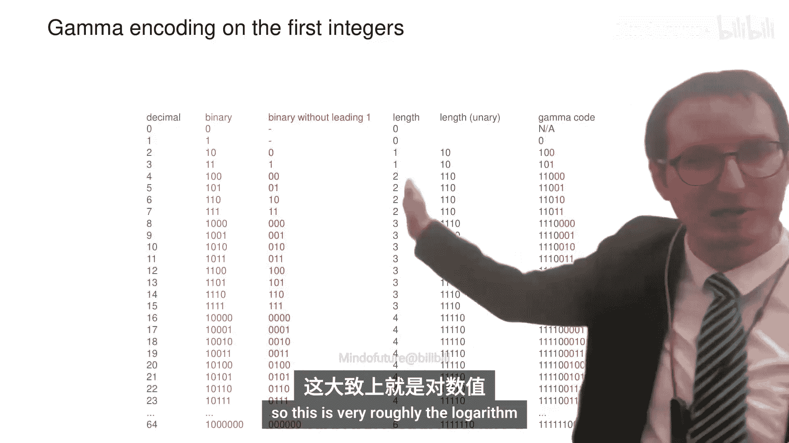

Okay。Very good。So these are the gamma encoings of the first integers。Now。

 what do you do if you want to encode zero？You're just offset by one， right？

You can make a convention that you just encode the inte plus  one， and then you can encode 0。

 So it's， that's easy。 Basically， It's not a problem at all that we cannot encode 0 because in practice。

 you just offset。Alright， so that's。Very good。Now， what are some of its properties。

You agreed it's a variable length encod， right， elastic。Small integers， very few bits。

 large integers， lots of bits。You agreed the prefix and coding， right。That I haven't shown yet。

 But who agrees that it's a prefix and coding。You see why you， you read， you。

 you look at all the webs that you have until you reach a 0。

 and then you know how many ones they are。 And then you know how many bits you need to read after all 0。

 So it's a prefix en。All right。Universal encoding。 that's new that I haven't actually discussed before。

 universalver encoding。 Uni encoding basically means。That it is optimal。

 whatever the distribution of your inteities。 That's a universal including。

 It's basically optimal up to a constant factor。But then I'm going to make more precise by going going into a little bit of math regarding the universal including we scared of math。

Who loves math。Oh， theoretical computer science has a lot of left right。

 Who is taking the information and theory lecture。Who will take the information theory lecture。Oh。

 okay。 So I have to tell you， I'm not an information theories， right， So I。

 I don't know as much as as directions or information theory， but I know a little bit。

 And just enough to explain what I'm going to， to explain here。嗯。O。So， I'm going to。

Explain what I mean with the gamma encoding is optimal。So the I behind entropy。

 who heard of Shanon entropy。Who never heard of entropy or Shanon entropy。Don't be shy。

 You can raise your head。 It's okay to not know， right。Okay， so I'm going to explain that。

So here's the idea。 You have to imagine an experiment with two people like Saint Bob。

And Alice has to communicate a number。To Bob。In order to communicate that number to but。

 she needs to send zeros and ones over some channel， right， And that's the only channel。

 They cannot speak。 They， they don't have any other communication， right。

 They have to send it over a channel。And so the， the idea is that there is the。

 the integels that Alice has to send。 She receives them by some sort of the random generator that just gives her some some。

Numbers， according to a specific distribution that distribution is given by a random variable。

 We heard of random variables。Right， awesome。 we're gonna have random variables in a few weeks with probabilitybaistic information rerieal。

 So be ready for that。 So anyway， have this probability distribution on integers。

 And Addis is given that number。😊，And she's supposed to send it to Bobb。And so， of course。

 they can encode it in a certain way。 They can choose the way in advance how they are going to encode it。

And so， of course， you want to do with TMD， right， You would like to find some strategy or find a way to encode everything。

In such a way。That it's the smallest average number of bits that you can possibly achieve on average。

 right， based on the probability distribution。What's important is that it's compressed。

 but it's lossless。 Losless means that Bob can retrieve the original integer。 There is no loss。

 no information is loss， right， It's not always the case。

 There are also compression schemes that might lose information。 For example。

 when you encode movies or series or pictures， Jpeg， for example， is not lossless， right。

 You lose a bit of information。 And the benefit that you get is that it's a very smaller， small size。

But here it's lots less。 You want Bob to be able to decipher the the the integer， okay。

So they have to decide on how they are going to encode these， these bits over the channel。No。

Shannon is the name of the person who actually managed to find an answer to that question and who is able to give you the answer that this is the smallest average number of bits that you are going to need。

 and that is the Shannon entropy。 And I'm going to tell you how it's done。

It's basically done by looking at some function that is called the amount of information letter I。嗯。

I'm directing I giving you the formula。 It's actually minus log T。

 where piece is the probability of seeing a specific number。

 So now I'm going to just take some time to be clear on the notation。

 And that's something that I will even repeat in a couple of weeks。What does everything mean in here。

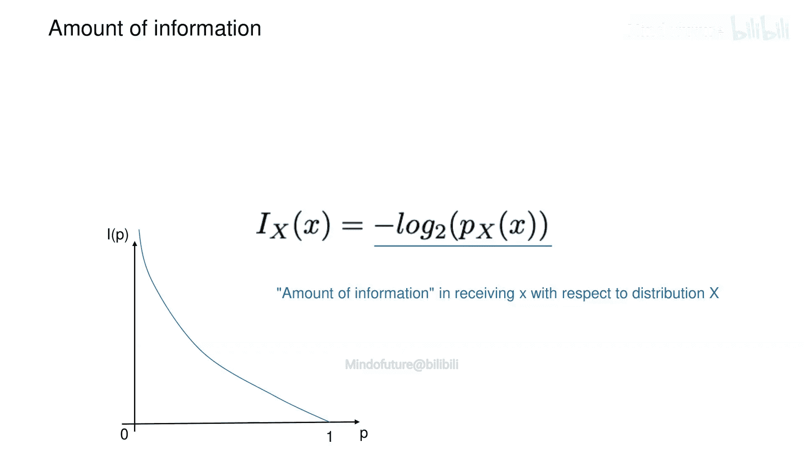

X here， the uppercase version。 that is my random variable。 The 1 I have here。

 That's my source of integers。 That random variable is basically。

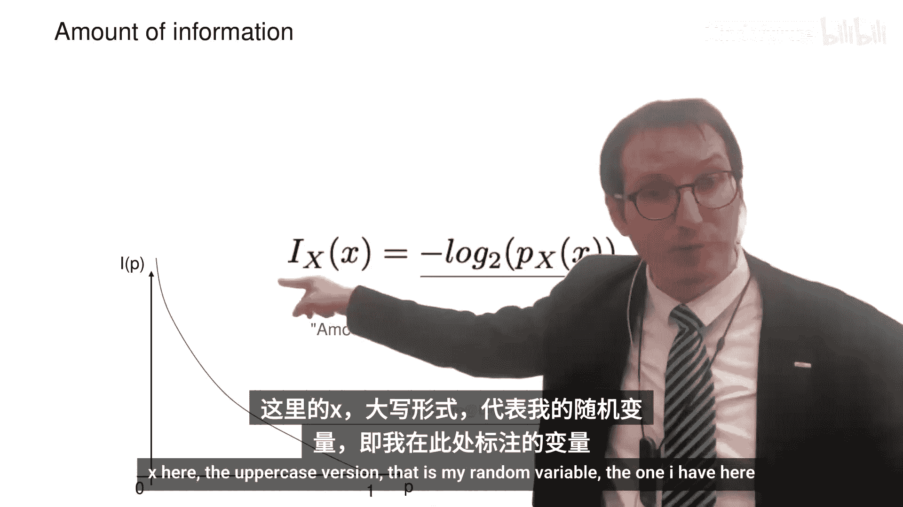

Very roughly speaking。 It has a probability distribution of all the individualstes， right。

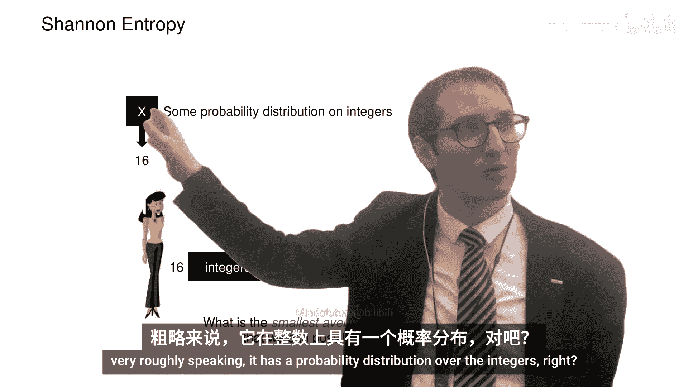

That's P X is basically the probability distribution over the integers。

 And Px basically gives me for every number that I squeeze in there。 It gives me its probability。

 right， It can tell me， for example， there's a probability of one quarter that the number is going to be 0。

 There's a probability of one half that is going to be one。

 There's a probability of the one quarter that is going to be 2， right。

 Then we say that Px of0 is one quarter。 Px of one is one half。 and Px of2 is one quarter， right。

 So far so good。 So this is Px， that the probability distribution that is associated with the random variable X。

😊，Small X is not a random variable。 Small X is just a nu lacent mathematical variable。

 The way you see that everyday， right is just replacement for some integer， small X。嗯。

So having seen that， you can see now what I have on my screen right here。

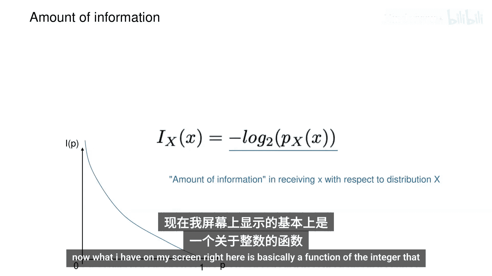

Is basically。A function of the integer that I'm sending with channel， the small X。

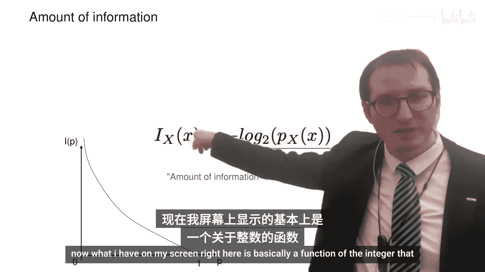

That gives me the amount of information。

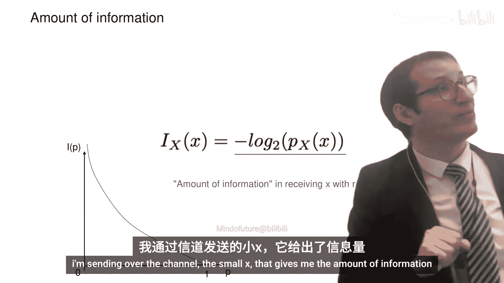

But it has a dependency because that depends on what I have in here。 That depends on the， on what I。

 what distribution I have in here。 So this is why we have this subscript here that gives me the random variable based on which you compute that amount of information。

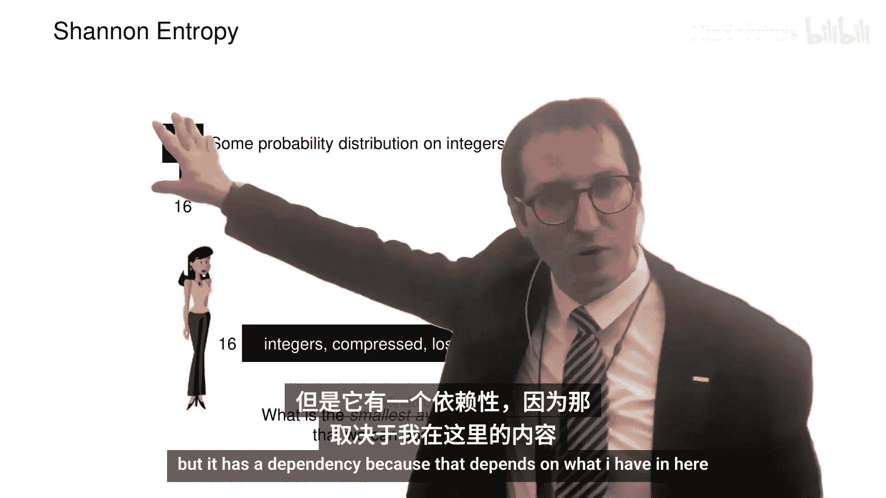

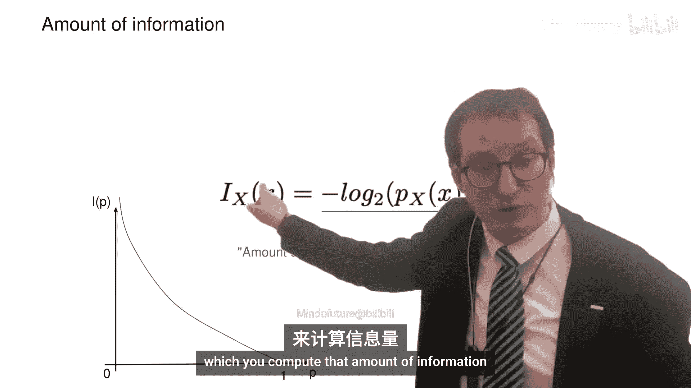

Now。There's a simpler way in the way that I think about the information。I think of it as self price。

The amount of self price。Because imagine that you have。A distribution that is deterministic。

You have basically， this。Socks here of integers。Always speeds out 42 a3 a million years， right。

 But it always gives you 42， no matter what probability of one。 So P X of 42 is one and P。

 X of anything else is 0， right。No。You push the button of these socks。And welcome Zuts，42。

 we surprised。Nobody is surprised， right， It's a probability of when that is， it was going to be 42。

 right， So now if I come to you and I tell you， oh， by the way， it's Peter out 42。

 they're going to be like， yes。 so。 and what， you know， that I'm not surprised at all。

 that that's already data Aristic anywhere。 I knew that How much information is there in here，0。

 You didn't learn anything。That's something you already knew Who sees that。And this is why。😊。

You see this magical formula that I have here。If the probability is one， what is the logo of one？

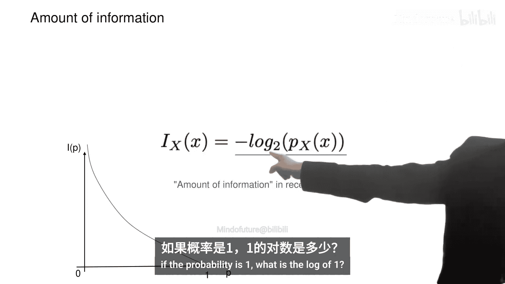

It's 0， right， I'm here。 So it basically means that if there is an integer that。

 according to my distribution X， if there is an integer。

That has a priority very close to one of being spit out by by the source of integers。

Then I'm not surprised at all。Now， imagine that I slightly modify those socks。

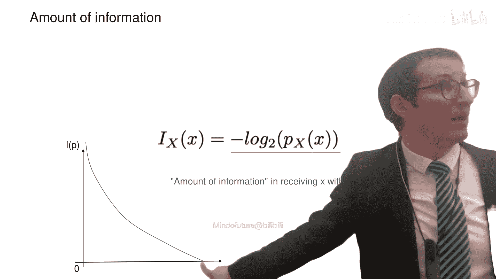

Now， it speeds out 42 with a probability of 99。9999999%。 and maybe。

It sps something else with an extremely poor probability。Now， I come to you and I said， okay。

 I pushed the button of this， this machine and it sp out 43。Now you're going to open your eyes。 Wow。

 this is a surprise， right， I expected 42 with very high probabilitybaities。 So 43 is quite unusual。

 right， So that means that the moment I told you，43 was spit out。 you're surprised。

 it means there was information in there。 There's a lot of information。

 And you see the most unexpected it is， the more unexpected itities。😊。

The higher that amount of information will be。 So you can see the amount of information as an amount of surprise that you would have if you see that integer。

 with with me。Right， so this is the basically the basic building block based on which we are going to define the entropy is the amount of self price。

Of seeing a specific integer based on the distribution， Because if I change the distribution。

 of course， it changes everything right， If I give you a probability distribution that says it's guaranteed to C 43。

 And I tell you， I saw 43。 Now， it's not a surprise at all。 So it does depend on a block X。Next。

Again， I insist because this can give a lot of headaches if you're not careful about that。

 uppercase X is the random variable itself。 That's my distribution of integers。

 Small x is a mathematical variable that just stands for any integer。

 You could replace x with one with 42 with what to well you want。 But big x。

 you cannot replace with an integer。 It's only small x that you can replace。😊，嗯。😊，Okay。

Now that's my datamin distribution， so I didn't put 42 in here。 I just put zero。

 but basically you see here the amount of information for0 is going to be 0 because it's a probability of one。

 right。Here's another distribution that's the one that I mentioned earlier。1 quarter，1 half。

1 quarter。So now I have a distribution。That speeds half of the times is' going to， to。

 to say whether and。1 quarter of the time 0 and one quarter of the time 2。

 you agree that when is going to be less surprising than 0 or2， right。0 O2 are more of a surprise。

 but one happens half of the time。 And you see， you just calculate minus of the log of the probability。

 right， So here the amount of surprise for one is one。 The amount of surprise for 0 O2 is 2。

 because that's not surprise price for 0 and 2， okay。😊。

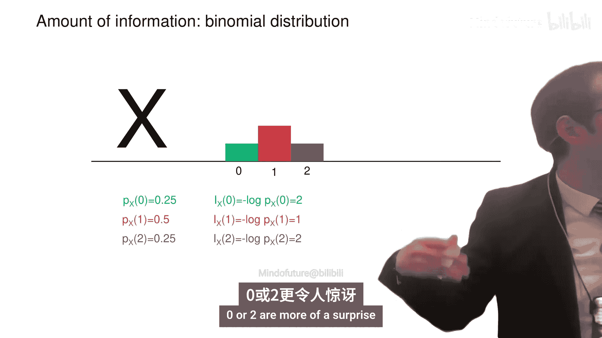

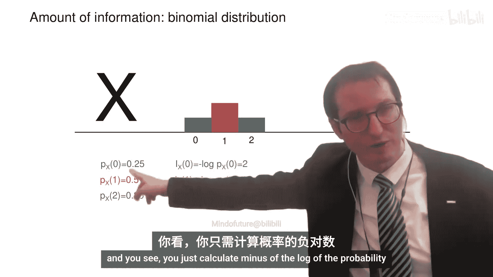

No。Don't run away。I'm going to introduce another random variable。

 You know that whenever you have a random variable， you can take a function of the random variable。

 right， For example， you can have a random variable that is the the， the die roll， right，1，2，3，4，5，6。

 Then you can have a function that tells you it's even or it's odd， right。

 now it's a function that maps 1，3 and 5 to odd and 2，4， and 6 to even， right。

 That's a function of my random variable。😊，Now， since I X is function。

 I can apply it to my random variable， right， So what that means can really take the time to understand that。

😊。

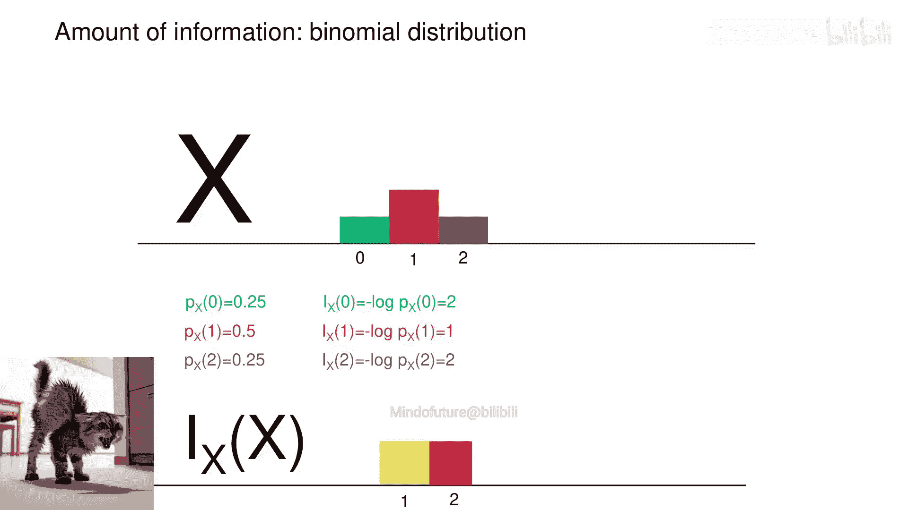

But do you agree looking at this。That。Half of the time。

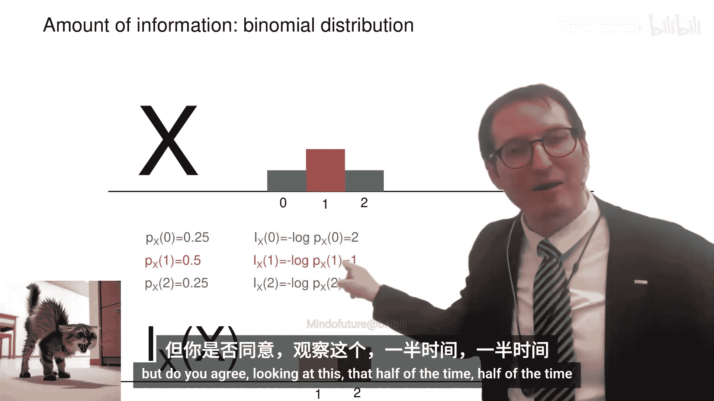

Half of the time， you're going to be simply surprised。😮，And half of the time。

 you're going to be doubly surprised。It doesn't matter if it's 0 or 2。

 The amount of surprise is the same。 So do you agree that half of the time you're simply surprised and half of the time you are doubly surpriseded agrees with that。

 So that gives me a distribution， another random variable。 Now it's the surprise random variable。

 I X of x。 that tells me half half。 I'm simply surprised。 I'm doubly surprised。

 And I just took that out of here。 by basically one that's 0，5 and 2。 That's the sum of 025，0，25。

 So that is also a random variable。

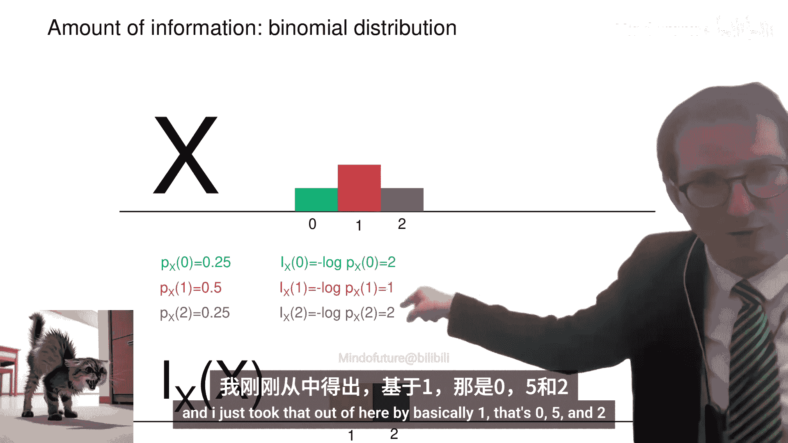

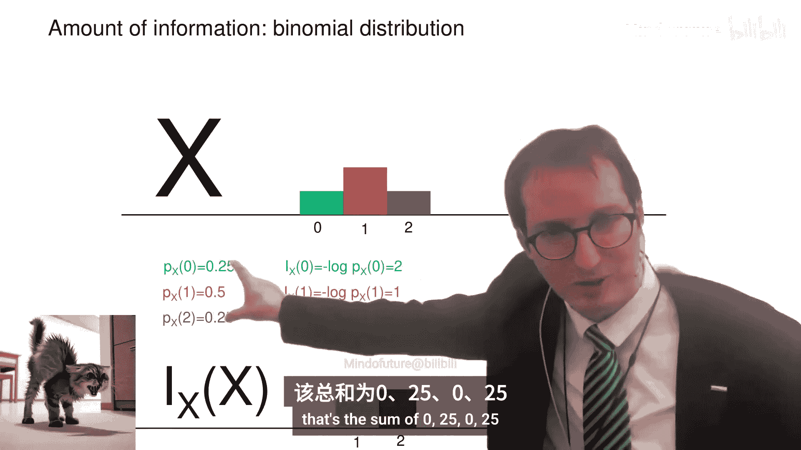

Who can tell me the expected value of that random variable here。

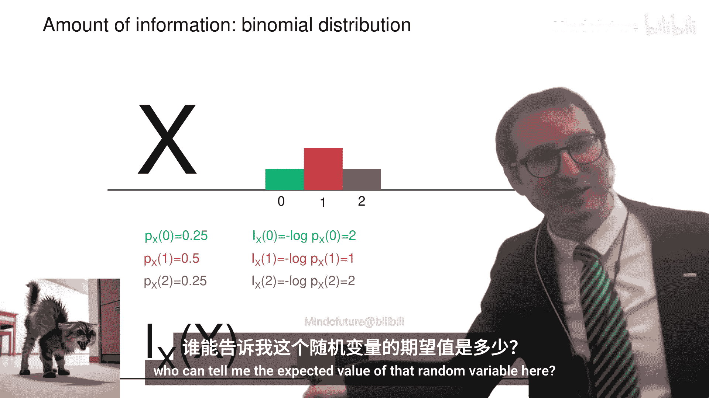

Which is one half of the time and two half of the time。But did you expect heat value。

Who knows and just doesn't dare to raise their head。

Just the expected value of that one half of the time， will agree its 1。5。

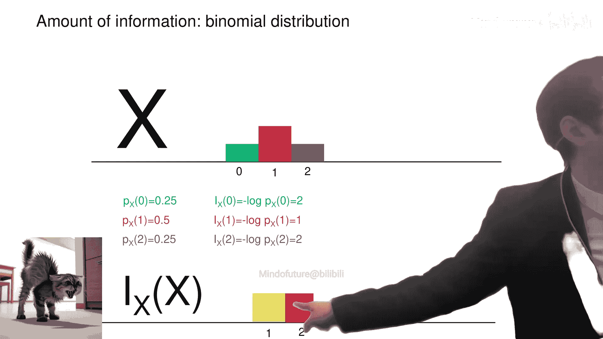

Right， that's okay， okay， awesomesome。 So that's the expected value，1。5。Well， in fact。

 that's the entropy， because the entropy of the shadow entropy is just exactly that it's the expected value。

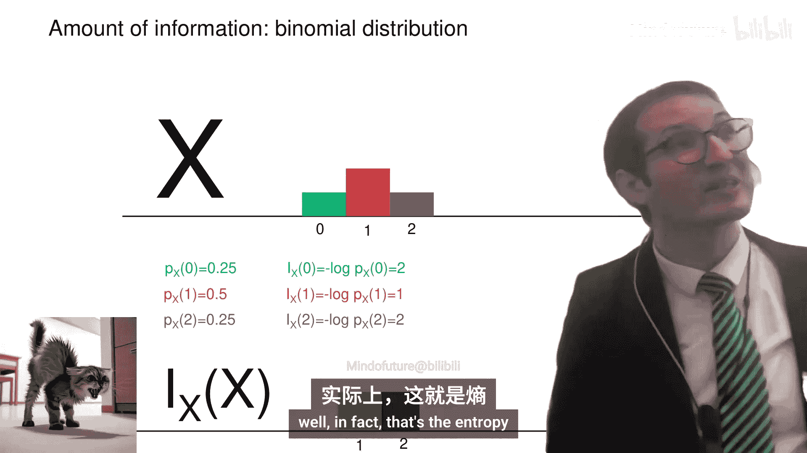

Of this stock price。 So you take the expected value of the amount of information with respect to distribution X。

 that has a random variable。So the entropy of any random variable， you can take me。

 tell me any source， any any source of integers， big X。

 And I can give you the channel entropy of that source， which is just a number。

And that number is computed by taking the expected value of the amount of information。

 according to x， which is minus s of the probability。That's it， that's the channel entropy。

 It's not so difficult。 But what is complicated is the headache that you get by looking at the formula。

 right， just having in mind that。Here， this subscript means that just that the distribution。

 according to which you compute the amount of information。

 But what is in here is really just a random variable and then a function of a random variable。

 That's what happened when I basically took it from here to here okay。

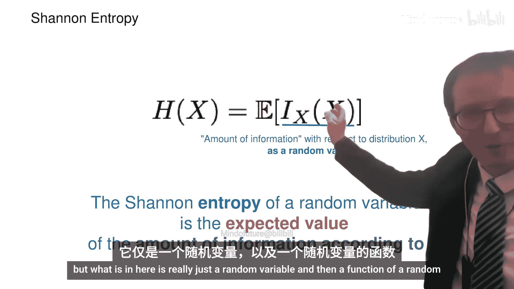

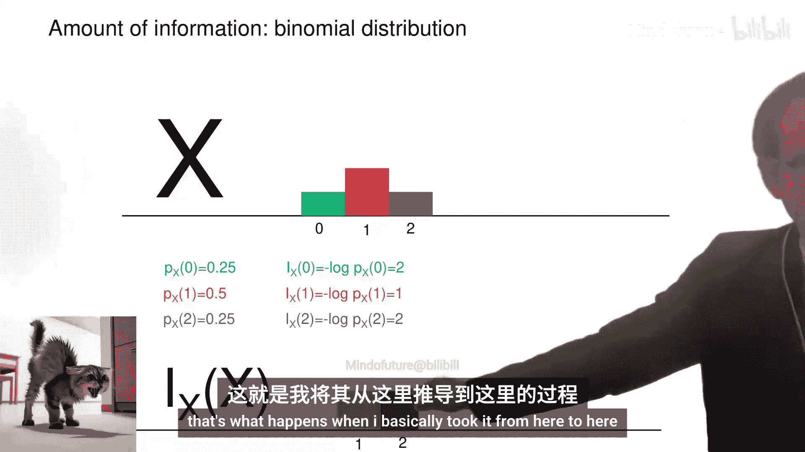

All right。So that is my entropy。And if I want to compute it。

 you know how to compute the expected value。 It's just the weighted average with the probabilities。

 right， So I just take the weighted average of my Ix of x for every possible value of small x。

 And I just compute the weighted average with the probabilities。

 And if I now replace this Ix with minus log p， I get this very famous formula that maybe already saw that the sum of minus P log p。

😊，That is the entropy。 That's how we get it。 That is the expected value of soft price。 So to say。

It turns out that this gives you the optimal number of bits in average that you can achieve with the experiment that I've shown you。

 That's the Shanon entropy。So let's compute it on a few examples。

 Here we have the dataministic source。That always gives me 0。

So I'm never going to be surprised with that one， right， So the entropy is 0。

 It's the average of 0 with the probability of one， right， with 0。What that tells us is that。

If you have this socks that always gives 0， Alice least doesn't even need to send anything to Bob。

Because Bob already knows that it's going to be 0 anyway， right。Gurgs。Right。

 so I don't even need any bits in here。 I I just don't say anything。 Let's look at my other example。

 The probability distribution is's also called binommial。 By the way， is distribution。

 It's the pascal triangle for those of you who saw it。 You know。

 A plus B squared is a squared plus 2， A B plus B squared，12，1。

 That's basically the where you get that from。But anyway。I have a probability of one quarter to get0。

1 have to get  one， one quarter to get 2。 And now the amount of surprise are already computed it。

It's simply surprised or doubly surprised。 And now since I'm simply surprised half of the time and doubly surprised half of the time。

 then I'm one and a half surprised on average。Right， that's my entropy。 I have an entropy of 1。

54 here。Here's another example。Uniform distribution over 0，1，2，3。

 It means that one quarter of the time it's 0，1 quarter of the time it's  one，1 quarter of the time。

 it's 2。1 quarter of the time it's 3。So always a priority of one quarter。

Then what is my amount of surprise always to， I'm always doubly surpriseded。

 whatever non doxs I would， I'm equally surprised because they all have the same probability。 So I'm。

 I'm surprised because I didn't know in advance， but I'm exactly as surprised to 00 as I'm surprised to 01。

 basically。So now what is the the， the average value of these weighted by the probabilities。

 which I'm completed here。 It's just two， because it's always to anyway。

 So the average of a random variable that always takes the value 2 is going to be 2。We Greece。Right。

Now do you see that that too， tells me you can transmit that with 2 Bs。An integer between 0 and 3。

 you can encode it with 2 bits。Who can give me an en that does that。Am mapping from integers to bit。

Just the representation in base 2， right，0，0，0，1，1，0，1，1。

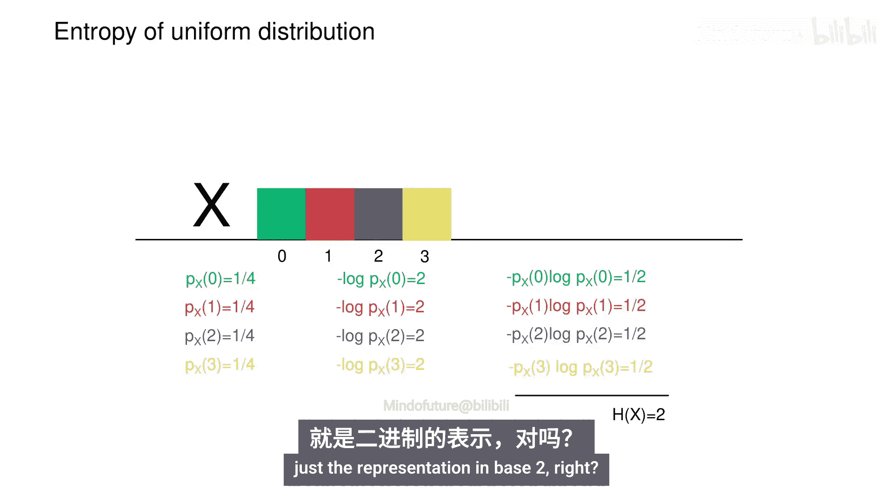

And this one is optimal， and I know it's optimal because the entropy is2。

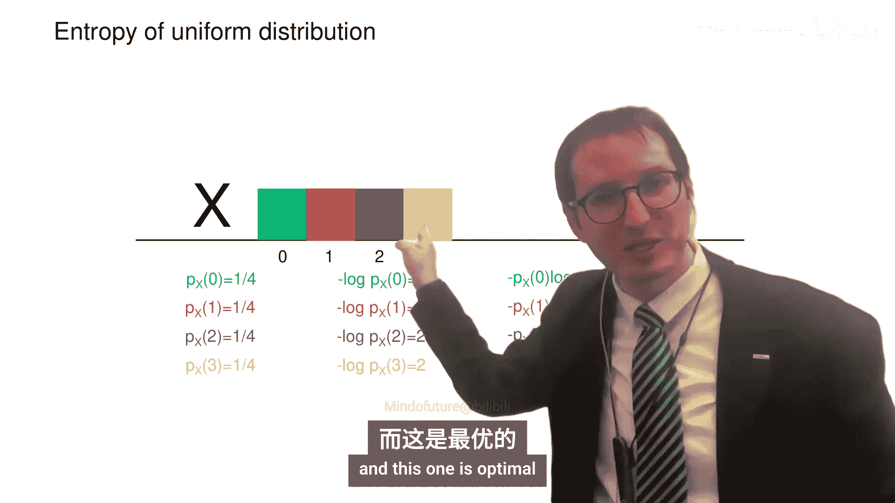

So I just need two bits， and I will never be able to do better than that。 Did you have a question。

 I thought， I think I saw raceend， no， okay。Alright。

 so that's my entropy and the uniform distribution。

 Who would be able to calculate the entropy for any distribution if I give you the list of integers and proba。

😊，Yeah， very good。 So that same。 And a number comes out of it。 That's my entropy。😊。

Here's another one with a geometric distribution。 right。

 So the geometric distribution is basically powers of1 half，1 half，1 quarter，1，8，116。

 That's called the geometric distribution。 In that case。

 with a factor of one half can have actually an numberble rather than1 half。

Now you see with a geometric distribution， the higher the integer。The rarer it is。

 and thus the more surprise I am right， So now you see the amount of surprise grows with higher integers。

 right。Do you see that Because they are rarer and rarer and rarer？

 And now it turns out that if you computes the average value weighted average weighted with the probabilities。

 you get two again。 It also has an entropy of  two。

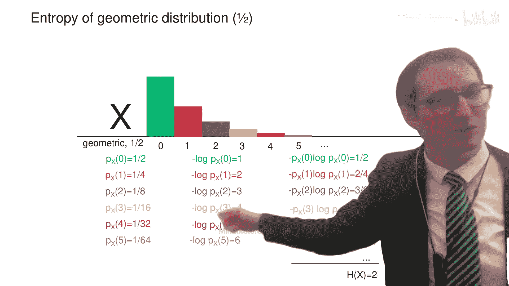

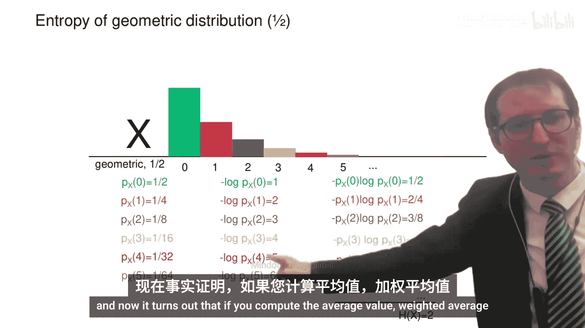

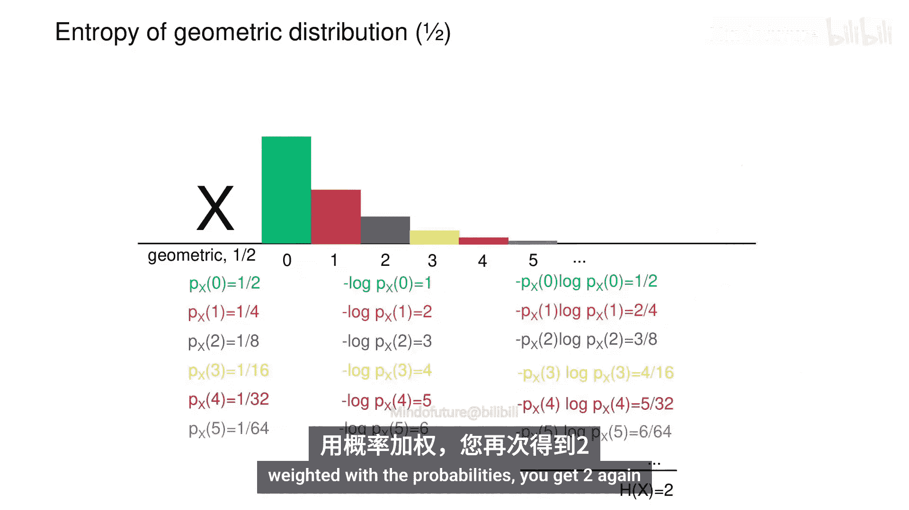

So you can include that with on average。

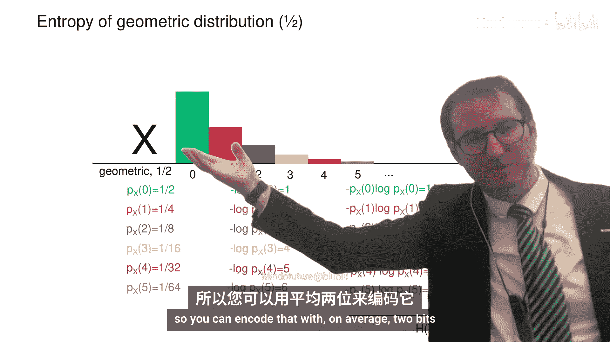

To bit。But， of course， it's not going to be the same encoding as for here， right。

 you need something smarter， something more involved in here。 But on average。

 the shadow entropy tells me you will not do any better than on average 2 Bs per inte。

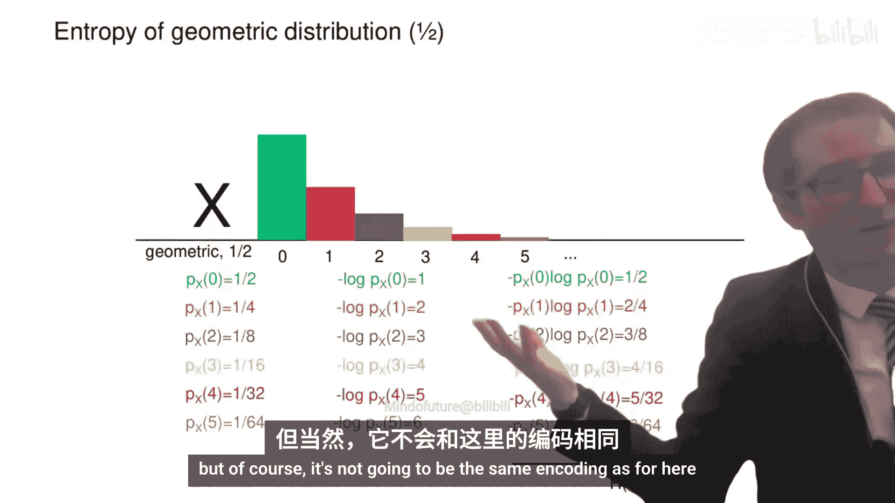

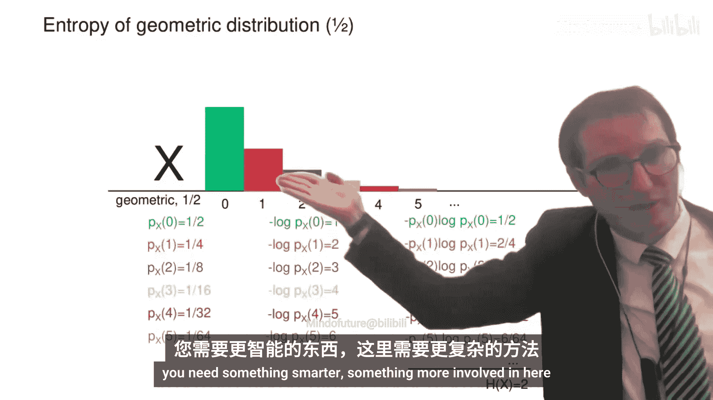

That seats。Okay， so now。That's my entropy。 That is basically my theoretical limit。

 It's what Croch Chanon told me， you cannot do better than that。

 You will never find any encoding that beats that number right here。So let's see。

 Let's take some and some some encoding。And compute the average length of an encoding。

 So now I'm no longer looking at the entropy。I'm no longer looking at the surprise。

I'm looking at the length。So in that case， I'm looking at the variable by 10 codingd on 8 B。

 So what is the length on 8 Bs， variable length of 0，12， it's always 8， right。

 And then it's going to be 16 after I which I， after I filled the the 7 bits， right。

Who agrees with that。 So it's going to be 8，8，8，8，8，8，8 the length。 And then at  some point 16。

 and then it's a point 32。And then if I compute， of course。

 it doesn't fit on my slide because it goes to infinity。

 but if you compute the average of that variable variable by encoding size。

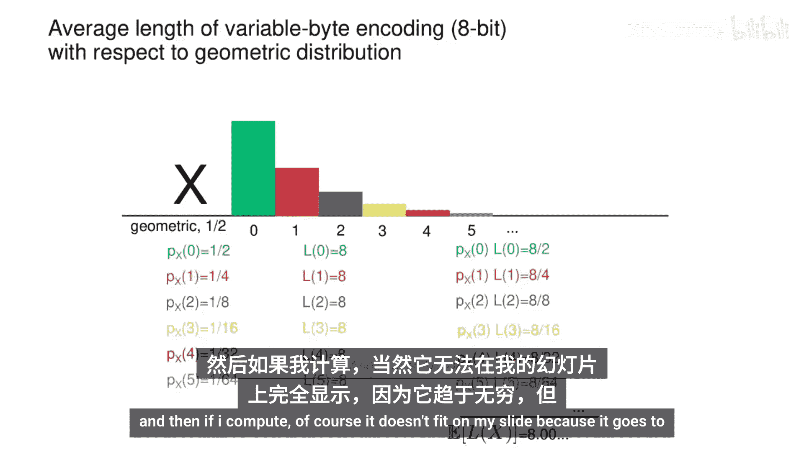

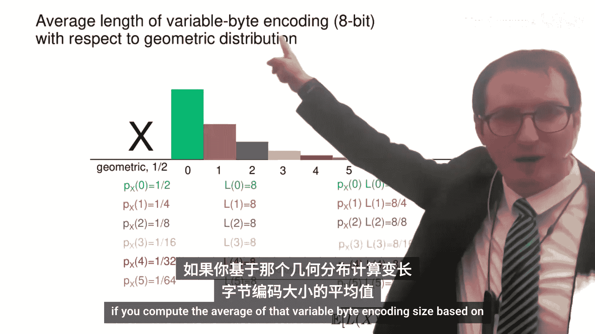

Based on that geometric distribution。

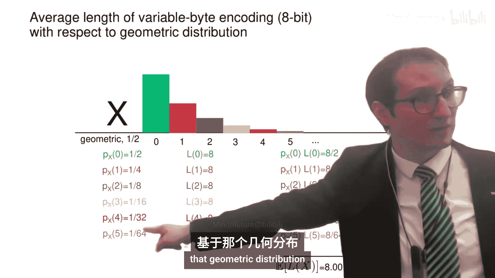

That gives me 0 8。00。 It's not exactly 8。 It goes higher because there's some 1632，64 in there。

 But they are so small that I'm still very close to8， right。Now， what do I learn from that。

If I use a variable by encoding for this geometric distribution。I have8 bits on average， per integer。

What is optimal， optimalti would be2。 That's the entropy。 So that gives me a benchmark。 Basically。

 the optimal is 2。 and I have 8。 So what the reaction is going to be say not so great， right。

 I could do2。 So8 is O， right， I can do it on 8 bit。 but it's not optimal。

 So you see how it's useful to have the entropy。 So you can compute what you actually have based on a specific encoding。

 And then you can compare it with the entropy to see how you how good you are doing as a benchmark。😊。

T。The gamma encoding。Instead of the variable length now。

 I'm going to use the gamma encoding on the channel between Alice and Bob。

 But I still have my geometric distribution right here。 I keep the same distribution。Now。

 you see the gamma encoding。 You remember that the length。

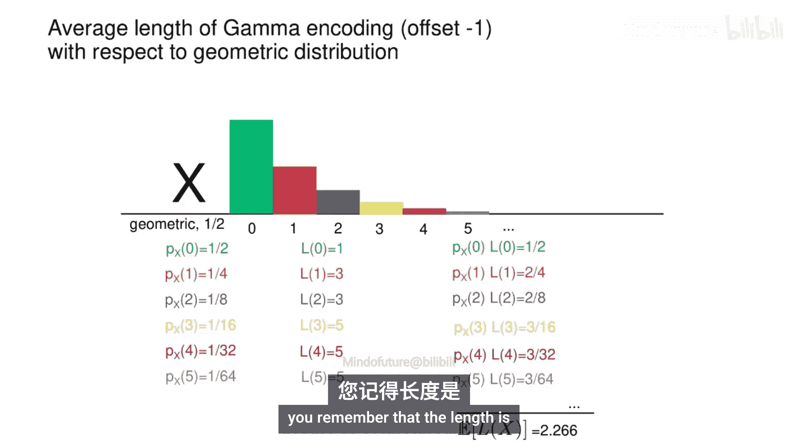

意思。1 and then 3 and 3， and then 5，5，5，5。 By the way， I need to encode 0。 So what did I do。

 I offset the whole thing by one。 Remember， that's my trick to also make sure I can encode 0。

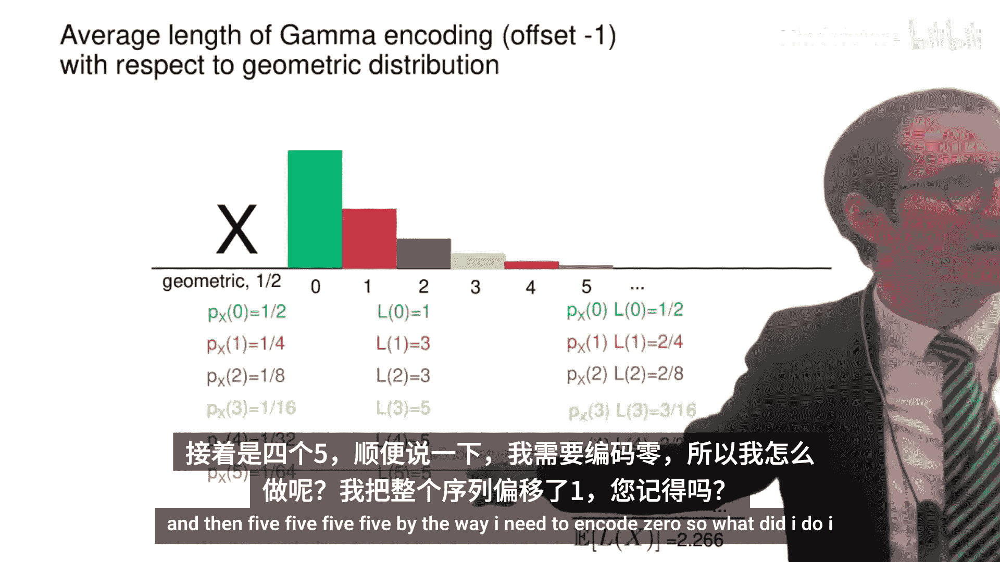

So the smallest gamma encod you have that's 0。 then you have 1，0，1，1，1，0，0，1，0，1 and so on and so on。

 right， So so sorry， that was 1，0，0，1，0，1。 That was 1，1000110011，1，0，10 and so on and so on。

 So that's my length for every possible integer。 Then I do the average of that weighted average with the probabilities。

 And I get 2。266。

That's better than 8， right？ That was O is。 Now， oh， this is good to terms times Pe 2。266。

 I'm close to 2。😊，So I'm doing well。What about the urary encoding， So surprise。

 The unary encoding gives you to its optimal with the geometric distribution。

 That's a fun fact that you can tell your friends is that it seems like a waste of space。

 this temperature， this thermometer encoding。😊，But it's an。

 it's optimal for your geometric distribution。It wins over anything else。

That there is a difference between the gamma encoding and the thermometer encoding is that the thermometer encoding。

 Yes， it's optimal with the geometric distribution， but that's pretty much it。

 It's not optimal for other distributions。But do gamma incoding。ForUp to a constant factor。

 it is optimal for any distribution。 Any of them is going to be doing very well。

 So this is why the gamma encoding is actually so nice。

 So here I took another geometric distribution that that just for giving examples that now is not based on one half。

 but on three quarters。 So it's powers of  three quarters。

 Now I find an average length of the geometric distribution of 1，34， which matches the entropy。😊。

The uniform distribution now you see it's doing less well。 If I use the unary encoding。

 then I have an entropy of 2。5 instead of two， right。

 So you see now the unary encoding is not so good。 And now if I computes the average length of my unary encoding over a uniform distribution between 0 and 1 million。

 then you know it's going to be absolutely terrible， right。

Because I'm going to have a lot of large individuals。 So you see， this is where it stops。

 The thermometer encoding is only good at one thing。 It's the geometric distribution period。

 the rest， it's not optimal， but the gamma encoding。And I'm going to end on that slide。

 is absolutely fantastic。😊，Because you have the guarantee that it's basically the entropy up to a factor of  three。

It's never going to be more than three times the entropy。 That is what we call a universal encoding。

 doesn't matter what distribution you have datataministic geometric uniform doesnn't matter。

 The gamma encoding is always within a factor of three close to optimal。Okay， who followed。Very good。

 So I'm going to， to。Let you go。 Maybe I can just check if you followed with my ear。

Restion right here。

I'm pretty sure I's going to。 I would put some sort of the error message or something。 Oh， no。

 it doesn't。 Oh， it worked， okay。

Alright， I'm asking because there was a bit of heavy math today。 I didn't get into random variables。

 but I， I， I will show you more mathematically in a couple of weeks。

 but just wanted to make sure that I didn't lose you too much。Okay。That is good。Alright。

 so thank you very much， everybody。 There is a great quiz this afternoon at 3 PM on compression。

 so you can get it' your second opportunity to secure the bonus points，2 out of 3。 The third 1。

 I think， is for the vector the， the， the。😊，Sorry。对。It may yes。

 exactly the third one is going to be later。 But if you have two out of three。

 you get the bonus points。 So if you already have the first one and you get this one。

 you're gonna have your quarter points。Thank you， Ja， for moderating。 Thank you。

 everybody for following this lecture。 Hope you enjoyed it。

 Enjoy the exercise session and see you next， next week。 Yes， right， It's not the vacation yet。

 So next week for the next cause。 Thank you very much。😊。

