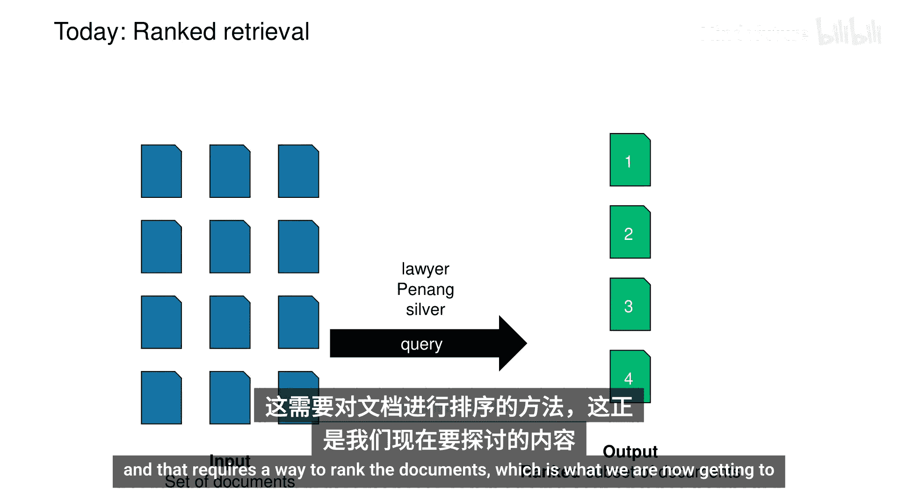
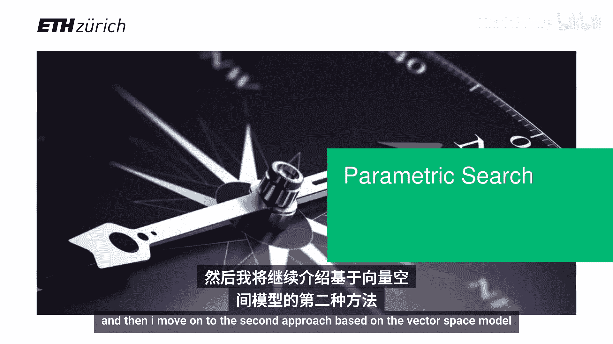
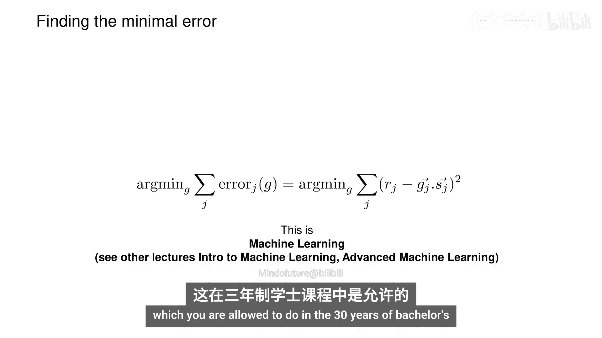
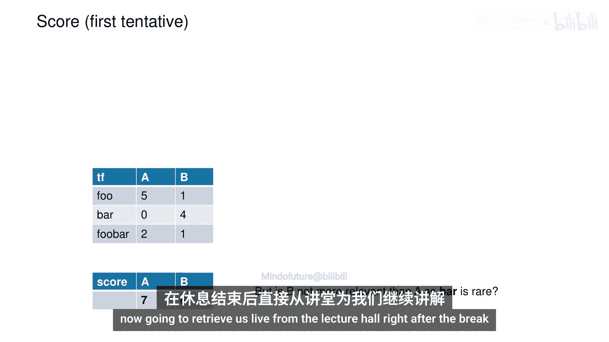

# 【苏黎世联邦理工学院】信息检索-｜-Information-Retrieval-｜-Eth-Zurich-2025-p17-P17_7._排序检索_(1_3)--BV1ndsBzdEss_p17-

Hello everybody， welcome to a new lecture of information retrieval so first I have to say that we forgot to activate the recording in the first hours two days lecture so that the recording is not available however。

 I am now regarding it again to also that you can also see what we have been doing this morning if you're watching the recording and just so you know there results also recordings from previous years。

 for example last year if you want to to watch a live lecture on the same topic All right。

 so first quick recap of what we have seeing so far so we cover the Boolean retrieval so we see that if the collection is a set of documents we have a query language that allows us to retrieve a subset of these documents based on end or and not。

We saw that in order to implement that efficiently we can use structure known as the standard inverted index with the dictionary on the left and the post exist on the right。

 we saw that the dictionary has an underlying data structure which can be a hash table or B plus3。

 hash tables are instance B plus3 are logariththmic but has the additional benefits that they can handle rangees of queries which is useful for whiteca for example。

Then we saw that we can have more kinds of queries including white card queries at the beginning at the end in the middle。

 both at the beginning or at the end， we saw that we can also do some spell correction by automatically finding for looking for closed welds。

And finally， we have price search where we can put a sentence a whole sentence with the order of wealth being importance between quotes。

We saw that for this phrase search we need additional structures so that expandends the standard inver index。

 One of the ways the byweld index where we have displayed in windows over the text with pairs of wealth that appear next to each other。

 of course， if this is a bit larger as an index， but it allowses you to。

And those some have phrase queries。And the other， the alternative way to handle search queries is to have a positional index。

Where we still have single terms on the left， however。

 we extend each posting with the exact positions at which the term appears in the documents。

Together with the number of times it appears， so for example two appears three times in document C at positions4。

 seven and 11。We saw that we can use three gra indexes in order to to。

Respond to white cat queries or do some spelled checking。

We saw that we can also map terms to term IDs because in the standard inductted index we know that posting is a pair of a term in a document。

 the document is just an ID and in the index the term is always the same on the same row so we just put it once on the left but when we built the index and we produce these pairs in memory that might repeat a lot so we can replace terms with the term ID to keep the pairs shorter in memory and this is what the blocked soft based indexing algorithm is doing BSBI which processes the collection in batches。

 produces all the term ID document ID pairs and then puts them back to this and then at the end we merge everything and build the index。

Then there is a second generation algorithm known as SpM or singlepain memory indexes， in that case。

 instead of producing intermediate key value pairs。

 we directly produce partial standard inarian disease that we spill back to disk and then at the end we merge them in linear air time。

😊，We saw that in real life the collection might actually change over time。

 so one way to handle this is to have an auxiliary index where we have the recent changes and then we have the main index that remains the same over longer periods and we periodically merge the auxiliary index to the main index。

And we've thought that there is an efficient way to merge existing indices with a logariththmic approach similar to the 2048 game where we try to do a logariththmic number of merges。

 every time doubling the size of the indices， so this is known as logarithmic merging or log structured merge trees。

 LSM trees。Then we saw that if we keep adding documents to our collection。

 the number of terms is going to keep increasing as well。

 the number of distinct terms and that increases in the square root so that is a surprise because we might have expected something with a horizontal S but that doesn't happen so if you keep adding new documents。

 the number of terms keeps increasing even though that increase slows down over time so this is known as another twist hips slow and it's causing tip flow。

 means that if you rank the terms by their popularity。

 meaning the number of times they appear in the collection， whats so known as collection frequency。

 then if you rank them by decreasing popularity， then the frequencies go in one over so some constant divided by the rank so it's a hyper and that's hips law。

We saw that we can compress the dictionary in memory for example this is what is called frontcoding so it makes it less spacecon than if you would just store all the terms and we saw that we can also compress the posting list on the right the first trick is to encode the gaps rather than the document ID themselves and that is because the document ID are increasing order so that the gaps are always positive the problem with that is that the size of the gaps might vary a lot so we need something elastic that can automatically shrink possiblemal numbers and grow with la known numbers this is a problem that has been solved by pet India so MIT a while ago known as the gamma encoding which encode every number by suppressing the leading one and replacing it with a sequence of ones and zero。

According to the thermometer encoding of the exponent in base two of the logarithm in base two。

 and that gives us the gamma code， the way you recognize the gamma code is that it has an odd size with a zero in the middle。

 only the ones on the left， and then the base two representation of the number without the leading one on the right。

We saw that the gammacoding is optimal for absolutely any distribution of the input， which is very。

 very remarkable within a factor of three。😊，So this is called a universal encoding if you take。

 for example， the thermometer encoding it's very bad for most of the distributions but it turns out that the thermometer encoding is optimal for geometric distributions。

 negative powers of two but it's not a universal encoding because that's pretty much the only distribution that the thermometer encoding is good for but the gamma encoding within a factor of three is optimal for any distribution that means that it's within a factor of three of the entropy of the distribution which would be the optimal size theoretically。

What I haven't shown you last time is what effect it has to be to use the gamma code and it's actually improving by a factor of four。

 so if you would store all of the post teamses uncompressed on 32 bit that would take 4 400 metes for a collection of 1 GBte。

 but if you use the gamma encoding of the gaps， then that's actually shrinking it to just 100 mete。

 so it means one of two things either the index takes less space or memory or you can fit four times as many documents with the same amount of index memory。

I strongly recommend that you read chapter5 on index compression as in every week because in case what I'm fitting in the lecture doesn't make any sense then you can actually get another angle from the book。

All right and now we proceed to this week's topic of interest which is that we are moving from querying with a Boolean query looking for a subset of documents to a newer kind of system where we are actually organizing the results in a ranked fashion。

 so imagine that in the old system I return a million documents and you throw a million documents at the user they wouldn't even know where to begin with these million documents right but if you rank the results then you can return the top 10。

 for example as it's commonly done with Google beinginggogo or search engines and that requires a way to rank the documents which is what we are now getting to。

A first approach to ranking is based on so called parametric search。

 and then I move on to the second approach based on the vector space model。

So in this first approach we basically consider still that documents are sets of wealth and can be encoded as vectors of Boans。

 however， we add something which is the metadata and actually if you go to a library or you look for books online you will notice that it's not just the full text of the book it's also the title。

 the authors， the publisher the number of pages， the language and so on and so on and so on that metadata in fact。

 is the very valuable and you can even offer a user interface to specifically search by metadata。

But you quickly realize that the problem of looking for the documents that match this query is a relational database problem really。

 because you can consider the metadata to be a relational table and every query entered in the form can be transformed to a SQL query。

 which is a simple filtering query on the field。嗯。And it turns out that in relational databases。

 we know how to improve these queries and make them fast and this is done with indices top price hash tables。

 B plus3， but this results in a very classical nuular implementation that you throw in DMDB which almost all of you attended already and it means that we build index structures as it is done commonly in SQL databases。

 and we use them in order to retrieve the resulting documents in the form of recordss， however。

 if we also include the full text of the books we can not only have these SQL indices that you see on the top of these slides but also the thought inverted index with the content of the documents and then you have something that is hybrids between good old relational database and an information retrieval system where you can combine。

Qury on the metada with a query， a Boolean query on the full text of the book。

It turns out that this kind of search can be used to give a prototype or。

A simple way to do to rank the results。 And the way you do that is。

By realizing that you can also have full text search on things like title author and that means that you can also have an additional standard inverted index so in that case not only the actual contents。

 the terms but also the title the author could be indexed with the standard inverted index so now you end up with three standard inverted indices plus the traditional sequence in this field on the top now we can merge this right why don't we merge the standardinverted indices in a single shared inverted index well here's how so Le make room on the left by extending a little bits the space for the terms and I'm going to add to every term the zone to which it belong so the zone could be the content。

 the body the title， the abstract the authors and that tells us where this term is to be found in the documents。

Now if we have several zones， then we end up with something like this to here I have the body and the title and the authors and I have now a posting list for every combination of the term in the zone right that's number one the first way of doing that and number two the other way is to still have the terms on the left but to put the zone in the postings instead of posting putting them in the terms and then you end up with the postings that contain the document I dis press the zones in which they appear。

So how do we use that in order to get scores here how when you have a specific term and a specific document you can compute a score by adding weights for all the zones in which the term is present so the weights would be in vector G and S is a Boolean that says yes it is in that zone or no it's not in that zone right so the zone weights are GI and the Boolean are in SI so what it results too in two is in fact that you sum up those GIs for which SI is true。

嗯。😊，It probably did not escape your attention that this is in fact the dot product。

 so you can also consider that GI and SiI are vectors。

 GNS and that you're computing the dot product of these vectors。

Very concretely assuming that G would be 0。3。2。5 and that's three zones tighter abstract in body。

And we compute the score of document1 for the query information that gives us just 0。5 because 0。

3 and 0。2 are multiplied with 0 because information is not in the title and it's not in the abstract and if we compute the dot product that gives us 0。

5 if we do the same for a document 4 for which information is entitled and body then we add 0。

3 and 0。5 because 0。2 would be multiplied with 0 because information is not in the abstract which gives us a total of 0。

8 and finally if we do it for body and abstract then we are going to end up with 0。2 plus 0。

5 because 0。3 is going to be multiplied with 0 because information is not in the title and that gives us a score of 07。

Now if we get discussed scores for every document which we've just computed。

 then we need to rank them and sort by score and the best result is document4 with a score of 0。8。

 then document5 with 0。7 and document1 with a score of 0。

5 so we have now a first ranked retrieval system that is going to give us an order in which the document are returns。

We can extend that to support multiple terms， for example。

 information and retrieval in that case we do the same thing not just for information but also for retrieval so we do that for every term and then we not only add across the terms but also across the zones and we get a grand total over the two dimensions of 1。

3。And。😊，I would like to note that this can be done efficiently if you remember the intersection algorithm that is used to implement the conjunctive queries and we can extend that so that at the same time we compute the intersection of the post exist we also compute the dot product by adding the the information for the further terms right so we can compute this dot product dynamically as we process through the documents to compute the the scores right so for example。

 if you process at the same time information and retrieval and you add document for then you are going to add all of that together from information and from retrieval to compute a grant total this in fact has the name it's called evidenceac because we accumulate the scores on the fly as we go through the posting list it's important that they'll come back to it later because that's also going to be important。

So the vector space model。Now I would like to open a small parenthesis to make a bridge to the introduction to machine learning costs which roughly half of you are currently taking because when to decide what that vector G is in order to decide those zones right I put this 0。

3。2。5 completely aarily but we can actually figure out what the optimal values are and when I say optimal then you probably start thinking of machine learning we could learn that。

In order to learn we did a training set and so we are going to assume that we have a training set with plenty of queries with every time a vector F of the zones that were activated by a specific term on a specific documents a vector of Guance plus R2 which is the basically telling me yes or no。

 this was relevant to a human being and that's actually something we did ask to a human being which is assuming you ask real people and in that case a human told us query EH on document A document A was actually relevant to me and so R2 would be one。

So then with this training set you can compute for every sample so J would be the next of the sample the dot product for that the sample and ideally that dot product should give you the the it should be one if it's relevant and zero if it's not relevant but that would only be in an ideal world that's not actually going to happen like that we only want to be close to it because that's only。

An approximation， and by close， we mean here the most classical method ever that you find in machine learning systems。

 which is the least sum of squares where we compute the difference between the expected relevance and the actual dot products and we want to minimize the sum of the square。

嗯。And if you do that you can apply machine learning techniques like a stochastic gradient decent or in some cases exact results that guys you don't even need a gradient de in the case of two zones you directly have the results you don't have to learn that of course by half andm just take use sometimes theres exact solutions sometimes you need to use specific techniques so some of you are taking intro to machine learning some of you asked this morning are also already taking the advanced machine learning lecture which are alloweds to do in the30 of bachelors so it's very very nice and now you can make that bridge between the two lectures okay parentheses closed now i'm getting to the weight。

And to another way of designing scores， which is using linear algebra。

So I'm going to now just make a little change instead of sets of wells we are going to consider bags of wealths。

 what does that mean it means that not only do I know which terms belongs to what documents。

 I also know how many times each term appears in a document。

And this number of times that the term appears in the document is known as the term frequency。

 for example in documents D who appears three times it's a bag so it repeats three times bar appears twice and full bar appears twice I insist that the term frequency has two parameters T and D you can see it in the sub it depends not only on the term that also on the document if you take another document is going to be different it turns out that we've already seen the term frequencies before and in fact we have seen them in the positional index if you remember in front of the positions we also have the number of positions that the term appears that was the term frequency that is exactly the same thing that we are talking about right now and you can see they appear for every term and every document。

So we can try to use term frequencies like this to compute score。

 so why don't we just add the term frequencies for one document across all terms so with thumb over the terms。

 the term frequencies5 plus0 plus two gives us seven， one plus4 plus one gives us six。

And that is going to give us a score of7 for a6 for B。

 so a wins and comes in position1 and B comes in position two。

But we can make an argument that that's not actually great because if you look closer you notice that the term bar seems to be rare。

 of course it's a very small sample so it's a bit of an exaggeration but it's rare on that sample because it only appears in B but not in a so you could argue that document B is very。

 very specialized in bar compared to document A and here the thinking and one of you gave the correct answer this morning is that we can put weights on the terms and give a higher weight to bar because it's more rare that who or than full bar so then we can try a new weighting scheme that is going to to be an improvement over this one and now we have a cliff finger which we kept for the break and you are now going to retrieve a live from the from the lecture or right after the break thank you very much。

