# 【苏黎世联邦理工学院】信息检索-｜-Information-Retrieval-｜-Eth-Zurich-2025-p18-P18_7._排序检索_(2_3)--BV1ndsBzdEss_p18-

Welcome back， everybody。We noticed that within record in the， in the first hour。

 So you in the lecture hall and you on Zoom will have been the only people ever to to。

 to have seen this。This， this lecture。 So I'm just going to redo it in the next hour。 And that way。

 we know， I'm joking。 I will could just continue， so。

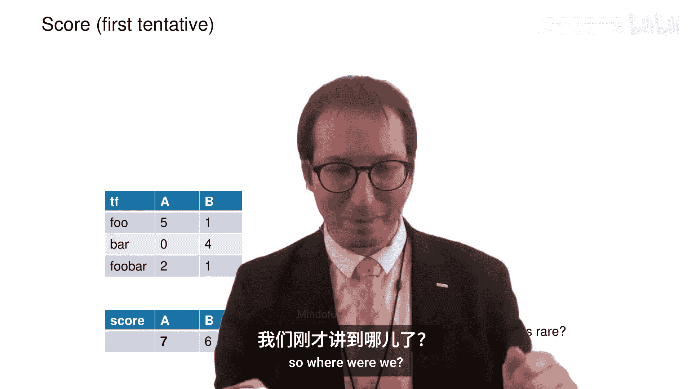

Where will we。We had the observation that you made， and that is correct。

 that we could add weight to fu to bar and to fu bar。

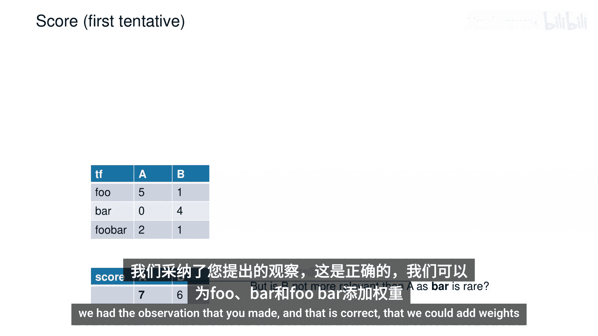

And that should improve the problem that we have here， which is that bar is rare。

 and it's not doing justice to be that it's not the first document， right。

 because we should have more weight on bar。 So your remark is absolutely correct。

 And this is what we are going to do now。

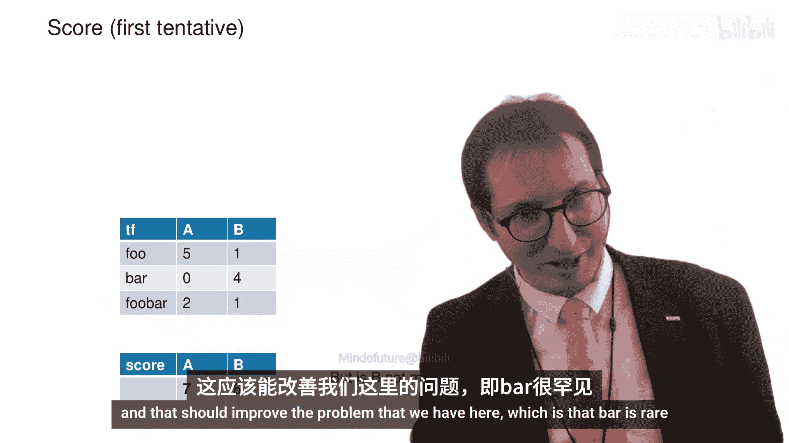

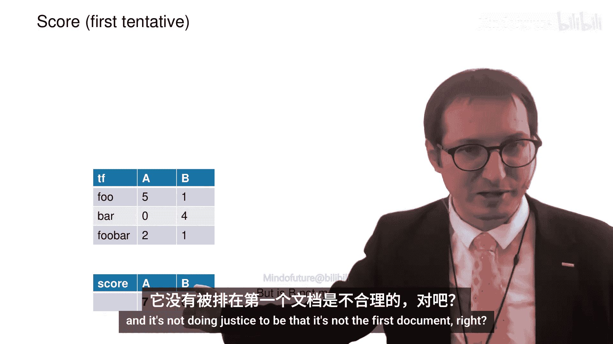

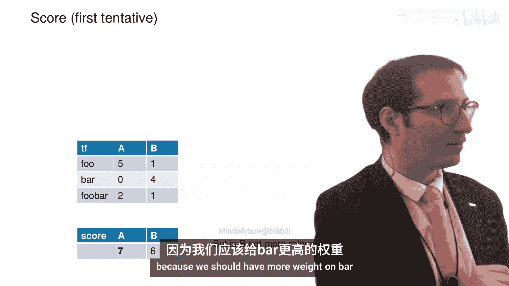

So what kind of weight。

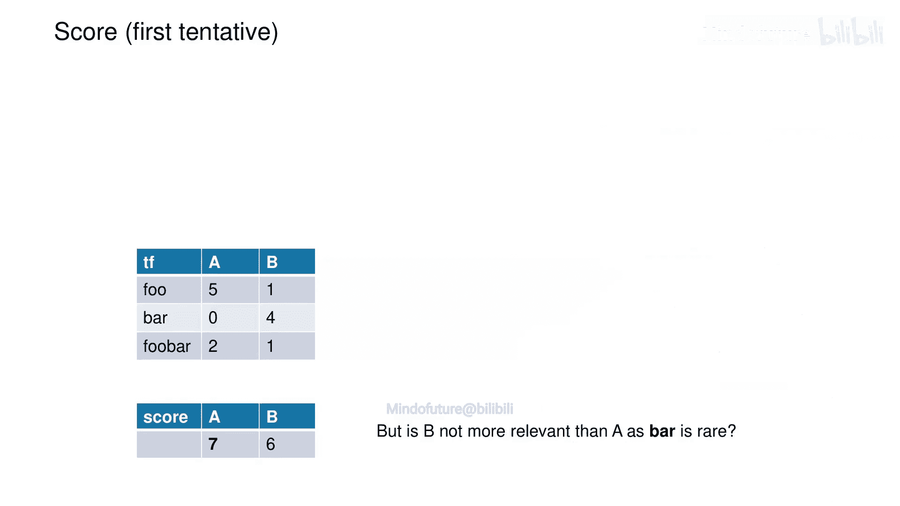

Good we。Use。

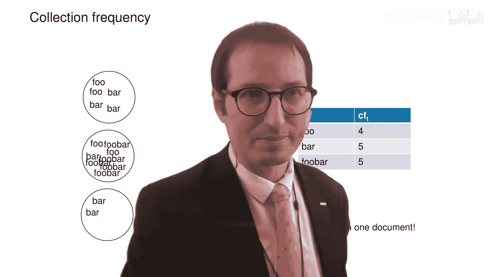

What you might think of the collection frequency， That is the number of time。

 the number of times that term appears in the collection。 That's how where it is， right。

 or how frequent it is， right？ So， for example， if we look at this collection of three documents。

 And at the three terms fu bar and fu bar， we notice that term fo appears four times in the entire collection。

 you see it's。

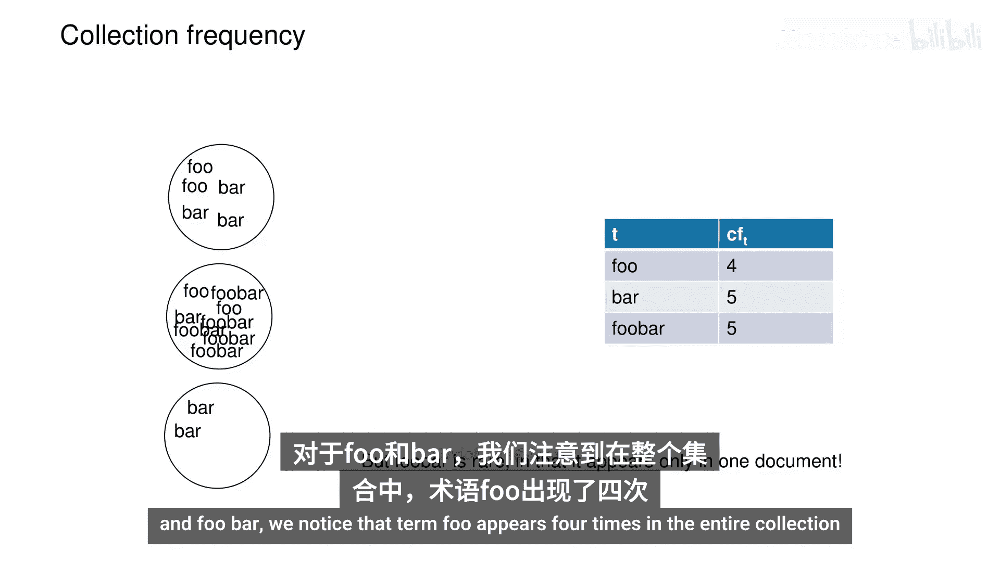

1，2，3， and4， right， So that swap times bar appears  five times 1，2，3，4，5。

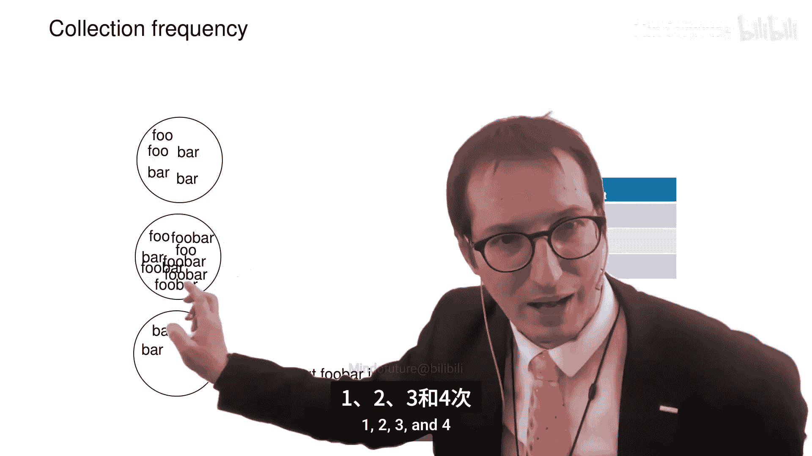

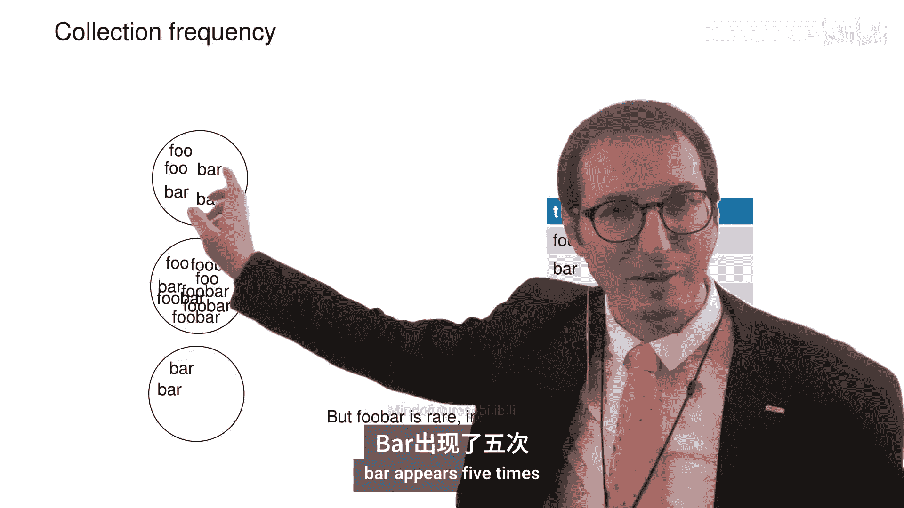

And Fu bar appears  five times 1，2，3，4，5， right， So that would be what we call the collection frequency or5 and。

fi。Who has already seen the collection frequency somewhere。Who has seen it in this lecture。Yes。

 you have indeed。We saw it here。 Yay， one last thing to learn。 That's again。

 the same thing when we were actually looking at tips slow and sorting the， the。😊。

Tms by decreasing number of occurrence， we were actually referring to the collection frequency。

 right， So by decreasing collection frequency， that gives us sips low。

So now that we know we are just using something we also already knew。

 We could have a few objections to this way of computing the weight with the collection frequency。

Because in that case， the most or one of the most frequent terms is fu bar， because it has five。

 That's the maximum number of times it appears in the collection compared with other terms。 However。

 what do you notice about fu bar。It's all in one document， it's in document 2。

So what you probably are looking at here is maybe this is a highly specialized term。

That only appears in specialized books。 And， and so pro probably book number two。

 document number two is some document on Fubarology， right。

 And it's specializing into explaining Fubar。 So maybe fubar is actually rare。Right。

 maybe it is actually a rare term because even though in the specialized book on full biologyr。

 it appears all over the place。 But there's only a few books that actually have the， the。

 the these term。 So maybe that's still not entirely satisfying， right。

 maybe the collection frequency still is not the way to go for the terms。 But still， you know。

 it's called collection frequency， You know， that's the same as in C slot。

 And so you can compute who could compute collection frequencies。

 If I give you other collections or documents。😊，Would be able to do that。Okay， very good。

What could we use then not to to weight， not the collection frequency。

 What other frequency do we have。Anybody on Zoom？Yes。李。The document frequency， exactly。

 we are going to use the document frequency。That is the way to go。

 So the difference between the document frequency and the collection frequency is that now we are not counting the total number of occurrence in the entire collection。

 We are counting the number of documents in which each term appears。 So it means that in that case。

 fo， even though it appears four times in the collection appears in two documents documents one and2。

 bar appears in all three document 1，2 and3。 So its document frequency 3。

 and fo bar appears in only one document very rare。 So its document frequency is one。

Something incredible is that you have also already seen the document frequency right here。

 These are the purple boxes in the standard index。😊，Right， so the term frequency。

 the collection frequency， the document frequency， we are just linking it to other parts of the lecture where you've seen them。

 So they are not new for today。 But now we put them the three of them together in。

 in the perspective of， of ranked search。 Allright， so these purple boxes are document frequencies。

What can we say here， when we can say that fu bar is very rare， actually。

 that's the rarest that you can have。 Well you could tell you， okay，0 would be even rarer。

 But if it's 0， you don't even see it anywhere， So it wouldn't even be in your index， right。

 So when is actually the rarest。 And then bar is the most frequent of in fact。

 bar is probably a stop world。 It's probably V or A or E or B。

 So somewhere that is very very frequent。And。Fubar is probably a very rare term， Like。

 I don't know sequi are， right， So it's very， very specialized terminology。Okay。😊，But for the wait。

That's not exactly it because we could use the document frequency as a weight。

 But do you see here that。If the document frequency is very high。We would like the weight to be low。

 right， So the direction is not right。 The， the direction of the document frequency is not right。

 We need to invest that。And we need to literally inverse that by taking the inverse of it。

 So we are going to， to do one over the， the document frequency。 And then we， the order is， right。

But we are still going to do a bit of tweaking right here。 So not just one over， but we are， in fact。

 going to take。3 over。The document frequency， it's just some kind of renormalization。

 because then it's between 0 and 1， right。 So 3 over y 3， it's not a magic number。

 It's the number of documents。 right， I just count the number of documents。

 And then I take the number of documents divided by the number of documents in which a term appears。

 So now， if three over the document frequency is one。 then it needs it appears in all documents。

Right， so that's that's the。That that's basically a frequent term。

 And if3 over the document frequency is equal to 3， it means it appears in on， in only one documents。

 right， So it's it's， it's higher。By the way， I said nonsense， it's not between 0 and 1。

 It's one or more， right， It can go all the way。 It's it's between one and。

The total number of documents。Okay， who agrees with that。Alright， so now it's in the right direction。

 right？ We are going to have a very low n over the F in the case of the frequent wells and a very high n over R D F in the case of where wells。

 But we are going to do one more thing。 we're gonna take the log of that。 just the logarith to， to。

 to remove a bit of that the， the， the influence of the very high numbers。 Why because。😊。

If you have a document with 1 thousand00 times the term and  another one with 2000 times the term。

Probably you don't want to make a difference of 100 between the two， Right。

 The difference between 0 and 1000 is enormous， right。

 not having a term at all and having it a thousand times。 That's a huge difference。

 But having a term 1 thousand times or 200 times。 that's no longer a big deal anymore， right。

 That's what the log does。 The log is going to， to， to amplify。

The differences for from nothing to something or small numbers and。

 and disempplified the the differences between very high numbers。

 So log of n over D F is the formula for our weight。

 And that is that has the magical name of inverse document frequency also known as IF。

Who has already seen I DF。Right， you might have seen it。 So it's， it's or TF I DF。Maybe some of you。

 al right。But I come， I come to that。 So inverse document frequency， I D F。

Something that I also insist on because we have term frequency， collection， frequency， document。

 frequency。So it's easy to confuse them。A reminder that the term frequency is bi dimensionional depends on the term end documents。

But the collection frequency and the document frequency are uni dimensional。

 They only depend on the term。They do not depend on the document because it's aggregated over the entire collection。

 So D F only have a subscript with T and not with D， right， the same for I DF。

 It only depends on the terms。 So one dimensional。 and is one dimensional gives us exactly what we want。

 We have weight for our terms。So let's go back to where we were with the example that we wanted to improve with fubar and Fubar were right here。

 And now we have our weight that we computed。 So you see how I computed them right， So this is3 by2。

 that's 1。5， we take the log of that3 by 3， That's 1 and the log of one is0 right。

 And then the fubar3 over one， the that's3 and the log of 3 is1 over 1。

1 right So if you take the log now it's no longer one or more。

 it's 0 or more when you when you take the log of one or more。Alright， so I have fo bar and Fu bar。

 And you see that the world is in order because fo bar is。Sorry。Fu bar is， what did I do here。

 What kind of。I think I probably just generated new numbers that have absolutely nothing to do with with what we with what we have here Anyway。

 just forget that the previous example， maybe I should redo the slides by taking the same numbers。

 But anyway I just made up some numbers in there that have nothing to do with the previous slide。

 And that gives us who bar and who bar。 And I did it in such a way that bar which is rare has a very high inverse document frequency。

 We give it more weight。 So who has a weight of5 bar has a weight of 10 and who bar has a weight of 3 And what I'm going to do now is multiply horizontally。

 I'm going to multiply every line in here with the corresponding number in there。

 So all multiply by 5 that's 25 and 5。 Then line 2 I multiply everything by 10。

 So thats 0 and 40 and line 3， I multiply everything by3 So that's6 and3 Who agrees with that。

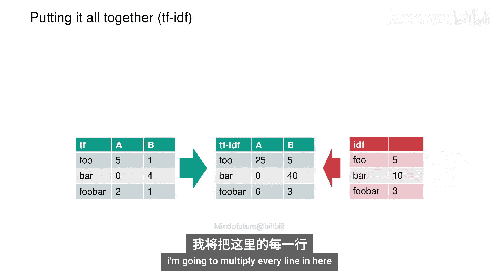

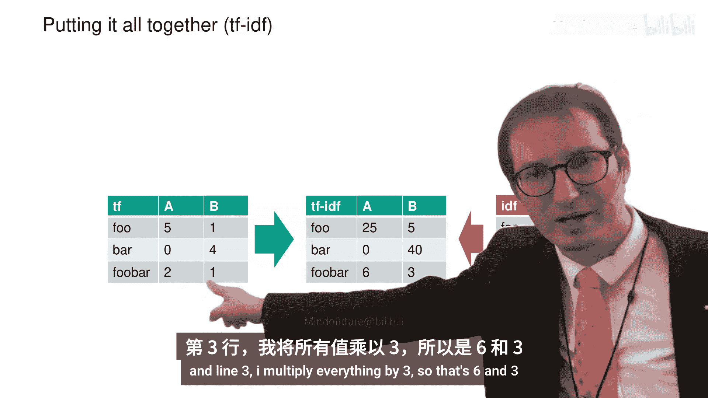

Now， quick question。 If I give you a collection of terms like displayed like this。

 like what you see on the left。And I ask you to do that， to basically compute the term frequencies。

 the I D Fs and the product。 who would be able to do that。Right， so you can try it as an exercise。

 but it's very mechanical， right， That's just what we do with this。So now we have multiplied T F and。

Idf。And that gives us what we call the T F I D F， right， And that's something you might hear。

 a lot of people say T F I DF as almost a new world。

 They basically mean the weight of the terms and document pairs based on the term frequency and the inverted document frequency。

 That is how they really contribute to the score。 High term frequency contributes higher。

Les cell document frequency contributes higher。So now if we want to now compute the score。

 we just computes the sun。So we have a total of 31 for a。And a total of 484 B。 And now B is winning。

 which is what we wanted。Right。Who understood what happened。 And now why suddenly bes weing now。

Right， it's these weights that changed the thing。 So now we consider that if a rare term occurs in the document。

 that is a big deal， right， So we want to put more weight on it。

 So that is known as the TF I DF scoring system for for。Information retrieval。But now。

 the difficulty is to implement it becauseuse it's one thing to do the math and to put numbers on the slide。

 But it's another thing to actually implement that in real life， because。

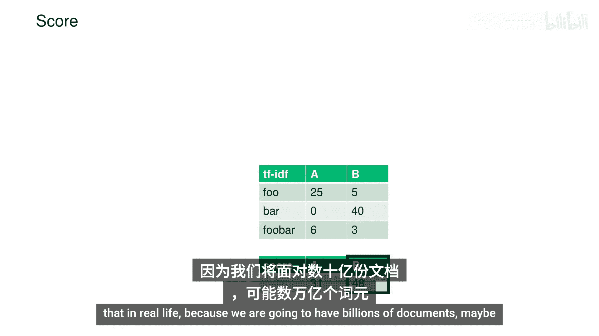

嗯。We are going to have billions of documents， maybe trillions of documents， maybe not of documents。

 maybe trillions of tokens and millions of terms， right。书。

There is one thing that I keep telling my masters students is that be。

 before rushing into the implementation of that， which might be very tempting now。

 because you know how to do it， you have to sit back a little bit and think about it。

What better way to think about something than to do some mathematics， right？

 So now we are going to look at it mathematically and try to abstract a little bit with the the power of the mathematical structures。

 And we are going to invoke a mathematical structure that I assume you have all seen in linear algebra。

 which are vector spaces already so vector spaces。 I assume all of you， right， okay。😊，嗯。

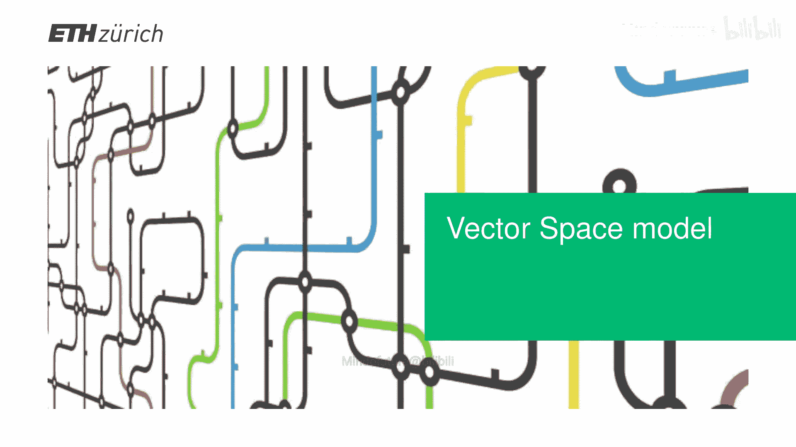

So。In the old system。We had documents that are list of wealths。

 but we abstract them and simplify them as sets of worlds。

 And we saw that with the set of wealth symimmantics， we can see documents as vectors of Booleans。

 right。Now we saw。 And that's for the advanced knowledge that for those of you who were bored。

 I put in the Moder that this is not technically a vector space。 It's more like a。

 more like a module because then it's not， it's not a ring。 it， it， it has less of a structure。

 but you can still make the vector multiplication in the matrix multiplication work。 So it's。

 it's not exactly a vector space， but。Can be manipulated like them， right？ So basically。

 we have vectors of bulloleans。So they look like this。 now I so here， I just put it horizontally。

 but it's maybe be more usual to put the vectors vertically。嗯。So， the idea is that。

We have terms or words。 I just use them a bit interchangeably right here， terms and words。

Every position right here。In my vector， in my vector space， every coordinate。Corresponds to one term。

 maybe this is computer。 This is information。 This is E T， H。 This is system。 This is Zuric。

 This is retrieval。 This is Sequi A R。 and this is Fubar， right， So this is。

 this gives us a vector of bullance set of world semantics。

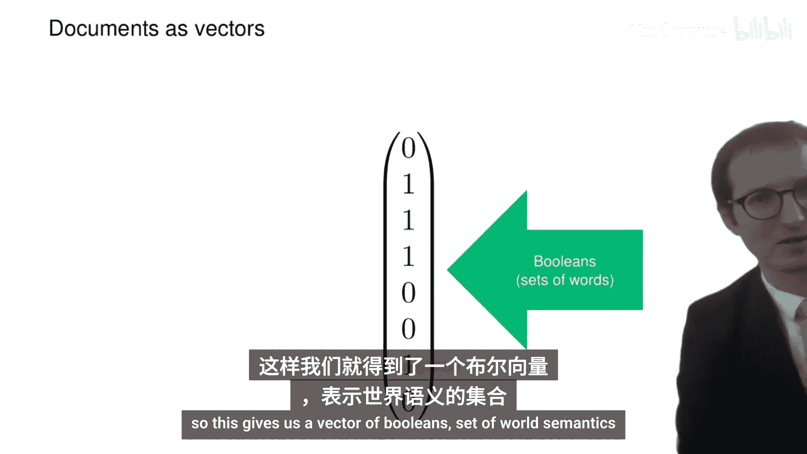

Now， if we think a little bit， now， this is a document。 It contains four terms。 right。

 What if we consider a single term， just one term。Do you agree。

 I could represent that one term as a vector， right。

I would just put zeros everywhere and just the one that corresponds to the term that I'm referring to。

 right？Now， where would they be in the vector space， These vectors that have zeros everywhere。

 except a one somewhere。Can do you visualize them in your head。Try it in two dimensions。

 one dimension， two dimension， three dimensions。 probably you saw something like this， right。

 in two dimensions。 I have 0，1， and I have 1，0。Now， if I generalize that to three dimensions。

 it looks like this， right， I have 0，0，1，0，1，0，1，0，0。Right， so it looks like a triangle now。

 So now it would be just a， just a line。 Now it's a triangle。嗯。

Who actually knows the generic name format that If we go to higher dimensions， how triangles。

Al Gia released。Have you ever heard of that。Start with an S。Simpplex， exactly。 that is the world。

 It is a simplex。 So， in fact， terms can be seized as the verticess of a simple。

 ver simplex is just a triangle， but generalized to higher dimensions， right。嗯。Alright， I have this。

 Yeah， that's it。 So if you want to visualize simplexes， they look like this。 So on the。

I didn't do that。 I took it from， from Wikipedia。 Give the credentials here。

 So dimension 0 is just a point。 dimension 1， it's a line dimension 2。

 It's a triangle and dimension 3 is's a T Pea headron， right？

 And then you can imagine in higher dimensions。 So that is called a simplex。Alright。

 so terms would be the verticess。Other simplex。Now， what about documents？

Where would the documents be， So that would be the terms。

 You could also consider that the documents containing exactly one term would basically be here， too。

 But what about general documents that could contain any number of terms。

 Where would they be not on a simplex， but where。That would be more than just the simple。

If you can directly give me the fancy name for that， that would be amazing。

 Let's see if you figure it out。 Where would the documents be。😊，你的不良。Sitting。😔。

Vectctorors that have zeros and ones， basically。Imagine it in two dimensions， three dimensions。

Who see it。W， who sees it and is too shy to answer。 And I promise I will not ask。Not even that。 Okay。

 let me show you then。 Let me show you。So that is an example in two dimensions，0，1，1，1，1，0。

 I could have put 0，0。 I mean， that would be the empty documents。

If you're strictly speaking of a mathematician， you do want to consider the case of an empty document because all the special cases are important。

 So I could even have put 0，0。But where are they in two dimensions。

 They are basically the 30 Cs of a。Square。Right。In three dimensions。 now you see it's a hypercue。

 right， I just put four of them， but there would be8 of them。 right， Do you see that it's a hypercue。

 It's the vertices of a hypercue。 So this here is where my documents are。

 If I use vectors of Booleyanance， right， individual terms， the simplex。And。The documents in general。

 there would be on the vertices of a hypoce。 So it's good to visualize that， right， to。

 to start visualize that in， in space。K。That is the for visualizing syntes。 I think for hyper cubes。

 I don't need to do it because it's something maybe more， more natural， right。

 that would be a dot line， a square， a cube than a hyper cube and so on。Okay。So having said that。

 that was the vectors of， of the Booleans。呃， now。We are going to go ahead。And use back。Of the world。

 instead of the sets of wealth。And the thing that changes is that now my documents are vectors of numbers。

 not just necessarily zero and1， but any numbers。Now， you might wonder why decimal numbers。

 because if it's a bug， this would just be intes， right。

 But we'll see how it can actually be real numbers because we are going to renormalize。

 So that's where these decimal numbers are going to。 real numbers are going to come from。

 But basically， we have documents that are now vectors of numbers。 right Any numbers。No， right。

 Just real numbers and non negative。 I'm not going to have negative numbers in there。

 Do you visualize all of these vectors that only have non negative coordinates。

 Do you visualize it in your mind。RightThat would be， so we go from here to here。

That would be the first quadrant。Over the。Real vector space， right。

 in the plane that would be basically the top right path。 But you can generalize in 3D，4D and so on。

 Who sees that。嗯。Technically， that is also not a vector space。 If you just take the first quadrant。

 it's not a vector space。 It's a module。 Again， you， you will， because then you， it's R plus。

 So that's not a ring。 It's a semi ring。But what interests us is you can still do metrics multiplication scatter product and。

 and so on and so on。 So this is why we don't mind that it's only the first quadrant and that it's not the whole vector space。

 alright。😊，I wanted to show that size too said， yes， we go from Boolean to numbers。

 And what number are going， are we going to put in there， We are， in fact。

 going to put preferably the TF I D F that we've seen earlier。 Now。

 you know why it's not integers because the TF I D F can be any real number， right。

 because we took a log somewhere， logarithm。P on intervals。Who sees that。😊，That because it's TFIDF。

 it's not going to be just the intelligences。But I should emphasize one thing。

 even though TF IDF is the most popular ever， that's kind of the textbook way of implementing such a system。

 it's not the only one。 There are other ways of putting weights in there。

 and I show you at the end of this lecture probably next week， the other ways。

 but I'm going to use follow purpose of this lecture TF IDFs because that's easy to understand。

 I really explain it to you。 So yeah。Some people might do it with just the term frequencies。

 For example， they might not want to multiply with the the IF。

 Some people don't want to take the log and so on and so on。Okay， so now that we have seen that。

 we are now visualizing our documents。In the first quadrant of some vector space of as many dimensions as terms。

 You know， it's big M， right， for the number of terms。 So it's r to the power of M。And yeah。

 so just the first quadrants。Now， you can see them as points or you can see them as vectors。

 right in that， in that vector space。 So now。I hope you see the power of that， because。Technically。

 what we did is we had books that you just hold in your hands that have words in there。

 And now these books， we abstracted them away so much that these are just vectors in some vector space。

Right， that's the power of abstractstruction。 Now we have our documents there。

 and we can start manipulating our documents and our querying system with that vector space and with these vectors。

😊，嗯。So I'm going to， yes， I'm going to use the the as many coordinates as termss X1 x to all the way to X M。

 I put a little row on top of X in the literature。 You might also want to find them in bold instead of the。

 thearrow is just a matter of convention。嗯。And so once you have a vector。

 one of the first thing you want to do。 I mean， I don't know you。

 But what I want to do is compute its norm。Like how far away it is It's a weird thing to do。

 But anyway， let's compute the norm of the vector。 And here we already saw the dot product of bit earlier that now I know。

 you know， if we do the dot product of it with itself。 and then we take the square roots。

 That is actually a norm。 That is known as the Euclidean norm， right， And that you've seen before。

 You know， the Euclidean norms。 It's not the only one。 there's other norms， you could say。

 for example， the sum of the absolute values of the coordinate。

 or you could do it with the cube instead of the square。

 You could also take it to infinity and take the max。 I mean， there's plenty of ways to do that。

 But this in particular， is the Euclidean norm。😊，Alright。

 so that tells us how far away it is from the origin。 So now that I have taken the norm。

 I can renmalize my documents and bring it on the unit sphere。Right。

 so it means that whatever document I have。I can bring it to the Uniphere。

 So now what's new is that instead of having。Documents on my hypocu vertices。 Now。

 my documents are any points on the of the unit sphere of my vector space。 That is two dimensions。

 It's just a circle in three dimension， it's a sphere。 And then in higher dimension。

 it is just the generalization of that， right， All the vectors that are at a distance of one of。

 of the origin。 So I renormalize them。Now， several things。The first thing is， why does it make sense。

To renormalize the document， because in a way， it would mean that the norm of a document doesn't matter。

 What matter is the orientation of the vector， but not the length of the vector。

Can anybody think of a。Intuitive argument or an intuitive argument on why the norm of the vector doesn't matter。

Okay， then let me give you an example。 Imagine that。I take。I don't know a book。

 Let's say a deception points by Dan Brown。And I do something illegal。

 meaning that I copy it over and over and over。 I just write a new book that has 10 times the entire contents of deception point。

 And then I do it with 100 times 10 times。 And now I sell to when I shouldn't be doing that？

 But anyway， let， let's do it with something that is not copyrightated like shallow conbs。

 I take shallow cons， Pri it 100 times。 And then I I put it， Fox said。

 do you think anybody is going to buy that， Is there any added value of bringing it 100 times instead of just once。

There is none， right， It's exactly the same thing。 There is absolutely no added value or information by just deuplicating the book。

 Who sees that。The original book。And the duplicated book。Correspondence to two vectors。

That have the same direction。They just differer by a sca factor。 That's what happens。

 So you can imagine that this reuralization thing is more。

 is more like just if you duplicateate or deuplicate the book。If you think of it。

 the direction of the vector。Where is you。How the terms are frequent relative to each other。

You basically remove the absolute values of the number of terms。 It's just the ratios of。

 of how the terms appear， right， So that's how how you see it。

 If you multiply the vector by a scholar， that's the duplication of the book。

 And if you just normalize it， of course， you cannot deuplicate a book or maybe it would be impossible to read。

 But basically， you get an abstract representation of the book that forget the absolute values and just keep the related frequencies。

 for whom is that here。So it means that normalizing in this way actually makes sense。

The second thing I want to say just to be complete， pun intended。

When we have a N product like that and a space that is complete， You know how it's called。

So's within H。A hillbert space， the same ones we have in the quantum physics。 So we are in here。

In a Hillboardt space。 and we are living on the unique sphere of the Hillboardt space。

 This is where our documents。Or。Concretely， if you take the TFIDFs。

 you do one more step after the TFID Fs， you compute the normal divide， So you renormalize。

 and then you get something that looks like this。 You can check。 I think this1 I did that actually。

 I computed it。I'm not sure anymore， but normally the， the norm should be one。Okay。

 so now we have our documents on Uni。 What are going to， we going to do now。

 we are going to pursue this intuition。 When I said， if I duplicate shallow cons 100 times。

 it's actually。Keeping the direction of the vector， but just changing its length。

Who would agree then， that。If I duplicate a book and rena formalize。

 that will be the same point on the unit sphere。Right。

If I give you a shallow comess and then duplicated 100 is the same point。

 What that tells us is that the same point on the unit sphere is basically equivalent documents。

 They are essentially the same， not exactly the same， but essentially the same。Now。

 what characterizes a points。On the unit sphere。Do you agree。

 It's more or less only a matter of angers。Right， who has already seen Pol coordinates。Right。

 so in the plane， for example， if you take a complex number。

 you can express it as r times E to the power of I theta， right。

 then you can have the radius and theta， the angle。 You can do it in 3D。

 Then you also have the length。 And then you have you typically use phi and theta， right？

 So phi tells you how it rotates like this。 And theta is from the Northpo， right。

 just like longitude and latitude on the Earth。😊，So what I want to say here is that if we remove the length out of the picture and we look at polar coordinates。

 we are looking at angles， Phi Theta and whatever angles make sense in higher dimensions。

But more precisely， if now I look at two documents， not just one documents， but two documents。

Do you intuitively see that the angle between these two documents are going to give us information of how similar these two documents are。

Right， this is the intuition， the angle between the two。Now。

 how do we compute the angle between two vectors in a hber space。

Or let me help you The cosine of the angle。Yes。😊，Exactly。

 we take the dot product and the dot product of the normalized vectors is going to give us the cosine of the angle。

 So the dot product that is the same formula。 we've seen it so many times today， the dot product。😊。

So if we randomorize the vectors， the dot product gives us the cosine of the。 Who agrees that。

 you know， right， You should know from B4， okay。So that's great because now I can just do some math。

 You know， some， some cooking recipe out of vector space and Hillbert space， magical formulas。😊。

And it spits out some number that tells me how similar documents are。 It's magic。 All right。

 If I just give you the original books， you cannot do that， right。

 I give you shallow combbs and Dan Brown and ask you what's the distance between these。

 You cannot tell me， right， But if you convert these books with their contents to the vector space and you compute that product。

 now you can tell me。 So there is the number I would there。

 that tells us how similar Dan Brown and shallow combs are。 right， So that's。

 that's the power of math。 And that's exactly what we need for information retrieval。😊。

So the cosine of the angle we get with the dot product。 So now we start seeing that。

It's the dot products of the vectors that are going to be important to us in year。

 So that gives us the simitudes， similarity between the two do。 I don't actually。

 if simitude actually exists in English。 Maybe it does。 similarity。 So intuitively。

 these two documents are very similar。Right， because they get normalizedized to almost the same point on the。

 on the unit sphere， very small angle。 And these are very different documents， We agree。

But now I'm going to go an extra step。Because not only the documents。Are vectors。

But if you think about it。Where is our vectors to。If the query you enter is just like in Google。

 you just enter a few worlds， even in natural language。 like when you copy past on error message。

 my query is a vector。The same in an LLM， if you write in chat GPT， that ends up at a vector。

 So now that's actually now bringing us closer to that direction。

 And maybe you start seeing where this is going。 If my documents are vectors and my queries are vectors。

 too。😊，Do you see it， Do you see how I can now execute the query and give you the results。

 Who can tell me。Normallybody you should already have everything you need to answer that question。

 who can build a system。Is he any sense。Anybody。On zoom。Who knows how to build it。

 But he's too shy to tell me。Okay， but I promise I would not ask when I ask that。 I don't。

 I don't actually ask because otherwise， you will no longer raise your hands if I ask it again。

 Alright， but I know， you know， I know some of you know what you mean。 So I'm going to get to it。

So now I put the queries as yellow and the documents as blue。

 But now it's very powerful because I'm saying the queries and the documents。

 These are the same things mathematically。 These are just vectors in some in the first quadrant of some vector hibo space。

😊，All right， and now you see。If that is the query。The the yellow point here。

Then probably this document right here is going to be top in the rankings。 right， Why。

 because the angle is very small。 Remember， it's the angle， not the distance， right。

 I'm interested in the angle。 If you reorganize everything， they will be almost the same。

Who sees the results of that  query？ If you have to rank them。

 who would be able to give me the ranked results。Right， probably then next would be， oh。

 I need a details。it right here。 We can figure it out with next。 have this right here。 So let's try。

 So we need to。 Oh， no， it doesn't project on the screen。 Oh， that's， that's sad。 I。

 I was hoping that somehow it would actually。

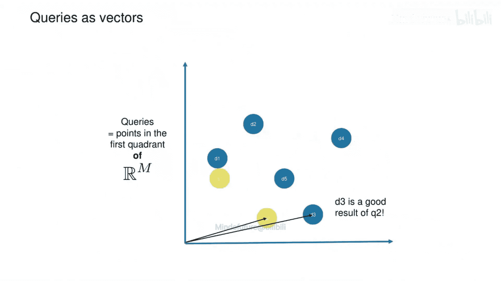

Let me let if I put my， Yeah， I I， I can know roughly where it goes， so。Like this。 The line。

 I just want to see who wins。 I think D 5 wins， Who agrees Ds with over wins over D 4。 So we have D3。

 We have D 5。 Then we have D4。 Then we have D 2， and then we have D 1。

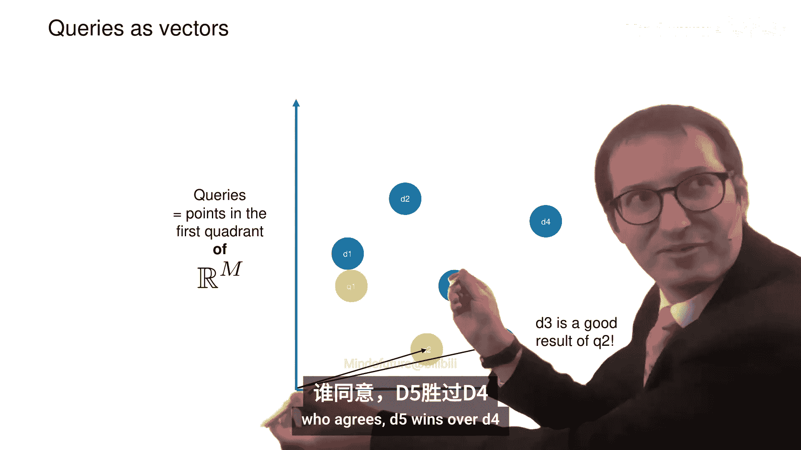

Do you see how powerful this is， We converted to documents to vectors。

 and now we computes the dot products， and we just rank them the。😊，Higher the cosine。

 the closer to one， the， the higher in the results and the farther away， the lower in the results。

 Isn't that a great feeling。😊。

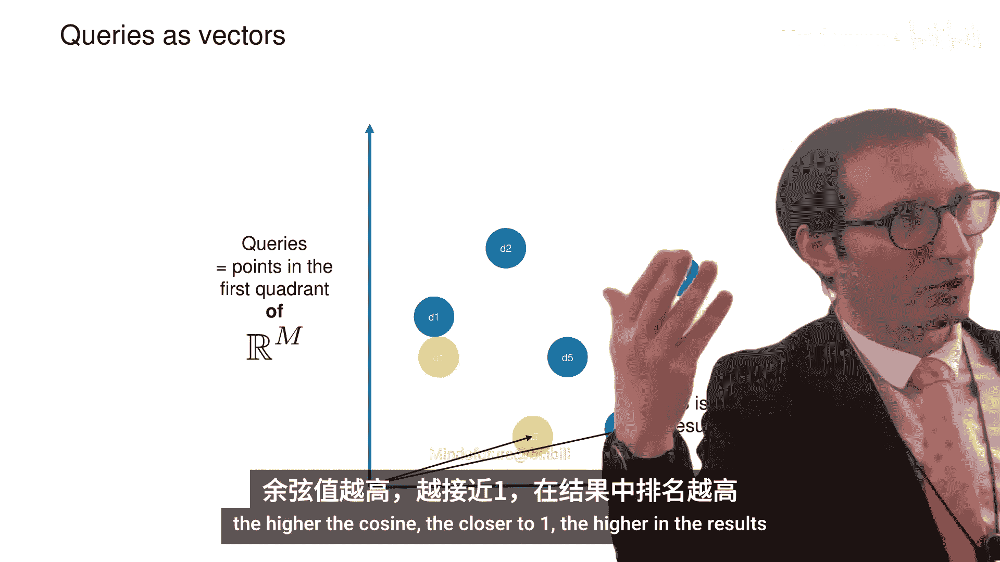

Of intellectual satisfaction， when you build something like this。 I mean。

 the people we did that are really amazing。😊，But that is called the vector space model When we do that。

 is there a qua。

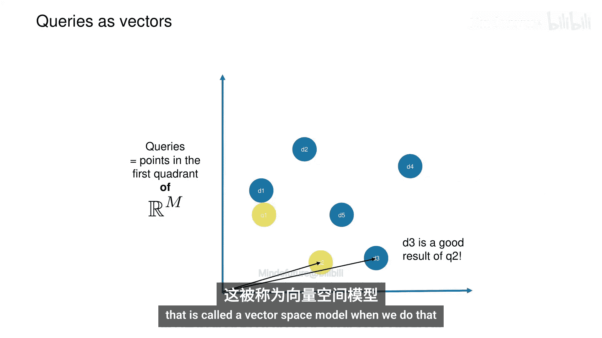

Or oh yes， yes， yes。 Yeah， that that's true。 Yeah， I need to put it very。 Yeah， exactly。 So， yeah。

 But anyway， yeah， you， you， since you agree with me that D 5 wins over D 4， we no longer need to。

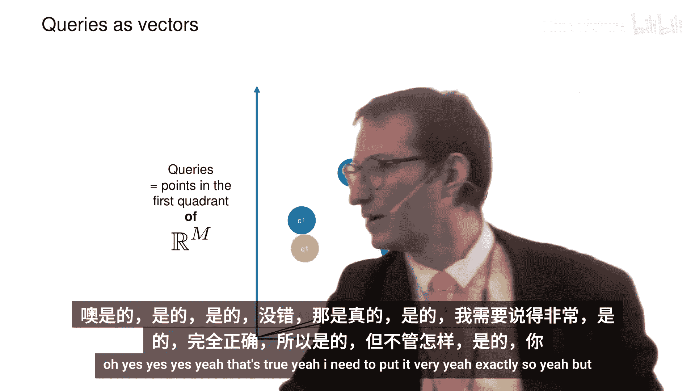

Actually， do that， okay。So you see AI is not perfect。 It's still not able to to put that on a。

 on a screen。Allright。And the same goes here。 if I have now the other query Q1。

 then probably D2 comes first， then D1， then D5， then D4， and then D3。Right， so now that's very。

 very powerful what we have here。But here's the thing。 It's nice。 Maly。

 We are very happy because we design the system that mathematically works。 So at that point。

 the mathematician just goes home and is happy about what they did because they solved the problem。

 right。😊，But now comes the computer scientists and， no， it's not solved yet。

 It's not solved yet because now we need to implement that。And the problem with implementation。

Is that we are looking。At。S tights。A billion vectors。

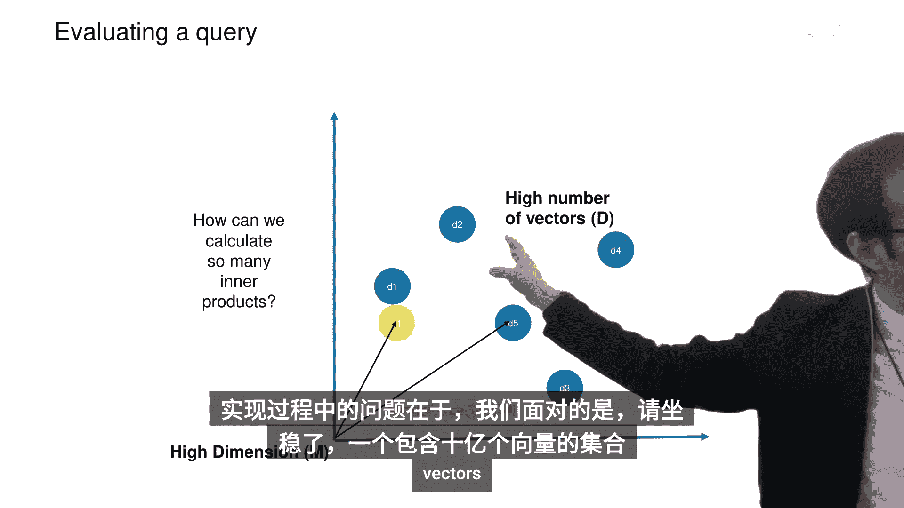

In a hillbert space of dimension， half a million。And now you want to compute all of these billion of scal products with half a million coordinates。

 So， yes， the mathematician is very happy about that because mathely is done。

 but we need to implement that。😊。

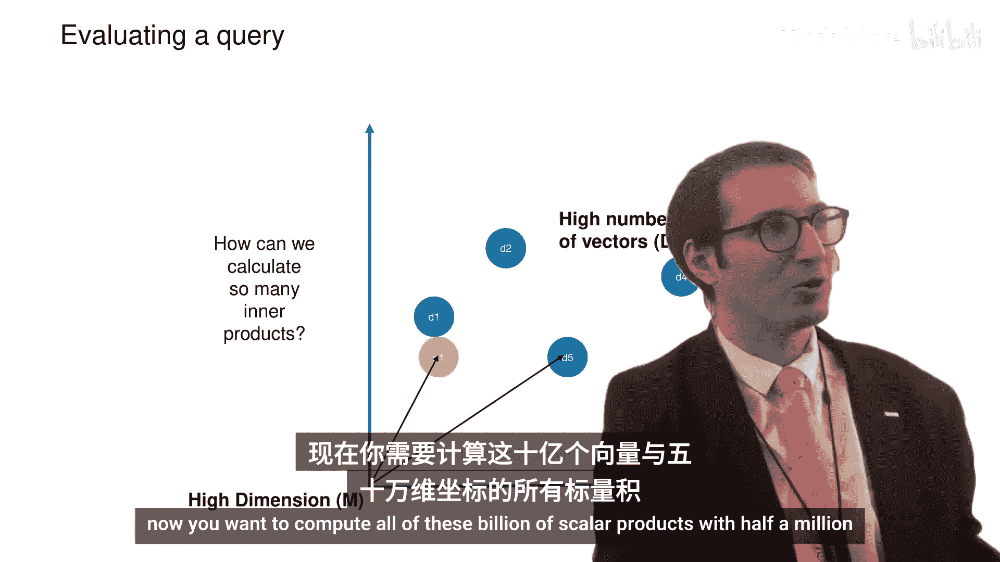

But I have good news for you， because now you can put your。

 So leave your mathematician hat and put your computer scientist hat。

 How will a computer scientist think about that。 We have vectors。 We have the query on the left。

 and the document on the right with half a million coordinates in there。

 We want to compute the dot product。😊，Now， visualize a query in your head。Now。

 visualize how the vector of the query would look like a typical query you would put in Google。

What can you tell me about the query vector， Isn't there something particular to the query vector。

 Could it be any vector or does it have something typical that might happen to the query vector。Yes许。

😊，Exactly， it contains almost on these zeros。 If I give you。

A vector of half a million numbers with no zeros at all。 And I tell you that's a query。

 You're not going to believe me。 That's not possible。 Nobody puts a query of half a million。T no。

 actually they do。 when you upload a P DF to an NM， you actually do that。 But anyway。

 if you with a Google query， which is the interest right here， you are going to have a lot of zeros。

 And very few coordinates with nonzes for a computer scientist。

 that's great because it means the scaf product all the path with the zeros goes away So we are not actually computing a scalaf product on half a million coordinates。

 we are only computing one on four， if it's a query with just four worlds， right。

 So that is now simple to do。 that we can do， right， So we still have to do it a billion times。

 But at least each scaf product is only on four coordinates， right， So that's progress。

 We are making progress。😊，So， now that we know。One sc product， we can do efficiently。

Let's think of how we actually scale the thing with。Doing it repeatedly。With plenty of documents， so。

We have this magical formula that gives us the similarity。Between two documents。

 it's basically the dot product。 So we multiply coordinate wise。

 and we just need to renormalize by the vectors。 Now I changed a little thing in the formula because here。

 I basically have the scalop product divided by the norms。

 But I did even though probably now you master math to a point that you didn't even notice。

 But actually， I moved the renmalization from an absolute renormalization of the total。

 I moved it inside the sum， right， and that， you know， because division is distributive of our audit。

 right， So I just moved it over here。

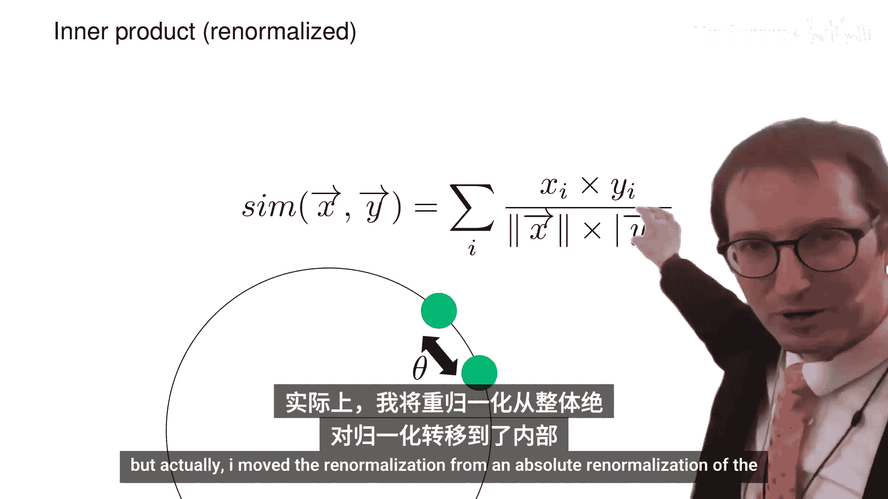

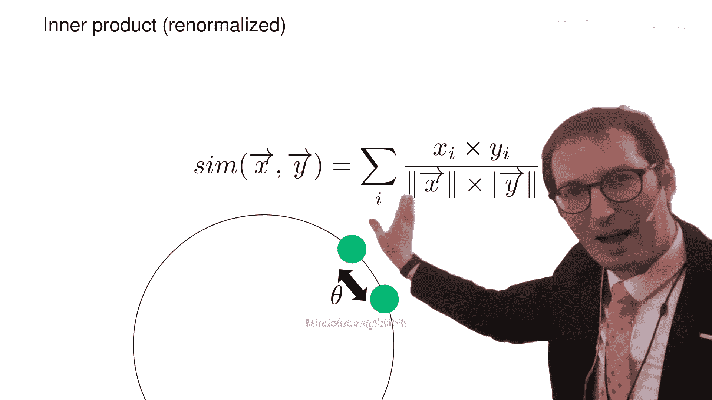

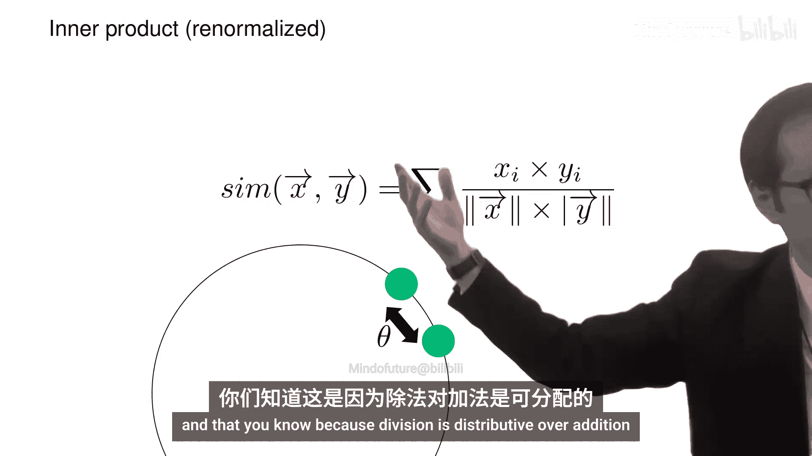

And now I just have a sum。

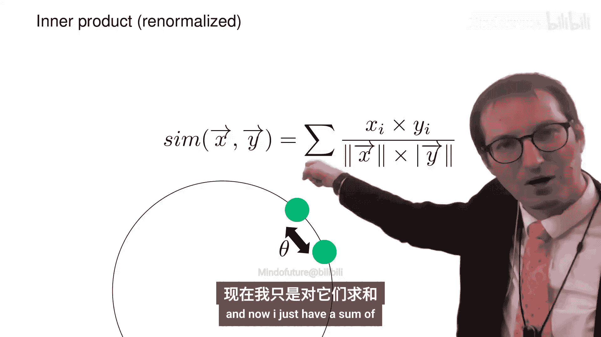

Of。This is very important because now I'm going to bring that back in the context of evidence accumulation。

 When I said earlier， we're accumulating evidence by summing things。

 So that's the direction in which I'm going right now。 So we have these terms that we want to add。

More exactly， what do I have in there。 I told you for the purpose of this lecture' the TF I D F。

 So I'm basically multiplying the T F I D Fs。For my documents。

And term multiplied with my TF I D Fs for query。 And I'm just summing of other terms。 right。

 That's my dot product。 Who agrees with that。Okay， and now it's expressed in a big sum of other terms。

 I just need to traverse and with for every term， a big sum of all of that。

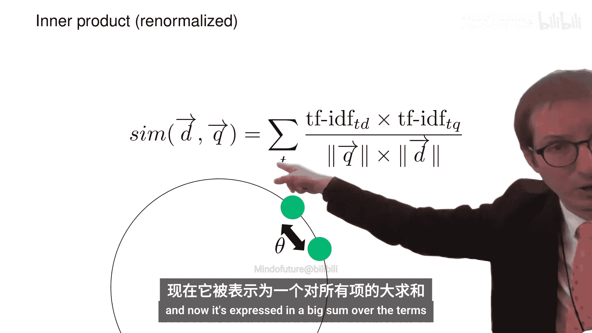

Rhich brings us now to the implementation。 And I'm just wondering if I manage to do it before we go。

 if there's a big click finger for next week。 Now that we look again at the standard inverted index。

 and we have to compute that。😊，We just。Need some place to store the precomp T F IF， right。

Because we want to probably， if we want to do evidence accumulation in the way I explained with the。

 the， the intersection algorithm。I need to store it somewhere。 I need to be there。

 So perhaps since the TF I D F depends on a term in a document and what is the term in document it's a posting。

 So we can put a TF I D F for every blue square in there gets a T F I D F。

The problem here is that it's gonna break a few things。 First。

 the compression algorithm that we spent one week designing with the beautiful gamma code is gone because now I basically have to store a real number in there and you can forget the compression。

 So there's already kind of a big deal that it breaks a few things。😊，So yeah。

 we cannot do that because we want to preserve what we've done before。

So it would be nice if we just put integel in there instead of floats。 Can we put integel。 Yes。

 I could just put my town frequency。 That is an integer that I can still use the gamma code to。

 to compress， right， Maybe not with the gaps， but I just lose the gaps， but I can use the gamma code。

 Who agree。😊，If I have a list with the document I D and the T S， I can use the gam I code， okay。

But if I use， I put the T F in there， I need to put the I DF somewhere else。

That somewhere else is going to be here Note that the I DF depends on the term， not on the documents。

 so I can factor them out and just start them。Together with the document frequency or instead of the document frequency in there。

What is the I DF， It's log of N over D F， right， I can put them in the purple squares。

 But there is one thing people do。 They don't compute the log。 They just compute N over D F。

And putit in there。嗯。Why that's a question that many people would ask。

There's a couple of answers to that， first。Log of N over R DF would be very。

 very specific to the case that we use TF I DF as weights。 But I told you。

 these are not the only weights out there。 There's plenty of other ways of computing the weights。

And so you don't know if everybody is going to take the log。 Maybe some people will not take the log。

So by not computing the log and just putting even D F， you leave it open。 Like people have a choice。

 They can take the log。 They cannot take the log。 They do what， they do whatever we they want。

 You do not constrain them。Another aspect is that computing the logar can be a bit expensive compared to to just multiplication and so on。

 So if you want to avoid the computation of logs， then you don't precompute them。

 And every time the index changes， But you can just do it on fly at runtime。

 right So these are all the reasons for whom does that make sense， So we don't compute the log。

 just N over the F。And the， the purple rectangles are perfect for that。 because D F。

 that's what was already in the purple box， right， So now I just take in of all that， okay。😊。

And for the query， it's easy。 We can just compute it。

 It's a very small query Computing the term frequency is。Is very easy。

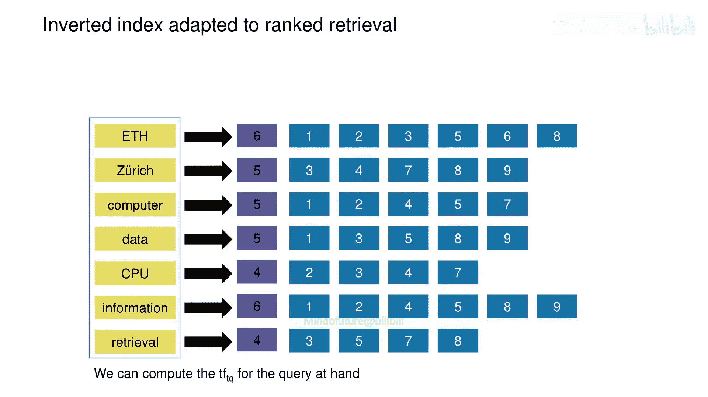

So I will keep the now the the last piece of the puzzle on how it assembles together to compute the scar product for next week as as a cliff finger。

 But I think you probably in your head already have an idea of how this is going to be to be done。

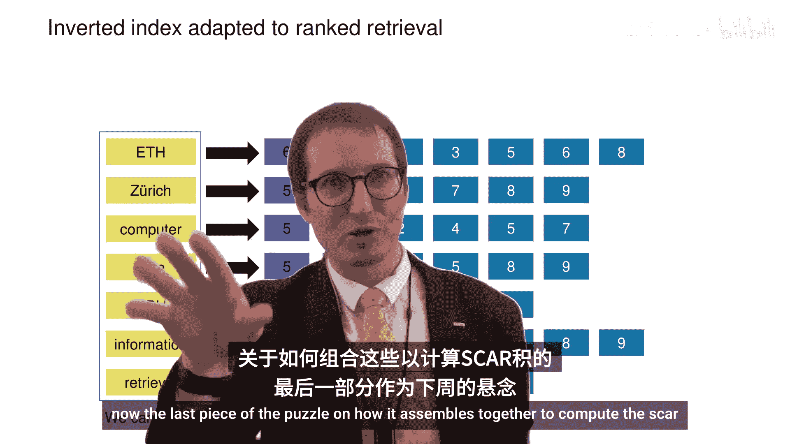

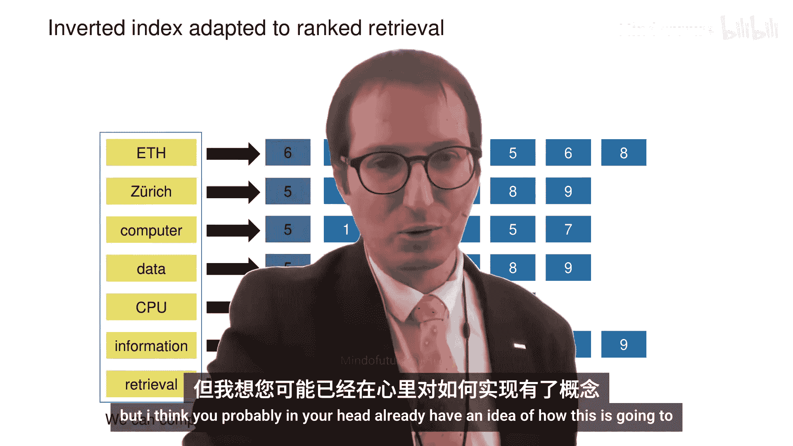

好。

Oh yes， you're right。 Yes， yes， yes， yes， yes， absolutely not next week in。3，3 weeks， right？ Oh。

 we are skip three weeks。 That's going to be rough。 Okay， so3， in three weeks， I will。

 that's a big cliff anger， right， like cutting a series in the middle for， for a few months， okay。

But， I want to know。嗯。Just to see， am I too fast， am I too slow。

I mean， I， I can tell intellectual like， how many people are asleep。

 that kind of give me an indicator。 But still， it's it's good to know。So that tells me。

 I'm not too fast， at least。And I'm also not too slow because most of you photos。All right。

So that's it。 You're free to go get some lunch。 Do not forget to complete the quiz by 3 PM。

 Most of you took it pass it。 If you don't pass， you maybe have silly attempts to attempt to pass。

 but that's very， very few who didn't pass。 So thank you very much。 Enjoy the exercises。

 Enjoy your vacations and see you in three weeks for the continuation。 Thank you。😊。

