# 信息检索：P18：排序检索 (2/3) 📚


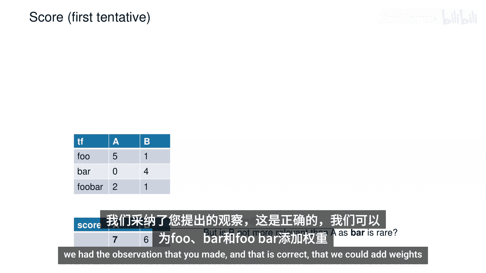


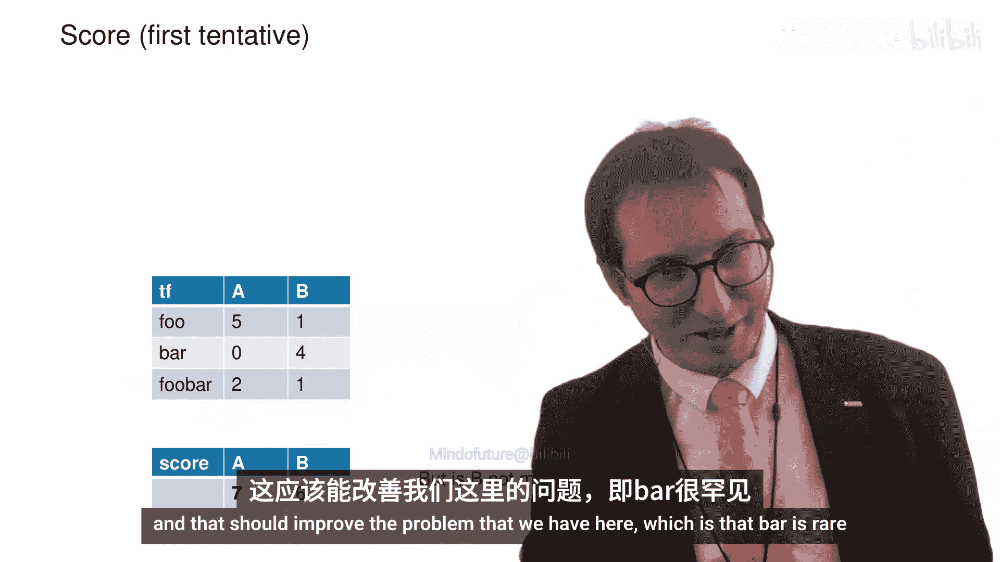

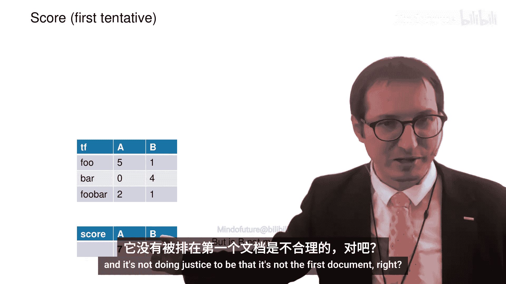

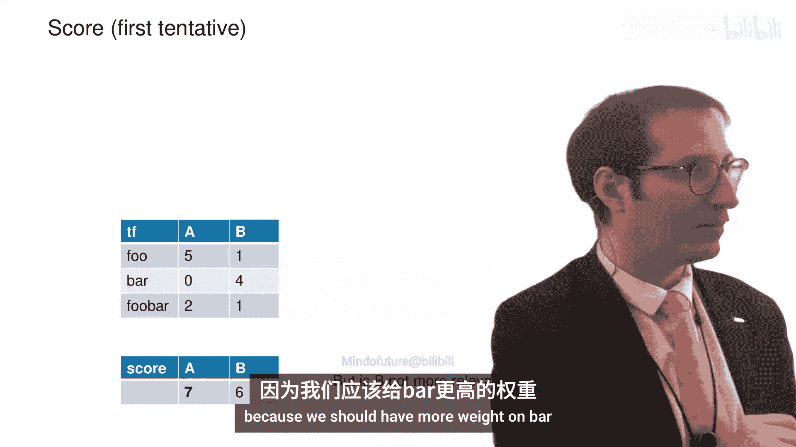

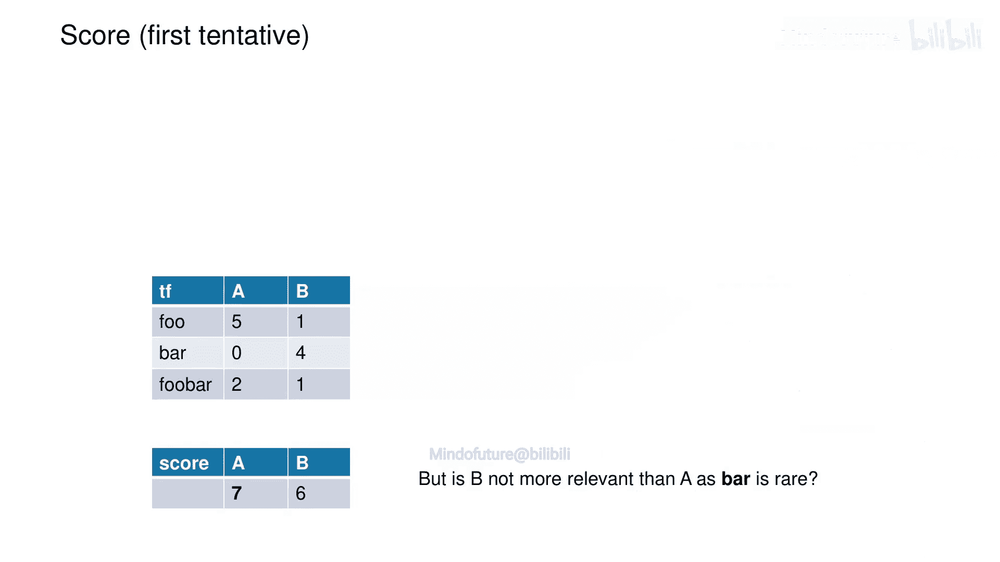


在本节课中，我们将学习如何改进排序检索系统，通过引入词项权重来解决之前遇到的问题。我们将从简单的频率统计开始，逐步深入到向量空间模型的核心概念，并探讨其数学基础和实现思路。

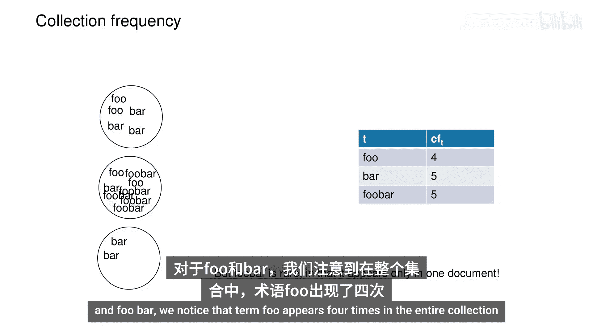


## 概述

上一节我们介绍了基于词项频率的简单排序方法。本节中，我们将看到如何通过为词项分配权重来改进排序结果，特别是如何处理罕见词项和常见词项。我们将引入**逆文档频率**的概念，并最终将文档和查询都表示为向量，从而在数学框架下计算它们的相似度。

---

## 权重计算：从频率到IDF

我们之前观察到，在排序时，罕见词项“bar”没有得到足够的重视。为了解决这个问题，我们需要为词项“foo”和“bar”添加不同的权重。

一种直观的想法是使用**集合频率**，即一个词项在整个文档集合中出现的总次数。例如，在一个包含三个文档的集合中：
*   “foo” 出现了4次。
*   “bar” 出现了5次。
*   “foobar” 出现了5次。

然而，集合频率有一个问题。以“foobar”为例，虽然它出现了5次，但这5次都集中在同一个文档（文档2）中。这可能意味着“foobar”是一个非常专业的术语，只出现在少数特定文档里，本质上它仍然是一个**罕见词项**。因此，仅用集合频率作为权重并不完全合理。

那么，我们应该使用什么频率呢？答案是**文档频率**。

文档频率与集合频率不同，它统计的是**包含某个词项的文档数量**，而不是该词项出现的总次数。在上面的例子中：
*   “foo” 出现在2个文档中（文档1和2），DF=2。
*   “bar” 出现在所有3个文档中，DF=3。
*   “foobar” 只出现在1个文档中，DF=1。

这样，“foobar”就被正确地识别为最罕见的词项，而“bar”则是最常见的词项（可能是一个停用词）。文档频率正是我们之前在标准倒排索引的紫色框中见过的数据。

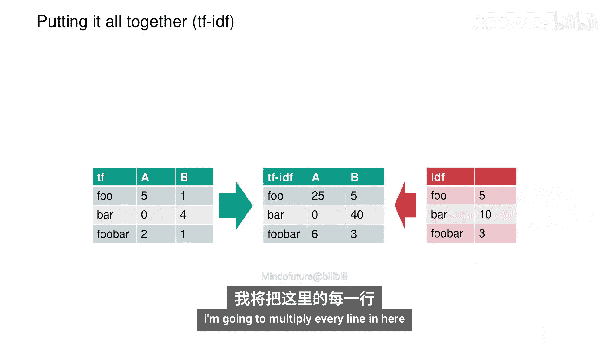

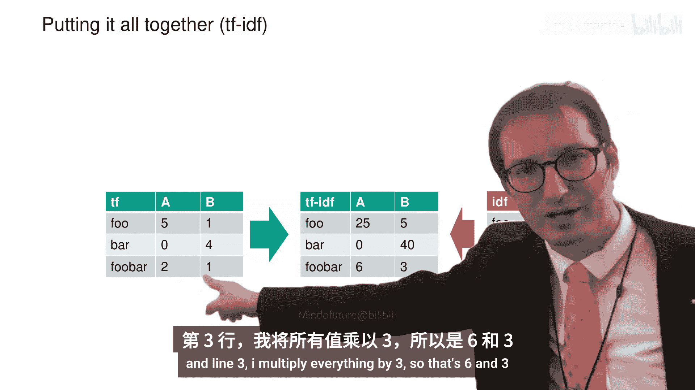

但是，对于权重而言，方向是反的：文档频率越高（词项越常见），我们希望的权重反而越低。因此，我们需要取其倒数。

我们通过以下公式进行转换和调整：
`IDF(t) = log(N / DF(t))`
其中，`N`是文档集合中的文档总数，`DF(t)`是词项`t`的文档频率。

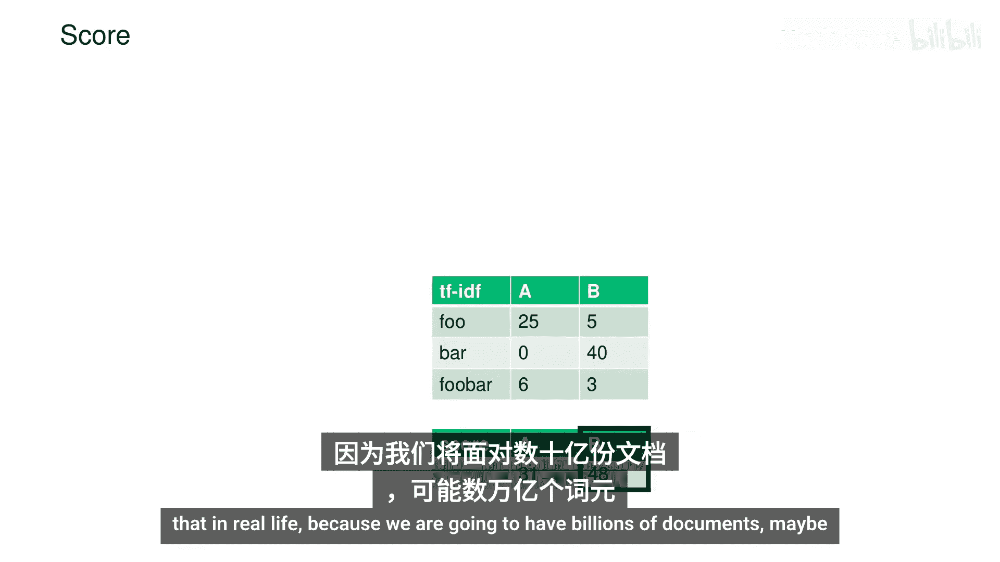

这个公式被称为**逆文档频率**。取对数是为了平滑数值：当词项出现次数从0到1000时，差异巨大；但从1000到2000时，差异的重要性就降低了。对数函数可以放大小数值之间的差异，同时压缩大数值之间的差异。


---

## TF-IDF：词项权重

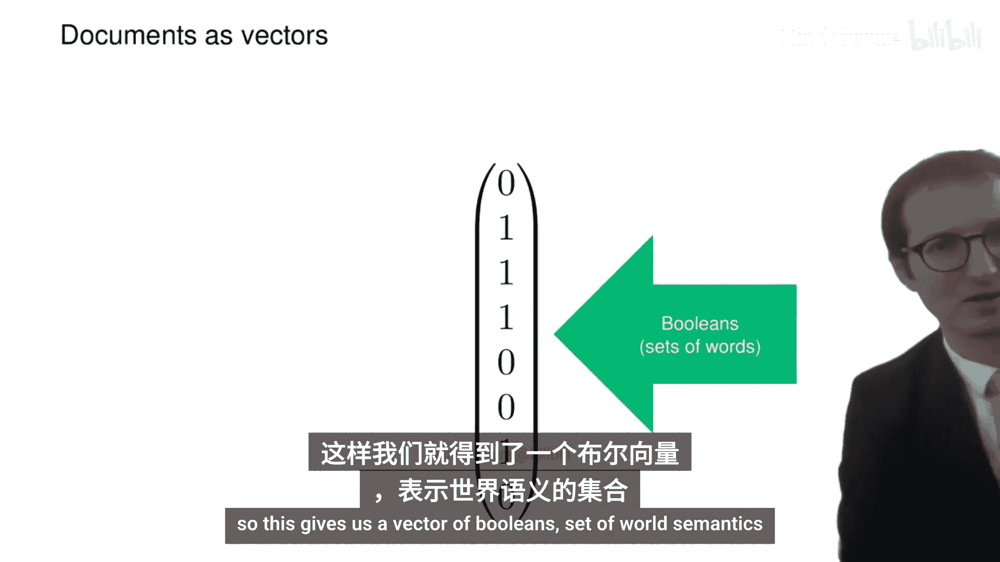

现在，我们将词项频率和逆文档频率结合起来，就得到了著名的**TF-IDF**权重。

具体计算步骤如下：
1.  计算每个词项-文档对的词项频率。
2.  计算每个词项的逆文档频率。
3.  将对应的TF和IDF相乘，得到TF-IDF权重。

以下是一个计算示例：
假设我们为“foo”、“bar”、“foobar”计算了IDF权重，分别为5、10、3。然后将文档-词项矩阵中的每个TF值与对应词项的IDF权重相乘。

```
原始TF矩阵：
文档A: [foo:5, bar:1]
文档B: [foo:0, bar:4]
文档C: [foo:2, bar:1]

IDF权重：
foo: 5, bar: 10, foobar: 3

计算TF-IDF：
文档A: [5*5=25, 1*10=10] -> 总和 35
文档B: [0*5=0, 4*10=40] -> 总和 40
文档C: [2*5=10, 1*10=10] -> 总和 20
```

现在，对于查询“foo bar”，我们计算其与每个文档的TF-IDF向量点积（或简单求和，这里假设查询词项权重为1），文档B的得分（40）最高，成为了排名第一的文档，这符合我们的预期。因为“bar”是罕见词项，在文档B中出现了4次，因此获得了更高的权重。

TF-IDF评分系统在信息检索中非常流行，它同时考虑了词项在文档中的局部重要性（TF）和在整个集合中的全局重要性（IDF）。

---

## 向量空间模型 🧮

虽然TF-IDF在数学上很清晰，但要实现它来处理数十亿文档和数百万词项，我们需要更高效的抽象模型。这就是**向量空间模型**。

在旧系统中，我们将文档视为词项的集合（布尔向量）。现在，我们使用词袋模型，并将文档视为**数值向量**，其中每个坐标对应一个词项，坐标值可以是TF、TF-IDF或其他权重。这样，一个文档就变成了高维空间（维度数等于词项数）中的一个点或向量。

更具体地说，我们通常使用TF-IDF值作为向量坐标。所有文档向量都位于这个高维空间的**第一象限**（坐标均为非负实数）。为了方便比较，我们通常将文档向量**归一化**为单位长度（即模长为1）。归一化意味着我们只关心向量的方向（词项之间的相对频率比例），而不关心其绝对长度。例如，将同一本书复制100遍，其归一化后的向量与原书是相同的。

归一化后的所有文档向量都位于一个**单位超球面**上。在这个空间中，一个点的位置主要由其**角度**决定。

那么，如何衡量两个文档的相似度呢？直觉告诉我们，两个向量之间的**夹角**越小，它们的方向越接近，内容就应该越相似。在数学上，两个归一化向量的**点积**恰好等于它们夹角的余弦值：
`cos(θ) = (v · w) / (||v|| * ||w||)`
由于向量已归一化（模长为1），点积 `v · w` 就直接等于余弦相似度。

这个发现非常强大：我们将文档内容的相似度比较，转化为了高维空间中向量夹角的计算。

---

## 查询即向量

更关键的是，我们的**查询**也可以被表示为同一个向量空间中的向量。用户输入的查询词被转换成TF-IDF向量（同样，查询向量通常非常稀疏，大部分坐标为零）。

于是，信息检索的任务变得清晰而优美：
1.  将所有文档表示为归一化的TF-IDF向量。
2.  将用户查询也表示为一个向量（通常不归一化，或按需处理）。
3.  计算查询向量与每个文档向量的**点积**（即余弦相似度）。
4.  按照点积分值从高到低对文档进行排序，返回最相关的文档。

在向量空间模型中，相关性排名直接对应于查询向量与文档向量夹角的余弦值。余弦值越接近1，夹角越小，文档与查询越相似，排名就越靠前。

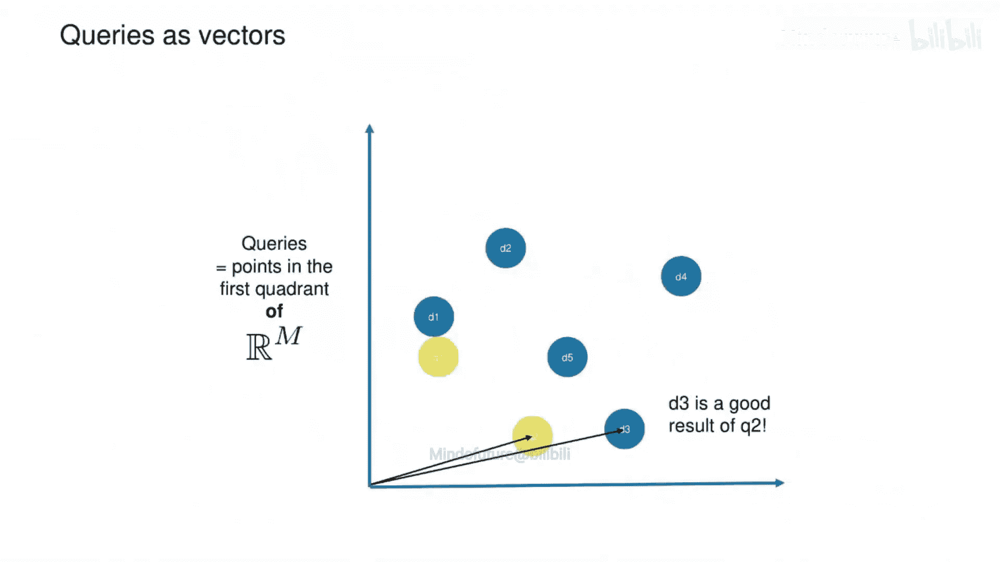

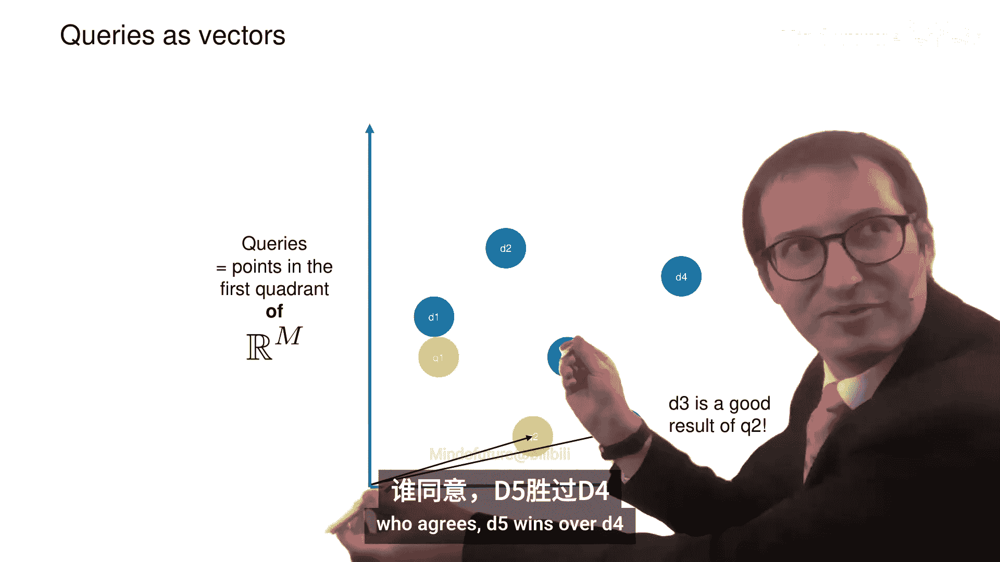

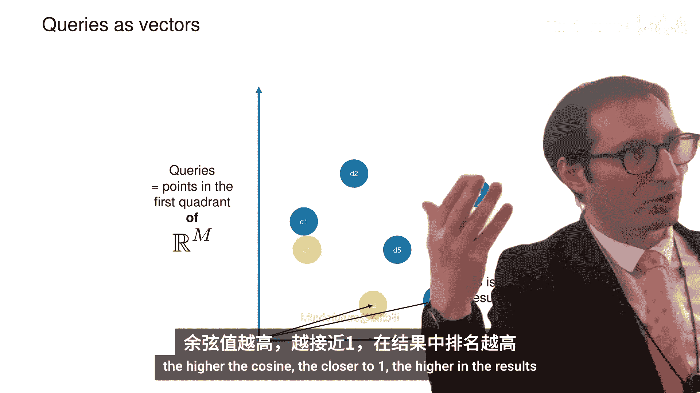

---

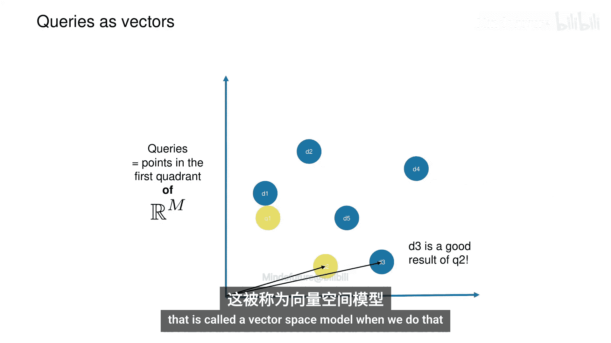


## 实现挑战与思路 💻

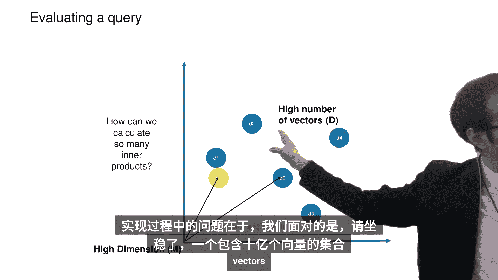

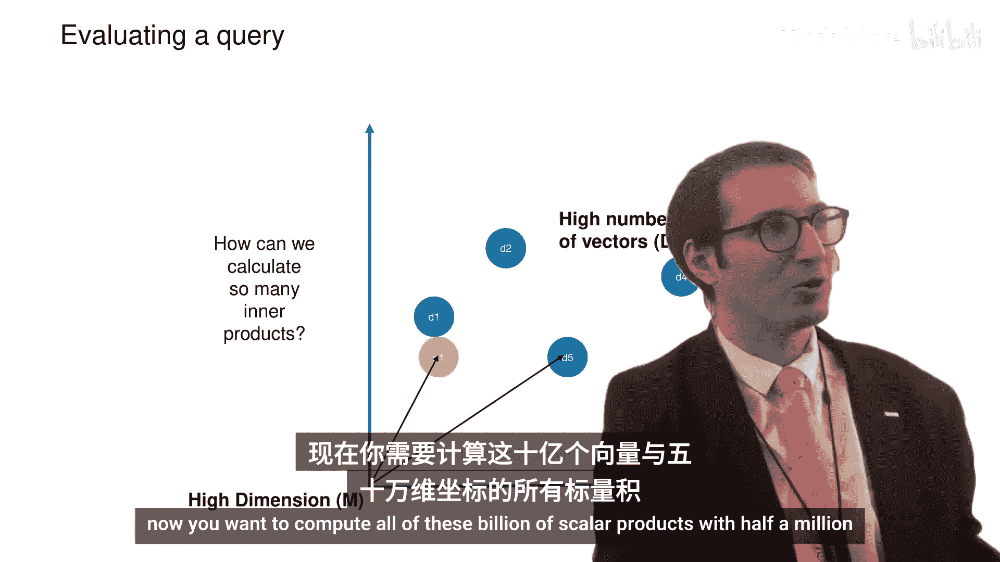

数学模型很完美，但实现起来面临巨大挑战：我们需要计算一个查询向量与**数十亿个**文档向量（每个向量可能有**数十万维**）的点积。

幸运的是，查询向量通常是极度稀疏的，只包含少数几个非零值（对应查询中的几个词）。因此，每次点积计算只需要对这几个非零坐标进行运算，而不需要遍历所有维度。

接下来，我们需要高效地处理数十亿次这样的点积运算。这引导我们回到**倒排索引**的结构。

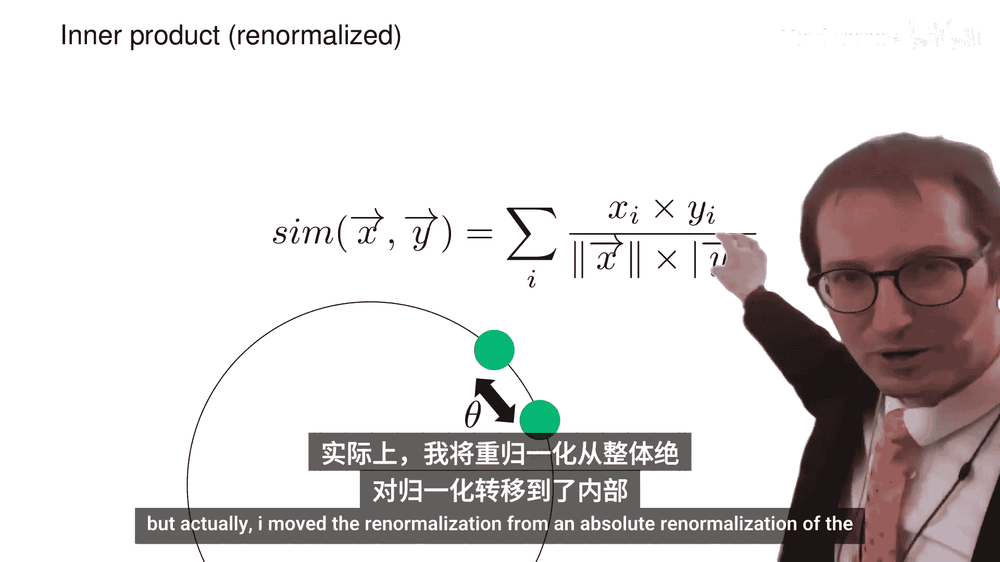

观察点积公式：
`score(q, d) = Σ (TF-IDF(t, q) * TF-IDF(t, d) / ||d||)`
对于查询`q`，我们只需要对查询中的每个词项`t`，找到包含`t`的文档`d`，然后累加 `TF-IDF(t, q) * TF-IDF(t, d) / ||d||` 即可。这本质上是一个**证据累积**的过程。

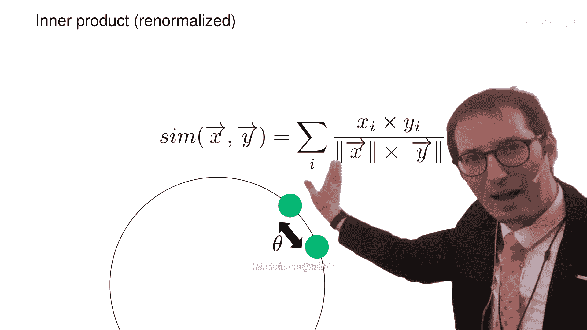

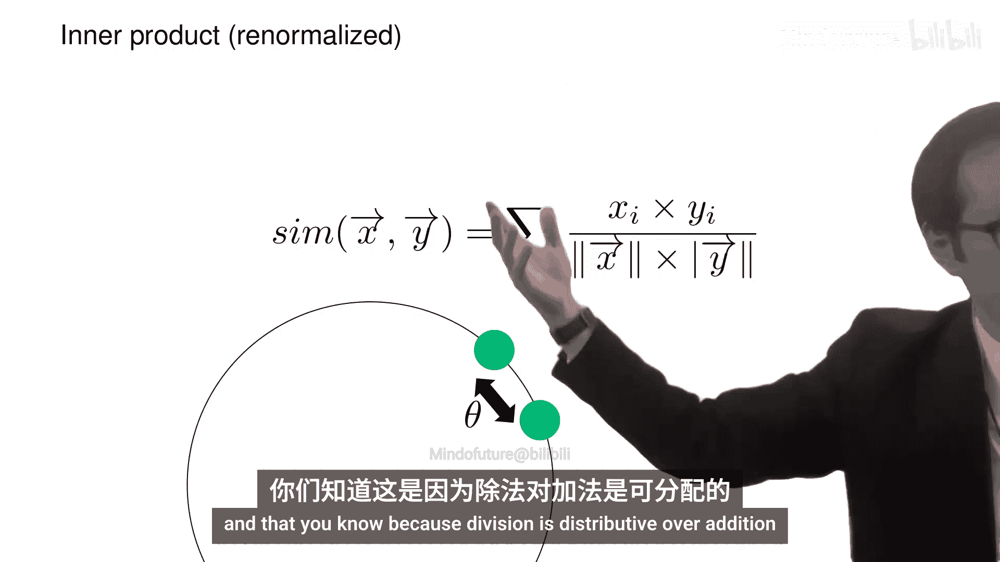

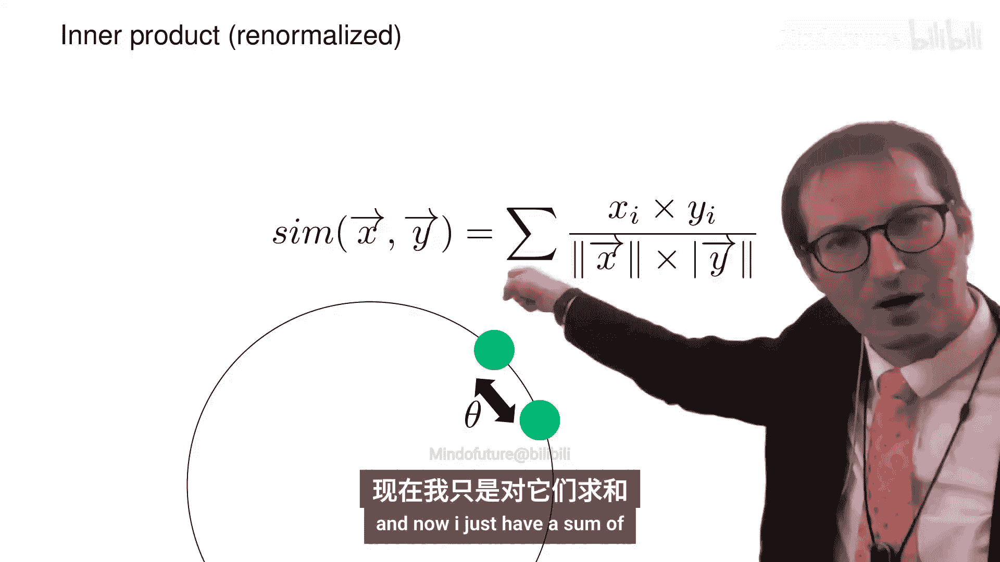

为了实现它，我们需要在倒排索引中存储必要的信息：
*   在倒排列表的每个帖子（文档ID）中，存储该词项在该文档中的**词项频率**。
*   在词典部分（原来的紫色框，存储文档频率DF），我们可以存储 `N/DF` 用于计算IDF。注意，这里通常不预先计算对数`log(N/DF)`，而是将`N/DF`存储起来，把是否取对数的选择权留给具体的评分函数，这样更灵活且节省计算。

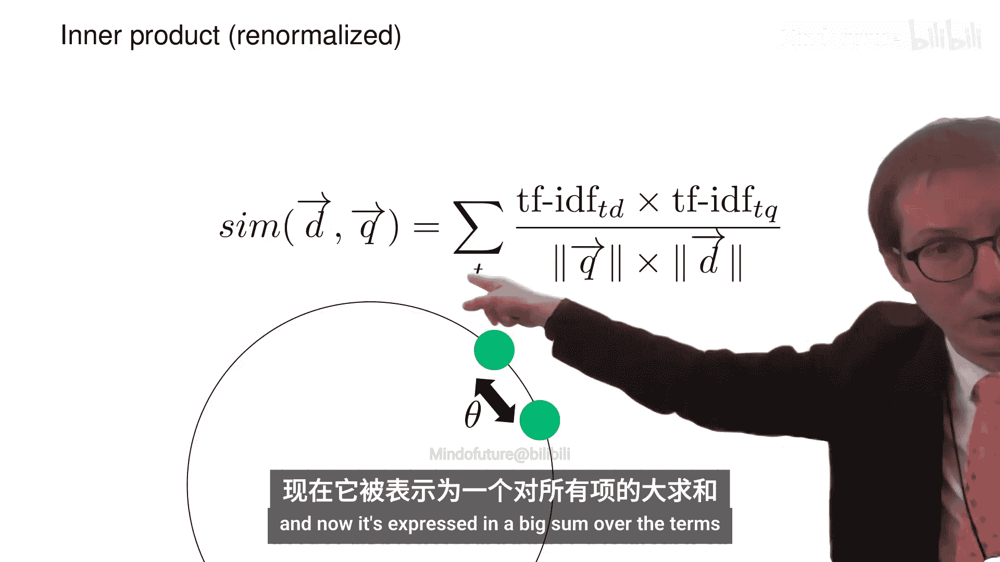

这样，当处理一个查询时，我们可以：
1.  对于查询中的每个词项，取出其倒排列表。
2.  从词典中获取该词项的 `N/DF` 值，计算查询词项本身的权重。
3.  遍历倒排列表，对于列表中的每个文档，获取其存储的TF值，结合IDF计算文档中该词项的TF-IDF，然后与查询词项的权重相乘，并累加到该文档的总分中。
4.  最后，对所有文档的得分进行排序。

如何高效地管理这些中间得分并进行排序，将是下一讲的内容。

---

## 总结

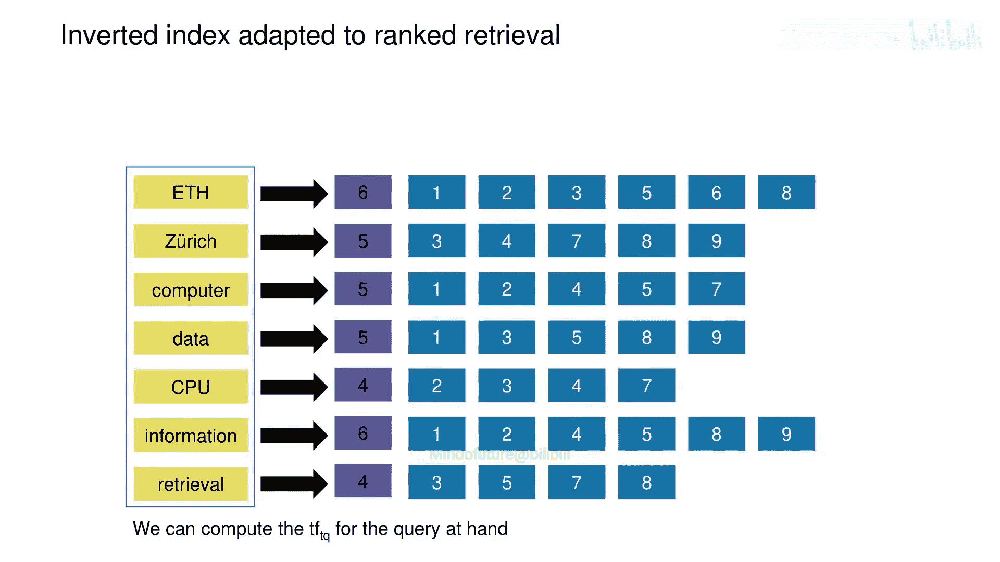

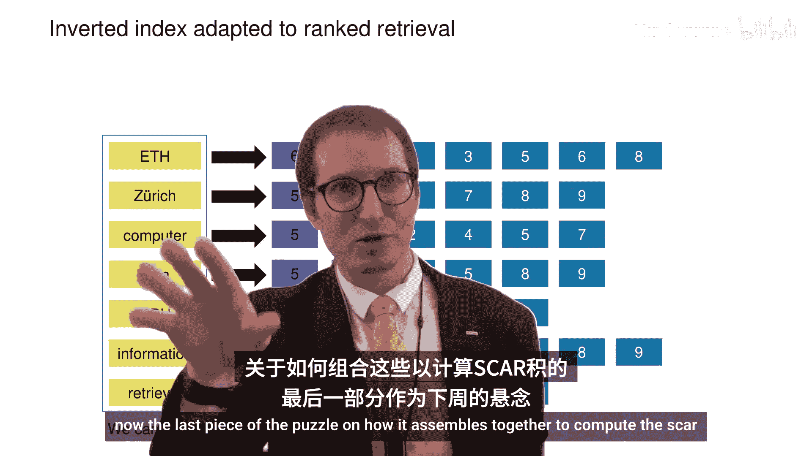

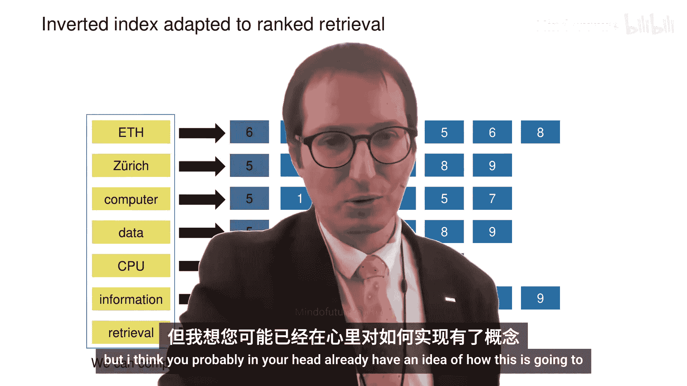


本节课中，我们一起学习了排序检索的核心改进方法：
1.  引入了**逆文档频率**的概念，用于给罕见词项更高的权重，从而形成了**TF-IDF**评分机制。
2.  将文档和查询抽象为高维向量空间中的点，建立了**向量空间模型**。
3.  利用向量**点积**（余弦相似度）来数学化地衡量查询与文档的相关性。
4.  探讨了将这一数学模型与**倒排索引**结合以实现高效检索的基本思路。


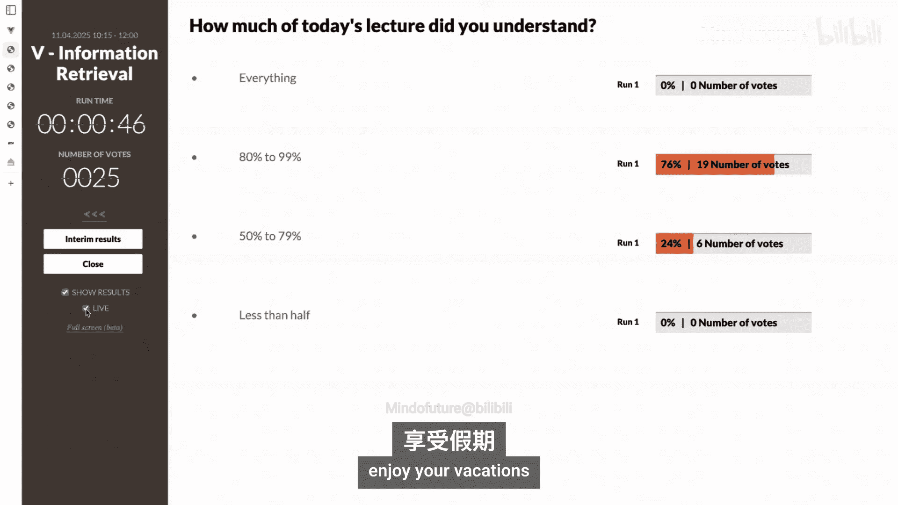

通过将文本信息转化为数学向量，我们为复杂的信息检索问题提供了一个强大而优雅的解决方案框架。