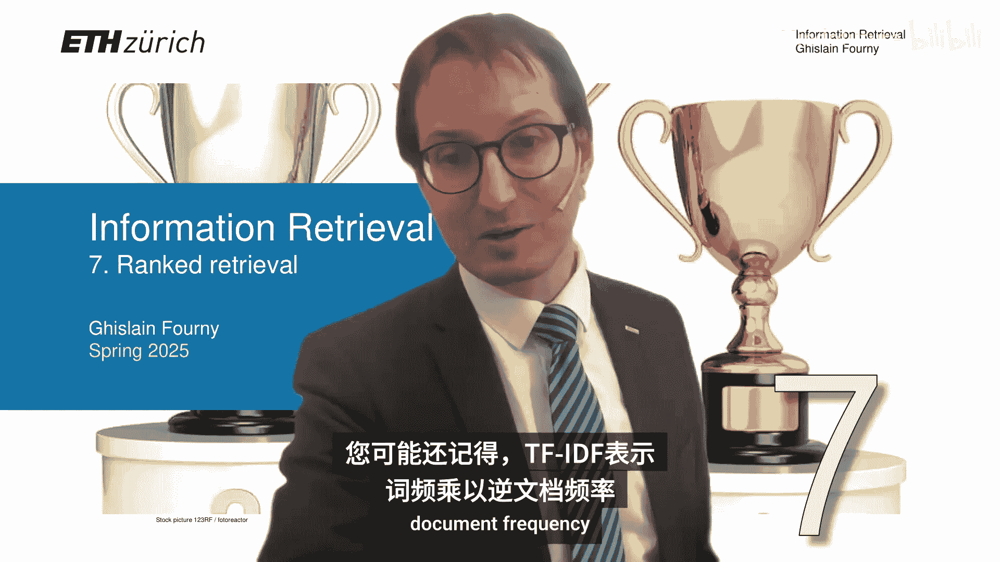
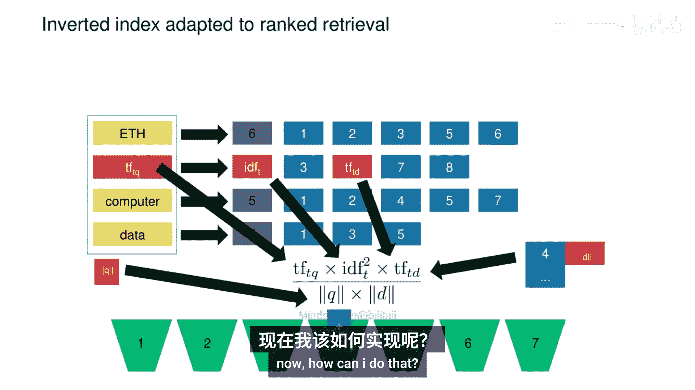
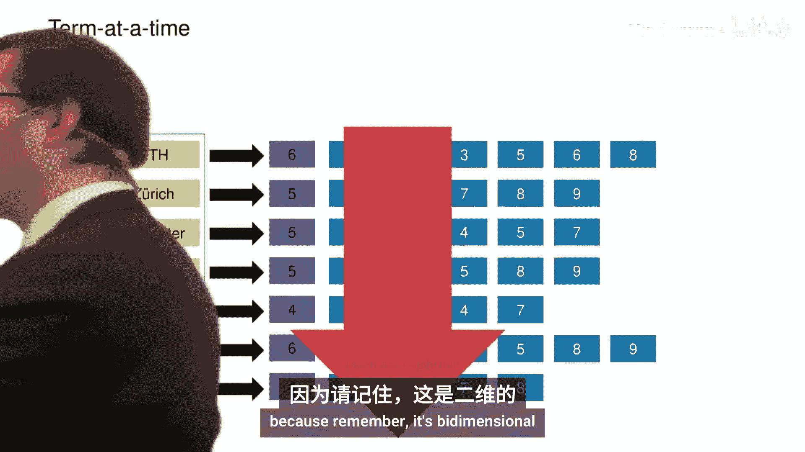
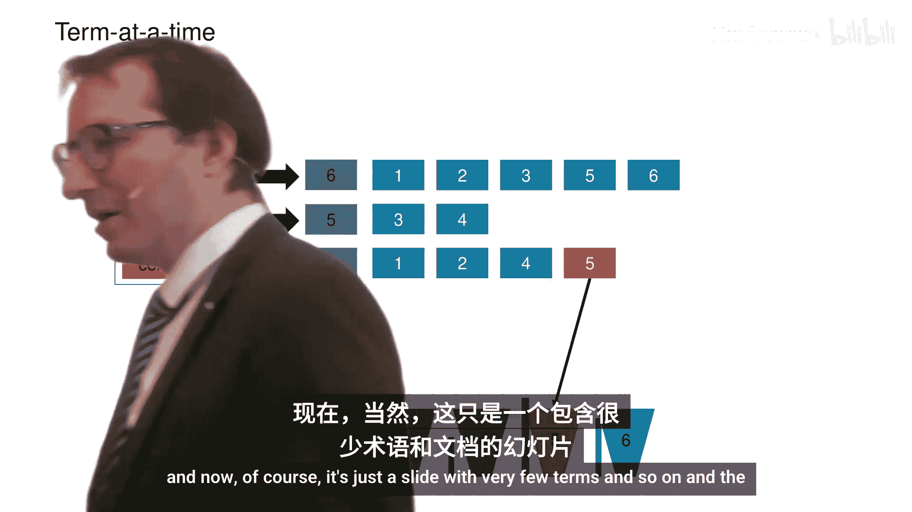
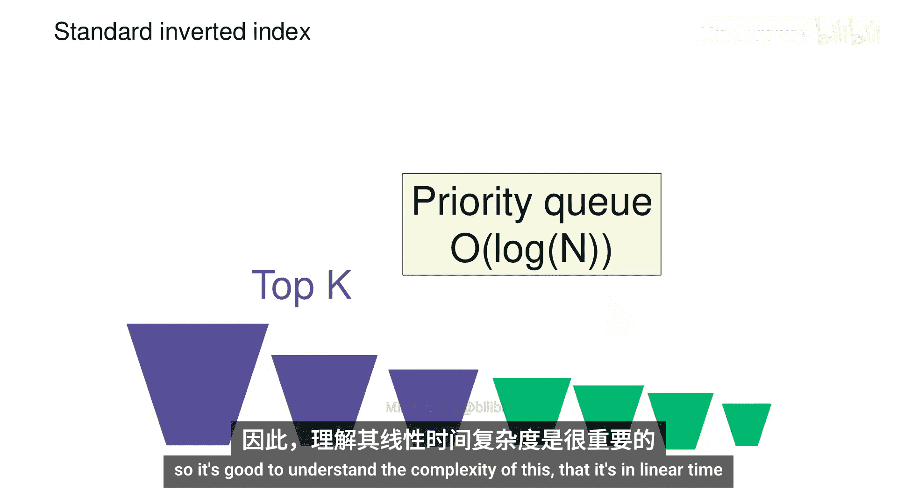
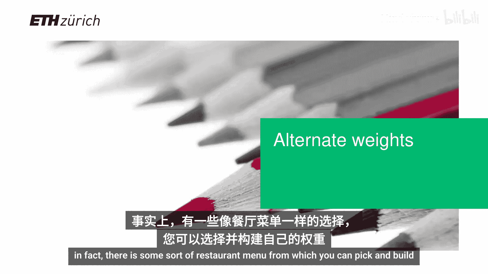
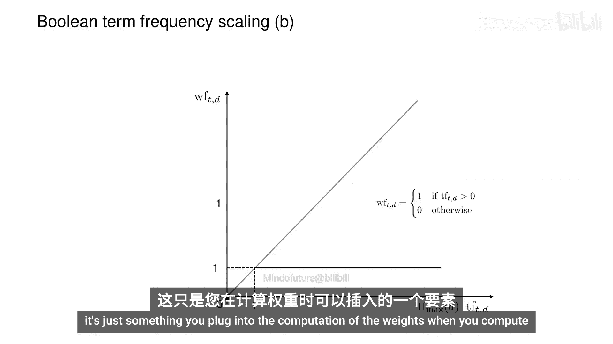
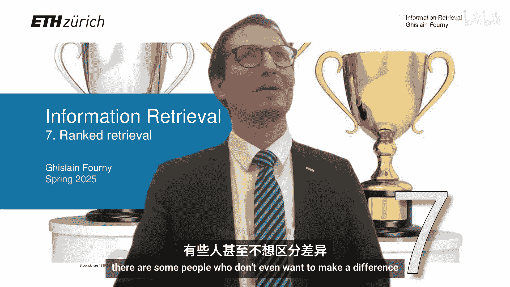
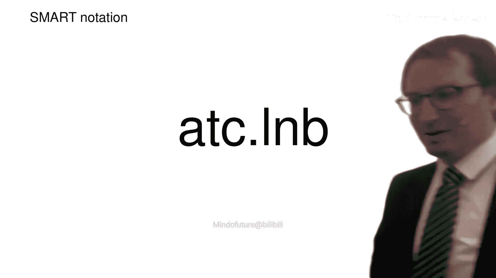
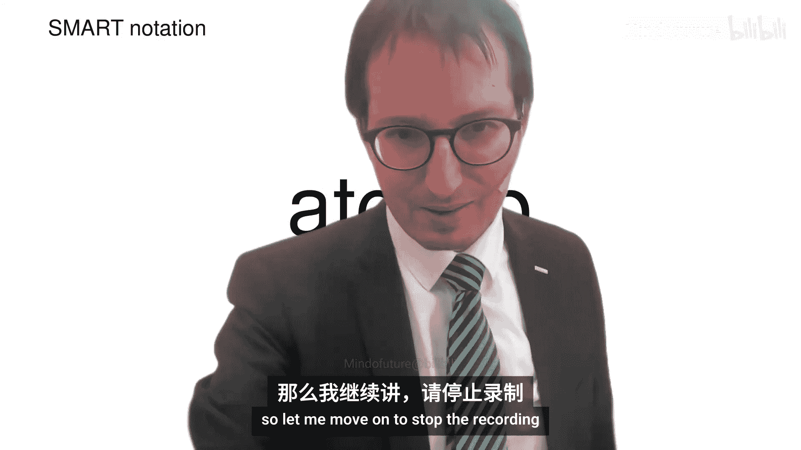

# 【苏黎世联邦理工学院】信息检索-｜-Information-Retrieval-｜-Eth-Zurich-2025-p19-P19_7._排序检索_(3_3)--BV1ndsBzdEss_p19-

Welcome， everybody in the lecture hall。 welcomecome， everybody on Zoom。

 welcomelcome everybody watching us from the future。 I hope you had a good resting week。

 We actually have not seen each other for three weeks。

 because there's been two Fridays where we didn't have a lecture。

 So Ill try to reactivate a little bit the knowledge and well take it from there and then I I continue。

 So we were in the middle of actually an advanced part already of the lecture。

 because unlike the first system that we beat that is based on Boolean Boolean retrieval。

 we started using the power of linearar algebra in order to to query our documents。😊。

And in particular， we represent every document as a vector of， for example， TF I D Fs。

 So you might remember that TF IDF means term frequency multiplied by inverted document frequency。

 trying to find the slides where we were。

And。So every document is represented by a vector， and we realize that a search can be seen as looking for all the vectors that are as close as possible to the vector of the query。

 And by as close as possible， winning， we mean， for example， the angle between the two vectors。

 And you know how to calculate an angle。 the cosine of the angle is basically the the inner products of the renormalized vectors。

嗯。But now we were left with the implementation of that。

 How do we compute the scal products of the document， vectors and query vectors for many， many。

 many documents that we're interested in。And so first。

 we need to have the number of stocks somewhere。 And so I left you three weeks ago with the fact that we basically store the precomputed term frequencies inside the postings。

 right， Remember， a term frequency has two subs， the term and the documents。

 the number of occurrence of a term term T in documents D。 So we can store them here in the postings。

Then we could store some form of precomputation for the inverted document frequency for each term。

 And now theres only one for， for each term。 So that would basically be the， the purple boxes here。

 But in practice， we don't store log of n over the F。 that would be the inverted document frequency。

We just store N over RDF without taking the look。 The reason for this， I will show you because the。

 the ideaF is not the only way you can actually model the rarity。 There's other ways。

 And so by just taking N over RDF， we remain generic as for we。

 we basically do not f the choice of the IF over any other number。 right。

And then for the TF of the query， because we need the TF IF both for the query and for the for the documents that we can do very easily because the query is very small。

 So that， that is a work in the back to compute the term frequencies in the， in the query。

And so what's going to happen is that we are going to accumulate the scalaf products。

 What I mean we accumulate is that a scaf product is a very， very， very large sum of products， very。

 very large sum。 And we need to accumulate that sum， right？ Remember that it's a sum。

That is made for each documents over the terms， right， So we need to travel the entire。

 the entire index。 So I'm putting these buckets right here that are basically going to accumulate the scalar products。

 right， bucket 1 accumulates the scal of products between document 1 and the query。

 buckets 2 between document 2 and the query。 And initially， these buckets are at 0。

 and we are going to fill them with the the， the， the products of the type T F I Ds。嗯。

So if I take it strictly like the original version。

 I basically have the TFIDF of the query times the TF I DF of the document， right。

 So this is the TF IDF of the query times that of the document renormalize because I want the angle。

 right， So I have to renormalize my inner product。 And basically， I have to sum that over T。

 the sum over T for every D and for every， I'm going to put the， the results here。Now。

How can I do that？ Well， there are two， two strategies， Because remember， it's bi dimensional。

 We have to sum of other terms and grow of other documents。

So we can do it in two ways， right， Either we do it term at a time， meaning that I take a term。

 and then I accumulate all documents or document at a time， meaning that I take one document。

 I process all the terms。 Then I move on to the next documents and so on。

So I'm going to show you animations further， too， But obviously， it gives us the same thing， right。

 It doesn't matter in which order we accumulate the TF I D Fs， because that's the。

 the result is going to be the same。 But you just need to be aware there's two ways of doing that。

 term at a time document at a time。 So he has my animation for you。

T matter of time means we start with E T H。And then we compute the TF I D S for document1 and E T H。

 right， I get some number。 It's just the the this， basically， just for document 1 and E T H。

And I added it to my bucket 1。 So it used to be 0。 And now I added something。

 instead of putting a number， I'm just going to have some sort of the bar right here that just as we accumulate。

 the TF I D F is going to grow， right， Then I do document 2。 Be smaller。 Do 3， document 4。

 document 5 document 6， document 4 doesn't exist。 So it remains that0， right， right， So fact so good。

😊，At that point， I've only accumulated the scores， the， the， the Sa product for just E T H。

 and I will also do it for the other term。 However， even though I did it only for E T H。

 I've already started it for all documents。 Then I go to Zuric。Then I'm accumulating more。

 Remember that it's a sum over the over all the terms。 So Ill document3。

 So I have to sum this plus this， right， So I'm going to add it。

 I'm going to compute the TF I DF times T F I DF。 And I added to bucket 3， bucket 3。

 So you see it a bit higher now Ad it here。 The same for document 4， which was at 0。

 Then we accumulate it a bit here。😊，I'm done with the。 Then I go for computer。 I a bit for one， for2。

3 doesn't change for4， for 5 and 6 doesn't change。And now， of course。

 it's just a slide with very few terms and so on。 But， and， and the documents。

 But I'm basically done， right， So assuming my query with E T H Zuric computer。

 I have now accumulated my scalaf products， right， This is what we call evidence accumulation。

What is the document that would be returned first with this， What's the highest score。5， yes。

 exactly。 document 5 would be the first to be displayed。 The second one probably document 1。

1 and 6 are actually pretty， pretty close， right， So1 and 6， then we'd have document 2。

 then 4 and then 3， right？ So you see， we just sort by Scala product。

 But now we have the sca products because we have accumulated。 We have summed over all the terms。

 So that's the definition of the scala product。 What about document at a time。

 It's exactly the same thing， except that now I do we document by document。 So document at a time。

 I would start with document 1。😊，Which has E T， H and computer。 And that's it。

 I'm done with document 1。 Then I go for document 2， E T H and computer。 Then I go for document 3。

 then document 4， then document 5。 then document 6。 Who agrees it's the same。Right。

 it doesn't matter if， in which other we do it， right， But we have a choice。

 turn at a time or document at a time。And I be a big pedagogyical mistake of not actually putting the same barss。

 but it's actually the same。 should give the， the same results in here。😊，Okay。Now。

We have to sort the documents by decreasing scala product， right， That's the I D。

 That's how we find the the closers。 Remember that it's the cosine of the angle， right。

 So if the angle is close to 0， then the cosine is close to。When， right？

 So if I start by increasing angle， then I start by decreasing scala products。Now， if we sort。

 what is the complexity， the optimal complexity for sorting a list。That should be automatic。

 all at the same time。 What is the complexity for sorting。N log n， exactly that， you know， right， we。

 you've heard it many times。 So you might think， okay， maybe we need n log N。But think about the U I。

 the user interface for that， for that engine。 Do you think we are throwing directly all the documents that the users。

 Is that what Google does。They don't do that。 They give you the first 10 pages， the first 10 results。

 Then you need to click to get the next 10 results。

 So it means that we don't need to sort everything。We just need to locate the top 10。Scaar products。

 What do you think is the complexity for that。We think it's also end again。We think it's O of n。

Or of log n。So it's all of n。 The majority is correct。 And for this。

 we actually use a priority queue or a he that basically is able to to do that for us。

 So building the priority queue takes linear half time。

 and then unqueing every time you unquee something takes log N。😊。

But since we only un queuee the top 10， we basically have 10 times log N， right。

 So we basically have O of n plus 10 times log N。 So it's still O of N。 right。

 How would I get the N log N。That if I un queue everything， then I have n times log N， right。

 But I would have to un queue everything to have n log N， right。

 If I un queuee a constant number of documents， I'm still at O of N globally。

 and the O of N comes from the construction of the queue。 Who is with me。Right。So it's。

 it's good to impact the con to understand the complexity of this that it's。

In linear time。Now， to finish this section on， on vector space model。

I told you that the TF I DF is the most common scheme that people use。

 It's the one that is used in almost all textbooks， but it's not the only one。 In fact。

 there is some sort of restaurant menu from which you can pick and build your own weight for your vectors。

And this restaurant menu has even codes to， to， to say what you want to do。 For example， N。

 I'm putting it in parenthees。 N is the codes to say that you're using the term frequency， right。

 So the weight。 So the weight is on the y axis， the term frequency is on the X axis。

 If you take the term frequency as the weight。 then it's y equals X， right。

 That's just the identity function。 The weight is the term frequency。 That is code N。 If you do that。

Some people do not want to do that Instead， they prefer to take a bit of a log and and。

 and kind of not have two high weights when the term frequency increases。

 So they are going to take one plus the log of the term frequency， right。

 It's just a slight variation。 So it means that instead of having the T F I DF。

 you have the one plus log T F I DF， right， Then you just have different numbers in your vectors。

If you want this， you use the code L instead of N， right。 So this is N。 This is L。

 It's called sublinear term frequency scaling。 Then you have augmented term frequency scaling。

 So what it does here。Is that it doesn't just take the log。 It actually kind of rotates the curve。

 So it was like this， and it rotates it like this。What this actually does。

 the explanation for that has to do with smoothing because the terms that never appear。

 if you have too small a sample of the of the collection。

 there might be underestimated because you just because of the sample。

 you didn't see them a lot and tilting like this， the curve a little bit is going to smooth a little bit the numbers。

 So it has to do with with the statistics， right， But anyway， it's just yet another formula。

 So some people are going to use a plus one over a Tf divided by Tf max。 It's just some formula。

 You don't need to know it by heart。 don't worry， but it just does this tilting， right。

 And so the people who want to use this instead of the others， they use code a right。

 So you have N L A for example， for the term frequencies， right。

 It's just something you plug into the computation of the weights when you compute them。

There are some people who don't even want to make a difference。 They basically don't want bags。

 They want sets of terms。 So either a term is in the document or it's not in the document。

 just like the bullolean querying。 In that case， the weight， the T F is going to be just one or0。

 right， They take one if the T F is positive。 and they take 0 otherwise。

Right， so basically， that means that instead of the TF I DF。

 you're basically going to have0 if the term doesn't appear or just ID DF if the term appears， right。

 for whom is that here。Right， so these are four ways that we can proceed with。 TF is the first one。

 but there's three other ways in there。 Oh， actually， yet another one。 don't。

 don't be scared by the formulas。 You don't need to know them by half。 I'm just telling you。

 there's plenty of other ways to do that。 right， here。

 they just some take some yet another way of doing that。Okay。

So these are all the possibilities that you have for the term frequency， and you have a code， N， L。

 A and so on for the term frequency。In exactly the same way。

 you can also change the IF and put something else than the IF instead。

Some people don't even want an IF at all。 They just want the TF。

 They don't just want the term frequencies。 In that case， they just take for the document frequency。

 They just take one。 They just multiply by one， and that it。So they would just have vectors of T Fs。

 If you take the， the T F， of course， on the other side。Then there is， of course， the IF。

 So this one， you know， right， That's the IF who recognizes the IF here。

That's the inverted document frequency， right， Lo of n divided by the document frequency。

Who recognizes this。 You do， right， I showed it。 Okay， Very good。 So that's code T， right。

 So that's code N for the document frequency absent， No document frequency。

 T for the inverted document frequency。 There is another one with it's incredible fancy formulas that people come up with。

 So this one is is yet another modification of the log of n over the F， just a slightly tweaked。

 Now you might wonder why we know in a couple of weeks because I introduce you to probabilistic information retrieval。

 It turns out that when you do in probabilistic information retrieval。

 you obtain a formula that looks that looks more like this。

 So this is the reason why some people prefer this instead of the inverted document frequency。

 That's called P， right， So we have N。 we have T。 We have P。😊。

So that's for the inverted document frequency。So you can tweak the term frequency。 You can tweak。

The document frequency， inverted document frequency。And there is a third thing you can tweak。

 is the renormalization。Because in the standardout approach， I told you。

 you just renormalize with the Euclidean descent。 right， That works。 That's the default。

But there's other ways。 First， there are people who don't even want to renmalize at all。

 They just put the TF I DF。 They don't even renormalize to one， right。

 So that's called N for the normalization， no normalization。

Then there are people who use the cosine normalization to the Euclidean distance to the origin。 So。

 so that's called the cosine normalization。 And， and that's called C， right。

 That is the standardout one。 That is the one that we've used until now。

And there are other people who like to use instead the size of the document。

 the number of characters in the documents to reize for some reasons， right。

 that could be for the people who want to do that， right。

And then there are people who want to tilt the curve and do the same kind of tilted as they did with the term frequency。

 And they have yet another super scary formula right here。 That is tilting the normalization。

 That's called P， right。But basically， when I want to say here， you obviously do not need。

To know all these formulas by heart， you， you at least need to know the one with the term frequency activated and the one when it's just Boan for the inverted document frequency。

 you need to know the code for none at all and for the I DF and for the normalization。

 you at least need to know the code for non normalmalization at all。 and the cosine normalization。

 right， and you don't need to know the other formulas or or anything。But basically。

 these codes are used like this when you have an information retrieval system that you want to configure。

You're basically going to give six letters。The first three letters indicates the convention you picked for the documents。

 So for the document weight， you pick a code for the term frequency。

 a code for the document frequency and a code for the renmalization。And the same for the query rate。

 you take a code for the term frequency for the query。

 a code for the document frequency and a code for the normalization of the query。攞咩你。

If I did my job correctly， you should now be able based on all the slides， not learning by heart。

 but seeing the slides。If I give you the six letters， any six letters， any combination。

 you should be able to compute all of the weights of the vectors。😊，Who would be able to do that。

Right， very good。 Most of you， you just need to look up these codes。 The first one， term frequency。

 Second one documents frequency， third one normalization。

 and you just look up the formulas and apply the formulas。 right， The standard one again。

 is the term frequency。 the I DF and the cosine normalization。 That is the。

 that is the standardout one。😊，All right。And this is where it stops for this one。 By the way。

 this is called smarted。 smartmed is the name of the， the the， the system。

 It's already a few decades old now， That was one of the early systems for information retrieval that were conceived。

 And so this notation here is still in use today by by some of the systems。Okay。

 and so in the exam and in the exercises， when you use， when we use these exotic things here。

 we tell you， we， we remind you， okay， that's the code for this。 That's the code for that。 Again。

 you just need to know the standard web， right， So as I， as I said。Very good。 Any questions so far。

No questions in the lecture hall on Zoom。 Any questions， last chance， no questions。 Okay。

 well you can see less questions later。 Al right， So also on the forum。

So。Let me move on。

So'll stop the recording。