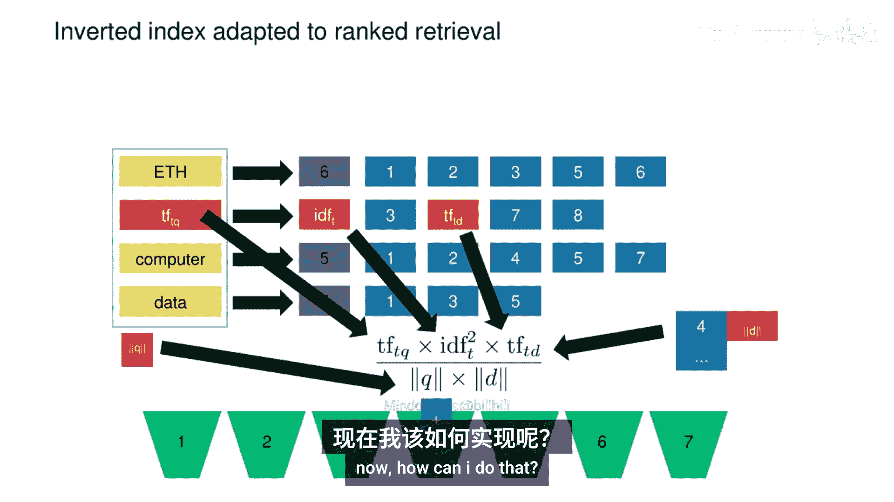
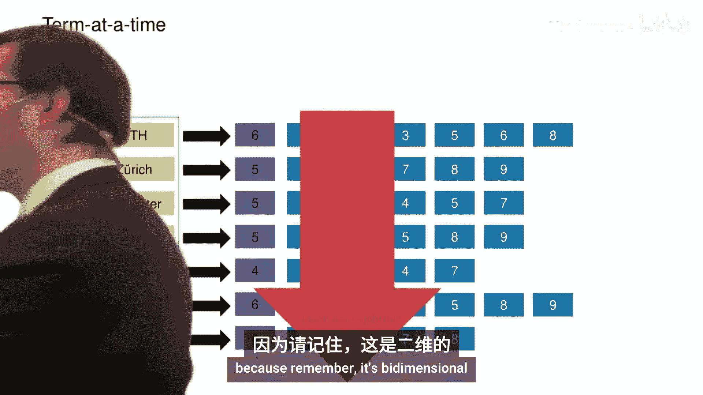
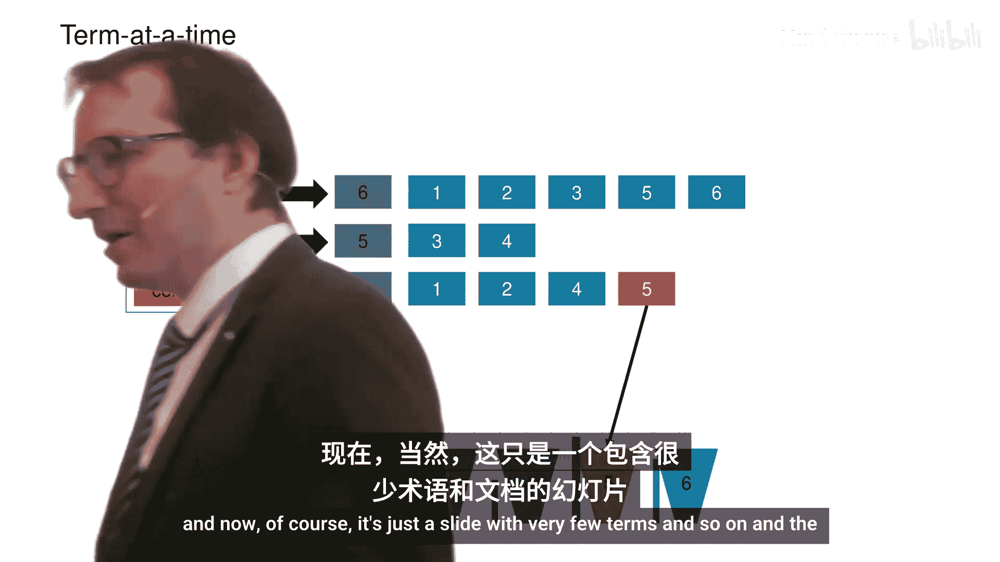
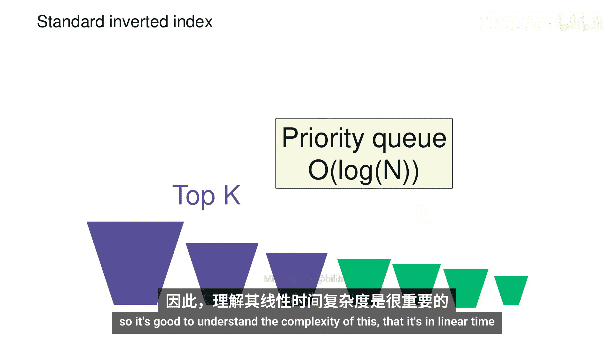
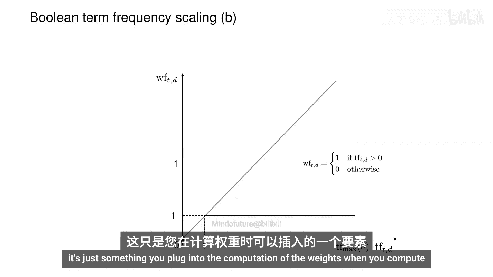

# 信息检索：P19：排序检索 (3/3) 📚

## 概述
在本节课中，我们将继续学习向量空间模型，并深入探讨其实现细节。我们将了解如何高效计算文档与查询之间的相似度，以及如何通过不同的权重方案来调整检索效果。

## 向量空间模型回顾
上一节我们介绍了向量空间模型的基本概念，即将文档和查询表示为向量，并通过计算向量间的夹角余弦值来衡量相似度。具体来说，我们通常使用 **TF-IDF** 值来构建这些向量。

**TF-IDF** 的计算公式为：
`TF-IDF(t, d) = TF(t, d) * IDF(t)`
其中：
*   `TF(t, d)` 是词项 `t` 在文档 `d` 中的词频。
*   `IDF(t)` 是词项 `t` 的逆文档频率，常用公式为 `log(N / df(t))`，`N` 是文档总数，`df(t)` 是包含词项 `t` 的文档数。

## 相似度计算与实现
本节中我们来看看如何高效地计算查询向量与所有文档向量的内积（即标量积），这是排序的基础。

### 证据累积策略
计算标量积本质上是一个求和过程：对每个文档，将其向量与查询向量对应维度的乘积相加。由于索引规模庞大，我们需要高效的累积策略。以下是两种主要的实现方式：

**1. 按词项累积**
这种方法一次处理查询中的一个词项。
*   遍历该词项的倒排记录表。
*   对于记录表中的每个文档，计算该词项对应的 `TF-IDF` 乘积（查询的 `TF-IDF` × 文档的 `TF-IDF`）。
*   将这个乘积累加到该文档对应的“分数桶”中。
*   处理完一个词项后，再处理下一个词项，继续向各文档的分数桶中累加。

**2. 按文档累积**
这种方法一次处理一个文档。
*   对于一个文档，找出查询中所有出现在该文档中的词项。
*   分别计算这些词项的 `TF-IDF` 乘积，并将它们累加，得到该文档的总分数。
*   处理完一个文档后，再处理下一个文档。

两种方法在数学上是等价的，最终都会得到每个文档与查询的标量积。选择哪种策略取决于系统实现的具体优化考虑。

### 排序与复杂度
得到所有文档的分数后，我们需要按分数降序排列，以返回最相关的文档。

*   **完全排序** 的复杂度是 `O(N log N)`，其中 `N` 是文档数量。
*   然而，用户通常只需要查看前 `K` 个结果（例如前10个）。此时，我们可以使用**优先队列（堆）**。
*   构建一个包含所有文档分数的堆需要 `O(N)` 时间。
*   从堆中提取前 `K` 个最高分文档需要 `O(K log N)` 时间。
*   由于 `K` 是常数，总体复杂度可以视为 `O(N)`，这比完全排序更高效。

## 权重方案变体 🍽️
我们之前介绍的 **TF-IDF** 是标准方案，但它并非唯一选择。信息检索领域有一个经典的权重方案集合，称为 **SMART** 表示法，它允许我们像点菜一样组合不同的权重计算方式。

SMART 表示法使用三个字母的代码来描述一个向量的权重计算规则，格式为：`ddd.qqq`
*   前三位 `ddd` 代表文档向量的权重计算规则。
*   后三位 `qqq` 代表查询向量的权重计算规则。
*   每位字母分别对应：词频处理、文档频率处理、向量归一化处理。

以下是常见的代码选项：

**词频处理**
*   `n` (natural): 直接使用原始词频，即 `weight = tf`。
*   `l` (logarithm): 使用对数词频，`weight = 1 + log(tf)`，用于抑制高频词的影响。
*   `a` (augmented): 使用增强词频，公式为 `0.5 + 0.5 * (tf / tf_max)`，用于平滑处理。
*   `b` (boolean): 二值化，词频大于0则为1，否则为0。`weight = 1 if tf > 0 else 0`。

**文档频率处理**
*   `n` (none): 不使用文档频率，即 `weight = weight * 1`。
*   `t` (idf): 使用标准的逆文档频率，`weight = weight * log(N / df)`。
*   `p` (probabilistic idf): 使用概率型的逆文档频率变体。

**归一化处理**
*   `n` (none): 不进行归一化。
*   `c` (cosine): 进行余弦归一化，即向量除以其欧几里得范数（长度），这是我们之前使用的标准方法。

**标准组合**
最常用的标准组合是 `lnc.ltc`。
*   文档向量：`l` (对数词频)，`t` (逆文档频率)，`c` (余弦归一化)。
*   查询向量：`l` (对数词频)，`t` (逆文档频率)，`c` (余弦归一化)。

在实际系统或习题中，如果使用非标准方案，通常会给出对应的代码提示，无需记忆所有公式，但需要理解标准方案并能根据代码查表计算。

## 总结
本节课我们一起学习了向量空间模型的具体实现和扩展。
1.  我们探讨了计算文档-查询相似度的两种证据累积策略：按词项累积和按文档累积。
2.  我们了解了使用优先队列高效获取前K个结果，其复杂度可降至 `O(N)`。
3.  我们介绍了 **SMART** 权重表示法，知道了除了标准的 **TF-IDF** 外，还存在多种对词频、文档频率和归一化的变体处理方式，这些变体可以通过特定的字母代码进行组合和配置。