# 【苏黎世联邦理工学院】信息检索-｜-Information-Retrieval-｜-Eth-Zurich-2025-p20-P20_8._优化_(1_2)--BV1ndsBzdEss_p20-

So we are staying on the same topic， right， We are just going to optimizeise now。 So if。

 even if there's something you missed， it will help you consolidate the knowledge。

 Did I reactivate the recording。I think so yes， it's recording， okay。All right。

So now we are going to improve and try to make it more efficient。

 And I'll take a look also at vector databases and using SQL to to do the computations on the vectors。

I have some remnants of last year's slides， because that was the day that a lot of people went to Europa back。

 And so we are having them in mind。 But I think it's still this year。

 And today is the startft of the registration。 So I thought I'd just leave the。

 the roller coaster slides on the slides。😊，Okay。So， it turns out。

That this approach with the vectors and the scalop products and the term frequency。

 document frequency and so on。Has become a huge hype。Which culminated with the LLMs。

 Cha GT and so on。 because inside it's all vectors and mattress multiplications and and， and， and。

 and， and。So， because of this。Because so many people suddenly wanted to run computation of vectors。

Database engineers thought， okay， we need to design database systems for that。

 Just like we have database systems for tables。 We have database systems for trees。

 for cubes for graphs。 We need database systems for vectors， vector databases。

 who has heard of vector databases。Some of you， right， It's all other place。

 a big hyp at the moment in the database community。And so this。

 what you see here is an extension of SQL。 So that should remind you of SQL right thats to create a table。

 And there is an extension here of Postgresql that allows you to have tables in which the type of a column can be a vector。

 you know the type can be a string an integer， a data and so on。

 but it can also be a vector with that extension。 So this creates a table with two columns。

 The first column is just an I 1，2，3，4，5 just enumerate and the second column in that example would store Tfi Idfs。

 So I'm creating a vector with1000 coordinates means that I would have 1000 terms in my collection。

 just an example。 and every record will contain one full sorry 10000， not 10，10000 terms。

 and every record will contain one vector with 10000 components。😊。

So that is a new type that we have here。That means that you can insert these vectors into your table。

 So in that case， of course， I didn't put 10000 values on my on my slides。

 but imagine that it's 10000 values here and I have one vector， two vectors and so on。

 right So that think of it of one document per row right， run every record is a document。

 And every time I have my TF IDF vector for the documents。Every coordinate corresponds to one term。

So far so good。Right， so this is how I can store it in a SQL table。

 But when it becomes really interesting is when you start querying。

 because that extension on vectors also contains additional operators。😊，And one of these operators。

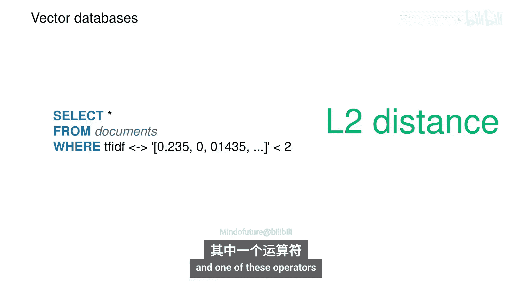

Compututes distances， right， So you can take， for example， the TF I DF of each document， right。

 for every document， you take the TF IDF from the table and you compare it with a query。

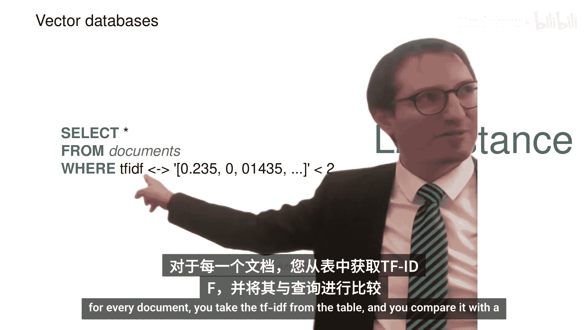

And you look for a T F， I D F that。Close to the query。 And you specify the bound right here， right。

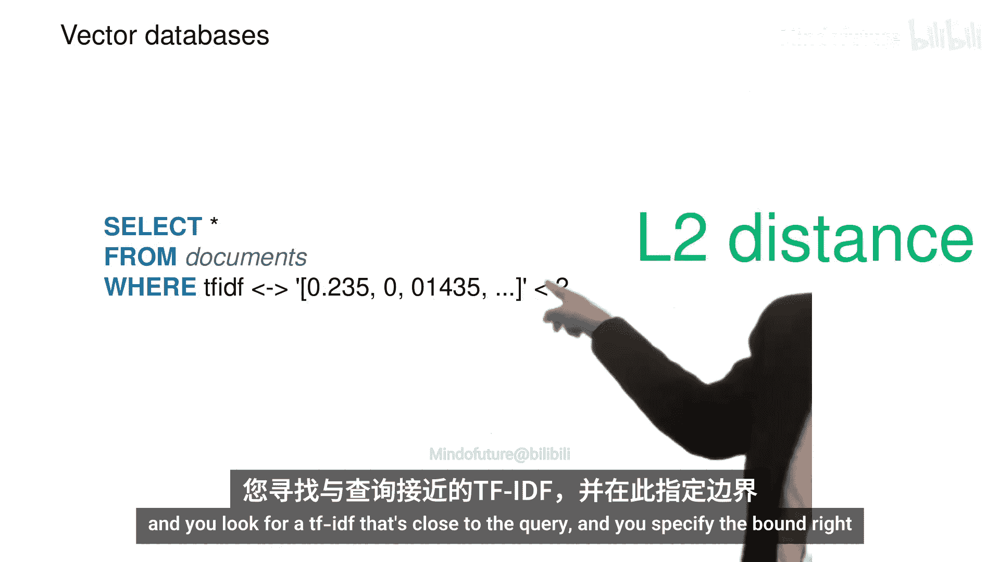

So what this does right here is that it's going to to compute the L2 distance， the， the Euclidean。

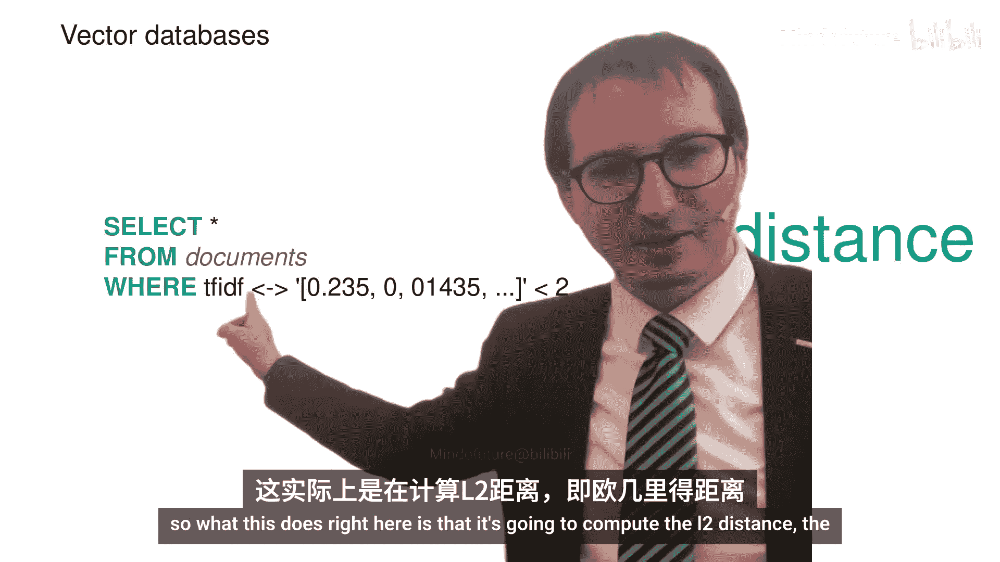

A distanceist。baby。

All right。

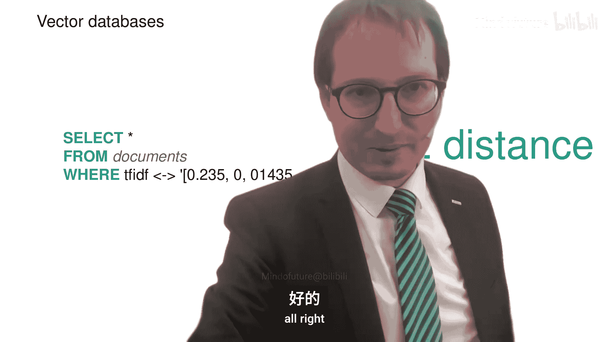

So that would be the L2 distance， but the L2 distance is not quite the 1 I gave you， right。

 The L2 distance would be the distance between the two points， right。So you can do it， right。

 But that's not the1 I told you last three weeks ago。

 The 1 I told you three weeks ago is the cosine distance。 That's the angle between the two。

 So that would be a different one。 That would be it， right， So they， they。

 I think they had a lot of fun designing this， right。

 they basically use this the dash in the middle of the twoarrow rows here。

 And if you use an equal sign。 Then it means the cosine distance。 That would be the one。 right。

 That is the notation for the cosine distance。 That would take the cosine distance between the two here。

😊。

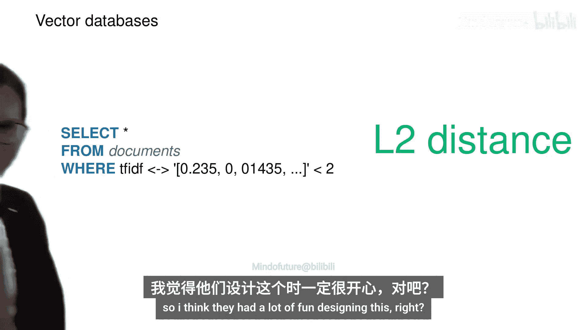

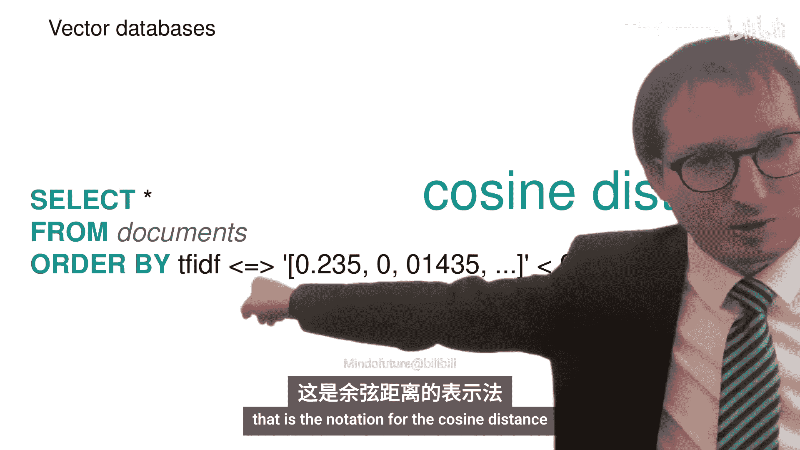

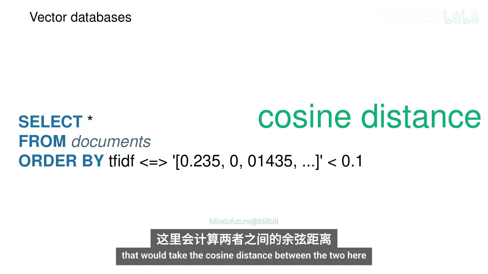

You can also do an inner product。 and you don't renormalize， right。

 Then you put this this hash symbol here。 You have the plus that would be the L1 distance。

 the L1 distance is almost like the Euclidean distance。 But instead of summing the squares。

 the square root of the sum of the squares， it takes the sum of the absolute values of the coordinates。

 right So that's called the L1 distance when you do that， that would be another annotation。

 and you also have a jackard distance that is kind of a modification of the jackar coefficients that turns it into a distance。

 but I'm not going to give you the details of that。 And then the humming distance。

 which is yet another distance like this。 So you see， you have all of these ways。

 all of these distances that are part of your library。 And now just with sQL。

 you can compute this car product and so on。 you don't need to worry about the details of the implementation。

 because the system does it for you and the system is highly optimized。

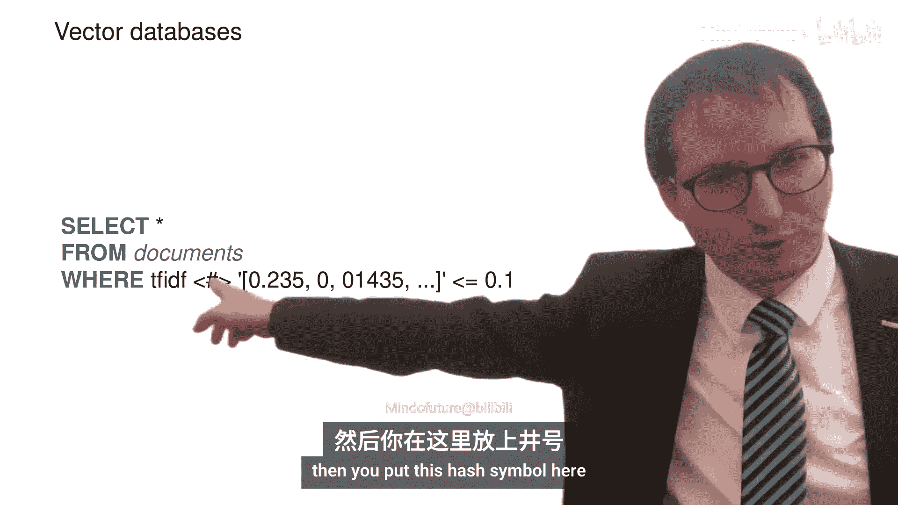

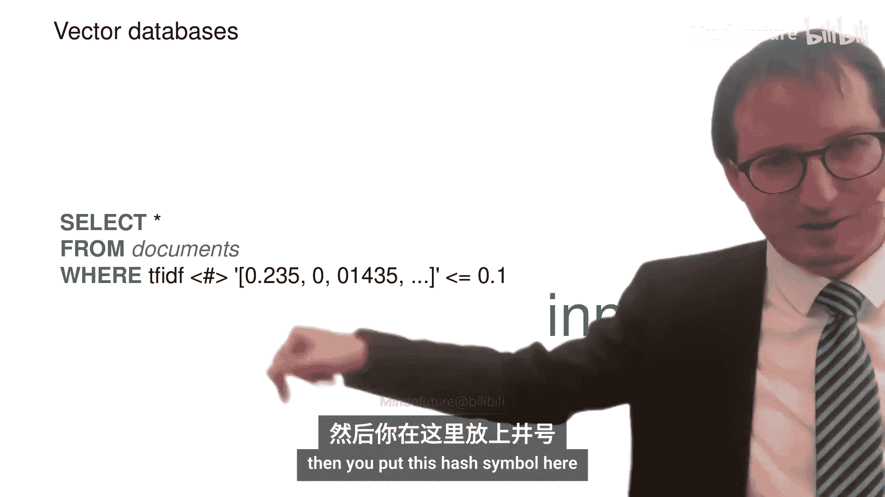

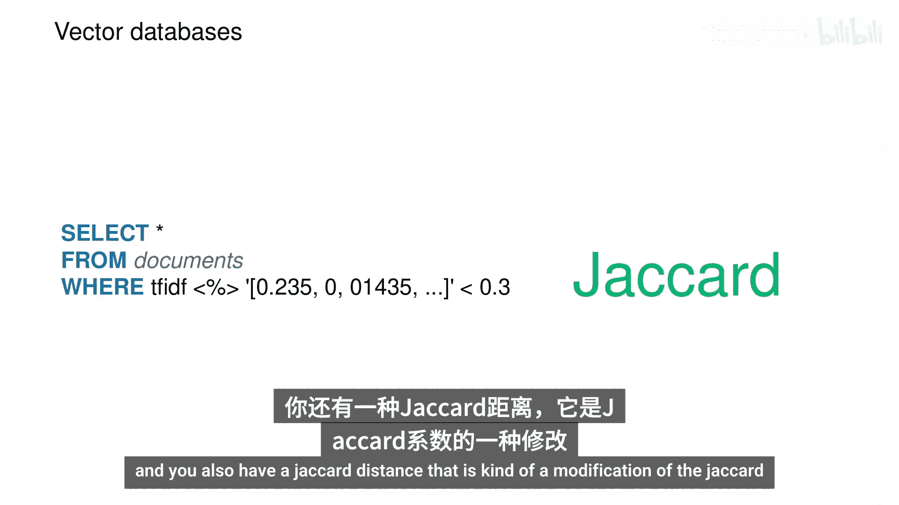

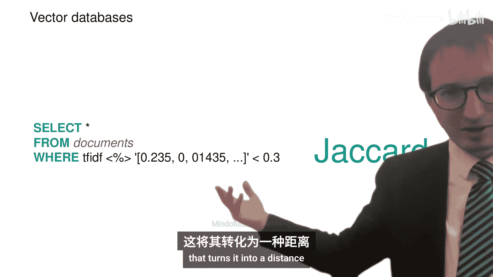

To compute these scala products and these things in a， in a very fast way， right？ So further course。

 of course， we have you compute them yourself and so on because you're learning， right。

 But in the end， the users don't even need to bother because they just use queries like this。

 and they directly gets the the scala products。Okay， so far so good， who is with me。Right。

 you agreed it simple， right， when you bring it to sQL like this， Just a few lines。 And that's it。

 right， super simple。But it's super simple because the engineers worked very hard to optimize it and make it fast and make it work。

 That so that's the the database engineers that optimize。

 And so now I'm going to go into the optimizations。

 the sort of things that they do in order to to optimize these things。

 So you remember these slide that I showed you at the start of today。

 we disease basically that the the what we want to accumulate as a sum， right。

 Remember we accumulate by summing over T with sum of other terms。For each document。Right。

 each document has its bucket and in each bucket with some over tea。So how do we do that efficiently。

 Well， at least you won't forget to register if you want to go， right， Okay， so。

The first thing we can do is。Get rid of the query length。 Why is it useless。

To divide by the query length here。Whos his why I can get rid of it， yes。Exactly。

 it's the same over all documents and terms。 So it's a constant。And because we want to sort。

By your quantity， if we change by a constant factor， it doesn't change the results。

 It doesn't change the ordering of the document。 So you're absolutely correct。 I can get rid of it。

 Gu， that's it。 Now， the division by the document， I don't need to divide every time， right。

 I don't need to divide for every term by the document。 Why don't， don't I do it at the end。 right。

 I first accumulate everything。 And then I will divide by the document length at the end。

 So let me take it away from here。 And I just put a mark here on the bucket that I shouldn't forget to divide at the end。

 right， And then I only divide one per document。 That already looks better， All right。

 What about the query term frequency， TF TQ here。Oh， one more thing we can do。

The buckets here that I'm accumulating into， Do you agree that I only to need to have the buckets for the documents that are going to have non zero。

 right， The documents that don't contain any of the terms， the buckets will remain empty anyway。

 So I don't even have to have the buckets in other， in other terms。

I can just create the buckets lazily whenever I see a document。

 But I don't bother creating these buckets for the， for the documents that， that I never see， right。

 So I can optimize here， too。We can also get rid of that one。 Why， Because in a query， typically。

 when you type a query on Google or any other engine。You type a few worlds， right。

 but you will not repeat worlds if you， if you look for like you you type E T H Zuric。

 you're not going to type E T H， E TH Xuric  Xuric Xuric， right， you just put each term once。

 So in many cases， you can just consider that the term frequency on the query side。

 it either it either is either one or0， right， It's one for the few terms that you have in your query and it's0 for the others。

 right。It's often the case。 It's not always the case。

 Who has ever pasted an error message into Google to see if other people had it to。Many of you。

 right， in that case， of course， that wouldn't be true because in the R。

 in a narrow message like that， you might have multiple terms and so on。 right。

 So it's just some approximation that in many cases， we would not have repetitions。

 And so in that case， it just went or 0。So we can get rid of it。 What when it's one。

 we just add this， when it's 0 that we don't even bother to， to add anything。So now， I get rid of。

This one。😊，Now。Look， I have twice the inverted document frequency here。

 I have it coming from the query side， and I have it coming from the document side， right。

 because I'm having the product of the TF IDF of the query and of the document。

 Do you agree it kind of redundant to multiply twice with the inverted document frequency， right。

 So why don't I get rid of the inverted document frequency on the query side。 I have a code for that。

 Remember， on the smart notation。 I have a code on the query side， I can put an n or something。

 And if I put an n， it gets rid of the D IDF。 So if I put an N in my smart scheme for the query at the second position for the document frequency。

😊，I get rid of the idea。 right， It's still there， but it's there on the document site。With Greece。

Right， so now I have only ones the IF。 So I'm good。 And now I just accumulate the TF I DF。

 So I already simplified a few things in there， Right， I just need to sum of all the TF I Ds。😊，书。

That is one， already one way to simplify things， right， You， you can。

 That's typically the way you think about it。But as not always。

 there are other tricks that you can use。嗯。Here's one of the tricks。

 You might have some terms that have very， very， very large postings list。

That might contain almost all the documents。 Do you remember where these are called。Stop2， right？

A stop world appears everywhere， right， And so。The idea is that if you have stop world in your query and you try to compute scores。

You're going to have a lot of buckets because you have almost all the documents in there。

 So you're going to have to accumulate scale of products for almost all the documents in the collection。

 That is very inefficient。But what is， what is the idea for a stop world。It's very low， right。

The idea was of a stop worldd， its says stop world。 So it's very frequent。

 So the inverted frequency is going to be close to 0。So why do we bother adding so many accumulators。

Just to fill them with something close to 0。 right， That's very inefficient。 So one trick is to just。

 to just get rid of the， of the， of the stop worlds。No。I can， also。

Pre select documents instead of computing my。Scaar products for every document in the collection。

 I can say maybe some of the documents that I prese might be relevant。

 I'm only going to compute the sca product for these documents。

 This is called inexact top K retrieval。 It means I only compute the sca product on a subset。😊，嗯。

In fact， it's not really such a big deal to do this in an inexact way。

 The reason is simply that if you use the TF IF approach with the cosine distance and so on。

 it's already an approximation， right mathematicalmaticly， of course， it's exact。

 It's an exact mathematical formula。But do you agree that applying this math to the real world is an approximation。

Right， when we say， okay， the， the， the， the cosine of the angle between the vectors gives us the score。

 That is an approximation of the real world。 It might not be the。

 it might be that the score doesn't exactly correspond to what people would say about the score。

 It's just a mathematical model for that。 And so since it's already not perfect。

 Then if we take something that is a bit less perfect， Then that's fine， too， right。

 It's not such a big deal。So we just preselect documents。

And compute the score on the on a smaller set。嗯。And so。What I can do， for example， is。

Get rid of the stop worlds here。 So the stop wealth would be end school。 My school might。

 I might push it by saying that school is the stop world and is surely a stop world。

 School might be a bit more frequent， right， But in that query。

 it E TH and Zuric that are really the the the rarer terms here。

 So I might want to focus on E TH and Zuric and just and just drop these and。It's。

 it has the benefits of eliminating a lot of computations。

 because if I eliminate the terms that have a low ideaF。

 I'm also eliminating a lot of postings to to accumulate。 So I take care of the stop world。Now。

 a second idea is that I can select the documents in the collection。That contain most of the terms。

So if I have a a document in my collection。That contains E T H and Zuric and end and school。

 That's a very good candidate， right， So I can keep it。

 If I have another document that only contains the term end。

 but it doesn't contain E T H Zuric and school。 Do you agree。

 I can just eliminate it from the accumulation， right。

 I I don't even have to bother accumulating the score for end， right， You agree with that， right。

 So this is what I mean with selecting documents。 We select the documents that contain all of these。

 and we throw away。 We don't even bother to compute the score for the documents that contain only a few terms。

 right。😊，Okay。But the problem is that in doing that。

 we might eliminate too many documents because if you have a long query。

 finding a documents that contain all terms that contains all terms might be a bit difficult， right。

 So there are a few tricks that people have developed over time。

 And so here I'm basically just going through a little bit of a toolbox of all the tips and tricks that people have been using to improve the system。

 It's a bit of a random list。Of tricks。This trick here is known as the champion list。

What we do is that we have all of these postings， right，Normally， they are sorted by document I D。

 the postings， But I'm going to sort them instead of sorting them by document。 I D。

 I'm going to sort my document by decreasing term frequencies。Right。

 so the terms that have a high term frequencies are going to contribute more to the accumulation to the scalar product and those on the right with very low term frequencies that will contribute less。

 right？ And so the idea of the champions list is that I only keep the top R documents where R is some。

Parameter that you can decide on。 And I'm just going to focus for every post exist。

 I'm going to focus on the terms that have the highest term。 So。

 sorry on the documents that have the highest term frequencies。 right， So fast so good。

I'm just keeping the highest term frequencies。 And now is chosen statically。嗯。

R might also depend on the rarity of the term， right？ I if， if a term is very rare。

 then maybe I can keep more documents for a term that is rare。

 And if I have a term that is more frequent， like school。

 then I can take a lower number of documents that I keep， right。

So this is a trick that the people have been using。So。In other words。

 what we need to do is we take the top R for each term。

And we need to take the union of these postings。 Do you remember the union algorithm。That we use。

Do you see the difficulty here， Can I apply that algorithm here。Who thinks I can。Okay。

 we thinks I cannot。Okay， indeed， I cannot。 Does anybody want to tell me why you cannot。李不听。什么。

Let detail tell you then so。The idea is that we reed it。 It was initially sorted by document I D。

 Do you agree that if I sort the document by document I D。

The order will be exactly the same for every term。That is why my union algorithm works。

 because I'm traversing all of the postsing this。 But the documents are in the same order。

 That's why it works。Do you agree here that since I solve by term frequency。

The other of the document is going to be different， every time。For every term。

 the documents would be in a different order。 That is why I cannot use the union algorithm， right。

 So things are more complex， right， You basically open suddenly a can of worms and。

 and things get actually more difficult， right， because the order depends on the term。

 We cannot use the union algorithm。So then people had to come up with a trick。 then。

 because since it doesn't work， we need another trick。

And so the trick that the people have is that they will keep the post list in the document I D order so that it's all the same。

 They can do the union， but they are going to build the champions list separately in a different structure。

 right， So they are going to to， to just keep the documents that are part of the champions list。

 But when you apply the union algorithm， you still go through the regular lists that are sorted by document I D。

 right。嗯。Here is yet another trick that people have been using。

 I'm just going through the tricks today。A trick is to not only sort the documents by decreasing term frequency。

 but to also sort the terms by decreasing IF。

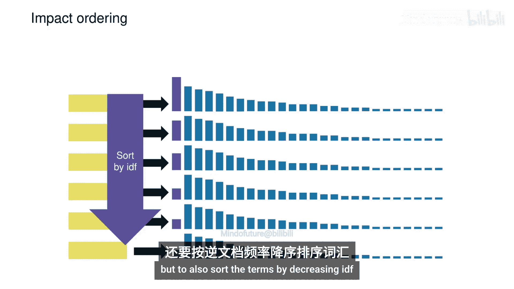

So， you agreed that。It means you're going to have all of the interesting terms that are rare。

 like ETH， Zuric， and so on at the top。

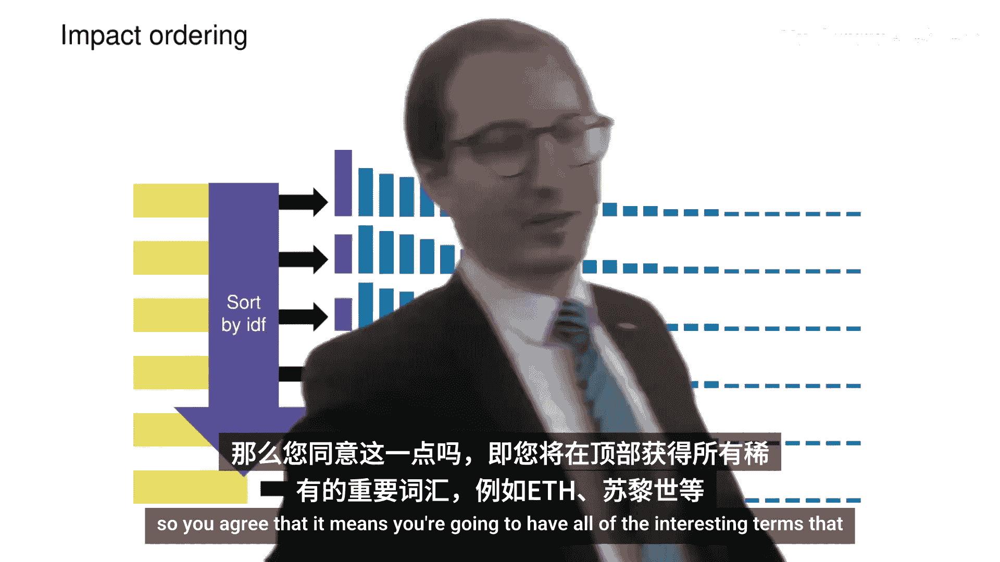

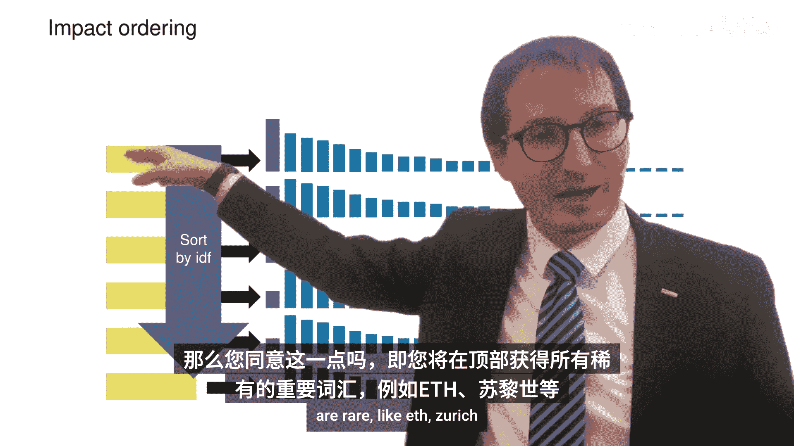

And you're going to have all the stop world and the useless V， E， B， and and so on at the bottom。

 right， And then you're going to have the documents that contain a lot of times The terms on the left and the documents that do not contain so many of the terms on the right。

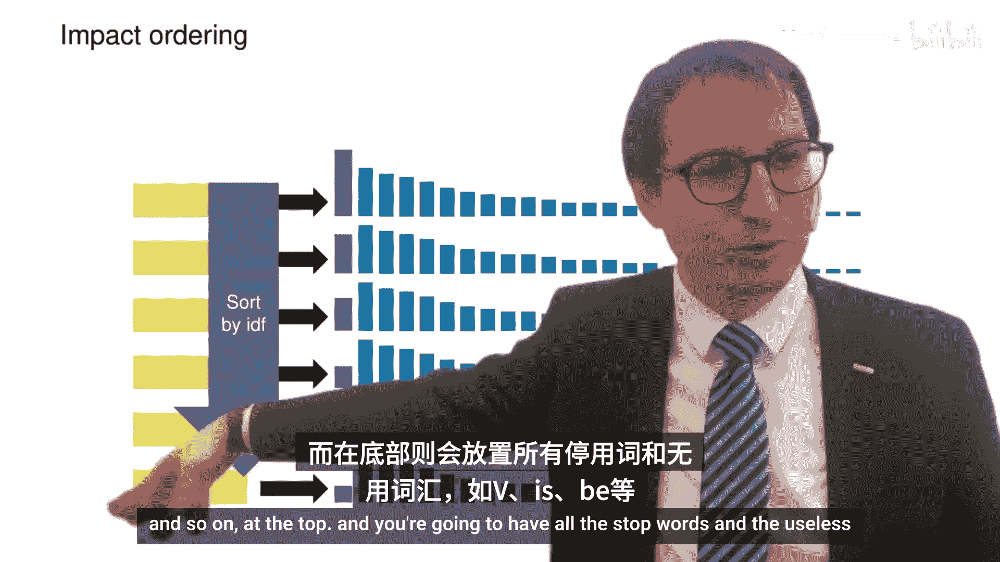

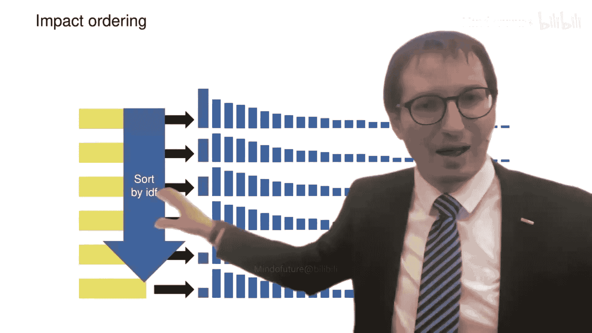

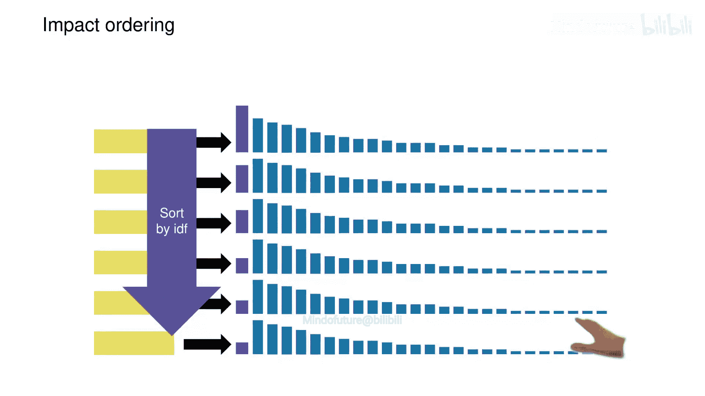

Do you agree。That the zone that we are really interested in。

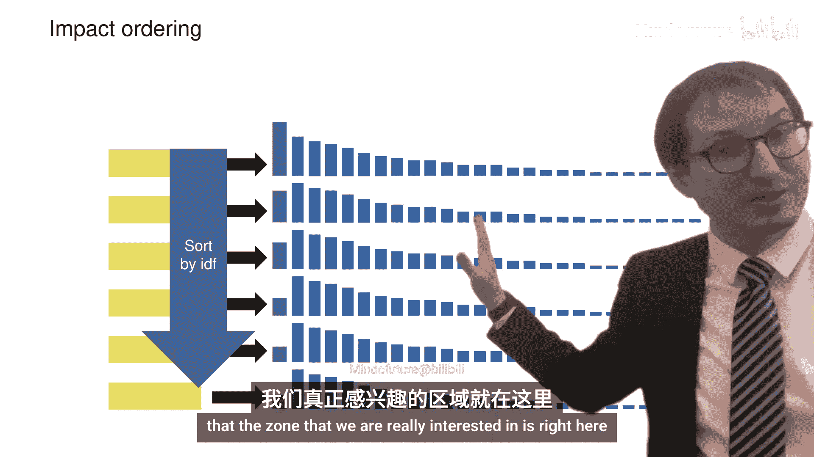

Is right here。Because these are the terms that are rare。

 so that these are the ones that characterize the documents。

 and these are the documents that contain them a lot。

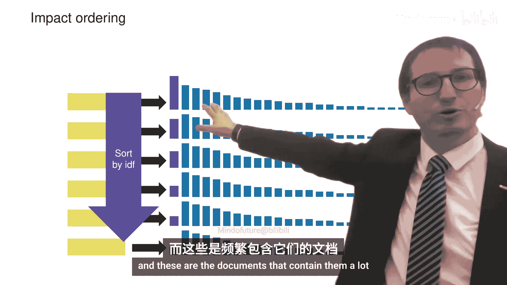

So this is here the zone that I'm interested in。So if I sort by I D Fs like this and by term frequency like this。

 I'm going to basically have at the same place all of the TF I DFs that I'm the most interested in accumulating。

 right， the higher ones。😊。

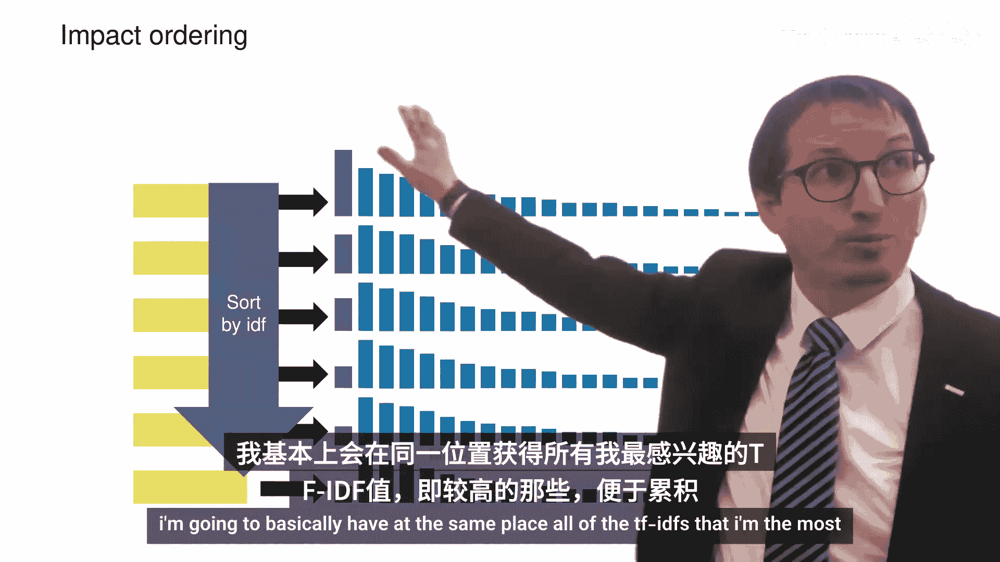

And so this is basically the idea that we are going to start accumulating the scalop products right here from that zone。

 And then we go a bit down and we go a bit to the right。 But at some point， we can just stop。

 We don't have to go all the way。 right， So that is yet another trick。

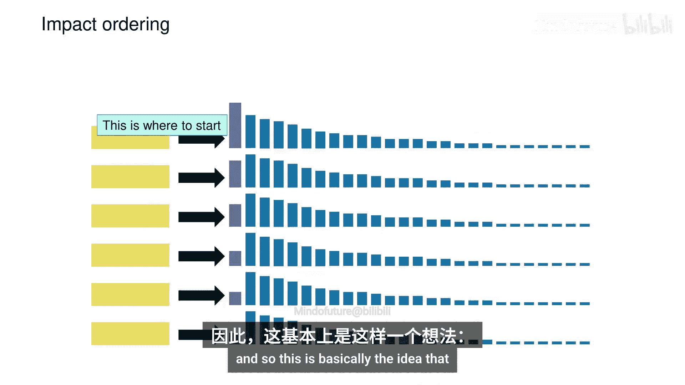

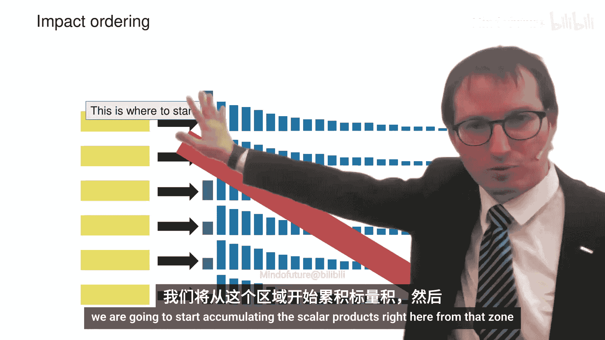

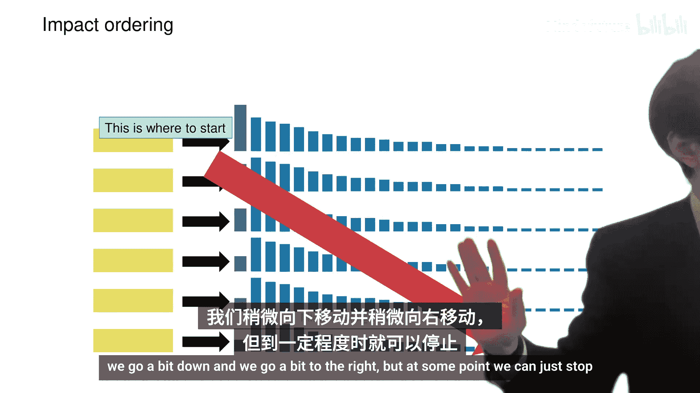

That people are using。And。What you need to understand then。

 which is because the order of the documents depends on the terms。

 It only works with thermometer time traal。If I want to accumulate the scalop product with this。

Kind of structure。 I have to do it。 term at a time。If I do it document at a time。

 I again have the problem that I cannot use the union algorithm。 If I do it document at a time。

 there is no way I can traverse document by document from the left to the right。

 because there is no left and right。 The documents are not all about the same。 Does it make sense。

Or whom does that make sense。For whom does that not make sense。Okay， for most of you， it makes sense。

 alright。So basically， document at a time is only possible if all of my posting lists all have the same order。

 Otherwise， it's no big deal。 I just use term at a time。 and term at a time is perfectly fine。ok。

Yet another trick， because I'm just throwing tricks at you today is that in some cases。

 I might one to press select documents， and I want to return the page with the top 10。

 but I don't have enough results from that selected set。Of documents。

 And so what people do in that case， instead of having just one champions list that they take out of the of the list。

 they just maintain several lists。 For example， you could have two list。

 the high list and the low list。 So you have the list of documents for a term that contain it a lot。

 And then a second list that contain it a bit less。So you。

 you basically can first try with the high list。 if that gives you enough documents for your top 10 page。

 then that's fine。 you stop here。 And if you don't manage to get 10 documents to return to the user。

 then you go to the low list。Right， so that's another trick。So the way it's done， for example。

 you can even do it with the three instead of just two tiers。 So in in that case。

 I'm just cutting my my documents in three list， the high list， the medium list and the low list。

 And now I have three indices， I have the tier 1， the tier 2 and the tier 3。

 And the idea is that I go to the tier 1， the top tier， if that gets me 10 documents， I stop here。

 if I don't have enough results， I go to tier 2。 If I still do not manage to find 10 documents。

 and I go to tier 3。 right So that's that's a trick to have this this seamless down ratingding right If you don't manage in the top tiers。

 you just go to the next tiers。So far so good。 It's a bit a boring list， right。

 Because all I did is throw tricks at you。 I didn't go into merge details。

 I just want you to be aware of the tricks that people have been using in order to optimize this。Now。

 there is another method。This is called clustering。

Who visits the machine learning lecture and head of clustering there， You did， right。

 So we can use it here， too。 So very briefly， it's the idea that I have my vector space。

 and every document is a vector and so on。 But basically。

 I can pick a few leaders like the square root of the number of the documents。

 And then I can use clusters around each leader。😊，I can do it based on the angle。 Of course。

 it doesn't have to be based on the angle。 But if I do it based on the angle。

 then these would be my clusters， right， based on the cosine distance。

And the ideas that I have basically put the documents together that belong together。

 And whenever I have a query， what I do is that I look at the cluster in which my query is。

 And I'm going to select the documents that are in that cluster。 right。

 That's another trick based on cluster。And I can then compute the scores and accumulate the sc of product。

Only further documents that are in the cluster of the query， Right， So that is yet another week。

 So you wouldn't believe all the tricks that people have come up over the several decades of work actually to。

 to build these systems， which actually brings us us to the break。

That is well deserved because I see that it is 11。So I'd see you then in 15 minutes at 16 past11。

 because I don't want to remove from you the one minutes that I that I took right now。

 So see you at 16 past 11 for the， for the continuation。

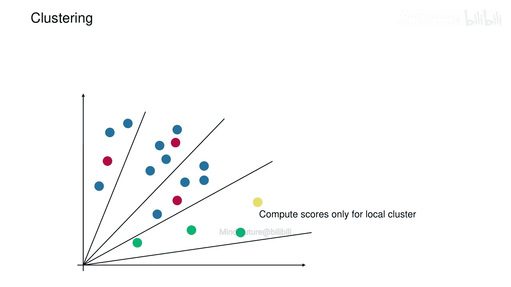