# 信息检索：8：优化 (1/2) 🚀

在本节课中，我们将学习如何优化向量空间模型的计算效率。我们将探讨如何利用向量数据库和SQL来简化向量运算，并介绍一系列用于加速相关性排序的实用技巧。

---

## 向量数据库与SQL扩展

上一节我们介绍了基于向量和点积的检索模型。本节中我们来看看如何利用数据库技术来高效地处理这些向量运算。

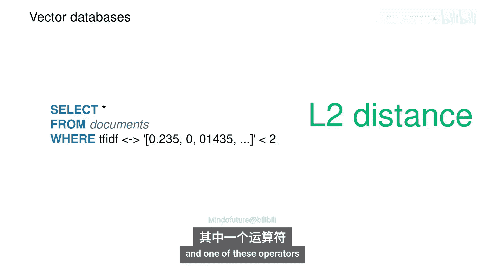

随着大语言模型（LLM）和ChatGPT的兴起，向量计算变得极其重要。因此，数据库工程师设计了专门的**向量数据库**，就像为表格、树、图设计数据库一样。

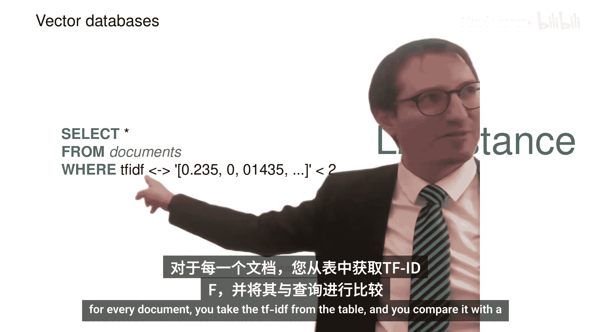

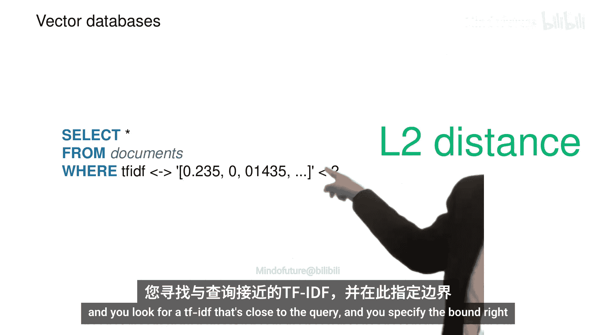


以下是一个使用PostgreSQL扩展创建向量表的SQL示例。它创建了一个表，其中一列可以存储向量。

```sql
CREATE TABLE docs (
    id INTEGER,
    tfidf_vector VECTOR(10000)
);
```

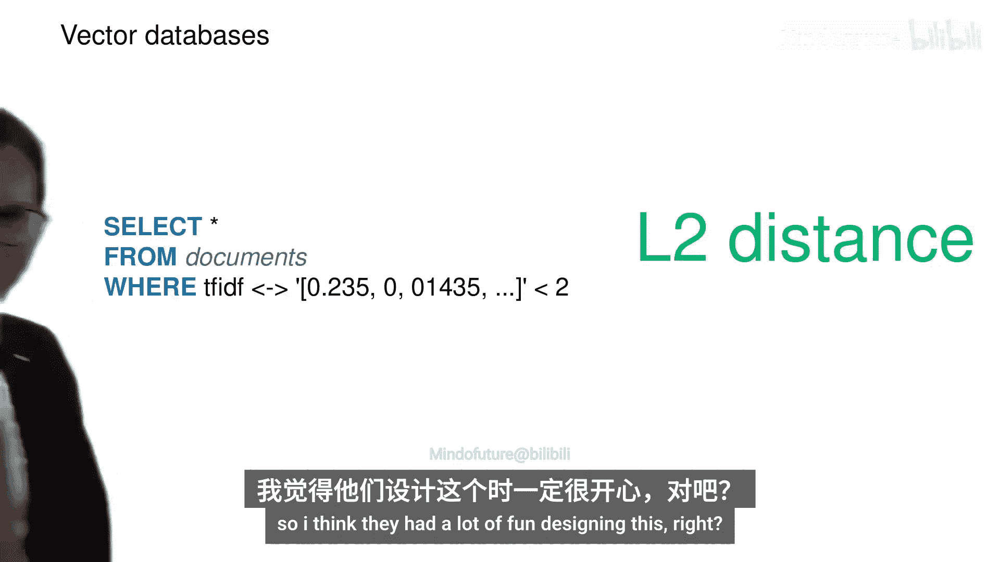


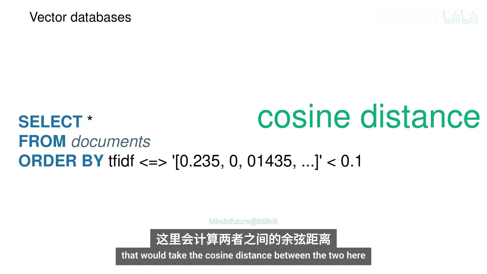

这段代码创建了一个包含两列的表：`id`是文档编号，`tfidf_vector`是一个包含10000个分量的向量，每个分量对应一个词的TF-IDF值。可以将其理解为每一行存储一个文档的TF-IDF向量。

将向量存入SQL表后，查询变得非常有趣，因为向量扩展提供了额外的运算符。


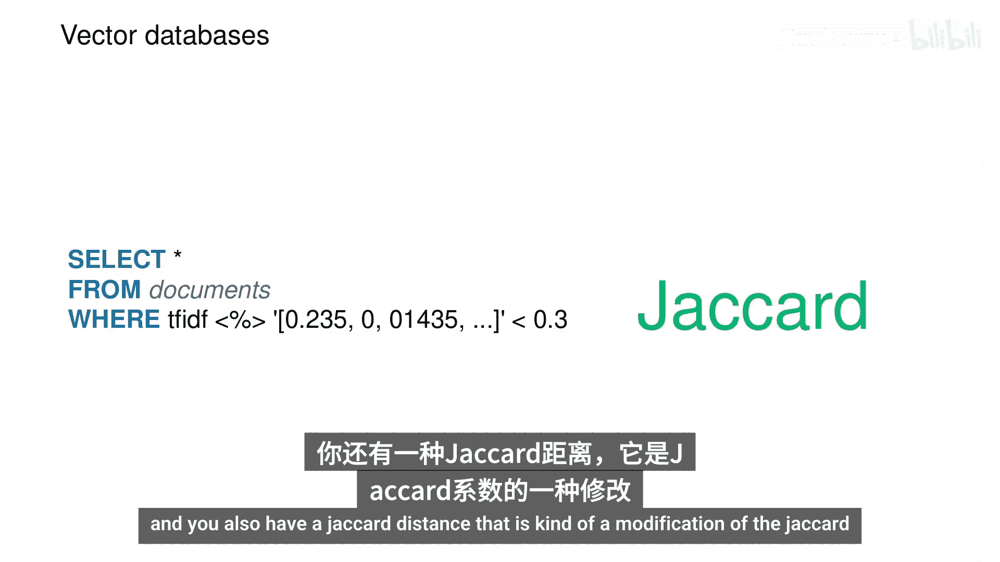

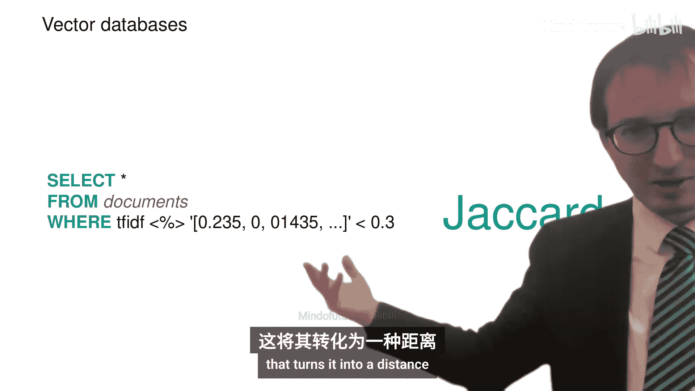

## 使用SQL进行向量距离计算

存储向量后，我们可以使用SQL直接计算向量之间的距离，例如查找与查询向量最接近的文档。

以下是计算**欧几里得距离（L2距离）**的查询示例：

```sql
SELECT id FROM docs
ORDER BY tfidf_vector <-> '[0.1, 0.2, ...]'::vector
LIMIT 10;
```

运算符 `<->` 用于计算L2距离。然而，我们之前课程中使用的相似度度量是**余弦相似度**。

计算**余弦距离**的运算符略有不同：

```sql
SELECT id FROM docs
ORDER BY tfidf_vector <=> '[0.1, 0.2, ...]'::vector
LIMIT 10;
```

运算符 `<=>` 用于计算余弦距离，它衡量的是向量之间的夹角。

此外，系统还支持其他距离度量方式：
*   **内积**：使用 `#<` 运算符。
*   **L1距离**：使用 `<+>` 运算符，计算各分量绝对值的和。
*   **汉明距离**等。

使用SQL的好处在于，开发者无需关心底层实现细节，数据库系统会对其进行高度优化，从而快速完成点积等计算。

## 相关性分数计算的优化技巧

尽管SQL接口很简单，但其背后是大量的优化工作。现在，我们来回顾并优化之前介绍的相关性分数计算公式。

初始的分数计算公式为：
`score(q, d) = Σ (tf_t,q * idf_t² * tf_t,d) / (|q| * |d|)`

以下是我们可以进行的一系列优化步骤：

**1. 消除查询向量长度**
因为查询向量长度 `|q|` 对所有文档都是一个常数，除以它不会改变文档的排序顺序，所以可以直接移除。

**2. 延迟处理文档向量长度**
我们不需要在累加每个词的贡献时都除以文档长度 `|d|`。可以先完成所有词的累加，最后再为每个文档统一除以一次其长度。

**3. 惰性创建累加器**
我们只需要为那些至少包含一个查询词的文档创建“桶”（累加器）。对于不包含任何查询词的文档，可以完全忽略。

**4. 简化查询词项权重**
在大多数搜索场景中，用户输入的查询词不会重复。因此，可以假设查询中的词项频率 `tf_t,q` 非0即1。当它为1时，可以直接累加；为0时则跳过。这简化了计算。

**5. 合并逆文档频率**
公式中，逆文档频率 `idf_t` 在查询侧和文档侧各出现一次，是冗余的。我们可以调整“SMART”记法中的查询权重，只保留文档侧的 `idf_t`。

经过这些优化，我们需要计算的核心简化为：
`score(q, d) = Σ (idf_t * tf_t,d) / |d|`
即对每个文档，我们累加其包含的所有查询词的 `TF-IDF` 值，最后再除以文档长度。

## 近似检索与预选策略

除了公式优化，我们还可以通过近似检索来大幅提升效率，即不计算所有文档的精确分数。

**1. 忽略停用词**
停用词（如“and”、“the”）的IDF值很低，对最终分数贡献微乎其微，但其倒排记录表非常长。忽略它们可以避免大量不必要的累加操作。

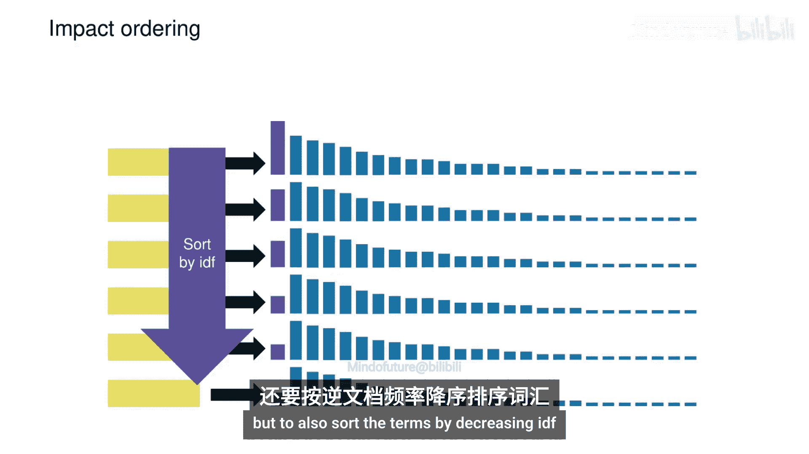

**2. 文档预选**
我们不必为集合中的每个文档计算分数。可以只预选那些可能相关的文档（例如，包含较多查询词的文档）进行计算。这被称为**近似Top-K检索**。


由于TF-IDF模型本身就是对现实世界相关性的一种近似，因此这种近似检索通常是可接受的。

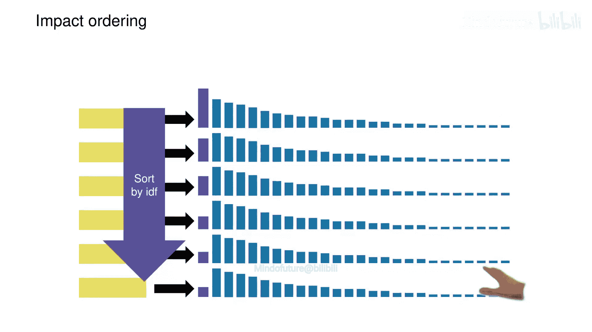

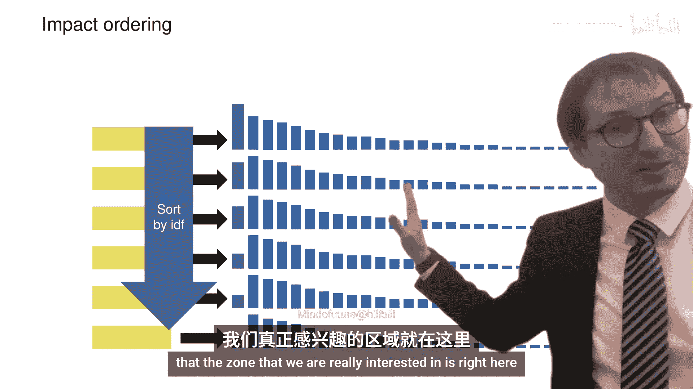

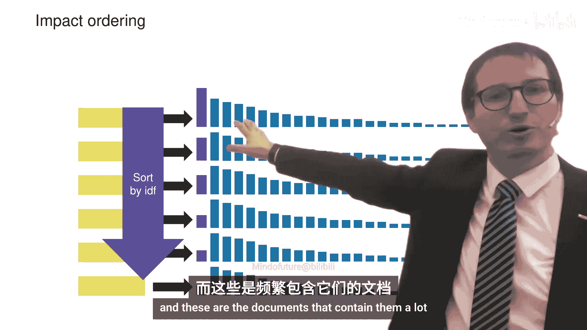

## 高级优化技巧工具箱

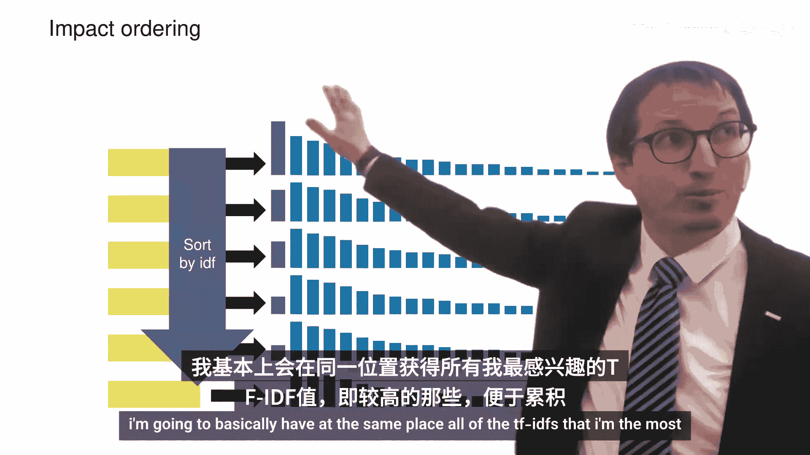

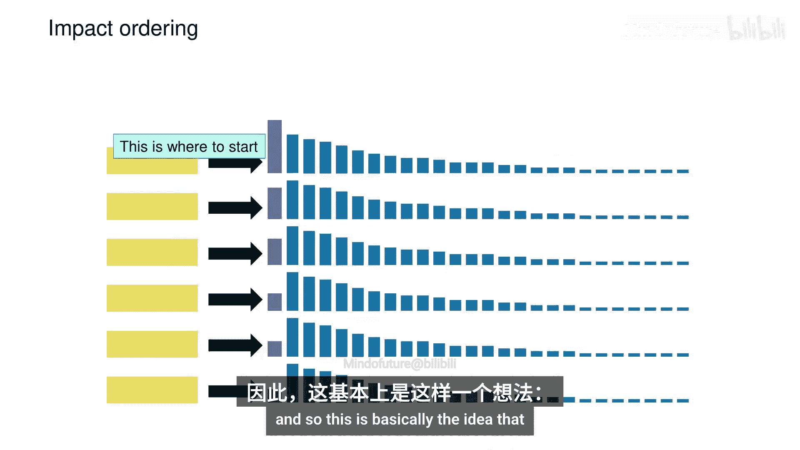

以下是业界常用的一些高级优化技巧：


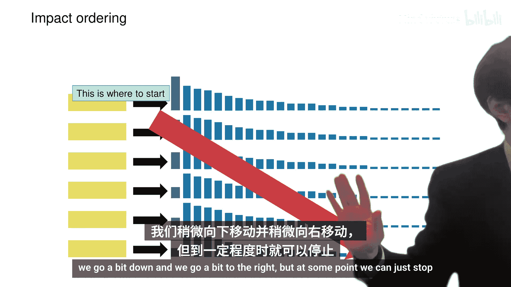

**冠军列表法**
为每个词的倒排记录表，不按文档ID排序，而是按词项频率 `tf_t,d` **降序**排列。我们只保留每个词项频率最高的前 `R` 个文档（即“冠军”），并仅在这些文档中计算分数。参数 `R` 可以根据词的稀有度动态调整。

但这种方法带来一个问题：不同词的“冠军列表”文档顺序不同，导致无法使用之前高效的**合并算法**。解决方案是同时维护按文档ID排序的原始列表和按词频排序的冠军列表，查询时使用后者进行预选。

**联合排序法**
将词按IDF降序排列（稀有词在前），将文档按词频降序排列。这样，高IDF词和高词频文档的交集区域（矩阵左上角）包含了贡献最大的TF-IDF值。我们可以优先计算这个区域的点积，并设定阈值提前终止计算，而不必遍历所有词和文档。

这种方法通常采用**按词遍历**的方式来实现累加。

**分层索引法**
将每个词的文档列表分为多个层级（例如：高频层、中频层、低频层）。查询时，首先只在最高频层中搜索。如果返回的文档数量不足（例如不足10个），则扩展到下一层继续搜索，以此类推。这样可以保证在多数简单查询中速度极快，同时对复杂查询也有兜底策略。

**聚类法**
利用机器学习中的聚类技术。预先将所有文档向量聚类，并选出每个簇的“代表”点。对于一个新的查询向量，首先找到它所属的簇（即距离最近的“代表”点），然后只与该簇内的文档计算相似度。这相当于将搜索范围缩小到了一个相关文档子集。

---

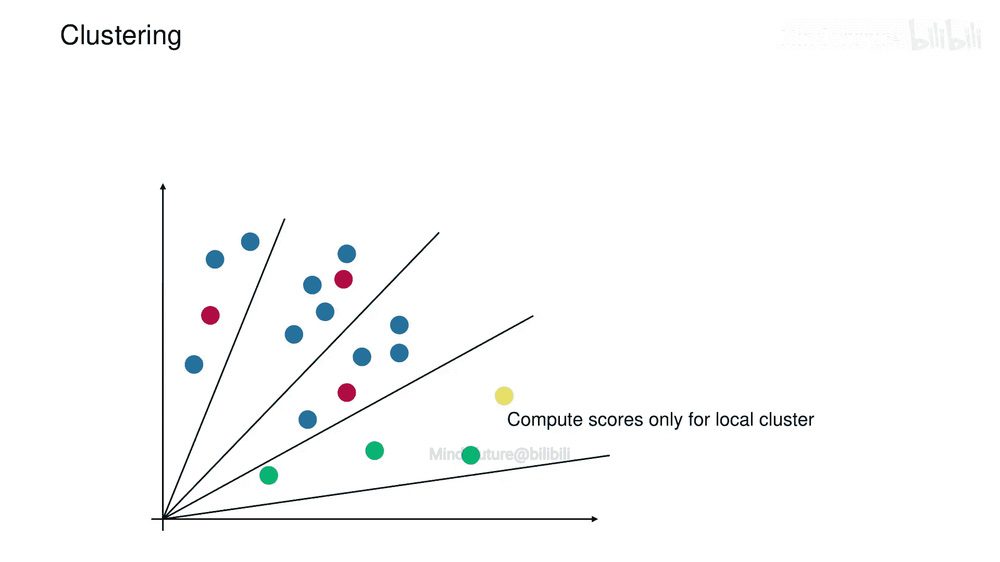

本节课中我们一起学习了信息检索系统的核心优化策略。我们了解了如何利用向量数据库和SQL来简化向量运算，并深入探讨了从公式简化、近似检索到冠军列表、分层索引等多种实用优化技巧。这些方法共同作用，使得大规模搜索引擎能够快速响应用户查询。下一节，我们将继续探讨更多优化技术及其实现细节。