# 【苏黎世联邦理工学院】信息检索-｜-Information-Retrieval-｜-Eth-Zurich-2025-p23-P23_9._评估_(2_2)--BV1ndsBzdEss_p23-

The future before the exam。So we start smoothly today。

 I will ask you a few questions on the clicker app to make sure that you're following。

 if you have any questions about what we've done last week or in the previous weeks。

 I can also take them。 Then I will finish the path on evaluation。

 And then we'll jump to probabilities。 So heavy math。Alright。そう。It's fast smooth。To the questions。

 So here is。

Well， so this is in the vector space model， right， when we take documents as bags of words。

 meaning that we care about the number of times。Terms appear in documents。

We could use the term frequencies in the vectors， right。

 bid document vectors where the coordinates all the term frequencies， right， Remember。

 it's one coordinate per term。 Then we would put the term frequency。

Why is that not a good idea to just put the term frequency and that it。

Is it because ranked retrieval then comes down to Buyan retrieval。

 which we've been covering in the first week of the course and the whole linear algebra is a useless overhead compared to plain intersections of posting exists。

 Or is it because some terms may be concentrated in just a few documents。

 or is it because the most relevant documents have low term frequencies。

 and we need inverted term frequency instead。 or who said that this is not a good idea。 This is。

 in fact， an excellence idea。SoRemember， term frequency is what we denoted as E。

And it has two parameters in the subscripts。A term and a document。

 And it is the number of times that said term appears in said documents。

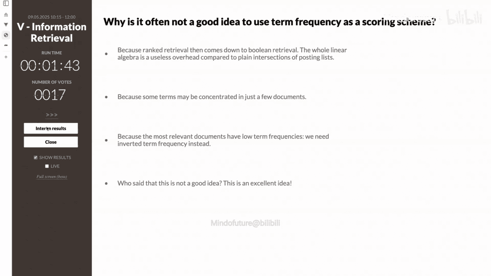

And I am pleased to see that the majority is correct。

Indeed， do you remember what we add in addition to the term frequency。

 what do we multiply it with very often。The I F， yes， the inverted document frequency， right。

 It's not the only way， right， TF IDF is the standard out way by default。

 If you don't have any ideas， then just put the TF I DF。

But I also told you that there's many variations of these。 I even gave you the restaurant menu。

 the smart notation with all the variations that you can have。 If you don't want the idea F。

 then you can do without it。 Not necessarily a good idea， but you can。If you want to renormalize。

 you can。 if you don't want to renmalize， then you， you also have that choice。

 If you are not happy with just the term frequency。

 you have all kinds of variations with the log of that， or you can fall back to Boan。

 just one or0 for the term frequency。 So you have a whole menu。 But the default is TF I DF。

 If you don't have any。Specific needs beyond that。 Alright， so indeed。

 the reason why we do multiply with the IF in general is that。

That wouldn't account or how rare a term is。 So it may be that some terms are only used in very specific documents。

 specialized documents， whereas other terms are very frequent。 And the stop world， for example。

 would have a very high document frequency， and there's a very low inverted document frequency。

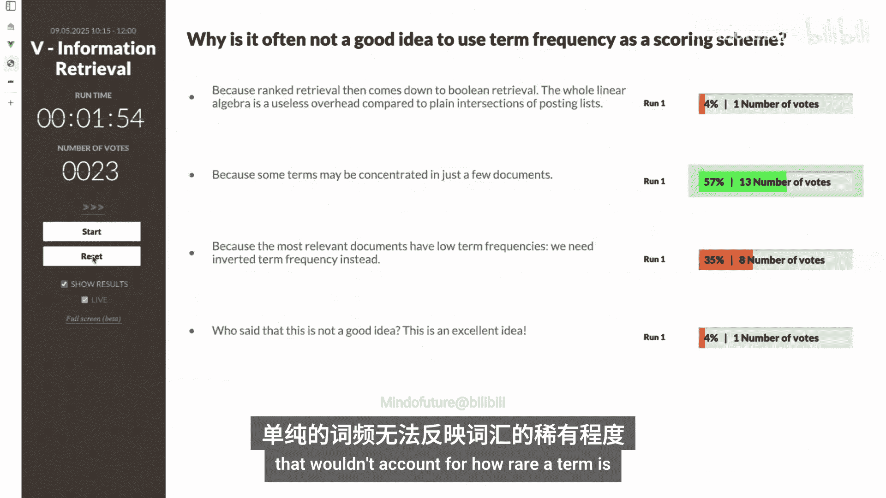

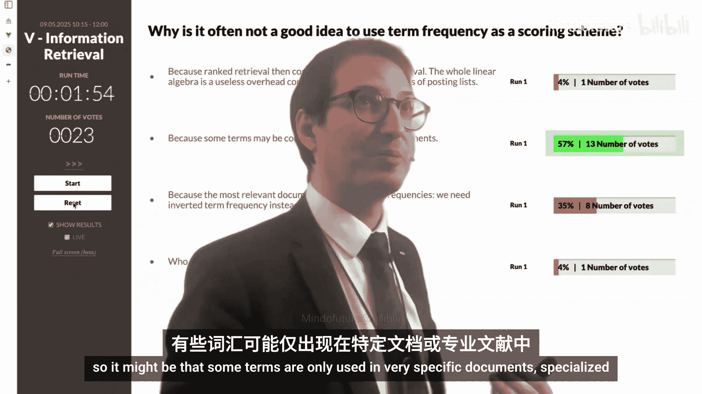

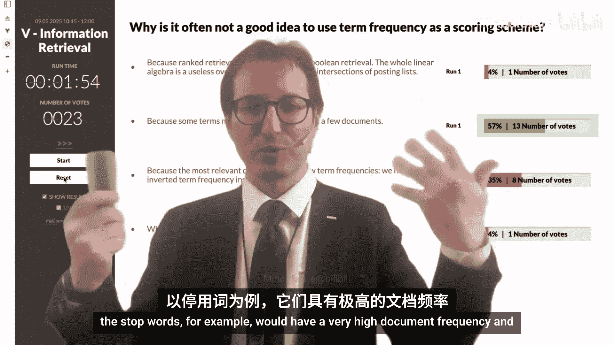

Okay， so this。This is good。 And the third one is actually made up because there is no such thing as an inverted term frequency that not that I know at least it's inverted documents frequency。

And， in fact， the low term frequencies would make the documents less relevant rather than more relevant。

 So it's the， it's the opposites。And in fact， to be fair， the， the。

 the person who answer felt true to the last one。Could be considered to be partially correct if you're on the query side。

 because remember that we have this choice on the query side and document side， the weights we put。

 And we saw that it's not necessary to have the ideaF on both the query site and the document side when we do the sc product。

 So it's typical to have the ideaF on the document vectors。 And in the query vector。

 we can just put the the term frequencies， right， so。

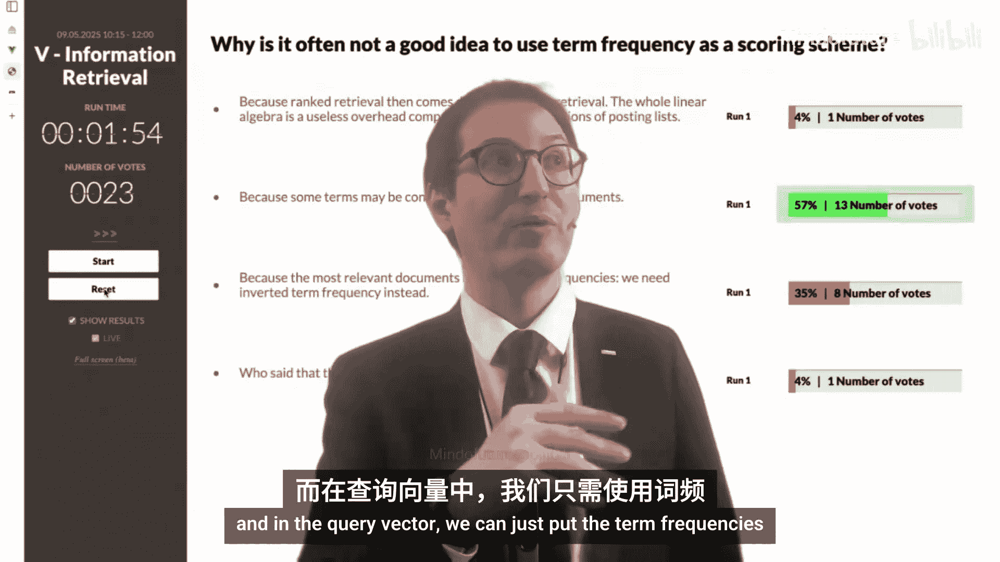

You wouldn't be entirely wrong of saying that it's an excellent idea on the query set。

。Let's move on to another question that I have or you maybe this one。

Because we are speaking about term frequencies。 So what is the term frequency of term A in documents。

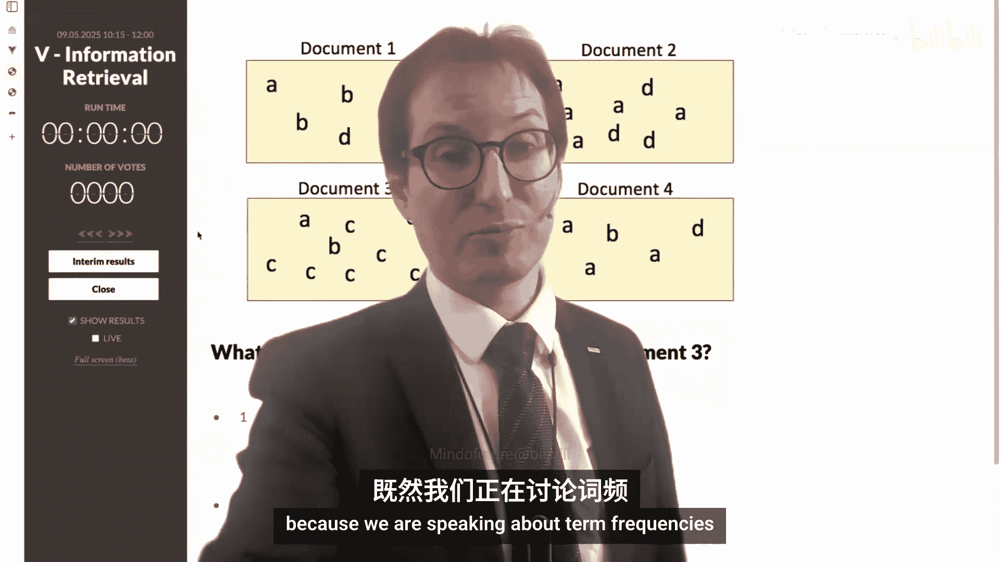

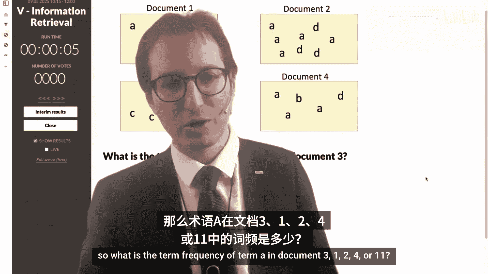

3。1，2，4， or 11。That would be an easy one， right。

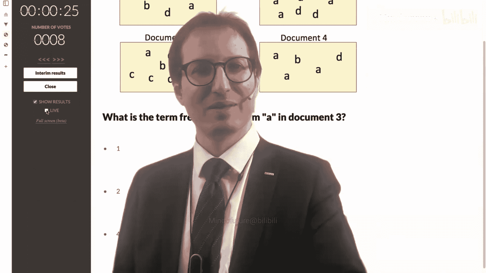

We aim at 100% for that one。 Yes，100% very good。 So indeed， it's just this one right here。

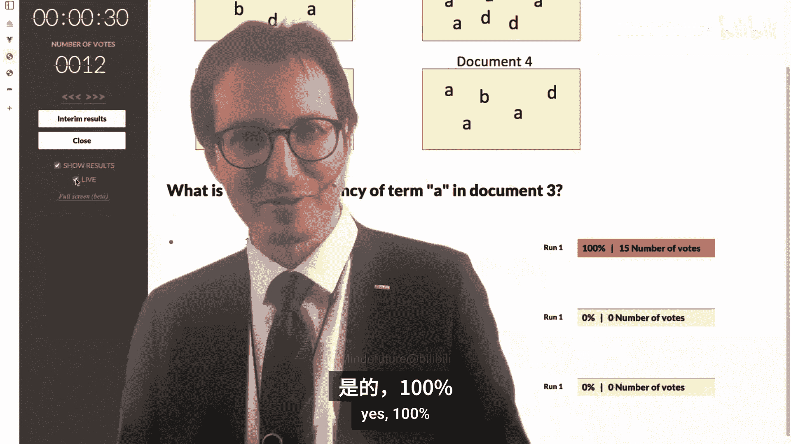

That you see here on my mass。

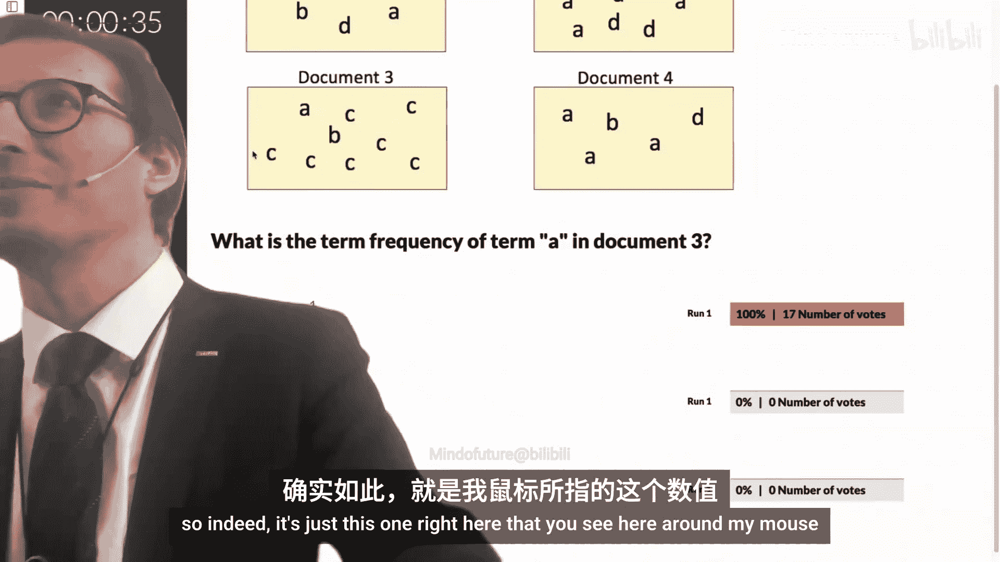

Alright， so this is good。呃。This is the 1 I should have asked first。

 But I'm just going to check that everybody gets it correctly。 What's the term frequency of term A。

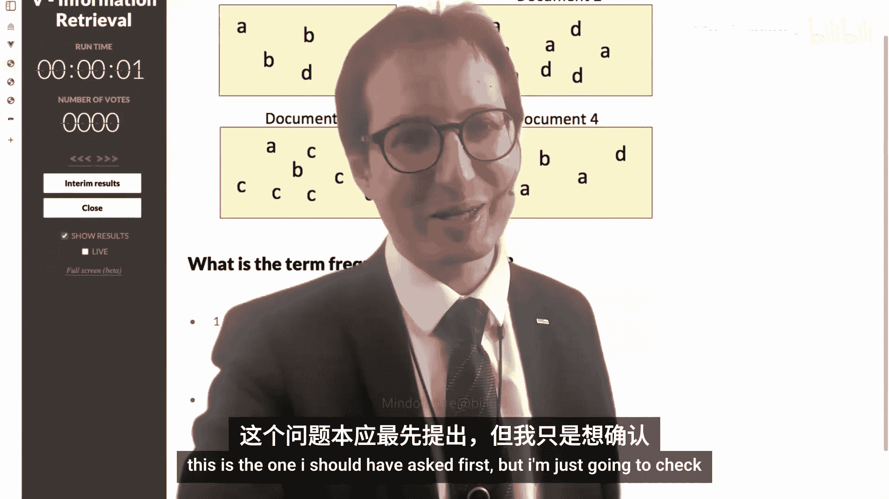

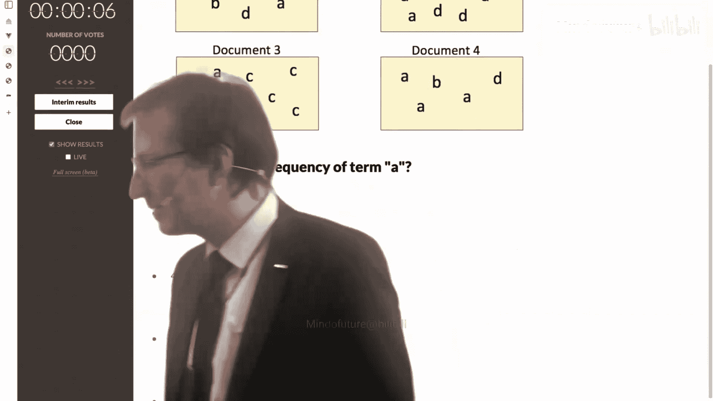

That should be answered in just a few seconds，100%， right。The term frequency of term 8。1，4。

11 doesn't make sense。Oh，11。 Okay， No， no， no， no， no， it doesn't make sense。

 The term frequency is for a term in a document， right， If you just say for a term。

 then that's incomplete， right， You need to say for that for what document。

 term frequency takes two parameters， a term in a documents。

What would be the name for maybe what you had in mind when you on 11。

 What would be the name for that， It's not called term frequency。 That would be called。

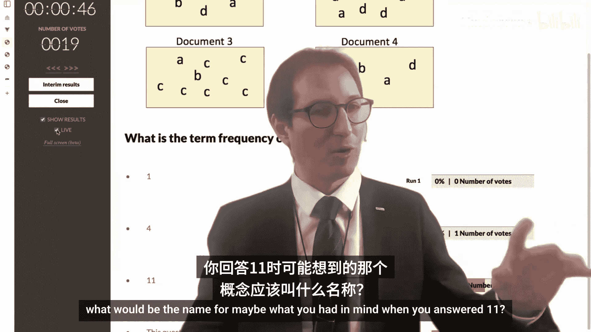

The total number of times it appears in the collection， anybody。It's quality。Collection frequency。

 right， So 11 would be the collection frequency of term A， Yeah，1，2，3，4，5，6，7，8，9，10，11。Alright。

 so collection frequency depends just on the term。 documentcument frequency depends just on the term。

 term frequency depends on the term， and the documents。Alright， so we've got things。Right now。

And what would be the inverted document frequency of term。

A，0，1，3， or4。

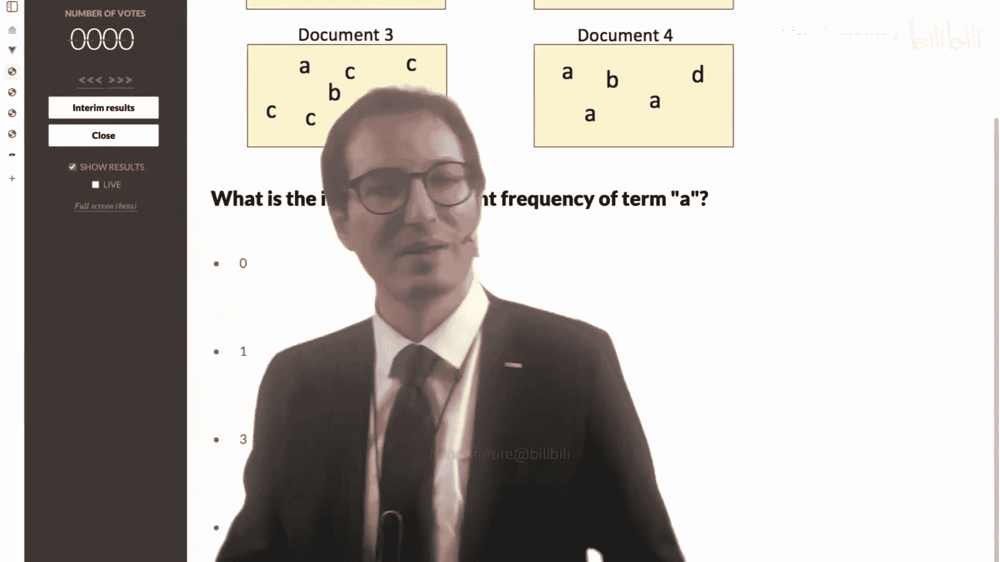

Remember the definition of inverted document frequency。Inverted document frequency of term a。

Remember logarithm of n over the document frequency and being the total number of documents。0 or1。

 Let's compute it total number of documents。4， yes。 How many documents contain term a。4 also。

 it's a stop wealth。 A is actually a stop wealth。 It's everywhere。 So 4 divided by 4 is。

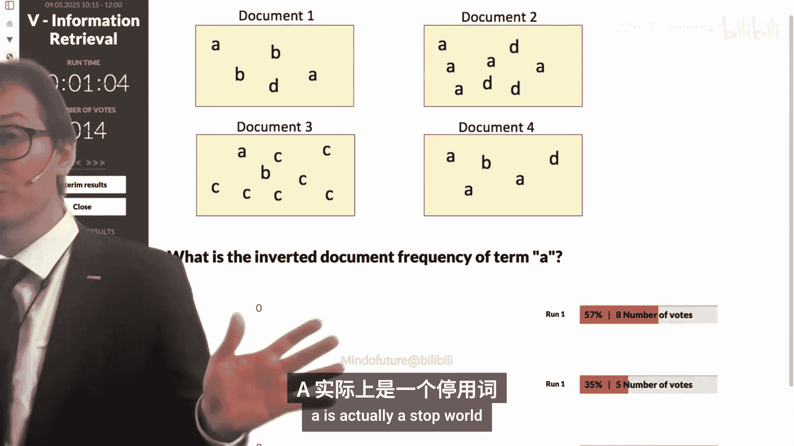

Yes， one and log of one。Is 0 in any basis， right， Otherwise。

 I would have told you which basis for the log to use， But in any basis， the log of one is 0。

 So indeed， the correct answer is 0 because that's a stop world。 That's the。

 the lowest inverted document frequency you can have is for the stop worlds that are absolutely everywhere。

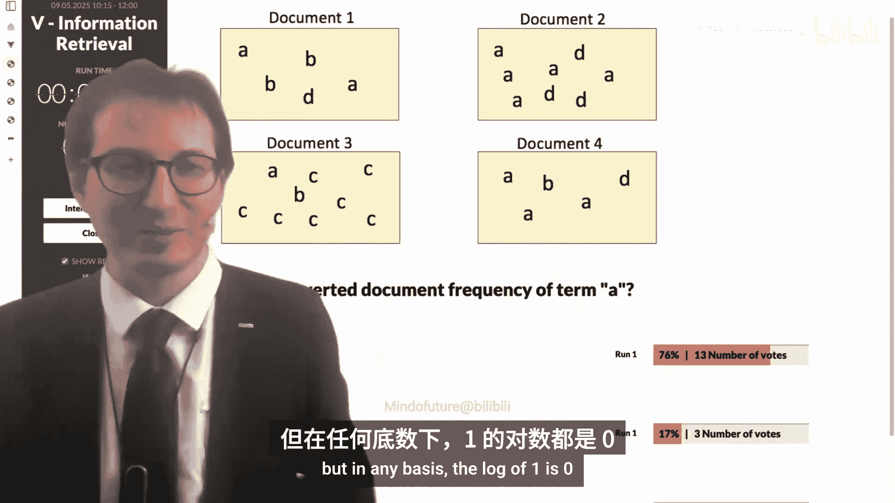

嗯。Alright， let's maybe this one， if you want to answer this one。

When do we most likely need machine learning to rank the documents using the vector space model to construct the standard inin index optimal to find optimal weights to score documents in zone queries or to display the results to the users in a way they understand。

That's something I briefly showed a couple of weeks ago。

But even if you didn't attend a few weeks ago， just machine learning should。

Give you the right keyword， Right， When you use machine learning， exactly you optimize weights。

 Allright。

So。That's it。 To rank the documents， we just his user a heap。 Remember， because we want the top 10。

 return the top 10。 So we use a heap structure。 There is no machine learning in there， right。

 We just accumulate the scala product by summing over all the terms for every documents。

 So there's no M L at all in there。

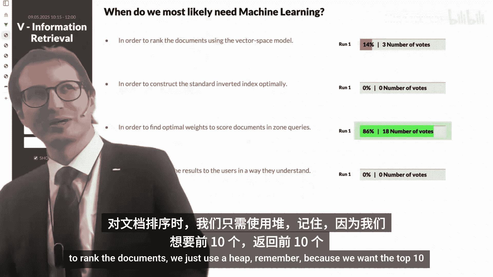

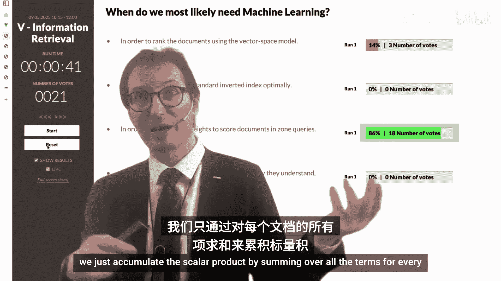

Alright， very good。 So that's where the way to start。Smoothly。

Now。Do we have any questions， anything。That wasn't clear。

Last week or previous weeks giving you maybe well of two minutes。To react。

With the courage in your hands to ask a question in front of everybody or type it in the chat if you prefer to type it in the chat。

We realized during the pandemic， actually， that with the courses on Zoom。

 there were more questions because people were a bit less less shy of。

 of writing questions in the chat that George here is going to read for you。

T because its can be more intimidating to， to speak in in front of everybody。

 That's why we have the Semi emails。 by the way， the Semi emails are here。Now that to to， to。

 to make you speak in front of of other people。Allright。So no questions。Mtraholder race。Okay。

 andonzo。超级H。A translation in which language。Would go方。Okay。In oh， yeah。

 that would be more difficult。I'm not fluent enough。Alright， so no questions。

So let me ask you differently。 So raise your hand。 if at that point。

 you're comfortable with the material and ready to move forward。Okay， the majority of you。 al right。

 And if you have any questions， you can ask them even later。 You can send us an E mail。

You can put your question in the forum。 You can also directly ask your T A or me。

 So that's absolutely fine。 I do recommend that you read the textbook， right。

 We have a textbook that has pretty much everything I'm telling you in the lecture。

 And sometimes it can also be easier to just read it at your own pace。😊。

Of to wewatch the recordings at your own pace。Oh， it says the participant has enabled translation。

 set your speaking language for this meeting。 So I'm going to say that it's in English。😊。

I would be curious which language you are going to translate these to。So this is English。

 And and who knows what language I'm actually speaking。

 Maybe AI is actually making my deep move with， with another language anyway。

So let me continue where we were。呃。I think we were close to the， Yes， to。呃。Here。

 you remember that I left you with the evaluation of precision and recall。

For ranked retrieval system， For example， the vector space models。

 So these are systems that return the top K queries， the top 10 queries。 Then you can click on next。

 next， next to get the next10 and so on。And so in order to evaluate precision and recall。

 we just keep clicking on next。 And every time we evaluate the current precision and recall。

 And we get that curve。 Remember that that last time。 So more precisely。

 we would get a curve like this。Basically， whenever there's a negative there's an irrelevant result return。

 It goes down。 When we have a relevant result， it goes up and to the right。

 And then we do a bit of cosmetics because this isn't really nice。 So we do， we do this， right， we。

 we。Take these horizontal lines to， to， to， to smooth it out。

 And then what we do is we don't do it for every。For every new result。

 we only do it for at the beginning then the first 10% and the first 20%， first 30%。

 And then at the end，10 percent of what we want， right？ And that we get with that， we get 11 points。

 that's called the 11 point Inter average precision，0，1020 all the way to 1 hundreds。By the way。

 just。嗯。Quick question that I remember from my physics lectures back then。

 We are actually in electronics when we were using the ocillrocopes and all of these devices。

Who thinks we can compute that in real time， these green lines。

That we can figure it out as the results come in。 We think we cannot。I see Ray sense， indeed。

 we cannot。 That would require knowing the future。

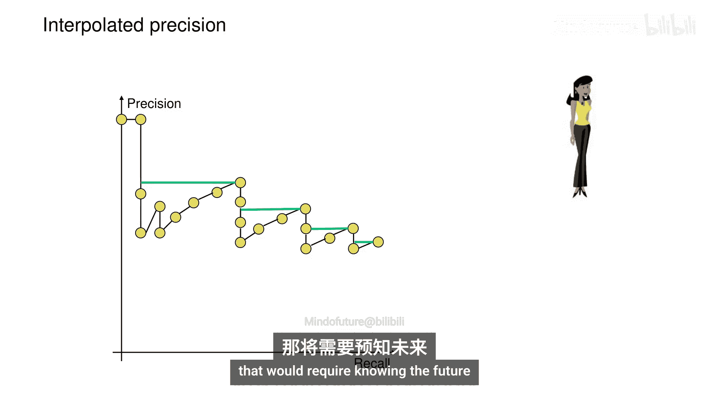

Right， so this is something that you do at the end。 But when you are here。

 you cannot possibly know in advance that this is going to be the next peak， right， So this is。

 this is something that you do at the end。 That was just fun fact that I remember from the。

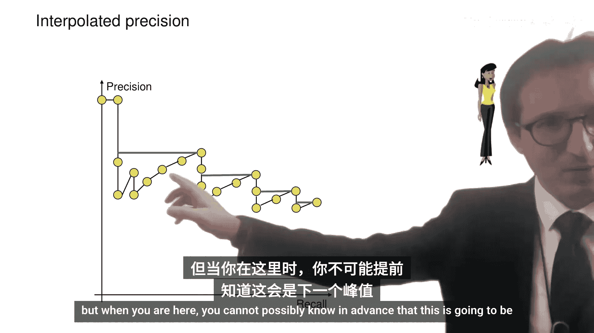

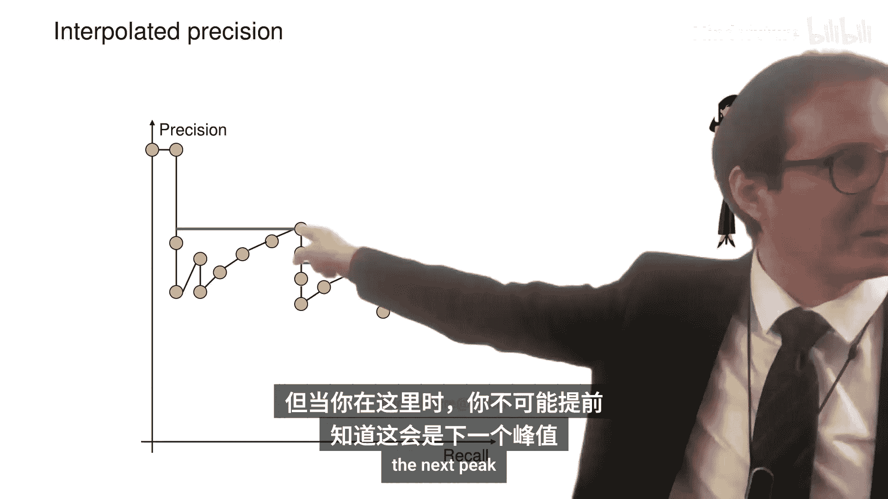

Physics course。 alright。And so I explained to you that an awesome search engine is going to keep its precision high。

 even as you click next。 So it keeps answering with relevant documents。 Of course。

 that only is going to be the case until you are out of relevant documents because you return them off。

😊，Then we saw that this in an awful search engine。 And this one can actually not even be salvaged in the way we saw less time to just flip the results。

 because when you have an engine that where you click next， you can， in order to swap the results。

 you would have to click next， don't take the end and then swap the results。 So computationally。

 it's not very practical。 So that actually would be an awful search engine， not very useful。O。

And then there are variations of that。 when variation that people have。

Is that instead of looking at the curve as a whole。They just take one metric。

 which is the area behind a below the curve This here。 So they compute the area， the， the， the。

 the total area。 And that gives you what's called the average precision because， in fact。

 it's kind of an average over， over the recall， right？ And， of course， when you do that。

That would give you the maximum possible value， because that's the maximum area possible， right。

 because you have the entire rectangle。 And that would you give you an area of。

Checking your following。 Here we Here is。0， exactly。Alright， so that's like taking the integral。

 If you have real numbers。 But since it's discrete here， that's just a sum that you see right here。

 It's a discrete sum。And then what people do is that they repeat with plenty of other queries。

 They just keep drawing the same curve with plenty of queries。 And then they again。

 take the mean of that across the queries。So you could call it the average average precision or the mean。

 mean precision， but that's not very nice。 So they came up with mean average precision， right。

 which is a way of saying you do in average choice， right。

 the first one over the as you go through the results and the second one across the the queries。

And even more， even more precisely across the information needs that are behind the queries。

 So that is called the mean average precision。Map， we have this gaming in academia of coming up with acronyms that actually are real worlds。

 And that's an example of that。 So map mean average。Precision。And that's the formula。

 It's just averaging twice， right。Alright。Then， there is something else。Again。

 with the idea of not looking at the whole curve。But of trying to find a single number。

The area is a single number， but this is something else。 it's called。The R precision。

The idea is actually simple。 Imagine that you have a specific information need and a query。

And you know that there are exactly K documents that are relevant to your information need。 K。

 that's just a number。 Maybe it's 42。And so you know that there's 42 documents that are relevant to you。

 And so what you are going to do is fetch the first 42 results of the query， the same number， right。

42 relevant documents。 So you are going to look at the first 42 results。And then at that point。

 you estimate the precision and the recall after 42 results。Now。

 there is something actually fun that happens when you do that， when you。

 when you look at exactly the same number of documents as the number of relevant documents。

 it turns out that the precision and the record are the same when you do that。😊，Right。

 and that you can see visually， right， So that would be the K relevant documents。 They are all here。

 Then you return on K。 do you realize that when you compute the ratio vertically。

 which is the recall。 And when you compute the ratio horizontally， which is the。

It's that cool precision， yes。So you get the same results because every time you divide in that case。

8。 So the true positives divide it by K for both the precision and the record。

 So it turns out the precision is the same as the record when you do that。 Who sees that。Right。

Allright。 And so visually， so this is the R precision。

 That's an example of when you've reach the R precision。

 the number of true false positives and false negatives are exactly the same。

 That's the R precision when you are there。 So it's the single number。 That is the the the。

 the precision ands the recall at the same time。😊，Alright。😊，And visually on the curve。

 if you want to directly plot it with no effort， just draw y equals x。And intersect it with the。

 with the curve， the the 11 point interpretationpo， for example， And you get the R precision， right。

 It's just the point at which the precision becomes equal to the recall。 So far so good。Right。

 so that's a very nice interpretation here that you have。Alright。

 so now if I hear some mathematicians here that might say， yes， yes， yes， wait， wait， wait。

 It might be more than one intersection generally because the curve is actually not that nice in general。

 So， yes， absolutely。 it could be that you have weird cases in which there's multiple intersections。

 But anyway， that's the， that's the idea。 Alright。😊，Okay， so that is the R precision。

But there is more。 There is one more thing that people like to do this time again， with a curve。

That is actually borrowed from electronics， I think。It's called。

 It means receiver operating characteristics or something。是。Receivever operator characteristics。

 Alright。 So that's borrowed from oh sorry， receiver operating characteristics receiver operating characteristics。

 Yes， exactly。 So R， R O C。 That's something you can see， I think， on your Internet box。 if you。

 if you look at your Internet box Internet， you might even see that that tells you something over the the signal strength over the Internet。

 But anyway。😊，嗯。How does it work， Well， imagine that you are on the beach and you have your bit detector and you're trying to。

 to see if you can find some bitins on the beach And you have this， this， this detector。

 which is some， some device that you， that you or you have one right here。So that is a bit detector。

 and it has a little knob to， to test how sensitivity is。 And so maybe at the， at the start， you。

 you， you set that to the， to the minimum。 and then you。

 you just go and try to see if if there are any lying around。And then you realize it's not beeping。

 doesnn't give you any positive results。 So you're， okay， you'll be disappointed。But you remember。

 you have a nub。 So maybe you can term the nerveb a little bit to， to make it a bit。

 a bit more sensitive。Then you continue。 then it starts， it starts beeping a little bit。

 but still not satisfying。And then you realize， what if I turn the knob to the maximum， right。

 and make it super sensitive， And then you guess what happens， right， It's beeping all the time。

 and it's also completely useless， right， But in fact， if you draw the curve of that。

 when you turn the knob to increase。😊，The sensitivity in order to make it beep a bit more easily。

You are going to get a curve that you actually， that is known as the ROC curve。 And I lost my。

Cl care whether， whether they put it or other， yes。So this is the curve you get， basically。

So the idea is that you， you， you increase。

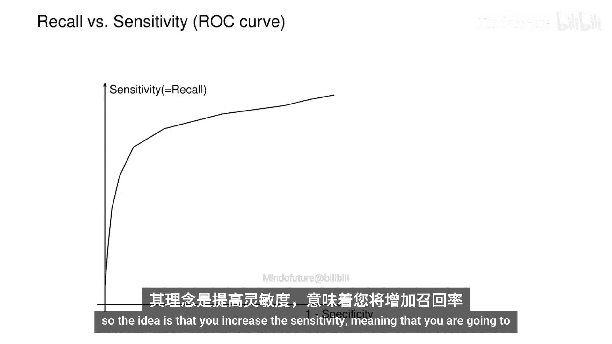

，The sensitivity meaning that you， you were， you are going to increase the， the， the recall。

 And then when you go on the right， you are going to， to。

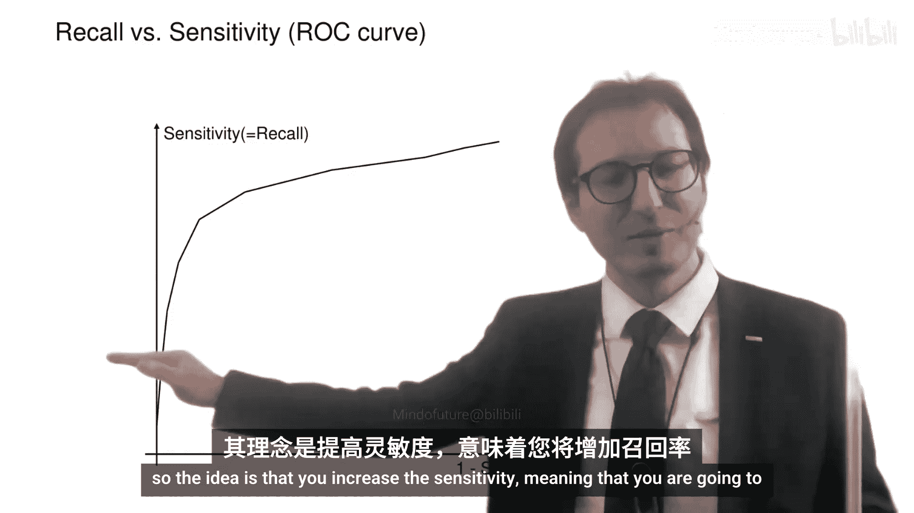

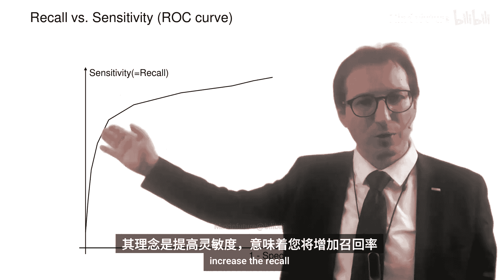

Be controlling to， to have an effect on the specific city。So remember， specificity， what it is。

 So the recall is how good you are at returning relevant results， right。

 That's the number of true positives divided by relevant documents。 The specific C is the same thing。

 but with on the， on the， on the right。 It's your ability to correctly identify non relevant documents。

😊，Right， so that would be the number of true negatives divided by the， the， the。

 the total number of of。Of non relevant documents。But here we do my 1 minus just to。

 to get the mirror of the curve。 And so that basically means that when we have a very high recall。

We don't have so many false negatives because this is what record is about， right， you you。

 you measure， you you， you， you have high record。 if you don't have so many false negatives。Here。

 you would have a lot of false negatives。 If you have very low record， it means you， you。

 there's a lot of documents。 you're incorrectly not returning， even though they're relevant。

Here you would have， if you're here very few false positives。

That's basically where you have very high specificity。

 You're very good at not returning irrelevant documents。 So few false positives。

 And here you have a lot of false， lot of false positives。 So if you put it all together。

Few force positives， few false negatives。 This is where you want to be。Lots of false negatives。

 lots of false positives。 This is where you do not want to be。

 So the curve that you have here in that example is good。Because it， it starts。With very few。

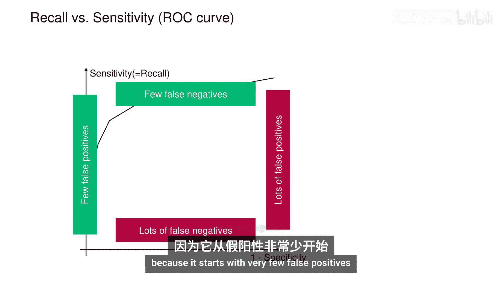

Forse positives。 And then you manage to decrease the number of false negatives as recall increases。

 And then at some point， you really get into very few negative， very few false negatives。

 High recall。 But that has a cost now specificity is actually is actually getting worse， right。

 So this is decreasing the specificity。 So you see this is what this curve does。

 it basically show you how you control the false positives than the false negatives with yournob。

 the littlenob that you turn。 And again， it's a compromise to make， right， by turning the knob。

 you're getting higher recall， you， you might find more bitcos。

 But at the cost of beeping for nothing， right， So you have also then more false positives。

 For whom is that here。😊。

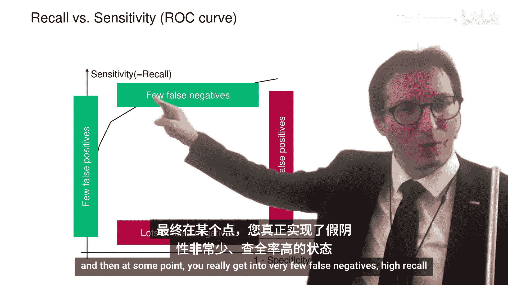

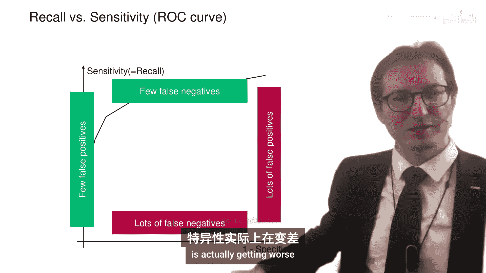

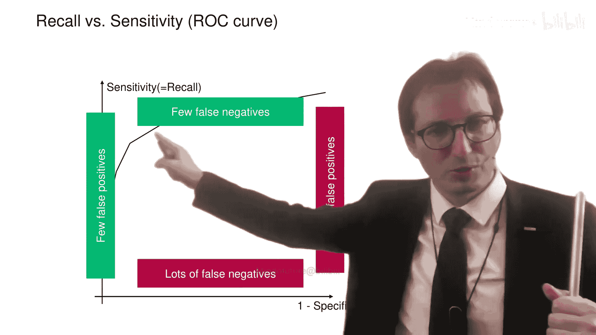

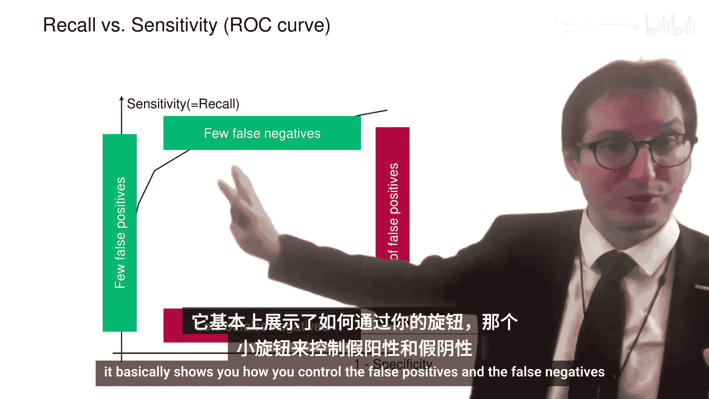

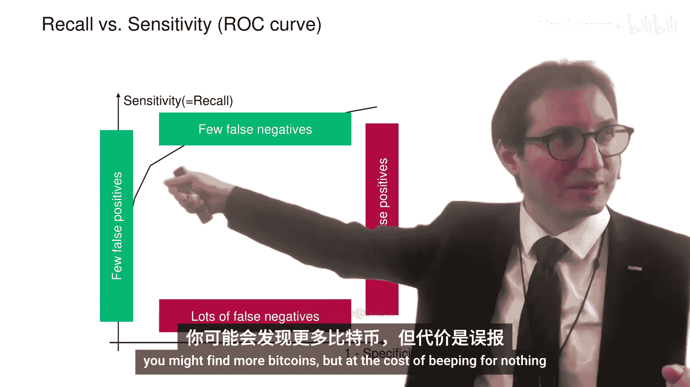

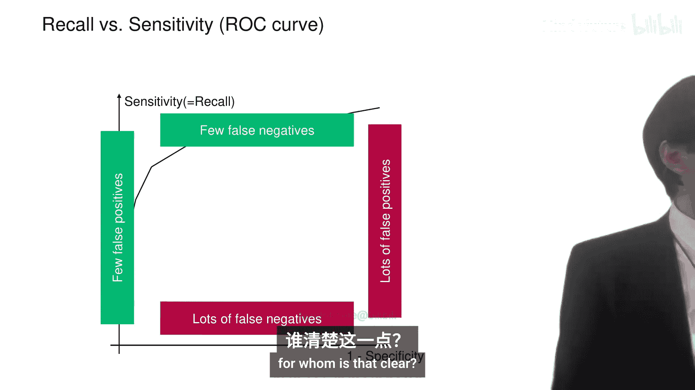

Right， so that is the R O C curve。 So we love to be here。

 where the curve is as much as possible like this。 We do not like to be here。

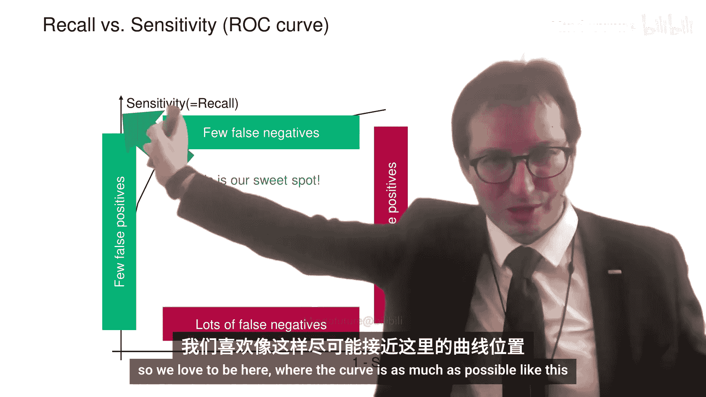

But do we really need not like to be here。 That is basically the question I asked last time。

 Is it really that awful。What if I give you。This device that is very good at a detection will actually not good at all。

It's beeping exactly when there's nothing。 and it's not beeping when there is something。

 So it only has true positive false positives and false negatives。Who is going to buy this from me。

Everybody， right， You just need to find where it doesn't beep。 And there you go， right。

 So this is the same trick， as I said last time。 So this， in fact， is not awful at all。 This is。

 this is just as good if you swap the results。 What you don't want is this。 This is awful。

 This is just a device that randomly beeps。 And you， it just gives you no information， right。

 So that is a really awful search engine。 If it has this curve。😊，Alright。

I just wanted to throw this out of nowhere。 But without telling you。

 I'm just saying that for those who love machine learning。

 there's plenty of more cool stuff you can do with this。 And you can come up with other metrics。

 This one is called the normalized discounted。 There's an N seen cumulative gain and ECG。

 And and that's there's plenty more things you can come up with plenty more metrics。

 You can come up with to。😊，To study your your system， right， It's a variation of the map you。

 you might recognize the formula here of the mean average precision。

 It's a variation of that with with different widths。Alright， but anyway。

 that's the end of this lecture。 So there's plenty of other metrics you can have。

 So here it was about the quality of the system。 So force positiveitive force negatives。

 But you also have the speed of the index construction that might be relevant。

 How much time does it take to reconstruct the index that might also have an impact on the stainness of your results。

 If it's the Internet。The speed of search this you want to be fast if you want you。

 if you want your users to be happy， they should get an answer in reasonable time for a search engine。

 it should be just a few milliseconds。 Of course， if you consider an LLM like chat GT or perplexity。

 then users can accept a bit longer time because of the high quality of where they're gonna get after that。

 right， So if you're sitting in some in in front of an LLM and it needs 5 seconds to get a full report on the lipididop in the in South Switzerland。

 that's actually worth the5 seconds rate， right， So it depends on your use case。

 But that's also a metric the the speed that it takes the laency。😊。

Then you have the expressiveness of a query language。 His， the Boolean querying was the way to go。

 but it was very tough to use because the problem with Boolean querying is that you write a query。

 you don't get a lot of results。 Then you modify it。 And now you get a lot of results。

 and it's very difficult in Boolean querying to find just the sweets， but in the middle。

 which is why phrase search as is known is the in the more modern search engines。

 engines work better。 And so the vector space model allows you to to search with more natural natural worlds。

 because the query is just a document。The size of the collection， of course， is relevant。

 If you index the entire Internet。just a small library also makes a difference。Anyway。

 that's the end of this lecture。 Do we have any questions。No here on zoom。Alright。

 so here we wouldd like to congratulate you because we are done with the bachelor's level part。

 or at least what he said in the textbook to be， this is what we teach at the bachelor's level in universities。

 So this is the end。😊，But you know that in order to push you a little bit。

 And in your third year of bachelor， you are allowed to take master's courses。

 so you can be exposed a little bits to to master's level content。And in the remainder。

 in the remainder of this course， I will expose you to master level contents。

 Well you have two more paths this week， next week and the week after that that are a bit more advanced。

 The first one is going to be probabilitybaistic information retrieval。And then language models。

 not the large ones， the more the old one， the， the ones that that are that look less cool than LL Ms。

 But still， it's very interesting to see what what we've been doing before that。😊。

And then we will be done。 So we'll have at the end of the semester。

 a wrapper lecture to just rehearse what we've seen。

 We'll have a big quiz with the the the T A S where you play against the T A S and we if you survive longer than the than the T A team。

And I think you want to announce maybe the， the mystery game that with the T A team。

 they have a surprise for you。So next week， we have planned a small surprise last mystery game for you。

 So you will see something appearing on Moodle paid under， I think it。

 it will be under last week's material。Namely a mystery game。

 And the first three submissions that make a like the first three students who make a correct submission will have a small。

 sweet prize。

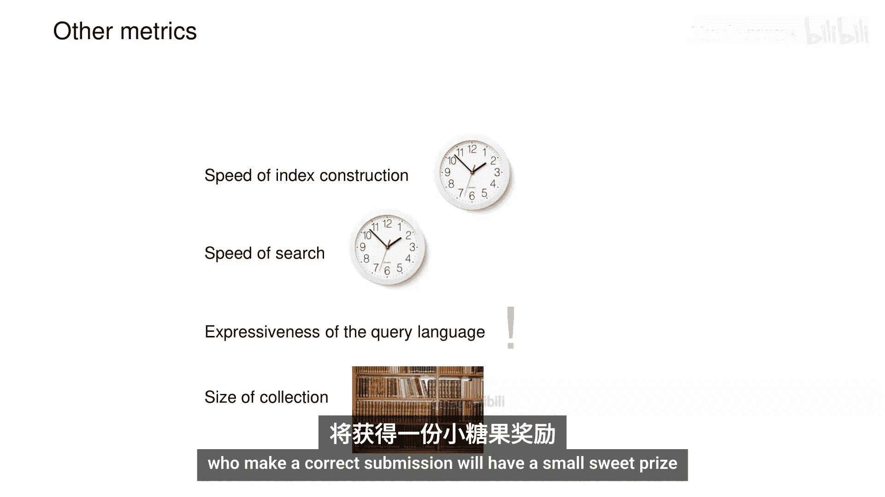

Thank you very much。 So you see all the hard work that the T A team is is putting in the course。

 So I hope you'll enjoy。😊。

This， this little game。それに。

Stop the recording here。