# 信息检索：9：评估 (2/2) 📊

在本节课中，我们将继续学习信息检索系统的评估方法。我们将深入探讨如何评估排序检索系统的性能，并介绍几种关键的评估指标和曲线。

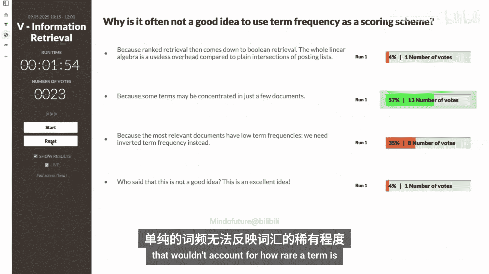

---

上一节我们介绍了精确率和召回率的基本概念。本节中，我们来看看如何将这些概念应用于返回排序结果的检索系统，例如向量空间模型。

## 排序检索的评估

在向量空间模型中，系统会返回前K个最相关的文档（例如前10个）。为了评估其性能，我们需要随着用户不断点击“下一页”来查看更多结果，并持续计算当前的精确率和召回率。

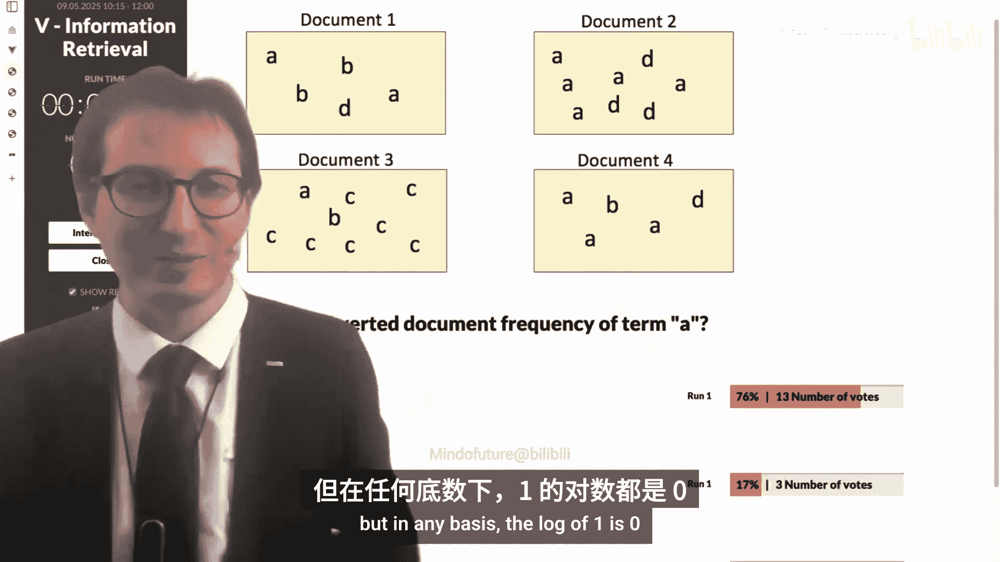

以下是评估过程的步骤：
1.  系统返回排序后的结果列表。
2.  用户从第一个结果开始查看。
3.  每查看一个新结果（或一组结果），就计算一次当前的精确率和召回率。
4.  将计算出的点连接起来，形成一条评估曲线。

这条曲线通常不平滑。为了得到更标准的表示，我们进行“平滑”处理：对于每个召回率水平（如0.0, 0.1, 0.2, ..., 1.0），取该点之后所有精确率的最大值作为该点的精确率。这样就得到了**11点插值平均精确率**曲线。

## 平均精确率与均值平均精确率

为了用一个单一数值来概括系统的性能，我们可以计算曲线下的面积，这被称为**平均精确率**。

**公式**：
`AP = Σ (P(k) * rel(k)) / (总相关文档数)`
其中，`P(k)`是在查看第k个文档时的精确率，`rel(k)`是一个指示函数，当第k个文档相关时为1，否则为0。

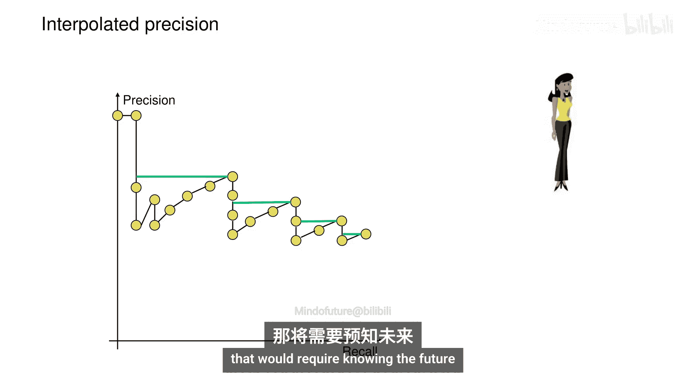

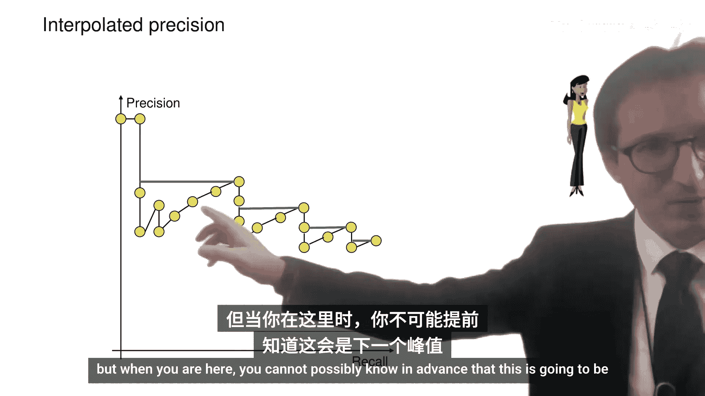

由于评估通常涉及多个查询，我们需要对多个查询的性能进行平均。这就引出了**均值平均精确率**。

**公式**：
`MAP = (Σ AP_q) / Q`
其中，`AP_q`是对于查询q的平均精确率，`Q`是查询的总数。

MAP是学术界广泛使用的核心评估指标。

## R精确率

另一种简化的评估方法是**R精确率**。其思想是：对于一个查询，如果已知总共有R篇相关文档，那么只考察系统返回的前R篇结果，并计算此时的精确率。

有趣的是，当考察的结果数量恰好等于相关文档总数R时，此时的精确率与召回率在数值上相等。

在评估曲线上，R精确率对应于精确率-召回率曲线与直线`y = x`的交点。

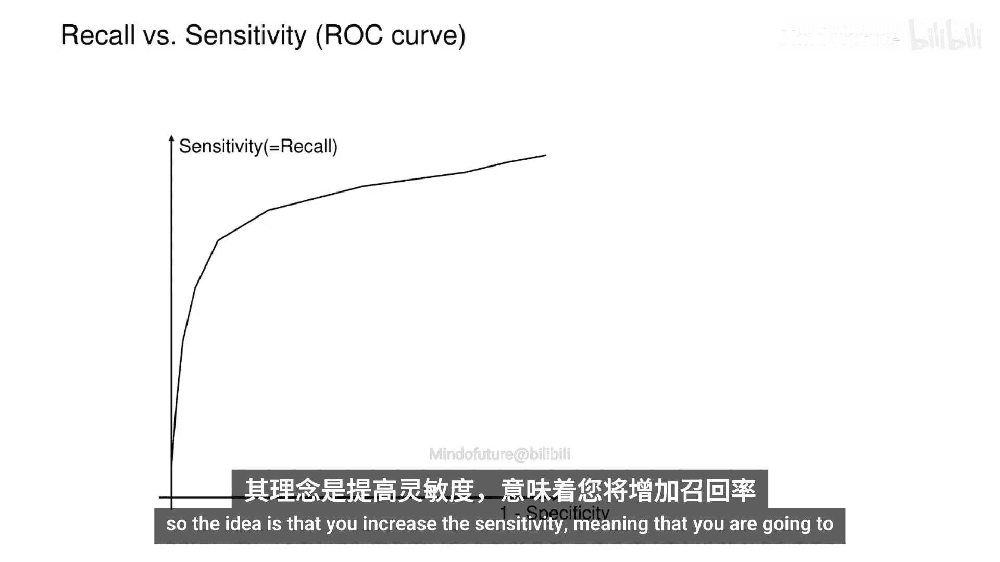

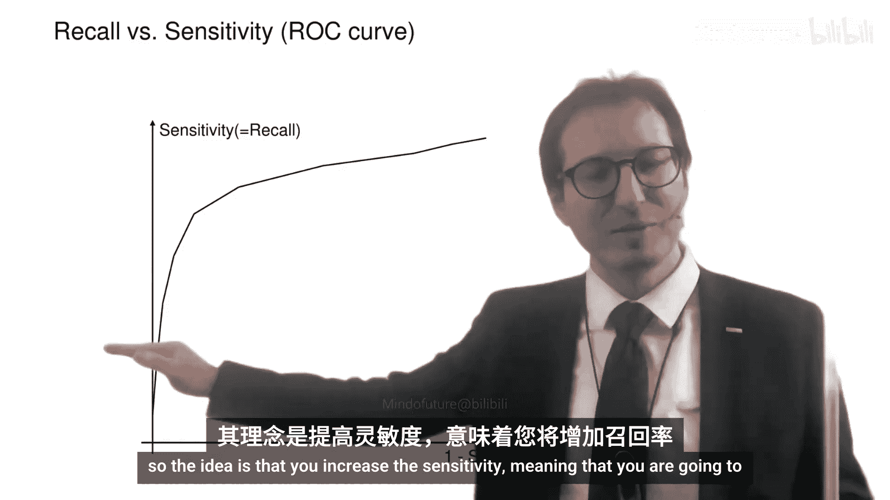

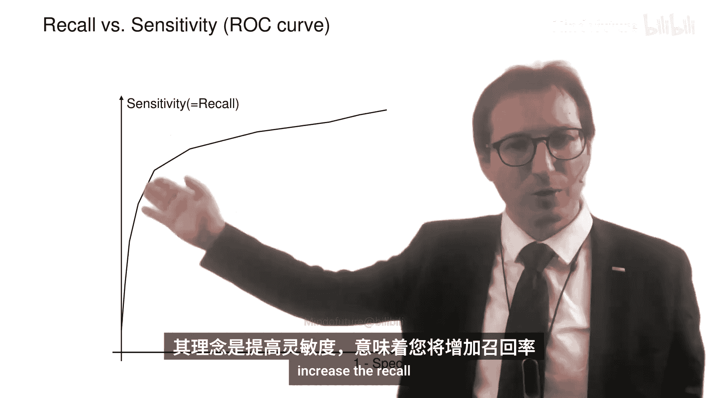

## ROC曲线

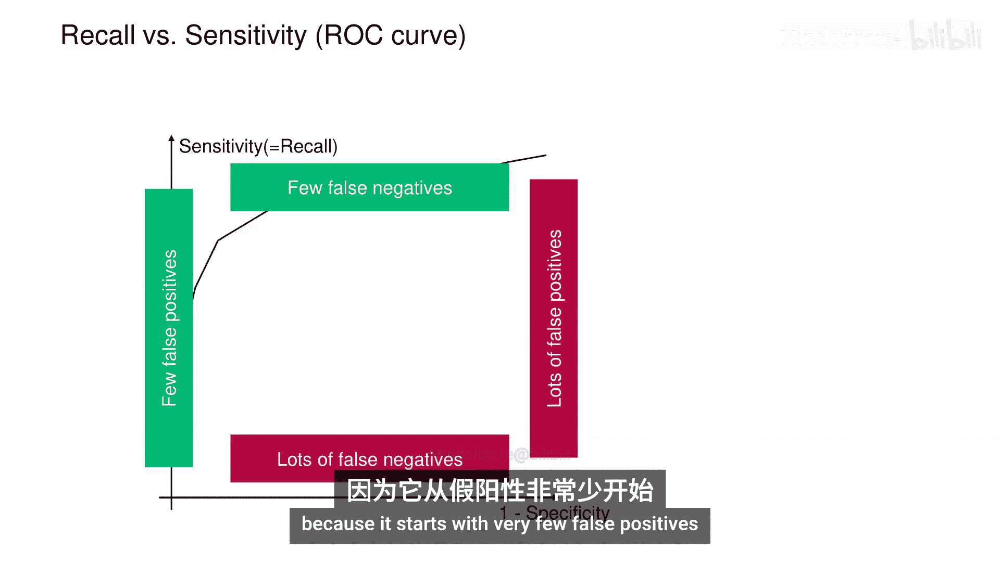

接收者操作特征曲线是另一种评估二元分类器（可类比检索系统）性能的工具。它描绘了在不同判定阈值下，**真正例率**（即召回率）与**假正例率**之间的关系。

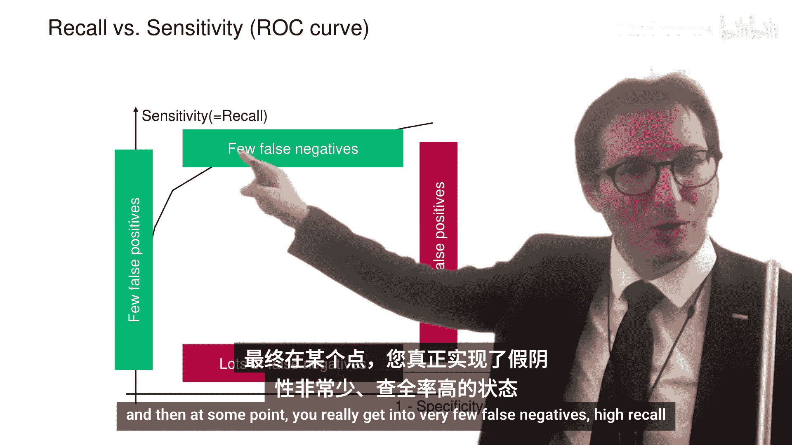

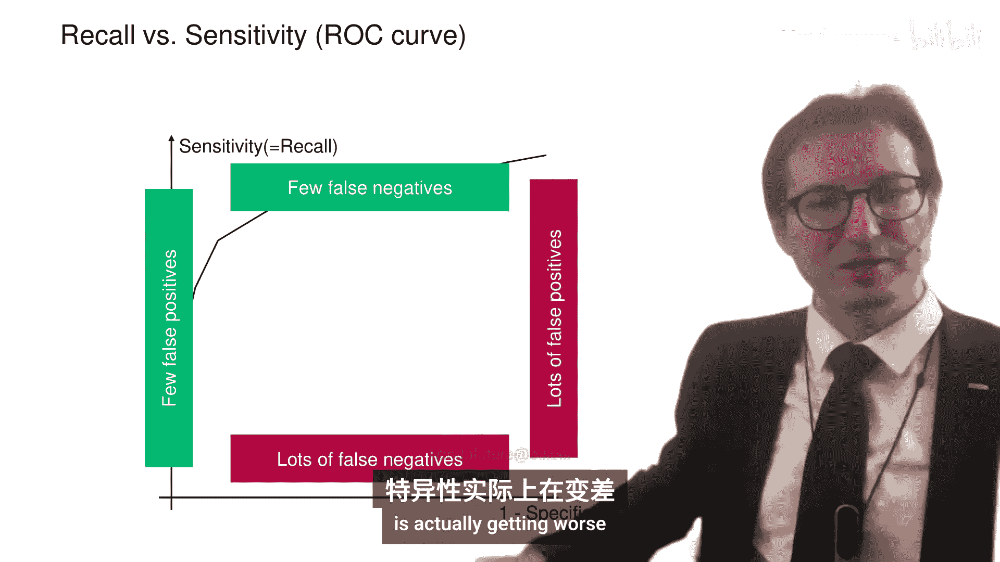

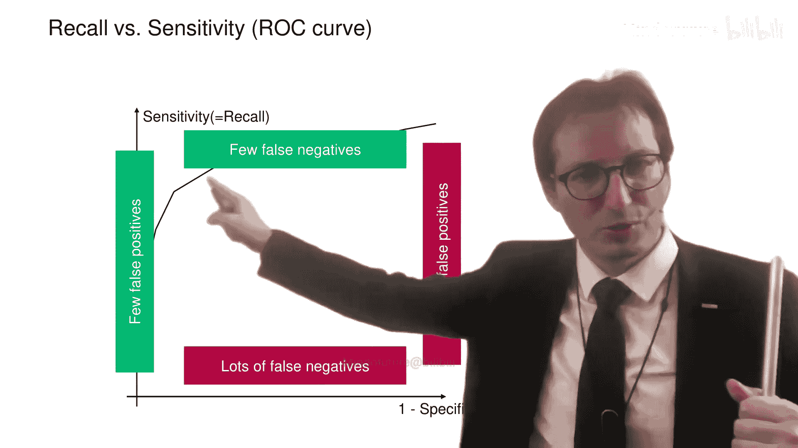

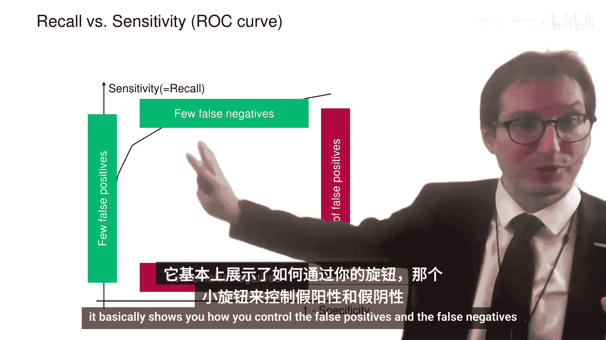

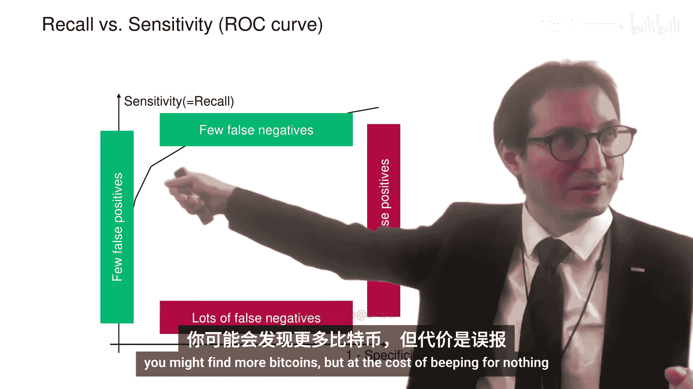

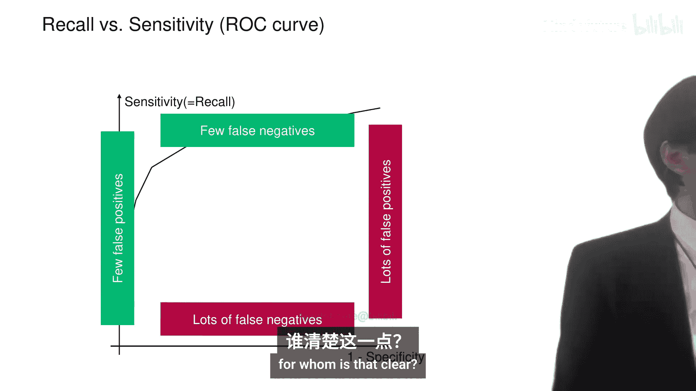

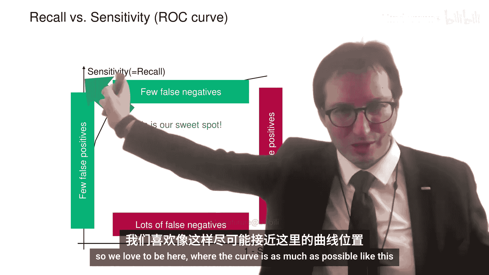

**公式**：
-   真正例率 `TPR = TP / (TP + FN)` （即召回率）
-   假正例率 `FPR = FP / (FP + TN)`

一个理想的系统，其ROC曲线应尽量靠近左上角（高TPR，低FPR）。对角线表示一个随机猜测的系统，而曲线如果位于对角线下方，则意味着系统性能比随机猜测还差；但值得注意的是，这样的系统其实可以通过反转其预测结果（将相关视为不相关，反之亦然）来变成一个有效的系统。

## 其他评估考量

除了检索质量，评估一个信息检索系统还需考虑其他维度：
-   **索引构建速度**：构建整个索引需要多长时间。
-   **搜索速度/延迟**：用户提交查询后，得到结果需要多长时间。对于网页搜索引擎，通常要求在毫秒级。
-   **查询语言表达能力**：系统支持何种查询（如布尔查询、短语查询、自然语言查询等）。
-   **可扩展性**：系统能处理多大尺寸的文档集合。

---

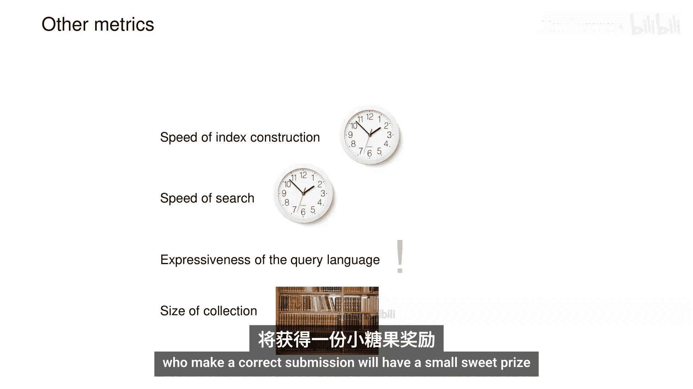

本节课中我们一起学习了评估排序检索系统的核心方法。我们掌握了如何通过精确率-召回率曲线、平均精确率、MAP、R精确率和ROC曲线来量化系统的性能。理解这些指标对于设计和改进任何信息检索系统都至关重要。从下节课开始，我们将进入更高级的主题：概率信息检索。