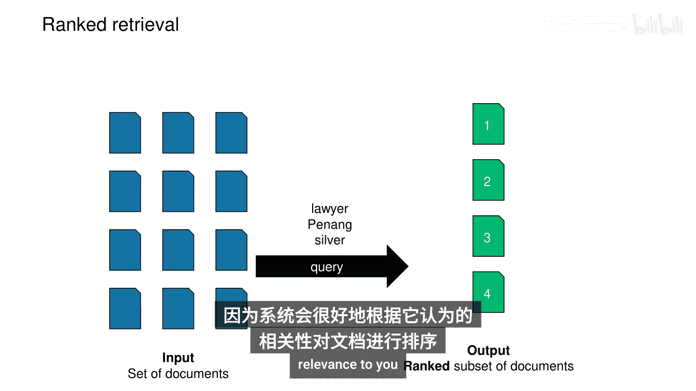
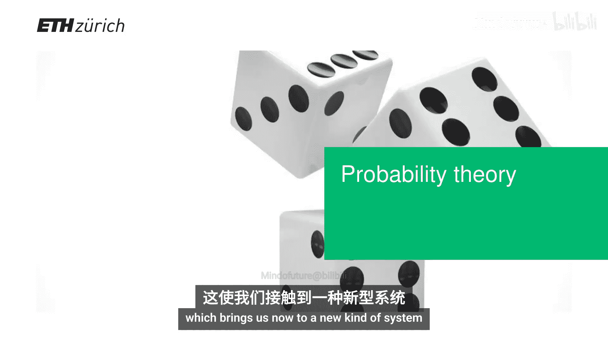
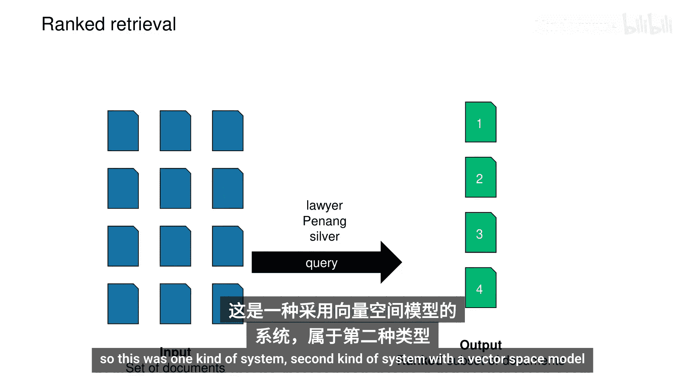
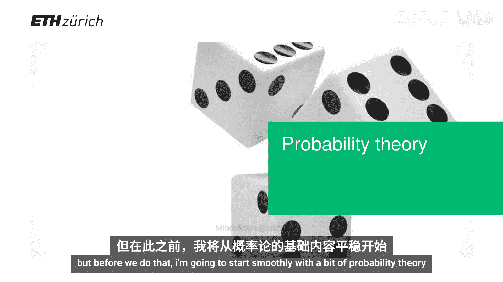
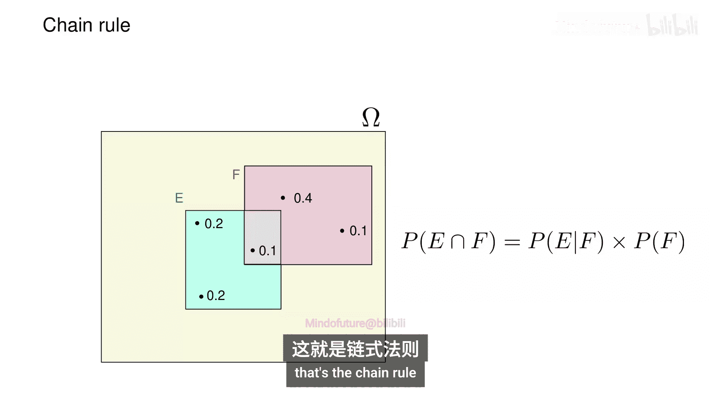
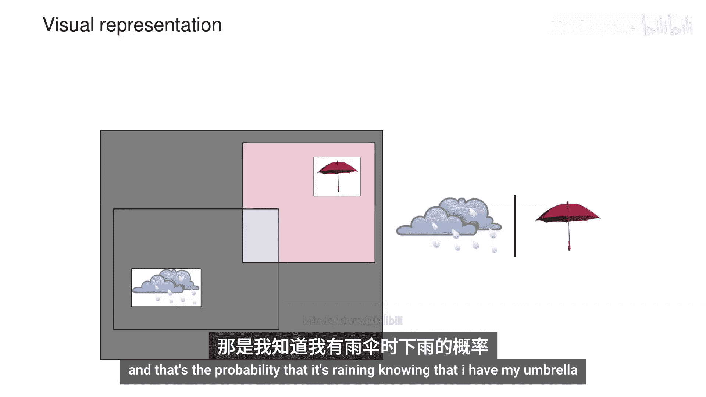
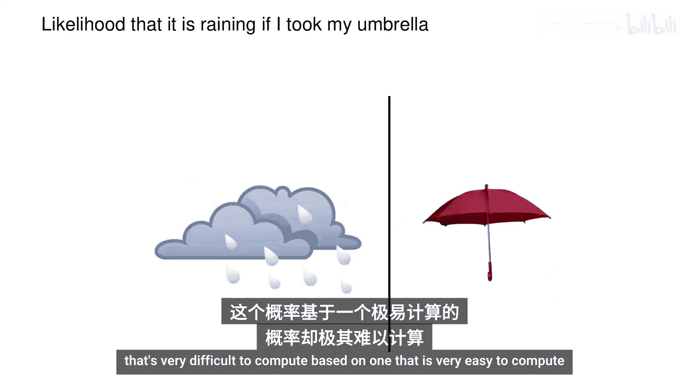
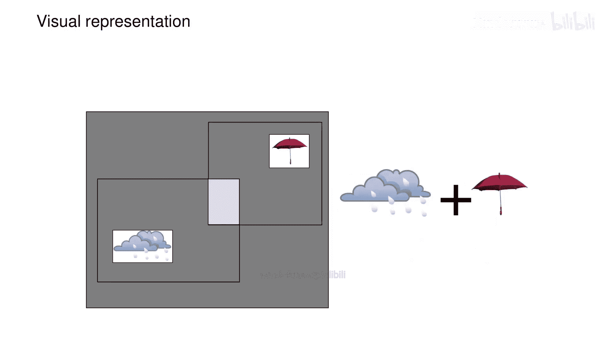
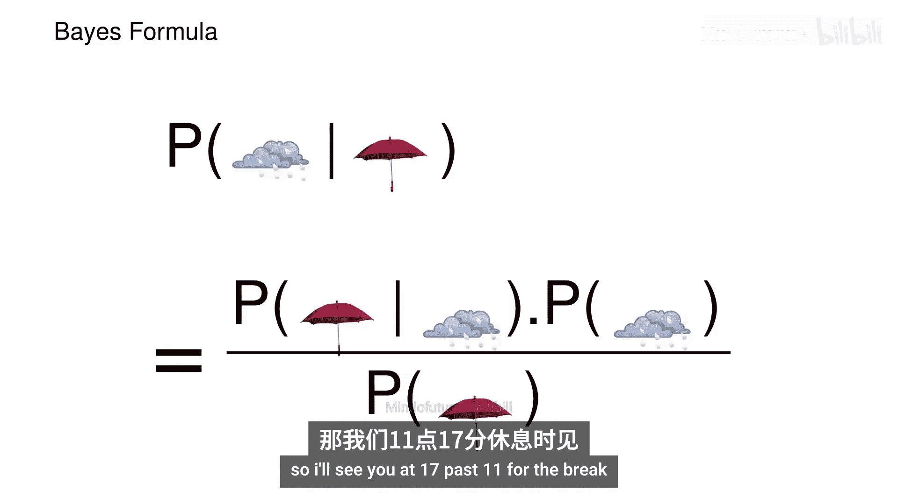

# 【苏黎世联邦理工学院】信息检索-｜-Information-Retrieval-｜-Eth-Zurich-2025-p24-P24_10._概率信息检索_(1_4)--BV1ndsBzdEss_p24-

你冇 be over。除。This lecture。So this is now master level。 So it's a bit more advanced。

 We'll take it smoothly。 I'll include here some。Express reminder about probabilities。

 which I assume you all know。 But it's just to make sure it's on the top of your mind。 By the way。

 this is my secret base in Antarctica。 These are older little health。elves。

 Seepilions of them will need them for omega space， because we have。

 we are going to have an omega space that is absolutely enormous， absolutelyute gigantic。 And so we。

 we， we can imagine that these the elementary elements in that omega space are going to be all older littleel。

😊，All right。So I'll take some time to quickly go over what we've seen so far to just put it all in context before we move on to the probabilities。

So remember that at the beginning of the semester， we've looked at the the oldest computerized systems that we've had in information retrieval from the typically from the 60s。

70s， which were Boan retrieval systems with Boolean queries。 There were commercially available。

 You know， so these are products that actually were sold and licensed。

 typically to lawyer the Phs or libraries and so on。

 And people could just query with a Boolean language， right。

So the idea is that you put your Boan query here with and or not。

 and then you get a subset of the documents， but not ranked， right。

 So this is why it was difficult to use。 There was no ranking。

 So it means you need to tweak your query to get a good number of documents， not too much。

 not too little， right So that required a bit of know how。That people got， got good at this。

 It's like the prompt engineering today。 Let's call it Boolean query engineering。

 We had Boolean query engineers back then who didn't have LinkedIn in order to braggle about it。

 sadly。 But this this was actually very complicated to， to do back then。嗯。

And then we moved on to a more modern category of systems with ranked retrievals。

 So now this is basically Google， Bing and so on。 For those of you who might have known it。

 Alta Vista， Yahoo and so on。 So all these search engines。That rank the documents。

 And here it's very useful because even， even if it's a million documents， you get the top 10。

 So you don't have to look at all the million documents。

 You can just look at the firstwas because the system is nicely ranking it by what he thinks is going to be the relevance to you。

嗯。All right。Which brings us now to a new kind of system。 So what， this was one kind of system。

 Second kind of system with a vector space model。

And now we are going to look at a new kind of system。EThat is based on probability theory。嗯。

More precisely， the base rule， But I'm going to， to。

 to remind you of everything that has to do with it。

So before I go through all the formulas that can be very scary。

 Its a lot of formulas to derive and so on and so on。 But before we do that。

 I'm going to start smoothly with a bit of probability theory。😰。

I think， you know everything that I'm going to show you until the break and and a little bit after the break。

 I assume， you know， everything that there is to know。 if you don't， then it's a good idea to。

 to look again， not for that cross， but also in general。So， in probability theory。

We typically assume that there is some omega space， commonly called omega。

That contains all the possibilities， right？ Some people also call it in model logic。

 They call it the possible worlds， right， It's all the possible worlds。嗯。This is a set。嗯。

Finite infinite depends if it's infinite， of course， it's a little bit more involved to do。

 but you can still do it with measurement theory。 We are going to assume it's finite for us today because we don't need all these all these measurements measures and so on。

 So we have these points in in omega that are called the elementary events that we call little omega。

😊，You can see them as one possible world。 It is one possible world。 For example。

 the world in which we are， But there are also other possible worlds， right。

 And so these are all the possibilities in there。And so what we do in probability theory is that we assign weights to these elementary events。

In the case that it's finite， it's just numbers。 These numbers are non negative。

 and they sum up to one。 And that is actually the probability for each elementary event to happen。

 right， You know all of that， right。I assume， you know all of that。

 You've seen that in probabilities and statistics。 Alright， and so we have this function P。

That takes every one of these elementary events and assign them this number。

 And then they all sum up to one。So because it's finite， I'm using a sum。 But， of course。

 if it's in infinite， then you go into integrals and measures and lowbe integrals and so on can get very complex。

 Fortunately for you， we won't have any such integrals or lube or anything in there。 No measures。

 just finite simple sums。 It's already complicated enough like this。Alright。

 And then what becomes interesting。Is when you consider subsets of omega。

 not just the individual points， but the subsets， These are called events。For example。

 an event can be its raining。And this is just the set of all possible wells in which it's currently raining right here in Zuric。

 right， So there are worlds in which it's raining and worlds in which it's not raining。

 And we have the set of worlds in which it is raining。 We call it E。

 And then we can define the probability of this event E。

 which is just the sum of the individual of the probabilities of the elementary event， right。

 It's quite intuitive， right， if if there's three worlds in which it is raining and the probabilitybabilities of this world theres 0。

10。10。2。 Then the total probability that it's raining is 0。4。 The sum of everything。

 So this is the probability of the event。Right， so an event is a set of elementary events， to subset。

Right， and we also use it a bit of an abuseive notation。

 But we use that same function P to designate the， the， the probability of the defect。The purist。

 I have a friend who a mathematicians。 He told me， no， no， no， you cannot even use P of omega。

 You should S， you should say P of the singleton omega， right， but。

That would make the sites very heavy。 So， so I， I， I， I can live with this slight abuse of notation。

Alright， so probability of an event。Then we can take the compliment that can be a some little bar on top of it。

 That's， of course，11 minus， right， if it's raining with probability 40%。

 then it's not raining with probability 60%。 right， You know all of that， right。

 everything I'm saying now you're supposed to know already。Then we have something called the arts。

 That's actually something very well known in in the betting companies， right， when you。

 you have horse races and so on。 And people go and bet that this horse is going to win and so on。

And in that case， they don't say there is a probability of 20% to win。 They say instead。

 there is an odd of 1，2，4。Right so they express it in terms of odds。

 and an odd is really just the ratio of the probability divided by the complements。

 probability of the complements。 So if you have， for example， 20% versus says 80%。

 Then that's20 divided by 80。 So that's one quarter。

 right Or if you swap it to do it the other way want its for。

 And typically instead of saying one quarter or 4， you say one to 44 to1， you know。

 like this is the vocabulary they use。 But these are the odds。

 this is going to simplify a few formulas。 right， It's not like super complex。

 but it simplifies formulas， because when you have divisions like that。

 we can simplify it by just saying， okay， that's the odd simplifies the little bit。Okay。

 then we have the intersection of two events that could be， for example。

 it is raining and the cat is inside。 And then you're looking at the world in which these two things happen。

 So that's the intersection of two of these subsets。 And it has a probability 2， T 2， of course。

And then the union， right， it's raining。 or the cat is inside sight， right。

 then it's all the world in which one of these two or both of them are true。 So that's the union。

And there is this formula here that， you know， it's kind of a Venn diagram here where the probability of the union is the sum of the probabilities corrected by subtracting the intersection。

 because if you sum just like this， you count twice the intersection。 So you need to remove it。

 You knew that formula， right， That will all， all known by you。

Then you have the notion of these joint events。 It means the intersection is empty。

And so what happened in that case is that since the intersection is empty。

 It simplifies the probability of the union。 You just sum them。

 So the probability of these joint events， you can just sum them as a simple sum without needing to correct for the intersection。

So the probability that it's raining or that it is snowing is the sum of them。

 because it's not normally raining or snow， I'm not a meteorologies， right。

 But I assume there is raining or snowing。 And I'm assuming the， it's very rare that it does both。

 right， So raining and slowing， you can just plus them。 You can just add them。All right。

Then we have the partition rule is kind of related whenever you have an event and another event。

 you can partition the event E in the part that is in F and the part that is not in F， right。

 So that's called the partition rule。 And because that gives you to these joint events。

 E intersection F and E intersection non F。 There are these joints。 So you can just sum them， right。

 You've seen that went too， right， partition rule。 Then we have conditional probabilities。

 And this is when things start to get a bit complex。 when you start getting into these things。

 So conditional probability is the the， the probability that some event happens。😊。

Knowing that some other event happen， for example， the probability that the cat is in sight。

 given the fact that it's raining， We all know that probability is 100%， right， But basically。

 you have new information that tells you it's raining outside。 And then you can update。

You probability that's the the cat is inside。 So the probability that E happens knowing F。

 it's obtained by dividing the intersection by divided by F。

 It can be seen as as a form of renormalization， right here， if you， if you know F。 if。

 if you gray out everything that's outside of F。 You have the updated E， right？

 You have the updated E where you renmalize by F。Right， everybody's with me。

That is a conditional probability。呃。If you rewrite that same formula slightly differently。

 it's exactly the same formula。 you just multiply by P of F on both sides。

You get what is known as the chain rule。 So whenever you have the probability of an intersection of two or even more events。

 you can rewrite it in the form of a chain。So the probability of E and F is the probability of。

F multiplied by the probability knowing F that can be generalized to any number of the of the events。

 right， You can have three of them E， F G， then the probability of E， F。

 And G is the probability of E times the probability of F condition on E。

 Time the probability of G condition on E And F， right， That's the chain rule。 You've also seen that。

Right， so that's the chain rule。It's just a rewrite of this one， in fact， conditional probability。

Then you have the notion of independence of two events。 That is when the condition doesn't matter。

You look at the probability of E。Or the probability of E knowing F。 And that's the same。

 Then it means that E and F are independent。So that's， that's basically the， the， the。

 the definition of independence not to be confused with this joint， right， So this joint。

 you can sum the probabilities when it's independent。

 What that gives you is that the probability of the intersection is just the， the， the probability。

 the， the， the product of the probabilities。That's， in fact， just using the chain rule。

 if in the chain rule。Probability of E knowing F iss the same as the probability of E。

 Then you get the product。P of E and P of F， right， Everybody with me。Noma you should be bold。

 That's what I expect。 I mean， I'm just going through it smoothly so that you。

 to bring it back to your minds that you should know all of that that I'm showing you。And now。

 nobody seems to know of that。I assume you should be able to solve that kind of puzzle， right。

 It's a classic that that can be you sometimes see it in some magazines。😊，嗯。When it rains。

 I forget my umbrella 50 of the time。 It rains every other day。 And last year。

 I had my umbrella on 22071 days。And I'm asking for the probability that is' raining。

 knowing that I have my umbrella today。Right， we is able to solve that kind of puzzle。

Who remembers how to do it。Who does not remember how to do it。Either you do or you don't， right。

 This is a complement of two probabilities。 Okay， let me try again。 Who knows。Who doesn't know。Okay。

 so it's half half。 So that's good that I'm reminding you then。 Okay。

 so let me show you how it solved。 Do you know for those of you who know how to solve it。

 What is the name of the rule that we are using to solve that。By exactly the bay rule。 So this is。

 this is exactly it。 So this is the the visual representation of that。

 There's some world in the in which it's raining and some world in which I have my umbrella with me today。

And。If I update， so I can't compute， for example， the probability that， given that it's raining。

 I have my umbrella。And I can also compute the probability that it's raining， sorry。

If you see it again。That's the probability that I have my umbrella knowing that it's raining。

And that's the probability that it's raining， knowing that I have my umbrella。

And so。We have to basically relate to the two， right？ So this one is the one that is easy to compute。

 right， That's when I have an umbrella knowing that it's raining。

 and that's the one that is hard to compute， right。

 And so this base formula is a magic device that allow us to swap the sides in order to compute a probability that's very difficult to compute based on one that is very easy to compute。

😊。

And so a visual representation is also， that's the intersection。 And， you know， the base formula。

Using the chain rule， the probability of the intersection， using the chain rule。

 is the probability it trains multiplied by the probability I have my umbrella， given that it rains。

But if I use the chain rule the same one， the other way round。

 I can also write it as the probability that I have my umbrella。Times， the probability trains。

 given that I have my umbrella。Right， so writing it in these two different ways and writing the equality。

 I can rewrite this as this。 And this is the base formula。 Just a consequence of the chain。

And now you see the magic of that， yes。Oh， we have the break。 Yes， absolutely。 And by the way。

 just to make the break more exciting， I have my umbrella to with me today， Right。

 So this is actual field work。 So I'd see you in， in。😊，15 minutes。 So it's  two past 11。

 So as you at 17 past 11 for the for the break。 Thank you， Josh， for reminding me。

