# 【苏黎世联邦理工学院】信息检索-｜-Information-Retrieval-｜-Eth-Zurich-2025-p25-P25_10._概率信息检索_(2_4)--BV1ndsBzdEss_p25-

Welcome back， everybody。So we were at the Rean umbrella thing。

So we want to know the probability that it trains。Given that I have my umbrella。

And we can express that by using twice the chain rule。 We obtained the base rule。

 And now it's suff to compute each one of these three numbers， right。

 So the probability that I have my umbrella knowing that it's raining thats。Sorry， that's 0。95。

The probability that it's raining that 0。5。 I told you， half half。

And then the probability I have my umbrella。s I did some statistics over the year。

 and I had it 271 days out of the year。 And so that gives me this。 And that gives me a result of 64%。

 meaning that I took a bit of a risk when I went with my coffee there without my umbrella that it's not training。

 So 64% instead of that's an update， if I didn't have the information on my umbrella that would be 0。

5 right And now if I add the information I have my umbrella that increased it from 0。5 to 0。

64 So that is the formula and。One of the uses of such formulas is to estimate things that are not accessible。

 for example， it's。It's used in the search of extraterrestrial life。 For example。

 when you want to reason on， on things that you cannot possibly measure because so far。

 we haven't observed anything。 But if you use that kind of formulas。

 you can try to have some high level theoretical reasonings on getting insights on that。 alright。

Okay， and in fact， the， the very famous， what is the name of this equation。

 the with the product of 7 thing， Is it the the Drake equation。The Drake equation， think it's。

 it's the product of the number of stars in the that form in a specific period of time Multi by the number of planets Multi by the ratio of the in inhabitable zone multiplied by the probability develops life。

 So there's a whole chain like this。 This is the chain rule。 right。

 That's yet another example of it's Drake， right， Drake equation。 Yeah。

 What's incredible is that whether I was a kids and I saw that equation。😊。

We only knew the first term。And now we already have two more terms because we actually found planets all over place。

 And we are even capable of seeing if they are in the inhabitable zone or not。

 So the the progress we' are making is， is amazing。😊。

RightI think there's people at T TH that also research these these things。Anyway。

This is what it's useful for。 And so a way to interpret it。

 So this is the visual that I have is that， you know， that's my， my statistics on my umbrella。

 that's when I forget it 5% of the time when it's raining and that's raining 50% of the time。

 And you， you can deduce that it rain 64% of the time。So the way that people think in the base。

 the Bayesian reasoning is that they have a prior that the probability training or not before I bring in the umbrella information。

 So that's more called my prior。 And then I updated multiplying with this this factor here。

 And I gets the posterior at the end。 That's my updated probability after I have digested the new information that I have the umbrella。

 right So then you get a whole category of Bayesian reasoning and a very big philosophical debate on whether that actually makes sense。

Mathematically， it sounds。 There's no question about it， but it's more about the applicability。

 in And that's a very interesting philosophical problem on what it means。

It also has to do with the semantic， the semantics of probabilities， of course。

So this is the base rule， right， And we are going to use it for our system。

 This is the reason why I'm actually showing it to you right now， because we are going to。

 to be using that rule， right。So that's， again， the prior， that's the posterior in so on。

But they need a few。Mar think before I get into my information retrieval system。

 I also needs the notion of a random variable。 Who remembers what a random variable is。Okay。

Who knows that a random random variable is not random， and it's also not a variable。Who knew that。

RightIt's not random。 It's not a variable。 In fact， it's a dataministic function。Right。

 a random variable is a dataministic function。 So that's actually quite funny to。

 to see it like that。 But this is where it is X is a function。😊。

That associates every element of my omega space。To some value in some set of my choosing。

 So I picked a set with three shapes in that case， with the blue square。

 the red Pentagon and the green triangle。And I associate every one of my elementary events。With。

With one of these objects， right。This is a random variable。

 And the reason it's called a random variable is because when you do that， you can actually。

Infer a probability on that set of shapes。 You can， in fact。

 transfer the probability measure over the set S， right。

 And the way you do that is that every one of these values that you associated with omega can be assigned some probability of weight by summing the probabilitybabilities of the omegas that are assigned to it。

 For example， the probability of the red Pentagon is 0，1。 The probability of the blue square is 0。4。

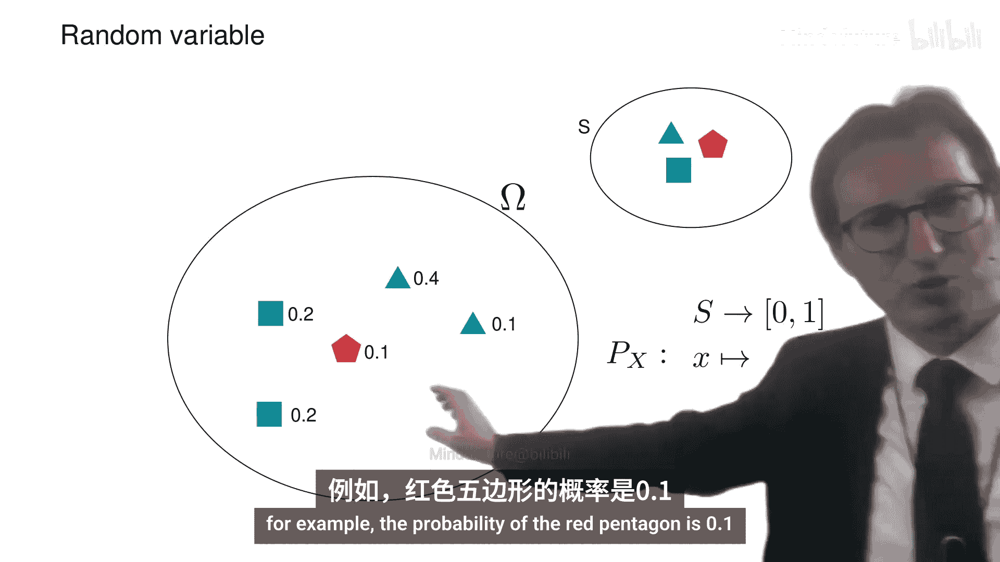

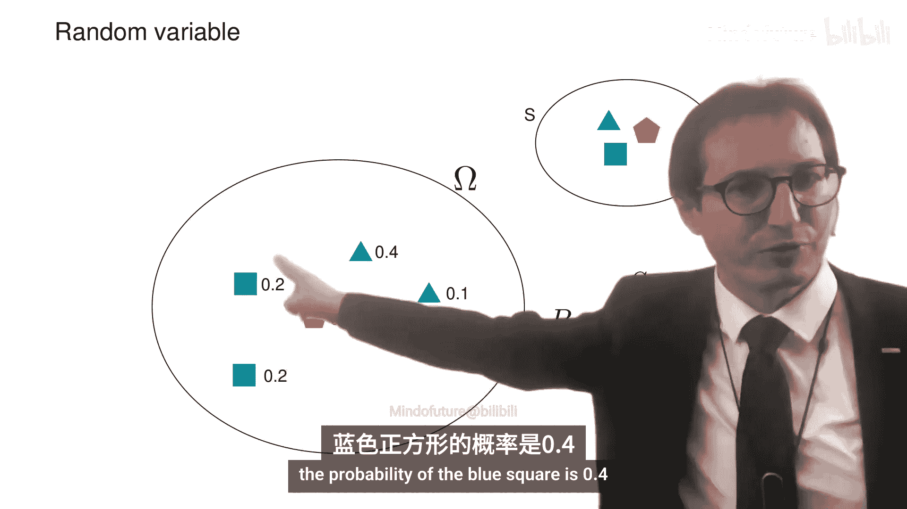

You agree。 I sum these two， and the probability of the green triangle is 0。5。

And so it means that when you do that， when you have this function that goes from here to here and you transfer that probability distribution。

This is kind of a new omega space in a way， right， it's kind of a probability distribution of over all these。

And that's the reason why in spite of being a datamintic function。

 you can view it as something random as well。 But never forget when you have a random variable。

 there is always an omega space behind that random variable， right， always。

That's important because in quantum physics， the problems come from the fact that we don't have an omega space。

 So we basically use random variables and there's omega space because we cannot glue it together。

 So it's actually something that is， that is absolutely important to remember that there's an omega space。

All right。And so these are my probabilities。 as I， as I told you。

 you just sum together those that have the same shape。

 And you see now we have a probability distribution of all these shapes。

 Notice this little subscript that I put in here because that means that the probability that is we associated with that random variable and it's a probability designed on that set。

 right， that that that the values that you that you feed into this probability function subscripted with x。

 it takes these values in there。

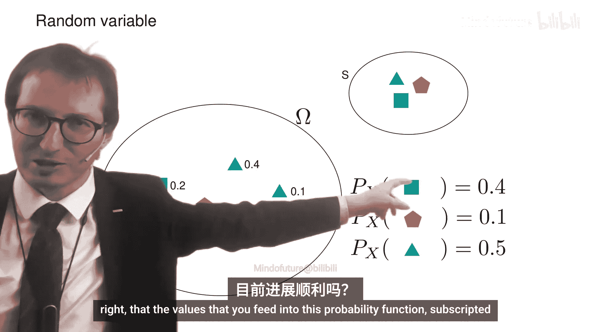

So fast so good。 Everybody with me。Right。Okay。呃。So in practice， and this is again。

 like when you learn how to ride a bike at some point， you remove the little wheels。

 then you remove the omega space and you just reason on， on the just on the random variables， right。

 And then you， you forget that there is the omega space， which mathematically you can， actually。

Now there's another notation， right， You can either use the P subscript X of these shapes。

 or you can have a more classical notation， The probability that big x is equal to the square， right。

 But always remember X。😊，Is really just a function。 So this is just a notation。

 When you write it in this way， it's just a notation， right。

 This is not an actual mathematical variable。 It's just mapping from omega to that set。

I will use this one notation， not this one， right， This one exists also。

 but it might be a bit harder to read。 So I'm going to be using this one in that， in that course。

What I don't want you to do ever， ever， ever， ever is this。

 Do not just use P and feed the value of the random variable in there。That is misguided。

 It's going to lead to a lot of errors。 It makes the formulas hard to read。 so do not do that。

And it's very hard to actually， for me to tell not to do that， because everybody is doing it。

 Even in the textbook， they are doing exactly that。 They are， they are using the。

 the basically the small letters like small Y， implicitly meaning they mean big Y equals small y。呃。

I think for， for learning， when you are still learning probability theory and random variables and so on。

 that's a very bad idea。 Bedagogically to， to do that。 So never do that。 never write。

I will have another example later， but always write explicitly， explicitly P of。The uppercase letter。

 that is my random variable， equals some possible value。Of that random variables。

 always like this and never like this。Okay。No。You can also have multiple random variables， X and Y。

 So you have two functions， two datataministic functions that's associate some some objects with my small omegas。

 And then I can define a joint probability， right， What is the probability。

 that big X is equal to small X and big y is equal to small Y。

 When I just look for all the omegas such that omega is associated with small X and small Y。😊。

With random variabless， big X and big Y， right， So this is very formal of separating。

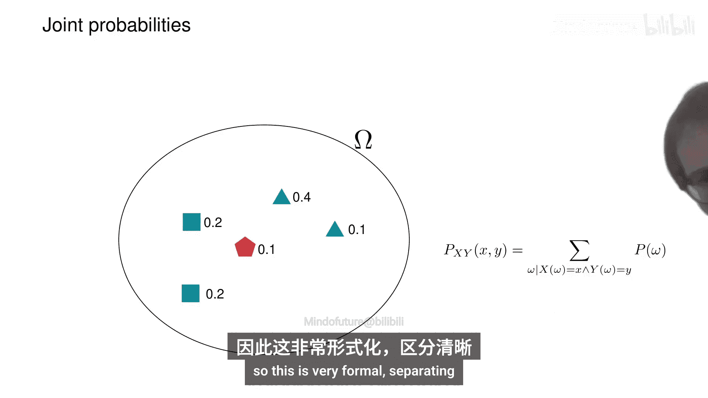

It's really a function。 So this is here the probability that omega via this function big x is associated with a particular value small x and that omega via the function big x。

 big Y。Is associated with a particular value small way。Again。

 look at that formula very carefully and ask yourself， what is everything。Big X and big Y。

 These are my random variables。Detaministic functions from U to subset。Small X and small Y。

 These are stand down new electron10 mathematical variables。Right。

 just like when you say small x can be one can be to that small X。

 It's just the mathematical variable， right like the ones that we are used to。

 a mathematical variable can be replaced by any possible value， and it still make sense。

 So you could rewrite that formula and replace X with the green triangle and y with a number and the formula still make sense。

 right， So this is the feature of mathematical variables， you can replace them with a value。

 And the way you see that big x and big y are not variables is that you cannot replace X。

 Y and X and y。 the big ones with anything， These are functions。

 It doesn't make any sense to replace big X and big Y with anything。

 Only small x and small Y can be instantiated into anything you want。 So whom is that clear。😊。

Very good。 So random variables are not variable。 They are not random。

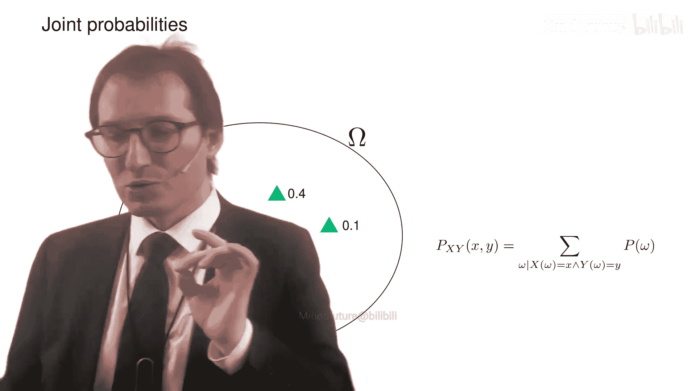

The actual variables are the small ones， the small next small way。

 These are the ones that you can replace with values。ok。We also have。

The conditional probabilities for random variables。 So the probability。

Of the seeing small X condition on small Y。For respectively random variables， big accents and big y。

It's the same formula that you have for the traditional events， right。

 It's the probability of the intersection。 So the joint probability of seeing small X and small Y divided by the probability of seeing small Y。

And again， that's not the notation I will be using。 I will be using this one， right。

 So it's the same one。 This notation is the same as this one， right。

 But you will probably agree with me that this is a bit harder to pass。 This is a bit easier to pass。

 Who agrees this is easier。RightThat makes it a bit easier。 right。

 So this is the reason I'm going to be using this one， right。And I insist， do not ever do this。Ever。

You realize that this is allammbiguous， because when you start writing things like P of small legs。

 given small white and so on。Your last， what does it even mean， right？ you you。

 you have to remember that small x， you implicitly mean with the random variable big X。

 When you write small Y， you implicitly mean associated with the random variable big Y。

The problem is that with that formula is that since small X and small Y are mathematical variables。

 you can replace them with anything you want。So imagine that now I write P of one conditioned on 0。

P of one condition what does that even mean that then you don't even have the letters to help you remember that one corresponds to big x and 0 corresponds to big Y。

 right So that is the reason why when you do that And a lot of people do that texttbook they do that pedagogically。

 it's very， very， very wrong because this is prone to errors and very。

 very difficult to actually understand what's going on。

 So my advice to you do not do that Always explicitly write the random variable that you're referring to acase letter equals to something that could be an uppercase letter could be an actual number could be anything you want。

 right。Ws with me。Right， very good。 And whenever you see people who do that。

 it's fine to tell them they shouldn't， especially when when you're teaching， that's very。

 very difficult to， to understand， alright。嗯。And I'm done with the smooth introduction。

 So just reminding you of what you should already know plus the small one in here。

Now I'm going to be going to Antarctica and use the little errors。In order to build my。

Information retrieval system。

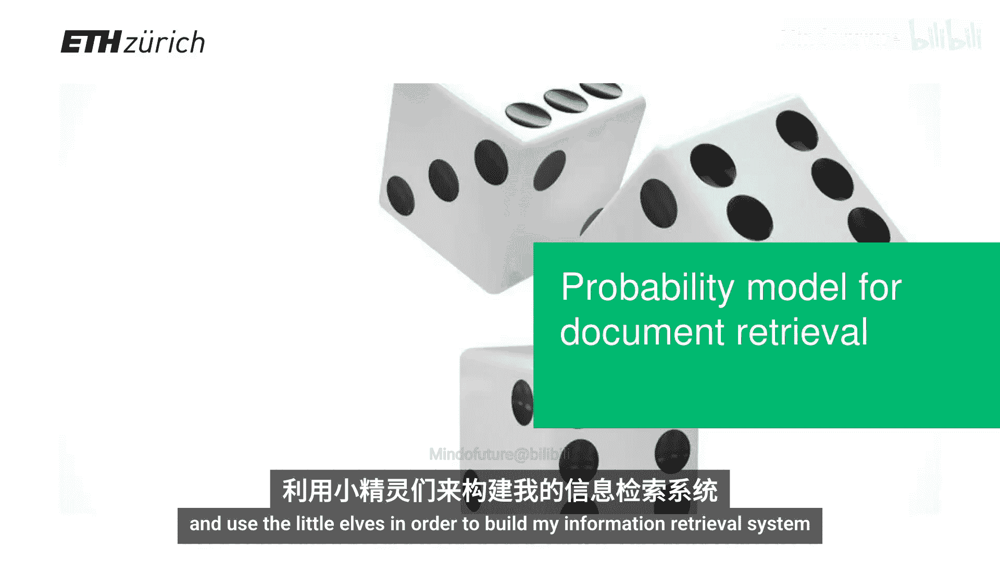

So， the idea。Is based on what I told you last week。About with the evaluation。

So the same thing that we've been using for precision， record and so on。

So remember that the way we evaluate。Is that at some point。

 we have domain experts to whom you give a document and an information need。

And some query that returns the documents。And you ask the person， the domain expert。

Is that document relevance。To the information need， That is a yes， no question。

 Either the domain expert says， no， no， no， that's not relevant at all。Or the domain expert says。

 yes， this is very relevant。 This document is very relevant to the query。 It's a bullolean， yes。😊，No。

 and so。In the past， there have been attempts to do that in reasonable numbers。 So， for example。

 the Cranfield data set had 1300 documents，225 information needs。

 Some later one had almost 2 million documents，450 information needs。

 You can imagine all the resources that it takes to actually start asking experts to。

 to give you these judgments。 Now， imagine that for the entire Internet。Right， billions。

And billions and billions of documents， probability probability pro the。P。

 also billions of information needs because there's billions of human beings， right， So we。

 we all look for things。 And now imagine the size of this thing， right， So this is。

 this is absolutely gigantic。 And yet this is what exactly what we are going to do。

 So imagine now my Oomega space。Cause I'm going to show you the omega space behind the random variables because it helps to。

 to understand。So myomega space has all these possible well， these elementary events。

And you have to imagine that every one of these points in my omega space。Corresponence to。

One specific document。One specific query。Press the yes， no flag。Is the document red events。

To the query。So。That's one point。 And you have to imagine。All of these points。For basically。

 the carn product of all the websites that are out there and all the things that people can look for。

 plus even the carn product of all the domain experts to whom you asked for the same document and query。

That might have said yes or no。And， of course， it's not like the cranfield or track data set where you can just ask people。

 now we actually need some serious business。 And so far this。

 I need a Septilionelves in in this secret base。 Every elf corresponds to one point in here。

 and every elf have has one document， one query and outputs one flag。😊，Everyre we were you with me？

Right， then we'll see we don't need the base。 actually， we don't need the else。

 but they are helpful to understand the probabilities， right。Alright， now when I told you。

Every one of theseels in front of their computer， they just have two keys on the keyboard。

 There's a yes and theres a no that's all theel have to do。 They have to press yes or no。

 given the document and the query that they see。What does it mean to associate。Every point。

 every elf。With a query， we've seen that before。 That is a random variable。

A deterministic function that associates every e， every point， every elementary event。

With one specific query。That is a random variable。So do you see that now I have a random variable。

Whose values are queries？ I'm going to call it Q big Q， right。

So Q is a random variable that associates every one of these littleelves sitting in front of their computer with one specific query。

 for example， information， there's plenty ofelves that see information on their screen， right。

 So that is a random variable queue， with with me。😊，Right。

 now I'm going to do the same thing with documents。 I define a random variable， big D。That is。

 in fact， a function that associates its each e with a document， each one of my elementary events。

With the documents。Here I picked the information retrieval book。

 So maybe there's going to be a millionels out of the Secepttiionels。

 A million of them are seeing the information retrieval book on their screen， right。

And maybe 5 million of them are seeing the query information on their screen。

 and maybe 3000 of them are seeing information and the book， right。

 when you start combining the two random variables。 Does it make sense。Right。

 it's just a one random variable Q for the queries， one random variable Q for the documents。

And one more random variable are。For the flag， that's basically the key they press。 Do they say yes。

 Do they say no。Remember， it's dataministic。 It's a datataministic function。

 If you take 1 point1 L E I S R， right， So this is dataministic。 So R is。A Boolean random variable。

 So far so good。Right。So now what's really cool is that once I have done that， I have my little L。

 and I have the big R， big， Q， big D， my random variables。

 Do you agree that then I can start writing formulas like the one you see on your screen。😊。

That formula makes sense， right， It's perfectly well defined as a conditional probability。

 applying to random variables。😊，This is the probability。

That knowing that the document displayed on the screen is small D。

 Small D can be information retrieval。 It's a mathematical variable。

 You can replace it with anything。 So let's say small D is the information retrieval book。

 And knowing that the displayed query is small Q， let's say information。

That's the probability that R is one。 It's the probability that the L presses one。RightAnd remember。

 R is it's all dataministic， but you have to remember that there might be a few thousandels that are shown the same document and query and maybe among these thousandels。

300 will have pressed yes， and 700 will have pressed no right So each one of them presses yes or no。

 but now you aggregate。 That's the probability of globally。

 all of theelves that have seen document small D and query small Q。

 Whats the ratio of them that have pressed the button。 Yes on the keyboard。

 And so you see it it is straight in here where you have。

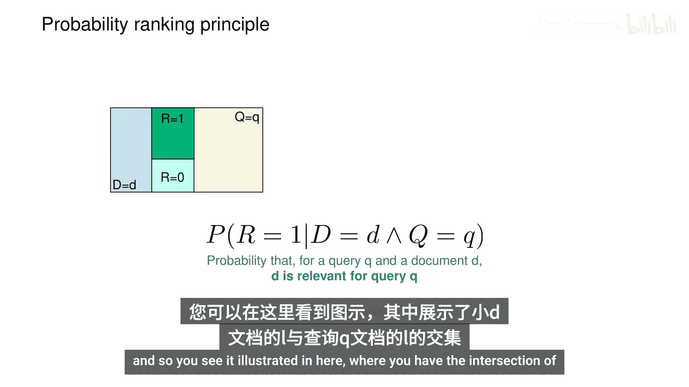

The intersection of。The Ls that C document small D intersected with the L that C documents small Q。

 So the intersection is here。 And in that intersection， These are the l that answer yes。

 These are the l that answer no， and that probability that R equals one is basically the， the ratio。

 It's roughly 70% in that case。 right， Who sees that This formula who understands that formula。

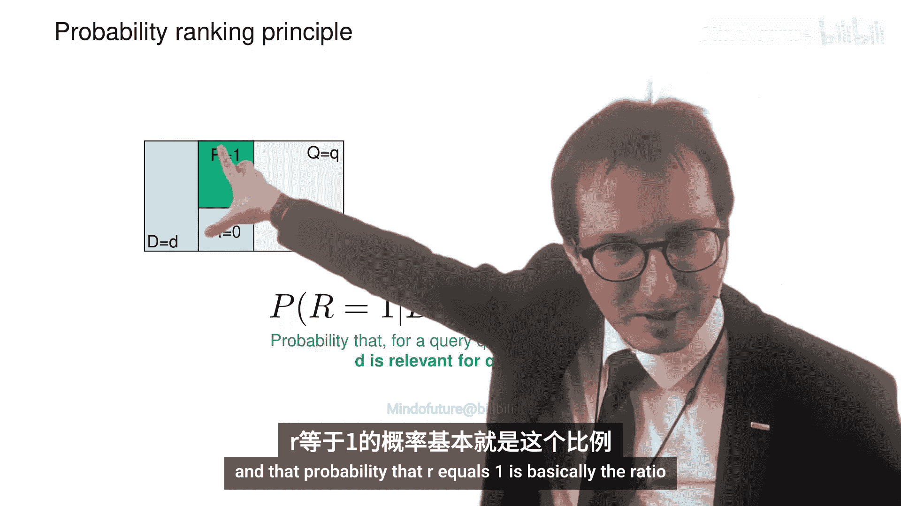

Right， okay， the little helps help help a little bit because if you don't see the omega space and so on。

 that can seem very abstract。 A formula like this。 Like， what does it mean that it's relevant。

 The probability of relevant。 But if you imagine this base in Antarctica and the earth。

 it helps understand what this formula actually does。 And this formula is very， very well defined。😊。

And， of course， you assume that theels are domain experts。 So when they answer yes or no。

 they know what they are doing， right。So you can trust their judgments。

Who see that we can build an information ritual system with that。So of you。

 how would you build an information retrieval system。With these numbers。

 imagine I have these numbers for every small D and small queue。 I can compute this。Any idea。

See Ra hands。 let's bring microphones to see to the people。 if you can tell us。

 So there was a race hand over here。 And I think I saw one over here。 So you， you wanted to say yes。

 so。呃， overall there。Yeah。So I believe you can like use this as a ranking system for a rank retrieval。

 So depending on how relevant or how high it rele is， you can do a ranked retrieval on that。 Yeah。

 absolutely。 so to be more precise。 imagine I give you a specific query。

 So a specific query molecule cube。How would you rank， What would you rank。

The documents with where this probability is the highest。 Yes， absolutely。 So this is the way to go。

 like this slide over here。 So here I have four documents， small D， small， E， small F， small G。

 These are four， four books。 And what you're suggesting is we rank them like this。

 And we return on those that have the highest probabilities， right。So indeed。

 in the case that the L all agree that's either one or0。 So I return the ones here。 But in fact。

 in reality， maybe they will disagree。 and I just need to rank reorder。

 So I I compute that for all documents。 The query is6， right， That's the query you want't answer。

You reorder， and now you would return first document F， then document D， then document D。

 then document E， right The documents that the mostelves have said yes to。

 they have said is' relevant。 the most relevant ones， you return them first。Was he who。

 who raised their head， You also wanted to say something similar， yeah。Basically the same。 Okay。

 so we agree。 Asome。 You're really， really good。 So this is exactly the idea， so。😊。

Assuming I have these earth in Antarctica。 I can build the Google。

 All I need to do is put some front end where people can enter their queries。

 Then I go to the earths。😊，I put the query of the user in small queue。

 Then I compute this thing for every one of the pages that I see on the Internet。

 There will be billions of them。 So I have to compute that a billion times。Ideally。

 that would be either one or0 if they all agree， because they will， of course， disagree agree。

 It's not all1 or 0。 So it's going to be numbers。 I reorder them。

 And imagine I'm doing that for every single page of the Internet。

For the query small queue that a user typed in their Google search box。

I have an information renewal system。Working one， who agrees with that。Right， very， very good。Okay。

We can also turn it into Boolean retrieval。 So that would be ranked retrieval。 Boolean retrieval。

 like would arbitrarily say， okay， whenever a majority of elseves think it's relevant。

So that would be the majority。 Proability that they press。

 yes is larger than the probabilityability that they press no。

 So I return on everything for which a majority said yes。

 right That could turn me into a Boolean system in that case。Alright。So illustrate it。

 you see one on the left where a majority said one for that particular document。

 small D and query small Q。 And on the right， you have one for which a minority of said yes。

 given documents small D andque small Q。 So you wouldn't return on the one on the right。

 You would return the one on the left。Alright， so that's the trick or expressed equivalently。

 whenever it's more than one half or whatever threshold you want， you output it。

But there's one problem with that。 It's the costs that would be associated with。

Building such a basin in Antarctica。 And that's even assuming that else exists， right。

So we cannot do that。 It's not viable。But we can pretend that it exists and we can do some mathematical reasoning。

 and maybe we'll reach some mathematical formula that we can use。

We it actually needing that base to exist and the earth to exist， right。

 And then we can just use that formula。 That's exactly what we are going to be doing now。

 So I'm just going to derive mathematical formulas based on that， actually。

 because this is where we want to compute and we'll see that we don't need theels。

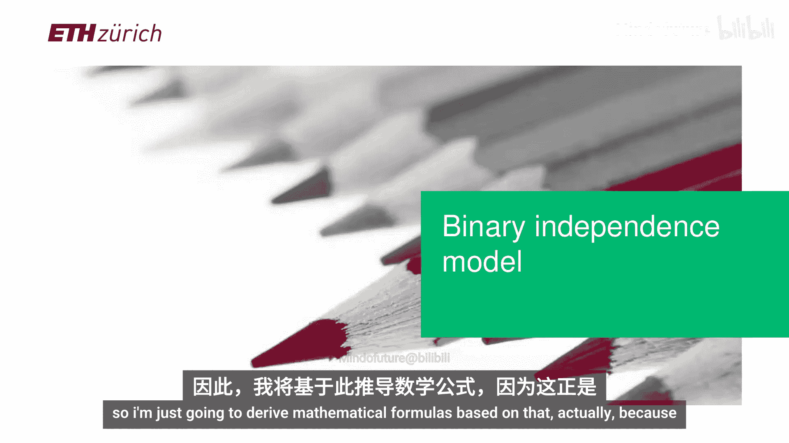

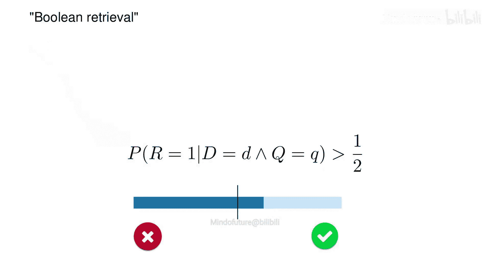

嗯。While doing this， we are going to make a few assumptions along the way。You will see。

That some of the assumptions that we will be making make a lot of sense。

 Some of them will be quite intuitive。You will see that some of these assumptions will be very unintuitive。

In fact， you might even think some of the assumptions。Might be a bit。Pushing it， right。 And in fact。

 that has to do or will explain that。 But sometimes you make an assumption not necessary because it makes sense。

 but because it simplifies things。 So you say， okay， if we would assume that。

We try and that simplifies the formula。If at the end， you build the system with that assumption。

And you build a system， and it actually works， and it has good evaluation metrics。

 Then you can argue that it made sense to make this assumption。

 But sometimes you can only see that at the end when you actually see it's working。

 So there's a bit of trial and error here。 Several decades of that， people writing papers。

好。How do we model these documents， What is this small D， Well we already looked into this。

 we can see the small D as a set of wells。Or we can see it as a bag of wealth。

 Or we can see it as a list of wealths， right， and all of that。Is well defined mathematically， right。

 I can have。A set of wealths。 I can number the wealth。 There's world number one， world number  two。

 world number 3， right， or you call them terms， terms wealth。嗯。

So you can see them as a set of wealth， a bag of wealth， or least of wealth。

 We've seen that if it's a set of world， it's just wood ads。And， in fact。

For the purpose of my probabilistic information retrieval system。

 I'm going to go back to set of wells。 So remember that we use the bags of weld for the ranked retrieval for vector space model。

But， in fact。For that， it's sufficient to have the set of wealth。

 It's also simple because then I don't have to bother with term frequencies。 Right。

 So now for the reminder of what we're going to be doing today and next week。

I only care if yes or no， a given term is in a given document。

 but I don't care about the term frequency that you can forget。 for out term frequency。

 So set of wells。When I do that。I can express my documents and my query as vectors of bulls。

There's a one if the term belongs to it， and there's a zero if it doesn't。There's， of course。

 a convention on the ordering of the terms， right， but that's arbitrary， right。

 But if I have a specific order on the terms， then I can put a 0， I can put a one。

Note that this is small D， small Q These are actual documents and actual queries。

 just with the variable to represent them。Now， once I do that。If I have a random variable that is。

 in fact， a vector， do you agree that the random variable。

That output vectors is the same as plenty of random variables that I would put each one of the components。

Do you agree that having a a random variable big D？That takes its values in the vectors is the same。

As having a random variable， big D1， that outputs， yes or no term。

 small D1 is in the the first term is in the document。 big D2， big D 3 and so on。

 All I'm doing is I'm splitting my big D， So the the big document inside every one for every term。

 right， like D。 So D E T， H， for example。Means。嗯。Yes or no is the document containing the term E TH。

 right That is a random variable。 It's a Boolean random variable that takes one or0， with with me。

Okay， so I do the same with the query Q information。

Is a boolean random variable that tells me yes or no， the query contains the term information。

So it means that now I can write something like this。 The probability that。

The document contains Tom K。Is equal to D。 So D K is just a Boolean value。

 It's a mathematical variable that can be 01。 You could actually put a 0 or1 instead of a small decay。

All right。If you replace it with a one that gives you the probability that the document contains terms decay K。

 knowing that the query is Q and that hit's relevant。 and if Dk is0， it。

 the probability that the document does not contain term K。

 knowing that the query is Q and that hit's relevant。

Weho agrees with that interpretation of that formula。Very good。 So you see。

 we've just split the documents into their individual vector components， Boolean components。

And now I'm going to make an assumption。I'm going to assume that I can factor the documents in terms of the terms。

 So it means that the probability that I have a specific document。Is the product。

Of the probability that it contains or doesn't contain the terms。That is a quite sensible assumption。

 right， That's called the the binary， think B binary independence。 never remember that binary。

 binary independence model。 Yeah， by B IM。 So that is。

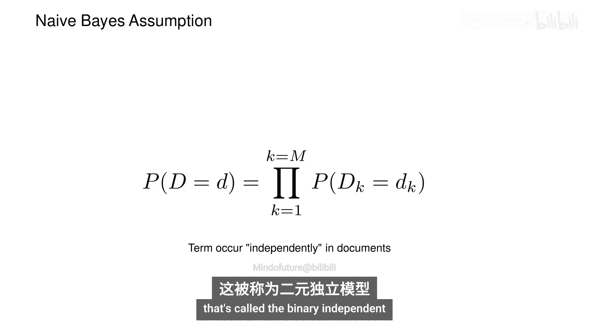

没有 some。Concretely because at first formula can be daunting。 so I did it with an actual document。

So the document says Preban is unexpectedly working today。It contains five terms。

 Po ban is unexpected D working today。 So you agree that D Po band D is D and expected D D working。

 and D2 are equal to one。And D， T， H， D the rigged the information。 Theyre all equal to 0。

 That just tells me what words are in the documents。 Do you agree with that。Well， basically。

 what I'm saying is that the probability that this is the document。

 So I replaced small D with an actual document。 And again。

 I can do that because that's a mathematical variable。That gives me a product of probabilities。

 It's the probability that it contains poly band times the probability it contains is times the probability contains unexpectedly。

 And then times the probability does not contain E T H and so on and so on， right。So again。

 that's because you have ones and you have zeros， right， So for the ones that have ones。

 is the probability of containing or the ones for which it0s the probability of not containing。

Who agrees this formula is quite sensible to us。And of course it's called an independence assumption Y because normally that you should be using a chain rule with conditions right but here I don't have any conditions。

 it means that I'm assuming all of these are independent of each other that's the assumption here right if E F and G are independent of each other。

 then the probability of EfG， the probability of E times the probability of F times the probability of G that's independent and I'm assuming that here that is an independent assumption。

So now if I make it more mathematics， I can replace this with the actual formal formula with all of the random variables for the individual components。

 right？😊，And then I checking for one0， depending on the words that I have。

 And now I'm even going to replace the ones and the zeros with the， the， the， the， the。

 the variables for the specific documents。And do you see that now I have my product。

Do you see that this right here。Is the formula I had right here by probability formula。Who sees that。

RightAllright， it's always a good idea to take the time to manipulate the equation and see what everything means。

 the uppercase letters， they are random variables， you cannot replace them。

 The small lowercase letters， these are mathematical variables。

 These are the ones you can replace with ones and zeros and sentences。😊，Alright。

 so I'm making my this assumption， right。And making this assumption。

So now remember that this is what we want to do。 We want to build a ranking system and compute this thing。

Anded by documents for billions of documents。We know that we have bias formula because this might be complex to computes。

 But to remember the umbrella in the rain， it's exactly like the umbrella in the rain。

 This formula here is half to compute。 How can I compute the probability of relevance。

 given a document in a grid just as hard as computing the probability that it's raining。

 given that I don't have my umbrella， right， or that I have my umbrella。

And so I can do some magic and invoke the base formula。😊，And the base formula tells me。

 I can do this。 I can swap R N D。So I'm going to swap them with that base formula。

 It's just that I'm missing something in here。 What do I want， I would like， depending on D N Q。

 right， So I'm missing something。That's O。 I can add it。Do you agree the base formula。

 It also works if I add the same condition everywhere。Right， that also works。 So I'm doing。

 I'm adding probability that the query is small cube。And do you agree， Well。

 maybe you have the feeling， But we see the formula on the right is going to be easier to compute than the formula on the left。

Right， this is what's going to happen。So。Now， we are going to look into this。

 I'm just checking the time。 I still have one or two more minutes to， to start doing the。

 the cooking with， with this。And， of course， what we' are going to be now doing is deriving mathematically a simplification of this。

 We' are going to simplify， simplify， simplify in such a way that at the end。

 I have something that is simple and usable for my system。😊，So， let's do that。That's my formula。

 The same1。 I just rewrotet it in here。And then what I'm going to do。

 that's really the tricks that the mathematicians have。

 It requires a bit of creativity to basically come up with these things and the derived right formulas in that way。

 But somehow。😊，Intuitively。I would like to get rid of the denominator in here。

I'm going to do that right now。 I'm doing it by rewriting the same formula with r equals 0。

 Not't that if free to do that， right， It's also true。 The same base formula。And now。

I'm going to divide。What happens if I divide a probability。With the probability of the complement。

 these R D odds。Right。Do you agree now。That if I rank the probabilities by the documents。

 by probability， it's the same as ranking them by odds。It's's in the same it works in the same way。

 If you order the documents by probability or you order them by odds。

 You get the same order agrees with that。 It's exactly the same。 So now I'm going to take the odds。

 So I'm dividing what's on the the first one with the second one。

 And do you see the denominator is going away now。Is going away because it's the same。

And that's how I got rid already on one third of my formula。 One third of my formula is out。You see。

 And so we just keep doing that to， to keep improving。So this goes away， right。

 One less thing to worry about。Now， do you agree， I can do this。

 So that's just the the simple arithmetics rule with multiplication division。

What do I have on the right， Do you see this， This is also an odd。This is also an odd。

 It's the odds of relevance。Depending the condition on the query。 So I keep simplifying like this。

And that's what I'm left with。No。Here is when I'm going to use D independence assumption。

That I'm going to decompose the random variable uppercase D。 I'm decomposing it in this way。

It's not exactly the same。 I still have the condition， depending on big R and B Q， right。

 So I have to also add the conditions in there。 Do you agree that this formula is still true if I add a condition everywhere。

Right， that remains true。 So I can add the same condition everywhere and get this formula that is also correct。

Right。Again， because it's the same condition everywhere。And this。

 I'm going to press the button and do that。 This is what I get。嗯。

I can also rewrite it a little bit in this way。 So you now now it's getting more precise。

 Now I'm looking at older the terms。😊，It looks small because that's a mathematical formula。

 But remember that there might be half a million factors in there。

There's half a million values in there， right that that I have here。

 I'm iterating on every term that there is in the collection。呃。And remember， this is a bulloleard。

 So now it's going to be more easier easier to handle because I'm not looking at the whole document。

 I'm just looking at bullolean。 Q is whatever inputs the user。G me the orthodox。

 And now I'm looking at the bulloles。These bullans D are going to depend on the specific document I'm looking at。

 right， If you take， if you take a document， it's going to give you ones at specific positions and0 at others。

 other document is going to have ones and zeros differently， right。Everybody with me？Alright。

 so I'm going to stop here because I don't want to end on something scary。

 because this is some of the formulas that are coming are actually scary。

 but we are doing it one by one。So。For now， just think of random variables。 These are not random。

 These are not variables。 These are just determining functions and be careful with the notations to always write it explicitly with a random variable equals to a specific value that can be a constant。

 or that can be a mathematical variable。😊。

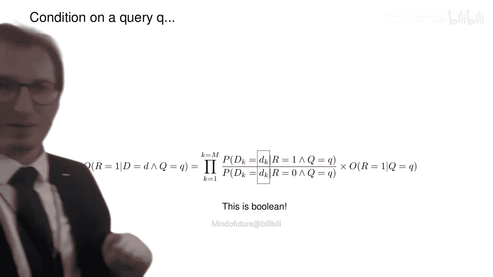

嗯。Alright。呃 let me。Just see。

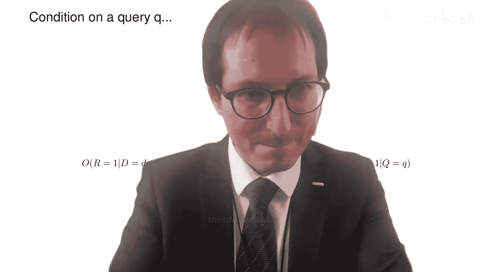

I've been trying to be very careful because I know this is advanced and so on。 I'm taking it slowly。

😊，Just just want to make sure that。I didn't lose。Too many of you。

 It's actually good to spread that over two weeks， because that way。

You have a bit of time to digest what we've been doing today。Alright。Very good。Again。

 all the part on probabilities， this， this is knowledge you already had， right， So。

 and there's even somebody who want us with everything。 This is really， really nice， okay。😊。

Very good。 So that's perfect。 That's absolutely perfect。 Very happy with this。😊，So where。Thank you。

 everybody， for attending this lecture。 I hope you enjoy the exercises that the T A team prepared for you。

 I hope you will also enjoy next week。 The mystery game that the T A team has prepared for you。

 And I'd see you next week for the continuation of the lecture with at the end。

 working and usable information retrieval system。 Thank you very much。 everybody。 See you next week。

😊。

