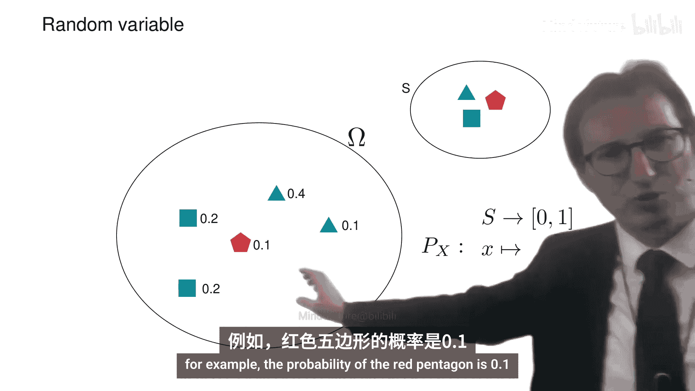
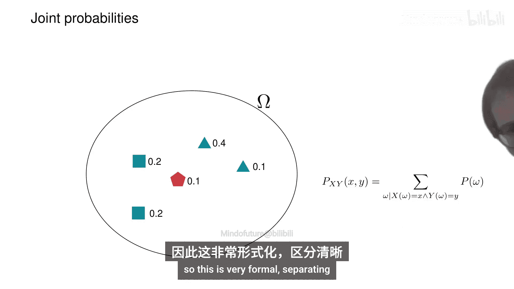
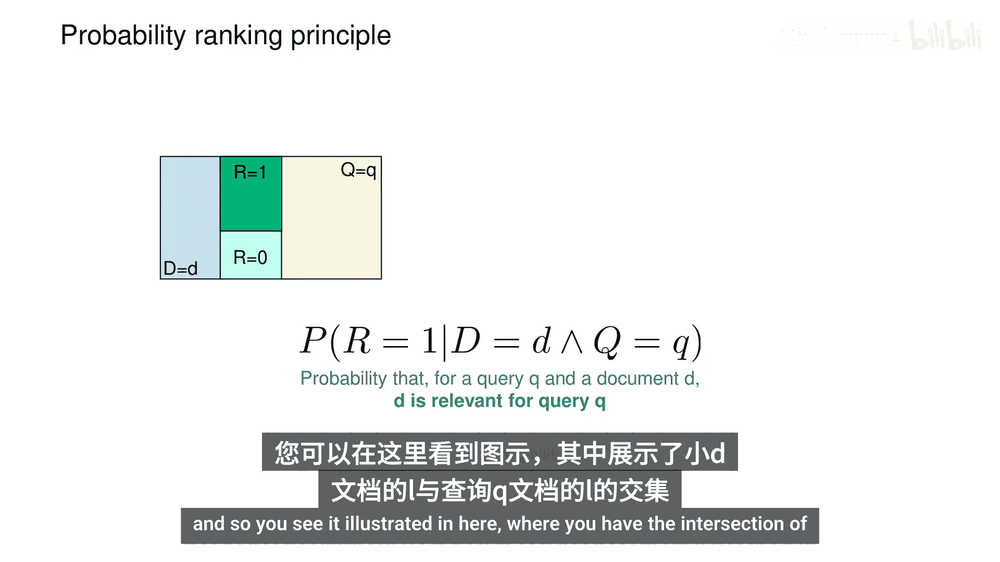
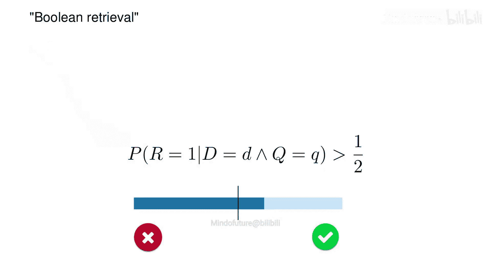
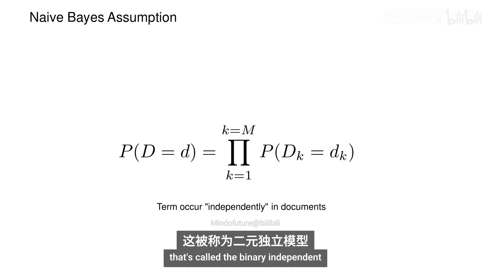

# 信息检索：P25：概率信息检索 (2/4)

在本节课中，我们将学习概率信息检索的核心思想，并利用贝叶斯定理和随机变量的概念，构建一个理论上可行的检索系统模型。我们会从简单的例子入手，逐步推导出用于文档排序的关键公式。

---

## 回顾：贝叶斯定理与先验概率

上一节我们介绍了概率论的基础。本节中我们来看看如何应用贝叶斯定理进行推理。

我们想知道“下雨”的概率，条件是“我带了伞”。这可以用贝叶斯定理来表达：

**公式**：
`P(Rain | Umbrella) = [P(Umbrella | Rain) * P(Rain)] / P(Umbrella)`

现在只需要计算这三个数值：
*   `P(Umbrella | Rain)` 是下雨时我带伞的概率，假设为 `0.95`。
*   `P(Rain)` 是下雨的先验概率，假设为 `0.5`。
*   `P(Umbrella)` 是我带伞的总概率。假设统计一年有271天带伞，则概率为 `271/365 ≈ 0.742`。

代入计算：
`P(Rain | Umbrella) = (0.95 * 0.5) / 0.742 ≈ 0.64`

这意味着，在知道我带了伞这个新信息后，“下雨”的概率从先验的 `0.5` 更新为了后验的 `0.64`。这种从先验概率开始，结合新证据更新为后验概率的推理方式，称为贝叶斯推理。

贝叶斯公式的威力在于可以估计那些无法直接测量的事物。例如，著名的**德雷克公式**用于估算银河系内可能存在的外星文明数量，它就是一连串概率的乘积，是链式法则的典型应用。

---

## 核心概念：随机变量

理解了概率更新后，我们需要一个关键工具来描述文档和查询，这就是随机变量。

随机变量既不是“随机”的，也不是传统意义上的“变量”。它是一个**确定的函数**，将样本空间 Ω 中的每一个基本事件（或结果），映射到一个我们感兴趣的值的集合上。

**图示解释**：
假设样本空间有一些基本事件，随机变量 X 是一个函数，它将每个事件映射到一个形状集合 {蓝色方块, 红色五边形, 绿色三角形} 中的某个形状。

通过这个函数，我们可以将样本空间上的概率“转移”到形状集合上。某个形状的概率，等于所有映射到该形状的基本事件的概率之和。

**重要提示**：
永远要记住，随机变量背后总有一个样本空间 Ω。在表示概率时，务必明确写出随机变量。建议使用 `P(X = x)` 的清晰形式，避免使用容易引起混淆的 `P(x)`。

我们可以同时定义多个随机变量，例如 X 和 Y，并讨论它们的联合概率 `P(X=x, Y=y)`。同样，条件概率定义为：
`P(X=x | Y=y) = P(X=x, Y=y) / P(Y=y)`

---

## 构建概率检索模型

现在，我们将利用随机变量为信息检索系统建立一个概率模型。

### 理想实验：南极洲的“小精灵”基地

想象一个理想实验：在南极洲有一个基地，里面有无数“小精灵”。每个小精灵面前有一台电脑，屏幕上显示一个**文档**和一个**查询**。小精灵是领域专家，他的任务是根据文档是否满足查询的信息需求，按下“相关”(1) 或“不相关”(0) 的按钮。

每个小精灵代表一个基本事件。我们可以定义三个随机变量：
*   **D**：一个函数，将每个小精灵映射到他看到的**文档**。
*   **Q**：一个函数，将每个小精灵映射到他看到的**查询**。
*   **R**：一个函数，将每个小精灵映射到他按下的**按钮**（1 或 0）。

在这个设定下，`P(R=1 | D=d, Q=q)` 就有了明确的含义：对于所有看到文档 *d* 和查询 *q* 的小精灵，其中按下“相关”按钮的比例。这个值衡量了文档 *d* 对查询 *q* 的相关性概率。

### 从理想模型到实际系统

如果这个“小精灵”基地真的存在，我们就可以构建一个完美的搜索引擎：
1.  用户输入查询 *q*。
2.  对于网络上的每一个文档 *d*，计算概率 `P(R=1 | D=d, Q=q)`。
3.  按照这个概率值从高到低对所有文档进行排序，并返回给用户。

这就实现了一个**概率排序检索系统**。我们也可以设定一个阈值（如 0.5），实现一个**布尔检索系统**：只返回那些多数小精灵认为相关的文档。

当然，建造这个基地是不现实的。但我们可以把它作为一个思想实验，进行数学推导，目标是得到一个不需要小精灵也能计算的、近似的公式。

---

## 关键推导与独立性假设

为了推导出可计算的公式，我们需要对文档进行建模并引入一些假设。

### 文档的表示：词项集合

我们将文档和查询表示为**词项集合**（忽略词频）。对于一个固定的词项顺序，文档可以表示为一个布尔向量，其中每一维对应一个词项，1 表示词项出现在文档中，0 表示未出现。

因此，文档随机变量 **D** 可以分解为一组布尔随机变量 **D1, D2, ..., Dt**，其中 `D_k = 1` 表示文档包含第 k 个词项。

### 二元独立性假设 (BIM)

现在，我们做出一个核心假设：在给定查询 **Q** 和相关性 **R** 的条件下，文档中各个词项的出现与否是**相互独立**的。这称为二元独立性假设。

这意味着，一个特定文档 *d* 出现的概率，可以分解为其各个词项出现与否的概率的乘积：

**公式**：
`P(D=d | R=r, Q=q) = Πk P(D_k = d_k | R=r, Q=q)`
其中 `d_k` 是文档向量在第 k 维的值（0 或 1）。

### 应用贝叶斯定理进行变换

我们的目标是计算 `P(R=1 | D=d, Q=q)` 用于排序。直接计算它很困难，但我们可以使用贝叶斯定理进行变换：

`P(R=1 | D=d, Q=q) = [P(D=d | R=1, Q=q) * P(R=1 | Q=q)] / P(D=d | Q=q)`

同样地，对于 `R=0` 也有：
`P(R=0 | D=d, Q=q) = [P(D=d | R=0, Q=q) * P(R=0 | Q=q)] / P(D=d | Q=q)`

### 简化排序依据：胜率 (Odds)

由于排序只需要相对顺序，我们可以计算相关与不相关的**胜率**，并对其取对数简化计算：

`O(R=1 | D=d, Q=q) = P(R=1 | D=d, Q=q) / P(R=0 | D=d, Q=q)`

将贝叶斯公式代入，分母 `P(D=d | Q=q)` 被消去，得到：
`O(R=1 | D=d, Q=q) = [P(D=d | R=1, Q=q) / P(D=d | R=0, Q=q)] * O(R=1 | Q=q)`

### 代入独立性假设

现在，将二元独立性假设代入上式中的概率比值部分：

`P(D=d | R=1, Q=q) / P(D=d | R=0, Q=q) = Πk [P(D_k = d_k | R=1, Q=q) / P(D_k = d_k | R=0, Q=q)]`

最终，我们得到用于排序的公式。排序时，我们可以忽略与具体文档 *d* 无关的常数项 `O(R=1 | Q=q)`，专注于计算每个词项贡献的乘积（实践中常取对数变求和）。

**核心排序公式（取对数后）**：
`Score(d, q) ∝ Σk log [ P(D_k = d_k | R=1, Q=q) / P(D_k = d_k | R=0, Q=q) ]`

这个公式的意义在于：我们将文档相关性概率的估计，转化为了对文档中每个词项在相关/不相关文档中出现概率比值的求和。这大大简化了计算，并为实际系统设计奠定了基础。

---

## 总结

本节课中我们一起学习了概率信息检索的基础框架。
1.  我们首先用贝叶斯定理说明了如何利用新证据更新概率信念。
2.  然后明确了**随机变量**是确定性函数这一关键概念，并建立了清晰的概率表示法。
3.  通过“南极洲小精灵”的思想实验，我们将信息检索问题形式化为一个概率计算问题：`P(相关 | 文档, 查询)`。
4.  为了得到可计算的模型，我们引入了**文档的词项向量表示**和**二元独立性假设**。
5.  最后，通过一系列贝叶斯变换和化简，我们将复杂的相关性概率计算，推导为基于各词项概率比值的求和公式，为构建实用的概率检索模型扫清了道路。

下一节，我们将继续深入，探讨如何从实际数据中估计公式中的概率参数，并最终得到一个完整、可运行的概率信息检索系统。