# 【苏黎世联邦理工学院】信息检索-｜-Information-Retrieval-｜-Eth-Zurich-2025-p26-P26_10._概率信息检索_(3_4)--BV1ndsBzdEss_p26-

Welcome， everybody， the lecture hall。 welcome everybody on Zoom。

 welcomelcome everybody watching us from the future。😊。

We are in the advanced part of information retrieval。 As you might remember。 now。

 we are tackling the advanced topics for retrieving documents。I will finish today。

 hopefully this probabilityba seek retrieval part。 and we will hopefully have some time to continue with language models。

And before that， I will ask you a few questions。 Thank you。 So that's。

We can check that You've been following。So， let me go there。Here is my first question。

Which of the following does not always apply。So is it that the sum of the probaities of all elementary events must be one。

Is it that each elementary event must have a probability of either0 or 1。

The elementary events are the elements of the omega， big omega。

A probability team must always be positive。And the probabilities of elementary events must all be equal。

 So some of these。Do not。Always apply。

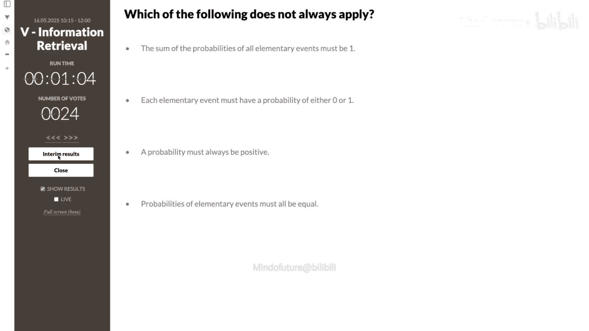

Oh， well， there's a lot of the disagreement in here， but we do have a majority for two of them。

So the sum of all the probabilities of all elementary events must be one。

 That's the definition of a probability measure， right， you， you need to to， to sum up to one。

 It's a normalization of the probability。A probability must always be positive in classical probability theory。

 That must be， right， You must have positive probabilities。😊。

It turns out that there exists negative probabilities。

 It's actually a brilliant idea by Richard Faynman。

 If if you've heard of him and he wrote a wonderful paper about the use of negative probabilities and what they could actually make sense。

 And in short， he uses negative probabilities a bit in the same way that I。

 the imaginary number was invented， right， they realize that you could solve polynomial equations by positing that there is a number I such that the square is -1。

 And then you calculate。 And at the end， there was no more I， but it solved your problem。😊。

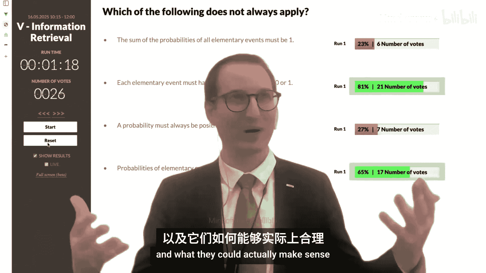

So negative probabilities are really the same。 You use them on the way to do your calculations。

 But at the end， they are gone and you're left with positive probabilities。 But that was parentheis。

 because classically in probability theory， normally you require that they must be positive。

And it shows that there's always the geniuses that are going to， to， to。

 to have all of these brilliant ideas to， to， to challenge。嗯。Things that are taking for granteds。

 Then the probabilities of elementary events must all be equal。 No。

 that would be a uniform distribution， but it doesn't have to be。

 We also have probability distributions that are not uniform。Yes， yes。Yes， absolutely。 yes。

 you're right。 So， yes， yes。 Actually， you， if， if that was quiz。

 you could make an argument on that and win， absolutely， because this is true。

 must always be positive with technically exclude 0 and the probability can be 0。 Yes。

 you're correct。 Thank you very much for this。 Yes， yes absolutely。 I had in mind the the。

 the whether I had in mind when I wrote that was negative probabilities。 You know， talk about them。

 But you absolutely correct。 That that would win an argument。😊。

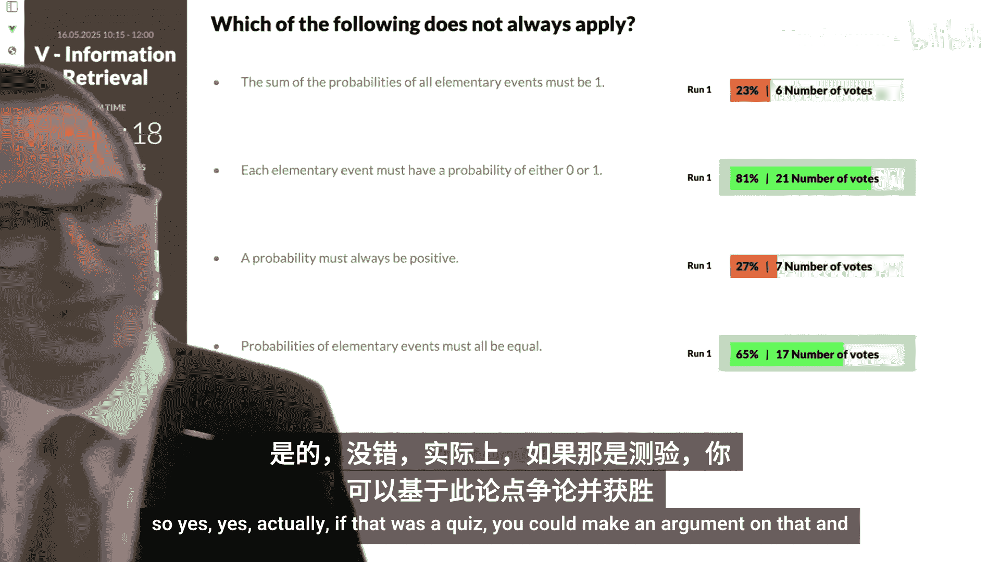

Alright。 And the last one， yes， each elementary event must have a probability of the 0 and 1。 No。

 that would be very restrictive。 That would basically be a probability distribution with a certain event and nothing else can happen。

 right， so that that surely does not always apply。

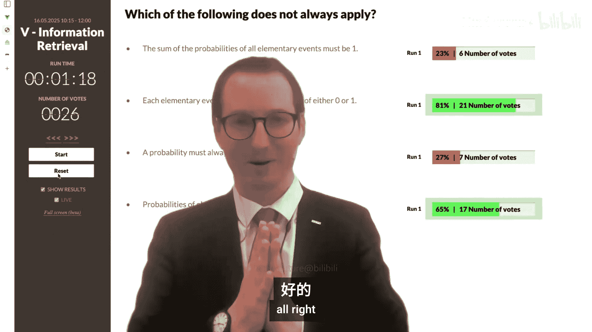

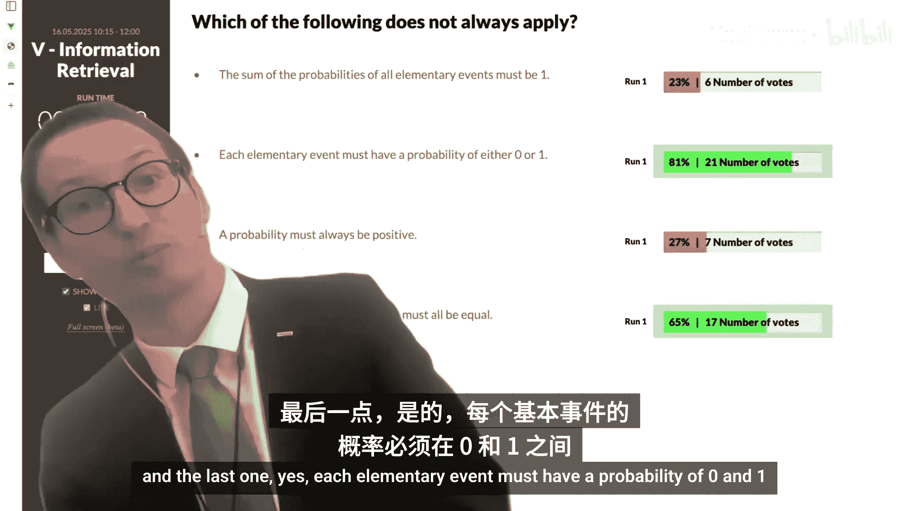

Alright， so very good。 And thank you very much for， for your remark。😊，嗯。

It's probably my French origins， you know， because when we say positive negative。

 it depends on the language， whether you include 0 or not。

 So there's different conventions across across areas。 But in English。

 positive actually does not include 0。Allright。Then， I have。你逼的。

Or still on probabilities to not switch the context too much。

Which of the following statements are true。 Do not be scared。

 It's always the same statement with things that change， right， It's just。

All the possible combinations。So if two events are independent， slash this joint。

 that's the way it changes。Then the probability of their intersection slash union， depending on the。

 on the statement you're looking at， is the product slash sum of their respective probabilities。

 And normally， there are two of them that should be correct。

 You just need to find the right combinations。

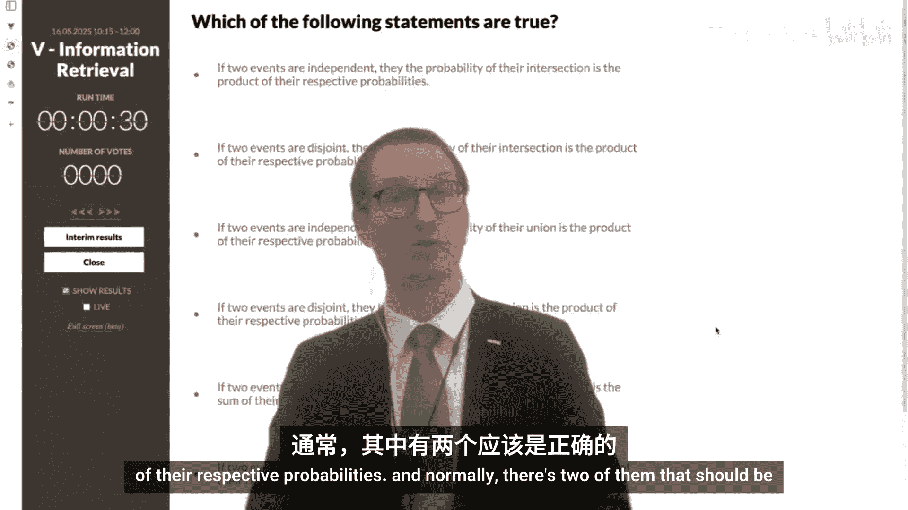

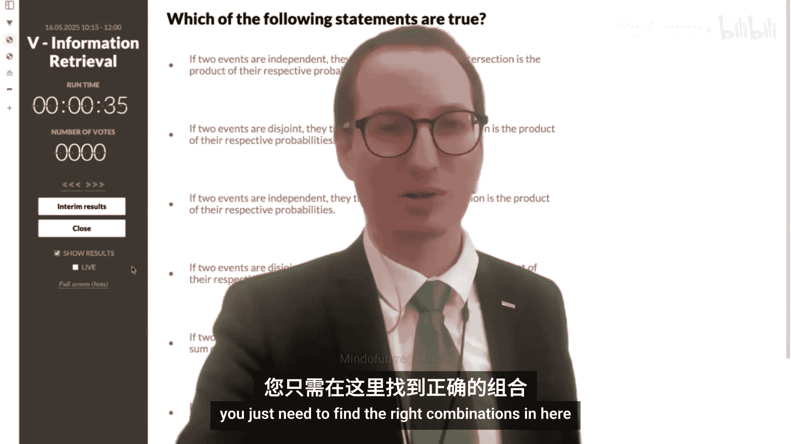

In here。It's about the definition of independence， when model the characterization of independence。

And these joint events。Remember that an event is a subset of Oomega， right？

 It's not the elementary one。 So an event is a subset。Normally， you should know all that。

 but it's a good thing， too。

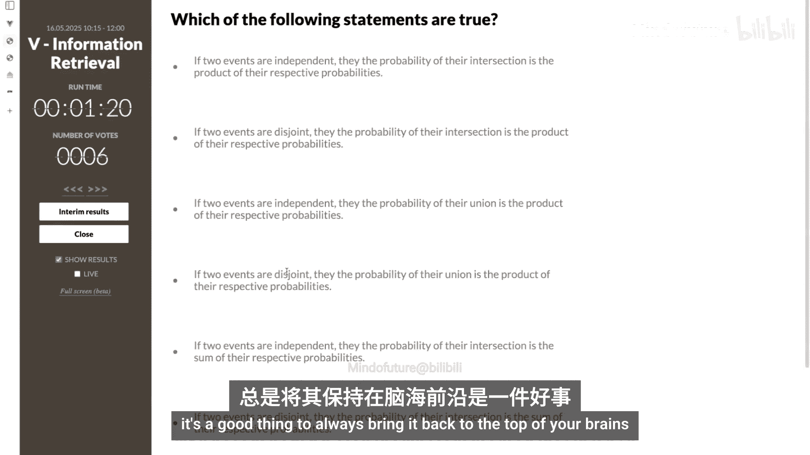

Always bring it back to。To the top of your brain。

But let's see if we have a majority。so I see。

Already one answer very popular here and another another one there。

I see now some people are changing their minds。Let me close it。 So， yes， indeed。

 independent events means that the intersection is the product of the probabilities。

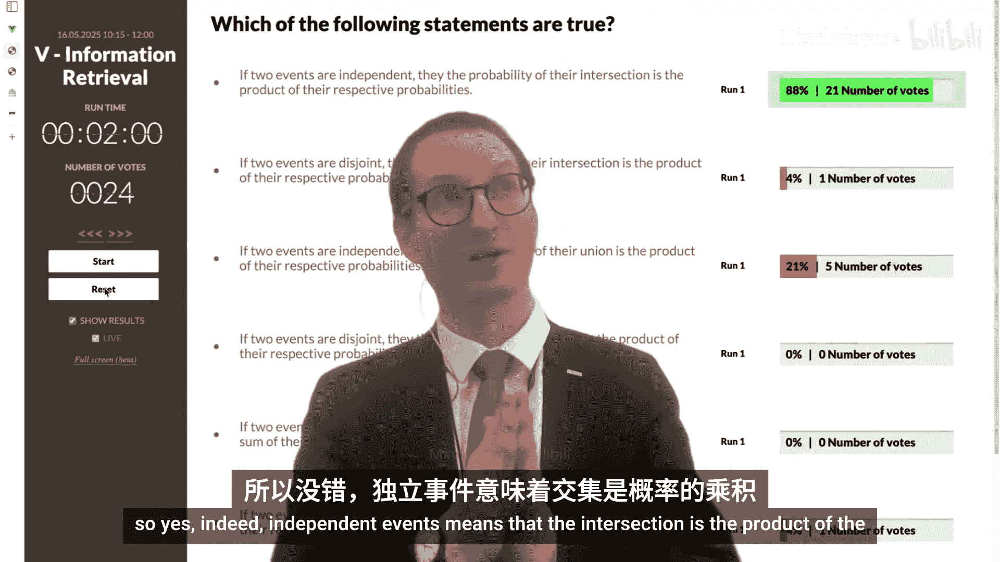

So these are independent events。Multiply them。

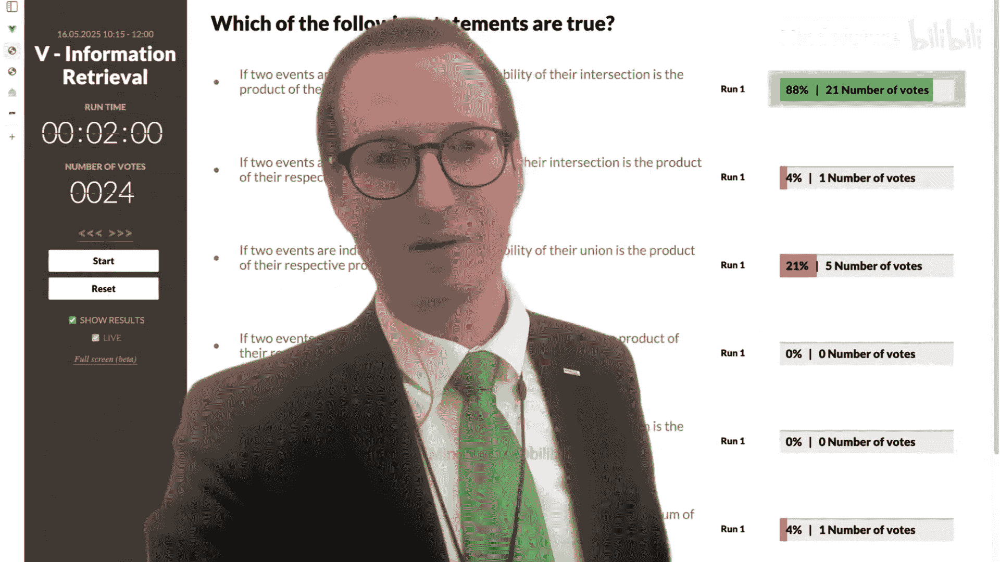

And if events are these joints， then you can compute the union as the sum。Right。

 it's like for example， the， the probability that it's raining and the cat is outside。

 if it's independent and it's the product of the probability that it rains times the probability that the cat is outside But we know that these two are not independent。

 So these joints would be if you were， if you have a。Die， for example。

 and the probability of obtaining an odd number。 you would sum 1，3 and 5， for example。

 because getting 1， getting 3 and getting 5 are these joint， this joint， right。

 So you can just sum sum them。 They cannot happen at the same time。All right。

And then I had failed one before I continue with my slides。Which one of。

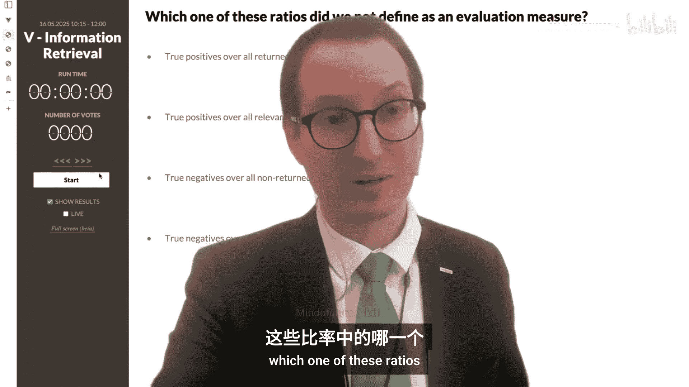

These ratios。Did we not define as an evaluation measure， meaninganing that we did not give it a name。

Is it true positives over all returned results， true positives over all relevant documents。

 true negatives over all non returns documents and true negative。Over all non relevance。

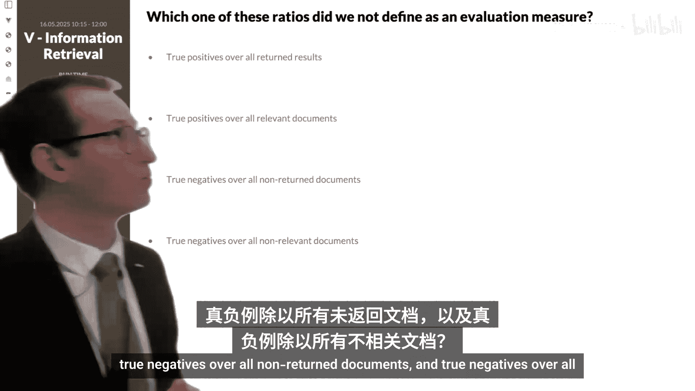

Documents。

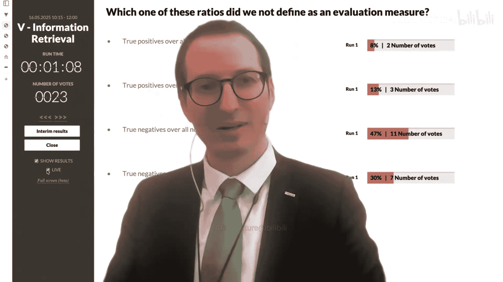

The third answer has the majority。So prove that to me。 What are the names。 So the first one。

True positives of all returned results。 What is it called， can all say it at the same time。

True positives over or returned results。Al raiseise your hands。 if you have the answer， yes。

It's the precision。 Yes， absolutely。 very good。 Then we have the two positives over the relevant documents。

 What is it called。😊，Recoll， yes， absolutely。 It's called recall。

 And the true negatives over all non relevant documents。This one is a bit less famous。Anybody。Spy， C。

 CCT， yes， and sensitivity is a synonym for equal。Now。

 it's been a few years that I keep saying this that we don't have a name for the fourth one。

 And at some point， I thought， okay， if we don't have a name for the fourth one， we should make one。

So I actually thought about it。And I think we could call it cryptto ision。

Because you can think of the looking at the the this third metric。

 it basically looks at what you didn't return and what you could have that has value that you could have returned。

 So it's in， in fact， it's like a hidden treasure。 right。

 It's all the documents that you would actually be useful。 But yet you we don't， didn't return。

 And so if you look at， for example， Latin roots and crypto for hidden thesorrus for treasure and yaon for ratio or the hidden treasure ratio。

 So maybe we can co call it cryptothearion。 But， of course， that's not like raw material。

 It's just that I thought maybe we could actually give it a name。

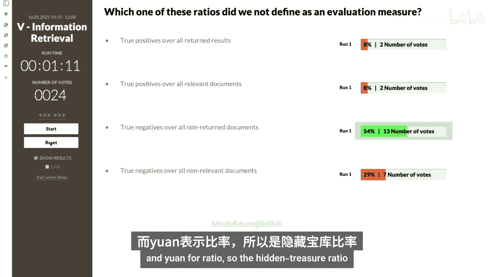

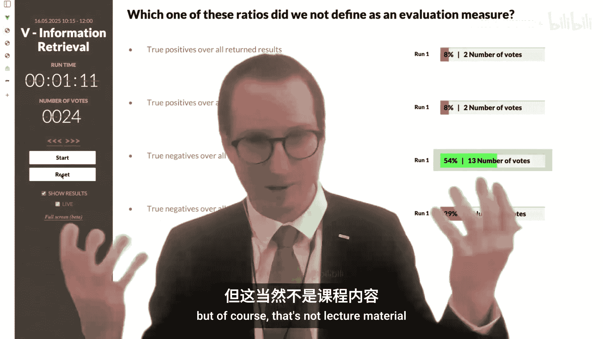

嗯。Alright。So， let's continue then。

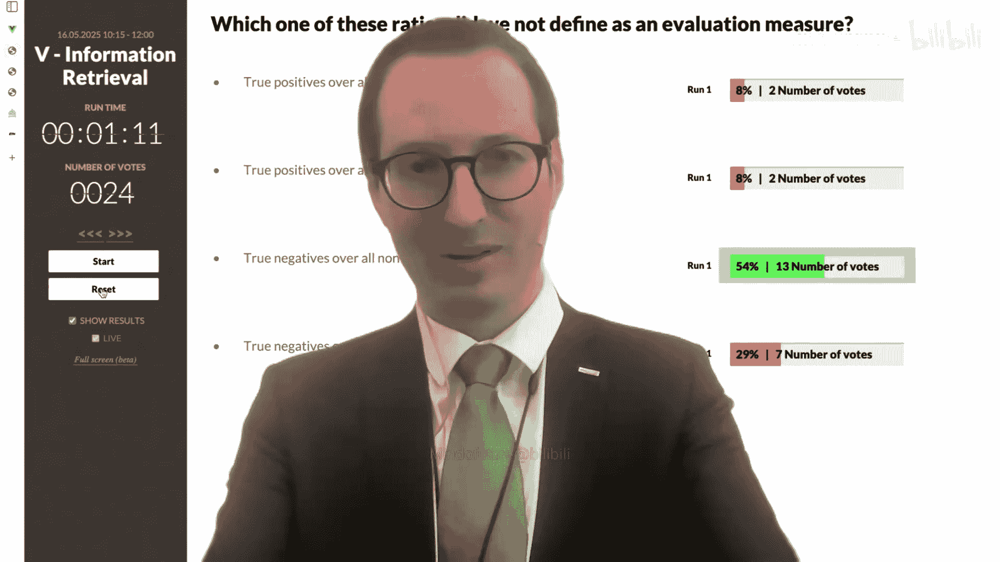

So we were in probablyably seek information retrieval， and I will。Imteki jump。ToWhere we were。

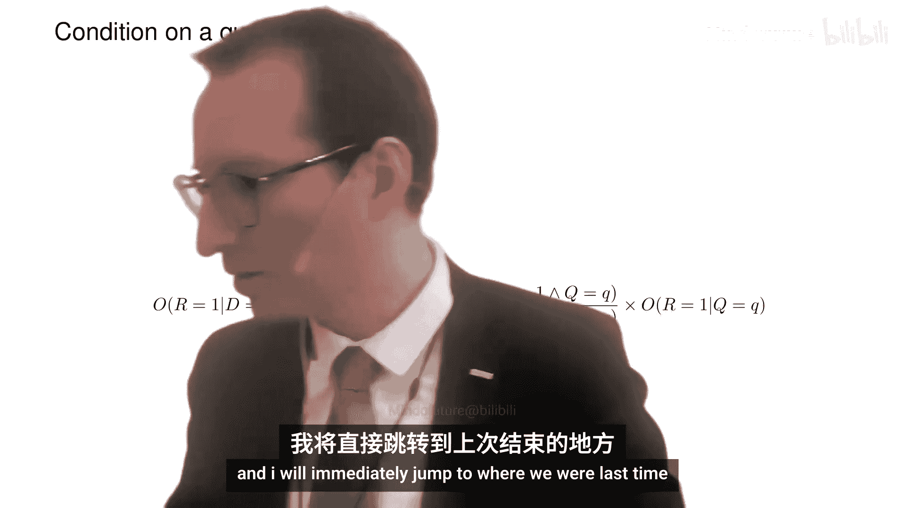

Last time， so I'm going to give you again。The context。We look at it from a probabilistic perspective。

 We have random variables。Which you remember are neither random nor variables。

 They are just deterministic functions。嗯。For documents。 for queries。And for the relevance。

 And so I gave you the thought experiment， because when you do mathematics， you know。

 you manipulate formulas， it can be very useful to come down to the underlying structure， right。

 And when you look at omega， it becomes simple because you just have a set that contains elementary events。

 And then you have every elementary event， you have a document， a query， and whether the query。

 the document is relevant or not for the query， and you just imagine you have stepians of times。

 And once you have this， then everything makes sense。

 the probability that a document is a specific document。

 the probability that a query is a specific query， the probability that something that the document was relevant。

 the probability that a specific document is relevant against a specific query and so on and so on。

 Once you have these omega space， you can write all of these formulas with random variables and conditional probabilities。

 So this is this is the。😊，That we used this idea of doing that。

 Maybe I can say a bit of history started in the 60s。 So it was suggested that we could rank。

The documents in the output of the， of the， of the， of the system， by probability of relevance。

 by decreasing probability of relevance。And that is called the probability ranking principle， PRP。

 it was called。 So probability ranking principle。The context back then was that we only had Booleyan retrieval。

 And so the probability ranking principle was an improvements over the Booleyan retrieval that introduced ranking。

 Right， So these were the the early days of ranking documents。And so it was invented in the 60s。

 Then in the 70s and 80s， it got improved。 And then there's modern systems like Ocappi that were created in the。

 in the 90s。 and that are still news today。 In fact。

 we will see why a lot of that it' still in news today after we have derived the the the formula at the end。

😊，Then you will see there will be a rabbit out of the h in， in what comes out of this。So， yes。

 the probability ranking principle。 and that was a fundamental principle。

 The second principle that I mentioned last week is the binary independence model。

 Its the idea that the terms in document occur independently of each other。 So this is， in fact。

 what allowed us to factor， factorize the probability here。 it's probability of a document。

 given that it's relevant against a query Q divided by the same with R equals 0。

And what we did is we factorize that into a product of other terms。

 product over our K of the probability that our document contains or doesn't contain term K。

 And that product here， the product of， of the， of the， of these of these D subscript K。

Is the binary independence model。 This is what says we are allowed to factorize this as。

 as a product。 And， of course， that's an assumption doesn't have to be what we assume。

 and you remember products of probabilities。 that is independent， right。

 It was the click of question I asked earlier。 So they are independent。 for each term。

 And so we just multiply them。So， yes， So this is， this is where we are。

 So we are in the 60s in the early ages of ranking ritual。

 And so now we are going to continue to derive this beautiful formula that you have right here。

 This is where we stopped。😊，嗯。😊，So。I would like to insist。

 because it's very important to understand what's going on when you look at mathematical formulas。

 you really have to understand what everything is in that formula， right， So you。

 you remember that the upper case letters are random variables。

 They are these deterministic functions that assign a document or query to every one of these elementary events。

 Theelves in Antarctica。While the lower case letters are mathematical variables。

 These are actual queries and documents。 So the lower case， for example。

 would be the latest Danb novel。Q lower case could be somebody who just types information retrieval in their search engine。

 That would be Q。And so you really need to really understand the lower case of per case that that is very。

 very important。 And so when I say。Uppercase D subscript K， going to maybe showbi cuiss。Easier。

 So this one， that is a random variable。 That is a yes， no random variable。 It tells me， yes or no。

 does the document contain term K， for example， K would be information formation。Larch is V here。

Subscript K tells me it's a1 or a 0。 If it's a1。 then this says k is in the document。 If this is 0。

 then it's， it means it's not in the document， right。

 And so the lower K is just a vector for a specific document。

 It's the vector of Booleanance for the one for the terms that it contains and 0 for the terms that it doesn't contain。

Alright， so is everybody with me。Right， very good。 I just wanted to pause on this and make sure that the notation is clear。

 So now that we know that， and we know that all of these things make sense because of the。

 the omega space and the lit leaves。 Now we can start manipulating it。 So now I。😊，Did something here。

 I， I cut my product into two parts。 I just put the factors on the left on the right， depending。

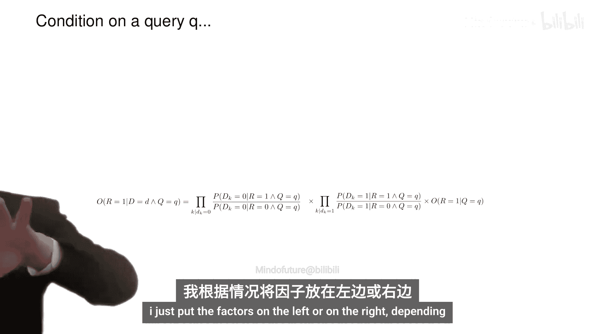

And so what I did is that I basically sorted out these lower k， lowercase D subscript K。

 I just took them separately， those that are zeros， those that are one。 So remember lowercase D。

 a specific documents。 So I'm putting on the left。All of the terms that are not in the document I'm looking at。

 just put them in here。 and don't I just put a0 here。

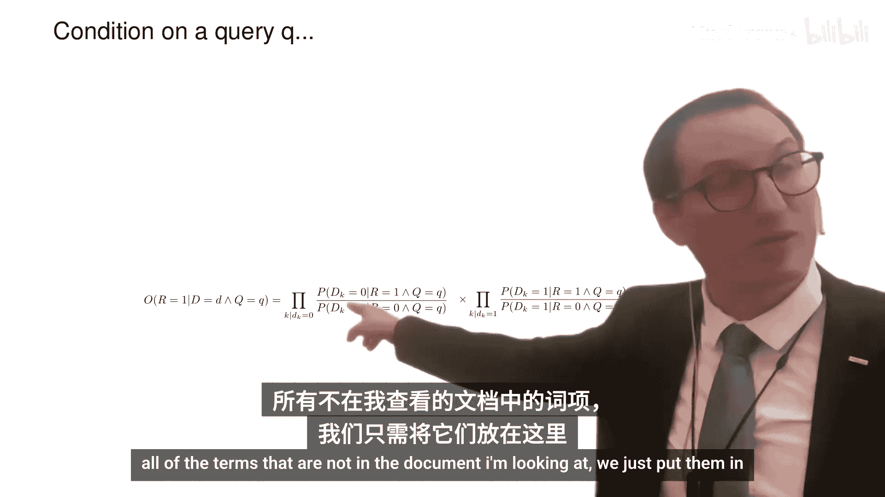

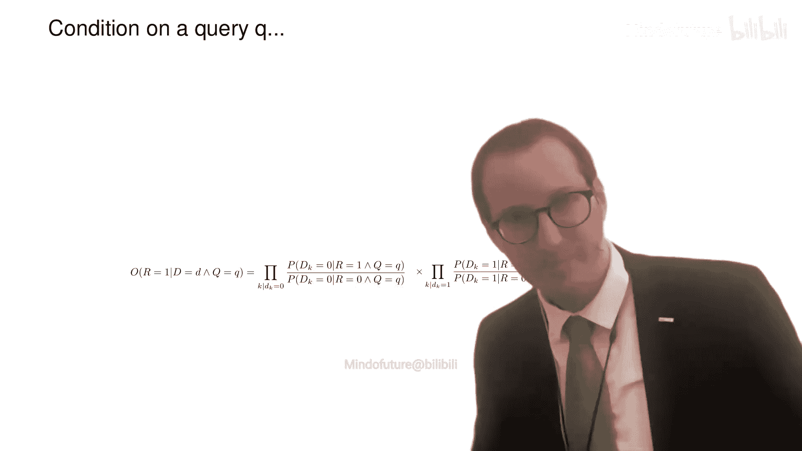

And then for the terms K that are in the document that I'm looking at， then I have them here。

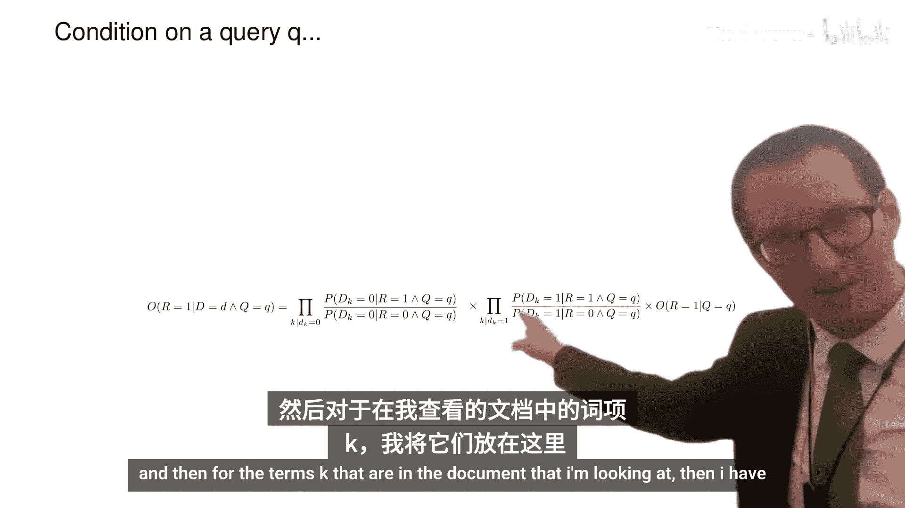

And that's a one。 So now we got rid of these mathematical variables just because we split it into Tutu。

 right， So these are the terms not in the document。 These are the terms in the。

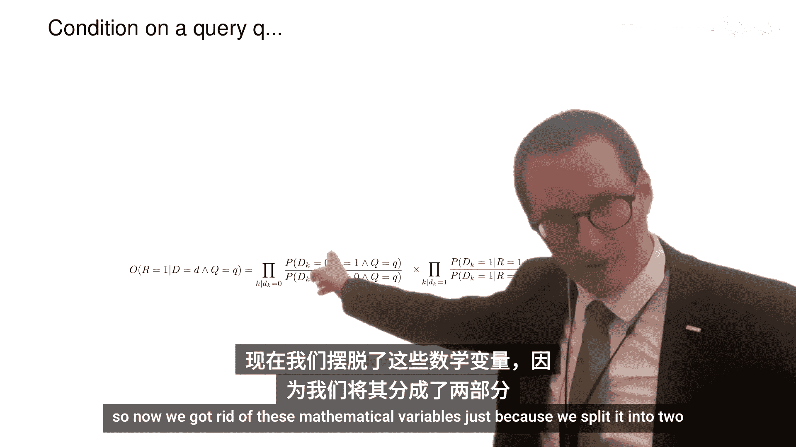

Documents， okay。Now， the next step is we are going to give names to some of the formulas because now it's becoming a bit complicated。

 So we are going to give them names。So this horrible thing over here， we are going to call it T KQ。

 right。So you see it depends on K and Q。 right， If you look at here。

 we have my mathematical variables。 I have Q lower case and K lower case， right。

 So these are a specific query and a specific term。 So for every query Q and term K， I define P K Q。

 which is a number。It is the probability that the document contains term K。

 given that it is relevant against query Q。Everybody with me。Right， so we just give it a name。

 We just call it P K Q， right， And we call the other one UK Q。

And now we can present this in this form， which is a contingency table。嗯。

Based on the condition that I have on the right。Because on the numerator of my fraction。

 So at the top。I have。R equals one。 So I'm looking at the document that is relevant。

 That is the upper part of my table。And then we have the probability that， given that it's relevant。

 the probability that term K is in the document。 It's present in the document。 that is P， K Q。

And then the probability that it is not present。 That is absent is the complement， right，1 minus。Y。

And then I look at the non relevant documents。 So if the。

 if the document is not relevant against query Q， then I have a probability UK Q that's the t number or case present and a probability 1 minus UK Q that it is absent。

 right。So basically， what I'm saying here is that I'm making a distinction。

 I'm looking at the probability that a certain term is present。

 that I'm distinguishing whether or not the document is relevant。

 So this is kind of assuming that it might play a role， right。

 if you look at relevant documents and not relevant documents。

 they will have different terms that appear in there。 intuitively。

 you might think the relevant documents are more likely to contain terms that are in your query。

 right， orms or that kind of things。 and the non relevant documents maybe a bit less。

 they could still contain them， but maybe a bit more random， So that makes sense， right。

 that you have a distinction and the behavior of the presence and absence of the terms that might be difference in relevant documents or in non relevant documents。

 That's all we are saying here， right。😊，Alright， so we call P K Q and UK K Q。

 These two pro abilitiesities。 It's just a number。 P K Q is a number for every K N Q。

 And UK Q is just a number。For every K And Q。Now， this is where the simplification starts。

 because now this is the part where the people back then and that went on for decades。

 starting throwing assumptions and ways to simplify。 Okay， let's assume this， let's assume that。

 And then you， you， you remove things for the formulas， right。

 So it's just mathematical cooking where， when you do that。And so the way it started。

Was this reasoning。If I have a term K， that is not in my query。 So it means Q， K is 0。

 That means term K is not in the query Q。So。If I assume that my term that I'm looking at is not in the query。

Then I'm going to conclude that。The appearance of the term in the documents doesn't depend on whether it's relevant or not。

Here's an example。Myque is information retrieval。And my looking， I'm looking at the term butterfly。

 Butfly is not in the query， right， So Q butterfly is 0。 Butfly is not in my query。

 Do you agree that if I now look at the documents。And I， I'm asking， okay， doesn't。

 does it contain or not the， the the term butterfly。Do you agree。

 It doesn't matter if the document is relevant or not。

 because butterfly has nothing to do with information retrieval， Right， So butterfly could be in a。

 in a novel。 Butfly would also be in an information retrieval book as examples in there。

 But there's no particular reason why butterfly that has nothing to do with information retrieval would behave differently in relevant and non relevant documents。

 right， Is that sensible， right， that makes sense。 So we make the simplifying assumption that for the terms that are not in the query。

Meaning almost every term， right， because the terms in the query does very few of them。

 So it's almost every term for most terms。 we are going to assume that the two are equal。Wow。

 that's actually great because we are dividing one with the other， right。

 So if we assume they are equal， we can just simplify with one， right， So it's actually。

 it's a very powerful simplification here that we have， right， But that's only for the terms。😊。

That are not in the query， right。So it means that I have here this product over all terms。

 Imagineagining a gigantic product with half a million factors， right， gigantic product。

But for most of the terms in my products that are not in the query， the factor is just one。

Becauseuse that's P， K Q of our UK K Q， But that's one。 So for all the terms such that Q K is 0。

 the factor is one。 So it means that I can restrict my product to just the terms in the query。

 Do you agree。Right， if I do the product， all the terms that are not in the query is just one。

 it's like times 1 times 1 times 1 times 1。 And I'm just removing the times 1。 That's what I'm doing。

 So now I'm restricting the product to just the terms that are in the query。 Now it。

 it's a very little product now， right， we， we have very few terms left。

 These are just the ones that are in our query。Okay。So now， let's continue to simplify。This 1。

 I hate to explain because there's no explanation。 I try to find when。 I'm like。

 why do we assume that， So this constingency table that we look at whether a term is present or absent in a relevant or irrelevant document。

That depends on the query。Right， this is why we have the， the queue as a subscript in there。

 That might be different depending on the query， right。

 If you're looking for a query for information retrieval。

And a query for butterfler in the content of Hu。 Then you would assume that this contingency table is going to be different。

 right。And so here， what we simplify is that we say， okay， no， it doesn't depend on the query， right。

 We assume that this table of present or absence， depending on whether it's relevant on it。

 doesn't depend on the query。 The first time I saw there was shocked。 Like。

 how can you assume something like this， Of course， it depends on the query， right。

And I looked it up a little bit， trying to figure out why， because in the book。

 they don't say in the textbook， they， they just， in the textbook。

 they just go ahead and remove Cuba but without an explanation， right， So I investigated。

And what I found。Wass that。It just simplifies the formula。 So that's the benefit we get， right。

 It simplifies the formula。And if we go ahead and do it and build the information retrieval system based on that。

 it actually works。 The evaluation matrix are actually good。 That is the reason why we do that。

 There is no explanation that I can give you that actually makes sense。 except if we do that。

 it simplifies the formula。 And if we build the system， it works。

 So I hope that explanation is good enough for you。 That's basically why we do that， right。😊。

So it's just computer scientists at work that are trying to simplify things to build a system。

 So we are gonna go ahead and do that。 We remove Q from the subscript。

 meaning that doesn't depend on Q anymore。 And we just have P K and UK。 So let me remove Q。

 We'm gonna I press that button。 There you go。 It's gone， okay。So now we just have PK and UK。

 We assume we can compute them in some way。 I'll come back to that later。So， now。

I'm just replacing this P， K and Q K， Q K。 Now， I did something。 I I， I， I。

 I just didn't swap them again。 I shouldn't have done that。 I swapped the two products and， and。

 and I understand that might cause confusion。 I just realized a bit later。

 So this 1 I'm putting on the left and this 1 I'm putting on the right。 So let's start with this。

 So this is the products such that for all the terms that are in the query and that are in the document。

 right， we have D K and Q K that are went。 So these are the terms in the query and the document。😊。

P K of our Q UK。 So I'm putting them here。 The terms in the query and in the documents， P。

 K of our UK。

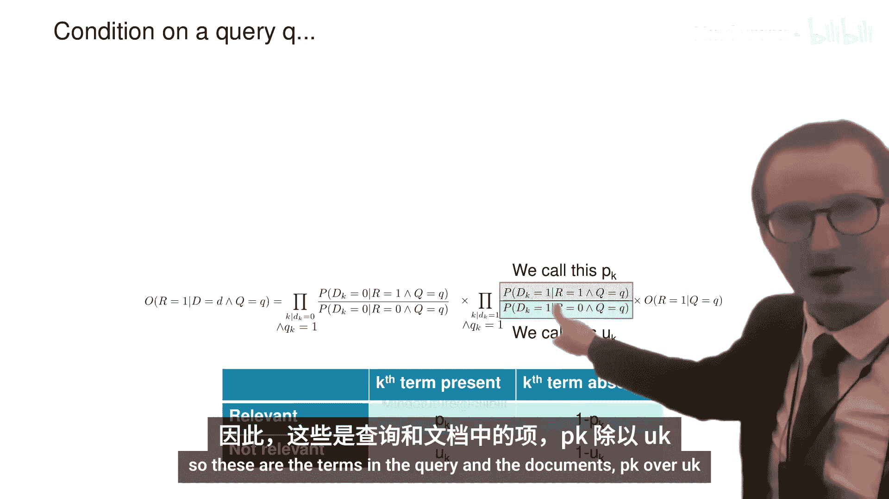

Now I'm taking the other one that was on the left。 I putting it on the right now。 And what is this。

 It's 1 minus， right， Because now I'm looking at the probability of not being in the document。

 I have a 0 here。 I have a one here， right， And I have a 0 here。 So that's the complement。

0 instead of one， because there's only two value，0 than1。 So that's 1 minus。

 Now I have 11 P K and1 UK， right， So which is which。 So the R equals 1。😊。

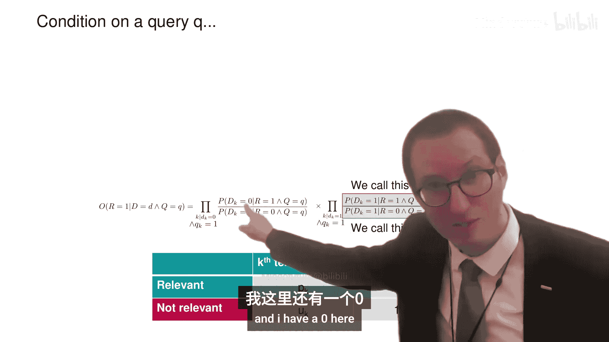

That is the peak 1 minus P K and the， the the R equals 0， that is 1 UK， right。

 So on the documents that are in the query and not in the document， which I put right here。

 not in the document in the query。 And now I have the compliments。 Who agrees with this。

All I did was replace the the the this aible formula with P K and 1 minus P K and so on。 right。

 plus unpadagoically swaps the two sides， which I shouldn't have done。 apologize for that。Alright。

 so now we have this and that I kept just the the same as before for。Alright， let's continue。Now。

 I'm going to do some mathematical hawker focus。Do you agree that if I have。

 if I have a mathematical formula。I can multiply it and divide it by the same number， right。

 I can do times 42， divided by 42。 That's the same， right So I'm going to do that。 I'm going to。

Multiply and divide by something。 Oh， I I did a few explanations， which I give already。

 So these are the terms in the documents。 and these are the terms not in the document。 right Alright。

 so I'm going to divide and multiply with the same thing。So at that point。

 you don't need to care what it is that we divide and multiply with。

 because that would always be true。 I could multiply it with absolutely anything and then divide it with the same。

 It's still the same， right， So I can do that。 I'm， I'm allowed to do that。

And you will understand immediately why we specifically divide and multiply with this。

 because that's actually going to， to， to tweak the formula in a good way。

I'm going to multiply and divide with this product of the 1 minus P K over 1 minus UK for the terms that are both in the query and the documents。

So I'm going to divide in here， and I'm going to multiply in here。Right。Now， here's the easy side。

 If I multiply this with this。You notice this is the same factor， right。It's the same。

 It's 1 speaker or 1 UK on the， on the two cases， right， What。

 what is different is that we don't do the product of all the same terms Here we。

 we have a product of all the terms that are in the query in the documents。 Here。

 we have a product of all terms that are in the query and not in the documents。

 Do you agree that if I multiply this with this。That amounts to saying that I have the product of this thing over all the terms in the query periods。

Whether or not in the document， right， I'm just doing the union of these two。

 So now I end up with just the terms。In the query， right， because those that were。

Not in the documents were here。 Those what were in the documents were here。 And I just multiply this。

 So I have one less filter in here because I just put them together。

The other one is more boring because here I have exactly the same product over the same terms。

 Those both in the query in the document。 So these are kind of exactly the same sur for my product。

 So I just need to multiply this and this。 sorry to divide to divide this divide by this。

 And this is what I get， right， I divide。 So1 P K is now at the bottom and 1 UK is at the top。😊。

So do you agree， I can do that because I just multiplied and if I did with the same thing。

 And what thing did I use Well I did it in such a way precisely that here I get rid of D， right。😊。

Because now theres no D anymore。But now， look， what happens。There is no D here。 No D here， No D here。

 No D here。 No D here。 There is absolutely no D at all right there。

Do you remember what we are doing right now？ We are ranking the documents。

We are doing that for every lowercase D。Do you agree that this here doesn't depend on the。

So it's basically a constant。Do you see why now I multiply it and divide it。

 I just wanted to get rid of the D because there there was a D right here。

 I just wanted to get rid of it。 So I just neutralized it with this。And this now。

Doesn't depend on D anymore。 It is a constant。So since we want to use that to rank the documents。

 we can just get rid of the content。 And that goes directly into the trashca。给。

So now we are left with this。 So you see， we are making progress because the formula is actually getting simpler and simpler and simpler。

 right， We just had to do this outrageous assumption that we can remove Q from the from the subscript。

 But we are getting there because we are getting something。😊，That is now becoming simple。 Plus。

 the product is super small， right， It's the terms that are in theque in the document。

 There's very few of them。 It's a very small product that we have here。呃。All right。Now。

 we are going to do something because that's a product。

 But if you remember all the algorithms that I showed you before for in particular。

 for the vector based model， you know， remember the the Sap product。

 the scatterap product is a sum of the， the product of the coordinate。

And that's what we called evidence accumulation， right， I was going through the posting list。

 accumulating the scores， adding， adding， adding， adding， adding， adding。

 But here we are multiplying。Who knows a magical， a magical tool that turns products into sums。😊，Yes。

😊，The logariths， the logariths turns products into some。 So we are going to apply your logarith。

 Do you agree， Loarithms are a monotonous function increasing。 So if we rank documents。

 we can take the log。 that doesn't change the order of the documents。

So let's take the logarm of this thing。And when we do。Bum， it's a sum no。

 that is also because 9 starts looking like heavy accumulation。Right， now we need to sum。

 And what are are we summing on， We are iterating of other terms。

Contained in the query and the document。 Do you realize that's exactly the evidence accumulation thing。

 right， When we iterate over the posting list and we add for the queries and documents for the postings。

 That is for the document containing the term。 So I love that。 This is really getting somewhere here。

😊，And so now we even have an inter appreciation for that， because。

 you know that when you divide a probability by  one minus the probability， that's called the odds。

 right， I explained last time。 P divided by1 minus P， That's the odds of something happening。

So we are looking at the sum of terms that are both in the query in the document。

Of the log of the odds of containing term K in relevant documents。

 minus log of the odds of containing term K in non relevant document， right， So I'm basically。

 I'm basically pushing up relevant documents and pushing down non relevant documents right here。

Alright。And remember， P， K and UK come from this contingency table。 I have them for every term。

 So I have half a million terms。And for each one of these half a million terms。

 I have a value for P K and for UK。 right， I don't know yet how to compute them。

 We'll figure that out later。 But assuming we can now we have a way to compute a score。

 It's called the retrieval status value。 That is that value。 That is my score。So if I call that C， K。

 that acts as whatever I I do the sum of。And so I basically have defined something。

That is the sum over older terms。That are in the query in the document of some value， C， K。Now。

 do you see the link here， this here basically connects to what we've seen before right here。

 We just need to walk down the terms in my query。Any in the document。 So looking at the posting list。

 And I just add that to the bucket， iterating of， okay， who sees that。Right， it's incredible。 right。

 So the math was worth it because now we have something that we can implement。

 We can go ahead and implement that。😊，And because of this insight。

 you realize that's actually a scala product， right， You can see that as a scala product。

 Scalaf product of what。 when you could imagine， for example， that in the query vector。

 you have ones where the term is there and zeros when it's not there。 And in the document vector。

 you have C， K when the term is here and 0 when it's not there。

 And if you compute the scala product of two vectors， you get exactly that right。

 So you can see that as a scala product again。 right So now we are getting close to even the vector space model。

 right， It's incredible because that has nothing to do with anything， right， we。

 we just started from scratch on probability seek information retrieval。

 And now we are we're ending up with vectors and and， and that and and and the evidence accumulation。

 So this is， this is incredible。😊，But there is one thing that we need to do。

 It's to know the values of P K and UK because we， if we don't have the values。

 then that's totally unusable。 So we need to figure out what values to use for UK and for。自记。

And so here you also have a beautiful。Set of papers over the 60s，70s。

80s and 90s about suggestions on what to do to get the values for P K and UK。

 There are theoretical proposals， people who did that in front of a blackboardt。

 And then there have the practical proposals， people who try to actually evaluate them using real people right So I'm going to show you a little bit of both。

 but very， very quickly。So we want to find values for this。 Now， let's first use the blackboard。

 So let's gather a few people in some in some classroom and have them brain brainstorm about how to do that。

 so。These people who brainstorm about that might think， let's add totals， right， when you have this。

 we can add on the rows and on the columns。 So let's add the total。 So relevant， non relevant。

 And then in the third row， I have all documents。 So it's， it's the sum， right。

 relevant plus non relevant。😊，And then on the right， the case term presence， the case term absent。

 we have the total。But now I no longer have the probabilities。 I have statistics， right。

 If I did it here， the sum of the of onittro would be one， right。

 The sum of the probabilities would be one。 and then the sum wouldn't make any sense on the columns because I'm looking at probabilities。

 right， But now I'm looking at statistics。You know that probabilities and statistics are connected。

 right。In fact， we haven't have courses with that name， right， But Chinese cartoon statisticstistic。

 They， they belong together。 So when you want to evaluate probabilities。

 you can just gather some statistics， and then you use the ratios that you get from the test statistics as estimates。

 We call that the maximum likelihood estimates。😊，Right， so we can use statistics。

 Just look at real data。Real world data and try to derive PK and UK。

From the statistics with the maximum likelihood estimates。And so if we try to do that。

 we can try to fill the table with statistics。 So let's start with the easy back。

 So the easy back is the with the total。

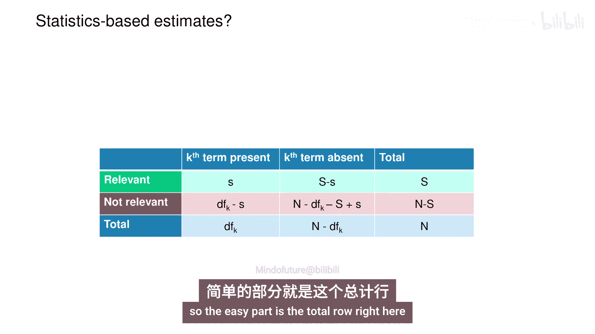

R right here， because what are the statistics。 So now I'm looking no longer at probabilities。

 but test statistics。So the pro， the， the， the number of times that the case term is present in a document is the document frequency。

 right， the number of documents that contain term K。 that is the document frequency of term K。

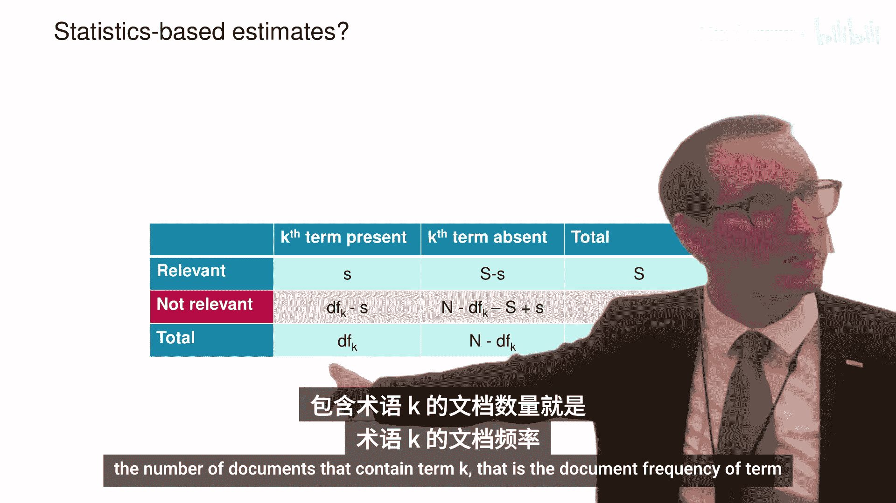

The total number of documents is N。And you agree that the。

 the number of documents that do not have Tom K。Is the total number of documents minus the number of documents containing the。

 right， because it's complementary。 This and this give me this。 So this is the easy to。

 this is easy to feel。And then so the people in a classroom， they don't have real data。 So。

 they just need to give names whatever they don't know。 So we give a name。

 small S right here and big S right here。 We just， you know， figure it out later。 But we。

 we give names here。 Now， do you agree， if I have here， small S and the document frequency here。

 I have the difference。

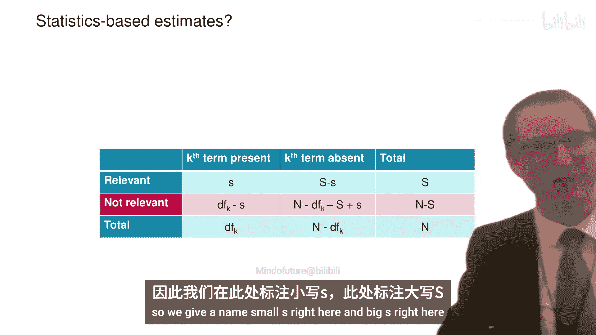

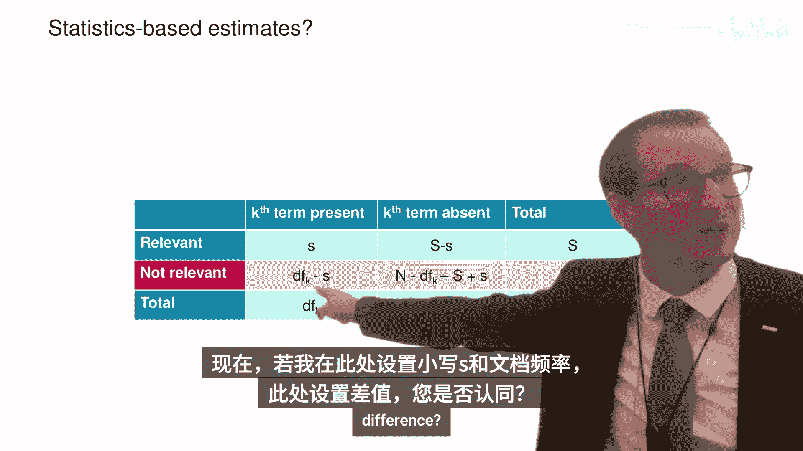

Right， because again， the sum of these two must be this。 So this must be， must be the subtraction。

 And here I have this horrible sum right here。 That is， again， this minus this。

 and this was also obtained from these minus this。 So。

 All I did was try to fill the table with with these statistics， right。

 And the insight right here is that we have a document frequency in here that can be helpful。Right。

 now I remove the the totals。 and now I get this right。

 So the this assuming I would have some value for uppercase S and lowercase S。 that would work。

 right， because big N， I know how to evaluate it。 I just need to count how many Web pages there are on the Internet。

 How mean， how many books in the library。And D FK， I can build that by scanning the books， right。

 scanning the， the number of documents。So now we kind of have something that starts looking like a solution with。

Lower case S and lower case S that are left to， to evaluate。 But fortunately。

 we have very smart people who make simplifying assumptions。And so I'll come to that。

 So now if we have this， right， and I can plug it into my formula， right。

 The log of the odds minus the log of the odds。 By the way， you know that in the same way。

 that logarithm turns product into sums， I can replace the minus with a plus and swap them， right。

 I just have -1。 So to the power of -1， you， you take theverse。

 So that's why I have a plus between the logs。 But anyway， if I plug it in here。Then I have that C。

 K is this horrible bunch of divisions and multiplications and additions and subtractions。

 So we this， this， this thing right here。 And， and then we can use that in order to。

 to add the numbers。Now。There is a little something that we do。In these cases， because remember that。

At least for D K and N。What we are doing。Is we are counting from real data。

 So I might have a library。And I have books， and I look at the data。 And so I feel my。

 I feel my statistics。 Lowcase S， uppercase S， you could imagine that you organize some live experiments with people in the university。

 and you asked them to stamp documents as relevant， non relevance。

 And that gave you the value of small S B S。😊，Now， imagine that I'm looking at a small library。

 I'm not looking at the whole。 I'm looking at a small library that has 1000 books， or 10000 books。

And we did all of that based on the these 10000 books and maybe based on 100 people to whom we asked。

 is it relevant or not。Do you see that this is a very small sample size。Right。

 if I just do that with 10000 books and 100 people， the precision I'm going get here is not great。

 right。And there is something worse。Is that let me do it。 I come back to the one half。

 which is the solution。So if I try to count my document frequencies and everything on a small sample。

 what's going to happen is that I'm going to have a lot of zeroes。Where the values are small。

For example， I'm looking for， for a world， let's say superkady fgistic exposcious， right。

 very rare term。It actually appears on the Internet。 You can look for it。 but very rarely。 Now。

 if I'm in the small library in a small university， it's likely I will not find that term anywhere。

So what document frequency would I have0， right in the library。 But on the Internet， it's not 0。 It。

 it， it might be a small number， but it， but it's there。

And so this is a discrepancy that has to do with the that has to do with the small sampling size。

 And so there is a trick for this when we want to avoid the fact that when I sample。

 I'm gonna get a lot of zeroes。

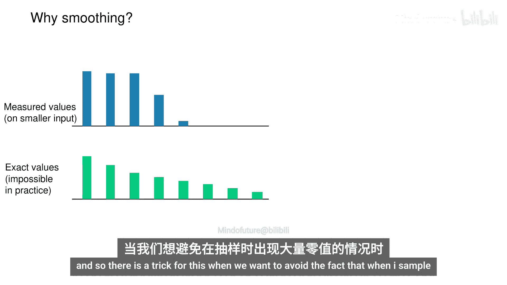

Where， in fact， the， what's happening。 Oh yeah， small zeros， where， in fact。

 it should have been small value。 So I'm far away。 And the trick is to smooth things out by just adding a constant everywhere。

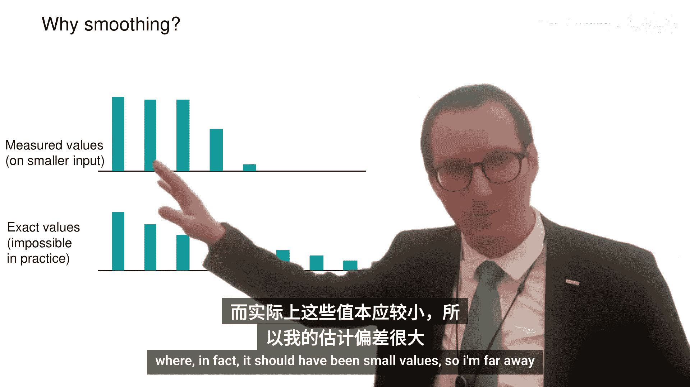

Right， so you run your statistics。 and then you， you add one half。 Don't ask me why1 half。

 but you add one half everywhere。 you smooth it out。 And that is going to turn this。

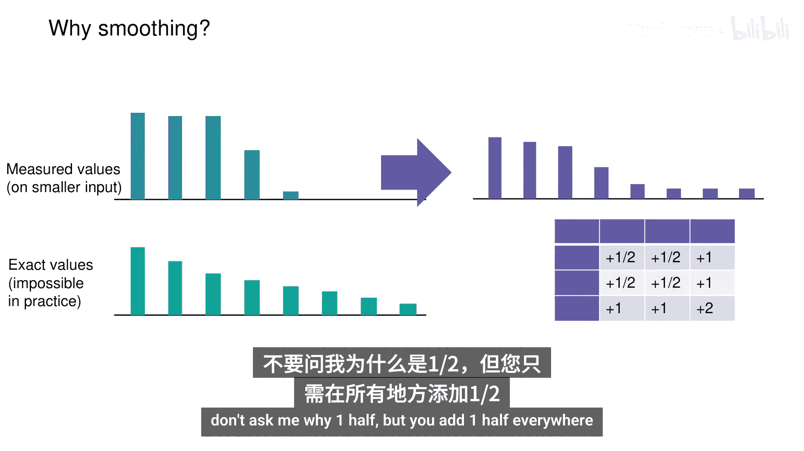

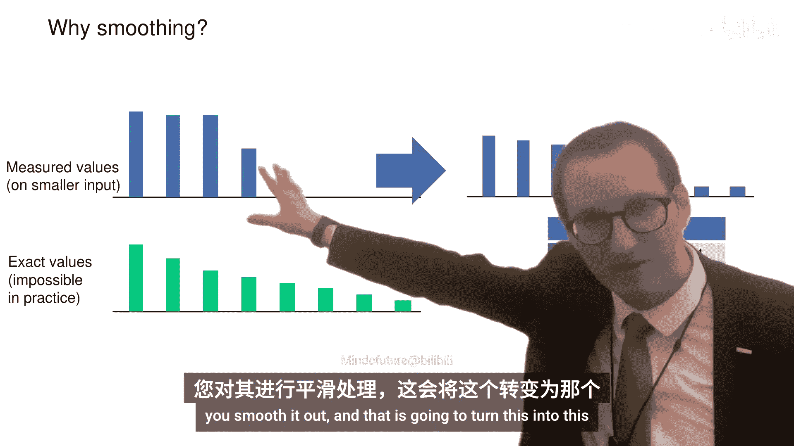

Into this， all you do from here to here is to add this one half everywhere。

 And do you see that doing that， you're closer up to reality。Right。

So it's basically amounting to saying。The terms that I never saw in my library。

 I'm not going to put 0 in there。 I'm still going to lift it a little bit to say， okay。

 maybe they still appear somewhere， smooth it。 And then I get the smooth statistics。

 And that's what we are doing here。 We are adding this one half everywhere one half just because it's it's it's way of adding a little bit of something。

 And then I smooth it out。 So even for the term that I might not have seen。

 I still don't have a0 in there， I still lift the value up a little bit。 with with me。Right。

 all right。So that's the expansion of smoothing。Now， I still mean the upper case S and lower case S。

 right。And so what can we do with that。Well， here's what people suggested。

 And I absolutely love that。 So first， there are two people K and Haper。 They said， okay。

 in relevant documents， We are just going to assume that the odd are one。

 So we are just putting one half and1 half and that's it。 and we are done， right。😊。

And that's great because now I got rid of all the values in there。😊，嗯。And for the other one。

 what can be suggested is to just remove the S more as big S。 we just。Assume that it's very close。

 Remember that when you have a query about the Internet。The relevant documents。

Are very few compared to the entire Internet， right， when you do a search on the Internet。

 the documents you're looking for are relatively a very small subset of the Internet。

 So that means that the non relevant documents that's almost the entire Internet， right。

So what we are doing here is we are saying， okay， not relevant。

 We are just approximating it with the total。 That was the total row that we had， right。

 So we are replacing with the document frequency and n n minus the document frequency。

 And so we got rid of the S and smaller case as how convenient， right， turns out it works。

 And that is the break。 And I'm going to finish that after the break and go to the language models。

 right， But we see simplifying assumptions。 They are great， especially when at the end。

 the system actually works。😊，So thank you。 And see you。In the 15 minutes at 17 passes。

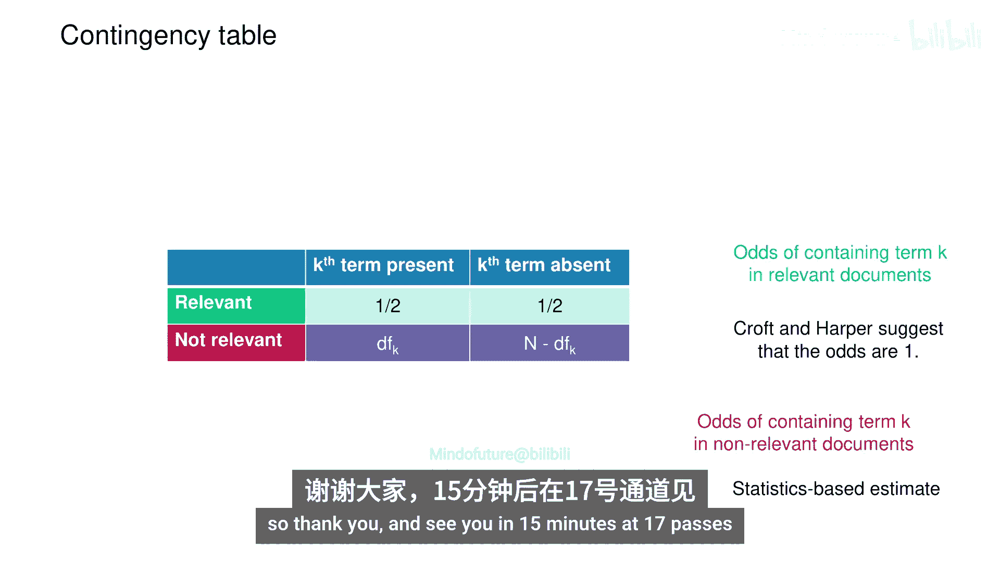