# 信息检索：P26：概率信息检索 (3/4) 📊


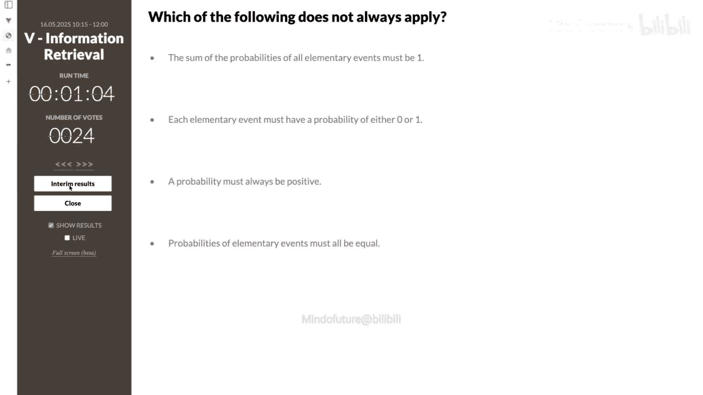

在本节课中，我们将继续学习概率信息检索。我们将从回顾基本概念开始，通过一系列数学推导，最终得到一个可用于实际文档排序的简洁公式。本节课的核心在于理解如何将概率模型转化为可计算的评分机制。


---

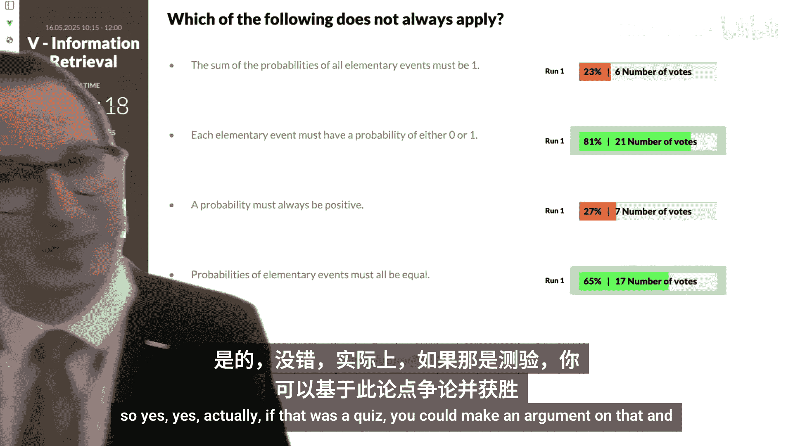

## 回顾与基础概念


上一节我们介绍了概率信息检索的基本框架和二元独立模型。本节中，我们来看看如何通过一系列假设和数学变换，将复杂的概率公式简化。


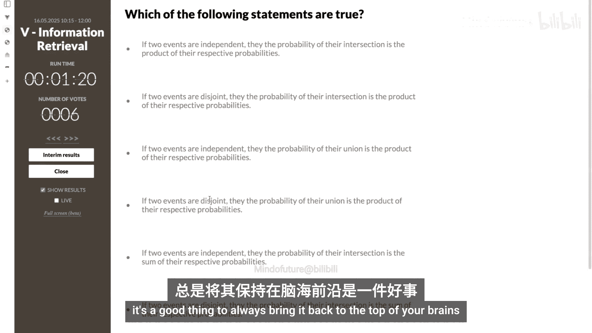

我们有一个核心公式，用于计算文档 `D` 对于查询 `Q` 的相关性概率比：


```
P(R=1 | D, Q) / P(R=0 | D, Q)
```


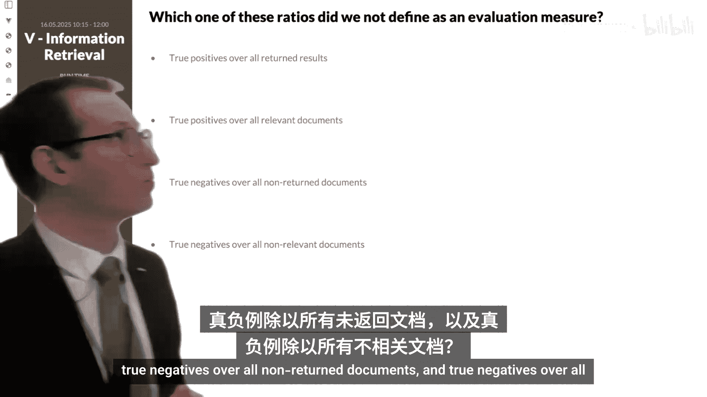


在二元独立模型的假设下，这个比值可以分解为各个词项的乘积。


---

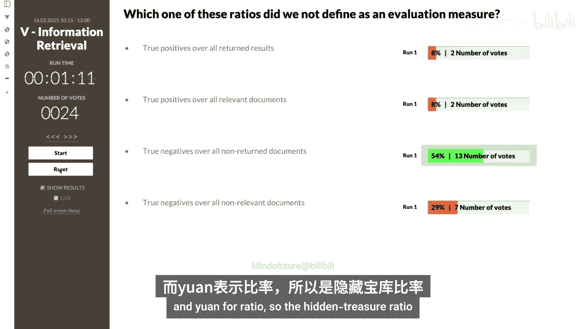


## 关键假设与公式推导


为了简化计算，我们引入了几个关键假设。

### 假设一：非查询词项的影响可忽略

我们首先假设，对于**不在查询 `Q` 中**的词项 `K`，它在相关文档和非相关文档中出现的概率是相等的。这意味着这些词项对于区分文档相关性没有贡献，因此在乘积中它们的因子为1，可以从计算中移除。

**结果**：我们只需要考虑**出现在查询 `Q` 中**的词项。

### 假设二：概率与具体查询无关

接下来，我们做了一个更强的简化假设：词项 `K` 在（非）相关文档中出现的概率（即 `P_K` 和 `U_K`）**不依赖于具体的查询 `Q`**。虽然这在直觉上并不完全合理（不同查询的相关文档集不同），但实践表明，这样做可以极大地简化公式，并且最终构建的系统效果良好。


**结果**：我们去掉了概率下标中的 `Q`，得到通用的 `P_K` 和 `U_K`。


### 公式重组与常数分离

基于以上假设，我们对公式进行重组和变换。核心技巧是乘以并除以相同的因子，目的是将公式中依赖于具体文档 `D` 的部分与不依赖的部分分离开。

经过变换后，公式变为两部分乘积：
1.  一个**仅依赖于查询和词项本身，而与具体文档 `D` 无关的常数因子**。由于我们在对文档进行排序时，对所有文档都乘以相同的常数不会改变排序结果，因此这部分可以忽略。
2.  一个**仅针对同时出现在查询和当前文档中的词项进行求积**的因子。

**当前公式**：
```
∏_{K ∈ Q ∩ D} [ (P_K / U_K) * ((1 - U_K) / (1 - P_K)) ]
```

---

## 从乘积到求和：引入对数

我们得到的仍然是一个乘积公式。然而，在信息检索的实际系统中（如倒排索引），我们更习惯于进行“证据累加”，即求和操作。

**解决方案**：对公式取对数。对数函数是单调递增的，取对数不会改变文档的排序顺序，但能将乘积巧妙地转化为求和。

**取对数后的公式**：
```
RSV = Σ_{K ∈ Q ∩ D} log [ (P_K / (1 - P_K)) / (U_K / (1 - U_K)) ]
      = Σ_{K ∈ Q ∩ D} log( O(P_K) ) - log( O(U_K) )
```
其中 `O(p) = p / (1-p)` 称为事件发生概率 `p` 的**几率**。


**检索状态值 (RSV)**：我们定义 `RSV` 为文档的得分。它等于查询与文档共同包含的词项所对应的 `C_K` 值之和，其中 `C_K = log( O(P_K) / O(U_K) )`。


**重要洞见**：这个 `RSV` 计算方式，本质上就是遍历查询词项的倒排列表，为包含这些词项的文档累加一个权重 `C_K`。这完全符合我们之前学习的高效检索模式。它甚至可以看作查询向量（由0和1组成）与文档向量（在词项 `K` 处的分量为 `C_K`，否则为0）的点积。

---

## 估计概率 `P_K` 与 `U_K`

现在，我们需要为每个词项 `K` 估计两个关键概率：
*   `P_K`：词项 `K` 出现在**相关文档**中的概率。
*   `U_K`：词项 `K` 出现在**非相关文档**中的概率。

我们可以通过收集真实数据的统计量，并用最大似然估计来近似这些概率。

考虑以下列联表，其中 `S` 是相关文档总数，`s` 是相关文档中包含词项 `K` 的数量。

| | 词项 `K` 出现 | 词项 `K` 不出现 | 总计 |
| :--- | :--- | :--- | :--- |
| **相关文档** | `s` | `S - s` | `S` |
| **非相关文档** | `df_K - s` | `(N - df_K) - (S - s)` | `N - S` |
| **总计** | `df_K` | `N - df_K` | `N` |

*   `N`：文档集合中的文档总数。
*   `df_K`：包含词项 `K` 的文档数量（文档频率）。

根据此表，最大似然估计为：
*   `P_K ≈ s / S`
*   `U_K ≈ (df_K - s) / (N - S)`

然而，直接使用这些估计存在两个问题：
1.  **需要已知 `s` 和 `S`**：这通常需要通过用户反馈（相关性判断）来获得，在系统初始阶段是未知的。
2.  **数据稀疏性**：在小规模样本中，`s` 或 `(df_K - s)` 可能为0，导致概率估计为0或1，进而使 `C_K` 计算出现无穷值。

### 解决方案：平滑与进一步假设

为了解决上述问题，研究者提出了巧妙的平滑技术和假设。

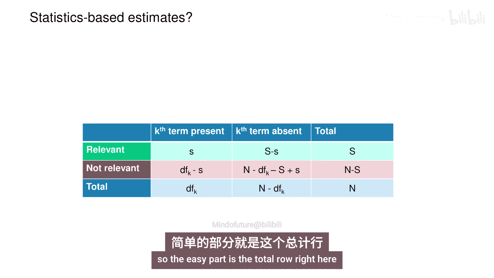

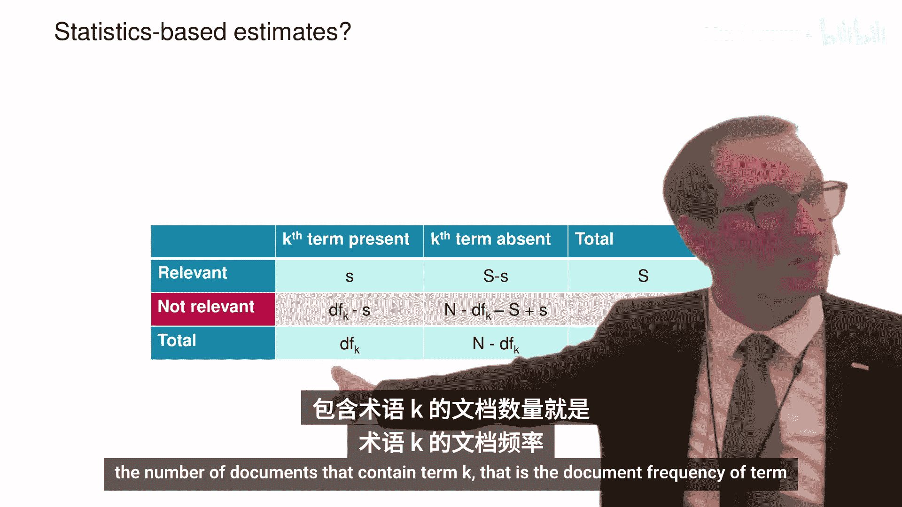

**平滑技术**：在所有的统计计数上加上一个小的常数（例如0.5），以避免出现零概率估计。平滑后的估计变为：
*   `P_K ≈ (s + 0.5) / (S + 1)`
*   `U_K ≈ (df_K - s + 0.5) / (N - S + 1)`

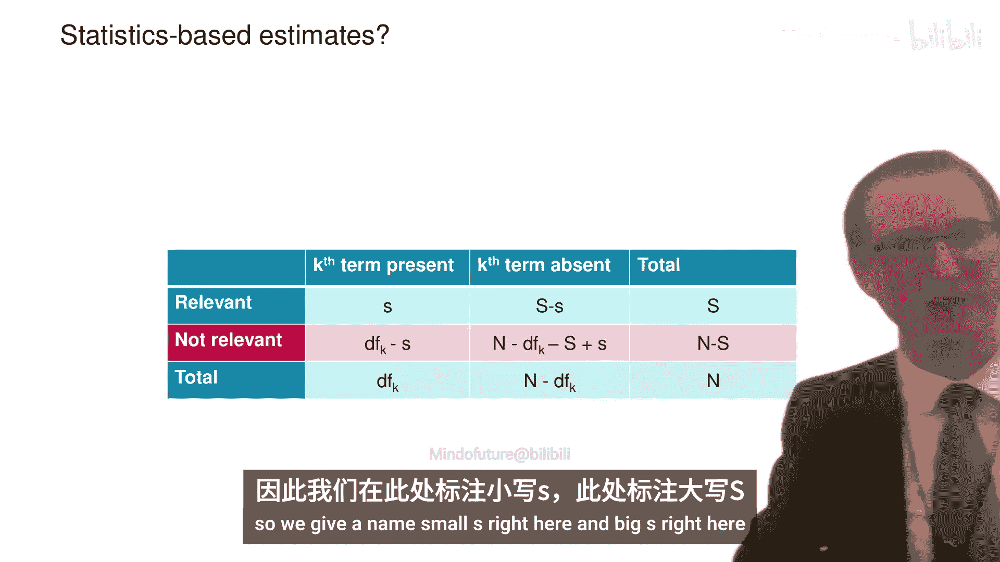

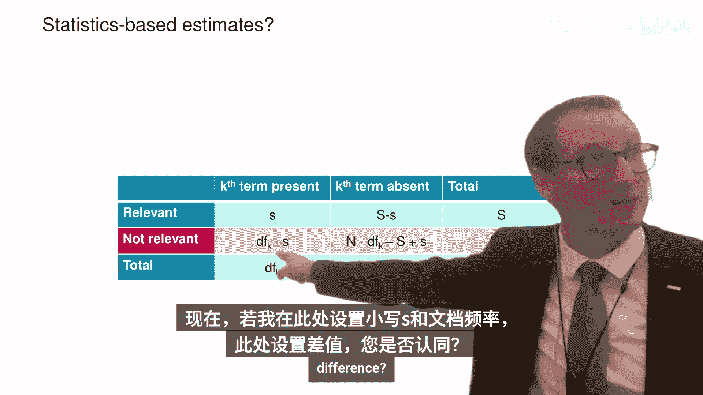

**简化假设**：为了完全消除对未知量 `s` 和 `S` 的依赖，我们可以做出两个实用的假设：
1.  **假设三 (Croft & Harper)**：假设相关文档中词项出现与否是等可能的，即 `P_K ≈ 0.5`。这意味着 `O(P_K) ≈ 1`，其对数值为0。
2.  **假设四**：对于大多数查询，相关文档只占整个文档集的极小部分（`S << N`）。因此，非相关文档的统计可以近似用整个文档集的统计来代替，即 `U_K ≈ df_K / N`。

结合假设三和四，权重 `C_K` 可以简化为：
```
C_K ≈ log( (1 - U_K) / U_K )
     ≈ log( (N - df_K) / df_K )
```

这个公式具有深刻的直观意义：**一个词项的权重，与其文档频率 `df_K` 成反比**。词项出现在越多的文档中（`df_K` 越大），其区分能力越弱，权重 `C_K` 越小（甚至为负值）。这与我们之前学习的 **IDF（逆文档频率）** 概念在精神上完全一致！

---

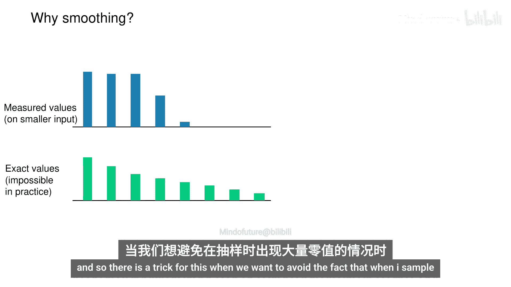


## 总结

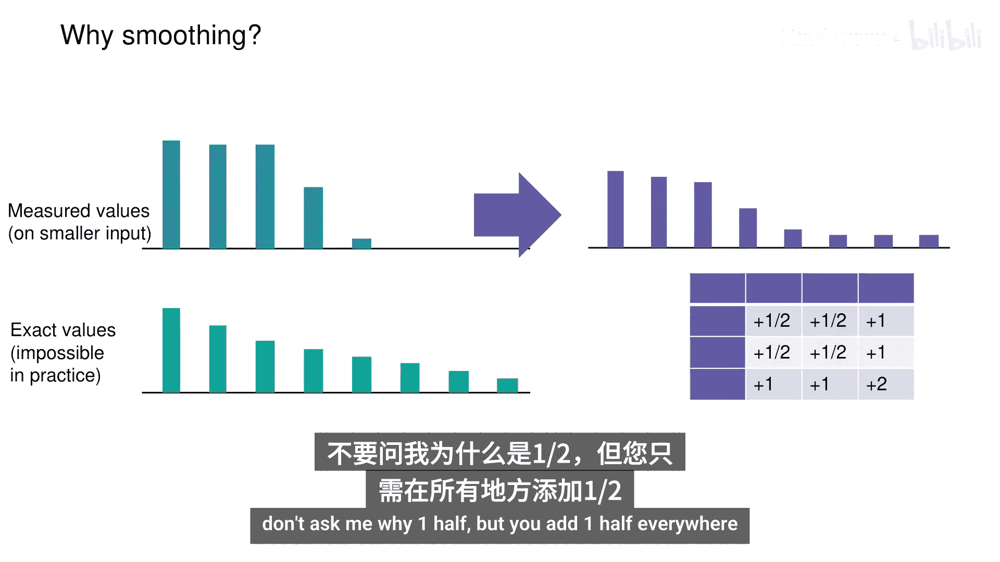


本节课中我们一起学习了概率信息检索模型的核心推导过程。

1.  我们从概率排序原则和二元独立模型出发。
2.  通过引入**非查询词项无关**和**查询无关性**的假设，大幅简化了概率计算。
3.  通过巧妙的数学变换和对数运算，将概率乘积模型转化为实用的**求和评分模型 (RSV)**，实现了高效的“证据累加”。
4.  为了估计模型参数（`P_K` 和 `U_K`），我们引入了基于统计的估计方法。
5.  针对数据稀疏和参数未知的问题，我们采用了**平滑技术**和两个关键的**简化假设**。
6.  最终的简化结果惊人地得出了一个类似于 **IDF** 的权重公式，这揭示了概率模型与经典向量空间模型之间的深刻联系。

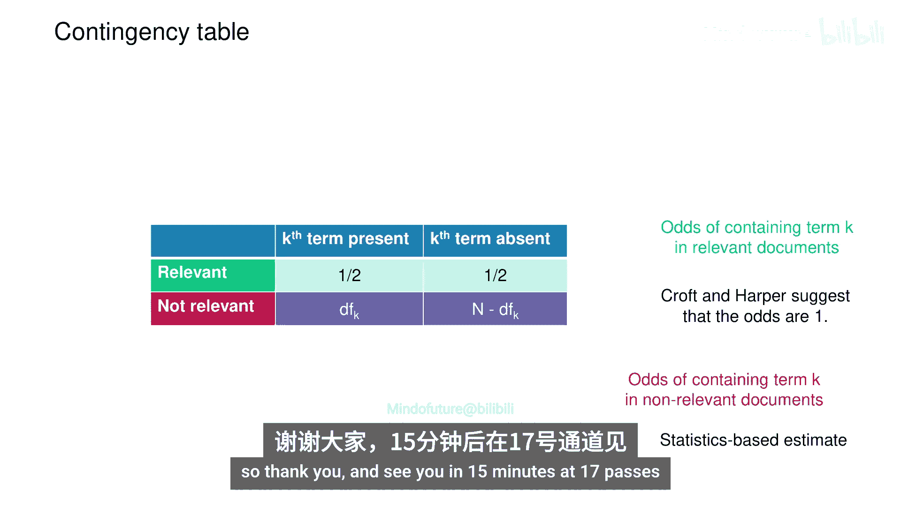

这个推导过程展示了如何将严谨的概率论框架，通过一系列合理的工程化近似，转化为一个高效、可计算、且在实践中非常有效的检索算法。概率信息检索为现代检索模型奠定了重要的理论基础。