# 【苏黎世联邦理工学院】信息检索-｜-Information-Retrieval-｜-Eth-Zurich-2025-p27-P27_10._概率信息检索_(4_4)--BV1ndsBzdEss_p27-

Where to come back。Everybody。So we are going to continue here。

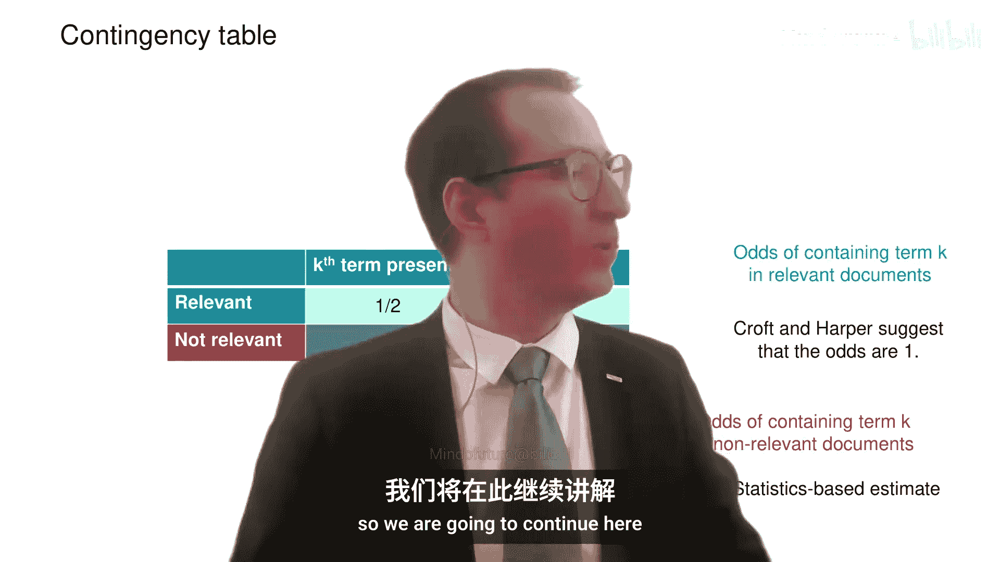

So now I'm about to。 yes， yes。 Thank you。

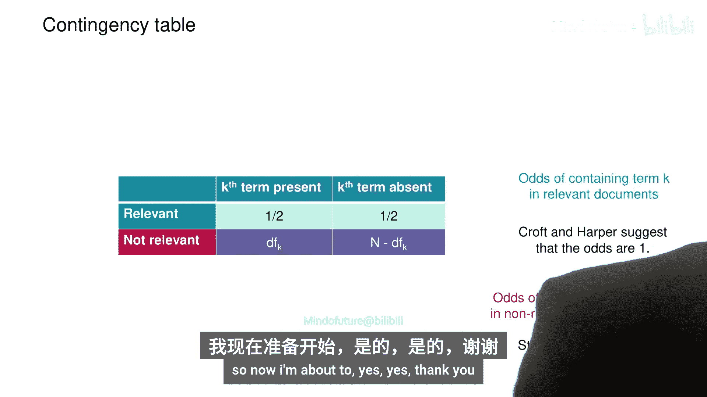

Trry about that。嗯。So we are going now to pull the rabbit out of the hat and show you that we are going to land about right where we were a few weeks ago。

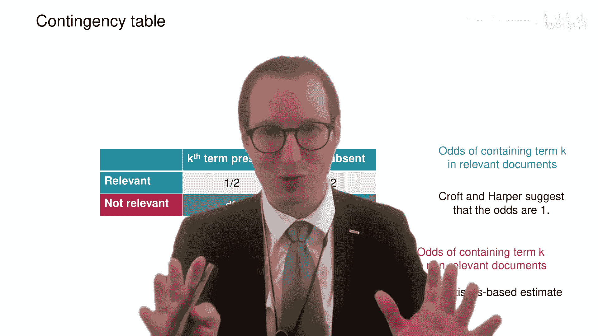

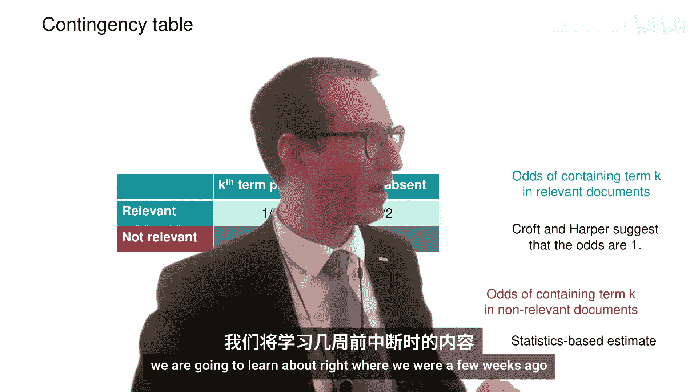

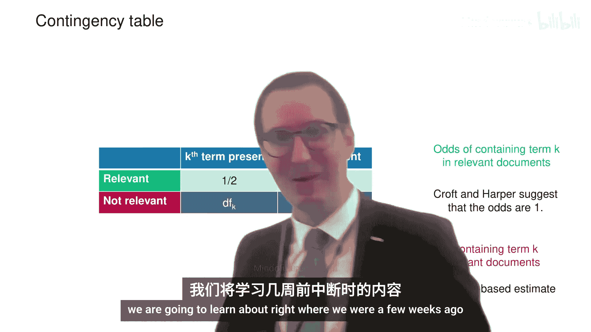

And。So we are going to be using this。 So remember the assumption that we've been doing right here。

 We have been assuming that the contingency table doesn't depend on the query， Right。

 P K is the same as P， K Q。 You can remember that with Pokemon wisdom， right， Pia， Pikachu， P K。

 P K Q。

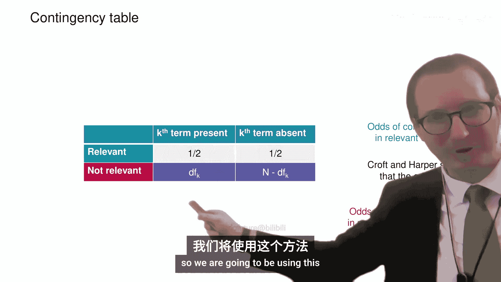

And so then we made a few other assumptions。 And so here the idea is that for the non relevant document。

 we assume it's just as good as the Internet。 And so we use the document frequencies。

And for relevant documents， we just assume maybe it's here， Maybe it's not here， right？

 And so when you don't know something， you just put one half，1 half。

And so this is what we have right here。嗯。And so if we smooth， we， if we round a little bit more。

 we can even take n right here。 Right， you agree， the document frequency。

 If you look at the entire internet， the document frequency for most terms is very small。

 you ignore the stop worlds。So we put N in here。 And so now what we can do is take this。

And plug it right into the C， K formula， right， with the P， K and UK。 And we get。B。We get this。

 Lo of one is。0， right， Okay。 So log of one is 0。 That goes away。

 And then we have logarithm of the document and frequency divided by n。

 How do we get rid of the minus in front of the dog。We put it inside。

 So do the power of -1 take the inverse。And we get this。This is incredible。

 Who is amazed at seeing that。What is log of n divided by the document frequency。

Did we see that somewhere。That， yes， we do。 I see a bit of nodding。 Where did we see it。

That is the inverted。Document frequency， right， That's the IF。That is the inver document frequency。

 So it is incredible because we made all these assumptions。 And at the end， we are just adding。😊。

Some sums that contain the inverted document frequency。

 So what we have just done with this mathematical mathematical deviationrivation。😊。

Is that we have given a justification to the use of Ifs in the vectorox space model。

That is what we have done。 That justifies with the priority seek approach。

It basically says that putting the I DF in your vectors in the vector space model。

Basically is consistent with ranking documents by decreasing relevance。

 by probability of decrease decreasing probability of relevance。 That is the result here。

 And this is really huge to， to come back to that。 So this is this basically correspond。

 There's no term frequency， right， So this would correspond to an instant of the vector space model where we don't use the term frequencies。

 We just put zero and one bulls that exist in smart right in the smart menu。

 I can say for the term frequency， I put0。1。 So if we do that on both sides and on the query side。

 we don't have I on the document side。 we have the IF。嗯。And we don't normalize。

 Then we get exactly the retrieval status value of the probabilistic information retrieval model。

 It's all connected。Information， pro information retrieval， the vector space model。Alright。

 so this is great。 right， This， is really， really is a great。😊，Results。For the term frequencies。

 we also need to justify them。 That will be the next lecture。 And then， the， the。

 the term frequencies will also pop right out of the hat。 But in a， in a different lecture。

 then we'll have a justification for both。

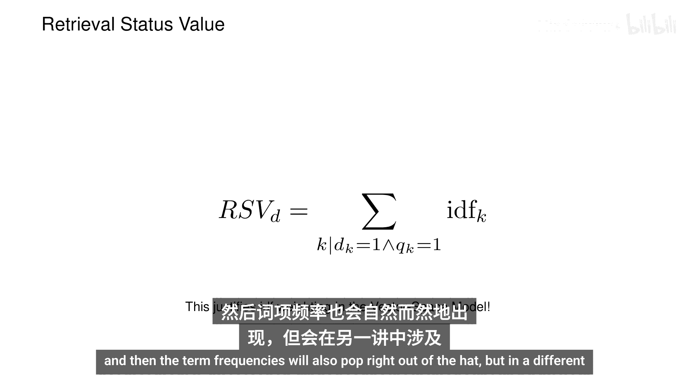

嗯。Alright。😊，And so， yes， when， when I say， you know。

 you just put the Booles instead of the term frequencies。 So that would be B， T N， B， T N， the。

 the smart code for， for to， something like this。Maybe， oh。

 maybe not quite because that would put the I on both sides。 So the IF needs to be on only one side。

 Maybe I'll fix the code。 But anyway， you see the idea。 we accumulate the evidence。

 We go through the terms that are in the query。 We go through the postings which are the documents that contain the term。

 and we accumulate the Is into the buckets that gives us the status retrieval such as value。

 and that， you know how to do， we've done that。 we've seen at the beginning。

 the intersection algorithm， Then we see term at a time document at a time。 You know。

 all the ways to accumulate this This is un。 The only thing we are tweaking is the term in the mathematical sense term。

 right what you add we change what is added。 In this case， the I with with me。Right。

 so it feels great， right to just land right on office where we have what we've seen before。😊。

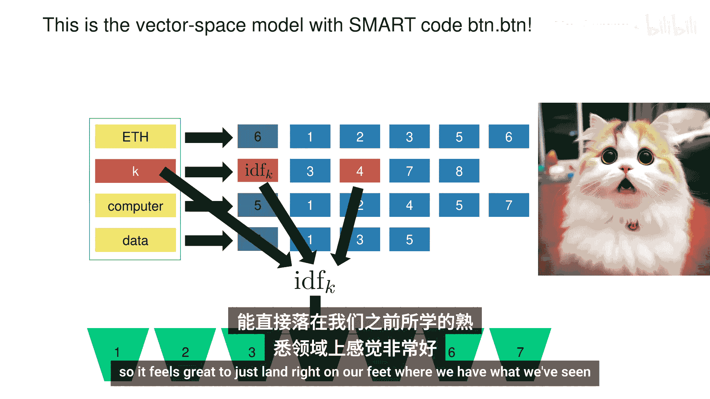

Now， I would like to finish with one more way， a different way of implementing that instead of this theoretical work that was done on a blackboard。

A different way to estimate P， K and UK。This is known as O K P。 O K P was， I think it's the 90s。

 That is。An information which we will system that implements all of that。

And BM 25 is BM means best matching， right， Best matching。 Best matching is basically the the。

 the whole idea of， of matching the the with term frequencies， I Fs and so on。

 instead of just the Boolean approach， right， So it's called this is the whole class of systems。

 best matching，25。 I don't know why 25。 Maybe I can try to also find out why they call it BM 25。😊，嗯。

Allright， so here's what they did。Stately difference。What they did is that they might。

 they consider that this one half，1 half here for the f feeding， the P， K 1 P K。

Is an outrageous assumption。 it's just too simplifying， right， That's that's two costs。

 And and so they were not very happy with it。 It might be a bit exaggerated that the odds are one。

 meaning one half，1 half。So instead， they said。This one half， one half， instead of that。

 we are going to evaluate it with real people。 So the ads in Antarctica， they don't exist， right。

 I hope it doesn't disappoint anyone， but we have real people who use your system who connect and input queries。

 So if you are a search engine with users。Then you can actually ask your users。

 And so the way that it works is that a user inputs a query in the system。And then the。

 the query is executed。 And then we use some， some values At the beginning。

 you might put one half1 half， if you want， right to just bootstrap the system。

 You put one half1 half。But at step K， more generally， we are going to call them P K at step S。

 sorry， So S is just is the step。And we display the results to the user。 right。

 We show the results to the user。And we ask the users to mark the relevant documents。Right。

 so it's manual work。 We add the， we ask the user， please， please， please tell us。

 you see that right when you when you go to some websites， you， you， you want some superb website。

 And then suddenly there is a purpose。 Did you find this page useful， right。

 You see that over the Internet。 It's actually done in practice。😊。

And so they asked the users to mark relevant documents。

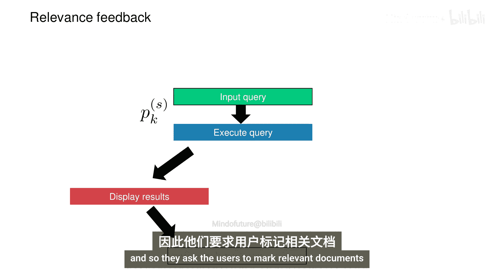

And so it means it goes into relevant， non relevant。

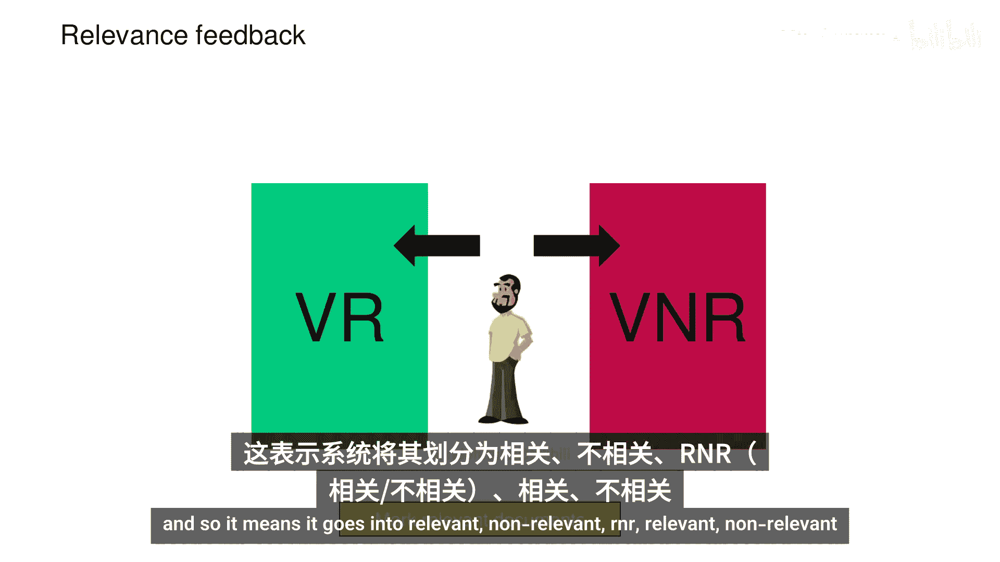

R and R relevant， non relevance。And based on that， you can do some statistics。 again。

 maximum likelihood estimate， right， You take the， the answers of the users。

 You look at what they stamped as relevant events， all the ones that are relevant。

of them do not contain term K， right， You just accumulate everything that is stamp as relevance。

 even across queries， because， as I said， this piika piachu thing， we， we just。

Don't care about the query。 We aggregate the statistics。

 and we compute the ratio of containing term K over everything that is relevant。

 That gives us an updated value。 a new R value。 I put an S plus one in there to say that。

 That's a better value， because now it takes into account。The feedback。 And then we just do it again。

 We cycle， right， We， we， we do another step。So here， here's how we update it。Now。

I told you about smoothing。 So again， the same I D。

 we can just add this one half and this one that just to smooth things out， right， to， to。

 to account for the fact that maybe you don't have enough users for the statistics to be very relevant。

So other people， instead of smoothing with just one half， they smooth with the previous value。

Who has ever heard of a Kman filter。Never， it's a way of smoothing， Basically， when when it。

 it's used， for example， for GPS or navigation coordinates when you。

 you keep having a point where you are， But， you know， the GPS， it's not very precise， right。

 So if you just look at your point it might jump a little bit。

 And so if you want to plot the path on which you are， when you follow the GPS coordinates。

Instead of。Taking the next value。You interpolate it with the previous value。

It's a way of smoothing the path all along which you move。 That's， that's called the Kman filter。

And so this here is a little bit like this。 It's like you have this brand new value that you're about to compute of your of your P K。

 But instead of just jumping to it directly or instead of just smoothing it with adding one half。

 you give some inertia from the previous value right， you you。

 it's like you keep an anchor to the previous value so that you don't go away too much from the previous value just to keep it a bit smooth。

 right。Or whom is that here。Right， so this is why we add this P K here。

 Kappa it's just a Greek letter that is a constant。 It's a parameter。 So for Kappa。

 you can just put whatever value you you you want， or you can use machine learning or whatever。To。

 to optimize it。Allright。Maybe machine learning is another kit for just one variable。 maybe。

 but anyway， So we just。Keep updating the new value。 And this is like a Bayian update。

 Remember the umbrella and the the rain， if I give you a new information that I have my umbrella and then ask now。

 how does it affect the probability that it's raining， Well。

 going from S to S plus one becomes a Bayesian update。 right， So this Kman filter approach is。

 is a little bit like this。 Alright。And so now I have updated them these other posteris， right。

 the priors at step S posterior at step S plus1。 And now I just do it all over again。

 I just keep updating。 And so if I'm lucky enough to have a popular search engine with a lot of people。

 then， of course， the quality of this is going to， to improve。 And yeah， that's how it works。😊。

And that was the last slide of probably seeking information retrieval。Do we have any questions。

 Anything that wasn't clear that you want to ask。Don't hesitate。

 because if something wasn't clear to you。 it's very likely it also wasn't here to others， right。

 So there's never anything wrong about asking questions。Any questions。On zoom questions。Best chance。

Okay。嗯。So if you still have questions that come later， just ask them on the forum， send us emails。

 send us messages， and we'll be happy to to answer them。 You could， you can also ask each other。

 right， It's the the best way to learn is to teach。 So if if you ask others to teach you。

 they cannot also learn by teaching because when you teach it forceses you to。

 you realize what you don't know it。 It focuseses you to， to go there and specifically focus on the。

 on the on the gaps。😊，呃。Alright， when then for this one。

 for the privacy seeking information retrieval。

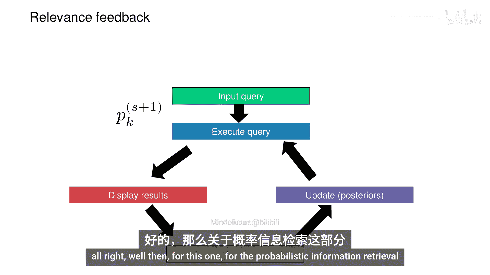

We are done。 And again， what is the most important message in here is that we got back the ideaF。

 We got back to the vector space model with the the inverted document frequency。

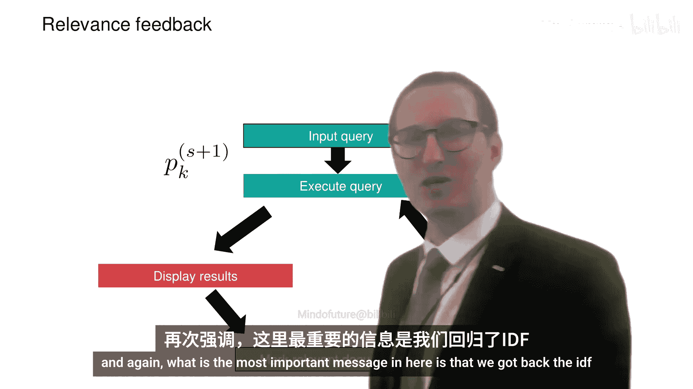

Historically， the vector space model came a bit later， Right。

 So Boan retrieval then priorityistic information retrieval，60，70s，80s。

 and then the vector space model came a bit later than the priorityistic retrieval。 I think the。

 the vector space model was the smart system was one of the first。 Yeah， but it's already over。

 I mean， it didn't came that much later。 And priority stick information retrieval。

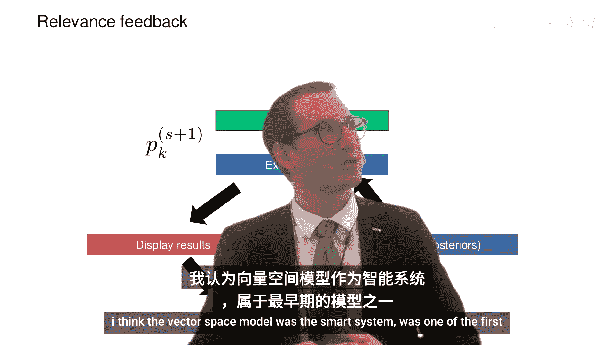

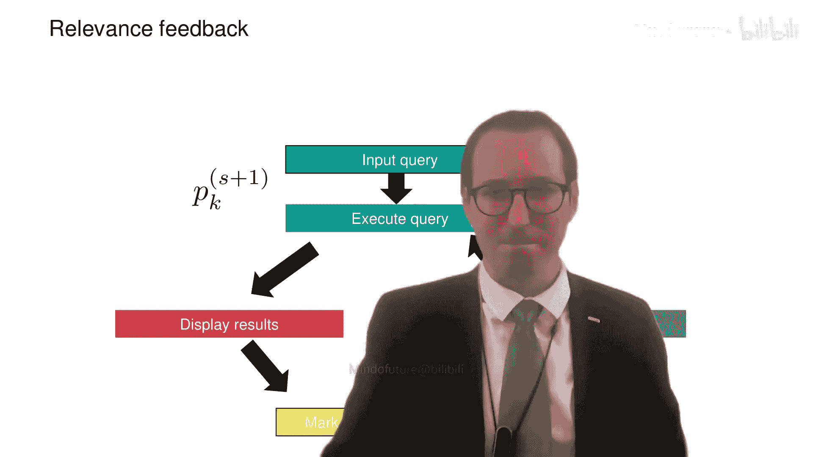

So I'm going to stop the recording here， and I'm going to jump to the other slides。

