# 【苏黎世联邦理工学院】信息检索-｜-Information-Retrieval-｜-Eth-Zurich-2025-p29-P29_11._语言模型_(2_3)--BV1ndsBzdEss_p29-

Welcome everybody in the lecture hall。 Welcome everybody on Zoom Welcome everybody from the future。😊。

Today will be the last week in which I will actually introduce new material。

 This is the end of the language models lecture。And next week， we'll have a celebration。

 So we'll have a final quiz。 We'll go through the semester， what we've learned and。

 and celebrate the end of the of the semester。 I will talk about the exam， what to expect。

 But before it comes to that。 we will we will finish the material today。

 I might even have time to ask you if you take our questions at the end if time permit。😊。

I hear from Josh that the mystery game is is ongoing。

 We already have two submissions that are correct。 So it means you have one more chance to win a prize。

 So you should try。 The goal is to relate some documents to the corresponding embedding。

 in the vector space and to find out which belongs to which， right。Okay， so where were we。

 We were in the middle of language models， but not the large ones， the， the small ones。

 the large ones， they are going to be introduced in a different course。

And I have to just go back where we were。So first this is where we stopped I threw at you all of these very complicated formulas。

 which basically are based on the chain rule。 It's the idea that for a document to be a document。

 We need to have a lot of things happening。 We need for it to have at least one word。

 we need for it for the first world to be specific word。 then we need to have a second word。

 then we need for the second word to be a specific word and so on。

 And for this kind of things we can use the chain rule。

 which is the idea for example with three variables。

 that probability of ABC is the probability of a times the probability of B conditioned on a times the probability of C conditioned on a and B and we get a chain rule。

 So of course， now it's more than three， it's actually way。

 way more than this So we had these huge formula originally。 But then we made a few assumptions。

 And this formula that you see right here has a few assumptions。

umption is that the probability of having one more world is always the same。

 Whatever the the length we already have。 that's one minus P stop， right。

 So we have a probability of P stop of stopping and the probability of one minus P stop of not stopping。

 right？ So every time I have to check that I don't stop already at the beginning。

 Then the probability that the first world is D1。 then I don't stop。

 And the probability of having D2 condition on D1。Then I don't stop again when minus P stopped then the probability of d3 conditioned on the first two and again probability that I don't stop and then the probability of d4 but here you notice something I only have the dependency on2 and3 that is because of the macroov rule because we we lose information when it's too far away in the past we only remember the previous two world in that case because we take two as the parameter and that means that the probability of having D4 as the fourth world is only conditioned on D2 and D3 not on D1 and then finally P stop because we we have to at some point decides that the document is over who understands this formula。

Right， and all the assumptions， right。Okay， very good。

 Now this parameter that here is set to2 for the the macro rule。 it can be changed， right。

 I can set it to 3。 I can set it to 4， but I can also set it to one or even to0。 And in fact。

 if you set it to0， interesting things start happening。😊，So now， regarding the terminology。

 notice that if I set it to two as been done on on this slide。

 I'm basically having a sliding window of three worlds， right。

 I always look at two world and then the next one。 So I look at three world at the same time。

 For example，2，3，4 in the last probability。So now， if we set n equals one for the Markov condition。

 then we have by Well。 We look at pair of wealth。 And if I set it to0。

 then we look at one word at a time。 We just look at the probability of one world。

 but we don't even look at the past at all。 And this is the reason why when we set it to 0。

 It's called the unigram model， right， So it basically means that we only were look at one world at a time。

 We don't even know what the past was。 We just keep roing。

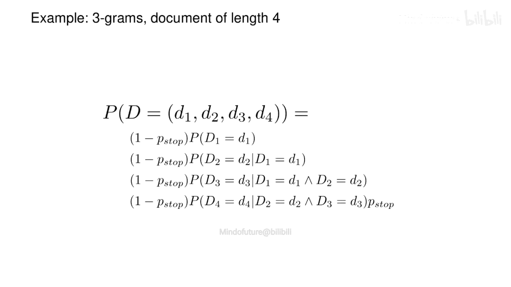

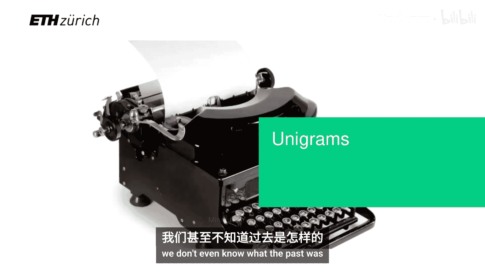

哦对。And so that means that the probability for the next world。 So now I'm at position K。

 So the probability of the next world to be a specific decay。嗯。Is， in fact。

 not going to depend on the previous world。 So it means that it's the probability of the next world being decay。

 just condition on the fact that there exists a world at that position so that the length is at least K。

 right， So what you see here is just the macro of condition just with n equals0， right。

For everybody is's clear。All right。And so， in fact。

The advantage here is that everything becomes much easier because you don't even have to condition and formal our world。

 So it means that all we need is an assignment。Of every world to some number。 It's one dimensional。

 right， We just have a list of the world， and we have a list of their probabilities。

That do not depend on the past。 So I gave an example here with2 B or a2 B。 that is the question So 。

3。2。1。 And you just want all of these to sum up to one right So it's a probability distribution on the world。

 and you use that to multiply whenever you want the next world。

 This is called the unigram model when you do that， But there is more。

And we'll go through the specific because the unigram model is very。

 very particular compared to bigram or trigram。You might remember from last time that I started with a finite automata。

 and I explained that we just reverse an automaton by instead of consuming world in order to accept them or not。

 we generate world。 So we just inverted the the use of the automaton。

 And so it means that we basically have an automaton with just two nodes。

 And one node just keeps generating the next world with a specific probability。

 And then every time you have the P stop。 And then if you have if you stop。

 then you go to the thing and and not to the thing， sorry， because you accept it。

 you go to the final state where you accept the world。One small world of warninging。

 if you look at it from the autoatton perspective。Is that we separated the probability of getting the next world from the probability of stopping。

 right， So there's two ways of looking at it。 Either you let all the probabilities for the world stop to sum to one and then you multiply。

 you renormalize with P stop or one minus P stop or you put the P stop as an additional possibility。

 right And typically when you draw the automaton， in fact。

You might renormalize a little bit by actually multiplying all of the weights with one minus P stop and then stop is P stop and that that way it sums up to one all the transitions from the from the automaton sum up to one now for the really if you want to really go into the details what we would have in fact in the transitions in the automaton。

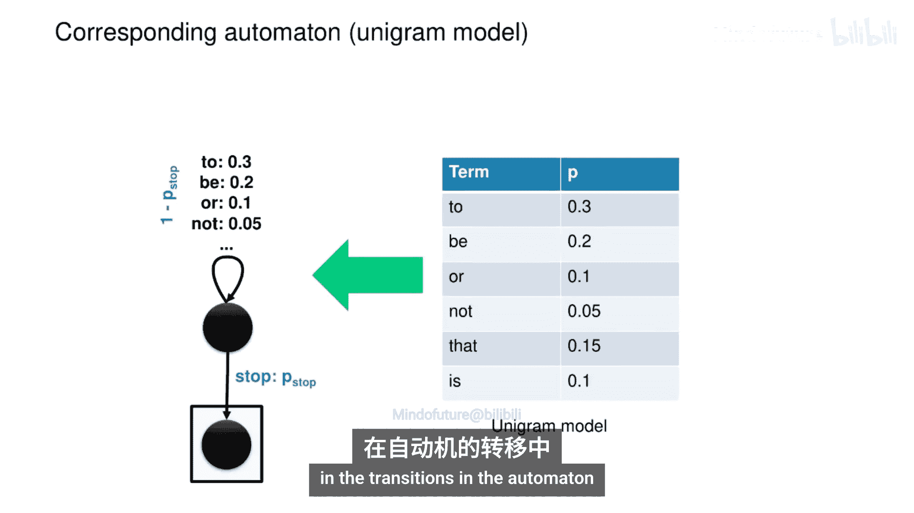

嗯。Would be here all of the world。 And here， that would be Epsilon， right， Epsilon is the empty world。

 So you have a transition with Epsilon where you don't have any additional world and you end up in the final stage。

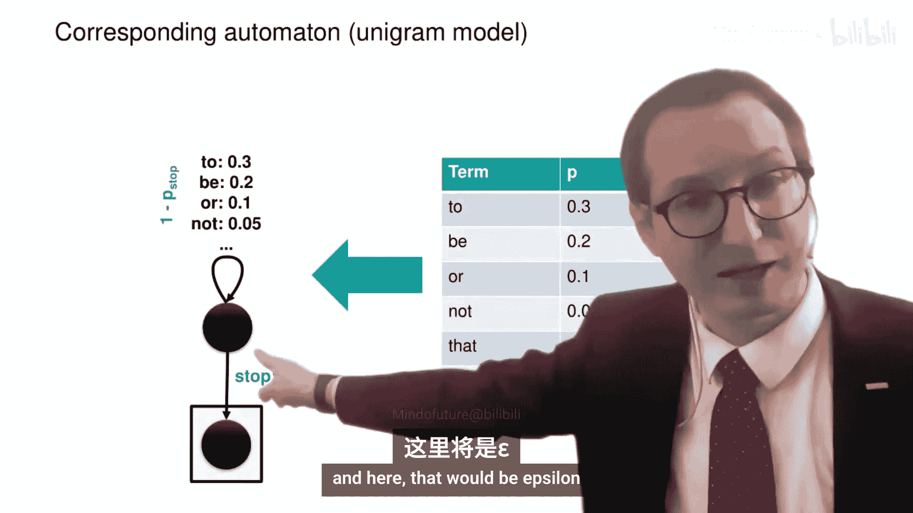

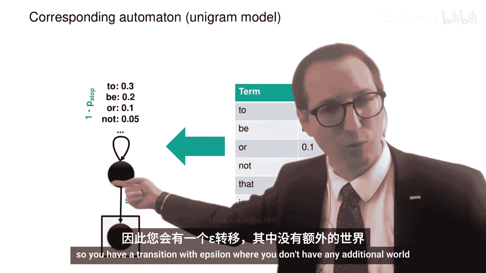

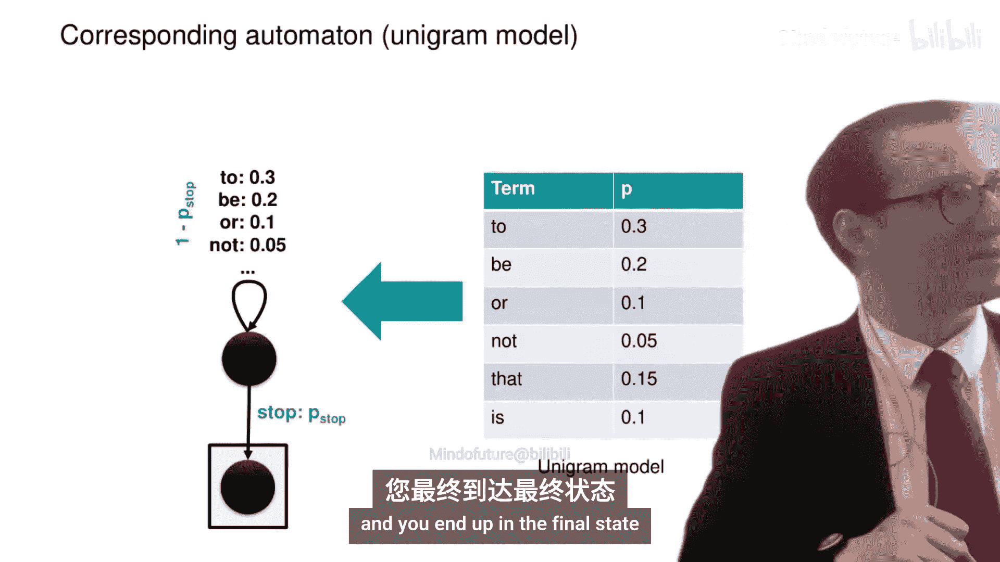

Right。Also， just to repeat something to make absolutely sure that this is clear。

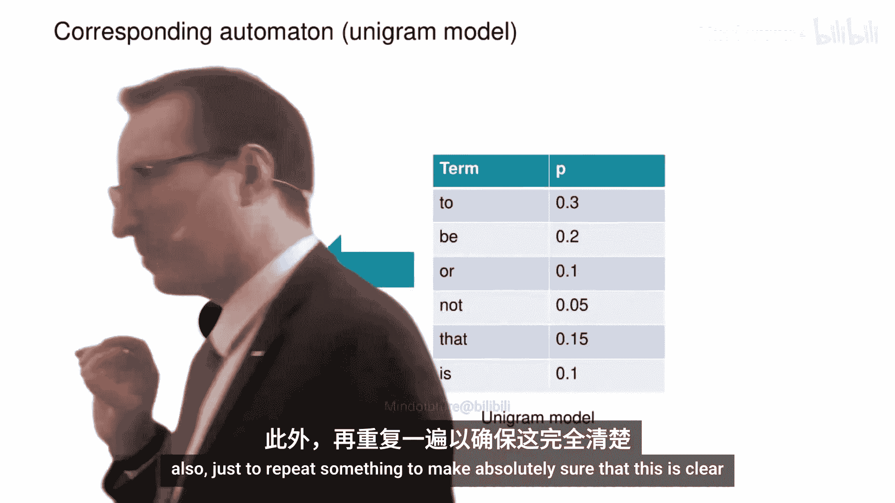

When you look at the regular expressions and finite automata。

The labels on the transitions are letters， right， So you have the letters。

 you consume letters and every letter goes to the next transition。 Or if you generate。

 you would generate letter by letter。 But here there is a subtlety is that the letters of the automaton are。

 in fact， the worlds。In our information systems， right， So the alphabet of the automaton is， in fact。

 made of the worlds of the information retrieval system。 right。

 It's a subtlety It can take a bit of getting used to。But。

 but this is why I have this full world here， to B or not， which are， in fact。

 letters of the automato alphabet。 for whom is that fear。Right， okay， so this is the unigram model。

 and all I need is a lookup table where each we corresponds to some probability。😊。

So now can anybody tell me then what would be the probability？😊，Of generating exactly。The documents。

 D1 D2 D3。D1 D2 D3， they are small， small D， right。 So it means it's just mathematical variable。

 They could stand for any， any words。 For example， it could be。Information retrieval lecture， right。

 D1 is information。 D2 is retrieval。 D3 is lecture。 So what is the probability of generating。

These documents with a unique one model。And in disorder， right， D1 D2 D3。

Remember it's the chain rule， it's exactly the chain rule we've seen before。

 exactly the same things we multiply except that now we don't depend on the previous worlds。

 So what could that be。Knowing that we have some lookup table right so we have one probability for D1。

 a probability for D2， a probability for D3， anybody。Once su try。Yes， I see a raised hand here。

 maybe you can bring the microphone。Well， it's just one minus P stop for the three words then P stop at the end and just PD D1 times Pd2 times P D3。

 exactly， Yeah， you're got to teach right， That's exactly what you said， right。So indeed。

 it's exactly the same idea as V4，1 minus P stop then PDD1 and1 minus P stop then PD D2 and1 minus P stop。

 then PD D3 and then P stop。😊，And now you just see that the probabilities of oh sorry。

 I will manage it。 The probabilities of generating specific neck12。 Now。

 they just don't have any conditions anymore want。 It just depend on the world。

 And I just use the notation PD D1 P D2 P D3 but PD D1 P D2 P D3 These are just the numbers that you have in these table right here right So P2 would be 0。

3。 D B would be 0。2 P or would be 0。1 and so on right is everybody with me。

It's going to get more complicated， right， So I'm the 60 careful。 alright。

 So now here's how it gets more complicated。The probability that you see right here on the screen is the probability of generating documents D1 D2 D3 in this order。

 D1 D2 D3， not D2 D3， D1， D1 D2 D3。 So there is a list of wild semantics and it has to be in exactly this order in the way we generate it。

But something is particular to the unigram model that doesn't exist with the other。

higherigh values for the Markov Markov condition。嗯。And it is that for the Uniigram model。

 we actually like to look at it from a bag of worlds perspective instead of a list of world perspective。

 right， So it means that when we don't， when we ignore the past and look at the world one by one。

 We actually don't care about the order。 We only look at the number of occurrence。 Now。

 that should remind you of something because we've been doing that in the vector plus space model。

 right， in the vector space model， we also ignore the order， we just looked at the term frequencies。

 So the number of occurrence and that was it。😊，And so。That means that for the Uniigram model。

 we need to do a bit of some gymnastics in here to go from having a random document where the order matters。

To a random documents in which your does not matter。 So what does it mean mathematically。

 So when we have the list of world model， then we have this mono8 structure with sequences of wealth。

 right， So this is the T star notation that we see， right。

 So Ts for the terms and style just means you concatenate the terms to get a document in a specific order。

 But if you go to the back of world model。How do you build a map mathematically when it just assigns every term to some number。

That number is the number of times it appears。 So a bag is a function from all the worlds to integer。

 So N to the power of W， you you you it's a mathematical notation for a function from W to N， right？

 So we associate every world that there is with an integer。 That is the bag of we model。😊，Now。

 if you look at these two and how you transition from the first one to the second one。

On the high level， we just drop the order， we forget the order。

And so what that means is that if you have， for example， a documents。

 let's say information retrieval lecture。Which doesn't have any order。

 So it just means that the bag where information appears once retrieval appears once and lecture appears once。

 and we don't care about the order。 How do we relate it to the list of well model。

 When we relate it in the sense that we look at all the documents。

 all the possible orders for these three terms。 So we have information retrieval， lecture。

 information， lecture， retrieval， lecture information， retrieval， lecture， retrieval information。

 retrieval， lecture information and retrieval information lecture。 right These are six possibilities。

Right， and so now， if I know the probability distribution。

On every ordered sequence of wels in the list of wel model。

 I can infer the probability distribution on the bags by just。😊，Putting in the same group。

 all of the documents that are basically the same bag， but in a different order。

 So it means that if I want the probability of information retrieval lecture， I need to as a bag。

 I need to have to compute the sum of the probabilities of each one of the six possible orders。

 So the probability with that it's the first order plus the probability is the second one plus the probability is the third one and so on。

Why can I add the probabilities， Because these are these joint events， right？

 That's why I'm authorized to add the probabilities in here， right。

So actually all I need to do is a I group all the documents that are just the same bag in a different order。

 I put them in the same group and then for that group I compute the sum of all the probabilities of with all possible orders and I get the probability folder back right for whom is that there。

😊，If it's not， don't worry， I' have pictures and animations to make it clear。 but in fact。

This is a multinoial distribution who has ever seen a multinomial distribution。

Who has never seen a multinoial distribution。As great I'd introduce you to it who has seen a binomial distribution。

😊，That that might be a bit more famous。 Yeah， but the multinoial won't actually generalize it。

 but we， we look at the details of that。 Here is it。 Here it is。 That's the binommial distribution。

So I， I thought it was more fun to do it with cats rather than terms， because it's also more visual。

 But let's look at the， the details of that。 So first。Look at the other of the cats。

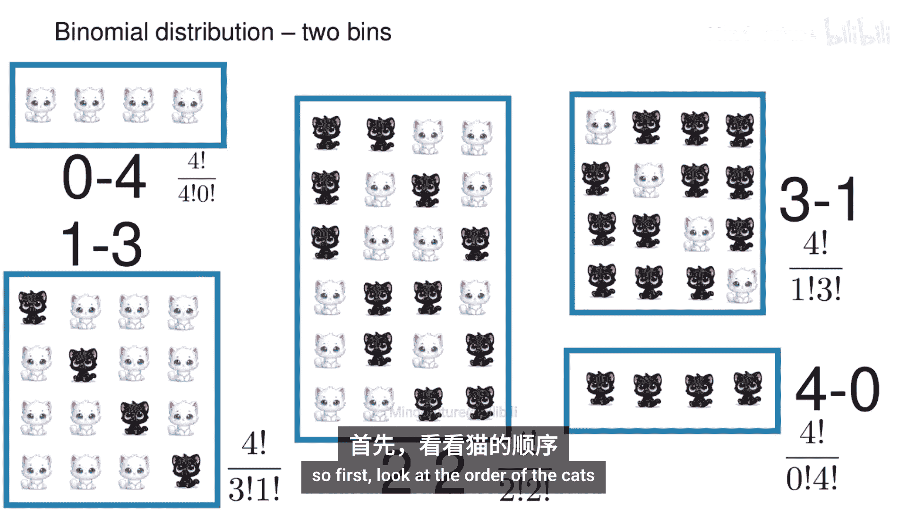

Right， so we have here。 Can I appear on the slide。 Yes， exactly。

 So here we have a specific order here， it's a specific order， a specific order， a specific order。

 a specific order。 So these are all the possible lists of cats that I can get。 How many are there。😊。

Possible lists in total with two colors。

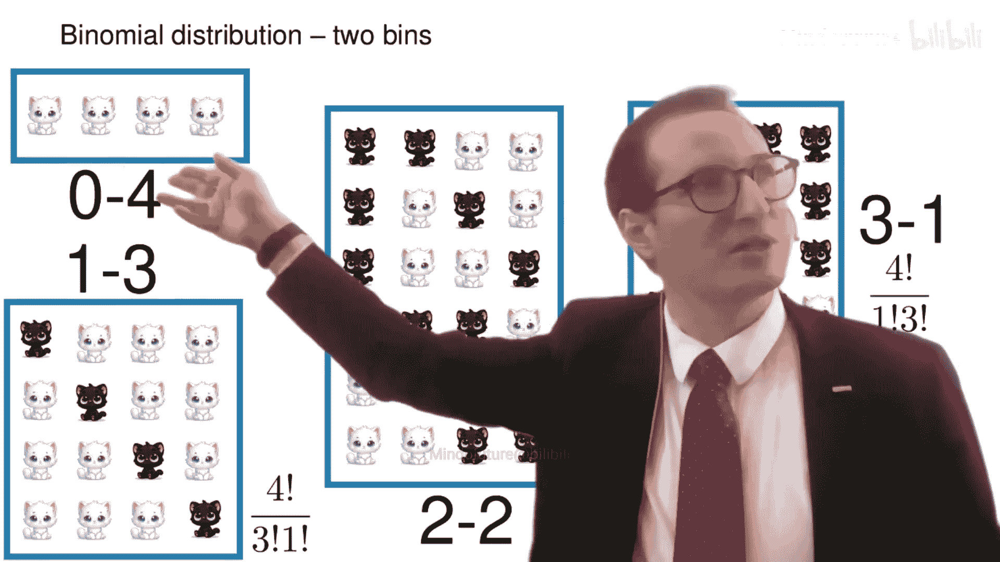

Two times  two times 2 times 2， right， So I have 16 possibilities of length 4。 If I。

 if I look at the length 4。 Okay， so 16 possibilities，16 possible order rings， sorry。

16 possible sequences of cats where they can be of any of the of the two colors。

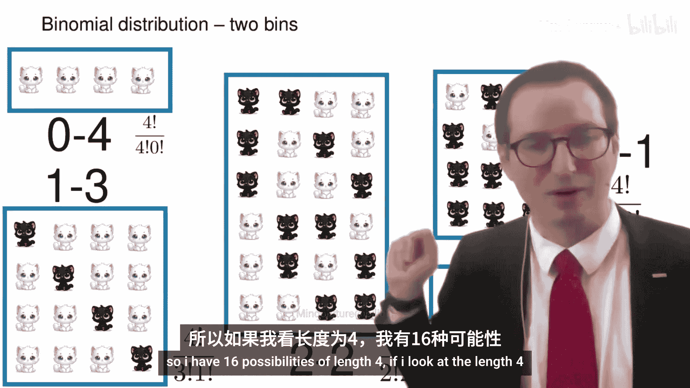

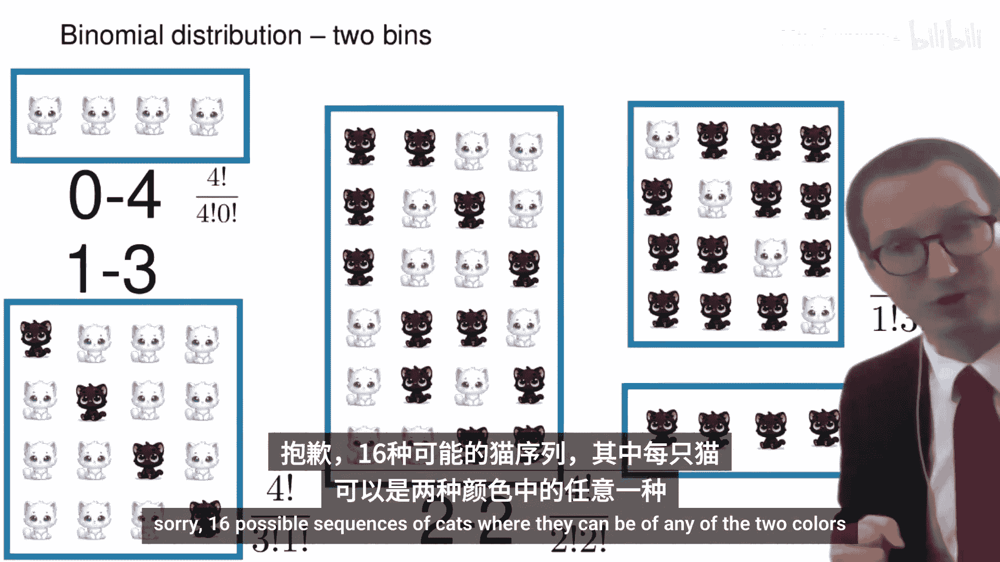

But things are interesting when I start grouping them。

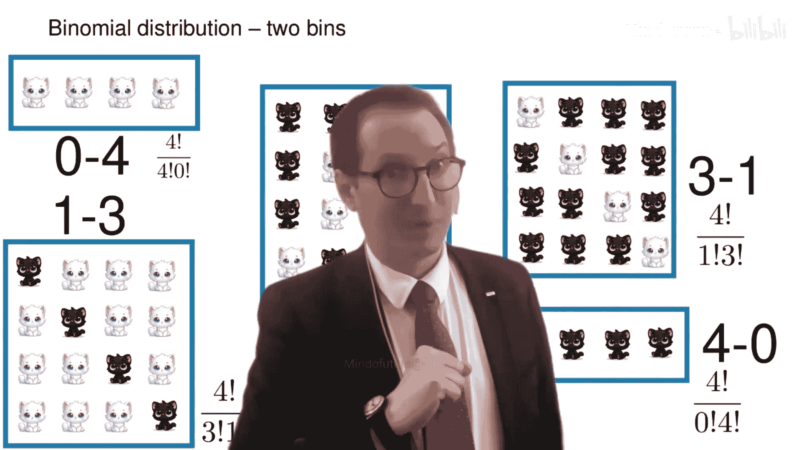

For example， in here， I have the group with actually the only sequence with four white cats。

Here I have all of the sequences with one black cat and three white cats that I put together， right。

 So there's four possible order rings， but it's the same bag， right。

That's the bag with one black cat and three white cats。

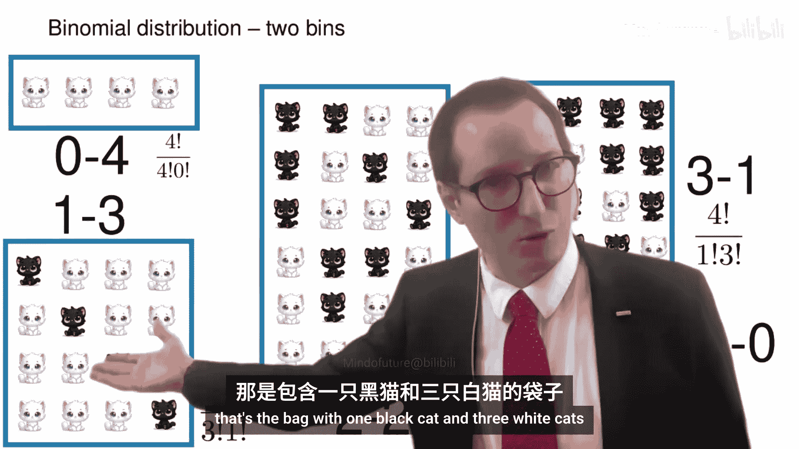

Then I have another group these times with two black cats and two white cats， right。

 and there are six possible other range。Then I have the group with three black cats and one white cats。

Don't twister with four possibilities。 And then I have the group with four black cats。

 But there's only one ordering possible in the， in that case。

And so this is what we do when we go from the list of world model to the back of world model。

 all we do is build these groups like here。 And so now I can just count that' combators。

 I count the number of possibilities。 And since it's the binomial distribution because there's only two colors。

😊。

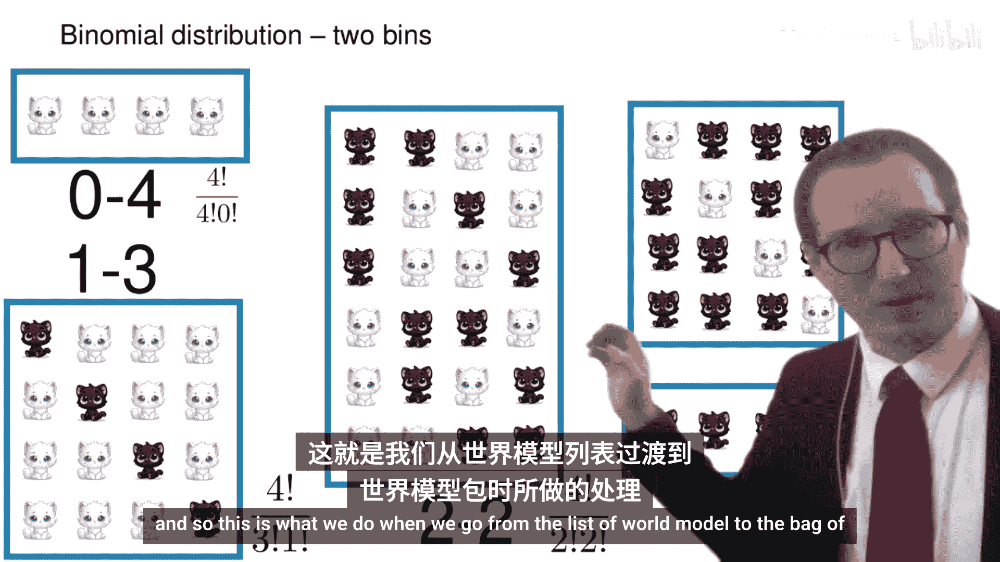

You might know that formula， right？ It's the number of possible combinations with。

3 white cats out of four， right？ And the formula for these is 4 factorial divided by3 factorial。

4-3 factorial， right， N factorial divided by k factorial n minus K factorial。 Who's。

 who has ever seen this。 I'm pretty sure you all have seen it， right， That's exactly the formula。

 That is the formula for the binomial N is the number of cats。 And K。

 K equals 0 K equals 1 K equals 2 K equals 3 K equals 4。

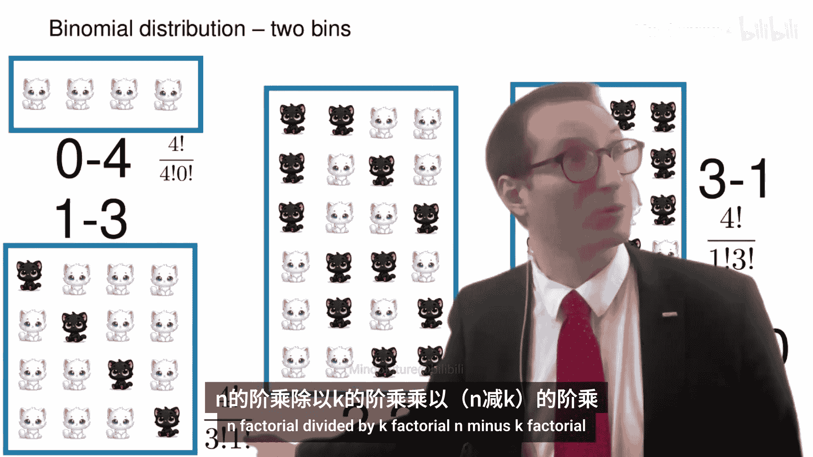

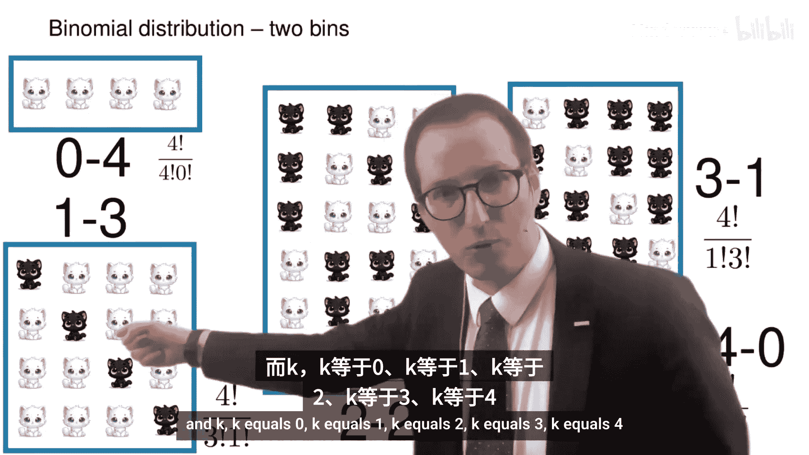

And it also corresponds to when you have mathematically a plus B to the power of N that basically gives you the coefficients。

 also， right， for example， here， that would be 1，4，6，4，1。

 And that basically means that if you were compute 1 plus B to the power of4。 you will get。

Is it to the power， I， I am always offset by one on these things。 But basically。

 you will get one plus 4。u。You think。Yes let me try to the power of four。

 if I'm upset by1 I I'd fix it。 So basically a plus4 to the power of four is equal to a to the power of4 plus4 times a to the power of3 times B plus 6。

 a squared B squared plus4， A B cube plus B to the power of four。And I was not offset。

 So that's all good， right， So it， it just corresponds to these developments。

 So this is the binomial， the binomial distribution。

 And now you see how you get from lists of cats to bags of cats， right。And how does it generalize。

 how does it generalize to more than two colors Well it's very easy。

 this formula where you divide with the factorials。

 you just put all of the the numbers of colors at the bottom and the total number at the top。

 and you just compute that。 So， for example， this is a bag of cats where there is three white cats。

1 blue cat and one black cat。1，3，1。 And so you compute the number of possible order rails in there with5 factorial divided by one factorial。

3 factorial， one factorial。And that gives you a total of 20， I think， no，1，2，3，5， I think， yeah，20。

Who's with me？RightSo that doing that with all of these little cats， basically。😊，Alosus。

To compute this。Because you might agree that when you look at this formula right here。

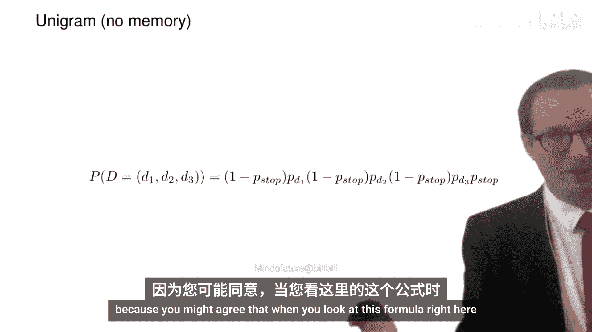

That computes the probability of getting a document in a specific order。

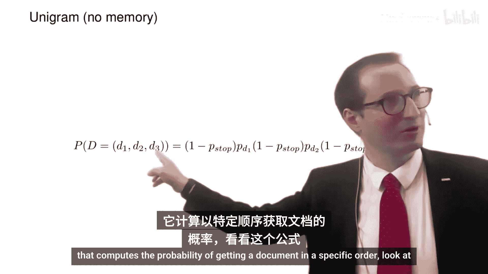

Look at this formula and tell me if you agree that。

The number I'm going to get out of this does not depend on the order。

If I compute the probability of D2 D1 D3 or D3 D1 D2， I'm going to get the same number。 Do you agree。

Just because it's commutative。 I'm getting the same number。

 So that means if I look at this formula right here。That I'm looking at a specific bag。

I'm looking at all the possible order rings。😊，But what I'm adding here is always the same number。

 It's always the same number because it doesn't depend on the order。

 So do you agree that if I add many times the same number。

 I can just multiply it with the number of times， right。

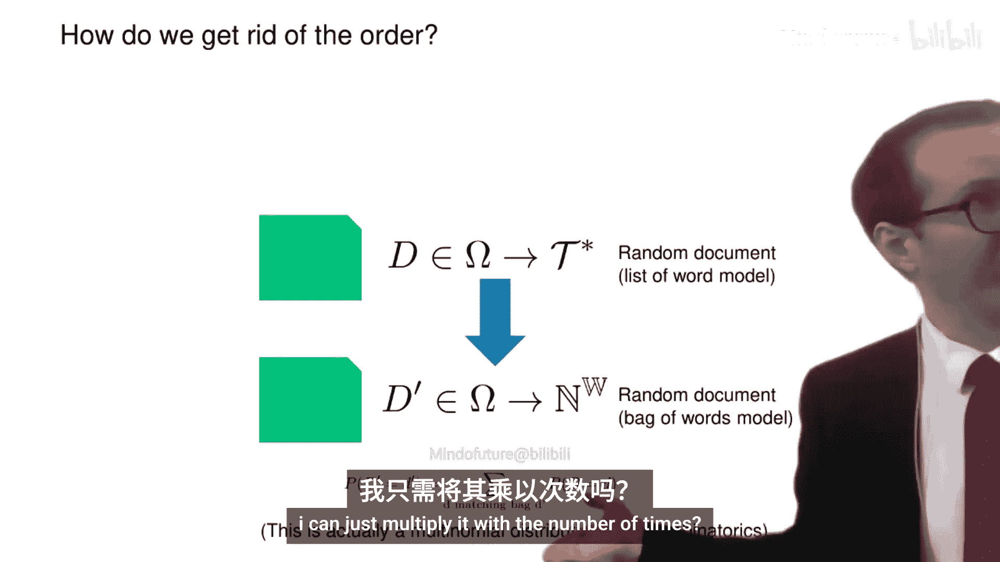

So what is my number of times， Well it's just the number of lists that I have in my group。

 So these formulas here give me basically the number of terms that I'm adding in terms in the sense。

 additive term mathematically， right， So the number of lists that match the bag is given to me with this magic formula or this magic formula。

 right， So that would be with three terms and yeah Okay， with with me。😊。

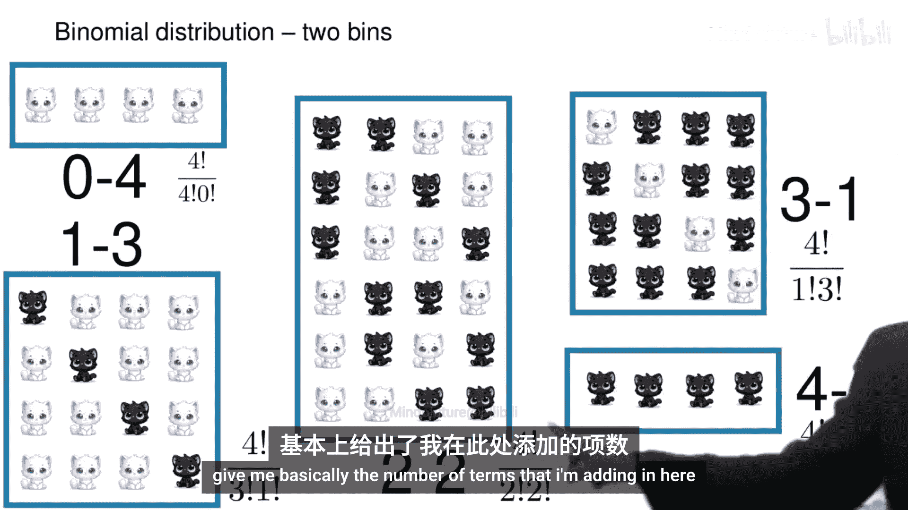

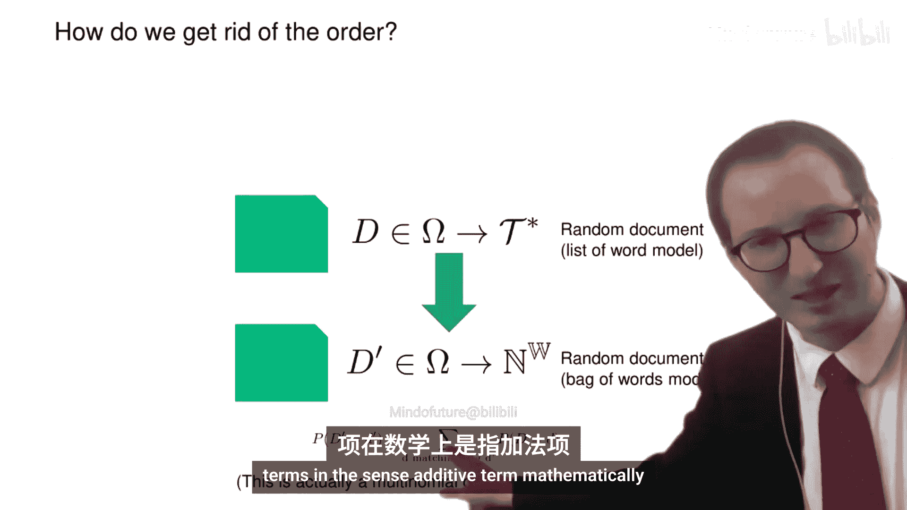

Very good。So now， surely you can give me the probability distribution for the Uniigram model。

Length of four So far cats with two termss。And I have a probability of two thirds of generating the black cut and a probability of one third of generating the white cut。

Can you try to find out the probabilities that we get here。 So， of course。

 you need to stuff with the list of cats model right。

 That gives you the all the probabilities of generating a specific list。

 And then by multiplying with these multinoial coefficients。

 you get the probabilities with bags of cats。😊，Does anybody have any idea how to start。

Maybe I can ask a simpler question。 What's the probability of generating， Let's say。

 three black cuts。Yes。😊，Yes， that would be the numerator and the denominator。So you're very close。

 So this is indeed about the power of three to be two thirds to the power of three， right。

 So you you just multiply three times the two third with itself， right。

 So it's two thirds to the power of three， absolutely correct。

 That's the probability of generating a sequence with three black cats。 Now。

 since there's only possible ordering。 That's also the probability for the back right So we have two thirds to the power to the power of three。

 which is a divided by 27， right。But now I have length 4。 So it's the probability of generating4。

 right？ So then I just put to the power of four， the general the probability。

Of generating four black cats would be two third to the power of4， right， you agree。

And then the probability of generating， let's say， one black cat and three white cats。

Exactly in this order。 First， the black cat and then the three white cats。

 What's the probability of that。That would be two third times1 third times one third times one third。

 right。So we just multiply them。 So this is what you get。

 So these are all the all the possible the possible bags in here， all the possible bags。

 And now that would be the probability of getting the cat exactly in the order， as you see in here。

 Right， So this is here 1 third，1 third，1 third，1 third。😊。

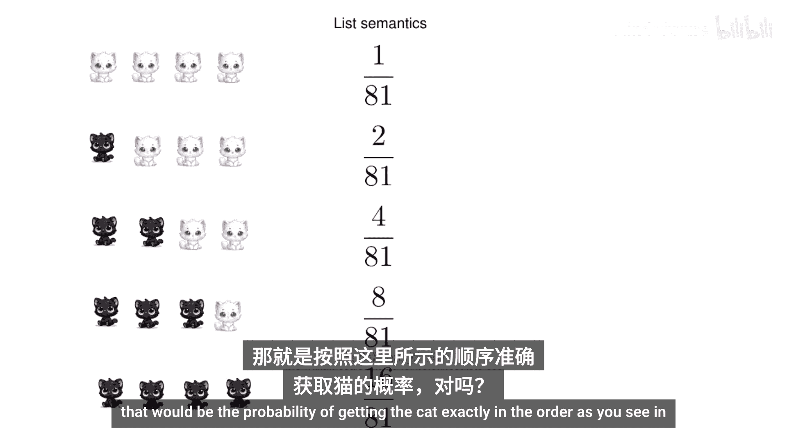

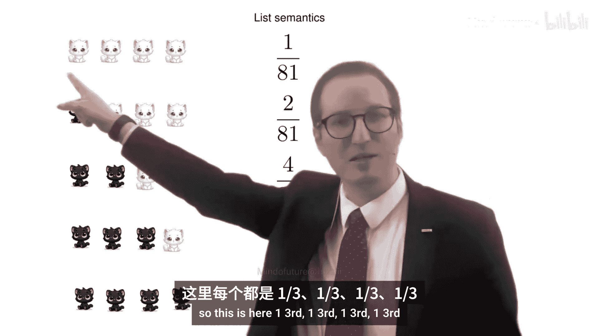

This is here， two third times 1 third，1 third，1 third。

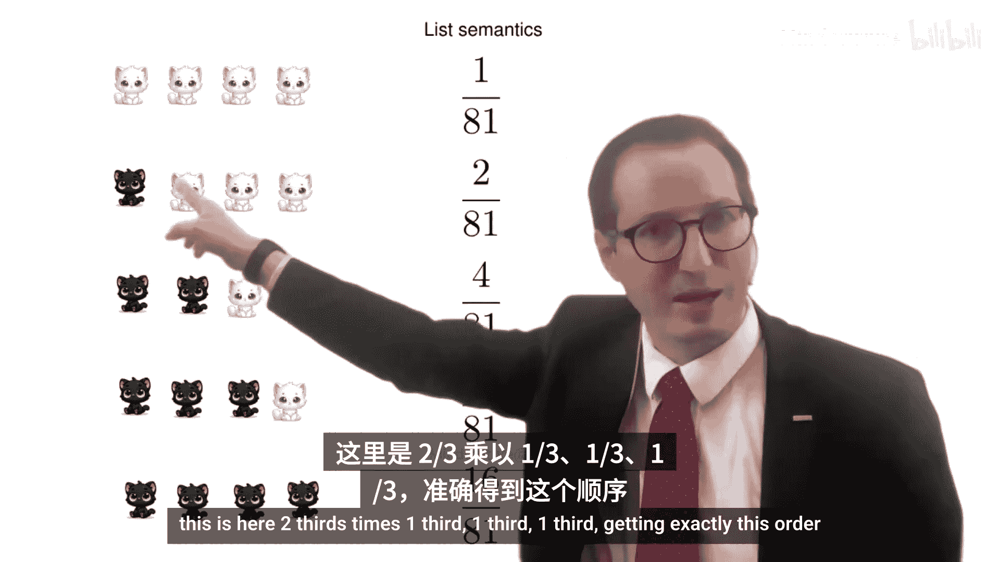

Getting exactly this。 then 20，2 third，1 third，1 third。 We get this。

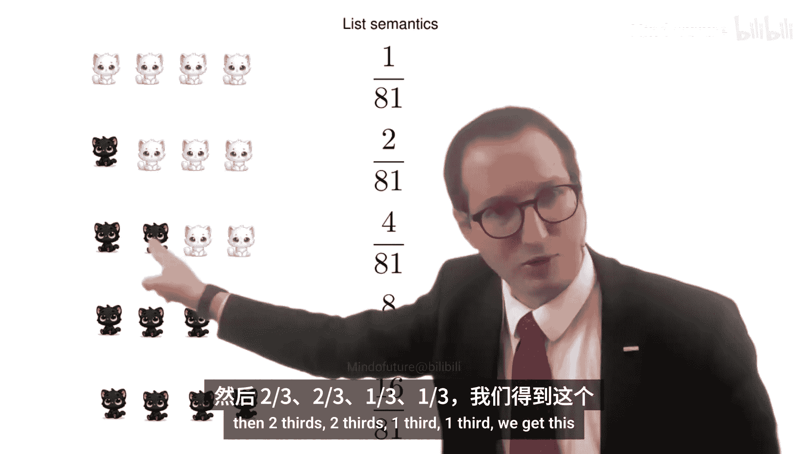

Then  two cells，2 third，2 third， and one third。 We get this exactly in this order， right。

 and then  two third，2 third，2 third，2 third， we get 16 over 81。

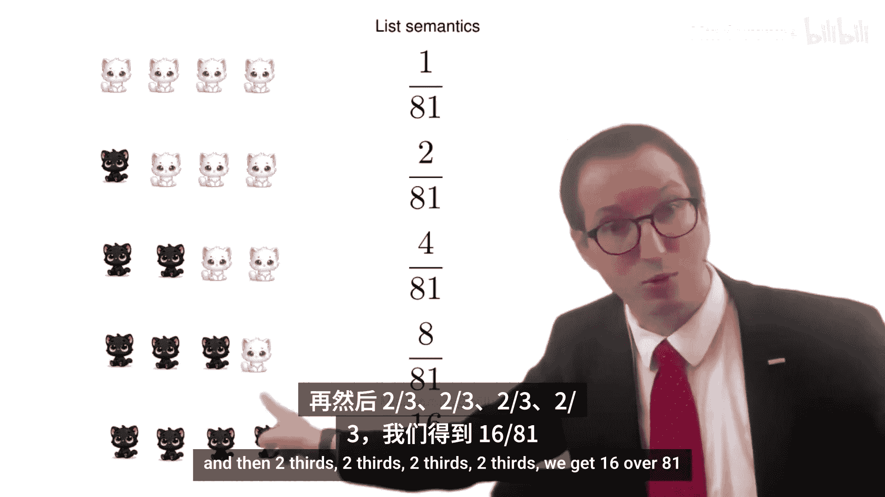

Do you agree， Who agrees with that。Okay， you notice it doesn't sum up to one， right？

And the reason it doesn't sum up to when is that I， I looked at the order。 And， of course。

 there's other possible orders that are not here。

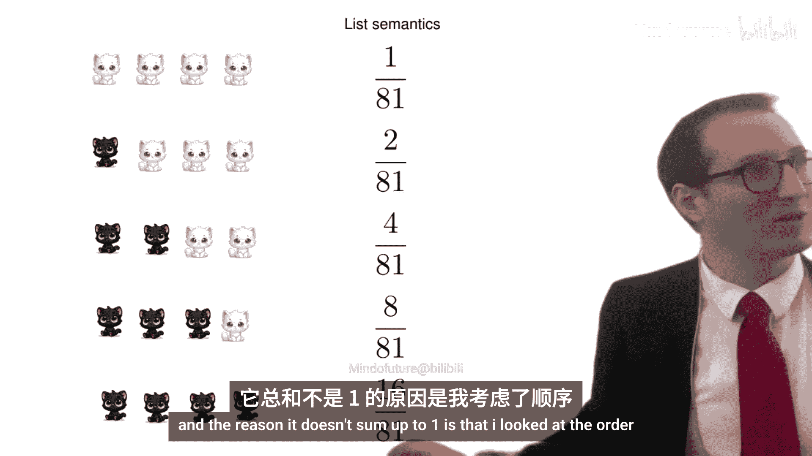

So that's the reason why it doesn't sum up to one。 For example， I could have a white， black。

 black white that doesn't appear here。 So this is why it doesn't sum up to one。 However。

 that is the least semantics probability， probability of exactly that order。 Now。

 I need a correction factor for all the possible orders that I can get。

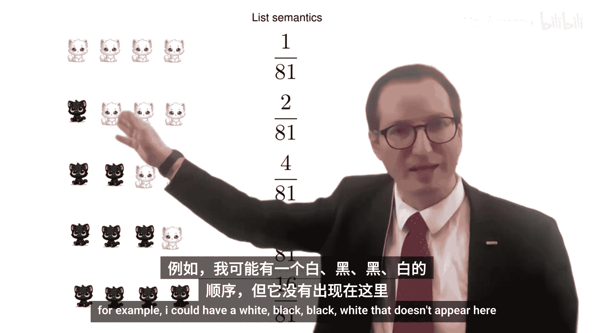

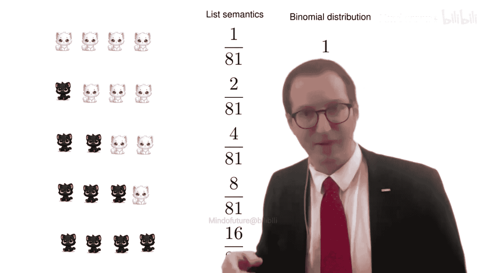

Which I have right here is the one fox 6，4，1。 That's exactly the one we got from here。1 fox 64。

1 is an older the procedure ordering。 I just group them together。

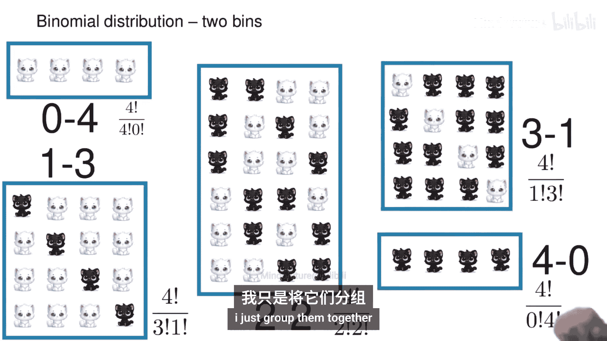

So I need the correction factor of my multinomial coefficient。

 And when I multiply with the correction factor， I get these probabilities。 Now。

 these are the probabilities for the bags。 So this is the probability of getting exactly all white cats。

 This is the probability of getting exactly one black cat and three white cats， but in any order。

 the probability of2 and2， the probability of one white cat and three black cats and probability of four black cats。

😊。

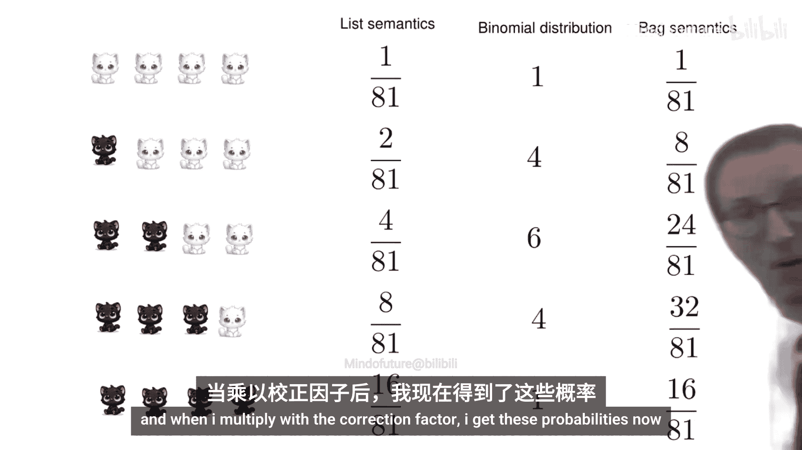

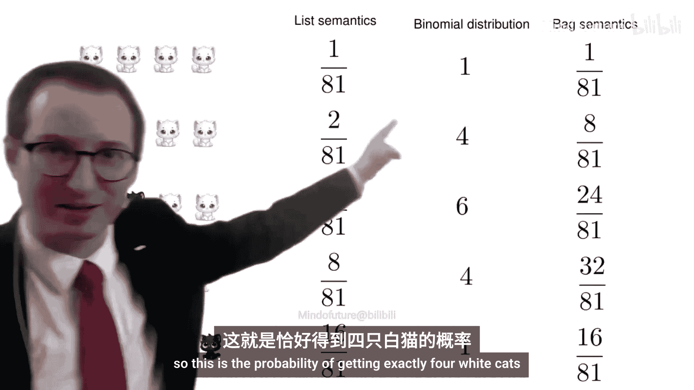

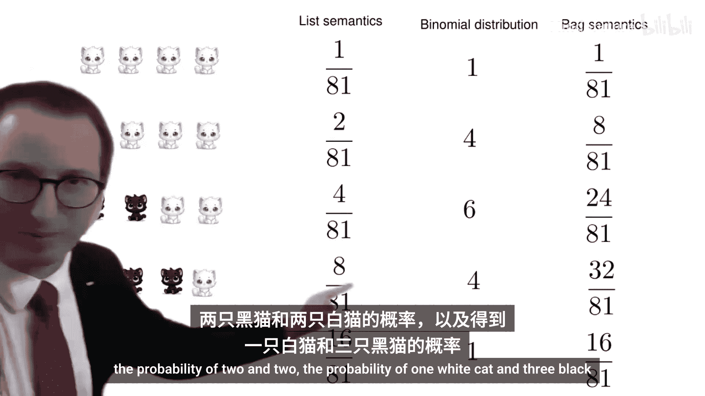

Do you see that the priority is now sum to1。

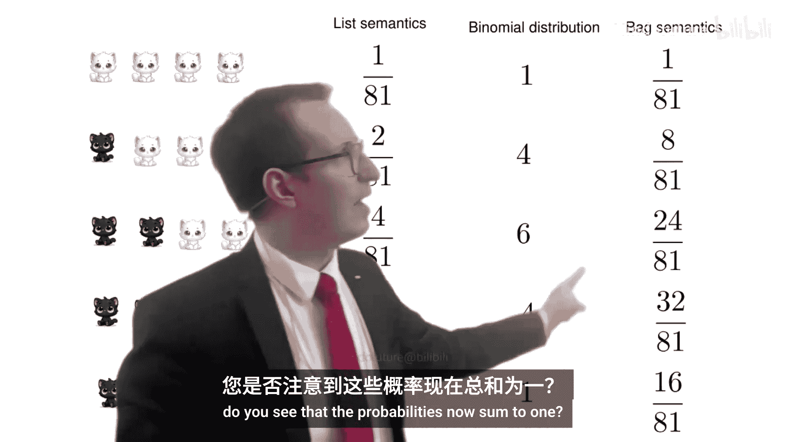

Because these are the only possibilities。 If you don't look at the order。

 these are the only possible distributions of colors。Okay， who' is with me？So， we've just linked。

The list of worlds or list of cats semantics to the bag of cats semantics。Okay。

 that's what we've done here。So。Again， the magic formula for the number of possible orders is this。

 It's the total number of cats factorial divided by the products of the number in each color。😊。

Factorial， that is the magical multinoial formula。 It generalizes the。

 the binomial one with n factorial divided by k factorial and minus K factorial。😊，Right。And now。

 if I。Nake We Mal jumped。And generalize what we've done with the cats for the specific cats where I had the two third。

 one third for the probabilities for each cat and a length of four。It generalizes to this formula。

 So I'm going to explain it。 But if I don't explain it， who already understands that formula。

Take a few seconds。 I see one race hand here。 Any else who already understands that formula。给。

Alright， so I'm going to explain it now。 And you will see it's actually exactly what I've already told you。

 There's nothing new here。 I just wrote a formula that。That does what we did。

Look at the product right here。The product right here is basically the probability of generating a specific color。

 black or white， that's T。 That's my term， right。But I have to put it to the power of the number of cats in that color。

 right， So P， T， for example， would be two thirds。Right。

 and I multiply two third for as many cats as they are with that color， for example。

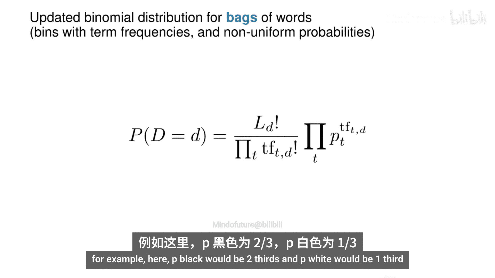

第二。P black would be 2 third and P white would be1 third。

 and I have to multiply P black here with itself。 so it's P black squared。

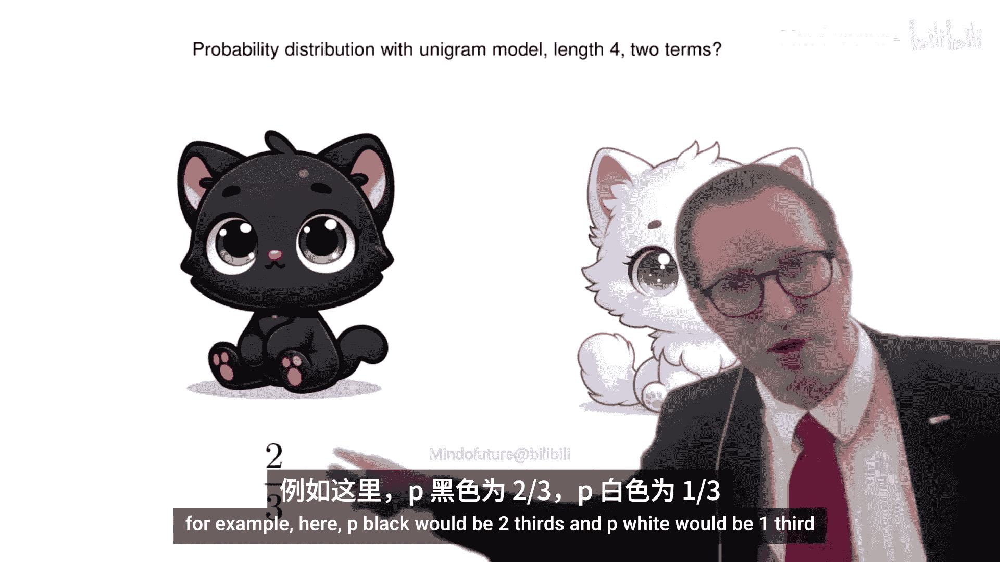

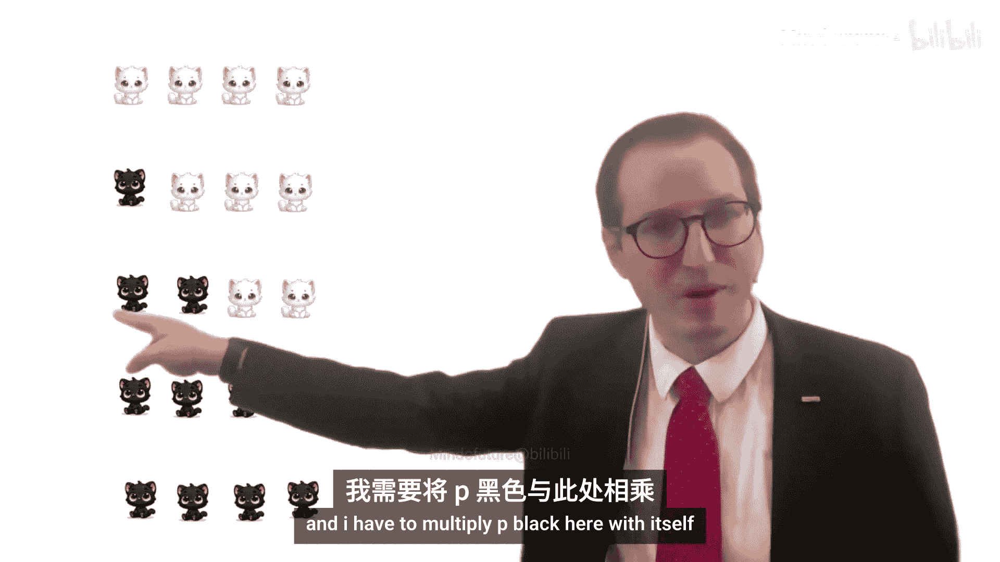

Keep black cube。Keep black to the power of four。

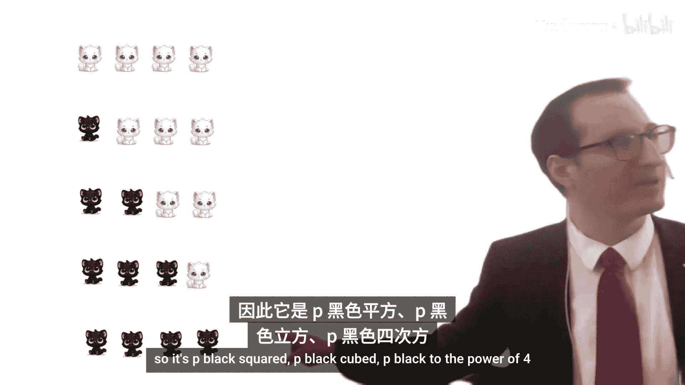

And then P white to the power of two to the power of one to the power of three。 right。

 So this is the multiplication we did here。 So if I go here， this is this multiplication。

 So that's P black to the the power of the number of black cats multiplied with P white to the power of the number of white cats with with me。

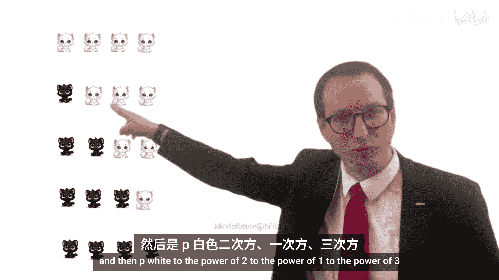

Right， so this is the probability for getting in a specific order。Right。嗯。

Knowing that I have a length， a given length。 And this here。

 you recognize is my multinoal factor that the number of possible ways I can order other cats。

 given the given the number of corals。 So I just multiplied here with that was the one fox6，4。

1 that I get with this， right？ So now I'm asking a question again， who understands this formula。😊。

Right， I see many more of you。 Okay， so look at it again， maybe your line。

 but this is exactly the formula that is known as the menomial。Distribution， right。

 It's the probability of you repeatedly generate cats in specific colors。 And then at the end。

 you ask， what is the probability that I generate exactly these numbers of colorss。

 which is the specific bag， right？ That is the multinoial distribution。No。

This is assuming that we have a specific length LD， right？This is a specific length。

 If I do not know the length， you agree。 I need to add the minus the。

 the P stops and the1 minus P stops， right。Yeah， I don't have the P stops and1 minus P stops。 right。

 But if I also want to compute the probability that it has that length， I would also need to add。

P stop times1 minus P stops to the power of the number of wells， L right。And so。

One more thing I didn't say because it was probably implicit。Is that the T F here。

Is the term frequency？RightIt's the term frequency of term T in document D。

But do you see that the term frequency is basically the number of cats。 So the term frequency。

 it would be let's say a color frequency， right， So。

 so that would be the color frequency of blue in specific documents。Right， so the。

 the term frequency is when I count the cats of a specific color。All right。

So this is the multinoial distribution。 And here， this is when I add my 1 minus P stop P stop。

SoThis is the probability。If I know the length， I know the length is L D。

 but if I do not know the length， I need to also make sure that I make it stop exactly after L Wells。

 So now this here。I if I don't know anything， the probability。Of generating document， small D。

Based on the number of terms that it contains。 So the bag of we saltics。

And every time you see that formula and you're lost again， then go back to the cats。 This is how。

 this is how you interpret the， the formula。

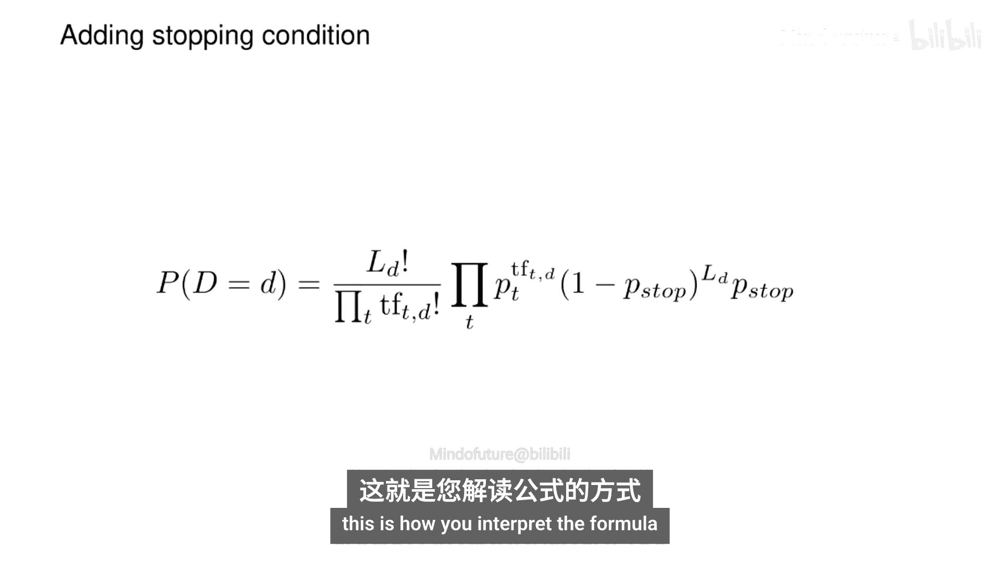

So that is the unigram distribution， very， very specific。 The unigram distribution。

 because you do have these bags that you can turn to the back of world semantics。In the general case。

 with by words or try words and so on。You basically can no longer do that。

 Then you have to care about the order。 If you say that the world depends on the world before it。

 then， of course， you， you care about the order because you， you need to to， to。

 to distinguish the world that came before。

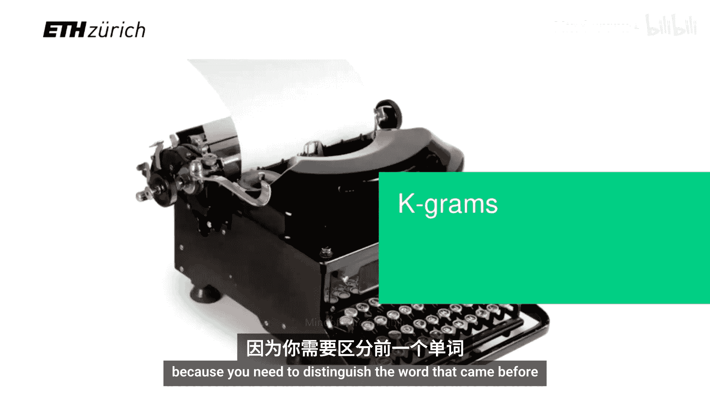

Alright。And so what that means， if now I look at the by world or bygram model。um。😊。

Then it means that my lookup table， the probability table。

 is a bit more complicated than the one I had for the unigram model， for the unigram model。

 it was just a one dimensional list。😊，But now， in the background model。

 the probability of generating a world depends on the previous world。Do you agree。

 It means that I'm going to have as many probability distributions as previous wells。 So。

 for example， I'm going to have a probability distribution。If the previous World was too。

And then I get that distribution。 Then I have another probability distribution again。

 if the previous word was be and so on。 that is a probability table that contains the probabilities of this condition on this。

Right， who sees that。Right，W who has ever seen a Bayesian network。

RightSo you will see Bayesian networks later。 That's exactly。

 So that that's basically a smooth intro to Bayesian networks。 When you have a Bayesian network。

 you basically have an a row that goes from a term to the next term。

 And this here typically is some transition table that that gives you the probability of generating generating a specific value based on a formal value。

 But don't worry， I'm not going to throw Bayesian networks that you。

 you have a lot of opportunities providing in your master to learn Bayesian networks。

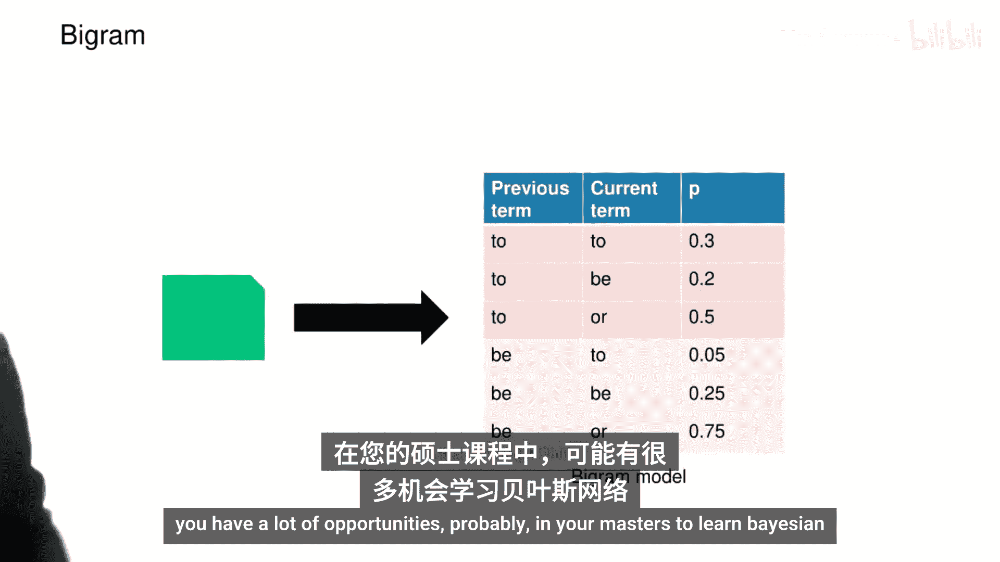

So this is just a lookup table of the probability of generating this term conditioned on the probability of generating this term and this sums up to one and this sums up to one。

😊。

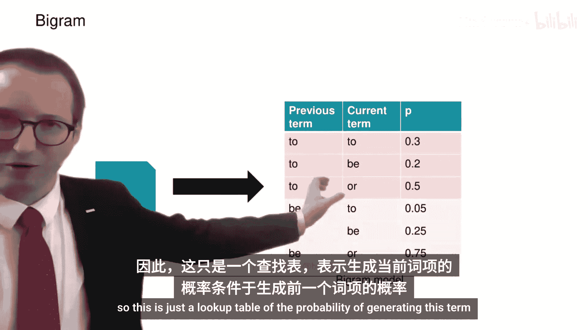

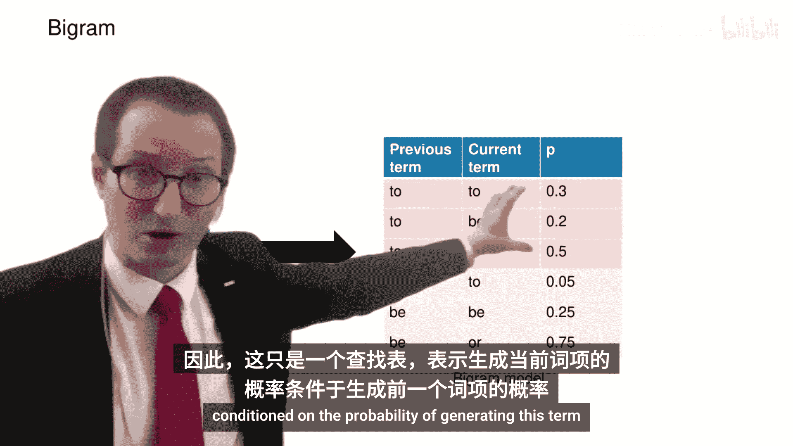

No， this doesn't。 That's just a typo。 It should sum up to one。 alright。

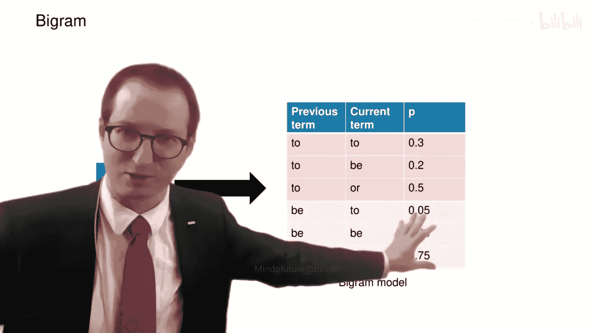

Okay， so that。I my updated formula。 And you see the only difference now that there is with the unigram model。

Is that now I have two worlds in the sub。 I have the previous world， and I have the current world。

 I have the previous world， and I have the current world here for the first world。

 I only have the first world， but that's conditioned on， you know， that is the first word， right。

 So that's why it's only one in here。 Allright， And these numbers here。

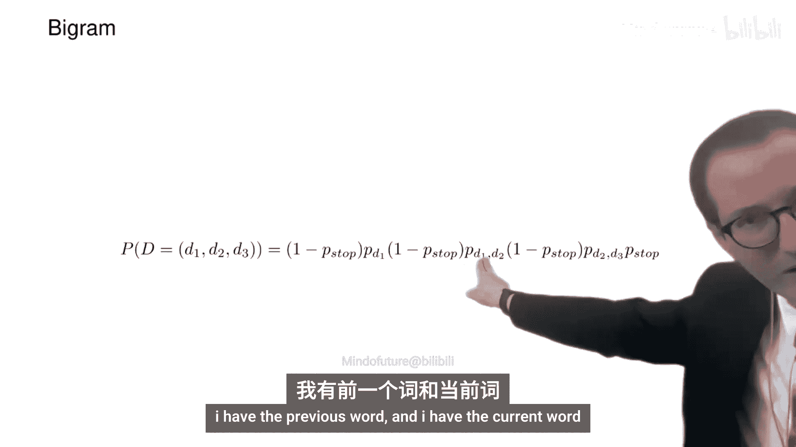

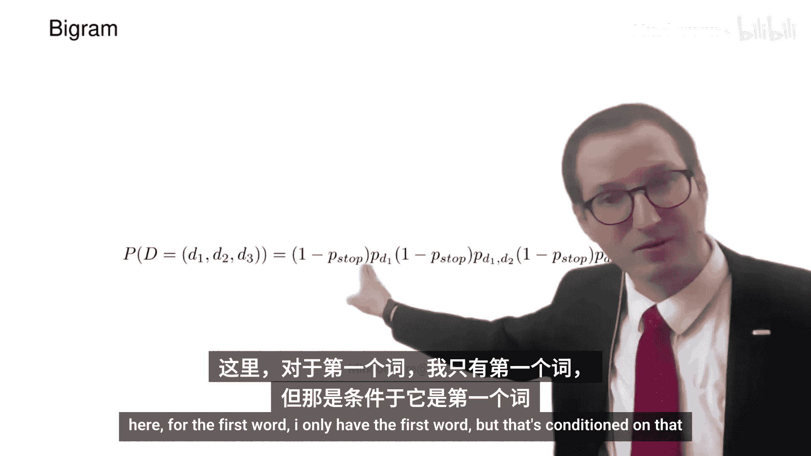

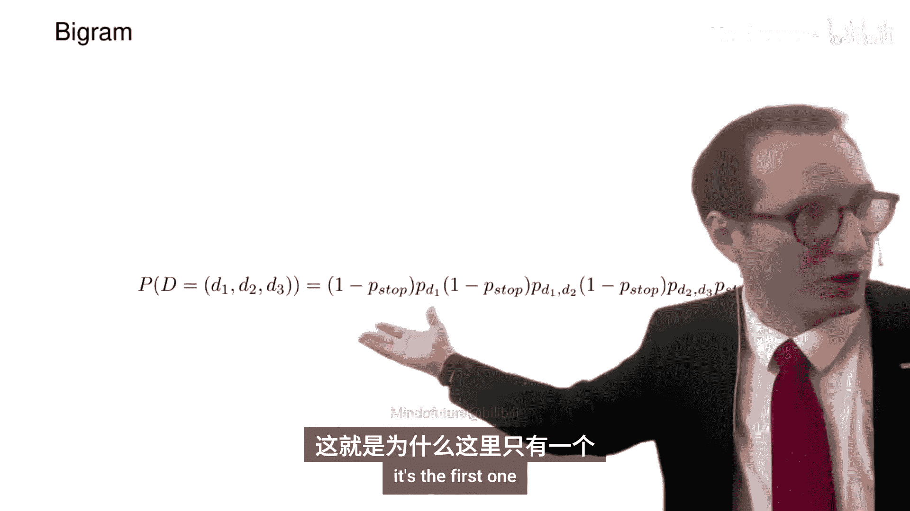

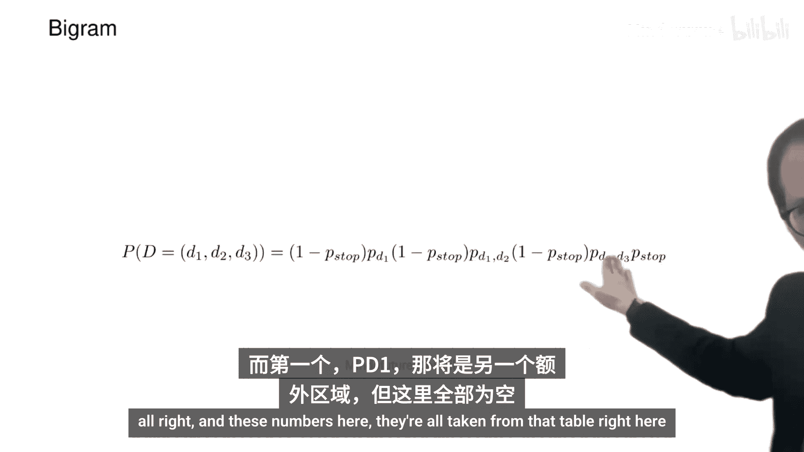

They' are all taken from that table， right here。And the first one， the， the， the PD one。

 that would just be。

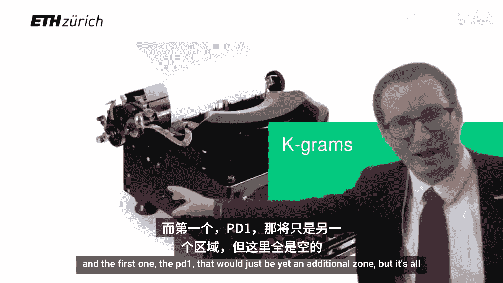

Yet an additional zone， but it's all empty here。 That's when the， the previous term doesn't exist。

 And then you have also a probability distribution for the first one。Any questions so far。Ws with me。

All right。So that's the probability formula。But now。That we've done all of this。 You might ask， okay。

 why are we doing all of this， Why are we generating documents。

So do not forget that this is an information retrieval lecture。 so we want to。Search for documents。

 And we want to find documents that correspond to a specific query， right。

 If I go back to the the goal that we have。And so what I'm going to do now is show you a technique。

Just like we did for the probability seeking information retrieval。

 the trick with the errors and probability of， of relevance of a specific document， given a query。

 I'm going to give you yet another trick。 But based on these language models that we've seen。😊，So。

Imagine this photo experiments。We are going to take all of the documents of the collection。

 There might be billions of them。And we are going to ask the little left in Antarctica to generate a model for every one of these documents。

 How do you do that， You look at the term frequencies statistically。

 So what are the the distribution of terms in every document。And out of these statistics。

 you turn it into a probability distribution， right？ So for the unigram model， it's easy。

 you just take the term frequencies and renormalize with with the length。

 and then you get one dimensional probability distribution。 Now， if it's a bygram model。

 it's a little bit more involved。 But still， it's easy just a few lines of Python right for doing that。

 you just scan through the byword and you generate your conditional probability tables based on the term frequencies or the frequencies of the pairs of words。

 So basically， you generate a model for every document。

 So that means that every document gives you a model and you can then use that model to generate new documents that look like that look like the first one just statistically that because the probabilities were taken from the frequencies in the document。

😊，So we do that for every document。In fact， it's quite fun to do。 So now， of course。

 now that we have L L L and chat GT。 It's a bit less impressive。 But back then， it was impressive。

 I think the first time I saw that was in the in the 90s， but it was probably even before that。😊。

That we now tell Ls。Just looking at the term frequencies or the frequencies of pairs or triple platets and so on and building models like that。

You can just generate documents。 So， for example， with onegrams。

 you just look at the term frequencies， Uniigram model， and you just。Toss a coin for every world。

 But without looking at the past， and you get something like to him swallowed confess you both which of save on trade4 a device and road life have he he speaks or a more to let less first you enter。

😊，I didn't get anything of that。 But again， that's a unigram model。 There is no connection。

 There is no order。So， of course， that， that that that doesn't sound very human generated， let's say。

Now， if you go to a diagram model and you， you look at now the， the。

 the two world windows and you generate the conditional probaities。 So again， you look at the。

 the term frequencies， but conditioned on the previous term。

And so if you try to do that and you bid this probability table right here based on the frequencies that you have in your documents and you do it with Shakespeare。

 then you come out with why do stand forth that I cannotopy for sooth he deppably hit the King Henry。

 leave King Fo what means sir I confess she and also his dream captain？So now you see。

 it still doesn't mean much， but you still see a connection between the world now， right。

 You still have the think that a world follows another world in a more logical way。

 Then you do it with three， fly and will read me this news of Christ。

 Therefore the sadness of parting， as they say tis done， this shall forbid it should be branded。

 It ren made it empty。So now we are getting closer。 Al right， It starts sounding。 You。

 you still don't get what it says， but at least it starts sounding a bit like it making sense。

 And then you increase for Ram's King Henry。 What， I will go seek the traitor Gucester Ex some of the watch a great boque Arin。

 It cannot be that。 so。😊，Right， and imagine there were no LLMs， right， decades ago。

 we were doing that。 It was quite fun。 And you actually get text that kind of sounds natural。😊。

And you could also do it with music。 I remember who， who read the Gudes Charba。Dokaov Sha up， Nobody。

 you should read it Goodba。 He got the put ititzer Pri with that book。

 It's about the the Good theor and and you know， theoretical computer science。 Let's put it。

 But it's really a masterpiece。 So Guba。 And the author of this book was giving talks where he was generated music。

 So instead of words， He was doing it with music notes。 And he took Ba all the competition by Ba。

 And then he just created a model and generated music。 And he just came out。

 And he made a vote like who thinks this is the Bah piece And who he。

 who thinks this is the piece generated by the model。 And a lot of people got it wrong。😊。

That was before LLMs。 Now we we do that， of course， with more me models， which is much more precise。

 and it foods us even more than it used to。 But yeah， allright， So you see。

 this was prechat GT pre LLMs that we could already generate with quite simple code。 You can really。

 I'm pretty sure you can do that in one hour。 You see it in front of a computer。

 You take Shakespeare shallow cons。 you can program that in one hour of your time。 Pret sure。😊。

Who feelss they could do it。Right many of you are right， So it means you're on the host， all right。

Okay， so now， of course， we have the luxury of having chat GT and a lot of things change。

 And now they they actually， it seems a pass duringuring test now because we can no longer tell them about。

😊，So that was charge GT 3。5。 This 1， I actually managed to to fool because it actually came with a definition of ver flight or Dutchch。

 but charge G T 4 cannot be fooled anymore。Right， now it's it actually has a bit more。

More we didn't call it reasoning， but was a bit more powerful， okay。

And it seems that the new one actually， again， got fooled。 So I， I think there was a。

 there was here a bit of a loss with4 compared to four that this one actually again。Good food。

 But anyway， you see the evolution， right， This is really decades and decades and decades of evolution。

 And for these， the LL Ms， you will need to go to the LLM lecture when it's offered。

 And then you can learn how we actually can build these things。😊，With the modern means。

But coming back to my information retrieval system。Now， I have these documents。

 I generated a model for every document， and that model is able to generate new documents。😊。

So now here's how I built my system。 The user just wrote a query in the in the in the website。

 in the query box， they wrote a query that I'm going to call Q。Now， imagine for a thought experiment。

That we picked a document at random。In the library， there's billions of documents。

 I picked one at random uniformly。And I built its model。

And I generated the document out out of this model。 And now you won't believe it。

 But what I generated turns out to be Q。I was lucky， I just randomly generated Q。

And knowing that I told you that， I picked a random document， turned it on。

 ran a generation of a document and happened to find Q as unlikely as it seems。

Then I'm asking you the question， given that。What do you think was the document I chose。

What is the document that is the most likely to just so happen to generate Q， right。

 the highest likelihood。 that is the thought experiment。 So， of course， we cannot do that in reality。

 right， except with ourels in Antarctica， they can generate them for all the documents。 But again。

It's a third experiment。So now， we have a problem。That we need to condition on a query queue。

Find the document the most likely to have generated it。 That is complex。 In fact。

 that's just like asking if I have my umbrella what the probability that that it's raining， right。

 And what do we do when we have a complex condition， conditional probability to compute。 And we。

 it's too difficult。 What do we do。Who knows？ I with not ask， But who knows what we do。Okay， let。

 let's take the break。 You can think about it。 I'm pretty much your you going to guess that。

 So let's take a break。 And5， in 15 minutes， I'm going to tell you the solution。

 right of how we compute this， the， the the likelihood of a document to generate a query cube。😊。

So see you in 15 minutes， thank you。😊。