# 【苏黎世联邦理工学院】信息检索-｜-Information-Retrieval-｜-Eth-Zurich-2025-p30-P30_11._语言模型_(3_3)--BV1ndsBzdEss_p30-

Previously， in retrieval。A user typed a query in the soft box other websites， that query is called Q。

A little Elvin Antarctica picked a document at random in the entire library of documents。

Generated a model I would have of that document by writing a Python script in an hour to。

 to build the conditional probability tables。Use that model， generated the document。

 and then the incredible happens。 The F just regenerated query queue。 What are the odds of that Incr。

 right？ And so we asked the question。😊，What document is the most likely to have been picked and to have generated Q。

 So it's a conditional thing condition on the fact that you've been informed that the document that was generated was Q。

What document has the highest likelihood of of having generated having generated hit Q。

Do you see that this gives us an information ritual system because if we are able to to compute the probabilities that it was a specific document D and we order them。

By descending probability， then we have just built a system right that And we just return the documents that have the highest probability。

And so this is called the query likelihood model when we build a system like this and concretely that was my puzzle before the break。

 when you have a conditional probability that is difficult to compute。

 you use the magical base theorM to just swap it。😊，So in that case。

 we want to know the probability that it was document small D。The one we want to rank， right。

 we are going to compute that for every document small D and and then the order by that。 But I pick。

 let's say a specific document。Condition under query Q， but I have no idea how to compute that。

 but with the base formula I just swap them it's the probability of generating query queue given document D multiplied by the probability that it was document D divided by the probability that it was query Q right Do you agree with that That is just the base CRM。

😊，But now the incredible happens because this is a constant。This doesn't depend on the document。

 right， so I can just get rid of that。 That's not going to change the ordering。This。

 we can just consider its uniform， right， that a priori。

 any document is just as likely as any other We speak randomly。 So this。

 we can just consider it the one over the number of documents。Which leaves us with this。

 But this is great because that we know how to compute。 I spent an hour explaining this， right。

 with this multinoial distribution and all the chain probabilities to generate。

 So that I know exactly how to compute。 This is exactly what we have done in this lecture。

 And here is the formula。 if you remember that that's my big， scary multinoial formula。

 So I took multinoial， the unigram model as an example。 I could， of course use by gra trigram and so。

 But I just wanted to stick to the unigram model。😊，But you notice a bit of a difference with before。

 they are some letters that have changed。And the letters that have changed。R。Here。😡，It's cute now。

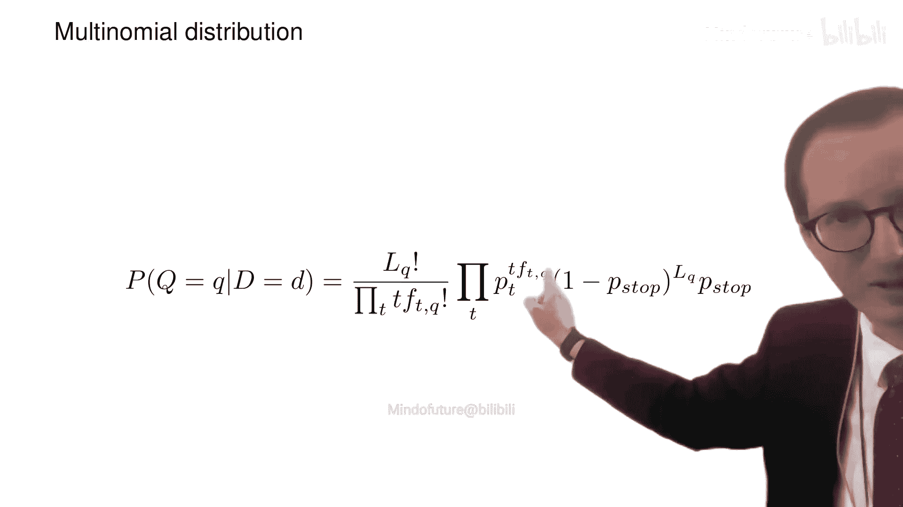

In the previous formula was D， But that's only because that's I I I used to call it D what I was generating。

 Now I'm， I'm looking at the probability of generating Q， right， So， of course。

 I need to look at Q in order to have the probabilities。 So Q， imagine that it's a bag of cats。

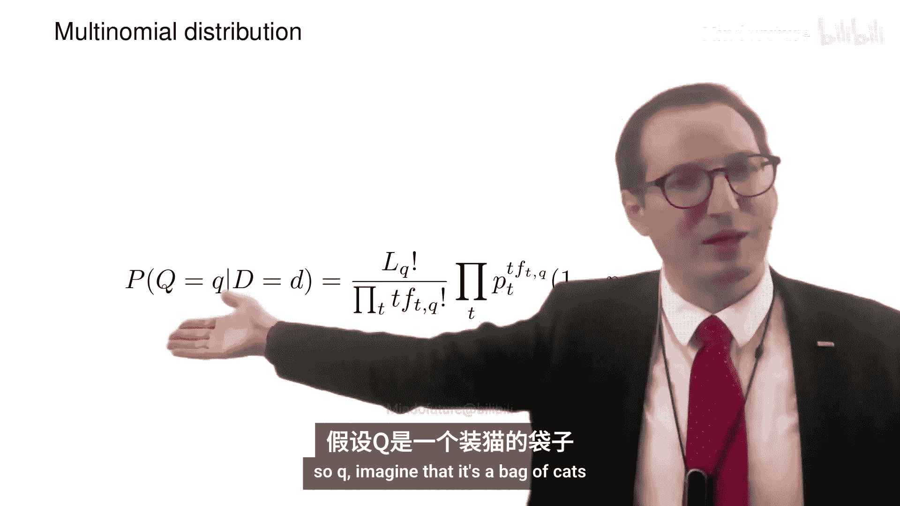

And then I'm looking at all the possible colors in there。 So as a bag of cats。

 And then I'm multiplying the probability of every cat to the power of a specific color。

 to the power of the number of cats with that color。 So that's my formula of B， right。

 But it depends on Q because that's the query that I I want to， to compute。

 what's the probability of generating the query， right， So this is why I have Q in there。😊。

Where does the document intervene in that formula。Well， that gives me T T。

 the probability of specifically generating。A term comes from the term frequency analysis of document D because I use document D to generate my model with with me。

Right everybody， so I use document D。 I beat the probability table out of document D。

 and then I look at Q and then I compute the probability of generating Q based on the probabilities that I infert from document D and then of course P stop and again that's L Q in here because we want to make sure that we generate Q。

 So it has to be exactly the length of Q。😊，Now， P， as I said。

 was generating generated out of document D， and in fact。

 I just divided the term frequency of the term divided by the length of document D right that's the easiest way to use statistics to compute probability out of a document。

 so careful this is why I have D in here because I use document D to build my probability weight。

But I'm computing the probability of generating document Q。We stayed with me。Right。

 it's mess of level now， right， So it's pushing a bit farther。 So this is。Basically， the big formula。

That I want to evaluate for every document。 So I'm going to compute that a billion time for every small D right Q。

 that's whatever the user I entered in the search box that doesn't change。 But D。

 I'm computing that for every documents。 and then I'm going to rank the documents based on the value of that。

 the documents that give me the highest value here。Are going to be ranked first。And then， decreasing。

Now。We are going to do a little bit the same sort of things we've done with probability seek retrieval。

 I'm going to cook a little bit here and try to turn it into something that looks a bit like evidence accumulation。

 And then we'll see what comes out of that。嗯。So first， you remember that here I have a big product。

 But when I accumulate evidence， I like to have sums， right， How do I transform a product into a sum。

 I take the log。 So we are going to take the log of that。😊，And that's what we get。And now。

 just like I did for probabilities， I'm going to look for what is constant and what is not constant。

 right， because I I， I might be able to get rid of some of the things in there， Right？

 And so if you look in here。😊。

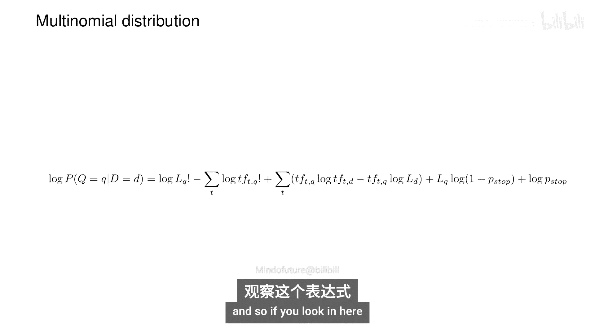

What depends on D and what doesn't。That doesn't depend on the， right， That's just a constant。

 We don't care for this sort thing。 That is also a constant。 So we， we， we。Don't care。Here。

 I need to be careful。 There is D。 There is D。 So this is not constant。

 That's going to change with the document。 This is constant。 There is no D in here， no D in here。

 no D in here。 This is all constant。 So the only thing that's actually not not constant is this。

 right， So I'm going to put all the rest in C。 That is a constant that doesn't change with the document。

Plus， my son， because now I have a sum。

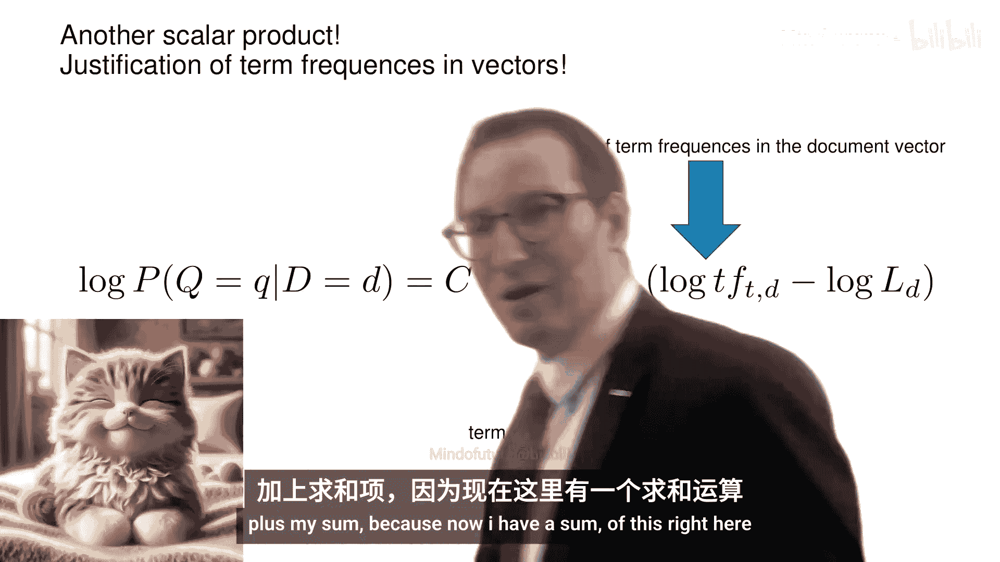

Of this。Right here。

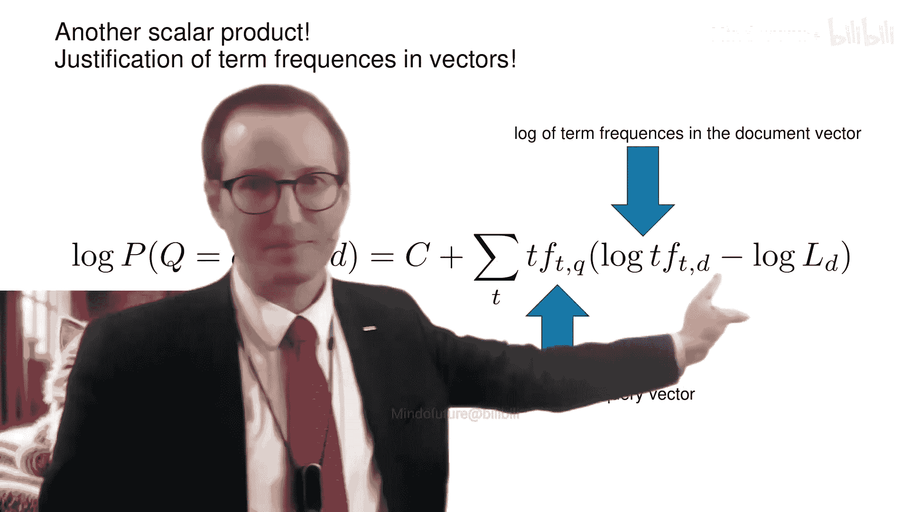

嗯。And now this is where it starts to look really， really cool because now you're probably starting to connect to connect a few dots with what we've done before。

 This is a sum of products。😊，Of which the first factor depends on the query。

And the second factor depends。On the documents。This is a scholar。Product。

What do we have in this kind of product。We have。A term frequency。For the query。

 we've seen that before， right， in the vector space model， we had a term frequency in the in the。

 in the in the scala product。 And here I kind of have a term frequency， too， but I took the log。

But that also we've seen before。 Remember， in the smart menu， I can select something different。

 I don't have to have the term frequency。 I can also have the logo of that。

 I have all kinds of variations。 So basically， what I see here is basically just a scal products of some vectors that are based on term frequencies。

We have just reinvented or rediscovered the vector space model。

With the justification now that we use term frequencies in the vector。

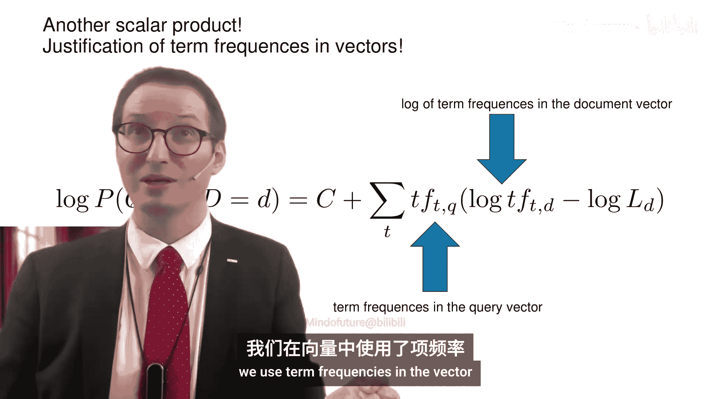

This， we can， you know， put it separately。 We can， I don。

 we can maybe assume more documents have the same length or whatever or。Get re。

 But this is really the focus right here。 This Who sees that it's a sca product。

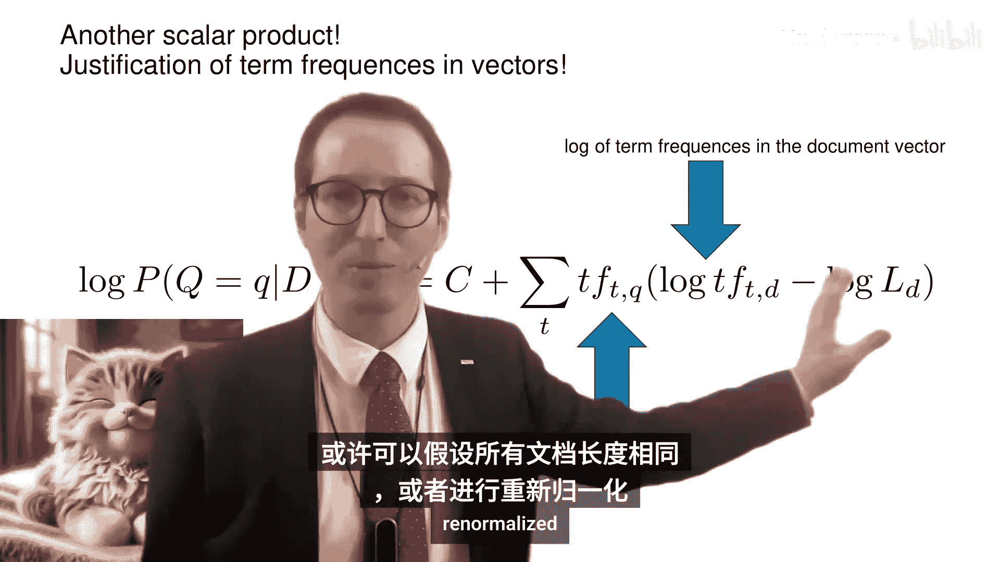

Right， this is exactly my evidence accumulation and that I can compute in exactly the way that we've seen before。

嗯。😊，So， now， if I。Get back to what we've done two weeks ago。

We have discovered that probabilistic information retrieval after doing a bit of cooking with the Bayesian rule and probabilities of relevance。

 And we got the IF out of the hut。And now we've done the same thing with with language models。

 And we've got the T Fs out of the hat。 right， So it， so it's all connected。

 Just gives the justification for the T F I Ds， right。😊，And so this is why the vector space model。

 in a way， can be considered as a kind of system that is based on language models。

 The justification for the term frequencies being the idea that the term frequencies gives you the probabilities of generating a specific documents。

 That is the high level idea， right。So。有。We to delight to， to。

 to see that we land back on our feet and find exactly the factors that we've had before。

 So I feel just like that cat over here， seeing such mathematical。😊，Beuff fiction。All right。

 so priority seek models， IDF language models， term frequency。

 and we get the TF IDFs that we had in the vector space model。😊，Then there's a few variations。

 But again， that's part of the smart menu that that we've seen before。 this idea of smoothing。

 So imagine that you compute your TF I DFs and then in further probabilities， for documents。

 then you're going to run into the issue that I mentioned before is that a document might be too small。

To generate anything， for example。You might have a query information retrieval。

 and then you might have documents that do not even contain information of retrie or retrieval。

 right， And if you build a model based on the document that does not contain information of retrieval。

 then what probability do you get for these terms，0， right， termm frequency is 0。

 The probability becomes 0。 And so the probability of generating the query is 0， right。

 just because the document was too small and， and， and and a lot of probabilityities are 0。

And so when we have a sample that is too small and would give us probabilities that are0。

 we can smooth it a little bit。 And you remember， we just add some constant a little bit everywhere。

 And this is what some people do。 So they basically take this term frequency evaluation but they smooth it a little bit。

 not with the constant。 You could do it with a constant。

 But another idea is to smooth it with the collection frequency。

 So you look at the collection frequency in the entire collection。 And then you take some。

 it's like cooking， right， So you cook something with a bit of the term frequency and a bit of the collection frequency。

 And that takes care of the smoothing， transforms it into something a bit more smooth that's going to not have too many zeroes in the probabilities with with me。

😊，So we just tweak it to lit bits to nudge it in the direction of the collection frequency。

That is the query likelihood model where we generate the models from documents。

There's other approaches that I will not go into， but just mention that some people do it the other way around。

They generate a model based on the query。And then compute the probability of generating each document based on the query。

As you can imagine， this one is not tricky because the query is very smaller right。

 The query might just have a few words。 So how can you generate a model out of a query， but again。

 it' smooth if you smooth with the collection frequency。

 maybe you can manage to get something out of these right But this other approach。

 which I'm not getting into， is called the document likelihood model right？

 Then you don't need the Bayesian formula anymore because you directly compute the probability of generating D with this scary formula that I've shown you with all the scary factorials and products and so on。

 And finally， there is a third approach。😊，Where you generate both models。

 you generate a model for every document， you generate a model for every query。

And then you compare the models。 You， you look at the distance between the models。

The documents whose model is closest。To the model based on the query is rankged I。Right。

 how do you compute distances。Quick example。 imagine that what characterizes the model is the probability weight。

 right， in the unique gra case， that would be the probability weight。That， basically。

Comes down to computing the distance between two probability distribution right And so there are formulas。

 magic formulas that give you the distance between probability distribution and example of that is that you computes the absolute difference between every possible value and then you sum of that and then you divide by two that gives you an example of distance is going to be0 if all the probabilities are equal and it's going to be you1 if they are as far away as they can be so basically it would be the case that the supports of the two probability distributions are completely these joints。

But basically， there are ways。 So you can compute the distance between two probability distributions。

 And then you would， you would get yet another， yet another way to build。嗯。Information， retrieval。

Engines and press and I press， there was no more slide。

Because you have made it through the entire material of the semester。 This is it。

So congratulations on that， especially because the probability seek and and language models was already more advanced than the than the rest。

 But at least now we know Y TF， and we know why。😊，Idf。嗯。

So I'm going to stop for a few questions if you have any questions。

 and then I will ask you questions。 Well just use a bit of the time left to to rehearse a bit。

 Do you have any questions。Anything。Well， then I repeat a question that was asked during the break。

 Then you can still ask a question after that， but just because somebody asked。

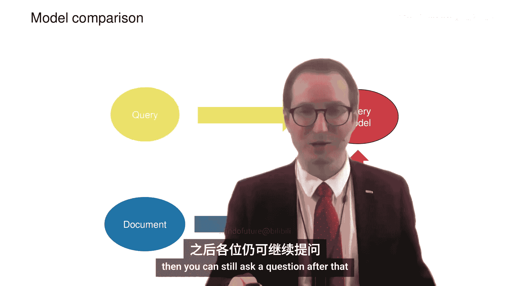

And it's important that you understand this in this formula right here。

 what's important is to understand that the product here is just on this。 This is what we multiply。

 This here on the right is separate， right that that is not in the That is not a factor of the product。

 So you have to cut it in here。 and the product is just just this。Any questions in the meantime。

Wu understood what I've been telling you today。Okay， many reasons， awesome。So great。

 So I will ask you questions。 Then I go to the to the clicker and， and I see。

 So maybe some easy ones。 Then I'd give you more of a challenge。😊。

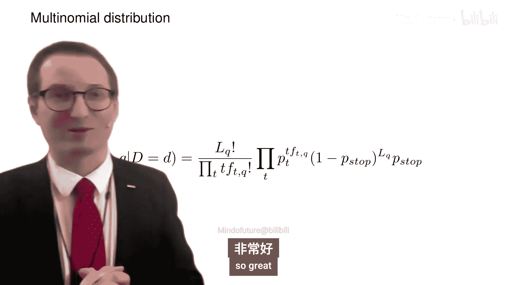

So。You prepare it。Okay， let me start with an easy one。

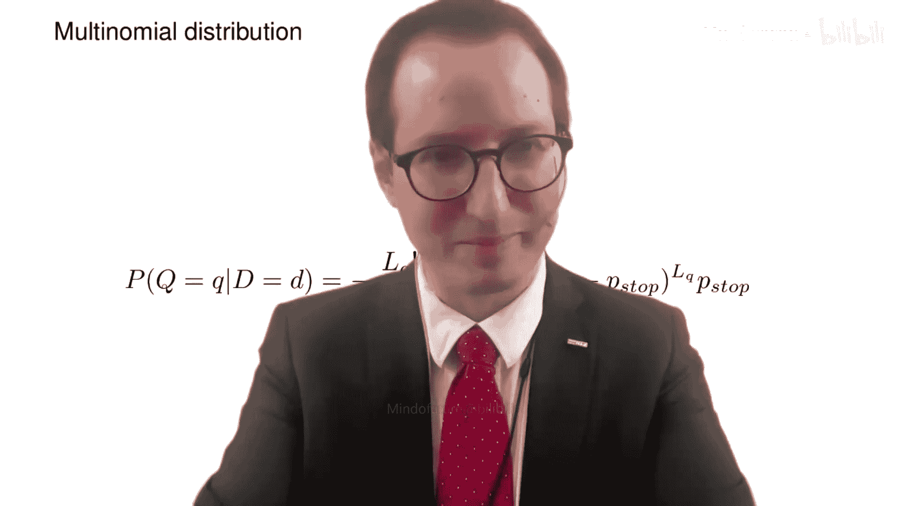

So what fundamental rules of probabilities did we use and apply to information retrieval。

 based rule the partition rule， the Peon hole principle or the addition law of probability？

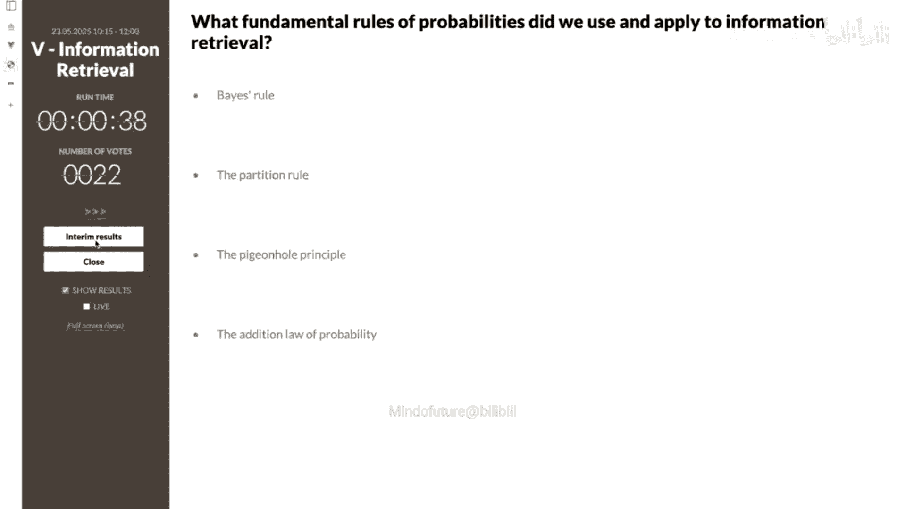

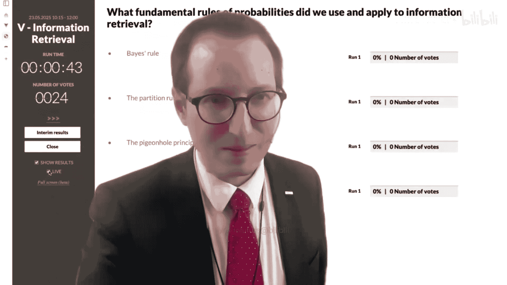

And indeed， so the bias rule， this is the rule that you use when you're completely star and you need to compute conditional probabilities and have no idea how to do it。

 There's a good chance that the bias theorem is going to help you。

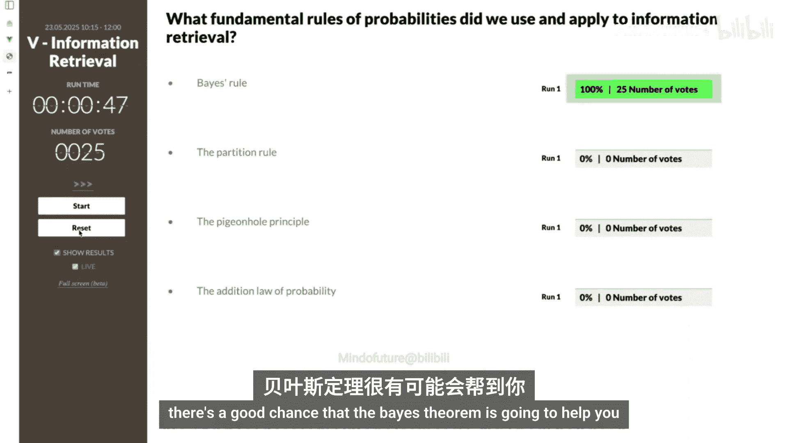

Okay。It's had another wind。嗯。Okay， let's go to this one。'cause it's actually different。

 And you can think of it a bit。

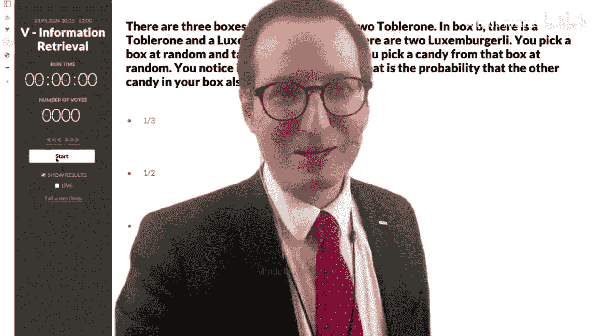

So I'm giving you three boxes。In the first block， they are twotoble。In the second box。

 there is Luxembourgga in box C， there are two Luxembourgga。You pick a box at random。

 one of the three。And then you go home。 and at home， you pick a candy without looking in the box。

 you just pick a candy randomly in that box。 and you notice it's a looksambogarity。

 And the question is， what do you think is going to be。

 what the probability that the other one is also looks embogarity。

You probably know what theorem you have to use， right？

But the difficulty here is the modeling because you you of course， we need to use the base theorM。

 but you need to know with what random variables。 This is the difficulty in here。

 wet random variables。Do you use。I already have 10 on cells。 R， that was so fast。

I would never have sold that so fast。 Did you guess， Sir。Estimate。Who is actually calculating。

 writing down the best awesome， perfect。😊，That is called the B paradox。 This problem right here。

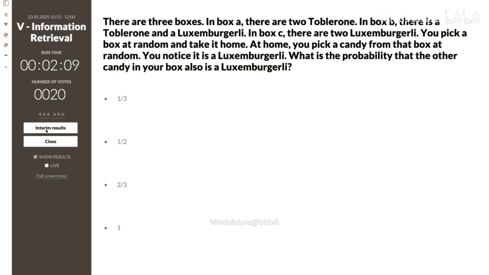

Let me look at your own selfelves。Oh。

So we have a majority one half。So maybeイビ lookさんが maybeーね。And we have 9 people who said。Two thoughts。

So basically there's， it's a higher likelihood that it's a luxembo than of being a topero。

Really give the solution。 I see no more， no more answers。The solution is。Who else。But， of course。

 they have a。An animation for you to show you why and how we come to two third。

So these are my three boxes。😊。

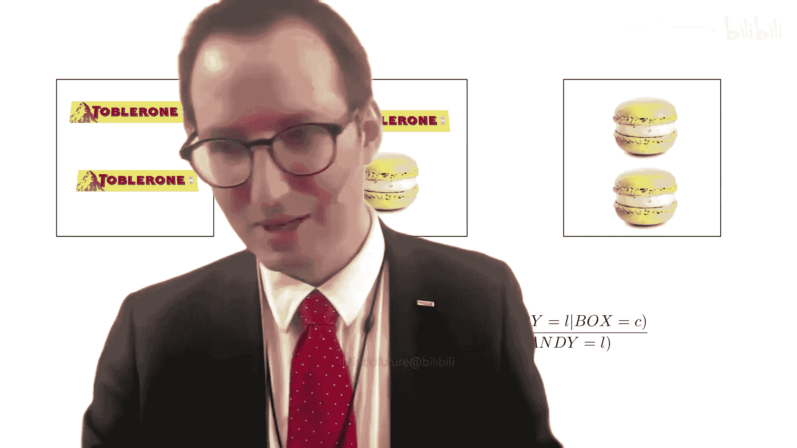

So you have the first box with box with Tutoleerone。 The second one with We reach。

 the third one with the Luxuxembourggali。And at the bottom。

 you see my two random variables that I use in the base formula。

 So I have a first random variable that that contains the box A， B or C， right。

 So that's a random variable that can take one of three values。

 So then I can write the probability that the box is a or the box is B or the box is。😊。

The other probability， the other random variable that I have is whether the candy that I have that I took out of the box。

 either。Touberone or Luxembourgg， right， So this one is a binary。 It's either Toblene or Luxembourgg。

And once you have these two random variables， you agree that what I'm looking for is the probability that we are in box C。

 given that the Cananddi are Luxembourggali， right。

 it's an equivalent way of saying that the other candi is also Luxembourggadi。

 because only box C would give me Luxembourggali as the other one。 Do you agree with that。

So I need to compute a probability that we have box C conditions。Under the Ken he being axembourg。

 but that I don't know how to compute。So I used the base formula and I swap them。And I have the cat。

 the probability of having a candy condition on the box should be easier。

 And the probability of the box probability of the candy。

 So what is the probability of getting box C。When felt。

 exactly because I picked the box as random them， Right， So when felt。

 what is the probability of picking a luxembourgly in box C。That is one， absolutely。

 because both of them are luxembogoli。 So that's one。

 And what is the probability without any condition， right， of picking a luxembourggoly as a candy。

1 half exactly， because I have three luxembogani and6 candies in total。 So it's one half， right。

 without conditioning or maybe any any box and and anything。 That， of course。

 is only true because the box have the same number of candies in each， right。

 if if that hadn't been the case that we could have said that。Alright。😊，So。I just replace one third。

 when，1 half。And。😊，I get two third out of that。And you can even see it visually when you when you apply the condition that it's a Luxembourg earlyli。

 you're in one of these three cases and in two thirds of the cases， you are in the third box。

 right that's just the visual that corresponds to the application of the base rule。Alright。

 so that is the bathroom。Paradox， and its two thirds and not one half as one might。

Have thoughts priori。All right。

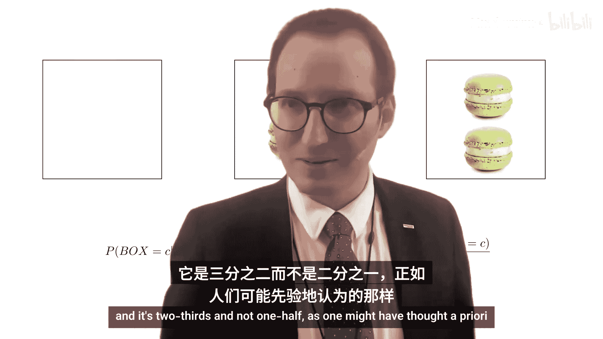

嗯。Let me give you another one。哦 no。都。诶。

Let me see。

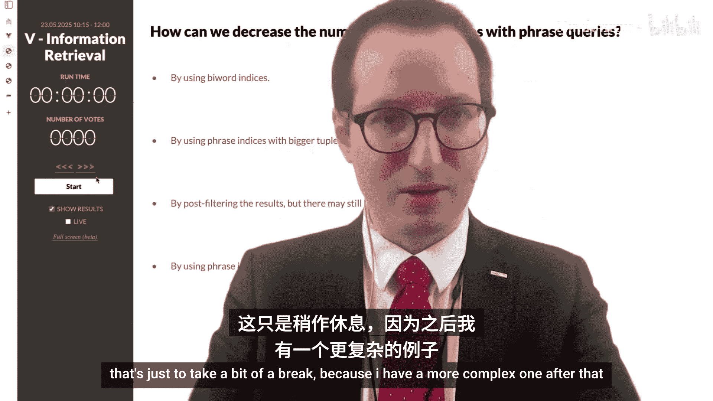

That's just to take a bit of a break because I have a more complex one after that， do you remember？

How we decrease the number of force positives with phrase queries。Right， if we use a by world index。

We might get force positives。 So results that actually do not match the query。

 Do you remember how we decrease the number of force positives。

Do you need to increase the upperpper size， reduce the upperpper size post filter。

 but not eliminating them completely。啊 okay， okay， okay。Okay。

 the correct answer is actually this one。 You increase the size of the the window， right。

 the number of to that's going to reduce the positives。

It's not incorrect that you can eliminate them by post filtering the results。

 That's not the problematic part。 It's the fact that then there are no more false。

I get it for negatives。 No that there are no more falseged positives。 That's， of course what I mean。

 right， So if you press filter。The first positives are completely gone， right。O。

That's the typepo I made that might have led you to to un this one。

 I guess there may still be some false negatives， but I think that would also be incorrect right there would also be there would also not be false negatives in the results。

Okay。So this is the reason why this is the correct answer。

 Small ocpers of wealth would make it even worse， right， because then you， you have。

 you would have even more force positiveitives in the， in the results。嗯。

Another one where do you think we use inexact top care retrieval。

 you remember inexact top care retrieval is when we want to return the top 10。

 normally we would need to compute the score of every document。

 but instead of computing the score of every document。

 we only compute the score of some documents that we pre select。

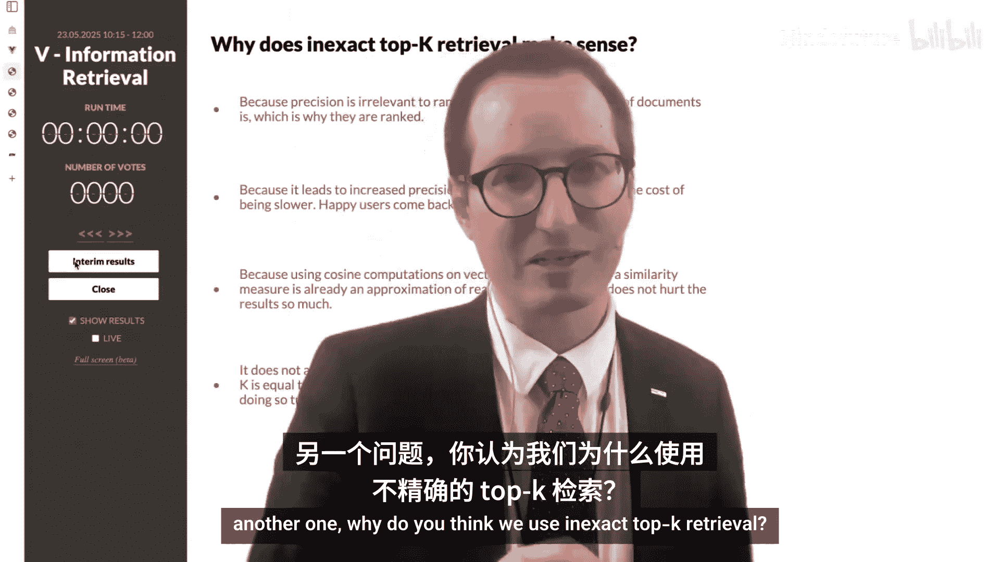

And so， the question is。Why does inexact stop K retrieval make sense。

So is it because precision is irrelevant to rank retrieval。

 and only the relevance of documents is relevant， which is。

W they are ranked or is it because it leads to increased precision and increased relevance at the costs of being slower。

Or is it because using cosine computations on vector representations as a cminity user measure is already an approximation of reality。

 so going in exact does not hurt the result so much。Or does it not always make sense。 And actually。

 in exact top K retrieval does not make sense if K is 5，8 or 13。

 but it makes especially a lot of sense if K is equal to 10。

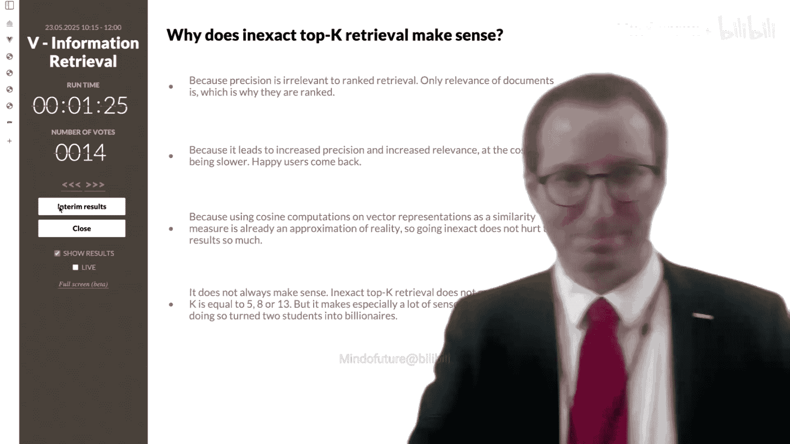

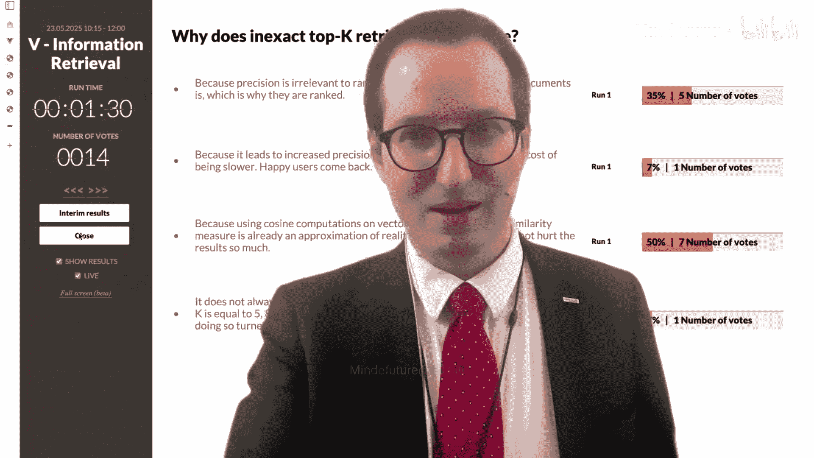

And the majority is correct。 That's indeed the case。

 So this is why you really should not forget that when we come up with all these formulas， you know。

 the be the probabilities， the language models or the cosine computations， the scatter product。

 you should never forget that all of that is an abstraction and an approximation of reality。 It。

 is's just a trick to implement a system that delivers results。 But it's not exact right。

 the scatter product does not gives you an absolute truth on the relevance of the documents。

 And if you have that in mind。 Then you realize it's already an approximation。 And so in exact top K。

 just just。Approximates the approximation。 That's the idea。

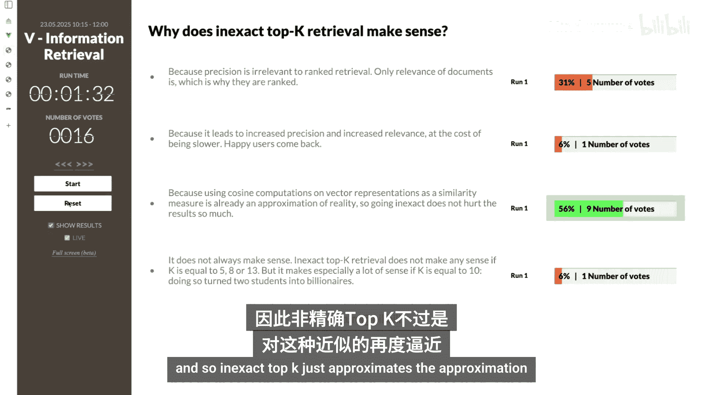

呃。Let me give you。Then the one that I had in mind which one is it， I think that's the one。Yes。

So now it's about what we've done today。Except instead of the cats， I'm using words now。

So the query is Fu Bfu， this is what somebody typed in the Google box。

And you have documents in here that all have a length of four for to keep it simple。

 So I'm asking which ones of the following documents would be returned on top as the first results of the query。

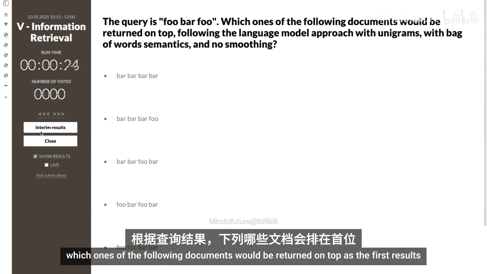

Following the language model approach。That we have with uniograms， unigrams， right。

 So we ignore the pest。

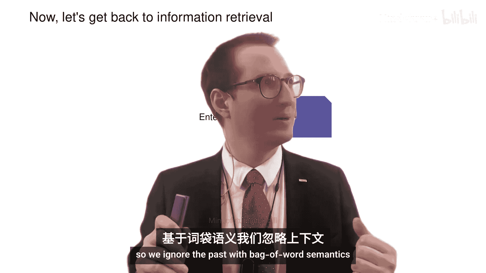

With bag of world semantics。 So it means we grouped everything into the。

 the bag of world model and no smoothing also to keep it simple。So。Which one is returned on top。

 or if there's some with the same score， maybe several robotts。

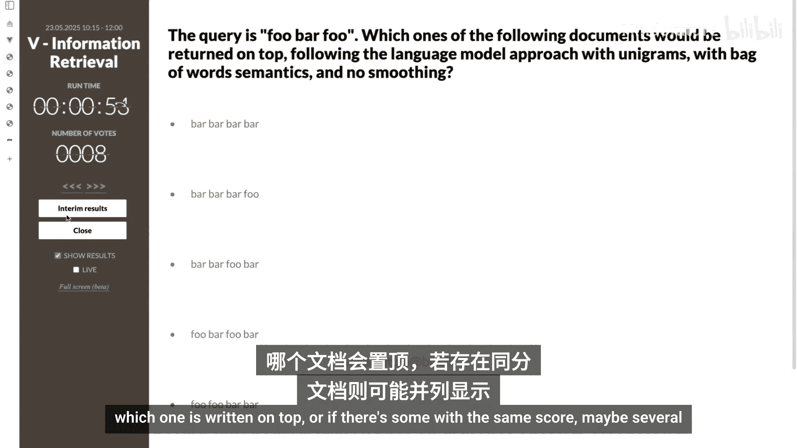

That's the one。 So the query is Fu back Fu， full back Fu。

And these are all the documents。Normally， doing it on a concrete example should also activate the brain you know。

 to to make sense of the formulas and understand the mechanism。

So remember that in the query likelihood model， the one that we saw。

 we generate a model for every document。 right， So every one of these documents。

Will give you a table of probabilities。These probabilities are computed based on the term frequencies。

In each document， weorize， of course， by the length in order for them to sum up to one， right？

As an example， bar bar bar bar， that would give you a lookup table with the probability of when for bar and0 for because there's no smoothing and the last one F would be that would be probability of when for who and0 for bar。

Ha， whoba would be one half，1 half， right。So you have to remember the formula for the。Generating。

Specific query for Bfu in that case。 and you need to compute。

The probability for each one of these models。Of generating Fu ba Fu and the highest the probability。

The higher， the ranking。Of the documents。

Let me look at the results。

You like this one。And it is the correct answer。

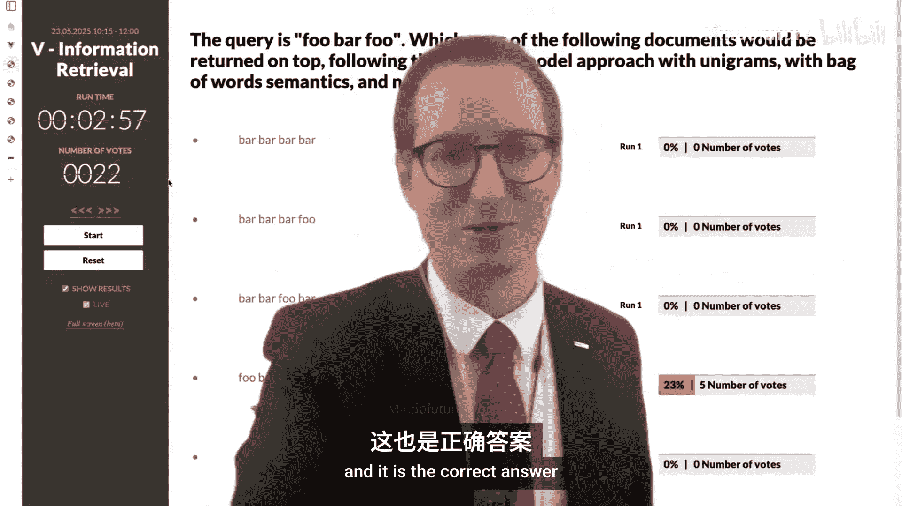

In this， Fu fo ba Fu gives probabilities of 3 quarter，1 quarter， right。So let me show you on a。

 on a slide。

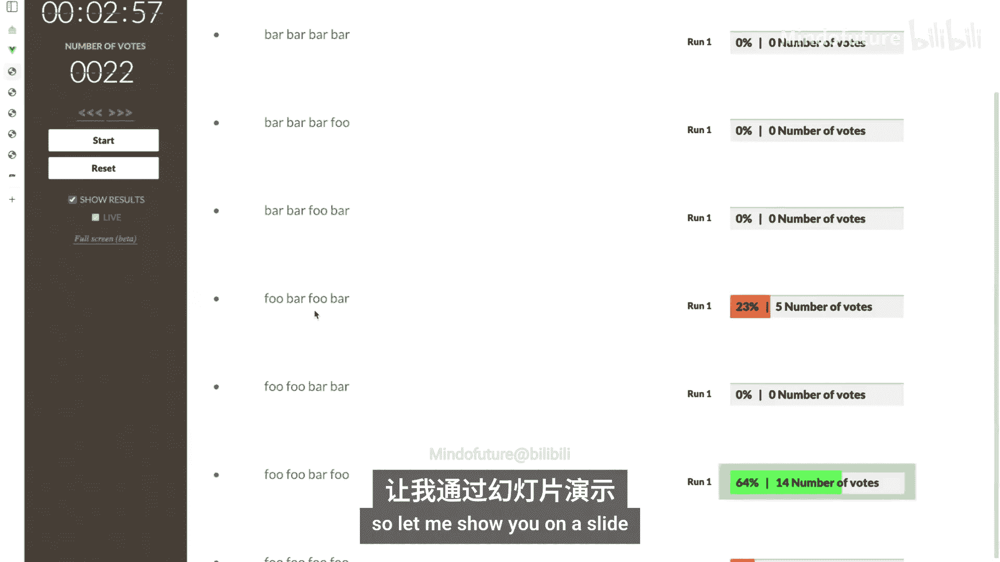

Makeake sure you。Under the。

So remember all the components of the formula， right， you have the multinomial coefficients。

That you multiply with。And then you have the products of the probabilities to the power of the of the of the number。

 the the numbers of cars。 And then you have P stop1 minus P stop。

But you remember that whenever we have to compute so many formulas。

 we need to find out what is constant and that we can throw away， right。

 because we should not bother computing constants。Who see that the multinoial factor。

 this factorial of the total divided by the product of the factorials is a constant based on the documents。

Why is it a constant。Do you see that we are computing the probability of generating Q the query？

So it means that the multidoal that we are going to compute is based on fu bafu， right thats。

3 factorial divided by two factorial， one factorial， because I have two times who and1 times bar。

 That only depends on the query。 It doesn't change。 I take a different document。

 I still have the same multinuial factor because that's based on the output of the model。

So that we get rid of， we don't need to bother with the multiial coefficients。

 one less thing to worry about。😊，Who agrees that one minus P stop to the power of4 and P stop is also a constant？

RightThat's because all the documents I give you have a length of four。 That's why。

 So we can get rid of that as a constant。 So all we have left are the products of the probabilities of the terms to the exponent of the number of times they appear in the query。

😊，So， it means that。I just need to compute that。 So I'm going to look at each document， and I'm。

Putting my probability look up table， right， Do you see probability 3 quatas，1 quarterter，3 quarter。

1 quarterta，1 half，1 half for Fu ba Fu ba， Fu fo ba， ba。

1 half1 half Fu ba1 quarter for ba and3 quarterta for Fu and so on。

 Does everybody agree with these probabilities。😊，Right。So。In that case， of course。

 I put them horizontally， the way I display them on the sides was vertical。

 there was one term per row， but here there's only two terms so I put them on a row fashion right instead of a current fashion just so that I can display my seven models on top of each other。

Allright， and then I need to compute the products of these probabilities。But I used to use。

 I need to use the exponents as they appear in the query， right。

 So it means that since in the query P appears twice， I need to take the square of P4。

And then multi by P bar， who agree。Right， good agree。Yes， based on the query。

 And so now if you compute that probability of P squared times P bar， the third line line is 0。

 The second line， is's always time divided by 64， right， in any case。 So one times 1 times 3 gives 3。

1 times 1 times 3 is 3，2 times 2 times 2 gives 8，2 times 2 times 2 gives 8。Three times 3。

 because that's the one we。Uperating， what is the formula for operating。No okay。I， okay。

 I cannot operate anyway， three quarters to three squares。 That's 9 times 1。 That's 9。

So we have 9 divided by 64 and then one times 1 times 0。 So we have a probability of 0。

 And now you see the maximum is 9 over 64， right， So this is why the document。

 Fu Fu Bfu is the one that comes first， because this is the one that generates the query with the highest probability。

 Of course， it's not a huge probability， right， it's it's a low number。

 but we are comparing them across documents and taking the number that appears the longest。😊，Alright。

 Gu do sense。喂，O。Awesome， so this is the language model。And as you can see in the end。

 we're actually looking at the term frequencies of the documents that influence。Everything。诶 okay。

Alright。So。That's actually pretty much it， so。

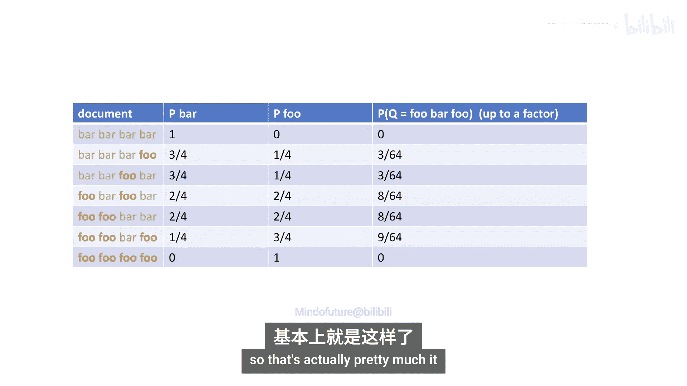

Wing to maybe if I come back here。Okay， no， apparently， I can no longer appear。

 So people on Zoom cannot see me anymore。 But anyway， thank you very much for attending today。

 you can get to have an early lunch。 Please come next week。

 everybody who can come if you come on Zoom， try to come in present because we're gonna have this big quiz。

 we're gonna have the prizes chocolate and so on。 So if you are in the lecture hall and you win。

 then you can actually get the chocolate。 And also because it's nice to celebrate together the end of the semester。

 One mo start in the mystery game。 One more chance to win。 Thank you， Josh。

 or moderating for organizing the mystery game with the T team。 Thank you。

 everybody for attending enjoy the exercises。 And I will see you next week for the final lecture。😊。

