# 【苏黎世联邦理工学院】信息检索-｜-Information-Retrieval-｜-Eth-Zurich-2025-p31-P31_12._总结_(1_2)--BV1ndsBzdEss_p31-

Welcome， everybody in the lecture hall。 welcomelcome， everybody on Zoom。 Welcome。

 everybody watching us from the future。😊，So today is the final lecture。

A bit tough right after Ascension day for one time， but today is a day of wrap up and celebration。

 so we don't have any new materials， So it's just to you know sit back and enjoy will go through the material of the semester just on a high level to make sure that you see the big picture and how everything connects I will also show you how this leads to large language models。

 which is another course at TTH that now you can take at least next year。

 which is kind of a followup historically over of this。

 we'll have after probably after the break or it depends on the timing right。

 but the announcement of the prize winners for the mystery game where we have some very tasty sweets and chocolates for them。

 So some sort of a wild ceremony and then we'll have the big quiz where you'll play against the T So at this jo。

And maybe other Ts will have the courage to come and play against you。 We have a great great TA team。

😊，And then we'll finally give you the prizes or the prizes for the the the big quiz game。

 It's this fresh from from this morning。And。C on Zoom， it's a bit tougher to transmit。

 But if the winner if in is in the lecture hold， then you can take it with you。

 and then we'll say goodbye。 So let's start with the wrap up of what we've done。 and it's。

Very vast quantity of new knowledge that you have acquired throughout the semester。

So now you will look at this slide that I gave in the first week of the course with maybe a feeling of familiarity now。

 because you actually know what this all means and what there is behind。

 We looked at Boolean queries， which were the earliest systems。

Then we looked at languages and saw that it's actually not so easy to bring the data in there and build the indices。

 We saw how to address tolerant retrieval， how to evaluate system。

 how to scale up building the index and building engines for larger collections。

 We saw how to compress the data which can save you costs in terms of the resources you need to scale up。

 And then we moved over to advanced information retrieval normally on the masters level with vector space models。

 probabilistic information retrieval and language models。

 And you saw that these two connect to this because that gives us the inverted document frequency。

 the justification for it。 And that gives us the justification for the term frequency。

 And this is where we have TF IDfs in vector space models。

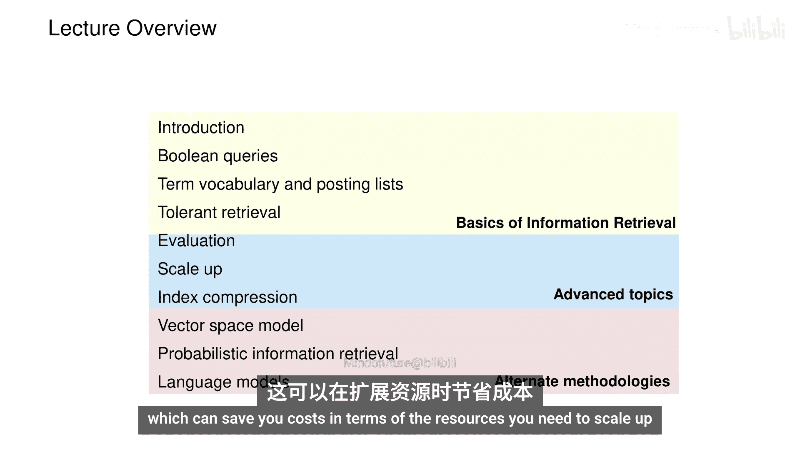

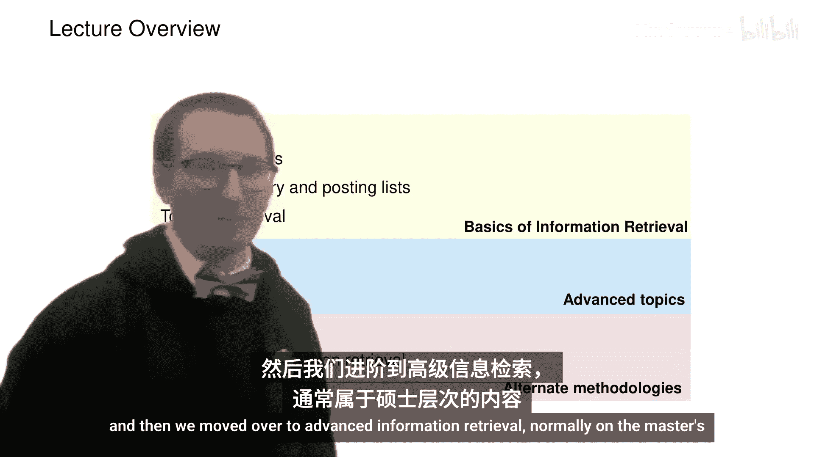

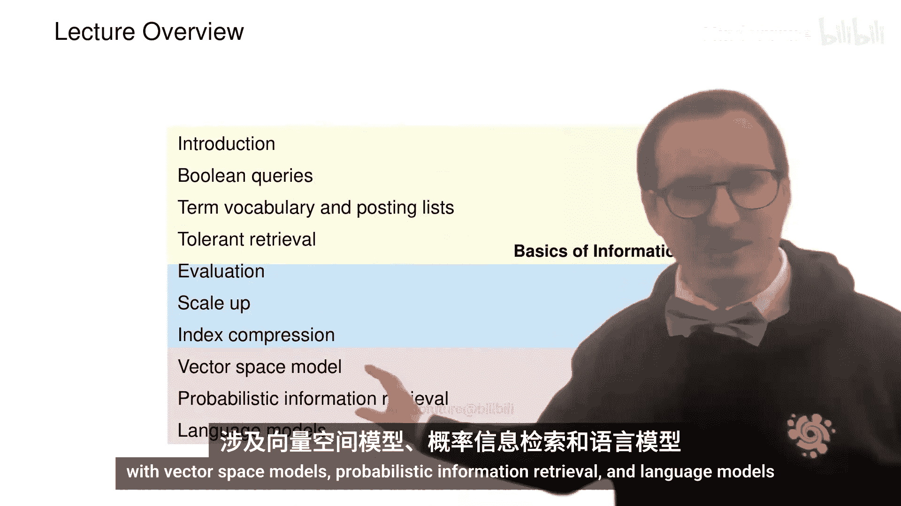

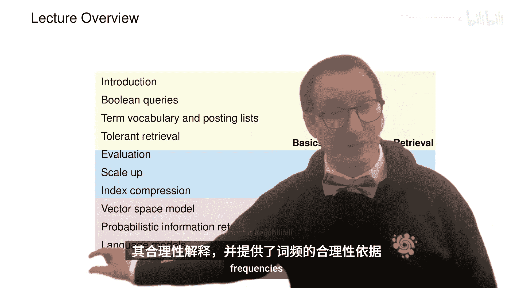

So I like to say that this is actually a database lecture because we learn to store and query and efficiently query data with some query languages and some results that we get。

And so in a way， this is the lecture for the fifth shape of data。

 So we have tables that you saw in database design and database modeling。

 but then we also have cubes， trees， graphs， which well see next semester in big data。

 And in this lecture， we tackled text。But one of the。I would say new take home messages that we got。

 especially in the last 10 or even in the last five years， is that， in fact。

 it's very efficient to view text as vectors。 So it was already a bit visible through the vector space model that we could do that。

 But actually with J GT and large language models。 It's validated that using vectors and linear algebra is the way to go to manipulate text and natural language。

But before it went to that， historically， the first systems。

 the information ritual systems didn't use vectors or that kind of advanced technologies。

 the first attempts just use the Booles。Meaning that you would write a query with the terms that you would like the document to contain or not contain with thisjunction conjunction。

 and we had a very simple query language with and or not。

That could be applied to some input collection set of documents。

 and then we would get a subset of the documents as the output of that query， no ranking。

 no particular order， we just give a few documents。

And there was that there were actually commercial products based on that。

 especially appreciated in libraries， but also in lawyers offices in order to to research to research。

Through texts。Then we saw that the concept of document might seem obvious in ancient times where we had the coices and books that are the units。

 But this underwent digitalization where now a document can be a web page。 It can be a movie。

 It can be， it can be sound。 It can be many， many different things， can be a paper and so on。

So we have this abstraction of a document that is kind of what the collection is made of。

 we have a collection of documents。And then we have the terms， which is an abstraction on the world。

 the fact that when you look at language， the way humans speak a language。

 their body is basically based on some tokens that you can analyze on the level of syntax on the level of the sounds。

 lexxims for memes and so on， but in terms of information rerie。

 we like to analyze them in terms of wes。And again， we have the context of a term。

 which at first seems obvious because you just look at the speciess and what there is in between spaces。

 but actually we saw it's not that simple。 It's actually much more complicated than this。

 but from the level of abstraction once you have done the work of tokenizing everything and getting the world out of them then you get terms and now we have a very abstract model where we have a collection of documents and the documents contain or do not contain terms we might be interested in the number of times they contain the terms and we may or may not be interested in the order in which they contain the terms。

 but you see that mathematically there is a lot of power in this on this highlel way of looking at things with just collections documents and terms with set of terms bag of terms list of terms semantics。

So we have this for the Boolean ritualtri。 And when we have this Boolean。Approach。

 we can use the set of wes model where either a term belongs or does not belong to a document。

 And it means that you can get a vector representation of any document has a vector of bulloleance。

 So now you should be familiar with this。 So the one says the vector is in there。

 the0 says the vector， the term， sorry， the term is in there if there's a one。 And if it's a0。

 the term is not in the documents。 You see here that's very important to be aware of that。

 The structure of the vector is that there is one term per position。

 So we have an arbitrary order of terms。 And every term corresponds to a position in the vector and you can have a one or a0。

 right， That's important because that's no longer the case with Lm。

 that this is how the vectors are big。 but with the old systems。

 every term corresponds to a position in the vector。

Then we looked at several representations that we could use when is the matrix representation。

 the incidence matrix where you have the terms on the rules and the documents on the columns。

 And in fact， every column corresponds to this vector that I mentioned earlier。 So the。

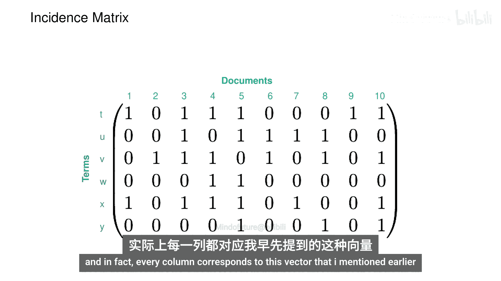

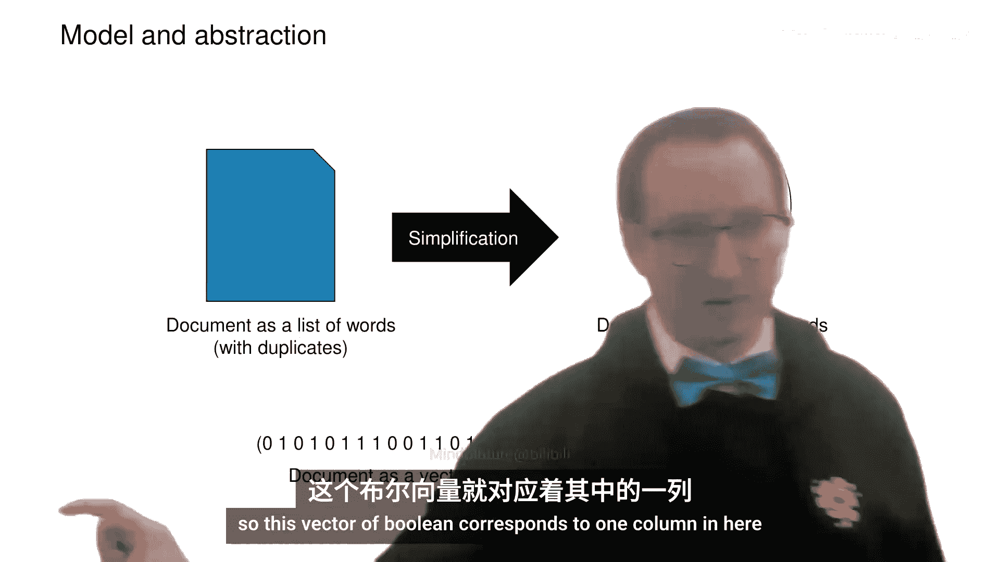

Dctor of Woans corresponds to one column in here that is the column representing these documents。

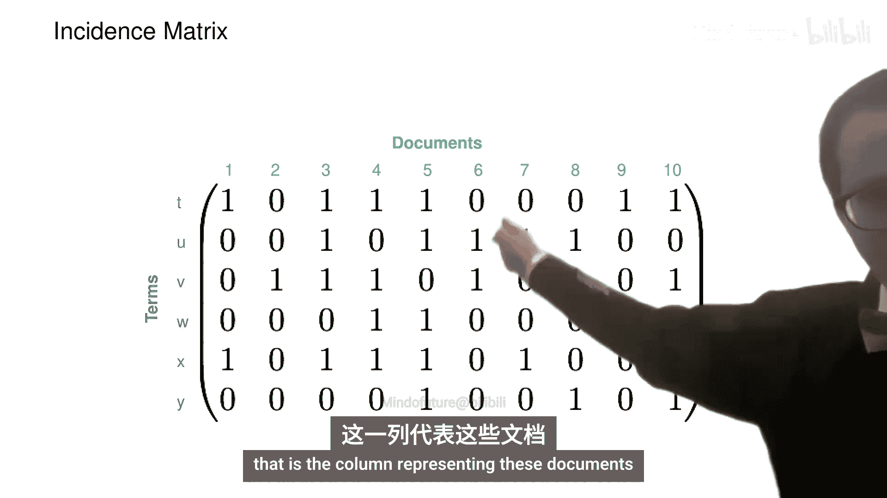

Alright。And so。In order to。Exeeccutute queries。 This is not efficient at all。

 There's a lot of zeroes that many places takes a lot of memory。 takes a lot of time。

And so in order to process the queries， we build what is called an index。

 an index is not specific to information retrieval。

 It's a generic concept in database systems that it's an additional data structure that you add in addition to the collection。

 the collection would be the original data， and you add these data structure that takes some space。

 So it has a cost， it also has a cost in building it that takes time to build， but once you have it。

 then you can process queries very efficiently based on this index。 So you have one term。

 these are the yellow cells， these would be the terms。

 then you have what you now know is the document frequency in the purple cells。

 the number of times the number of documents that contain the term and then you have the postings。

 the non- positional postings which are the blue rectangles in there and here these are the document I and the posting in here is the pair made of the document I and the term that is right。

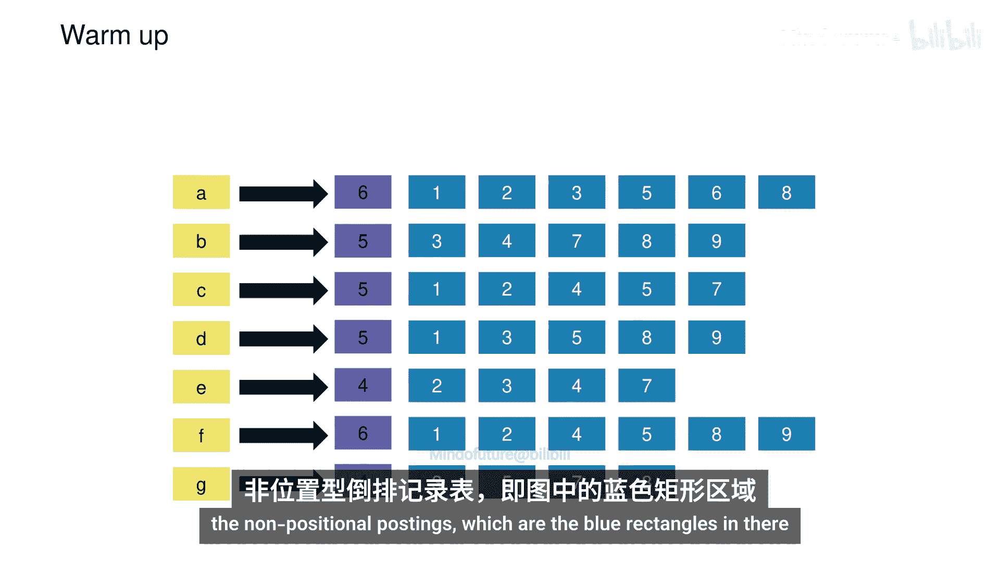

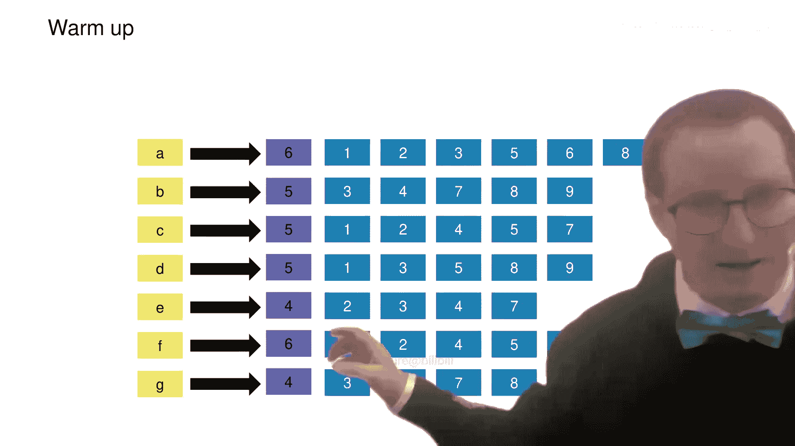

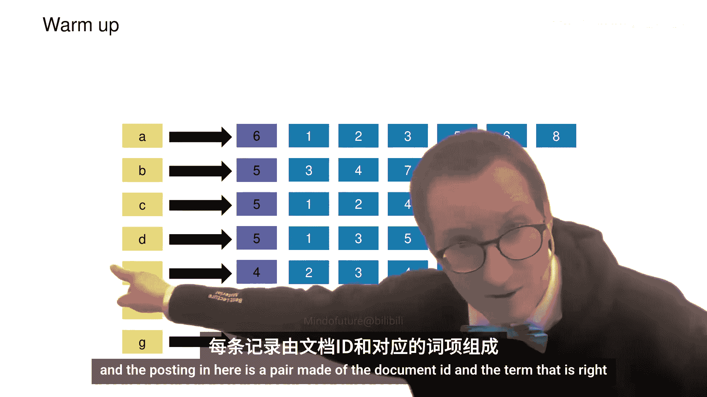

Right， so this is called the standout inverted。Inンdex。We saw that once we have this index。

 we can map Boolean queries to this index。 for example， when you have an and。

 you intersect the posting list， when you have an or。

 you compute the union of the posting list Since the posting list as ordered。

 We can just do it in linear time。 We just traverse them at the same time with pointers on every one of them。

 and then we can compute the union or the intersection and not likewise。

 you can also efficiently execute the node。Then。Is beautiful once you have the terms。

 but the half path is to get the terms。 How do you build the list of terms and how do you map the documents to to these to what contains and does not contain the term。

 And we spent an entire week。Just looking at it and seeing that it complicatedlic because of the complexity of human languages。

 so。Collecting documents， tokenizing linguistic preprocessing， building the index。

All of that is actually quite complicated， but we've looked into these things。

 and now we are equipped with a few with a few tools that allow us to do to do all of this， right。嗯。

I made this slight a couple of years ago because it's very easy to get drowned in all the terminology。

 And so I wanted to clarify with this that there are kind of six concept in there depending on whether you refer to the concepts before it has been processed or after it has been processed by processed。

 I mean this kind of process you went through the language processing。

 you know what is the same term just conjugated in different tenses and so on。

 So all of these all of these processing and then so that's the first dimension。

 the second dimension is is it not tied to any document or is it tied to a document。

 a specific document and maybe even to a position in the document。

 and that gives us two times three possibilities right and we have kind of names and terminology for all cases So if it's raw and tied to a specific position we call it a positional token if it's tied to a document but without a position。

The non positional token， if it's still unprocessed， but not tight to anything in particular。

 we can say world， we can say non normalizedmalized type。

 And then if it's been processed with these things。 So you haven't analyzed the language and so on。

 then you basically have positional posting， non positional posting and the terms right also normalized type and the processed path。

 that's what maps to the index right， it's the the terms that are the normalized types that corresponds to the yellow boxes in here。

 So this is the the processed part。 the non positional postings corresponds to the blue boxes in here。

 and the positional postings would correspond to the blue boxes。

 But if we turn the index into a positional。嗯。We saw that some of the terms can completely be skipped because the posting list would be basically the entire collection。

 So it's very inefficient。 And we can save us some space。

 which was particularly important in the 60s，70s，80s。

 So in the good old times where we didn't have that much computing space and power today。

 it's a bit less of a problem。So these are called the stop wes， we just remove them completely。

 it's so frequent that they do not help。Another thing that we saw is as part of this processing of the the of the tokens into the into the terms。

 we can use query expansion query on both sides， so either we expand the index or we expand the query。

And now， of course。Now that we have LLMs that looks a little bit prehistoric， right。

 the fact that we need to manually expand in there because with an LLM， it just uses the embeddings。

 I would say a few words about that to do these kind of things， right， But before we had LLMs and。

 and the luxury of of the embaddings， this is how it was how it was done。

 So very manually and programmatically that that we did that。嗯。

Also mechanically and algorithmically we have a stemmer that allow you to kind of group the world in categories to get the terms again。

 this is kind of obsoleted by LLMs which now do it with embeddings。

 but again in the good old times this is where we could relate the world together and find out that they relate to each other。

We saw that if the posting list are very sparse， we can have these skip pointers that allow you to directly jump to to other cases so。

More precisely， it's when you want to compute the intersection of a very spas posting exists and another posting exist that is not sparse。

 And because the other one is sparss， you might want to jump directly to to to posting。 For example。

 imagine the other posting exists has one。 and then it's followed by 11。

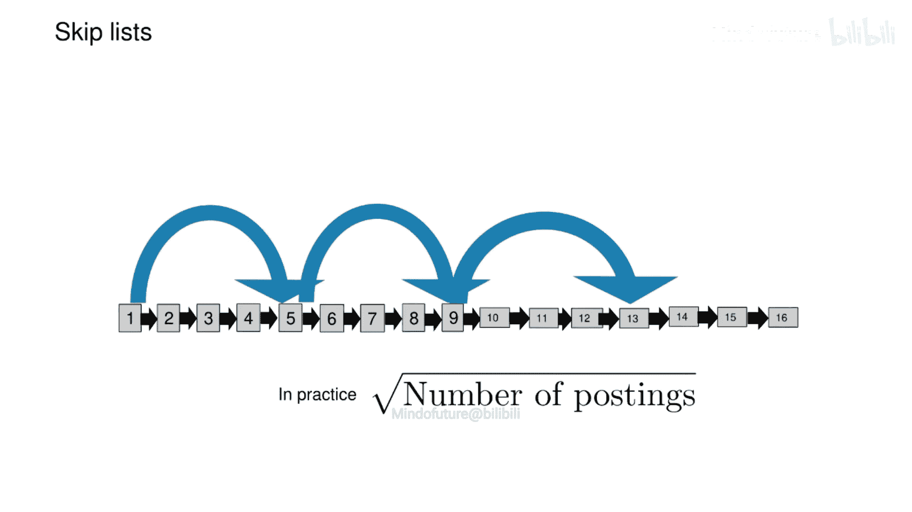

The other posting list， then in this one， what you can see that you can immediately see you can jump to 5 and jump to 9 and then go to 11。

 So you basically don't go through this。 If you know that the other posting list is directly there。

 So this is the idea of a skip pointer。

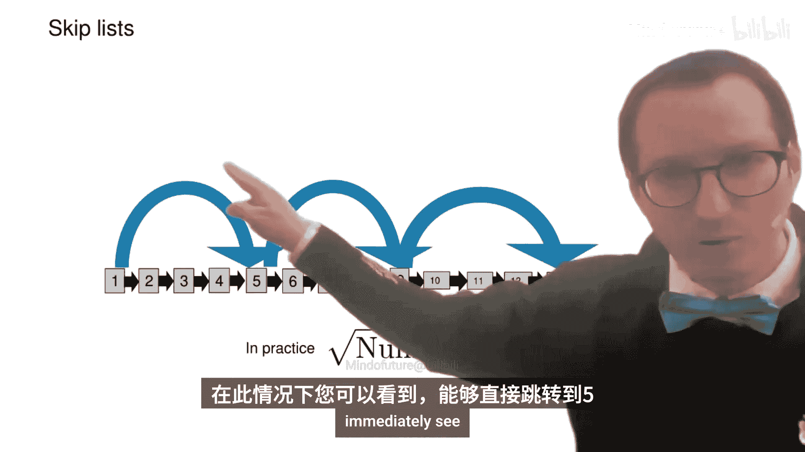

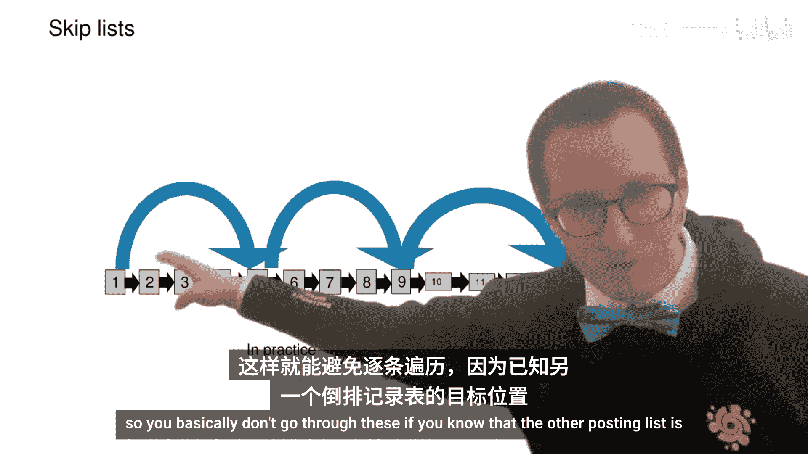

Which I am related to the generalization of that， which we also saw a couple of weeks later with the。

 So that's one level。 Let's keep point of。 But you can have even more levels。

 And this compares to working， taking the bike， taking the train， taking the plane， you know。

 like in terms of of。Transportation， if you consider that going through a posting list is a transportation。

And so these skip list with more layers are used in vector databases。 So when。

 when you look for for the specific vectors and close to queries， these are actually very useful。

 And I just showing them next to each other， because even though that was in the context of pushing lists。

 and that was in the context of the vector databases， vector space model， they are， in fact。

 the same idea from a theoretical computer sense perspective， this idea of skipping。

 if you want to use fancy well， then these are basically singly or doub linked lists。😊。

With additional singlely and doub link lists， layers on top of each other。

 And then you can go up and down through this， through this graph。Okay。😊。

Then we saw that we can improve the standard inverted index。

 That's why it's called standard because we can modify it into less standard flavors。

 One of these is to use pairs of terms instead of terms on the left or even three terms four terms and in that case。

 it's called a by world index three wordor index or Kword index and it has just a problem is that it might return false positives So it needs additional work to make sure that that it doesn't return false positives and you can reduce the false positives by just having a longer window and the problem with longer windows is that it expandends the space unit right and this is yet another problem that was solve by LLMs with the attention mechanism right。

But it's always important to see the historical perspective and the the the challenges that we've had in the past。

 This is the positional index， which is another way of handling the phrase queries where this time instead of the non positional postings。

 we have positional postings。 And that means that for every term in a documents。

 it's not just set of words， it's。

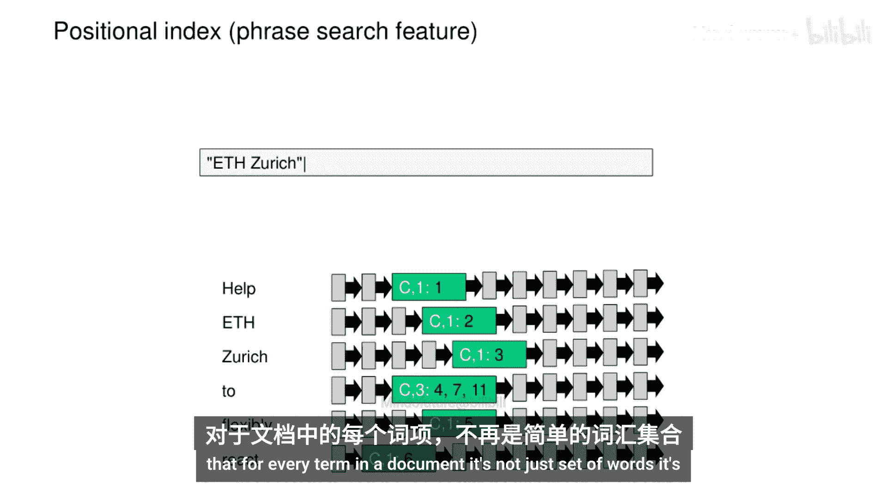

Listists of worlds， because we know all the positions in which the terms appear in the documents。

 So we we know the order in which they appear and that allows us to also just like this one process phrase queries right。

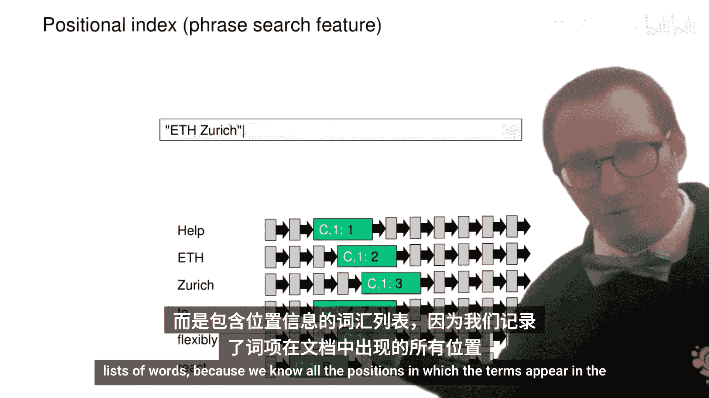

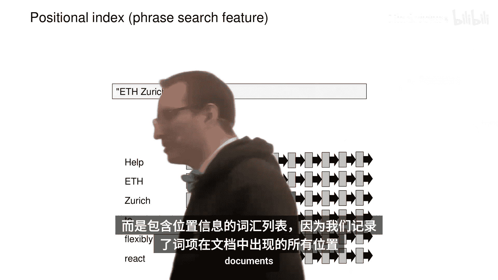

嗯。Then the goal of an index is to process the query efficiently。

 But in order to process the query efficiently， you need to be able to look up the terms efficiently in the standardout inverted index。

 And so that means that these yellow boxes that are on the left of the standardout inverted index。

 they are organized in a structure。 And that's， again。

 theoretical computer science algorithms and data structures。

 And we have two main families of data structures that allow us to look up one of these yellow boxes。

 the terms， one is hash tables， its instance， right， just snap your fingers。 And then you。

 you know where the the terms is， but you cannot handle ranges， or you can use three structures。

Actually， more precisely in the context of databases B trees or B plus trees。

 which are a more modern version of the binary search trees， which would only have two children。

 but in B plus tree， you can have 10 children，20 children and the main reason for doing that just not a binary search tree but more children is because of the hardware。

 the fact that you're reading from the disk and you want to make sure that whenever you read from the disk you take a full block right see if you just have a binary search tree。

 you would be reading much less， that's an inefficient use of the disk in terms of latency So we have hash tables and we have B plus trees。

 These are the most common indexing structure。 Of course。

 theres more structures than than this you also have in databases。

 geographic index and so on and so on。 There are even people who use machine learning in these。

 So instead of building a structure， they learn the structure to locate the terms。 All right。

 but in the context of this courseh。Birs and trees。A B plus3 looks like this。 again， As I said。

 it's generalization of a binary of tree to more children。

What's important in a B plus tree is that the the terms and the posting lists are at the bottom at leaves of the tree。

And everything that is not a leaf that is up there。All of these node in here。 Sorry here。

 All of these basically are only here for the lookup。 They're only here to tell you， go left。

 go right and so on。 But these are actually the the。

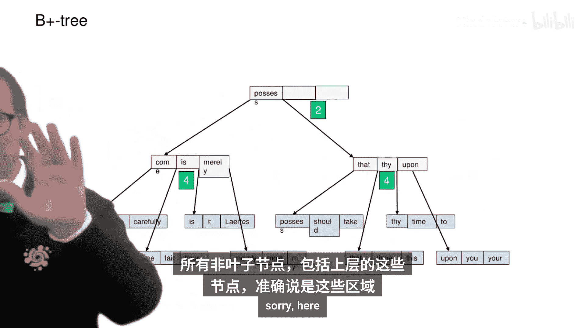

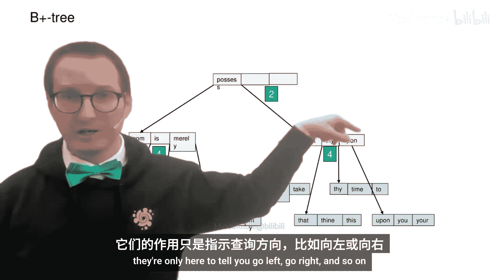

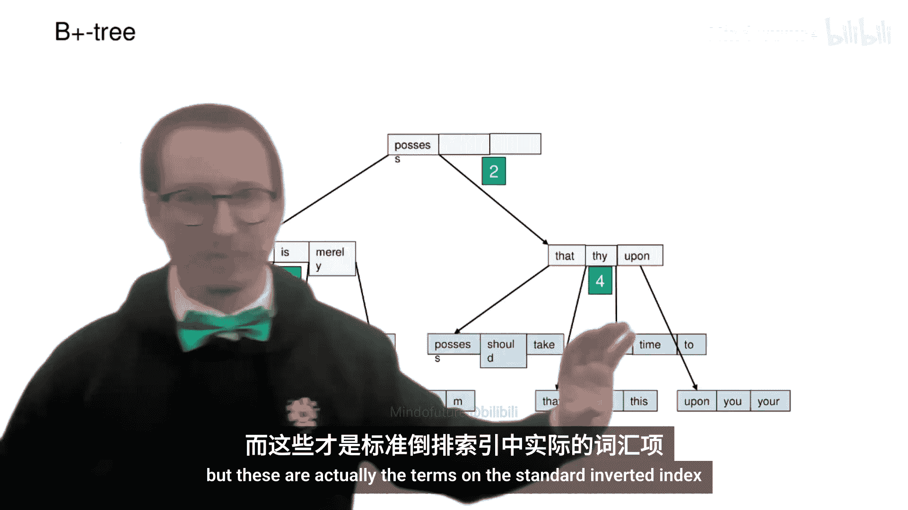

The， the， the， the， the terms on the standard in index that I associated with the the posting lists。

Okay。Then we saw that。 We can。In addition to brilliant queries， phrase queries。

 we can also execute wild card queries。 We saw that depending where the wild card is。

 it can be easier or more difficult， right， It's easier if the wild card is at the end。

 if the wild card is at the beginning， you need to have another index mirrored。

 if the wild card is in the middle， then you can use these tricks with the permut term index where you add a dollar。

 and then you imagine that you rotate the world。 So when it's at the end。

 it comes back at the beginning， And so you have all the rotations of plants。 for example， in here。

 So then you can build the permut term index， Another approach is to compute the kgramms。

 the K grams is exactly the same idea as the K world index， except that instead of worldls。

 you have letters。And so here you have， for example， the three grams of computer would be Dola C O。

 COM， OMP and so on。 Do not forget the dollar at the beginning at that the end。

 because it identifies the the start and the end of the world。 And typically2。

3 kg are are very popular1 gram or after that is is either not very useful or not spaces right。

 And that' also useful for the spell check whenever you you want to to correct typo and the kgrams are going to be helpful。

Yet another way is the edit distance， which is the computation of the distance between two worlds。

 depending on the number of edit steps that you need to take between the two。

 And this is efficiently solved with dynamic programming where you fill this 2D grid in here in order until you。

 you finally find the number at the top right， which is the edit distance between the two。Right。

 so also called Leenstein algorithm。And as I mentioned。

 it's the same algorithm that gets you the diffs when you use Github and you get a diff between two branches。

 It's the same algorithm right instead of letters， you have lines。

 but it's exactly the same algorithm that that gives you that。嗯。😊。

Yet another way to compute the proximity between world is the jackard coefficients。

 where it just computes the number of kgrams in the intersection divided by the number of kgrams in the union。

 careful， It's not a distance， It's a coefficient， because the distance should be0 when it's the same and higher。

 if it's not the same， but here it's the opposite。 it's0。

 if it's completely disjoints And one if it's the same kgrams。 You can turn it into a distance。

 people have done that， you need a bit of mathematical cooking to do that。 but but as presented here。

 It's just the jackard coefficient。And yet another one way of the looking for world that are close to yours is the soundex algorithm that is based on how the world sounds specific to the English language。

 of course。And it consists in the encoding of the world based on the， on the vowels。

 And so you have the dentals， the freeatives that all the fancy worlds that people specialized in phonology use to describe like frees would be further dental D T。

 label L。 And so no， no， label is。B these are liberal ones。Alright。

 so this is the sounddex algorithm。 And again， I mean， now with the。

 with artificial intelligence and so on， we， we have。Much better ways to map the world to language。

 right， but historically this is what came first。Then from a hardware perspective。

 we saw that whenever you want to make something fast。

You have no other choice than to understand the hardware， the memory， the disk。

 the speed that it has， the cost that it has。 So you have to spend some time on that。

I'm not a hardware researcher， but I know that cache and RAM is much more expensive than these game tapes。

 and I know that they're also much faster， but I also know that they are much smaller so you just need to have this hierarchy in mind in terms of the price the speed and the size and to know that the first two need electricity to maintain the memory but the other two do not if you switch it off the data is still preserved。

😊，嗯。Okay， and once you， once you know that， then you can design algorithms for building the index。

 much more efficiently， We saw that one trick that people used is to replace the terms with term Is。

 just like you give document Is to the documents。 you give term Is to the terms。

And then these posting， which are pairs of term documents。

 they can be turned into term ID document ID。Yess， just during the construction of the index。

 And so we have this first generation。Of index construction called BSBI。

 where you batch you have these batches of the collection。

 you partition the collection and one partition at a time。

 you create this term I document I pairs and then at the end you merge them。

 Then there is a second generation algorithm that is an improvement of that one。

 So that's the first one。 The second generation is this one called Spmi single pass in memory indexing that doesn't use the term I trick instead it directly build partial standard inverted indices for each batch。

 each partition of the collection。 then merges them at the end。

So it's great when that doesn't fit in memory， but it still fits on the disk， right。

 And if it does not fit on the disk either， then you go to map Red。

 Ma Reduce is the big data approach。 That's for indexing the entire Internet where you can use your cluster in the data center。

 And again， you have your these pairs of term document Id。

 You don't need the term Is in there because it's a data center。 There's there's a lot of space。

 And yeah， so that is how you actually build Google or Bing or a search engine over the Internetnets map Red。

😊，嗯。Then the next problem that we saw because now we deal with the Internet is that the internet changes every day。

 people edit their web pages， they add new content， and so if you want to maintain a search engine。

 it has to keep being updated to the latest version of the Internet。

And one of the tricks that we have for that is the logarithmic merging is that you。

 you keep building a new smaller index with all the latest data。

 and then you keep merging it to lower levels。 you can see the bit like archaeology and fossils。

 you do it logarithically， meaning that you merge every time with a small indices。

 And whenever you have a lot of indices of a certain size。

 you merge them and double the size every time。 And this is the the more you go to the right。

 the more it's the very old the very old data that you that you will find。

 So that's a trick to from an algorithmic complexity to to。

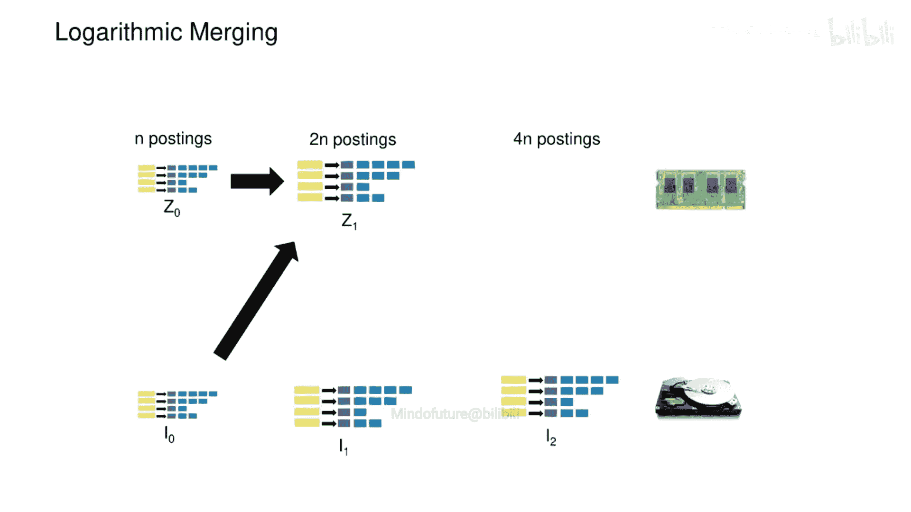

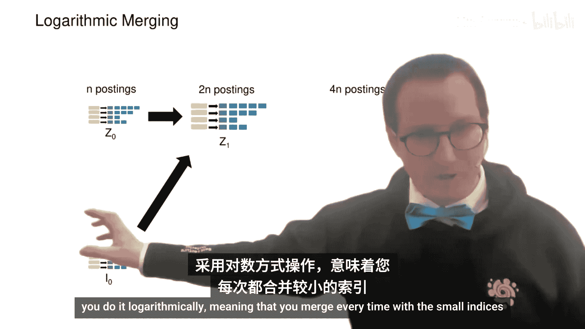

To handle the regular updates to the index。Then we saw。 And that's a wisdom in general。

 not just for this course， that it's nice to be able to scale up and buy more machines and and so on。

 But it costs a lot of money。😊，And especially when you are you are a startup。

 you might not have that much money。 And there is actually something much more efficient。

 is to try to compress and to make do with just one machine。

 There's a lot of startups that can actually that only need one machine for the first prototype。

 So for this， we looked a little bit that statistics one off and things。

 We saw that based on experiments。 It's M K recall experiments， hips slow。😊。

Tells us if you keep growing the collection， you keep adding and adding more books to the collection。

 How does does the number of terms， unique terms grow。

And we saw it's in the square roots of the size of the collection。

 Very surprising because we would think it's an asymp to， but actually， know， it's the square root。

 keeps growing in the square root。And the second law associated with it is the。

 the how the frequency， the collection frequency of the， of the terms evolves。

 If I rank the terms by decreasing collection frequency and I plot the collection frequency。

 then it's a hyper went over and。So some constant divided of the rank， that's cheap slow。

Based on that， we found ways to compress。 So now we can compress the older。The yellow boxes。

 which without the B plus tree it's called the vocabulary， so we found ways to compress it。

 we also found ways to compress the postings， the blue boxes on the right。

 a naive approach was the variable by1coding which saves a bit of space。

 but an even better approach is the gamma encoding which is elastic and adapts to the length。

And remember that the trick， because the posting exists are an increasing sorted list of integers。

 we just need to to encode the gaps in between， we don't need to encode the actual integers。

 just the gaps in between， which which are always positive because it's sorted list of integers。嗯。

Just for those who are curious， I actually managed to extend this to encoding any decimal numbers in this way。

 It just uses the gamma encoding in the exponent and you can encode all of the decimal numbers in such a way that you can compare the bits to tab with two numbers。

 which which is the smaller one， which is the greater one， then you can do it on the bits。

 It's not part of the material of the lecture。 I just want to mention it because that's that you can actually also do that for decimal numbers of any。

 it's also elastic， any precision， any exponent。 But again。

 this is not material don't that absolutely not part of the examine anyway。Then， we went to。

Newer generation where we want to rank the results， which is a bit more familiar to people。

 because if you use Google or Bing or the the newer search engines， you get the top 10。

 then you click next， you get the next 10 and so on。

 So we need to rank the documents and compute some scores。

We saw that you can do that with a relational database with the forms that you can fill on the metadata of the books。

 and this is actually how libraries used to do it， but it's actually a bit limited because you don't get to the full text of the books it's just based on the metadata。

But in fact， if you go to the full text and actually look at the content of the books。

 which we are interested in。Then we saw that you can compute these cars based on the term frequencies and on the document frequencies。

 more exactly the inverted document frequencies， and so we can represent the documents as vectors with every term correspondinging to one coordinate and then you put the TF IDF。

 which is the product of the term frequency and the inverted document frequency。

And you can use a scar product。With the same with the query。 So document vector query vector。

 you compute the sca products。 and you have a score。 So it's this was an incredible insight。

 to be able to to， to see that you can use linear algebra to compute the scores。

 So it means that documents now are vectors on of numbers， not just booles， vectors of numbers。

 So now you have a vector space。 You have all of your documents that are just points or vectors in that vector space。

 So is the query。 And so now the beauty is to locate the documents that are just the closest to the query。

 And these are your results。 The closer they are the higher they rank in the outputs， right。😊。

And the trick is to use the angle in between。 so that's the scalar product。

 you can renormalize it too if you want that that's the angle between the query and the vector。

And it's a scalar product。 We love computer scientists love it because a scalaf product is just a big sum。

😊，And so the way you implement it is that you just accumulate that sum into buckets。

 just you keep going through the post things and you add， add， add， add， add。

 add the the old the these X I Yi to the buckets and then you have the scoress that accumulate and then you look at the highest ones and these are your results。

We saw that even though TF IDF is the textbook approach that has variations of that。

 you don't have to use TF IDF， you can just use Tf without IDF。 you can use the logo of the Tf。

 you can use Booles， so there's plenty of variations of that and they have codes you can encode them into six letters that basically tell you a what convention you use for the queries and the documents that's called smart because smart was the name of the system The third systems that did that。

And all of that gave birth to vector databases。 And I think LL Ms are also partly responsible for the hyp on vector database。

 But people realize that vectors now are so important technologically。

 that we can build vector databases， just like we have relational databases， graph databases。

 And so now this is a big deal。 And so that this is an example of extension to。Po Gs Ql。

 where you create your vectors， you can insert them。 And then in SQL， you can compute。

 So the L2 distance is just the Euclidean distance between two points。 the L1 distance。

 also called Manhattan distance is the the similar but horizontally vertically。

 Then you have the inner products， the sc products between the two。

 And if you renormalize the inner product。 You have the cosine distance。

 And the cosine distance is the one we used in the vector space model all the time。

 And that's great because all of that can be executed very。

 very efficiently with the vector databases。 There's been a lot of research on that on how to。

 how to do that very efficiently。😊，So yeah， that's the new at the moment， the vector database。嗯。

But the insights that we could use vector spaces and。Documents as vectors of numbers。

Is due to probabilistic information retrieval。 So we did it at the end of the of the course。

 But in fact， historically， it came before。It's because people try to have an approach of sorting the documents by the probability。

Of relevance with the third experiments with theel Zondaika。And doing that。

You actually can derive a formula that， in fact， is the formula underlying underlying the vector space model。

 the scalar products， the vectors that all come from these。

 the first insight came from this approach。And then we realized so that gives you the IDF。

 the TFs come from the language models， but this is how historically how we got the vector space model and the scalar products by deriving from the probabilitybabilistic approach right here。

Then we have language models that was what we did last week where you can look at generating data just less advanced than LLMs。

 You just generate the terms in a document。 You can compute the probability that terms are generated。

 we made a few assumptions， you know this P stop one minus P stop。

 the fact that we have a memory in the past of in that case just the last two documents that we remember and that gives us the probability of generating documents。

 We saw that in the case you don't have any memory。 Then we want to group the documents。

Into the bags for those that have exactly the same world， but in a different order。

 And that is important because counting how many there are， how many combinations there are。

 how many orders there are。Allows us to write the formulas precisely to turn the list of world into the back of worlds approach and the difference between the two is these factors that you need to multiply it with。

And finally， we derive an engine by having a thought experiment that you receive a query。

 you take a document at random， create a model， generate something。

 happen to find the query and you ask yourself okay。

 if that happened and what's the most likely document I picked and that gives us exactly a way to rank the documents based on this and surprise surprise。

 we get a scalar product， But this time with the term frequencies。

 So just like we got the Ifs from the probability approach here。

 we get the Tf in here and that is what gives rise to the TF Is in the vector space model。😊，Right。

All right。Then to evaluate system， use precision， recall specificity。

 they have no more secrets for you。 just so you know， the f one， which is not， nobody uses that。

 I still haven't converged on the world， or cryryploy or own exhaustiveness。

 The only thing I'm saying here is that that doesn't exist that is not found out there is no name for it and no use for it。

 So it's only this three that are， in fact， the one that people actually use。

 And just for completeness， that would be the f one if if people actually use it。Typically。

 we compute the harmonic mean between precision and recall， very often done in practice。

For the ranking systems， we have these curves where you just click next， next， next， next， next。

 next， next。 And every time you update the precision and the recallco， when you do that。

 you get a curve that goes like this。嗯。Another approach that comes from electronics is the receiving op receivers operating characteristics。

 R O C curve。 that also gives you some， some idea of how the， how the system is doing， right？

 So you want to have。

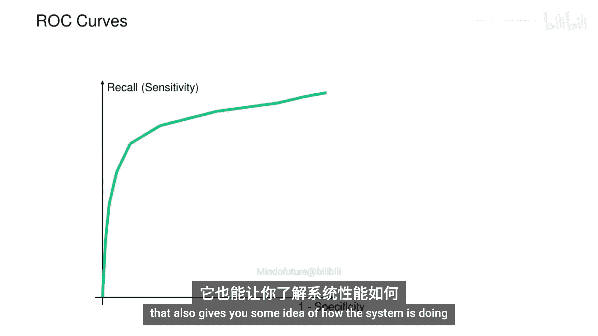

A curve in that case that is as close to this as possible。

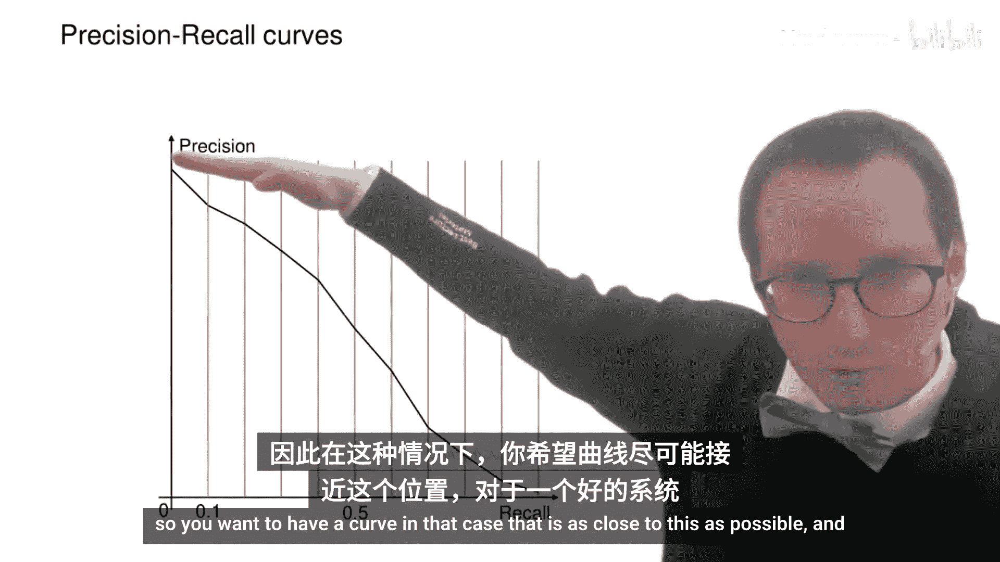

And in that case， as close to this as possible， if you have a good system。

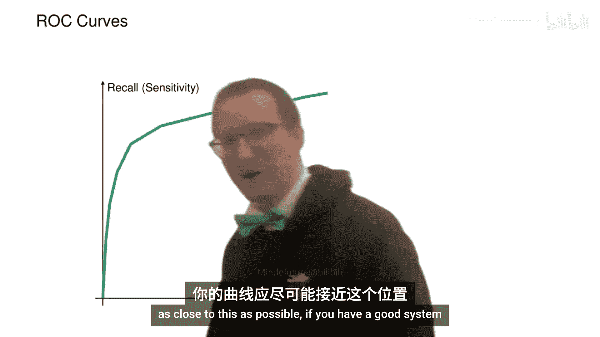

So now we've done all of that。And I would like to now do the transition to LLMs。

 the large language models who think they will take LLMs next year since spring， every spring。

 normally。Not yet。 Okay， but in case you won't， just as an appetizer。

 this is how Cha GT and LL Ms actually take it from there。

The first difference is the scale in the scale of the systems we saw in this semester。

 we had lower numbers。 But the LL Ms， that's why it's called large go extreme in in the scale。

 The number of tokens， the， the， the， the， the size of the connectionss that they work on。

 That's massive。 Like， that's the， the entire Internet。

 So that's the first difference between information reval and LL M is the scale。Second， difference。

 the tokenizing in information Re。 We kept it simple。 We just use the spaces。

 even though language plus processing and so on still applies。 But in LL Ms。

 we don't care about the spaces anymore。 An LL M can swallow anything。So basically， you just you can。

 you can tokenise anything。 And this， this uses information。

 theoretical consideration and entropy to find the optimal way of doing that。

 But even if you trained an LLM that doesn't know streets which， you can fit it with street which。

 it will be able to tokenize it and process it， right So it'， it's more powerful。

 but tokens now no longer correspond to words， you know， that are separated by spaces。

 It's much more evolved。 The second difference， is that the third difference is that in information retrieval historically。

 when we have vectors， the coordinates of the vectors correspond to the terms。

 maybe you have information that is the first number retrieval。 that is the second number。

And like this， you have half a million or a million coordinates on your vector。

 and every term is associated with a boolean or a number。In LL Ms， that's no longer the case。

 the vectors don't mean anything anymore， at least to a human。 So we have vectors still。

 we still use the vector database。 We still use the scalar products。

 We still use the proximity and so on。 But it's no longer case that every coordinate corresponds to a term。

 It corresponds to whatever and that abstract， right， So we just puts the the， the， the。

 the the documents and the text in there in that vector space。 But in a way。

 we don't really understand。But， of course， that's a chicken and egg problem。

 because how can we create a vector space and put the documents in there in a way we don't understand that's the magic of machine learning。

 So we actually learn it。 We just create systems that have many weights。

 And that's also why it's large language models。😊，And have billions， trillions of weights。

 So this is the we use neural networks。 And the neural networks learn how to put the documents in there。

 how to place the point。 This is something we learn based on these systems。

 and it's learned in such a way， that it works， right。

 So under the constraint that it satisfies the all our goals。

 It learns how to place the points in there。Right so on the left， no machine learning。

 we can do it programmatically on the right， we use machine learning to put the points in the vector space in a way that actually doesn't make sense to us humans。

 but that happens to understand or create some semantic understanding。Of year of the data。

Another one is another difference is attention， we saw in the language models that we have this Macov chain where we only look at the two or three or four preceding terms。

 right？But in LL Ms， we no longer do that。 We look at everything， even in the future。

 not just in the past， also in the future。 And so we have this attention mechanism that you might who。

 who sort the paper attention is all you， right， That one became very famous。

 This is what it's about。 So you no longer just look at the past few terms。

 You look at absolutely everything， right， So the the entire， you you relates to terms with。

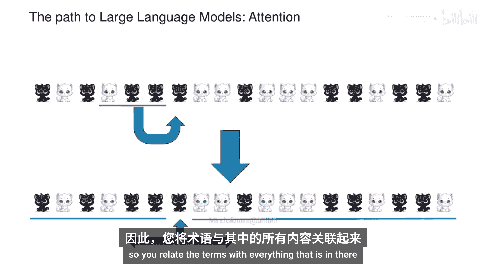

Everything that is in there。 For example， if you have a pronoun like I or you or he or she。

 then you just relate it to some other place where you might have the person or the noun that it refers to Thats part of the attention mechanism。

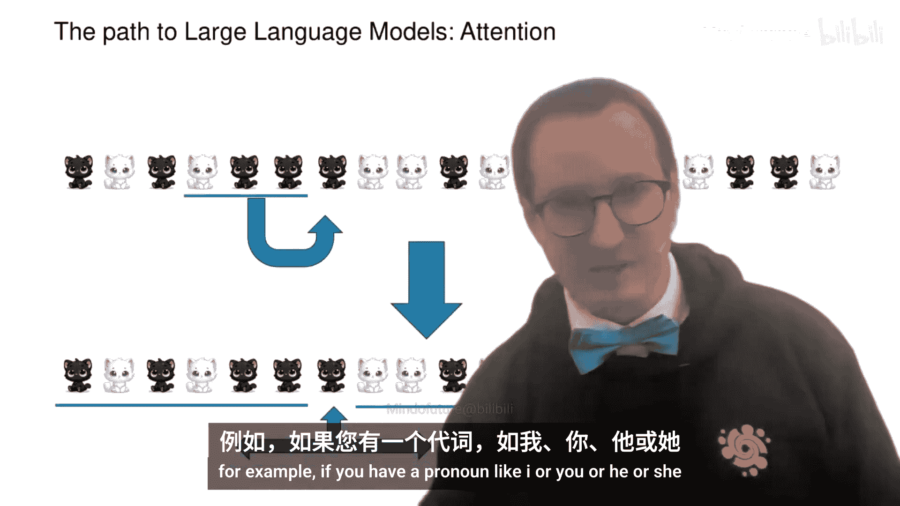

Of course， when you generate contents， there's a trick that you just remove that because， of course。

 you cannot do the future。 So when you generate， you just have a mask in here that hides that。

 and then you just do it based on the on the test right， So this is attention。

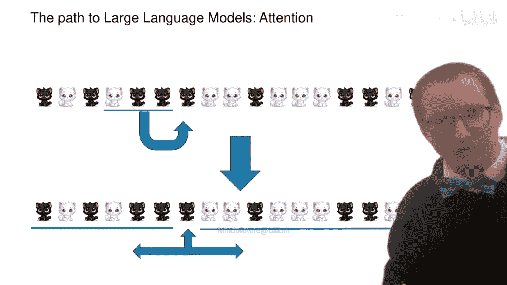

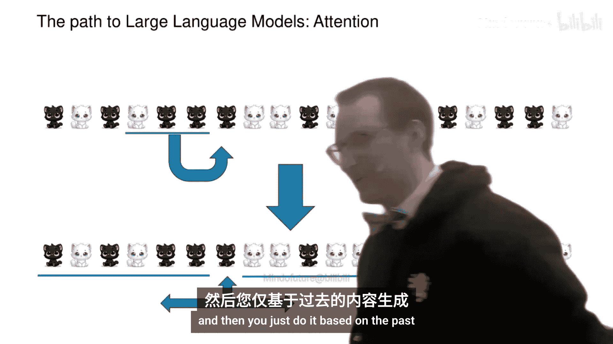

And finally， all of that means that instead of just searching and ranking， now we can use it。 I mean。

 probably everybody uses it。 now we can translate even in real time， we can write。

 get generative AI to write text to summarize and so on。 and se search。

 Also very useful When you search for a certain thing。 on the Internet it can actually。😊，In quotes。

 understand what you're looking for in the sense of the expansion I said earlier。

 lift elevator and so on。 So now that is done almost natively。

 this kind of this kind of a semantic search。Alright， and so this is an appetizer for the。

 for this course， which is taught by Ryan C Marine bios and F and Tra。 And normally it's every year。

 So if you want to take it from there and study large language models。

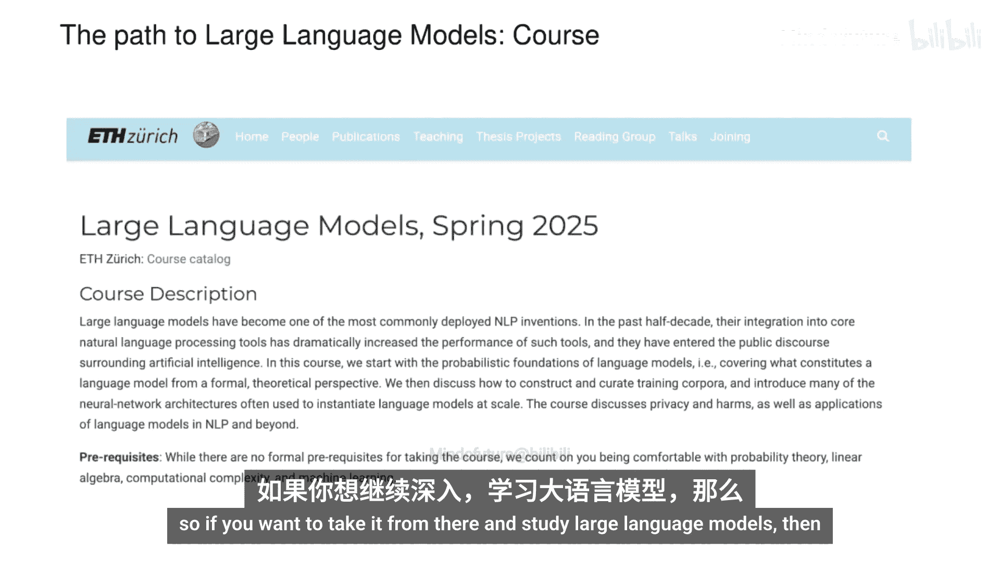

Then you can do it in your methods next year。So now we are almost at the break。

 Do we already have Ts。😊，Not yet on Josh。 So what we will do， maybe they can't have a break。

 but that means Josh that you will get all plus because now we are going to give a bigger plus to the T A team。

And so， Josh， you receive here all the appreciation in the applause。

So thanks a lot for the amazing work this semester。

 the C team is still working very hard on the preparation of the exam， which will be in in August。

 Sp of the exam。😊。

Everything here is that we covered in the lecture is material， except when I said it's not。

 So the slides， the recordings， the textbook， the theoretical exercises， the practical exercises。

The click of questions。You really should read the textbook if you haven't done so。

It's more or less the same thing as in the lecture。

 but gives you another perspective by other people。 And so it's good to learn。😊。

Consolidate everything since it's exactly 11， maybe we'll take the break。 And right after the break。

 I'd explain， you know， the exam model what to expect。

Then we'll give the prizes to the lucky winners。 We're not lucky competent winners of the。

 of the mystery game and， and then we'll proceed to the， to the quiz game， right。

 So I see you in 15 minutes。😊。

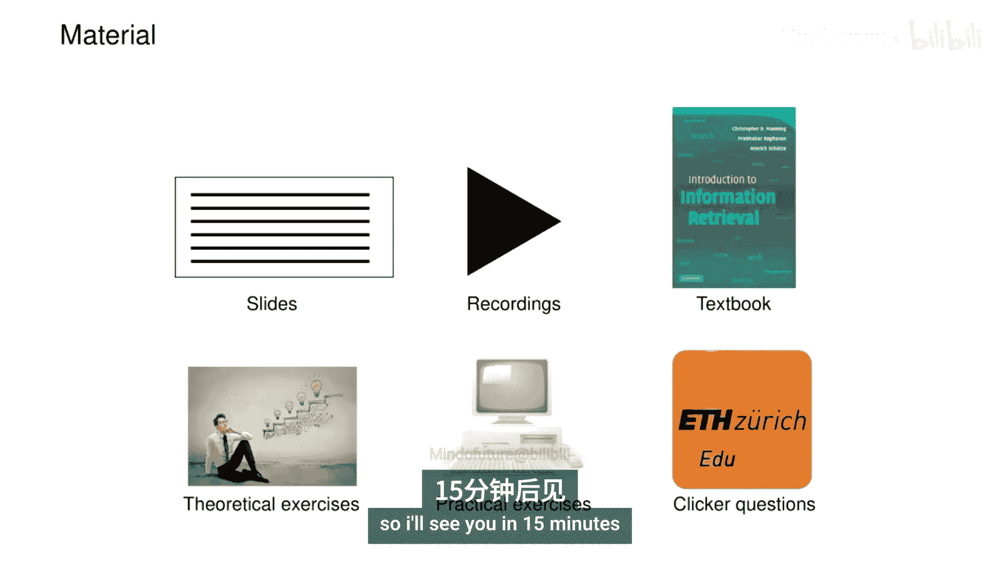