# 信息检索：P31：总结 (1/2) 🎓

在本节课中，我们将对本学期所学的信息检索知识进行一次全面的回顾与总结。我们将从高层次梳理所有核心概念，理解它们之间的联系，并简要展望这些知识如何通向现代大型语言模型。

---

## 课程回顾：从布尔检索到向量空间

上一节我们介绍了本课程的总结框架，本节中我们来看看本学期所涵盖的广阔知识体系。你们已经掌握了大量的新知识。

现在再看第一周课程中的这张幻灯片，你们应该会感到熟悉，因为你们已经理解了其背后的含义。

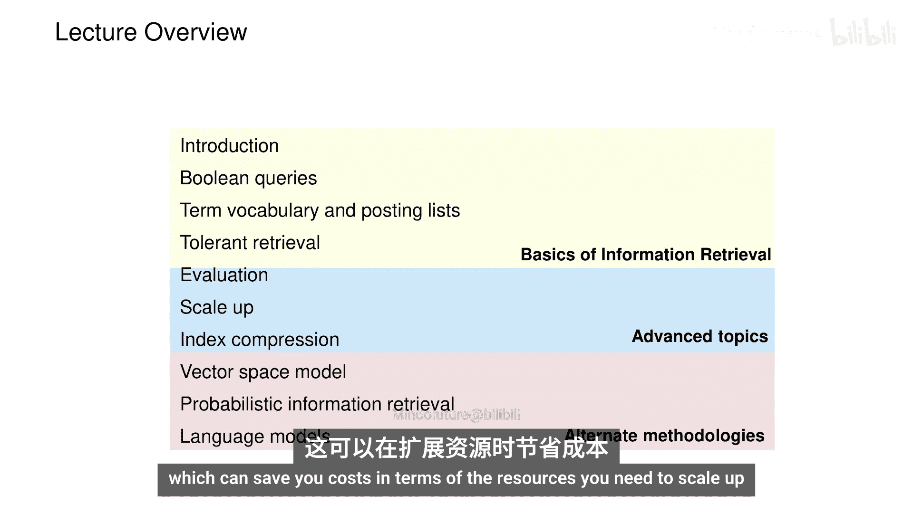

我们学习了最早的**布尔查询**系统。
接着，我们探讨了**语言处理**，发现将数据构建成索引并非易事。
我们学习了如何处理**容错检索**，如何**评估系统**，以及如何为更大规模的集合**扩展索引和搜索引擎**的构建。
我们看到了**数据压缩**技术，这能帮助我们在扩展时节省资源成本。
然后，我们进入了通常属于硕士阶段的高级信息检索领域，包括**向量空间模型**、**概率信息检索**和**语言模型**。
你们看到了后两者与向量空间模型的联系：概率模型为**逆文档频率**提供了理论依据，而语言模型则为**词项频率**提供了理论依据。正是这两者共同构成了向量空间模型中的 **TF-IDF**。

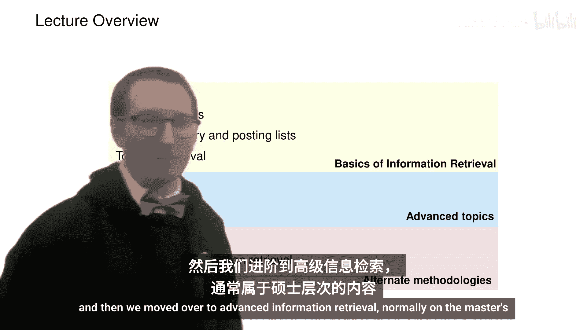

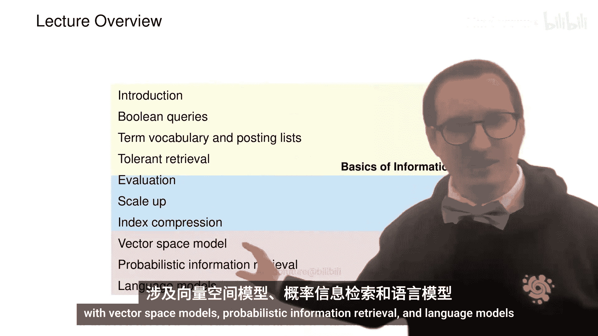

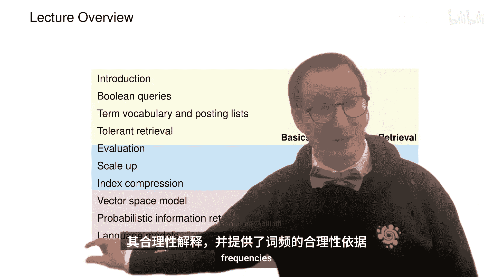

所以，我喜欢说这实际上是一门数据库课程，因为我们学习了如何存储、查询以及高效地查询数据，使用特定的查询语言并获得结果。

从某种意义上说，这是关于**第五种数据形态**的课程。我们学过数据库设计和建模中的**表格**，接下来在大数据课程中还会看到**立方体**、**树**和**图**。而在这门课中，我们处理的是**文本**。

但我想说，一个重要的新启示，尤其是在过去五年甚至十年里，是**将文本视为向量非常高效**。这一点在向量空间模型中已初现端倪，而随着像 ChatGPT 这样的大型语言模型的出现，使用向量和线性代数来处理文本和自然语言的方法得到了验证。

---

## 历史演进：从布尔系统开始

然而，在发展到这一步之前，历史上最早的信息检索系统并未使用向量或此类先进技术。最初的尝试只使用**布尔逻辑**。

这意味着，你可以编写一个查询，指定文档应包含或不包含哪些词项，使用合取、析取等逻辑运算符。我们有一个非常简单的查询语言：**AND**、**OR**、**NOT**。

它可以应用于一个输入文档集合，然后查询的输出就是该集合的一个子集，没有排名，没有特定顺序，只是返回一些文档。

实际上，曾有基于此的商业产品，尤其在图书馆和法律事务所中用于文本研究。

---

## 核心抽象：文档、词项与索引

接着我们看到，“文档”的概念在只有书籍和卷轴的古代似乎显而易见，但经历了数字化后，文档可以是网页、电影、声音、论文等许多不同的事物。

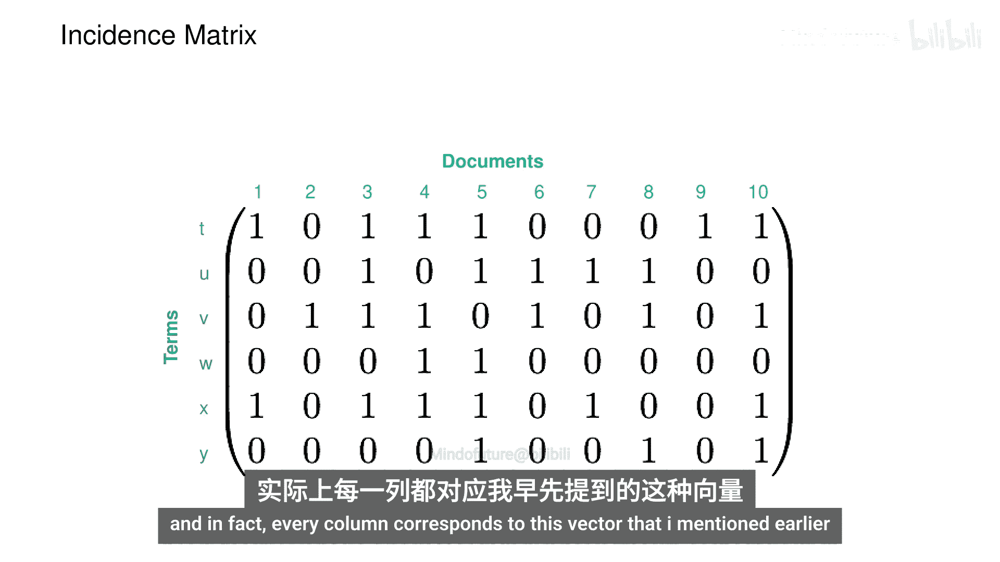

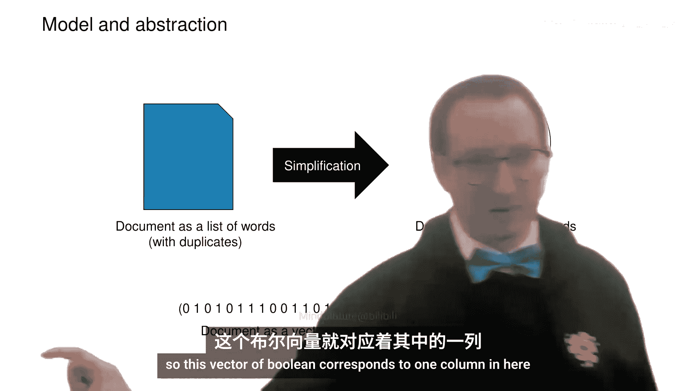

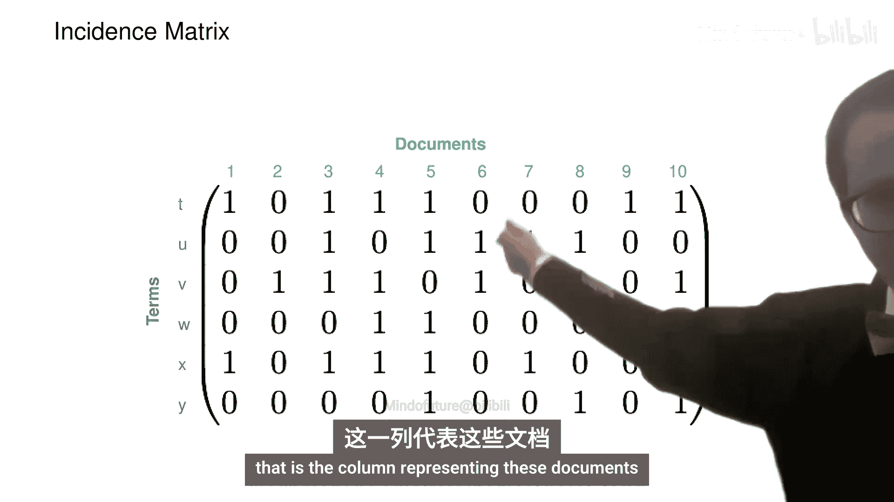

因此，我们有了**文档**这个抽象概念，它是构成集合的基本单位。我们有一个**文档集合**。

然后是**词项**，这是对语言世界的抽象。人类语言本质上基于一些可以在句法、语音、词汇等层面分析的标记。在信息检索中，我们喜欢在**词**的层面进行分析。

同样，我们还有**词项上下文**的概念，起初看似简单（只需看空格之间的内容），但实际上我们了解到这要复杂得多。

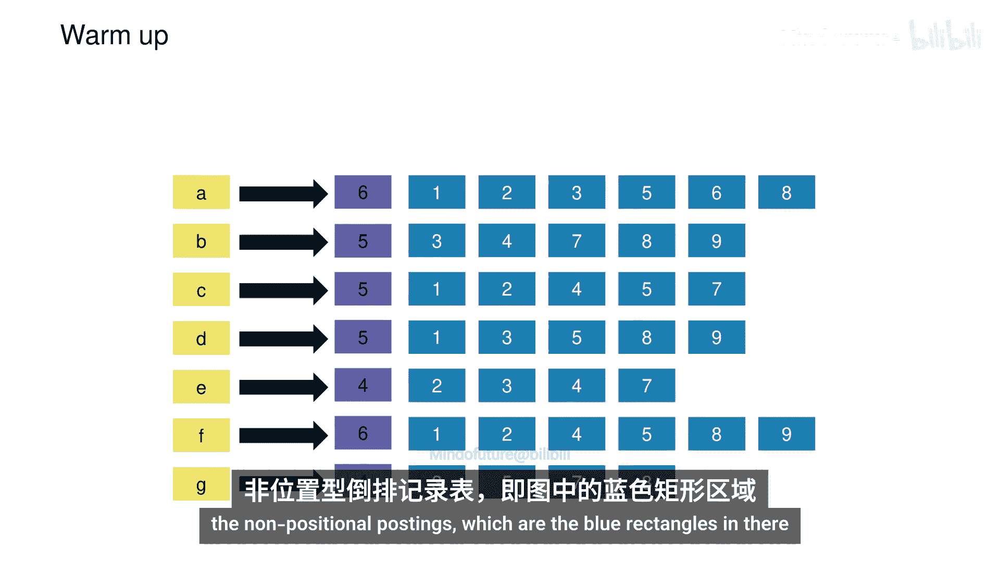

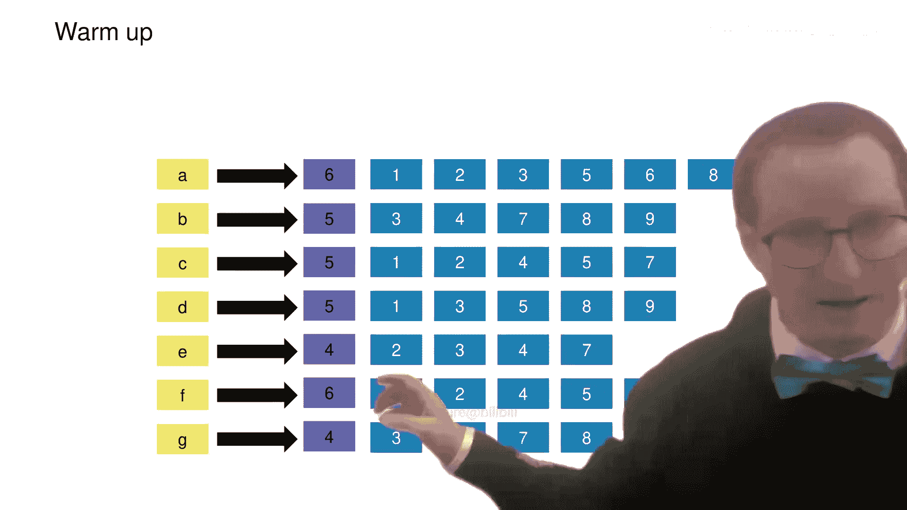

一旦完成了分词和所有预处理工作，我们就得到了词项。现在我们有了一个非常抽象的模型：一个文档集合，文档包含或不包含我们感兴趣的词项。我们可能关心词项出现的次数，也可能关心它们出现的顺序。但从数学角度看，仅用集合、文档、词项（词袋、词表、语义）这种高层次视角来看待问题，就蕴含着巨大的力量。

对于布尔检索，我们可以使用**词项集合模型**，即一个词项要么属于一个文档，要么不属于。

这意味着任何文档都可以用一个**布尔向量**来表示。**1** 表示该词项在文档中，**0** 表示不在。重要的是，向量的结构是每个位置对应一个词项。我们有一个任意的词项顺序，每个词项对应向量中的一个位置，其值为 1 或 0。这与后来的语言模型不同，在旧系统中，每个词项确实对应向量中的一个位置。

我们研究了几种表示方法，其中一种是**词项-文档关联矩阵**，行代表词项，列代表文档。实际上，每一列都对应前面提到的那个向量。一个文档的布尔向量就是矩阵中代表该文档的那一列。

然而，为了执行查询，这种表示效率极低，存在大量零值，占用大量内存和时间。

因此，为了高效处理查询，我们构建了所谓的**索引**。索引并非信息检索独有，它是数据库系统中的通用概念，指在原始数据（集合）之外额外构建的数据结构。构建索引需要空间和时间成本，但一旦建成，就能基于它高效处理查询。

在标准倒排索引中，我们有词项（黄色部分）、文档频率（紫色部分，即包含该词项的文档数量）以及**倒排记录表**（蓝色矩形）。这里的倒排记录是非位置性的，是 `(文档ID, 词项)` 对。

一旦有了这个索引，我们就可以将布尔查询映射到索引操作上。例如，对于 **AND** 操作，我们求倒排记录表的交集；对于 **OR** 操作，我们求并集。由于倒排记录表是有序的，我们可以用线性时间完成这些操作，只需用指针同时遍历它们即可。**NOT** 操作也能高效执行。

这一切在有了词项之后很美妙，但难点在于如何获取词项。我们花了整整一周时间来探讨如何将文档映射到包含/不包含哪些词项，并发现由于人类语言的复杂性，这相当棘手。

收集文档、分词、语言预处理、构建索引，所有这些实际上都非常复杂，但我们现在掌握了一些工具来完成这些工作。

---

## 关键概念辨析与索引优化

我几年前制作了这张幻灯片，因为很容易在众多术语中迷失。我想借此澄清，根据你指的是处理前还是处理后的概念（“处理”指经过语言预处理，如识别不同时态下的相同词项），以及是否与特定文档（甚至位置）绑定，我们大致有六种概念。

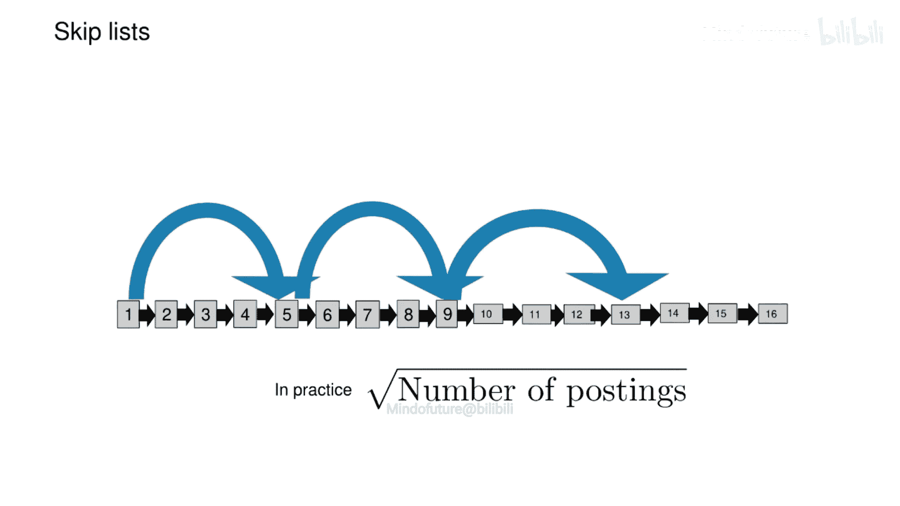

如果它是原始的且与特定位置绑定，我们称之为**位置型词元**。
如果与文档绑定但无位置信息，则是**非位置型词元**。
如果尚未处理且不与任何特定内容绑定，可以称为**词**或**未归一化词型**。
经过处理后，我们基本上就有了**位置型倒排记录**、**非位置型倒排记录**和**词项**（即归一化词型）。词项对应索引中的黄色部分，是处理后的结果。非位置型倒排记录对应蓝色部分，而位置型倒排记录则对应如果我们把索引变成位置索引时的蓝色部分。

我们看到，有些词项因为其倒排记录表几乎包含整个集合而可以完全跳过，这样能节省空间。这在计算资源和存储空间有限的六七十年代尤为重要。这些词被称为**停用词**，它们因出现过于频繁而无助于区分文档，故被移除。

我们还看到，作为将词元处理为词项的一部分，我们可以使用**查询扩展**，既可以在索引端扩展，也可以在查询端扩展。当然，在拥有大型语言模型的今天，这看起来有些原始，因为 LLM 可以直接利用嵌入向量来完成这类事情。

在算法和机械层面，我们有**词干提取器**，它允许你将词语分组到不同类别以获得词项。同样，这现在已被使用嵌入向量的 LLM 所取代。

我们看到，如果倒排记录表非常稀疏，可以使用**跳表指针**，让你直接跳转到其他位置。更准确地说，当你想计算一个非常稀疏的倒排记录表与另一个不那么稀疏的表的交集时，你可能希望直接跳转到相关记录。例如，如果一个倒排记录表包含 `[1, 11]`，另一个包含 `[1, 5, 9, 11]`，使用跳表指针，你可以直接从 1 跳到 5，再跳到 9，然后到 11，而无需遍历中间项。这是跳表指针的思想。

这与我们几周后看到的**多层跳表**概念相关。你可以有更多层级，这类似于选择自行车、火车、飞机等不同交通工具。在向量数据库中，当寻找接近查询的特定向量时，这种多层跳表结构非常有用。尽管一个用于倒排记录表，一个用于向量数据库，但从理论计算机科学的角度看，它们是相同的“跳跃”思想。如果你想用花哨的术语，它们基本上就是带有额外单链表或双链表层的链表，你可以在图结构中上下移动。

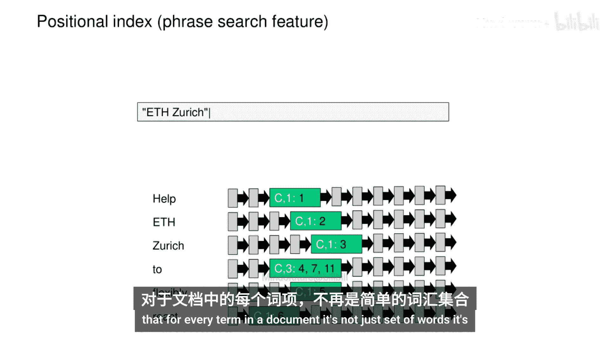

---

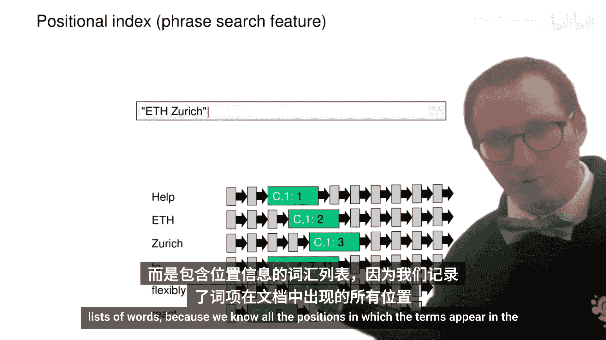

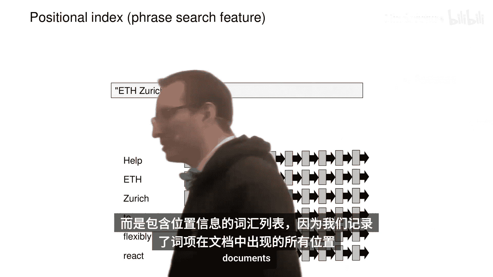

## 索引的变体与高效查找

接着我们看到，我们可以改进标准倒排索引（之所以叫“标准”，是因为我们可以修改它，产生不那么标准的变体）。

其中一种变体是使用**词对**甚至三词、四词组合作为索引项，这被称为**双词索引**、**三词索引**或 **K 词索引**。它的一个问题是可能返回误报，因此需要额外的工作来确保不会返回错误结果。你可以通过使用更长的窗口来减少误报，但更长窗口的问题是会扩大空间需求。当然，这个问题后来被 LLM 的注意力机制解决了。但了解历史视角和过去面临的挑战总是很重要的。

另一种处理短语查询的方法是**位置索引**。这次，我们拥有的不是非位置型倒排记录，而是位置型倒排记录。这意味着对于文档中的每个词项，我们不仅知道它是否出现，还知道它在文档中出现的所有位置。这让我们能够处理短语查询。

索引的目标是高效处理查询。为了高效查找词项，我们需要能够在标准倒排索引中高效地查找这些黄色部分的词项。这意味着标准倒排索引左侧的这些黄色词项被组织在某种数据结构中。

这又回到了理论计算机科学的算法和数据结构。我们有两类主要的数据结构来实现这种查找：**哈希表**（查找速度极快，但不能处理范围查询）和**树结构**（更准确地说，在数据库背景下是 **B 树** 或 **B+ 树**）。B+ 树是二叉搜索树的现代版本，它允许有多个子节点（如10个、20个）。这样做的主要原因与硬件有关：从磁盘读取数据时，你希望每次读取都能获取一个完整的块。如果只用二叉搜索树，每次读取的数据量可能很少，无法充分利用磁盘带宽，导致延迟效率低下。因此，哈希表和 B+ 树是最常见的索引结构。当然，还有更多结构，甚至在数据库中，人们也开始使用机器学习来学习定位词项的结构，而不是手动构建。

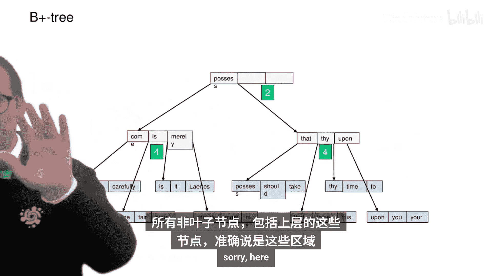

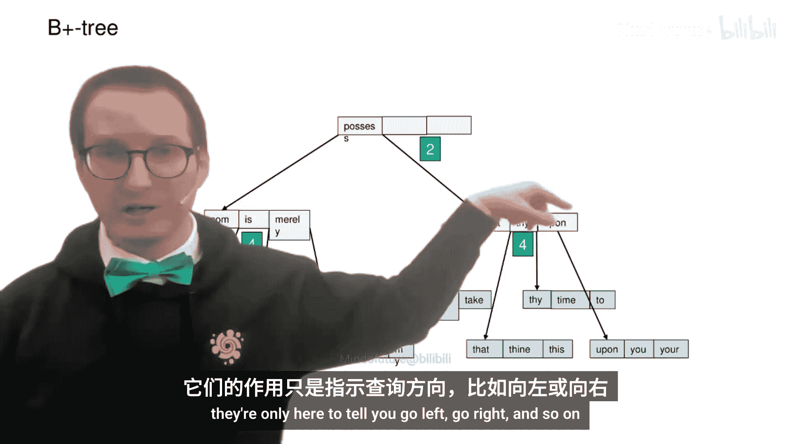

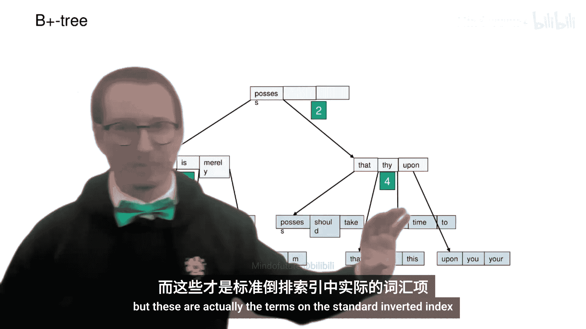

B+ 树看起来像这样。重要的是，在 B+ 树中，词项和倒排记录表位于树的底部（叶子节点），而所有非叶子节点仅用于引导查找，告诉你该向左还是向右走。实际与倒排记录表关联的词项位于叶子节点。

---

## 处理复杂查询：通配符、拼写检查与距离度量

接着我们看到，除了布尔查询和短语查询，我们还可以执行**通配符查询**。根据通配符的位置，处理难度不同。如果通配符在末尾，处理起来相对容易；如果在开头，则需要一个镜像索引；如果在中间，则可以使用**轮排索引**的技巧，即在词项后添加特殊符号（如`$`），然后旋转词项，使得通配符在末尾的情况转换为在开头的情况，从而构建包含所有旋转形式的索引。

另一种方法是计算 **k-gram**。k-gram 的概念与 K 词索引完全相同，只不过单位从“词”变成了“字母”。例如，“computer”的 3-gram（假设首尾添加了 `$` 符号）可能是 `$co`, `com`, `omp`, `mpt`, `pte`, `ter`, `er$`。通常 2-gram 或 3-gram 很常用。这对于拼写检查也很有用，当你想纠正拼写错误时，k-gram 会很有帮助。

另一种度量词间接近程度的方法是**编辑距离**，即计算两个词之间需要多少编辑步骤（插入、删除、替换）才能相互转换。这可以通过**动态规划**高效解决，即填充一个二维网格，最终得到右上角的数字，即两个词之间的编辑距离。这也被称为 **Levenshtein 算法**。值得一提的是，你在 GitHub 上比较两个分支差异时使用的算法也是这个，只不过比较的单位从字母变成了代码行。

另一种计算词间相似度的方法是 **Jaccard 系数**，它计算两个词 k-gram 集合的交集大小与并集大小的比值。注意，这不是距离，而是一个相似度系数，因为当两个词完全相同时，其值为 1；完全不相同时为 0。你可以通过数学变换将其转换为距离。

还有一种寻找发音相近的词的方法是 **Soundex 算法**，它基于词的发音进行编码，但这主要针对英语语言。现在有了人工智能，我们有更好的方法将词映射到语言，但 Soundex 是历史上的先驱。

---

## 硬件考量与索引构建

从硬件角度看，我们了解到，要想让任何东西运行得快，别无选择，必须理解硬件、内存、磁盘的速度和成本。你需要花时间了解这些。

缓存和 RAM 比磁盘或磁带昂贵得多，但也快得多，不过容量也小得多。你需要在脑海中建立关于价格、速度和容量的层次结构，并知道前两者需要电力来维持数据，而后两者即使断电数据也能保存。

一旦了解了这些，你就能设计出更高效的索引构建算法。我们看到的一个技巧是用**词项ID** 替代词项本身，就像给文档分配文档ID一样。在索引构建过程中，`(词项, 文档)` 对可以转换为 `(词项ID, 文档ID)` 对。

第一代索引构建算法是 **BSBI**，它分批处理集合，每次处理一个分区，创建 `(词项ID, 文档ID)` 对，最后合并它们。

第二代算法是 **SPIMI**，它改进了 BSBI，不使用词项ID技巧，而是直接为每个批次构建部分标准倒排索引，最后再合并。这适用于数据无法完全放入内存但可以放入磁盘的情况。

如果数据连磁盘也放不下，那就需要使用 **MapReduce**，这是大数据方法，用于索引整个互联网，利用数据中心集群。同样，你处理的是 `(词项, 文档ID)` 对，在数据中心环境下，不需要词项ID，因为有充足的空间。谷歌或必应等搜索引擎就是这样构建的。

---

## 处理动态数据与压缩技术

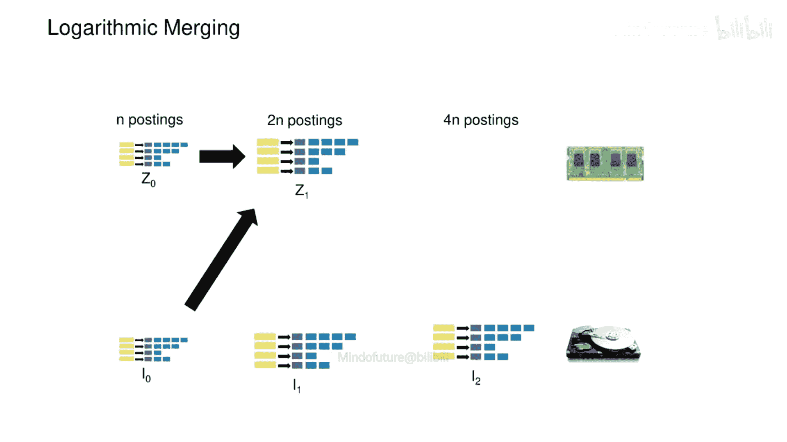

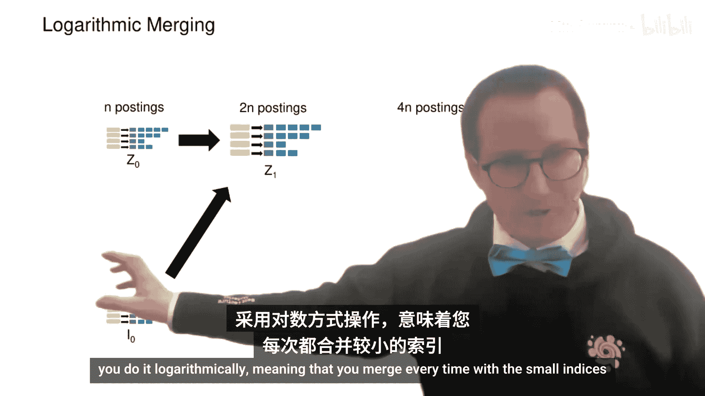

我们遇到的下一个问题是，互联网每天都在变化，网页被编辑，新内容被添加。如果你想维护一个搜索引擎，它必须持续更新以反映互联网的最新状态。

处理这个问题的一个技巧是**对数合并**。你持续用最新数据构建一个新的、较小的索引，然后将其合并到更底层的索引中。这有点像考古学和化石分层，你以对数方式进行合并，即每次合并较小的索引，当某个大小的索引积累到一定数量时，就将它们合并，使索引大小翻倍。越往右，数据越旧。这是一种从算法复杂度角度处理索引定期更新的技巧。

接着我们看到，能够扩展并购买更多机器固然好，但成本高昂，尤其是对于初创公司。实际上，更高效的方法是尝试**压缩**数据，仅用一台机器完成任务。许多初创公司的第一个原型只需要一台机器。

为此，我们研究了一些统计规律。基于实验的 **Heaps‘ Law** 告诉我们，随着集合不断增长，添加越来越多的书籍，唯一词项的数量如何增长。我们发现，它大致与集合大小的平方根成正比，这有些令人惊讶。

与之相关的第二定律是 **Zipf‘s Law**，它描述了词项的**集频**如何演变。如果按集频降序排列词项并绘制其集频图，会发现它近似服从一条双曲线，即集频与排名的倒数成正比。

基于这些规律，我们找到了压缩方法。我们可以压缩黄色部分的**词典**，也可以压缩蓝色部分的**倒排记录表**。一种朴素的方法是**可变字节编码**，可以节省一些空间，但更好的方法是 **Gamma 编码**，它是弹性且自适应的。

记住，关键技巧在于倒排记录表是递增的整数排序列表，我们只需要编码整数之间的**间隙**，而不需要编码实际的整数本身，因为间隙总是正数。

顺便提一下，出于好奇，我实际上已经将这种方法扩展到了编码任何十进制数。它只是在指数部分使用 Gamma 编码，你可以用这种方式编码所有十进制数，并且可以直接在比特位层面比较两个数的大小。但这不属于课程内容。

---

## 排序检索与向量空间模型

接着，我们进入了需要**对结果进行排序**的新一代检索系统。这对人们来说更熟悉，因为使用谷歌、必应等现代搜索引擎时，你会得到前10个结果，点击“下一页”得到接下来的10个，依此类推。我们需要对文档进行排序并计算得分。

我们看到，可以使用关系数据库和基于图书元数据的表单来实现这一点（图书馆过去就是这样做的），但这有些局限，因为你无法触及图书的全文内容。

但如果我们深入全文，查看图书的实际内容，我们可以基于**词项频率** 和**文档频率**（更准确地说，是**逆文档频率**）来计算得分。这样，我们可以将文档表示为向量，每个词项对应一个坐标，其值为 **TF-IDF**（词项频率与逆文档频率的乘积）。

然后，我们可以使用**点积** 来计算文档向量与查询向量之间的相似度得分。这是一个了不起的洞见：你可以使用线性代数来计算得分。这意味着文档现在是由数字组成的向量，而不仅仅是布尔值。你拥有一个向量空间，所有文档和查询都是这个空间中的点或向量。现在的美妙之处在于，定位那些最接近查询的文档，它们就是你的结果，越接近的文档在输出中排名越高。

技巧在于使用向量之间的**夹角**，这可以通过点积来计算，如果你愿意，还可以将其归一化。点积之所以受计算机科学家喜爱，是因为它就是一个大的求和运算。

实现方式是：遍历倒排记录表，将 `xi * yi` 累加到对应的“桶”（即文档得分）中，然后找出得分最高的那些，它们就是结果。

我们看到，尽管 TF-IDF 是教科书上的标准方法，但它有很多变体。你可以只用 TF 不用 IDF，可以使用 TF 的对数，甚至可以使用布尔值。这些变体可以用一组六个字母的代码来编码，以说明在查询和文档中使用了哪种约定，这被称为 **SMART** 表示法，因为 SMART 是第一个实现该功能的系统名称。

所有这些催生了**向量数据库**。我认为大型语言模型也在一定程度上推动了向量数据库的热潮。人们意识到，向量在技术上变得如此重要，以至于我们可以像构建关系数据库、图数据库一样构建专门的向量数据库。这是一个重要的扩展领域，例如在 PostgreSQL 中，你可以创建向量，插入它们，然后在 SQL 中计算 L2 距离（欧几里得距离）、L1 距离（曼哈顿距离）、内积（点积），如果对内积进行归一化，就得到了我们在向量空间模型中一直使用的**余弦距离**。所有这些都可以通过向量数据库非常高效地执行，目前有大量关于如何高效实现的研究。

---

## 概率模型与语言模型：TF-IDF 的理论基石

但是，我们能够使用向量空间并将文档视为数字向量的洞见，实际上源于**概率信息检索**。虽然我们在课程最后才学习它，但历史上它出现得更早。

因为人们试图通过概率来对文档按相关性进行排序，通过 **Elizondo 实验** 等方法，实际上可以推导出一个公式，而这个公式正是向量空间模型中点积运算的基础。最初的洞见就来自这种方法。

然后我们意识到，这给出了 **IDF** 的理论依据。而 **TF** 的理论依据则来自**语言模型**。这就是历史上我们如何从概率方法推导出向量空间模型和点积运算的过程。

接着是**语言模型**，这是我们上周学习的内容，它比 LLM 简单，只生成文档中的词项。你可以计算生成某些词项的概率，我们做了一些假设（如 `P_stop`, `1-P_stop`），以及我们只“记忆”过去两个文档的情况，这给出了生成文档的概率。

我们看到，在没有任何记忆的情况下，我们想要将文档分组到那些拥有完全相同词项但顺序不同的“词袋”中。这很重要，因为计算有多少种组合、多少种顺序，能让我们精确地写出公式，从而将词序列方法转化为词袋方法，两者之间的区别就在于需要乘以的这些因子。

最后，我们通过一个思想实验推导出一个检索模型：你收到一个查询，随机选取一个文档，基于该文档创建一个语言模型，用它生成一些文本，恰好生成了这个查询。然后你问自己：如果发生了这种情况，我最可能选取的是哪个文档？这恰恰给了我们一种基于此对文档进行排序的方法。并且，惊喜的是，我们又得到了一个点积运算，但这次是基于词项频率。正如我们从概率方法中得到 IDF 一样，我们从语言模型这里得到了 TF，这两者共同构成了向量空间模型中的 TF-IDF。

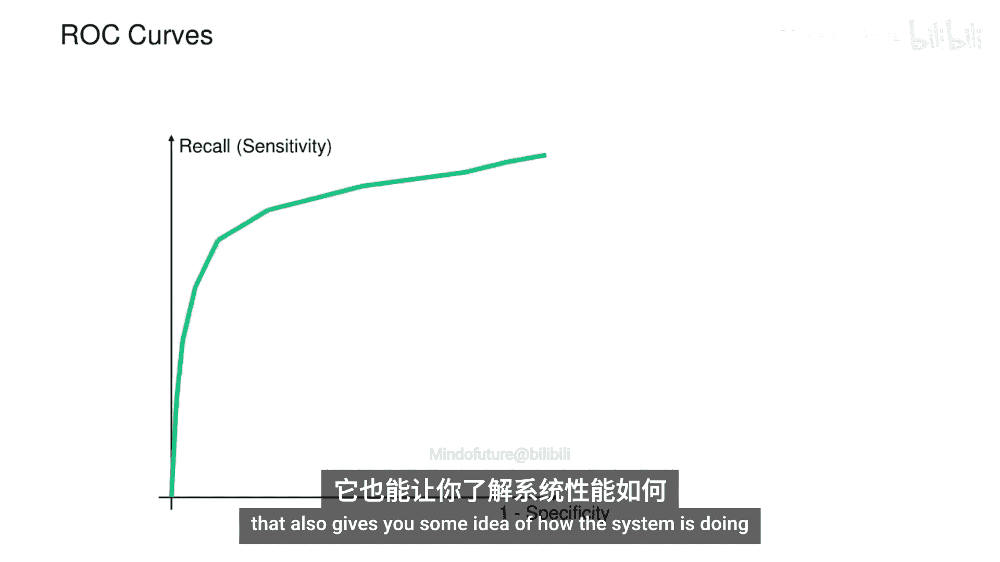

---

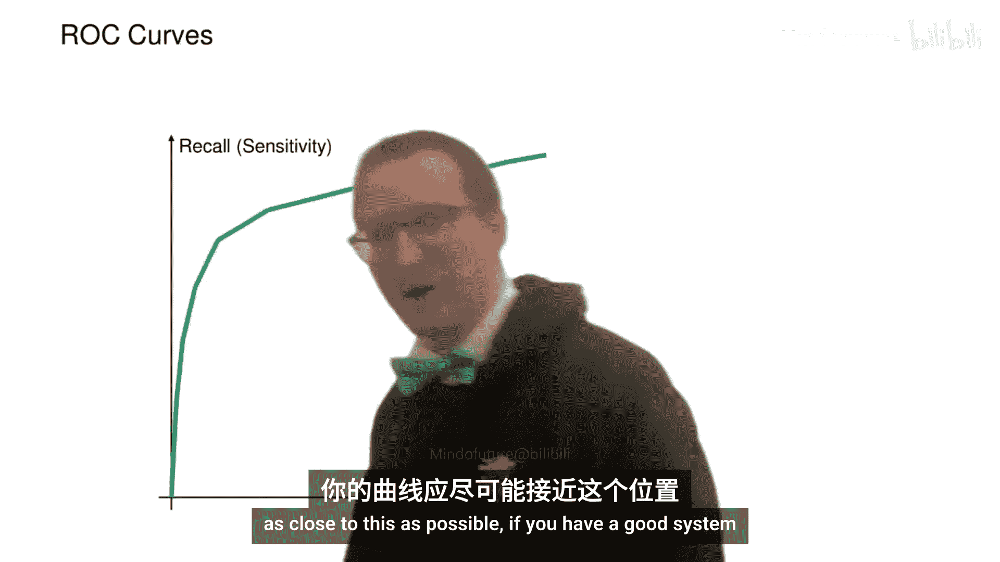

## 系统评估指标

为了评估系统，我们使用了**精确率**、**召回率**、**特异度**。对你们来说，这些已不再神秘。至于 **F1 分数**，实际上没什么人用。我还没发现全世界有谁在用“穷举率”或“哭喊率”这样的术语。这里我想说的是，除了精确率、召回率、特异度这三者，其他指标并不常用。为了完整性，F1 分数是精确率和召回率的**调和平均数**，在实践中确实有时会用到。

对于排序系统，我们有这样的曲线：你不断点击“下一页”，每次更新精确率和召回率，绘制出的曲线就是**精确率-召回率曲线**。

另一种来自电子学的方法是 **ROC 曲线**，它也能给出系统性能的一些信息。你希望 ROC 曲线尽可能接近左上角，这表示系统性能好。

---

## 通向大型语言模型

现在，我们已经完成了所有内容。我想现在过渡到**大型语言模型**。你们明年春季可以选修 LLM 课程。

首先，第一个区别是**规模**。本学期我们看到的系统规模较小，但 LLM 之所以“大”，是因为它们在规模上走向了极端：处理的词元数量、连接的规模都是海量的，涉及整个互联网。这是信息检索与 LLM 的第一个区别。

第二个区别是**分词**。在信息检索中，我们保持简单，主要使用空格分词（尽管语言预处理仍然适用）。但在 LLM 中，我们不再关心空格。LLM 可以“吞下”任何东西，你可以对任何内容进行分词。这使用了信息论和熵的考虑来寻找最优的分词方式。即使你训练一个不懂“街道”这个词的 LLM，你仍然可以用“街道”来调整它，它就能处理它。因此，LLM 的分词能力更强大，词元不再仅对应于由空格分隔的“词”。

第三个区别是**向量表示的含义**。在传统信息检索中，当使用向量时，向量的每个坐标对应一个词项（例如，第一个数字对应第一个词项，第二个数字对应第二个词项）。你的向量可能有50万或100万个坐标，每个词项对应一个布尔值或数字。在 LLM 中，情况不再如此。向量对人类来说不再具有直观含义。我们仍然使用向量、向量数据库、点积和邻近度计算，但向量的坐标不再对应具体的词项，它对应的是某种抽象的东西。我们只是将文档和文本放入那个向量空间中，但以一种我们并不真正理解的方式。当然，这是一个鸡生蛋蛋生鸡的问题：我们如何创建一个向量空间并以我们不理解的方式放置文档？这就是机器学习的魔力。我们实际上是通过学习来构建的。我们创建拥有数十亿、数万亿权重（参数）的系统（神经网络），这些神经网络学习如何将文档放置到向量空间中，如何放置这些点。这是在满足我们所有目标约束的条件下学习出来的，它学会了以一种恰好能工作、能理解或创造数据语义的方式来放置点。因此，左边（传统 IR）没有机器学习，我们可以通过编程实现；右边（LLM）我们使用机器学习将点放入向量空间，这种方式对人类来说没有直观意义，但恰好能理解或创造数据的语义。

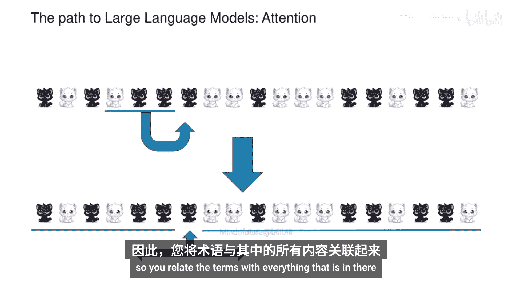

另一个区别是**注意力机制**。在传统的语言模型中，我们有马尔可夫链，只关注前面两三个或四个词项。但在 LLM 中，我们不再这样。我们关注所有内容，甚至包括“未来”的内容，而不仅仅是过去。因此，我们有了**注意力机制**。你不再仅仅看过去的几个词项，而是关注其中的所有内容。例如，如果你有一个代词如“我”、“你”、“他”、“她”，你会将其与可能指代的人或名词的其他位置关联起来。这就是注意力机制的一部分。当然，在生成内容时，有一个技巧是屏蔽未来的部分，因为你无法知道未来。所以在生成时，你使用一个掩码来隐藏未来部分，只基于已有文本进行生成。

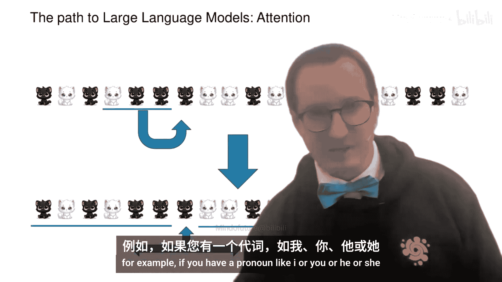

最后，所有这些意味着，我们现在不仅可以用于搜索和排序，还可以用于**翻译**（甚至是实时翻译）、**生成文本**、**总结**等。搜索也变得非常有用，当你在互联网上搜索某个内容时，它实际上可以“理解”你在寻找什么（就我之前提到的查询扩展而言，例如“电梯”和“升降机”）。现在，这种语义搜索几乎是原生完成的。

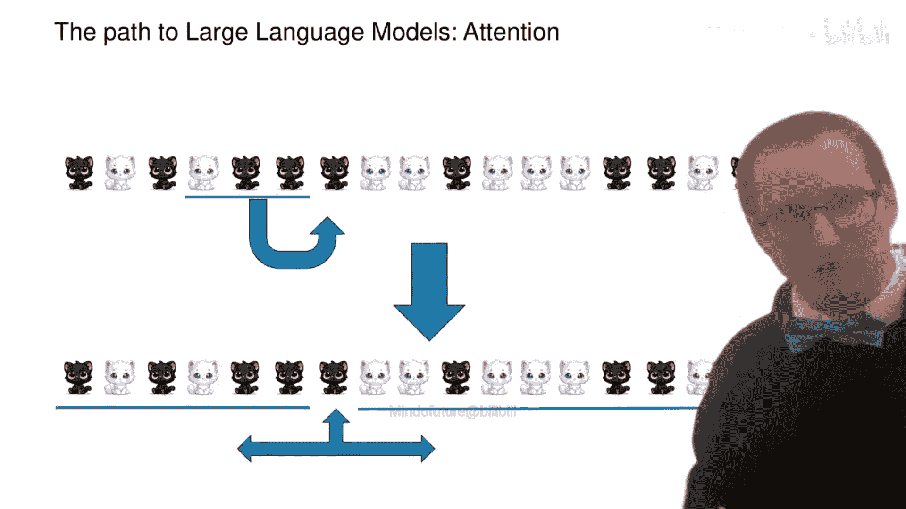

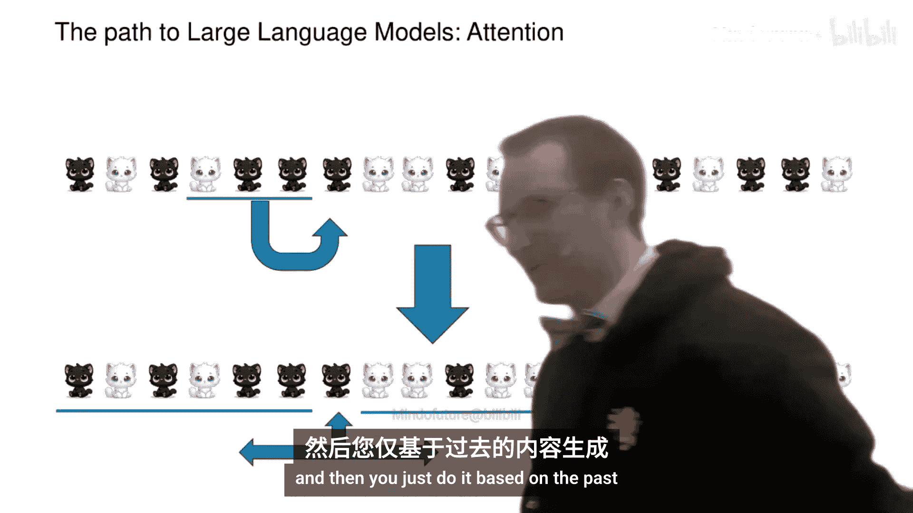

以上是 LLM 课程的“开胃菜”，该课程由 Ryan Cotterell、Marco Baroni 和 Thomas Hofmann 教授，通常每年开设。如果你们想继续深入学习大型语言模型，明年可以在硕士阶段选修。

---

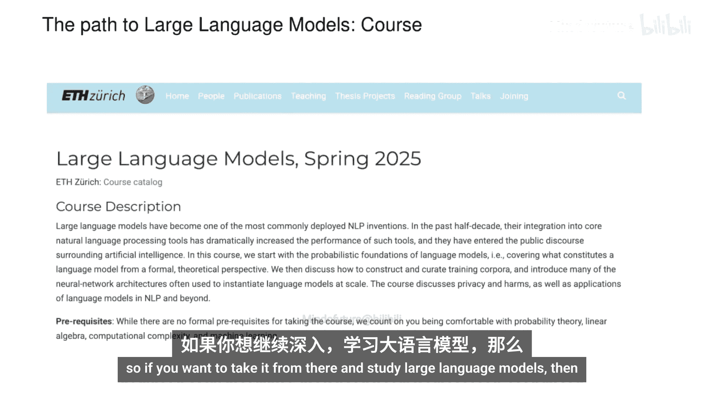

## 课程总结与后续安排

本节课中，我们一起回顾了信息检索课程的核心内容，从基础的布尔检索、索引构建，到高级的向量空间模型、概率模型和语言模型，最后展望了这些知识如何构成现代大型语言模型的基础。我们涵盖了文档与词项的抽象、各种索引结构与优化技术、查询处理与扩展、系统评估方法，以及硬件和规模化的考量。

现在，我们即将进入课间休息。休息之后，我将解释考试模式、注意事项，然后为神秘游戏的幸运（也是能力出众的）获胜者颁发奖品，接着进行问答游戏。

我们15分钟后见。