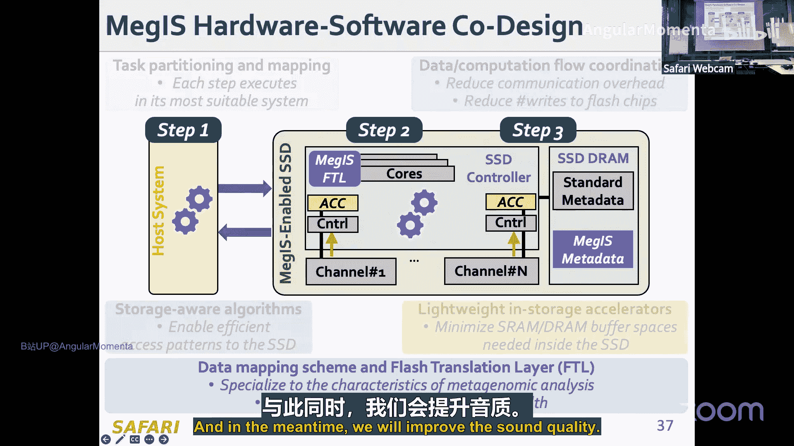
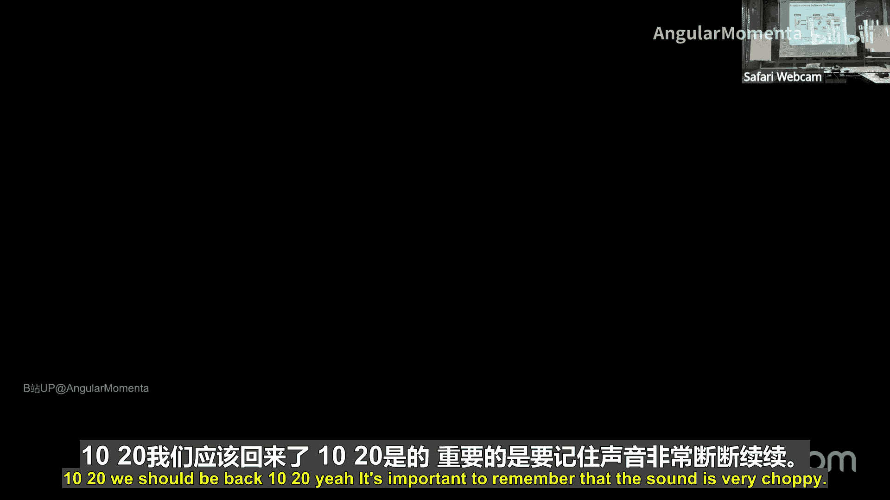
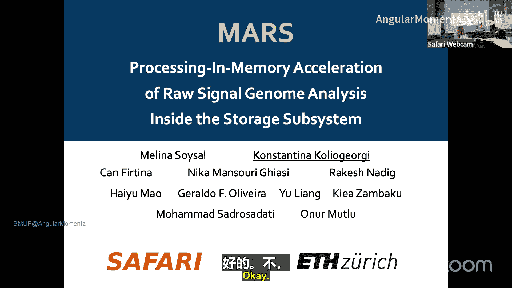
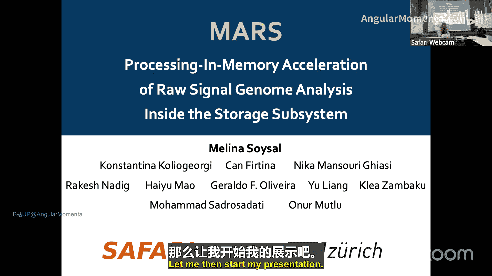
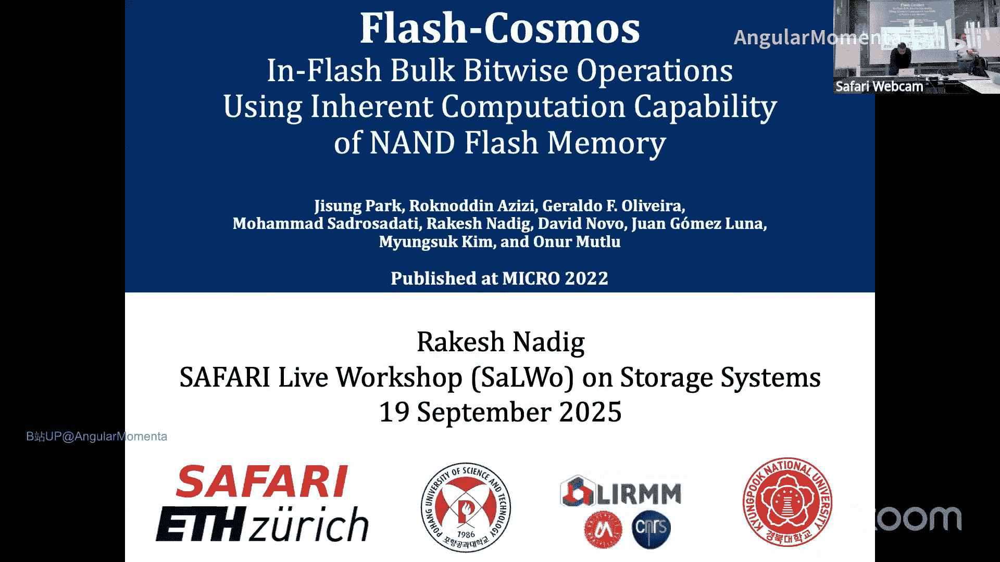
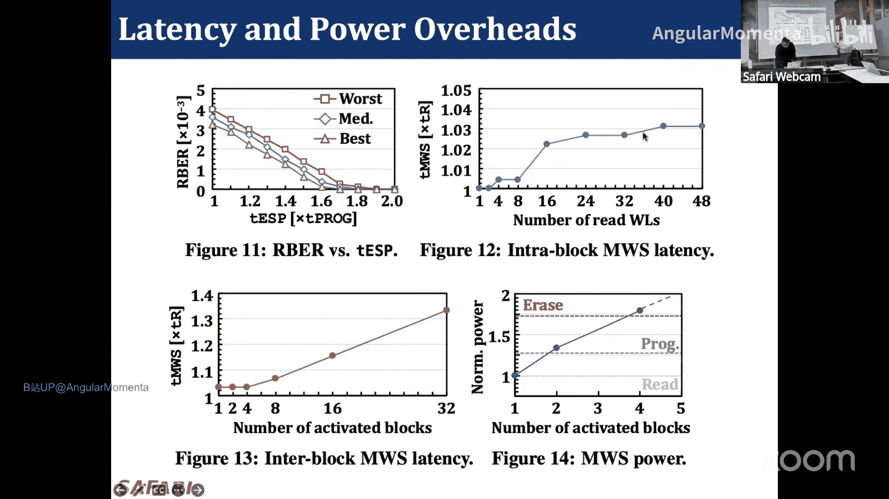
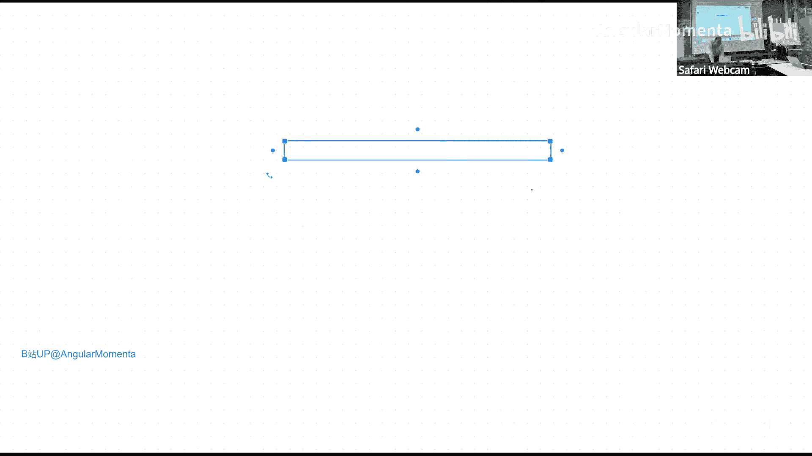
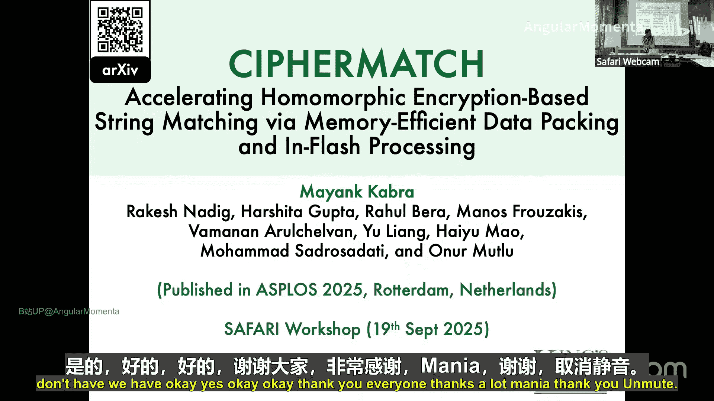
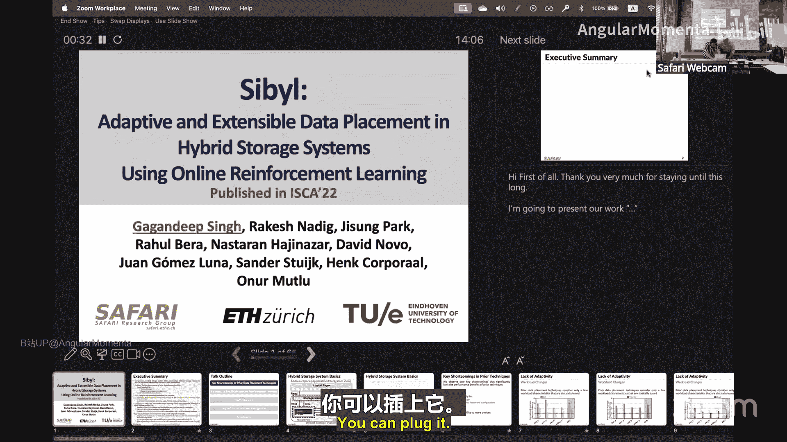
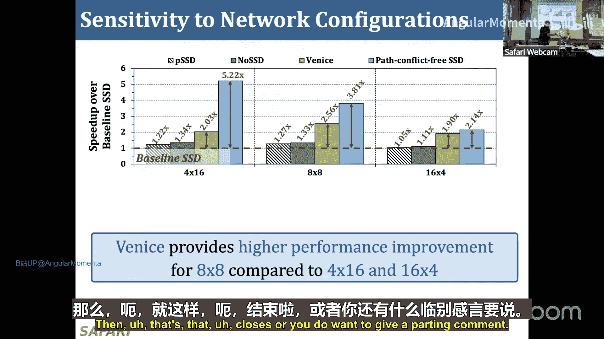

# 001：课程笔记与教程整理

在本课程中，我们将学习苏黎世联邦理工学院（ETH Zurich）SAFARI研究组在2025年首次存储系统现场研讨会（SaLWo）中分享的一系列前沿研究工作。这些工作聚焦于存储中心计算，旨在通过近数据处理、算法-硬件协同设计等方法，解决现代数据密集型应用（如大语言模型、基因组学、安全计算等）中的数据移动和计算瓶颈问题。

---

## 章节 1：RISE：存储内处理的高性能检索系统

上一节我们介绍了本次研讨会的背景和主题，本节中我们来看看首个关于检索增强生成（RAG）优化的研究。

**问题**：检索增强生成（RAG）流水线在主机和存储系统之间产生了显著的数据移动开销。同时，现有的存储内处理（ISP）方案仅加速了RAG中的最近邻搜索阶段，并且引入了显著的面积和功耗开销。

**目标**：通过加速最近邻搜索和文档检索，同时无需修改存储系统，来缓解RAG的数据移动开销。

**解决方案**：RISE系统引入了三种关键机制：
1.  **高效的、为ISP定制的倒排文件（IVF）算法实现**。
2.  **低成本的嵌入向量到文档的链接机制**。
3.  **利用SSD内现有计算资源的近似最近邻搜索（ANNS）引擎**。

**核心设计**：
*   **数据库布局**：为嵌入向量和文档创建独立的存储区域。嵌入向量使用增强型SLC编程模式存储，以提供可靠的ISP操作；文档存储在TLC中，以提供高存储密度。两者都连续存储以避免地址转换开销，并通过闪存页面的带外区域链接。
*   **ANNS引擎**：采用IVF算法和二进制量化。搜索过程分为粗粒度（识别最近簇）和细粒度（在簇内搜索）两个阶段。计算在闪存芯片的页缓冲区和外围电路中进行，距离计算完成后，结果被传输到SSD的嵌入式处理器进行最终排序和选择。
*   **优化**：包括距离过滤、多平面输入广播和流水线操作，以进一步提升性能。

**关键结果**：
*   与CPU搜索相比，吞吐量平均提升 **15倍**，能效平均提升 **55倍**。
*   将RAG流水线中的文档检索延迟降低至总运行时间的 **0.2%** 以下。
*   性能超越现有的先进ANNS加速器（如ND搜索）最高达 **2.5倍**。

**总结**：RISE是首个利用存储系统内现有计算资源、通过存储内处理来加速RAG检索全流程的系统，显著消除了数据移动瓶颈。

---

## 章节 2：存储中心系统在基因组学和宏基因组学中的应用

上一节我们探讨了如何优化大语言模型的检索，本节我们将视角转向生命科学领域，看看存储中心计算如何加速基因组和宏基因组分析。

**问题**：基因组和宏基因组分析需要对海量数据进行昂贵的计算，因此受到计算和数据移动开销的严重制约。现有的加速方案（如专用硬件、高效启发式算法）主要缓解了计算瓶颈，但来自存储系统的数据移动开销影响变得更为突出。

**目标**：论证并展示存储中心系统设计在基因组学和宏基因组学中的巨大潜力。

**解决方案概述**（基于SAFARI研究组的系列工作）：
以下是该方向一系列工作的简要介绍：

*   **GenStore（用于基因组学）**：首个用于基因组学的存储内处理系统。核心思想是在SSD内部直接过滤掉不需要进行昂贵近似序列比对的读数（如完全匹配或无匹配位置的读数），只将需要复杂计算的读数发送到主机，从而显著减轻计算和数据移动负担。
*   **Midas（用于宏基因组学）**：首个用于宏基因组分析的存储内处理系统。采用**协同存储内处理**的设计理念，通过硬件-软件协同设计，在存储系统和主机系统之间高效地划分任务、编排数据与计算流，并辅以存储感知的算法优化和轻量级加速器。
*   **Grapes（用于基因组图）**：首个用于大规模基因组图分析的存储内处理系统。通过专门的执行流和调度使复杂的基因组图分析工作流更“存储友好”，并利用存储内和闪存内处理进一步提升性能、能效和成本效益。
*   **MARS（用于原始信号基因组分析）**：首个用于端到端原始信号基因组分析的存储内处理系统。通过软件改进（过滤技术、算术优化）和硬件系统（利用SSD内部DRAM进行存内/近存处理）的协同设计，加速分析流程。（Constantina将详细介绍此项工作）
*   **Sage（用于压缩基因组数据的高效分析）**：一种用于大规模基因组数据高压缩比存储和高性能访问的算法-架构协同设计。它支持仅使用轻量级硬件进行快速解压缩和高效流式访问，使得在资源受限环境（如便携式系统、近数据处理系统）中集成基因组分析系统成为可能。

**总结**：存储中心系统为基因组学和宏基因组学带来了显著的性能、能效和成本效益提升，同时也有助于提高系统的鲁棒性（如安全性和隐私性），有望推动这些关键应用得到更广泛的采纳。

---

## 章节 3：MARS：用于原始信号基因组分析的存储内处理系统

上一节我们概述了基因组学中存储中心计算的多个案例，本节我们将深入探讨其中一项具体工作——MARS，它专注于直接分析DNA测序仪产生的原始电信号。

**问题**：现代测序仪的数据生成通量极高，且许多应用有实时性要求，而原始信号基因组分析（RSGA）难以跟上这种速度。加速RSGA时，I/O数据移动成为最突出的开销。

**目标**：设计一个高性能、高能效的RSGA系统，同时解决I/O数据移动和计算瓶颈。

**解决方案**：MARS是首个用于端到端原始信号基因组分析的存储内处理系统。
*   **关键思想**：通过**目标软件修改**和**专用硬件组件**的协同设计，在SSD内部加速RSGA。
*   **软件优化**：
    *   **过滤技术**：在流程中集成频率过滤和基于投票的过滤，提前丢弃不可能产生有效匹配的候选序列。
    *   **算术优化**：将浮点值和操作转换为定点表示，以减少内存占用和计算成本。
    *   **准确性保障**：精心放置过滤技术并微调参数，在保持高精度的前提下进行优化。
*   **硬件架构**：在SSD内部部署专用计算单元，利用存内/近存处理技术。
    *   **SSD控制器内**：MARS控制单元（协调流程）、排序与合并单元（用于序列排序）。
    *   **SSD内部DRAM内**：算术单元（执行所有算术逻辑操作）、查询单元（用于哈希表查找）。
*   **工作流**：将RSGA流程分解为细粒度任务，映射到相应的计算单元，并通过流水线方式执行。

**关键结果**：
*   在保持与基于碱基调用流程相当的精度的同时，甚至提高了F1分数。
*   性能超越最先进的软件方案（基于CPU的RSGA流程）和硬件加速方案（基于GPU的碱基调用+比对流程）。
*   能效显著优于所有基线方案。

**总结**：MARS通过创新的软硬件协同设计，首次在存储系统内实现了完整的原始信号基因组分析流程，有效解决了该领域的性能和能效瓶颈。

---

## 章节 4：Flash-Cosmos：利用NAND闪存固有计算能力实现闪存内批量位操作

上一节我们看到了存储内处理在特定领域应用中的威力，本节我们将深入更底层的闪存内处理（IFP）技术，探讨如何直接利用闪存芯片进行通用计算。

**问题**：批量位操作（如按位与、或）在数据库、加密等应用中广泛使用，但在传统系统中受限于存储与计算单元间的数据移动瓶颈。现有的闪存内处理技术受限于**串行数据感知**和**低可靠性**（无法利用ECC、数据随机化等纠错技术）。

**目标**：提升批量位操作的性能、能效和可靠性。

**解决方案**：Flash-Cosmos提出了两大关键贡献：
1.  **多字线感知（MWS）**：支持通过**单次感知操作**对多个操作数进行批量位操作。
    *   **块内MWS**：同时激活同一闪存块内的多条字线，实现操作数间的按位**与**。
    *   **块间MWS**：同时激活不同闪存块内的字线，实现操作数间的按位**或**。
2.  **增强型SLC模式编程（ESP）**：增大SLC存储单元的电压状态间隙，从而为闪存内计算提供更高的可靠性，实现零错误位。

**系统支持**：通过新增MWS、ESP、XR等闪存命令来启用Flash-Cosmos功能。

**关键结果**：
*   在真实的3D NAND闪存芯片上验证了可行性。
*   系统级评估显示，相比最先进的IFP技术（ParaBit），性能提升 **3.5倍**，能效提升 **3.3倍**。
*   在保持高可靠性的同时，无需对商用闪存芯片进行修改。

**总结**：Flash-Cosmos首次实现了通过单次感知操作进行多操作数批量位运算，并以高可靠性、低成本的特性推动了闪存内处理技术的发展。

---

## 章节 5：CypherMatch：基于内存高效数据打包和闪存内处理的同态加密字符串匹配

上一节我们探讨了闪存内处理的基础位操作，本节我们来看一个更复杂的应用：如何利用IFP加速安全计算领域中的同态加密字符串匹配。

**问题**：基于同态加密的安全精确字符串匹配缺乏可扩展性，主要受限于两个性能瓶颈：1) 复杂的同态乘法计算成本高；2) 同态加密后数据膨胀导致存储I/O数据移动开销大。

**目标**：设计一个可扩展、可并行化且高效的基于同态加密的安全精确字符串匹配系统。

**解决方案**：CypherMatch是一个算法-硬件协同设计。
*   **算法贡献（CypherMatch软件）**：
    *   **仅使用同态加法**：通过算法设计，实现仅用同态加法完成精确字符串匹配，消除了昂贵的同态乘法。
    *   **内存高效的数据打包方案**：优化数据打包，将多个数据位打包到一个明文向量中，显著减少了同态加密后的内存占用（从之前工作的64倍膨胀降低到4倍）。
*   **硬件贡献（CypherMatch硬件/IFP）**：
    *   **闪存内处理架构**：利用NAND闪存固有的位级和阵列级并行性，在闪存芯片内执行同态加法操作。通过控制闪存页缓冲区的锁存电路，实现按位加法等操作。
    *   **减少数据移动**：整个匹配计算在闪存内部进行，仅将最终结果（或索引）传输到SSD控制器，极大降低了数据移动。

**关键结果**：
*   **CypherMatch软件**：在CPU上运行时，比现有最好的算法快 **42.9倍**，节能 **39.4倍**。
*   **CypherMatch IFP**：在软件版基础上，进一步获得 **136.9倍** 的速度提升和 **256.4倍** 的节能。

**总结**：CypherMatch首次将闪存内处理应用于加速同态加密字符串匹配，通过消除同态乘法和优化数据布局，并结合IFP极大减少数据移动，为实现实用的安全字符串匹配提供了新途径。

---

## 章节 6：SIBYL：混合存储系统中基于强化学习的自适应可扩展数据放置策略

前面几节我们关注的是在存储设备内部进行计算，本节我们转向存储系统的另一个关键问题：在由多种异构存储设备（如高速SSD、大容量HDD）组成的混合存储系统中，如何智能地放置数据以优化性能。

**问题**：现有混合存储系统数据放置技术存在两大缺陷：1) **缺乏自适应性**：无法适应工作负载变化和设备特性变化；2) **缺乏可扩展性**：难以扩展到两个以上的存储设备。

**目标**：设计一种能持续学习和适应应用及底层设备特性，并能轻松扩展到各种混合存储配置的数据放置技术。

**解决方案**：SIBYL，一种基于**在线强化学习（RL）**的数据放置策略。
*   **问题建模**：将数据放置建模为RL问题。
    *   **状态**：包含请求大小、类型、页面访问频率等特征的6维向量。
    *   **动作**：选择将当前页面放置在哪个存储设备（如快速或慢速）。
    *   **奖励**：基于请求延迟的函数，封装了设备内部状态、吞吐量和驱逐开销。
*   **系统设计**：
    *   **双线程异步执行**：决策线程处理每个I/O请求的放置决策；训练线程在后台收集经验并更新策略网络，定期将更新后的权重同步给决策线程。
    *   **轻量级神经网络**：使用简单的两层前馈网络，以降低运行时开销。

**关键结果**：
*   在真实系统上使用多种工作负载评估，在双混合存储系统中，性能超越先前最好的数据放置策略 **21.6%**。
*   在三混合存储系统中，性能提升高达 **48.2%**，展示了良好的可扩展性。
*   达到了具有未来访问模式先知能力的Oracle策略性能的 **80%**，而存储开销仅为124.4 KB。

**总结**：SIBYL是首个基于强化学习的混合存储系统数据放置策略，提供了优异的自适应性、可扩展性以及易于设计和实现的特性。

---

## 章节 7：Harmonia：使用多智能体强化学习增强混合存储系统中的数据放置与迁移

上一节我们介绍了使用单智能体强化学习优化数据放置，本节我们进一步探讨混合存储系统中另一个关键任务——数据迁移，以及如何协调数据放置与迁移这两个策略。

**问题**：先前技术通常只优化数据放置**或**数据迁移策略。若简单地将两者结合，会因缺乏协调而产生冲突决策，导致性能下降。同时，这些策略也缺乏可扩展性。

**目标**：设计一个整体数据管理技术，协同优化数据放置和迁移策略，实现两者间的决策协调，并能适应工作负载变化和设备特性。

**解决方案**：Harmonia，采用**多智能体强化学习**。
*   **双智能体设计**：
    *   **数据放置智能体**：负责为新到的I/O请求选择存储设备。其奖励基于当前请求的延迟（即时奖励）。
    *   **数据迁移智能体**：负责在后台选择需要迁移的页面及其目标设备。其奖励基于**未来一段时间内**数据放置智能体所处理请求的延迟（延迟奖励），以此实现协调。
*   **协调机制**：迁移智能体的奖励函数依赖于放置智能体的性能表现，这促使迁移决策以改善未来数据放置为目标，从而避免了策略冲突。
*   **系统集成**：迁移操作在系统带宽空闲时进行，以避免干扰前台I/O请求。

**关键结果**：
*   在真实系统上使用17种数据密集型工作负载评估，在两个配置下，性能比先前最好的方法平均提升 **32%** 和 **33%**。
*   扩展到更多设备时，性能提升可达 **42%**。
*   推理延迟低（~240纳秒），存储开销小。

**总结**：Harmonia首次利用多智能体强化学习来协同优化混合存储系统中的数据放置和迁移，通过巧妙的奖励设计实现了策略间的有效协调，显著提升了系统整体性能。

---

## 章节 8：Venice：通过无冲突访问以低成本提升固态硬盘并行性

最后一节，我们将关注固态硬盘（SSD）内部的互连架构。如何设计SSD内部网络，以最大化其并行性，是提升性能的关键。

**问题**：在传统SSD中，多个闪存芯片共享通道。当多个I/O请求试图同时访问共享同一通道的不同芯片时，会发生**路径冲突**，导致请求被序列化，限制了SSD的并行性和性能。

**目标**：从根本上解决SSD中的路径冲突问题，以低成本为每个闪存芯片增加访问路径，并有效利用所实现的路径多样性。

**解决方案**：Venice，一种低成本的SSD互连网络设计。
*   **低成本互连网络**：在SSD内部构建一个2D Mesh网络。每个**闪存节点**包含一个商用闪存芯片和一个相邻的小型路由芯片，通过双向链路连接相邻节点。**无需修改闪存芯片本身**。
*   **无冲突路径预留**：为每个I/O请求使用一个小的“侦察”数据包在网络中预留一条从控制器到目标闪存节点的**无冲突路径**。数据传输沿预留路径进行，从而消除冲突。
*   **非最小自适应路由算法**：当最短路径被占用时，算法能够利用网络中的空闲链路，寻找非最小路径到达目的地，而不是等待，从而更有效地利用网络资源。

**关键结果**：
*   性能相比基线SSD提升最高达 **2.7倍**，相比先前最好的方案提升 **1.9倍**。
*   **99.98%** 的I/O请求不会遇到路径冲突。
*   能耗降低 **46%**，尾延迟显著改善。
*   路由芯片面积仅占闪存芯片面积的 **8%**，链路功耗也低于共享总线。

**总结**：Venice通过创新的低成本和互连网络、无冲突路径预留和智能路由算法，有效解决了SSD内部的路径冲突问题，显著提升了SSD的并行性、性能和能效。

---

**本节课总结**：
在本节课中，我们一起学习了苏黎世联邦理工学院SAFARI研究组在存储中心计算领域的多项前沿工作。从优化大语言模型检索的RISE，到加速基因组分析的系列系统（GenStore, Midas, MARS等），再到利用闪存内处理加速安全计算（CypherMatch）和基础位操作（Flash-Cosmos），最后探讨了混合存储系统的智能数据管理（SIBYL, Harmonia）和SSD内部互连架构优化（Venice）。这些研究从不同层面（应用、算法、架构）展示了通过近数据处理、硬件-软件协同设计等方法，能够有效突破数据移动瓶颈，为未来数据密集型应用提供高性能、高能效的存储系统解决方案。