# 002：课程概述

在本节课中，我们将要学习数据为中心的计算和节能计算的基本概念。我们将探讨现代计算系统中数据移动的瓶颈问题，并介绍处理内存（PIM）架构作为一种潜在的解决方案。课程将涵盖处理近内存（PNM）和处理用内存（PUM）两种主要方法，并通过具体的研究案例，展示如何通过硬件和软件的协同设计来提升系统性能和能效。

---

## 数据为中心与节能计算：2：数据移动瓶颈与PIM架构

上一节我们介绍了课程的整体目标，本节中我们来看看数据移动瓶颈的具体表现以及处理内存（PIM）架构如何应对这一挑战。

现代计算系统以处理器为中心，所有数据都在处理器中进行处理，这导致了巨大的系统开销。为了执行计算，我们需要在计算单元和主内存之间移动数据。先前的研究表明，超过60%的总能量消耗在这种数据移动上。

处理内存是一种有前景的范式，旨在缓解此类问题。它主要有两种方法：
1.  **处理近内存**：在内存附近或3D堆叠内存的逻辑层中添加逻辑单元。
2.  **处理用内存**：利用存储单元本身的模拟操作原理来执行计算。

与以处理器为中心的架构相比，处理内存架构具有更高的带宽、更短的平均内存访问时间和丰富的并行性。

然而，尽管处理内存架构（包括PNM和PUM）相比以处理器为中心的方法缓解了数据移动瓶颈，但在主流架构中采用此类系统仍然相当复杂，原因包括缺乏针对处理内存架构的工作负载表征方法、基准测试套件、有效的执行范式、编译器支持以及自适应的数据感知运行时机制。

---

## 数据为中心与节能计算：3：识别和表征数据移动瓶颈

上一节我们介绍了PIM架构的基本概念，本节中我们来看看如何系统地识别和表征应用程序中的数据移动瓶颈。

缺乏识别和表征数据移动瓶颈的工具和方法，限制了PIM架构的采用。为此，我们提出了**DAMOV**框架。

DAMOV方法以应用程序源代码及其输入数据集作为输入，通过三个步骤来识别和分类数据移动瓶颈：
1.  **应用程序性能分析**：识别可能受数据移动瓶颈影响并主导应用程序执行时间的函数。
2.  **基于局部性的聚类分析**：分析内存访问轨迹的空间和时间局部性。
3.  **内存瓶颈分类**：通过模拟不同系统配置（如传统处理器系统和PNM系统），识别硬件运行应用程序时的特定瓶颈来源。

基于此分析，我们将应用程序分为六类不同的数据移动瓶颈，例如DRAM带宽限制、延迟限制以及因核心数增加导致的缓存争用和抖动。

DAMOV基准测试套件和模拟器已在线提供，可供研究社区用于研究处理近内存架构的不同方面。

---

## 数据为中心与节能计算：4：为PUM架构提供编程和系统支持

上一节我们探讨了如何识别数据移动瓶颈，本节中我们来看看如何为端到端的处理用内存架构提供编程和系统支持。

处理用DRAM系统存在三个主要低效问题，源于DRAM芯片本身大而僵化的访问粒度：
1.  DRAM利用率不足。
2.  计算支持有限，仅能实现行内复制等操作。
3.  由于缺乏编译器支持，编程模型面临挑战。

我们的目标是设计一个灵活的处理用DRAM系统来克服这些限制。为此，我们提出了**MimDRAM**。

MimDRAM的核心思想是利用DRAM细粒度访问来实现处理用DRAM操作。通过分割全局字线，允许在DRAM行访问时只激活包含目标数据的特定DRAM垫，这带来了三个主要好处：
*   提高了硅利用率。
*   可以在同一子阵列的不同垫上同时执行多指令多数据操作。
*   可以利用DRAM垫内部已有的互连结构实现行内归约等更复杂的操作。

MimDRAM是一个硬件-软件协同设计系统。在硬件侧，我们修改了DRAM子阵列并实现了内存控制器控制单元。在软件侧，我们提出了三个LLVM编译器通道，用于代码识别、调度与数据映射以及代码生成。

评估表明，与GPU、CPU和其他PIM解决方案相比，MimDRAM能显著提高能效和单位面积性能。

---

## 数据为中心与节能计算：5：为高效PUM执行启用数据感知优化

上一节我们介绍了为PUM架构提供系统支持的MimDRAM，本节中我们来看看如何通过数据感知的优化来进一步提升处理用内存执行的效率。

处理用DRAM系统因简单使用位串行执行模型而面临三个问题：
1.  **数据表示僵化**：对窄值（用大格式存储的小动态范围数据）执行位串行操作会导致性能低下。
2.  **面向延迟的执行**：位间依赖导致串行计算，难以隐藏单次PUM操作的延迟。
3.  **高精度计算的可扩展性挑战**：位串行操作随比特精度线性或二次方扩展，高精度下延迟难以隐藏。

我们提出了**PROTEUS**，一个数据感知的硬件-运行时框架，能够动态、透明地为处理用内存执行选择最佳的比特精度和数据格式。PROTEUS包含三个主要组件：
1.  **并行感知微程序库**：包含针对不同PUM操作的手动优化实现。
2.  **动态比特精度引擎**：动态识别目标PUM操作所涉及缓存行的动态范围。
3.  **微程序选择单元**：根据识别出的数据格式计算所需比特精度，并选择能带来最佳性能或能效的微程序。

评估显示，与CPU、GPU和仅启用动态精度引擎的CD-PIM相比，PROTEUS能显著提高单位面积性能和能效。

---

## 数据为中心与节能计算：6：设计PIM可编程性框架

上一节我们探讨了通过数据感知优化提升PUM效率，本节中我们来看看如何降低处理近内存系统的编程门槛。

编程通用处理近内存系统存在障碍，需要程序员手动在PIM芯片的计算引擎间分割输入数据、处理缓存、管理暂存内存以及协调数据传输，编程工作繁重。

我们的目标是让程序员能够在无需了解底层硬件细节的情况下编写高效的PIM代码。为此，我们提出了**DIVA**。

DIVA的核心思想是使用直观的数据并行编程接口来实现PIM可编程性。DIVA自动在PIM核心间分发和收集数据，并管理工作并行化，它包含三个组件：
1.  **数据并行模式API**：预定义的高级数据并行模式原语（如Map、Reduce）。
2.  **数据流编程接口**：定义由数据和转换组成的流水线。
3.  **动态模板化编译**：动态将流水线阶段翻译为目标应用的二进制代码。

评估表明，对于某些应用，DIVA能因其主机与PIM的协同并行执行而显著提升性能，并且能大幅减少代码行数，抽象掉了硬件细节。

---

## 数据为中心与节能计算：7：探究商用DRAM芯片的计算能力

上一节我们介绍了提升PIM可编程性的框架，本节中我们转向基础研究，看看如何深入理解现有商用DRAM芯片本身的计算潜力。

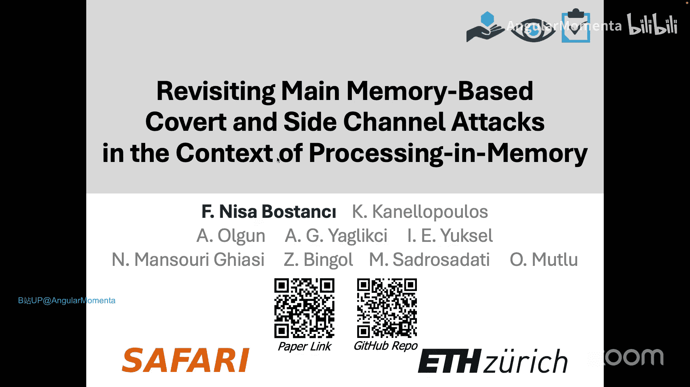

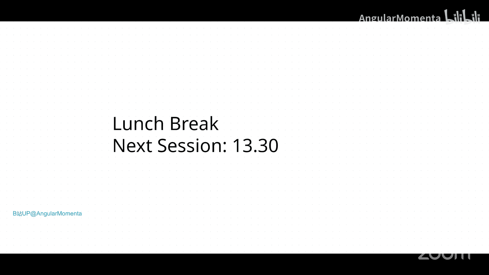

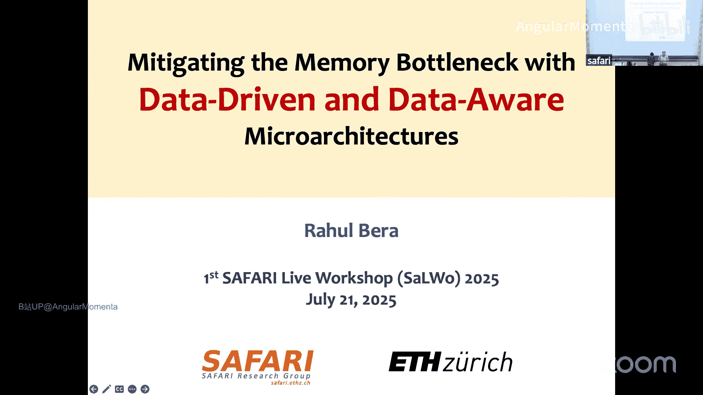

我们的动机是探究商用DRAM芯片在已有概念验证之外，是否能执行更完整的功能性操作。我们通过实验表征了来自两大制造商的256颗DDR4芯片。

我们观察到，商用DRAM芯片能够：
*   在两个相邻子阵列中同时激活多达48行。
*   以高达32个目标行执行非（NOT）操作。
*   执行多达16个输入的与（AND）、或（OR）和非或（NOR）操作，且可靠性很高。

数据模式和温度对这些操作的可靠性影响很小。这些实证结果表明了使用DRAM作为计算基板的巨大潜力。

---

## 数据为中心与节能计算：8：探究DRAM芯片的同步多行激活

上一节我们展示了DRAM芯片的功能完整性操作，本节我们进一步深入，分析其同步多行激活的能力及其在计算中的应用。

我们测试了120颗DDR4芯片，发现可以执行多数表决（3、5、7、9输入）操作，并能将一行内容同时复制到多达31个不同的行。

一个关键发现是，存储多个冗余的多数输入副本（称为输入复制）能大幅提高这些操作的稳健性。对于多数表决操作，平均成功率可提高30%。

此外，温度、电压、数据模式和时序等操作条件会影响行内操作的稳健性，影响幅度高达12%。

我们基于对行解码器电路的反向工程假设，解释了同步多行激活的机理，并开源了我们的测试基础设施。

---

## 数据为中心与节能计算：9：PIM架构下的系统安全考量

上一节我们探讨了DRAM的计算能力，本节我们将视角转向系统安全，重新审视处理内存背景下的内存时序攻击。

PIM架构通过将计算移至数据附近来缓解数据移动瓶颈，并因其显著的性能和能效优势而开始被实际产品采用。然而，此前没有工作分析和评估新兴PIM架构在面对时序侧信道和隐蔽信道攻击时的安全性。

我们观察到，PIM架构由于两个主要原因，为关键的主内存时序攻击创造了机会：
1.  这些架构为用户空间应用提供了直接的主内存访问，这是高吞吐量主内存时序攻击的关键基础。
2.  针对此类攻击的防御措施要么成本高昂，要么不适用于PIM架构。

我们引入了**IMPACT**，这是一组利用PIM架构实现的直接、快速主内存访问的高吞吐量内存处理时序攻击。IMPACT通过消除昂贵的缓存旁路步骤和利用PIM操作的内在并行性来提供高泄漏吞吐量。

我们通过三个案例研究进行了演示：两个基于不同PIM架构的隐蔽信道攻击，以及一个基于PNM的基因组隐私侧信道攻击。讨论和评估表明，缓解IMPACT攻击会带来高性能开销，这凸显了为未来健壮系统寻找低成本缓解方案的必要性。

---

## 数据为中心与节能计算：10：数据驱动与数据感知的微架构设计

上一节我们讨论了PIM的安全问题，本节我们回到性能主题，看看如何通过数据驱动和数据感知的微架构设计来缓解内存瓶颈。

当今计算严重受数据制约，从大规模数据中心到基因组序列分析等新兴应用，数据常常是性能与能效瓶颈。然而，现有架构在利用海量数据和元数据做出自主、自适应决策方面表现不佳。

我们的目标是设计能够从系统数据和元数据中学习以做出数据驱动决策，并能利用应用数据特征及语义做出数据感知决策的智能架构。我们通过三项工作推进这一目标：
1.  **Pythia**：基于强化学习的数据预取器，可自主使用多程序上下文信息和系统级反馈进行预取。
2.  **Hermes**：基于感知器的片外负载预测器，可预测哪些负载请求将访问片外内存，并提前从主内存获取数据，以隐藏片上缓存访问延迟。
3.  **Constable**：安全动态负载消除技术，通过识别并消除重复执行且产生相同结果的负载指令，缓解资源争用。

这些工作展示了通过数据驱动和感知的方法，可以在不同层面有效提升系统性能和能效。

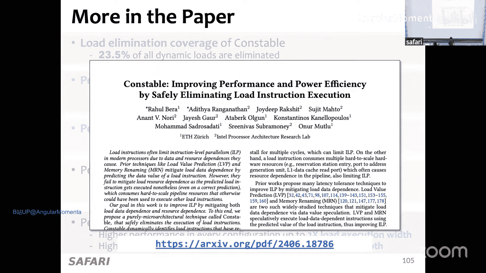

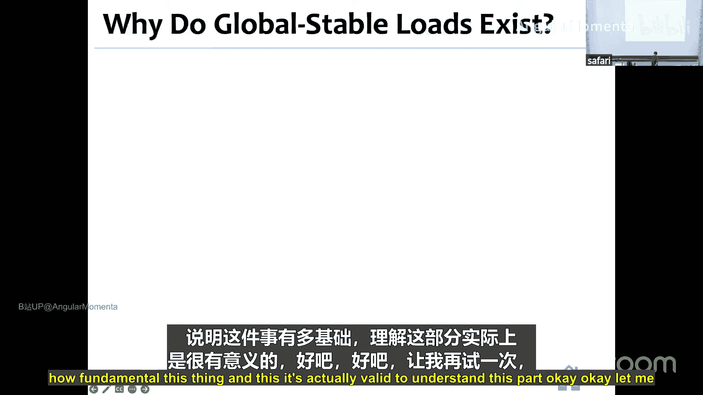

---

## 数据为中心与节能计算：11：移动设备的软件级节能方案

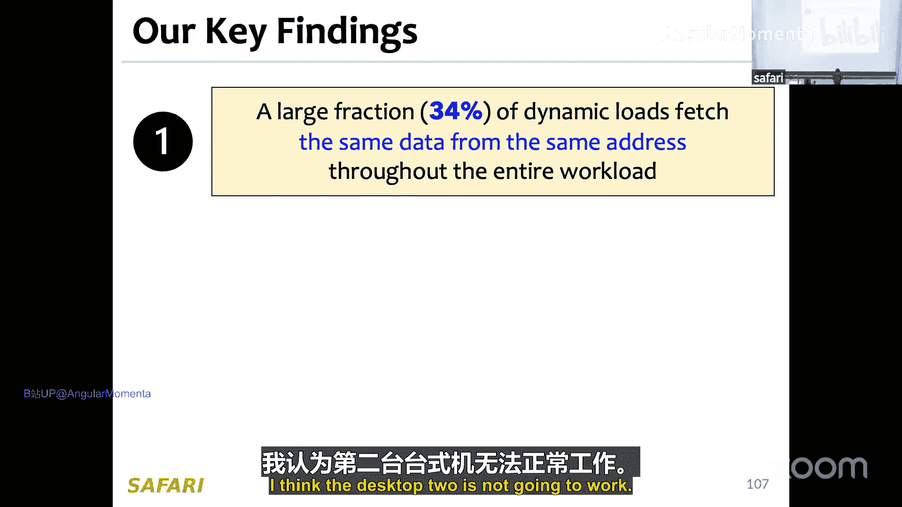

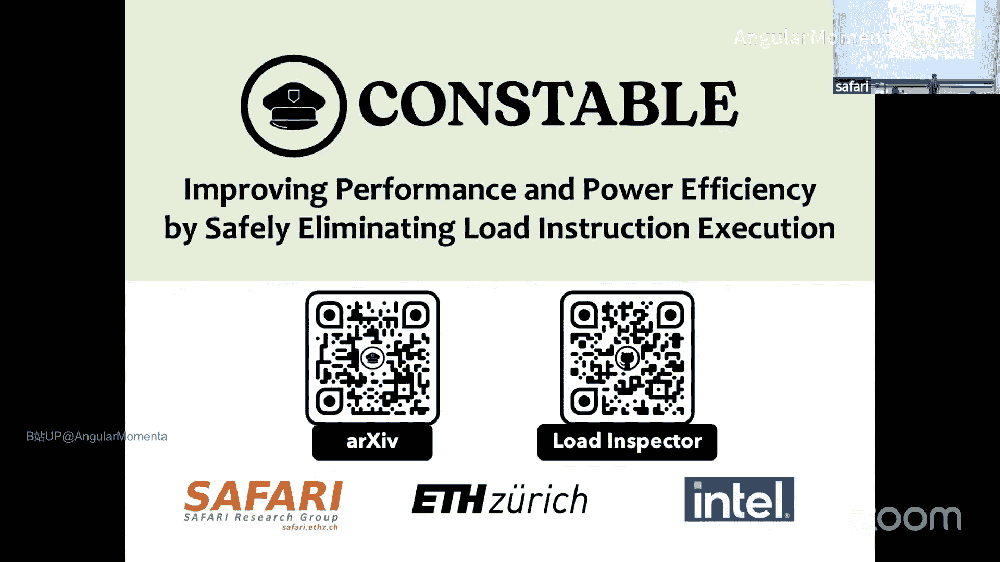

上一节我们探讨了硬件微架构的优化，本节我们看看在移动设备上，如何通过软件层面的方案来解决内存不足和能耗问题。

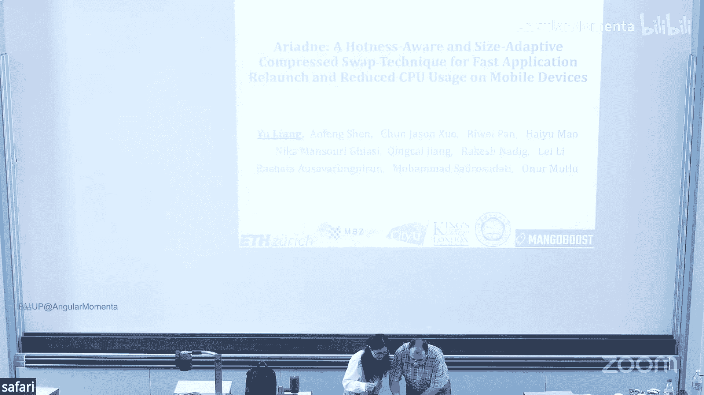

移动设备上的可用内存通常稀缺，但DRAM容量因功耗预算限制无法相应增加。现代移动系统通常采用ZRAM压缩交换方案，将数据压缩后存储在DRAM的特定区域（ZRAM），以避免交换到闪存，从而延长闪存寿命并降低读取延迟。

然而，我们发现ZRAM仍然会显著增加应用重启延迟和CPU使用率，因为它不区分数据热度级别，也未利用不同的压缩块大小和数据局部性。

我们剖析了移动工作负载，得到三个关键洞见：
1.  应用连续两次重启期间使用的热数据相似度很高。
2.  小尺寸压缩速度快，大尺寸压缩率高。
3.  应用启动期间的数据访问存在局部性。

基于这些洞见，我们提出了**Ariadne**，这是一种热度感知和大小自适应的压缩交换方案。Ariadne根据数据热度级别使用不同的压缩块大小，并对热数据执行预解压。在Google Pixel 7真机上的评估表明，与ZRAM相比，Ariadne能同时降低应用重启延迟和压缩解压的CPU使用率。

---

## 数据为中心与节能计算：12：基于近内存处理的时序分析加速

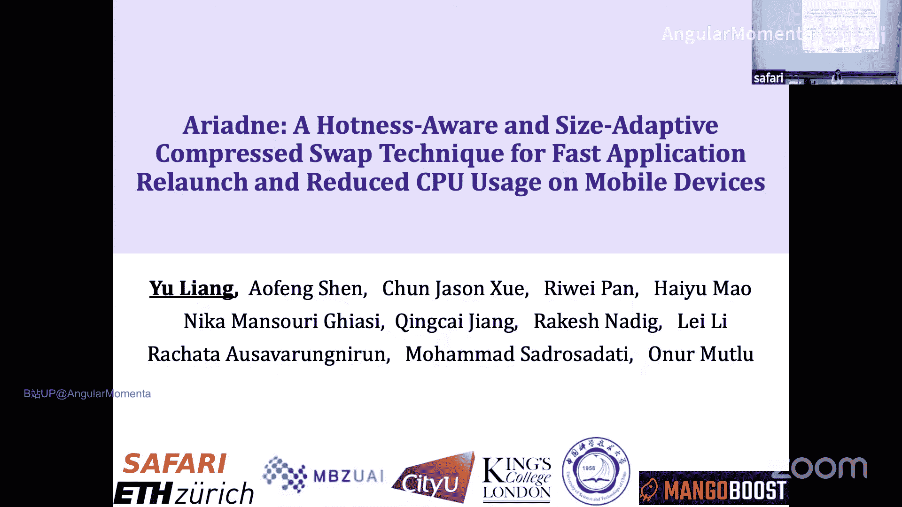

本节我们转向一个具体应用领域——时序分析，看看如何利用近内存处理来加速。

时序分析在气候、医疗、经济等领域有广泛应用。加速时序分析能为众多领域带来益处。**NaTSA**是首个面向时序分析的近数据处理加速器，基于欧氏距离和矩阵剖面算法。

NaTSA旨在充分利用HBM内存带宽，并集成所需计算资源以提供平衡方案。它包含多个处理单元，采用向量化方法计算距离矩阵的对角线批次。通过高效的静态工作负载调度，确保处理单元间的负载均衡。

评估显示，与基于DDR4的多核CPU以及通用HBM处理近内存平台相比，NaTSA能提供最高超过14倍的性能提升和超过27倍的能效提升。但需要注意的是，浮点运算单元面积开销较大，且大部分能耗仍来自HBM内存设备。

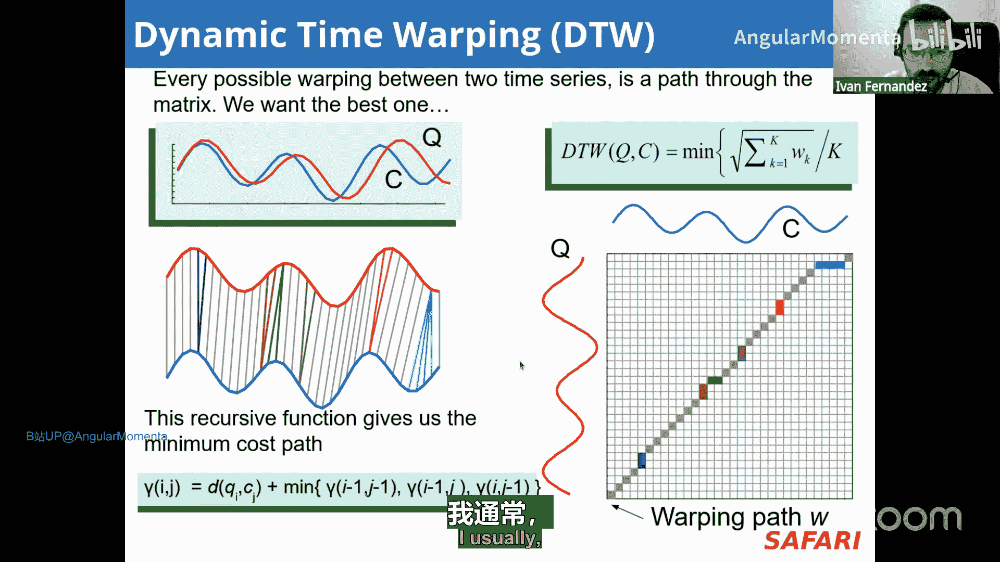

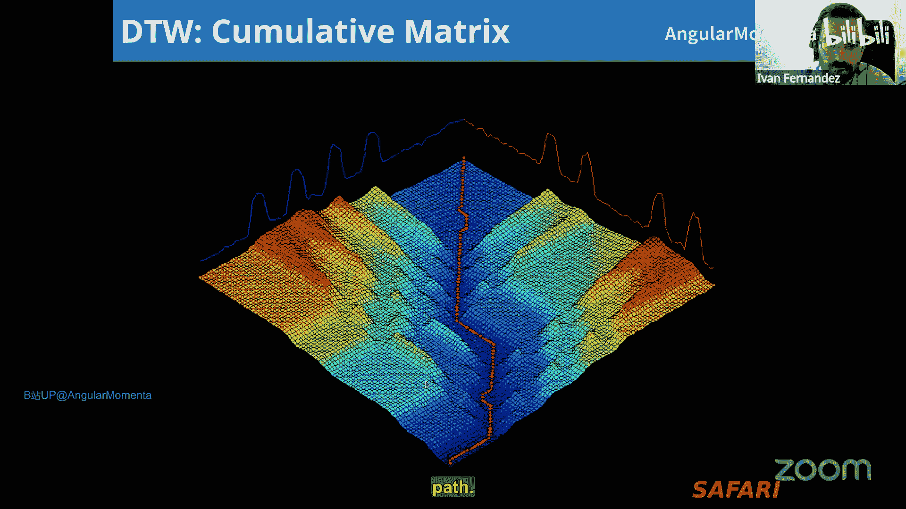

---

## 数据为中心与节能计算：13：基于存内处理的时序分析加速

上一节我们介绍了基于近内存处理的加速器，本节我们看看如何利用更激进的存内处理技术来加速时序分析。

动态时间规整是用于异步序列的最准确距离计算方法之一，但计算复杂度高。**MaTSA**是首个基于磁阻存储器（MRAM）的时序分析加速器，采用存内处理技术。

MaTSA旨在数据所在位置（存储阵列）执行计算。它包含多个支持计算的交叉阵列，每个阵列包含可重配置的感测放大器，能以脉动方式沿对角线计算DTW距离。通过流水线化查询处理，所有处理元件在任何时刻都处于工作状态。

评估中，我们定义了MaTSA的三种配置：嵌入式版、便携版和HPC版。与对应的CPU、GPU和FPGA平台相比，MaTSA HPC版本能提供超过7倍的性能提升和超过11倍的能效提升。MaTSA通过利用存储阵列的列级位并行操作，显著提高了并行性，并通过存内处理减少了数据移动开销。

---

## 数据为中心与节能计算：14：细粒度DRAM架构设计

在本课程的最后，我们来看一个旨在降低DRAM能耗的细粒度架构设计。

现代基于DRAM的系统因粗粒度数据传输和行激活而浪费能量。应用程序通常只使用从DRAM获取数据的一小部分。我们的目标是设计一个新的细粒度、低成本、高吞吐的DRAM基板来缓解这个问题。

我们提出了**Sector DRAM**，其两个关键设计思想是：
1.  **扇区激活**：通过添加隔离晶体管，将DRAM行分割为可独立激活的扇区。
2.  **可变突发长度**：修改I/O电路，使其仅传输来自已激活扇区的数据，实现可变大小的数据突发传输。

将Sector DRAM集成到现代系统中面临子缓存块粒度传输和因未取全数据块导致的性能开销挑战。我们通过**扇区缓存**和两种预测技术（加载存储队列前瞻和扇区预测器）来解决。

评估表明，Sector DRAM能提供显著的能耗节省和性能提升，尤其适用于高内存密集型工作负载。其DRAM芯片面积开销仅为1.7%，性能接近高开销的先进细粒度DRAM架构，同时能耗更低。

---

## 数据为中心与节能计算：15：课程总结

在本节课中，我们一起深入探讨了数据为中心和节能计算的前沿领域。

我们从数据移动瓶颈这一根本问题出发，系统性地介绍了处理内存的两种主要范式：处理近内存和处理用内存。我们学习了如何通过DAMOV框架识别和表征瓶颈，如何通过MimDRAM和PROTEUS为PUM架构提供系统支持和优化，以及如何通过DIVA框架降低PNM的编程门槛。

课程还涵盖了基础性的研究，包括挖掘商用DRAM芯片本身的计算潜力，以及审视PIM架构引入的新安全挑战（IMPACT）。我们探讨了数据驱动与感知的微架构设计（Pythia， Hermes， Constable），以及针对移动设备的软件级优化方案（Ariadne）。最后，我们通过时序分析这一具体应用，展示了PNM（NaTSA）和PUM（MaTSA）加速器的设计，并以一个创新的细粒度DRAM架构（Sector DRAM）结束。

这些工作共同描绘了通过硬件-软件协同设计，从数据为中心和节能角度革新计算系统的广阔图景。尽管仍有许多挑战，但这是一个充满机遇的研究方向。