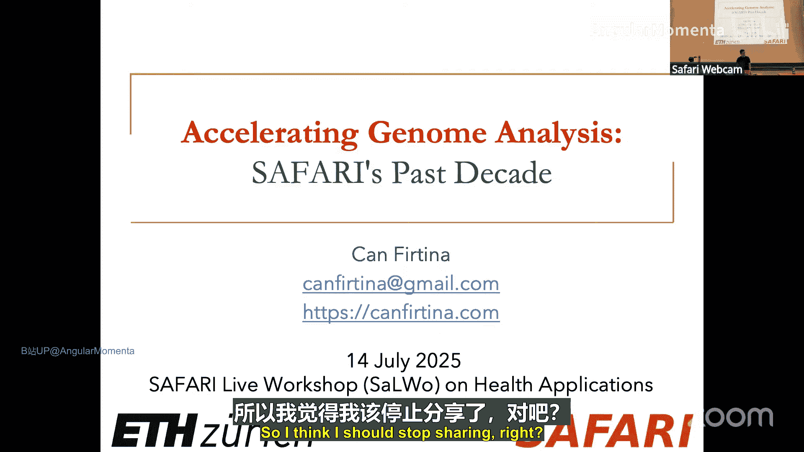
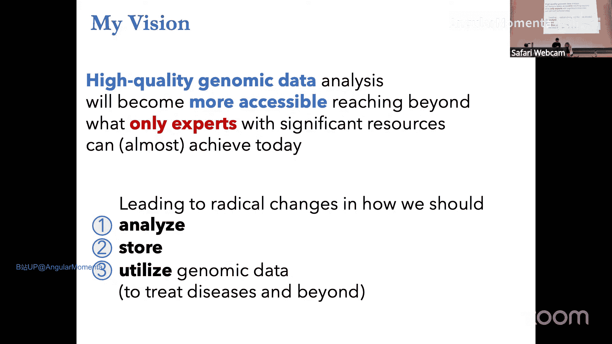
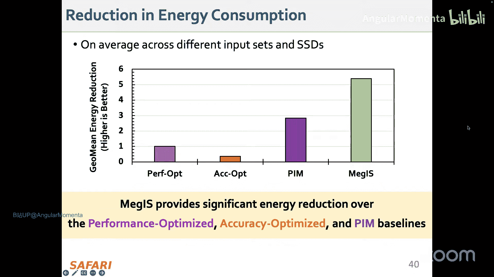
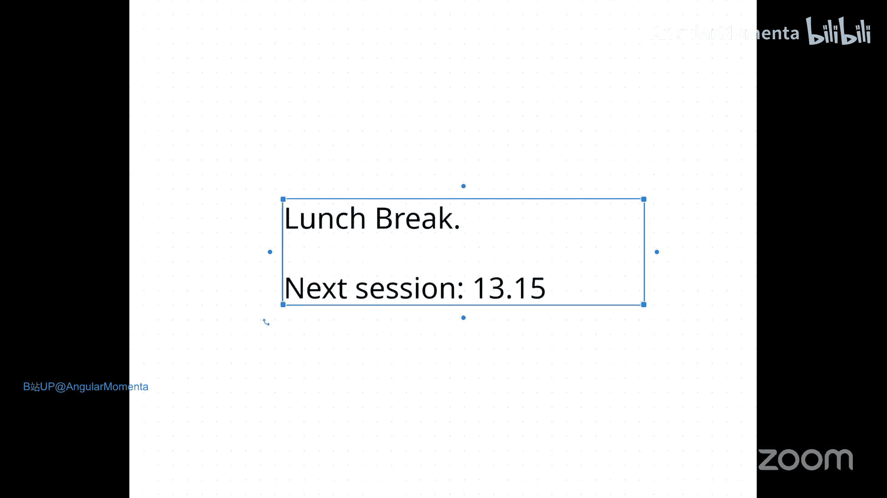
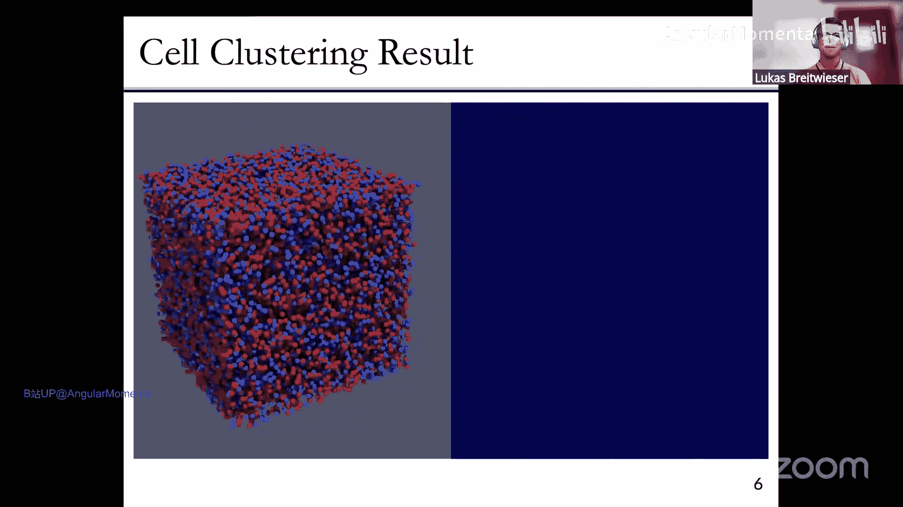
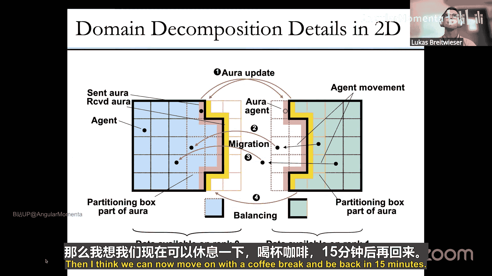
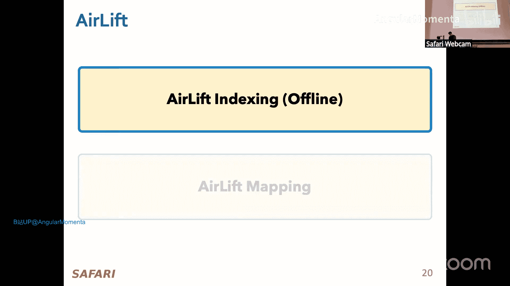

# 003：基因组分析概述与挑战

在本节课中，我们将学习基因组分析的基本概念、其广泛的应用场景，以及当前面临的主要计算挑战。我们将了解为什么需要设计新的算法和架构来应对这些挑战。

## 基因组分析的重要性

基因组分析的目标是从生物体的完整基因组序列中生成关键见解，并据此采取行动。分析的数据不仅限于DNA，还包括转录组（RNA）和蛋白质组数据，它们提供了不同分辨率的生物学答案。本节课我们主要关注DNA数据。

**核心应用包括：**
*   **发现与治疗疾病**：识别与基因组变异相关的疾病，例如特定癌症风险。
*   **基因组编辑**：通过编辑基因组内容来解决生命的基本挑战，例如通过CRISPR技术靶向编辑致病区域。
*   **病原体检测**：检测环境中的有害病原体，以预测和应对疾病爆发。
*   **便携式分析**：将基因组分析能力集成到便携设备（如无人机）中，用于农业监测、个性化购物建议等。

## 数据量与能耗瓶颈

基因组分析需要处理海量数据。这种大规模数据移动导致了整个系统的**能耗瓶颈**。

**问题根源在于：**
*   **数据生成器高度专业化**：例如基因组测序仪，能以极快的速度生成数据。
*   **分析系统通用化**：我们使用通用计算设备来分析特定类型的数据，这并不高效。

**后果是：**
*   **巨大的数据移动开销**：数据需要在内存层次结构的多个层级间移动。
*   **高昂的能耗**：一次内存访问消耗的能量可能比执行一次计算操作高出两个数量级。

这意味着我们需要协同设计**算法**和**架构**，以高效地处理数据。

## SAFARI研究组的解决方案方向

为了应对上述挑战，SAFARI研究组在多个方向进行探索，旨在通过算法与架构的协同设计，实现快速、准确且高效的基因组分析。

**以下是主要研究方向：**
*   **原始信号分析**：直接分析测序仪产生的原始电信号，而无需先将其翻译成DNA碱基字符，以实现实时分析。
*   **新算法设计**：例如，设计单次哈希操作即可识别潜在突变的算法，或处理参考基因组更新时最小化重复计算的算法。
*   **人工智能与机器学习集成**：设计用于基因组分析的期望最大化技术和加速器，以及优化用于原始信号翻译的大型神经模型的框架。
*   **数据中心架构**：设计内存处理（Processing-in-Memory）架构，将多个分析步骤融合在内存中执行，以减少数据移动。
*   **新型加速器架构**：设计专用逻辑（如GenASM）来快速执行近似字符串匹配，这是基因组分析中的核心且耗时的操作。

## 基因组数据分析流程与瓶颈

典型的基因组数据分析始于样本采集，经过文库制备、测序生成原始数据（电信号或图像），再通过计算步骤进行翻译和分析。

**该流程存在显著的性能障碍：**
*   **流水线步骤多**：从数据生成到最终分析需要多个步骤。
*   **吞吐量不平衡**：不同步骤的处理速度不匹配，导致瓶颈。
*   **数据移动开销大**：数据在存储系统、主内存、缓存和计算单元之间频繁移动。

问题的核心在于使用**通用计算设备**处理特定数据，导致数据移动开销巨大。因此，我们的目标是**通过算法与架构的协同设计来最小化数据移动**。

## 实例：JaP（内存加速器）

JaP是一个用于基因组分析的内存加速器设计，它解决了多步骤分析中的两个主要数据移动限制。

**问题描述：**
1.  **步骤间大量数据移动**：数据在多个分析步骤间传输。
2.  **无用计算**：初始步骤分析的所有数据中，只有一部分对最终结果有用，其余数据的移动和计算被浪费。

**JaP的解决方案：**
JaP设计了一个包含**反馈控制器**的内存处理系统。控制器在步骤间建立流水线，持续感知小块数据。一旦分析表明某些数据在后续步骤中无用，它会立即反馈给早期步骤，停止对这些无用数据的继续分析。

**公式表示优化目标：**
`最小化总开销 = 数据移动开销 + 无用计算开销`

通过这种方式，JaP**同时最小化了数据移动和无用计算**，从而显著提升了系统整体性能和能源效率。

## 实例：Swordfish（处理非理想存储设备）

Swordfish研究专注于在使用非易失性存储器进行内存计算时，设备的非理想特性（如噪声）对模型可靠性的影响。

**关键问题：**
人们通常在通用设备上训练神经网络模型，然后将模型部署到可能因噪声而产生不同输出的非理想存储设备上。这会导致准确性下降。

**Swordfish的解决方案：**
Swordfish提出可以**学习这些非理想特性并将其整合到模型中**，从而使模型对设备噪声更加鲁棒，最终在使用该设备时获得更好的准确性。

## 实例：GenStore（近存储计算）

GenStore探索了在存储系统内部直接进行数据分析的可能性，以最小化向主内存和计算单元移动数据的需求。

**核心思想：**
在存储系统中对基因组片段进行初步过滤（例如，识别与参考基因组完全匹配或完全不相似的片段），只将需要复杂计算的部分发送给计算单元。

**挑战与解决：**
存储系统的硬件资源有限。GenStore通过设计一种机制，在资源受限的条件下有效识别精确匹配和高度不相似片段，从而**最小化计算开销和数据移动开销**，实现显著的加速和能耗降低。

## 实例：GenASM（近似字符串匹配加速器）

GenASM针对基因组分析中核心且频繁的**近似字符串匹配**操作进行加速。

**设计特点：**
GenASM通过协同设计算法和硬件，在考虑内存带宽和计算开销的前提下进行优化。它包含两个主要模块：
1.  **GenASM-DC（距离计算）**：基于移位寄存器的加速器，用于高效计算序列间的差异数量。
2.  **GenASM-TB（回溯）**：用于精确定位序列间差异的具体位置和类型。

**算法改进：**
GenASM基于Bitap算法，但对其进行了改进，使其不仅能计算差异数量，还能定位差异位置，满足了实际应用的需求。

通过最大化并行性、最小化内存带宽需求，GenASM及其后续改进工作（如SGram用于图结构基因组分析）相比现有技术实现了显著的性能提升和能耗降低。

---

本节课中，我们一起学习了基因组分析的基础、其面临的大数据与能耗挑战，并概述了SAFARI研究组通过算法与架构协同设计来应对这些挑战的多种解决方案。从原始信号分析、新型算法、AI集成到数据中心的近存储/内存处理架构，这些工作共同推动了快速、高效、可扩展的基因组分析技术的发展。