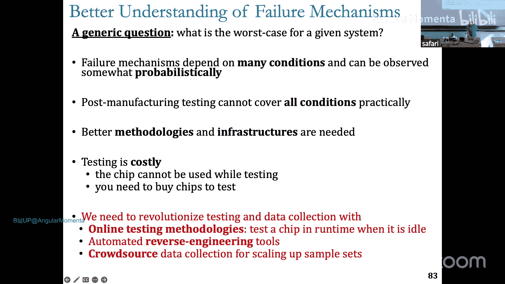
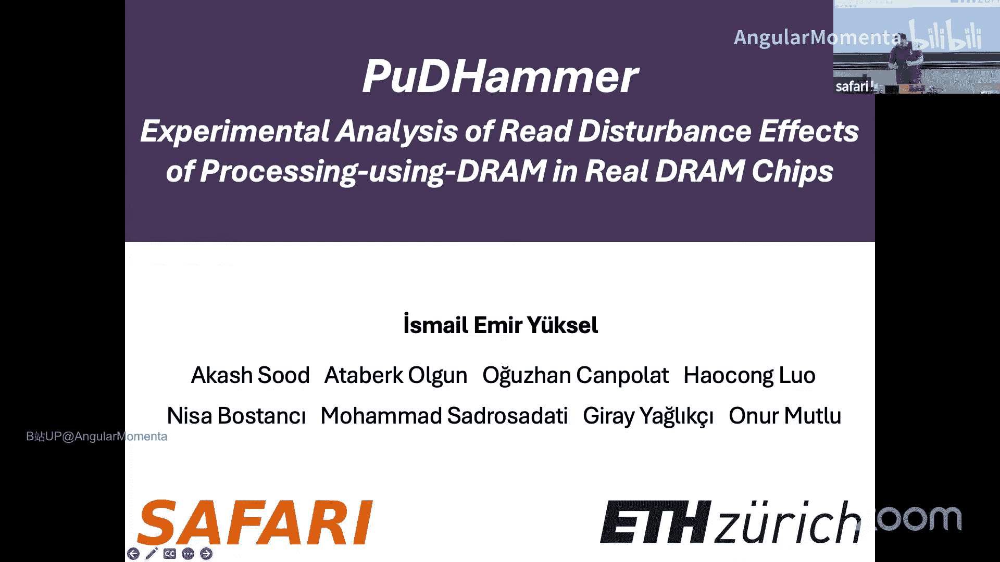
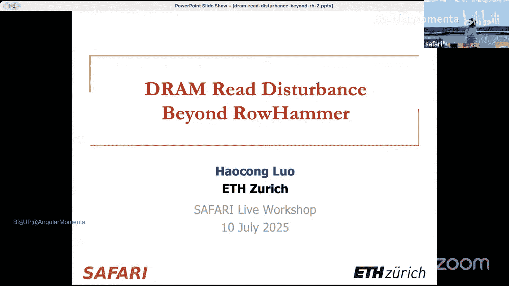
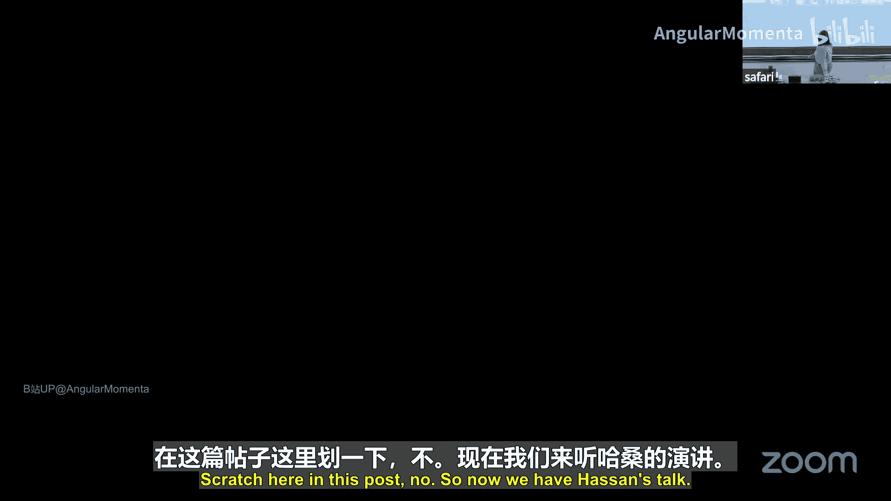
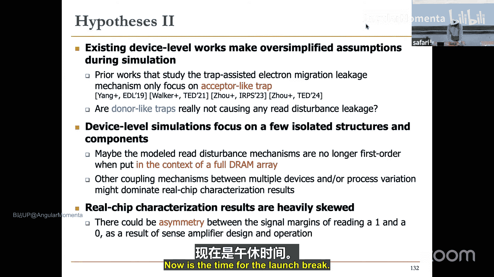
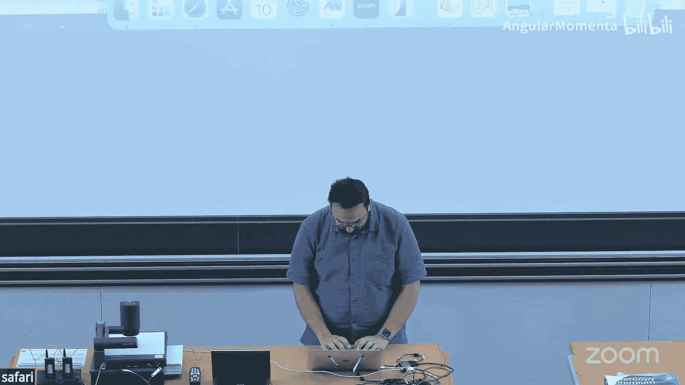
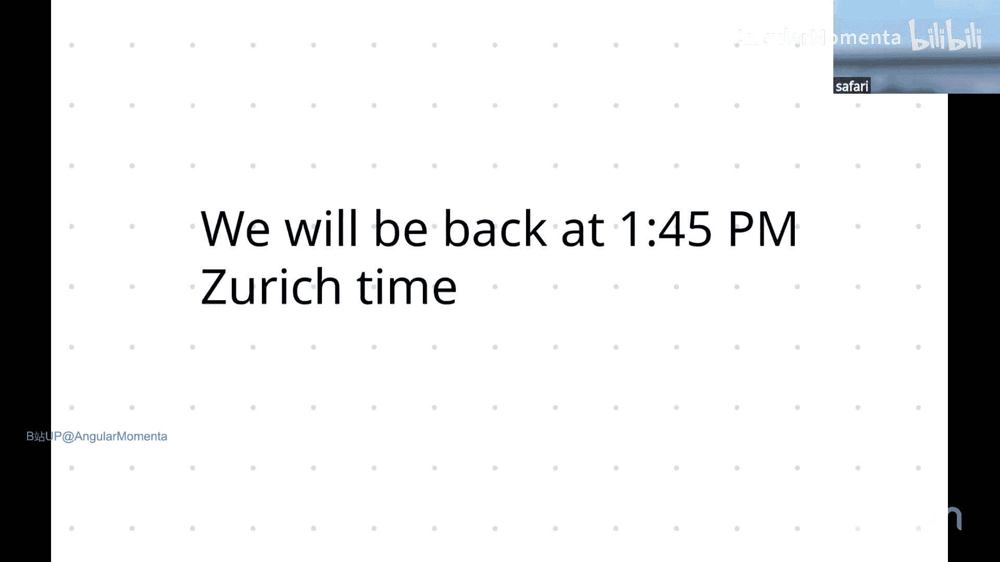

# 004：内存稳健性在线研讨会概述

在本节课中，我们将要学习内存稳健性的基本概念，并了解首届SAFARI在线研讨会（SaLWo）的背景和议程安排。

苏黎世联邦理工学院（ETH Zurich）的SAFARI研究小组举办了首次在线研讨会，主题聚焦于内存稳健性。本次研讨会旨在分享该小组在内存安全、可靠性和性能方面的前沿研究，并促进学术讨论。

## 研讨会背景与目标

本次研讨会源于教学与研究相互促进的理念。通过分享研究成果并与全球同行交流，可以推动领域发展并探索未来研究方向。SAFARI小组此前已举办过名为“SAFARI Live Seminars”的系列研讨会，而本次“SaLWo”则是该系列的一次集中爆发，旨在通过协同讨论激发更多创新想法。

以下是本次研讨会的核心信息：
*   **网站**：所有研讨会详情均可通过官方网站获取。
*   **直播**：三天的研讨会均通过YouTube进行直播。
*   **议程**：研讨会共分三天，首日主题为“内存稳健性”。

## 首日议程概览

首日研讨会将涵盖内存稳健性、安全性、可靠性等多个议题，包括Rowhammer、Rowpress等内存干扰现象的机理分析、真实内存芯片的表征以及相应的解决方案。

以下是首日的演讲者及主题安排：
*   **开场**：研讨会组织者介绍。
*   **演讲1**：关于实现可扩展、安全且可持续的系统。
*   **演讲2**：关于PotHammer——基于内存处理操作的内存干扰实验分析。
*   **演讲3**：关于Rowpress——超越Rowhammer的内存干扰现象。
*   **休息与讨论**：会议期间设有多次休息环节，供与会者交流。

## 总结

本节课我们一起了解了首届SAFARI在线研讨会（SaLWo）的背景、目标和首日议程。该研讨会致力于探讨内存稳健性领域的前沿挑战与解决方案，为相关领域的研究人员和学生提供了宝贵的学习和交流平台。

---

# 内存稳健性：2：实现可扩展、安全且可持续的系统

上一节我们介绍了研讨会的整体安排，本节中我们来看看如何构建能够稳健且可持续扩展的计算系统。

在本节课中，我们将要学习现代计算系统在技术缩放和系统扩展两个维度上面临的挑战，特别是内存隔离失效的问题，并探讨相应的解决方案。

## 技术缩放与系统扩展的挑战

计算系统的扩展主要体现在两个方面：
1.  **技术缩放（Scaling Down）**：通过缩小制造工艺尺寸，使芯片更密集，从而获得更高性能、更低能耗。公式表示为：`性能 ∝ 1 / 特征尺寸`，`功耗 ∝ 特征尺寸²`。然而，这同时引入了更复杂的故障机制，需要更复杂的硬件来缓解，反而可能增加能耗并降低芯片可用性。
2.  **系统扩展（Scaling Up）**：以分布式方式扩展系统，可以降低拥有成本并实现按需动态扩展。但这带来了安全性和隐私方面的担忧，可能阻碍其充分发挥潜力。

理想情况下，系统应在芯片变得更密集、更多用户共享时，依然能保持**稳健且可持续的扩展**。

## 内存隔离与Rowhammer问题

内存隔离是系统安全的基础，即访问一个内存位置不应导致其他未访问位置的数据被意外更改。然而，在现代DRAM芯片中，由于“行干扰”现象，内存隔离难以保证。

**Rowhammer** 是一个著名的行干扰实例。其原理是：反复激活（打开和关闭）DRAM中的某个存储行（攻击者行），会导致物理上相邻的行（受害者行）发生比特翻转。这可以破坏数据完整性、泄露隐私，甚至被用来完全控制计算机。

Rowhammer攻击自2014年被发现以来，已被证明广泛存在且威胁持续。即使最新的DDR5设备和纠错码（ECC）机制也未能完全免疫。随着技术缩放，芯片单元更小、更密集，诱发比特翻转所需的激活次数减少，使得问题更加严峻。

## 针对Rowhammer的解决方案与挑战

缓解Rowhammer的基本思路是：当检测到某个行被频繁“锤击”时，刷新其物理相邻的行。关键挑战在于确定何时、何地进行刷新。

现有的解决方案（如基于计数的刷新）随着技术发展可能变得成本过高或效果不佳。因此，需要更高效、可扩展且全面的解决方案。

## 本研究的核心贡献

本研究的目标是有效且可扩展地缓解内存干扰。为实现此目标，我们开展了以下工作：

以下是本研究的主要方法：
*   **深入理解干扰机制**：研究了温度、内存访问模式、受害者行物理位置和电压对干扰的敏感性。
*   **设计新颖解决方案**：利用对DRAM芯片内部和内存控制器的洞察，设计新的缓解机制。

### 关键研究发现

1.  **温度的影响**：实验发现，每个易受Rowhammer影响的DRAM单元都有一个“易受温度范围”。在此范围内会发生比特翻转，范围外则不会。不同单元的温度范围不同，且与制造工艺相关，关系复杂。
2.  **访问模式的影响**：研究发现，一种称为“Rowpress”的访问模式（长时间保持攻击者行打开）能显著减少诱发首次比特翻转所需的激活次数，有时仅需一次激活。这使得许多良性工作负载也可能无意中触发干扰。
3.  **电压的影响**：降低字线上的电压幅度可以减少Rowhammer的脆弱性，但代价是DRAM单元处于更弱的状态。
4.  **空间异质性**：不同DRAM行对Rowhammer的脆弱性存在显著差异。利用这种差异，可以动态调整防御机制的强度，只为脆弱的行执行密集的预防性刷新，从而降低开销。

### 提出的解决方案

基于上述洞察，我们提出了以下解决方案：

以下是本研究提出的关键机制：
*   **Swiper**：一种利用行间脆弱性差异的动态调节机制。它与现有Rowhammer防御方案（如Para、Graphene等）协同工作，通过动态调整阈值来减少不必要的刷新操作，从而降低性能开销。
*   **BlockHammer**：一种替代性方法，它不依赖DRAM内部地址映射的专有知识。当检测到某个行被锤击时，它选择性地限制（节流）对该行的访问，从而防止干扰发生，而无需刷新相邻行。
*   **Chronos**：针对行业最新解决方案“每行激活计数”（PRAC）的优化。PRAC通过在DRAM芯片内为每行维护计数器来跟踪激活，但更新计数器会引入额外延迟。Chronos利用DRAM子阵列级并行性，在访问数据行的同时并行更新计数器，将PRAC的性能开销从约10%大幅降低到接近0%。
*   **BrakeHammer**：一种在存在高Rowhammer漏洞时保障系统可用性的机制。它通过观察内存通道上的Rowhammer预防性操作，回溯并识别可能发起攻击的线程，然后限制该线程的内存访问带宽，从而在遭受攻击时改善系统整体性能和能效。

## 未来研究方向

最后，我们展望了两个未来的研究方向：
1.  **软硬件协同设计以实现可持续的稳健性**：结合硬件层的精确、快速测量与软件层的语义信息和高层响应，可以更低成本地实现安全目标。
2.  **以数据为中心的稳健性**：随着“内存中处理”和“存算一体”等数据-centric计算范式的发展，需要重新审视其安全模型和潜力，并研究这些新架构可能引入的新型安全挑战（如侧信道攻击）。

## 总结

本节课我们一起学习了现代系统在扩展时面临的内存稳健性挑战，重点分析了Rowhammer问题的机理、影响因素以及一系列旨在降低缓解开销、提升系统可用性的创新解决方案。这些研究为实现芯片更密集、用户更共享的未来计算系统的稳健、可持续扩展提供了重要思路。

---

# 内存稳健性：3：PotHammer——内存处理操作中的干扰分析

上一节我们探讨了Rowhammer及其解决方案，本节中我们来看看当DRAM被用于计算（而不仅仅是存储）时，会引发何种新的内存干扰问题。

在本节课中，我们将要学习“内存中处理”技术如何通过激活多个DRAM行来实现计算，以及这种“多行激活”操作如何加剧内存干扰，形成所谓的“PotHammer”。

## 背景：内存中处理与多行激活

“内存中处理”是一种有前景的范式，旨在缓解处理器与主存之间的数据移动瓶颈。它利用DRAM单元的模拟操作原理直接在内存中执行计算。

**多行激活**是实现许多PIM操作的关键技术，主要分为两类：
1.  **连续多行激活**：通过违反预充电时序，连续快速地激活两行，可用于实现行复制等操作。
2.  **同时多行激活**：通过违反激活时序，同时激活一个子阵列内的多行，可用于实现多数表决等操作。

## 问题：多行激活的内存干扰效应

不幸的是，现代DRAM存在行干扰现象，即使只激活单一行也可能导致比特翻转。Rowhammer是此现象的典型代表。然而，尚无研究探讨**多行激活**对内存干扰的影响。

我们的目标是：理解多行激活如何影响真实DRAM芯片的内存干扰脆弱性。

## 实验方法与设置

我们使用基于FPGA的DRAM测试基础设施（如DRAM Bender），对316个商用DDR4芯片（来自四大制造商）进行了实验。我们关注的关键指标是诱发首次比特翻转所需的最小“锤击”次数。

## 实验结果与分析

### 1. 连续多行激活的干扰效应

实验表明，与传统的双面Rowhammer相比，使用连续多行激活进行攻击能显著降低诱发比特翻转所需的最小激活次数，降幅可达14倍。绝大多数测试的受害者行都表现出脆弱性增加。

### 2. 同时多行激活的干扰效应

同时多行激活的影响更为剧烈。例如，同时激活4行进行攻击，可比传统双面Rowhammer降低159倍的最小激活次数。在某些极端情况下，仅需26次激活即可诱发比特翻转。超过99%的受害者行受到影响，且超过25%的行其最小激活次数降低了99%以上。

### 3. 数据模式的影响

研究发现，同时多行激活导致的比特翻转主导方向是“1翻转到0”，这与Rowhammer的主导方向“0翻转到1”相反。这表明其底层机制可能与Rowhammer不同。

### 4. 对现有缓解机制的绕过

我们测试了DDR4芯片中内置的Rowhammer缓解机制。实验发现，该机制对连续多行激活的缓解效果尚可，但对同时多行激活的缓解效果很差，在某些情况下仍能诱发大量比特翻转，数量可比Rowhammer多出上万倍。

## 缓解PotHammer的尝试与挑战

我们尝试调整行业最新的Rowhammer解决方案——每行激活计数来应对PotHammer。

以下是两种调整策略：
*   **朴素调整**：直接将Rowhammer的触发阈值降低到PotHammer观察到的最低值。
*   **加权计数**：根据操作类型（普通激活、连续多行激活、同时多行激活）对计数器进行不同幅度的增加。

性能评估显示，即使采用加权计数的优化方案，在PIM操作强度较高时，系统仍会承受平均近50%的性能开销，极端情况下可达99%。这表明需要为PotHammer设计更智能的解决方案。

## 总结

本节课我们一起学习了“内存中处理”操作如何通过多行激活加剧DRAM的内存干扰，即PotHammer现象。实验表明，PotHammer能显著降低诱发比特翻转的阈值，并可能绕过现有缓解机制。直接适配现有方案会带来高昂性能开销。这些发现警示我们，在设计未来的PIM系统时，必须将内存干扰的韧性作为核心考量。

---

# 内存稳健性：4：Rowpress——超越Rowhammer的内存干扰

上一节我们讨论了PIM操作中的干扰问题，本节中我们回到更基础的存储操作，探讨另一种广泛存在且机制不同的内存干扰现象——Rowpress。

在本节课中，我们将要学习Rowpress的基本原理，了解它如何通过长时间保持DRAM行打开来诱发比特翻转，并分析其与Rowhammer的区别、真实系统演示以及缓解方案。

## Rowpress：一种新的内存干扰现象

Rowhammer是通过**高频次**激活/关闭DRAM行来引发干扰。我们提出的问题是：是否存在另一种不依赖高激活次数的干扰现象？

**Rowpress** 正是这样一种现象：长时间保持一个DRAM行打开，就足以导致相邻行发生比特翻转。它不需要像Rowhammer那样多的行激活次数，在极端情况下，仅激活一次并保持足够长时间即可诱发比特翻转。

## Rowpress的表征实验

我们在164个DDR4芯片上进行了实验。关键指标是诱发首次比特翻转所需的最小激活次数。

以下是Rowpress的核心特征：
*   **大幅放大干扰脆弱性**：随着攻击者行打开时间的增加，最小激活次数可降低一至两个数量级。在30毫秒的极端情况下，仅需一次激活。
*   **受温度影响**：温度升高会使Rowpress更易发生，这与某些Rowhammer行为相反。
*   **与Rowhammer机制不同**：
    *   **影响的单元集合不同**：易受Rowpress影响的单元与易受Rowhammer影响的单元重叠度很低。
    *   **比特翻转方向不同**：Rowpress的主导方向是“1翻转到0”，而Rowhammer是“0翻转到1”。
    *   **攻击模式有效性不同**：对于Rowpress，在某些条件下，单面攻击模式可能比双面模式更有效，这与Rowhammer相反。

## 真实系统演示

我们在真实的Intel处理器和三星DDR4模块上实现了Rowpress攻击。关键思路是：通过持续访问同一DRAM行中的不同缓存线，来延长该行的打开时间。

用户级程序演示表明，通过增加每行访问的缓存线数量（即延长行打开时间），可以诱发比特翻转，而在单纯使用Rowhammer方法时可能无法实现。

## 缓解Rowpress的方案

我们提出了一种方法论来适配现有的Rowhammer缓解机制以同时缓解Rowpress：

以下是缓解方案的核心思路：
1.  **限制最大行打开时间**：在内存控制器层面实施。
2.  **调整Rowhammer缓解参数**：根据Rowpress导致的最小激活次数降低来重新配置缓解机制的阈值。

我们将此方法应用于两种现有方案（Graphene, PARA），评估显示，在添加Rowpress防护后，仅带来较低的性能开销。

## 总结

本节课我们一起学习了Rowpress，这是一种通过长时间保持DRAM行打开来诱发比特翻转的广泛存在的干扰现象。它显著放大了内存干扰的脆弱性，且机制与Rowhammer不同。我们演示了其在真实系统上的可行性，并提出了有效的低开销缓解方案。理解Rowpress扩展了我们对DRAM干扰现象全景的认识。

---

# 内存稳健性：5：结合Rowhammer与Rowpress的混合干扰

上一节我们分别介绍了Rowhammer和Rowpress，本节中我们来看看将这两种干扰模式结合使用会产生什么效果。

在本节课中，我们将要学习如何通过组合Rowhammer和Rowpress来构建更高效的干扰攻击模式，并分析其背后的可能机理。

## 混合攻击模式

我们设计了一种混合攻击模式：在双面攻击中，对一个攻击者行进行“锤击”，而对另一个攻击者行进行“按压”。

## 实验结果

我们比较了这种混合模式与传统的单面Rowpress、双面Rowpress模式。

以下是实验发现的关键结果：
*   **更短的首错时间**：混合模式诱发首次比特翻转所需的**挂钟时间**显著少于传统的双面Rowpress模式，最高可减少46.1%。
*   **相近的激活次数**：混合模式所需的最小激活次数与双面Rowpress模式相近。
*   **主导机制假设**：结合以上两点，我们假设在双面Rowpress攻击中，来自其中一个攻击者行的Rowpress干扰效应远强于另一个，因此无需对两行都进行“按压”即可达到类似效果。
*   **不同的比特翻转**：混合模式诱发的比特翻转集合与传统的单/双面模式有较大不同。

## 总结与展望

本节课我们一起学习了组合Rowhammer和Rowpress的混合干扰模式，它能在更短时间内诱发比特翻转。这提示我们，两种干扰机制在双面攻击中可能存在非对称的贡献。未来的工作需要从器件层面深入研究Rowhammer和Rowpress的机制，以验证这一假设，并更全面地理解DRAM干扰的版图。

---

# 内存稳健性：6：实验表征与器件级研究的不一致性

在前面的章节中，我们基于大量真实芯片实验，报告了Rowhammer和Rowpress的多种行为特征。本节我们将探讨这些观察结果与现有基于TCAD仿真的器件级研究结论之间存在的差异。

在本节课中，我们将要学习如何对齐并交叉验证实验表征与器件级模型，并识别出当前理解中存在的不一致之处。

## 研究目标与挑战

我们的目标是将Rowhammer/Rowpress的实验表征结果，与器件级仿真所建模的错误机制进行对齐和验证。面临的挑战在于，由于DRAM中“真/反单元”的底层布局对内存控制器不透明，在实验和仿真之间存在着鸿沟。

我们的方法包括：
1.  从已有工作中提取关键的器件级干扰机制。
2.  对真实DRAM芯片的真/反单元布局进行逆向工程。
3.  执行与器件级工作所使用的访问和数据模式完全匹配的真实芯片表征实验。

## 发现的关键不一致性

我们发现了以下几个关键的不一致之处：

以下是本研究识别出的主要矛盾：
*   **不一致性1：双面Rowhammer的比特翻转方向**
    *   **实验表征**：观察到“0翻转到1”和“1翻转到0”两种方向的比特翻转。且“0翻转到1”的首次翻转所需激活次数平均低24.7%。
    *   **器件级机制**：认为双面Rowhammer应只导致“1翻转到0”的比特翻转。
*   **不一致性2：双面Rowhammer的比特翻转数量**
    *   **实验表征**：只有在锤击次数足够大（平均约4倍于首次翻转激活次数）后，“1翻转到0”的比特数量才会超过“0翻转到1”。
    *   **器件级机制**：认为双面Rowhammer会增强“1翻转到0”的泄漏，暗示其应始终主导。
*   **不一致性3：单面Rowpress的比特翻转方向**
    *   **实验表征**：绝大多数情况下只观察到“1翻转到0”的比特翻转。
    *   **器件级机制**：认为无论是相邻字线还是穿越字线作为攻击者行，单面Rowpress都应能导致两种方向的比特翻转。

## 可能的假设与未来方向

这些不一致性可能源于：
1.  基于保持失效的真/反单元逆向工程方法在现代DRAM芯片中可能并非完全适用。
2.  现有的器件级干扰机制解释可能不够全面，未能捕捉所有影响因素（例如，只考虑了受主型陷阱、仿真结构过于孤立、未考虑阵列中其他部件的耦合效应等）。
3.  实验表征结果可能因位线读出放大器的非对称读“0”读“1”容限而存在偏差。

## 总结

本节课我们一起学习了在DRAM干扰的实验表征与器件级研究之间存在的显著不一致性。这些差异涉及双面Rowhammer的比特翻转方向与数量，以及单面Rowpress的比特翻转方向。厘清这些不一致性对于建立更准确、全面的DRAM干扰模型至关重要，需要器件层和系统层研究人员的紧密合作。

---

# 总结

在本系列课程中，我们一起深入探讨了内存稳健性领域的多个核心议题。我们从SAFARI在线研讨会的概述开始，逐步学习了：

1.  **系统扩展的挑战与Rowhammer**：理解了技术缩放和系统扩展带来的内存隔离挑战，以及Rowhammer问题的机理、影响因素和一系列创新解决方案（如Swiper、BlockHammer、Chronos、BrakeHammer）。
2.  **PIM中的干扰（PotHammer）**：认识了当DRAM用于计算时，多行激活操作会显著加剧内存干扰，现有缓解机制可能失效，并带来高性能开销。
3.  **新的干扰现象（Rowpress）**：学习了另一种通过长时间保持行打开来诱发比特翻转的广泛干扰现象，其特性与Rowhammer不同，并探讨了其缓解方案。
4.  **混合干扰模式**：了解了结合Rowhammer和Rowpress可以构建出更高效的攻击模式。
5.  **实验与器件研究的鸿沟**：识别了当前基于真实芯片的实验观察与基于TCAD仿真的器件级理论模型之间存在的关键不一致性，指出了未来需要跨层合作以完善认知的方向。

这些内容涵盖了从基础问题到前沿挑战，从现象分析到解决方案的多个方面，为我们理解并构建更稳健、安全、可持续的未来内存系统奠定了坚实的基础。