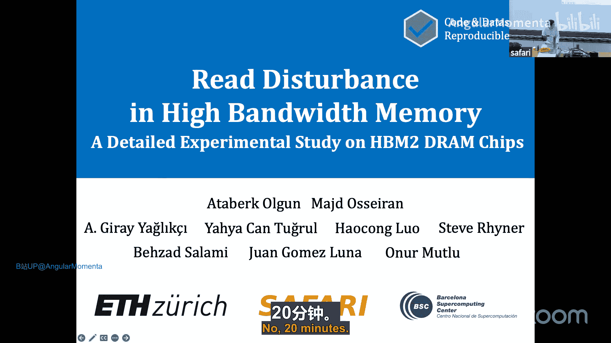
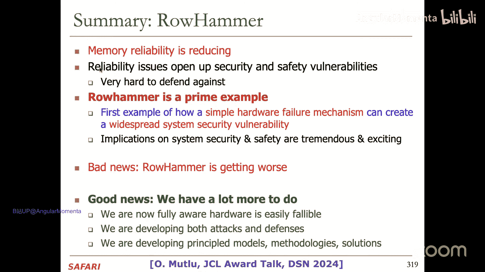

# 005：内存稳健性基础与实验分析

在本节课中，我们将要学习内存稳健性的基本概念，特别是由内存干扰（如Rowhammer）引起的比特翻转问题。我们将通过实验数据理解这些现象的严重性、变化性及其对系统安全性的影响。

## 内存隔离与干扰错误

内存隔离是系统稳健性的一个关键属性，它要求一个内存地址的访问不应意外地影响存储在其他地址的数据。然而，在现代内存芯片中，由于干扰错误的存在，满足这一属性变得非常困难。

干扰错误的一个典型例子是Rowhammer。当反复激活和预充电一个“攻击行”时，会导致相邻“受害行”中的比特发生翻转。我们称被反复激活的行为“攻击行”，而发生比特翻转的相邻行为“受害行”。

## 干扰错误的普遍性与影响

自2014年左右起，研究表明Rowhammer比特翻转现象广泛存在。许多研究人员已经利用这些比特翻转，以多种方式破坏了系统的安全性。

一个常见的误解是，纠错码（ECC）可以完全消除干扰引起的比特翻转。然而，多项研究（包括我们的工作）反复证明，ECC无法完全根除这类故障。在我们的幻灯片中，您将看到一些真实数据，展示ECC在面对此类故障时的无效性。

## 内存可靠性下降与Rowhammer的挑战

内存可靠性正在降低。Rowhammer比特翻转难以防御。坏消息是，情况正在变得更糟；好消息是，我们作为架构师还有很多工作可以做。我们可以提出解决这个问题的方案，或者开发新的实验方法来理解这个问题。

我的工作正是致力于开发解决方案、模型和方法论，以理解现代内存芯片中的干扰问题。

## 可变读干扰（VRD）现象

上一节我们介绍了干扰错误的基本概念，本节中我们来看看一个关键的研究问题：可变读干扰。

我们的目标是回答一个关键问题：我们如何能准确且高效地测量每个DRAM行的读干扰阈值？读干扰阈值（RDT）量化了一个行在经历第一次读干扰比特翻转前所能承受的干扰量，通常以激活次数表示。

准确识别RDT值至关重要。如果配置的阈值过高，则无法缓解比特翻转，系统将不再安全。如果配置的阈值过低，则会引入不必要的性能和能耗开销。

为了达成目标，我们实验性地表征了DRAM芯片。我们使用了DRAM测试基础设施来测试DDR4模块，该设施提供了对DRAM命令、时序参数和温度的细粒度控制。我们还测试了来自三家主要制造商的许多芯片，涵盖了各种芯片密度、数据版本和芯片组织。

我们采用了严谨的读干扰表征方法，防止了干扰源，并使用了最坏情况下的双面Rowhammer读干扰访问模式。

以下是我们的主要发现：

*   **读干扰阈值随时间随机且不可预测地变化**：我们发现，一个DRAM行的读干扰阈值会随时间随机且不可预测地变化，这使得准确识别读干扰阈值变得极具挑战性。这是最重要的基础性结果。
*   **观测到的阈值分布广泛**：我们记录了超过1亿次读干扰阈值测量。对于一个特定的DRAM行，我们观察到的最大阈值可以是最小阈值的3.5倍。而且，一个行的最小读干扰阈值值可能在进行了惊人的94,000次测量（至少花费两周时间）后才出现。
*   **我们称这种新现象为可变读干扰（VRD）**：它对系统安全性和稳健性具有影响，因为无法快速准确地识别一个行的读干扰阈值。

我们评估了使用保护带和纠错码作为VRD引起的未使用比特翻转的解决方案。根据我们有限的比特翻转位置数据集，我们发现相对较大的保护带结合ECC可以防止VRD引起的未使用比特翻转，但会带来显著的性能成本。我们认为需要更多的数据和分析来得出明确的结论。

我们的结果呼吁未来在理解和高效缓解读干扰比特翻转及VRD方面进行更多工作。

## 可变读干扰的深入分析

上一节我们介绍了VRD的基本现象，本节中我们来看看更深入的分析结果。

我们对许多DRAM行进行了测试，并扫描了许多测试参数。以下是三个关键结论：

1.  **所有DRAM行都表现出不同程度的可变干扰**：没有一行能免受可变干扰的影响。我们计算了每个测试行1000次读干扰阈值测量的变异系数。所有测试行都表现出VRD，没有一行的阈值测量变异为零。
2.  **相对较少的测量不太可能得到一个行的最小读干扰阈值**：我们使用蒙特卡洛模拟来评估仅使用n次测量（n小于1000）来发现1000次测量中的最小读干扰阈值的概率。例如，仅进行一次测量（n=1）获得最小值的概率非常低，只有0.2%。即使进行500次测量（n=500），对于中位数行，概率也达不到100%。
3.  **数据模式、温度、攻击行开启时间都会影响VRD**：我们观察到数据模式会影响VRD分布，但没有单一数据模式在所有测试的DRAM中导致最差的分布。攻击行开启时间也会改变分布，但没有明确的单一关系。温度的影响也没有清晰的模式。

此外，我们观察到，随着芯片密度增加和制造工艺进步，读干扰阈值的分布变化（即变异性）趋于恶化。这意味着随着技术发展，干扰问题可能变得更加难以预测和控制。

## 可变读干扰对系统的影响

上一节我们深入分析了VRD的特性，本节中我们来看看其对系统安全性和稳健性的影响。

防御措施或读干扰缓解技术提供的安全保障依赖于准确识别读干扰阈值值。我们表明，准确识别这些值极具挑战性。

我们评估了一个短期解决方案，即将读干扰阈值的保护带与纠错码结合使用。根据我们有限的实证比特翻转数据集，我们表明这种组合可以在一定的性能成本下防止VRD引起的比特翻转。我们认为这需要未来进行更多在线读干扰分析、运行时可配置干扰机制的研究。

需要强调一个重要注意事项：本部分及下一部分呈现的结果仅基于有限数量的读干扰阈值测量。您可以悲观地认为，更多的阈值测量可能会产生更差的结果。思考数百万或数十亿次读干扰阈值测量可能产生的结果是有益的。

以下是更深入的探讨：

*   **识别最小读干扰阈值非常困难**：读干扰阈值的变化可达3.5倍，且可能没有上限。其分布受许多参数影响，全面测试非常耗时。例如，仅测试一个拥有256K行的存储体中的每个行一次，就可能需要39分钟。而一个DDR5模块有32个存储体。
*   **单独使用保护带效果有限**：由于全面测试非常耗时，系统设计者可能会测量几次读干扰阈值，然后取最小值并应用一个保护带，希望覆盖永恒的最小读干扰阈值。然而，我们的分析表明，即使使用较大的保护带（如50%），也不能保证能识别出最小读干扰阈值。而且，大的保护带会引入显著的性能开销。
*   **纠错码作为补充技术**：我们重视纠错码作为使用读干扰阈值保护带的补充技术。但我们观察到的比特翻转率表明，目前广泛使用的、相对廉价的ECC方案结合10%的保护带可能仍然不安全。使用20%或更大的保护带可能只会在行中产生一个独特的比特翻转，结合当今使用的ECC方案或许可以防止。但我们认为需要更详细的分析（可能需要进行大规模研究）才能对保护带和ECC的有效性做出明确结论。

## 高带宽内存中的读干扰

上一节我们讨论了DDR内存中的VRD，本节中我们来看看高带宽内存中的读干扰问题。

我们问了一个问题：读干扰是否存在于新的高带宽内存DRAM中？如果存在，它在高带宽内存中表现如何？

我们的目标是实验性地分析现代高带宽内存芯片对Rowhammer或读干扰的脆弱程度。因此，我们实验性地表征了两个不同FPGA板上的六个HBM2 DRAM芯片。

以下是四个关键结果：

1.  **读干扰脆弱性在3D堆叠通道和各通道的数据行间变化**：我们观察到比特翻转发生在每个测试的DRAM行和所有测试的通道中。比特错误率在不同通道间变化，我们识别出具有不同比特错误率的通道组。最脆弱通道的ID在不同芯片间也不同。
2.  **平均而言，用少于诱导第一次比特翻转所需激活次数两倍的次数，可以诱导最多10个比特翻转**：我们开发了基于诱导第一次比特翻转所需锤击次数的九个其他指标。我们发现，平均而言，少于两倍的最小锤击次数就足以诱导最多10个比特翻转。此外，如果一个行需要很多次锤击才能诱导第一次比特翻转，那么诱导该行更多比特翻转可能需要的额外锤击次数更少。
3.  **行加压在测试的HBM2 DRAM芯片中普遍存在**：保持一行开启更长时间（行加压）也会导致比特翻转。我们观察到，随着开启时间增加，比特错误率增加，并且用更少的激活次数就能诱导比特翻转。
4.  **我们完全揭示了一个测试芯片中未公开的片内Rowhammer缓解技术的工作原理**：我们发现该HBM2芯片实现了一个未公开的片内缓解机制。该机制每17个定期刷新操作执行一次受害者行刷新（也称为目标行刷新）。它会刷新攻击行两侧的相邻行。我们设计了几种访问模式来绕过该缓解机制。

我们还绘制了关于攻击和缓解的若干启示。我们希望我们的工作能激发并帮助未来的工作。本工作的所有数据和源代码均在下方链接中开源。

## 低开销Rowhammer缓解技术：Abacus

上一节我们分析了HBM中的干扰问题，本节中我们转向缓解技术，介绍一种名为Abacus的低开销解决方案。

随着DRAM对干扰越来越脆弱，现有的Rowhammer缓解技术要么以高面积开销实现低性能成本，要么以低面积成本但高得令人望而却步的性能和能耗开销来防止比特翻转。我们在这项工作中的目标是，在高度Rowhammer脆弱的DRAM系统中，以低面积、性能和能耗开销防止Rowhammer比特翻转。

我们的关键思想是使用低成本和可扩展的基于哈希的计数器来跟踪DRAM行激活。为此，我们提出了Abacus，它通过采用Count-Sketch技术来跟踪大多数DRAM行，以实现低面积成本；并且仅使用高精度的每DRAM行激活计数器来跟踪一小部分被多次激活的DRAM行，以减少性能损失。

我们的综合评估表明，Abacus在面积、性能和能耗成本之间取得了良好的平衡，其面积开销显著更低，并且性能优于最先进的缓解技术。

Abacus的关键观察是：许多工作负载在不同DRAM存储体中访问相同行地址的时间大致相同。因此，我们可以使用一个计数器来跟踪所有存储体中具有相同地址的多个行的激活次数。

Abacus有两个关键结构：
1.  **计数器表**：使用Count-Sketch技术，将每个DRAM行尽可能唯一地映射到一组低成本的基于哈希的计数器。
2.  **近期攻击者表**：仅为一小部分被多次激活的DRAM行分配高精度的每行标签计数器。

当发生对行A的激活时，Abacus首先检查计数器表获得一个估计值，同时检查近期攻击者表获得另一个估计值。如果近期攻击者表有标签匹配，则使用其更准确的估计值。然后，Abacus将此估计值与预防性刷新阈值比较，如果达到阈值，则预防性刷新行A的受害行。

## 低开销Rowhammer缓解技术：CoMeT

上一节我们介绍了Abacus，本节中我们来看看另一种低开销缓解技术CoMeT。

我们的目标是在高度Rowhammer脆弱的DRAM系统中，以低面积、性能和能耗开销防止Rowhammer比特翻转。

我们观察到有两种类型的计数器可用于跟踪激活次数：低成本的基于哈希的计数器和高精度的基于标签的计数器。理想情况下，我们希望同时实现低成本和高精度。

我们的关键思想是：首先使用低成本和可扩展的基于哈希的计数器以低面积开销跟踪大多数DRAM行激活；其次，仅使用高精度的基于标签的计数器跟踪一小部分DRAM行，以实现低性能开销。

我们引入了CoMeT。CoMeT有两个关键结构：
1.  **计数器表**：采用Count-Sketch技术，这是一种基于哈希的频繁项计数技术，使用多个哈希函数和每个哈希函数对应的计数器数组。
2.  **近期攻击者表**：仅为一小部分被多次激活的DRAM行分配高精度的每DRAM行激活计数器。

当发生激活时，CoMeT首先检查计数器表获得估计值，同时检查近期攻击者表。如果近期攻击者表有匹配，则使用其更准确的估计值。然后比较此估计值与预防性刷新阈值，并在达到阈值时预防性刷新受害行。

我们的评估表明，CoMeT在面积、性能和能耗成本之间取得了良好的平衡，其面积开销显著低于最先进的缓解技术，并且性能更优。

## 由Rowhammer防御引入的隐蔽和侧信道漏洞

上一节我们介绍了低开销缓解技术，本节中我们来看看这些防御措施可能引入的新安全问题。

工业界和学术界已经采用了多种Rowhammer缓解措施，但它们完整的安全影响尚不明确。这就引出了一个问题：工业和学术界的Rowhammer缓解措施是否会引入新的隐蔽和侧信道漏洞？

在这项工作中，我们表明不幸的是，答案是肯定的。

我们观察到，DRAM预防性操作（如刷新）具有两个基本特征，使得隐蔽和侧信道成为可能：
1.  这些操作通常会导致常规内存请求的访问延迟显著增加。
2.  预防性操作可以按需触发，因为它们高度依赖于内存访问模式。

利用这一观察，我们引入了LeakyHammer，这是一类新的攻击，它利用Rowhammer缓解措施引起的内存延迟差异。LeakyHammer的关键思想是：首先通过按需触发预防性操作，确定性地对内存请求施加高延迟；其次，通过观察系统中发生的预防性操作，准确推断受害者内存访问模式。

我们在论文中进行了三个案例研究：
1.  **基于PRaC的隐蔽信道攻击**：我们展示了攻击者可以利用PRaC机制建立跨进程的隐蔽通信信道。
2.  **基于RFM的隐蔽信道攻击**：我们展示了类似的攻击也可以利用刷新管理机制。
3.  **网站指纹攻击**：我们演示了一种网站指纹攻击，攻击者可以通过观察受害者进程引起的预防性操作，推断出受害者正在加载哪个网站。

我们还讨论了如何缓解LeakyHammer，并提出了两种对策：
1.  **固定速率RFM**：这是一种根本性解决方案，它将预防性操作与运行应用程序的内存访问模式解耦。
2.  **随机初始化激活计数器**：这是一种较低成本的应对措施，通过随机化方法降低信道容量。

我们的评估表明，固定速率RFM可以在近未来的Rowhammer阈值下以较小的性能开销缓解LeakyHammer和Rowhammer。而随机初始化激活计数器则以较低的性能成本降低了信道容量。

## 自管理DRAM框架

上一节我们讨论了防御措施可能引入的漏洞，本节中我们来看一个旨在简化新维护操作实现的框架。

实现新的片内维护操作（如更好的Rowhammer保护）意味着需要更改DRAM接口和其他系统组件（如内存控制器）。然而，修改接口是一个复杂的过程，通常需要多年时间。

我们的目标是简化和加速实现新的高效片内维护操作的过程。我们的关键思想是提出一个简单的接口变更，使得DRAM芯片可以拒绝针对正在维护区域的内存访问。

这一单一的接口变更允许DRAM设计者实现新的维护机制，而无需进一步更改接口和其他系统组件（除了DRAM芯片本身）。

我们在SMD中实现了三种片内维护机制，以展示SMD的有用性和多功能性。我们的评估表明，SMD能够以较小的面积成本实现性能和能耗高效的维护操作。

我们的所有源代码和数据均在下方链接中开源。

SMD的关键观察是：DRAM芯片拥有维护自身所需的所有信息。DRAM芯片也应该自我维护，原因有二：首先，实现维护机制更容易且可能更快，因为这样做不需要更改接口；其次，它使DRAM制造商能够在不断露任何DRAM内部专有信息的情况下进行架构优化。

我们的解决方案是启用自主的片内维护操作。然而，DRAM接口定义过于僵化，无法容纳自主的片内维护操作。我们的目标是对DRAM接口进行一次简单的变更，以启用自主维护操作。

SMD引入的概念是“锁定区域”。锁定区域定义了维护操作的粒度。锁定区域位向量指示正在维护的区域。锁定控制器协调DRAM区域的锁定和释放。

通过支持SMD的DRAM存储体，我们在开始对该区域进行维护操作之前先锁定一个区域。内存控制器可以访问未锁定的区域。如果内存控制器访问一个锁定的区域，它会收到一个否定确认。维护操作完成后，锁定控制器释放锁。

SMD只需要对DRAM接口进行一次修改，即增加否定确认信号。这可以通过使用DDR4和DDR5接口中已有的Alert_n信号来实现，无需额外的引脚成本。

## 总结

在本节课中，我们一起学习了内存稳健性的核心挑战——由Rowhammer等现象引起的内存干扰错误。我们深入探讨了可变读干扰（VRD）这一新现象，它表明读干扰阈值会随时间不可预测地变化，使得准确防御变得困难。我们还分析了高带宽内存中的干扰问题。接着，我们介绍了几种低开销的Rowhammer缓解技术，如Abacus和CoMeT。然后，我们探讨了这些防御措施可能意外引入的隐蔽信道和侧信道安全漏洞（LeakyHammer）。最后，我们了解了自管理DRAM（SMD）框架，它旨在通过简单的接口变更来简化未来维护操作的实现。整个课程强调了在追求内存性能与密度的同时，确保其安全性与可靠性的持续挑战与重要性。