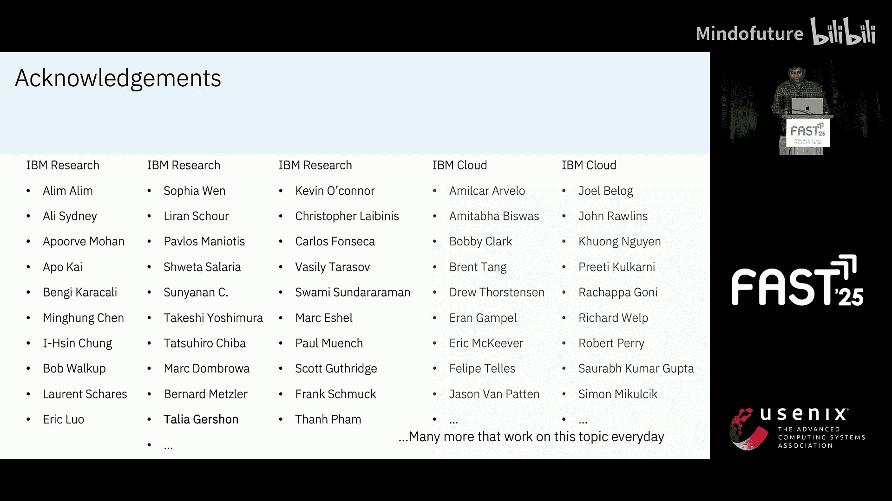
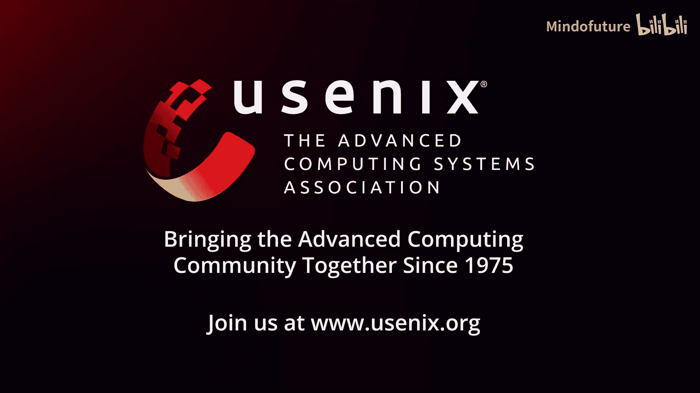

# FAST25存储大会-｜-USENIX-Conference-on-File-and-Storage-Technologies-p01-P01-Keynote-Address---Insights-Gained-from-Delivering-Two-Generations-of-AI-Supe--BV1HmVXzME4J_p1-

。

Actually， in order to prepare for this， I've watched multiple keynote speeches Rammszies。

 for example， and from last year and is from the year before and all of them mentioned there is some bright blaring lights coming out those are the two lights I couldn't believe it's actually that bad but like any good day I model I watch there talks and I learned a few things and what I learned from those is that they actually told a personal story as well as a technical story so I'm going to try to kind of weave in a little bit of my own personal journey because my understanding is that this conference is about half or 50% students and 50% professionals and I think my personal story might be inspiring to some of the students because I' have come through the same routes that most of you are going through。

😊，So let's get started here I do if you have a burning question please raise your hand you can ask me I would rather this be kind of an interactive session rather than a boring one but if you have a long question we can take it offline I'm here today and tomorrow I'm feeling a little bit under the weather so that's why my speech is a little bit muffled but rather than that I'm perfectly healthy and happy to engage with you。

😊，嗯。So I also want to thank the organizers as well as the Uex team HyDN team and more importantly all of you for giving an hour of your time I take this very seriously and I hope youll get something out of my presentation so I organize my presentation to mainly three parts I'll spend a little bit of time on my own personal journey in how I've come to where I am right now the second part of it is mostly the technical part which is what's really new in AI and I've actually used a lot of AI to even come up with the presentation here so I'll be interesting we'll talk about a little bit of the AI workloads because when I look at the past keynote speakers and the speakers that in general here they are all storage experts。

And I'm not a storage expert。 So as I was thinking back。

 what is it that I can tell you guys that's actually new to you And what is new really now is in new workload。

Obviously， storage guys gets excited by the new workloads。

 So AI is the new workload and I want to talk about what are the systems that we are building for AI。

 what are the kinds of challenges we are seeing compute network storage wise。

 and so I'll spend some portion of this talk at the end on the storage parts of it。

 but I also want to connect the compute and the network aspects of challenges in AI systems。

 and finally I'll do a brief summary of it。😊，Okay。Allright。

 so I'll make this really short just as an inspiration。

 I'm not gonna rehash everything that happened in my whole life。

 but I actually started my career at IBM research while I was doing my graduate program I think it was a second year or third year。

 I got an internship at IBM P Watson Research center and Ive never left I love the place it's a great environment。

 And if you find something like that definitely hold on to it but the first seven。

8 years of my career is probably the time where I did the most intense technical work actually like Ramsay。

 my advisor and I had the same issue I wanted she wanted me to graduate I said I wanted to do one more thing and she gave me the advice that you know PhD is not the end of your career。

 you understand that right PhD is only the beginning of your career。

 So you know move on you go to the industry， you learn new things and that's kind of pushed me out and join IBM I joined the high performance computing group at IBM。

😊，where we were building Bluegen L， Bluelugen Q， all the supercomputers。

 we were working on file systems， performance tools and so on and so forth。

 But without going into the technical side of it， the main thing that I learned in their journey is that really you do your best cheap technical work in the first5。

6，79 of your career that is the time where your boss doesn't bother you you will not get a lot of you know you need to manage this person that person so on and so forth。

 you can sit down and I do a lot of this kind of work I really grew my circle of influence I've probably gone to a conference every every month or so lots of conferences available talk to a lot of people I built a huge network of mentor community this is the only community unfortunately that I did not actually get to meet I've been to supercomputing the network and conferences so and so so on and so forth So my advice to youngng students here as you are graduating is that make your first few。

Its really deeply technical and build a huge community。 The community is going to help you。

 You are going to help the community as well。 So it works both ways。Second part of my journey。

 I basically did a good job at building HPC systems and so on。

 And when you do a good job at IBM usually they will ask you go work on something that actually makes money obviously HPC is not one that makes a lot of money So I started to actually completely throw everything I did in HPC and movement to a new area。

 this thing called cloud and this was in 2013 just for time reference。

 So it's very early days of cloud。 Nobody knows people are making fun of cloud people are taking seriously what cloud is doing。

 Amazon is doing and so on。😊，And that's the time。 And in fact， if you are an HPC。

 everything is about performance。 If you go to cloud it's actually everything is about not about performance。

 It's about usability。 It's about consumability。 it's about elasticity。

 everything else but performance is kind of the last thing。

 and so I'm able to kind of basically throw away get into a new field learn things there and started to build a lot of different cloud services but really my HPC background came into used there as well。

 So don't be afraid to take new challenges。 they are going to come if there is anything that's constant that's really change my mentor Jim Brown from U Austinin past as well told me you know that's the only thing that's constant is change So adapt to it and I think change is going to be even more rapid in the next many years。

In the last five years or so we actually embarked on this journey of AI as many of you know。

 IBM has been doing AI for a long time。 We have won the jeopardy and so on。

 but then we started to reinvigorate all of our AI efforts around 2021 to capture this new AI bars。

 So we build AI systems in the last four years that's going to be rest of my talk but the biggest thing we have done in building these systems is if you are in kind of industry one way to build AI systems is actually build them exactly like HPC systems You just deploy them like a traditional bare metal infin band in videodia will if you have deeppack pockets and video will sell you actually a shrimp system that you can just buy deploy and run That's one way to do it that's surely a successful way but a very expensive way it brings you a lot of constraints。

 The other way to say is okay what are the AI workloads。 What are the characteristics。

 How do we actually rearchitect the entire system and that's what we。

I've done in the last four years。So my message here is really。

 I felt like I actually was perfectly fitted for this role because I had the background of HPC。

 I had the background of cloud and so we went and did AI systems in cloud like HPC systems but bring all the cloud characteristics。

The final thing I do and I encourage everybody to do it。 And I actually。

 I think we should give a round of applause to all the mentors that took up the role here。

 if you don't mind， this is a great job。😊，I benefited a lot from mentoring。

 actually continue to benefit a lot from mentoring。 I have a number of mentors。

 every conference I go。 I spend maybe two three hours actually with each of these people tell them my issues。

 sometimes my mentors tell me their issues are which is okay。

 And then you know we kind of brainstorm on ideas and so on。

 And this becomes kind of a lifelong friendship that continues So I do that quite a bit。

 I also teach I used to teach at NYu now I teach a course once every year at Columbia University and cloud and machine learning。

 It's really exciting to interacting with students and help my kids I have kids as well and their friends on various kinds of Lego challenges and things like that。

 So do help it's actually a lot more fulfilling。 Otherwise your work will consume you So this is one way to distress yourself actually out of all the dotoday work。

 with that I'm gonna get it the main part of my talk。 So what's new in AI。😊。

Of course all of you I'm sure know what is new in AI。

 It's chargeT deepse you know that's all in your minds。

 but let me take a little bit of a step back So how did we get here right So if you look at the history of AI starting in 2021 this is a trend that we have actually noticed and others has here folks at Stanford for example noticed as well which is where previously we are building AI models by taking data thats that you need to label a bunch of data that you curate it then you build an AI model then you find unit for a particular use case and you keep doing this and we have done a bunch of these models actually in our own labs which is a very uncalable way to actually bring AI to masses this is one of the reasons why although we had great success in winning jeopardy championship that did not translate in all reality to a lot of the business value and the big thing that changed。

😊，Is this concept of foundation models where you don't no longer have to actually build a model for a different use case。

 but you could take a lot of the data。 the data itself。

 especially textterra has a lot of information that you can use to train models because when you speak words they are actually connected together and so you can train a model using that information and you build this foundation model once you have a base foundation model you can then find tuny to do various use cases and the way I explain to my students is think of foundation model as actually sending a kid to school for 12 or 16 years So this is like the base knowledge everybody gets the same base knowledge we all have that going through our own schooling and once you are done with it now is when you specialize either it's with RHF reinforcement learning reinforcement learning with human feedback for a particular domain coding or solving puzzles are doing some。

Acivities you can then fine tune these models to make them far more usable right but this doesn't come for free this kind of training a foundation model and then actually fine tuning it to the different use cases is expensive。

 So the thing I wanted to cover here is usually this training part is what gets actually most of the attention。

 Most of the press its a deepses train a model for only $5 million。

That really is like you know I ran only a marathon and I ran only 26 miles not telling you how many hundreds of miles you run before and not telling you all of the costs that rent into it right so what I wanted to do was actually I wanted to cover the whole landscape of of the activities that go into actually training these models so before we go there let me just tell you a few use cases because I think it's always better to ground your thinking in a particular use case so for us at least in IBM the use cases centers around three important domains one of course we are the IT and support for large organizations or do a large organizations do they do actually coding they build applications they build use cases they build workloads so one of the key use cases for us is coding assistance there are thousands of developers within IBM。

And all of the corporations that we deal with have thousands as well and so one of the key use cases is actually helping coding automate generating hints generating coding semantics of fixed bugs help with debugging things of that nature that's a key use case that's actually gaining a lot of traction the second one is customer service assistance so these are chat partss these are when you make a call to your wireless provider why something is not working。

 helping you to debug kind of things these customer service assistances exploded during COVID time as people have actually stayed at home and all kinds of issues and this continues to be a huge area for not only as for many other organizations。

And the final one， which you don't see as much kind of from saying outside。

 but actually in the internal organizations， workflow orchestration is a huge deal right So when when you go to Amazon and click select an item and click buy。

 there is actually a huge amount of workflow that happens in the background that results in somebody picking the item from the bin that's actually somewhere and putting it in the card and then shipping it to your place and the same thing happens with IBM。

 for example， when you I'm sure you have all made reservations to get here huge number of those reservation transactions actually run on IBM systems So there is a huge amount of workflow orchestration that happens behind the scenes to deliver goods and services to end users。

 So these are all kind of just a glimpse of the different use cases that we are targeting these kinds of enterprise AI models and the way we target them with this collection of AI models that we also train they are called a granite series。

 So granite for code， this is。Gite AI model， a foundation model that's trained。

 but then fine tune for code。 It's trained for 116 different languages。

 including Cobal and photo and so on and so forth。 there is various configurations of these models there is a 3 billion model 8 billion model 20 billion and so on this billion models is the size of the model think of it as a parameters in the AI model and we open source these models as well。

 So for people that want to actually understand what these models are trained with there is an open source repository where you can find information about those models as well as there is a paper associated with it that actually tells you what data sources are used to train the model so you can go validate it。

 So we kind of put all of that out。For the languages we further train these granite models with various language information。

 I think we have one now with eight different languages Japanese including multilingual and so on。

 and we focus more on the smaller size of the models but with a higher quality data because the model size has an implication on the inference cost which we'll touch in a second。

And the final one is I'll just briefly mention there is a lot of industrial use cases of time series data。

 either it's your refrigerator or your air conditioning system and so on and so forth they all produce constant time series information and we find a lot of use cases in the time series data so there is a granite time series series models as well。

So all of these models had to be trained， and so this is the infrastructure that we built to support training。

 inference and tuning of these models。So let me just show you the overall workflow that I promised a second ago。

On this infrastructure。 so AI model training， typically we talk about training。

 but actually it starts at data preparation。 and this is a process that's labor intensive that computationally intensive and that's actually more data intensive Data preparation is where you take it's almost like digging for gold in dirt。

 the data is is everywhere there is a huge amount of data that's out there。

 but not everything in that data is actually valuable or helpful。

 So our data preparation typically starts around 10。

2030 petabytes of raw data and then you filter that data out to get eventually maybe a trillion。

2 trillion 10 trillion kind of tokens。 So it's a huge funneling process。

 and each time you are doing data preparation filtering you are trying to look for certain parents if you are training a model and that goes in an enterprise。

 you want to make sure you don't have hate and abuse kind of。

Text but at the same time you don't want to miss the nuances of communication so how do you do that Those are the kinds of processing steps that happen it's a huge data exercise as I mentioned most of this data typically starts in a object store kind of configuration and then you read the data process that data and then you store it back into object store so a lot of the computation for this kind of jobs takes hours to days there is usually every team that's training these large models have hundreds of engineers that are data engineers that are actually just working on this process thousandshouand of course of compute is needed and this process is repetitive you don't start you don't do data preparation once and you're done actually you have to go train a model look at it and then you go keep repeating this process not a huge amount of GPUs get used and there are some steps where GPUs are used but there is always hundreds and thousands of steps。

Involved in this job。 So that's data preparation for you in AI。

 That's one really computation and storage demanding application。

 The second one is distributed training。 So this is where once you have the data and there is process where your engineers look at various configurations for the AI model they go through it's like preparing for the marathon so they prepare train a smaller model run few miles first day a few miles next day。

 you train a smaller model。 you look at the hyperparameter。

 you train another slightly bigger model and you get the whole thing ready and then you launch your distributed training job approximately the preparation takes about the same amount of infrastructure as actually training the model sometimes training the model is actually less type than than the preparation like in the case of a marathon you'll run far more miles than actually just doing the marathon this takes weeks to months And so when you look at deepse actually the number that they produce was 5。

5。and dollars and some number of GPU hours what they said was exactly that that particular model training you only do the exact training that they have done。

 but not all of the preparation， but typically this is significantly expensive in compute cycles and you throw hundreds of thousands of GPs at this problem hundreds to thousands of GPUs。

The next step is once you have the model again， the end of the distributed training is not a model that you will directly use as is it's like the end of your high school is not when you're going to workforce and start to work。

 There is fine tuning that happens So that's where the model adaptation and fine tuning process starts。

 typicallyy this tends to be hundreds of jobs。 you fine tune in many different ways。

 Sometimes you fine tune halfway。 and then you actually go back and refine fine tune the process。

 and this fine tuning doesn't have to be a job like a distributed training job。

 it could be running a subset of GPus。 you could。You could parallelze the fine tuning operations。

 You might actually fine tune exactly the same process through multiple different paths and then evaluate and pick the best one and so on and so forth。

But once the fine tuning happens， this is when you actually deploy this model into inference。

 This is where end users get to actually access the model that you have trained and preprocesed and fine tuned frankly speaking。

 nobody makes a dime in the first three steps first three steps are completely cost of course except Nvidia a lot of money selling GPUus。

 but the rest of the people don't right the place where it has true value to a consumer is the inference time。

 an inferences you can imagine is a highly demanding interactive process especially within yourer model where you have chain of thought reasoning where the model is actually reasoning or what you are exactly asking and doing a lot of computation。

 and it eventually spits out an answer。 This is a very computationally intensive task as well as a memory intensive task So most AI model performance is。

dictated by the memory bandwidth of the GPUus。 and of course。

 you expect once charge GT or deeps or IBM， once we put out a model。

 you expect that model to be available 247 and you expect it to be performant and producing response times with a reasonable amount of time。

 So it's a web application with a huge demand on horizontal scalability and response the main metric that is used from the inference side is usually dollars or dollars per million tokens。

 that's a metric that's gets used and that's actually how most of the people get charged in many of these AI services。

 So that means optimizing cost today， everybody is exposing these models at any cost basically to gain market traction but the place where if AI were to explode and get used in the long run。

 that cost has to be really optimized。Right。嗯。So。II wanted to and I give these talks。

 I kind of try to give some kind of intuition for people。 So when we talk about distributed training。

 what do we really mean and where did we start and where we are right now。

2 main things I want to remember is data and the model size。

 So this is I'm going back a little bit when we started the whole work on our AI system。

 this is in 2020。 and we have done a lot of user surveys to figure out what will be the data size。

 and the biggest data sizes that they could tell us about 100 billion to 200 billion parameter tokens in data size is kind of what they were envisioning Of course。

 now it's 2020 and know vision is 2020 we can look back and we know this data has exploded。

 So what I'm showing on the right hand side all the way up to 2024 on the vertical axis is the billions of tokens。

 In fact， this graph I made in March of 2024。 Now it is 10 trillion。

15 trillion tokens is what the common commonly accepted data set size。

 so the bar on the right is actually much higher is another factor of two larger than what it shows here。

 So the amount of data that we are throwing at these AI models is just exploding is going exponentially that's just data so that's one factor that goes into training these models the second factor that goes into training these models is how big a model you want to train。

And。In 202021， if you ask even the top research， they would say maybe a billion parameters is kind of the place where we would train nothing bigger than that that has gone to 10 billion that has gone to 00 billion now we are talking close to a trillion actually some of the models are 1。

21。41。0 trillion parameters deep C 670 billion parameters of course there is a mixture of experts I would talk about that right now but but the size of these models is growing exponentially as well。

 it's not only just to train a model that end users consume nowadays there is a lot of these models that are trained as teacher models So you train a large model that becomes your teacher model than you go train much smaller models that are student models that will learn from these large teacher model So when but when you are designing a system in 2020 or 2021 you would be expecting a billion half a billion to a billion or 5 billion but。

You know but this is where we ended up being So what kind of compute do you really need if you want to support these kinds of models as I said。

 the two parameters are data and the number of parameters that you will use in your model and the math is really really simple。

 This is the MS math you could figure out it's really just the multiplication of the amount of data and the number of parameters of your model that's what dictates the amount of compute In fact。

 the equation is six grader can remember this it is the for every single parameter and token combination you perform six computations So its six times the number of parameters times the number of tokens that you have that's the amount of compute you need to pretrain these models I know my AI folks will say six you are assumingum activation checkpoint for it is not for this crowd I don't think that's that relevant but that's the kind of compute that you need for just pretrain。

Your model if you talk about just inference， just think of it as doing just far pass forward fast is two computations for every single parameter un token combination。

 so it's two times 10 times D instead of six times。

10 times d for inference for fine tuning you will use sub a small set of data。

 So your D will be smaller， but the your N is still the same so that's how you compute the amount of compute cycles you need for fine tuning。

Okay， hope that's helpful， right。Okay， so。I just want to remind you when we started this whole work designing these systems。

 we were in 2021 and we are trying to design what kind of a system we have to do。

 So we did our best to design our first system in 2022。 That's what we call Vla part1。

 So this is a system weve designed in 21 we delivered in 2022 our users were using it。

 it's lots of GPus with 200 gigab ethernet it's a cloud data center in part of IBM cloud in 2023 by the time we delivered the system。

 it became very clear we actually need a bigger system and so we ended up delivering delivering an X system would called Vla part2 essentially take the existing system almost four times improve its performance。

 and I go into the details on that in a second。By the time we had done with that system。

 we needed more capacity， so we ended up delivering VLA2 in 2024 end of last year。

 and that has about8x more network capacity， 2x more compute performance and so on。In the meanwhile。

 if anybody is interested， these systems are not just limited to IBM cloud。

 we actually package them and bring them to your data center so if you have deep enough pockets stuck to me and we can get one into your lab as well。

 so that's what we call Von Prem。A lot of the details on these systems are actually documented in an archive paper in addition to building these systems we also built an onprem HPC system just to compare performance and usability and so on and so forth。

 so those are all documented in that archive paper I'm also happy to let you know we have an as+ paper that's actually coming up in the next AS+ conference which has a very distilled version of the lessons learned from here。

嗯。So what are some of our design principles is when we are thinking about these systems number one。

 of course， we are designing a cloud native AI system。

 but we wanted to make sure it actually delivers some performance。

 we cannot just say it's in a cloud so it's very elastic and scalable but it doesn't perform that won't work right So performance is it state out performance but cloud our clouds and many clouds are actually limited to Ethernet some of them do support infinibad but vast majority of the fleet of infrastructure that's available in cloud is Ethernet。

 So we want to make sure we deploy these systems in Ethernet configuration while delivering the best possible performance。

 second， as I just showed you training the models， of course。

 a lot of the system builders start with actually needing infrastructure to train the models but training the model is only one step you really need to bring them to clients So that's why it has to support the full life cycle of the workload in parallel we want to make sure it has all of the cloud flexibility So operational。

The lastasticity so that we can grow and deploy the same copy of this system across our worldwide data centers not all of them are same size or shape some data centers。

 many cloud providers face the same thing Some data centers tend to be really big but in other locations where you have data centers in metropolitan areas and so on they tend to be smaller so you need to be able to deploy different configurations of these systems。

And the last one， I'm sure you' are hearing this as well， when it comes to AI infrastructure。

 the first thing that actually hits you is the lack of power and availability of power to feed these AI systems。

 so power space and cooling becomes a huge challenge and we'll talk about this in a second。Allright。

 so our Va overall system architecture looks like this。 It's a spine leaf configuration。

 a typical cloud configuration where there is n number of servers within a rack。

 Each of these servers is connected to multiple top of the rack switches for high availability and then those top of the rack switches connected to multiple spine switches。

 So that means a packet that's going on a network interface has multiple paths to go。

 you could actually take any of these stores down spines down and so on。

 Still the system will be operating We expose all of the compute capacity through virtual machines。

 which is common in other cloud providers as well。 What is different with us is we actually document all of this through open source Linux KbM Q and we publish this information as well。

 So as I mentioned， our network cards are dual ported network cards。

 each port connect to a different tour there are multiple spines and packets travel through multiple paths。

 We also use a tiered storage system。 I'm sure this is of interest to many。

A few where we have storage on the nodes that's the local storage but it's kind of treated as kind of non-persist storage then you have persistent storage here with a file system and then there is object storage and we'll talk about that in a second as well This is just a brief overview of the compute node standard deployments for a lot of these compute nodes for training especially a collection of GPUs within a node that are tightly connected with a high performance networking in this case we have eight GPUs that are connected with and we link fabric and those GPUs are driven by some number of CPUUus and then there is network cards that are attached to these GPUus that connected to the rest of the system。

I'm going a little faster because I'm checking the time and it looks like I have 20 minutes。

 So I'll try to wrap it up。 what is our supercomputer part one is really this kind of a system where we are able to virtualize all of the compute capacity but deliver bare metal kind of performance。

 we have spent a lot of time actually documenting this virtualization process and we were able to deliver more than 90% GP efficiency for the workloads in 92021。

 And remember 2021 workloads are really， really small。

 So that that's when 2022 came rolled in and the requirement was we need at least2 x more compute at least four x more performance so that we can train these bigger models that are required。

 But and we have to do all of this in six months and the previous system took us a year and a half。

 So that's the time where we went back to drawing drawing board actually celebrating after a couple days。

😊，To figure out how to improve performance of water at least2 x on the previous system。

 but also double the capacity and improve the operations。

 One of the things that happens on these GPU node is they fail and and we'll talk about that in a second。

So two things we have done to improve the performance by 2x as I mentioned。

 when we deployed initial Ver system， we use TCP network TCP means whenever GPus need to communicate to each other especially across nodes if they communicate within the node there is something called enablinging fabric that's easy to that's a high bandwidth performance but once you have to communicate across nodes the GPU has to copy the data back into the CPU and the CPU will use TCP protocols to communicate this information and that works perfectly fine for the 2021 models but when you look at 22 and 23 models that is not sufficient so we enable this technology called GPU direct ID DMMA over IBM cloud networking。

 which basically lets GPs communicate directly even if they are across different nodes without ever actually going back to the CPU so that means you eliminate all the data copies and so on and so forth。

So as a result of this， we were able to improve the network throughput by 2 to 4 x and network latency basics to 10 x and train even a 20 billion parameter model in a reasonable time。

So let me just show some data， I know a lot of you love the data。

 so the TCP performance would be something like the red line as a function of the array size。

 so as the bigger data you saturate the network when you are on the small end of the data side you are more on the latency bound。

 but once you get to RDMA especially RDMA with the GPUs directly you get that green curve which is almost 4。

5x better performance than TCP。And we have done evaluations on how does this scale right so you might work with 32。

 64， 128 GPUs， but does it scale to hundreds thousands of GPUs and I'm showing some of that here as well。

But what does it mean for a workload perspective because when you are at the end of the day you need to be able to train these models and what I'm showing here is the red line is where the previous system 1 x with the TCP networking anything about that is better performance and so we see a geometric mean of about 2 x better runtime performance so that means you can train the models 2 x faster so you reduce the time by 2x that's just improving the existing system I will skip this in the interest of time。

The other one I mentioned is power space and cooling efficiency。 our initial system deployment。

 And actually this is industry standard you will see in a lot of the GPU configurations。

 Usually you deploy two nodes or three nodes in a GPU rack these GPUus consume a lot of power。

 the a100 GPU8 GPU configuration consumer of 6 kiloW H 100 consumer actually about 9 kilo and industry standard racks are about 20 kiloW So you deploy two nodes are three nodes of this and then youre at the top end for the rack。

 One of the things cloud providers do is we actually provide rack with full redendancy so that is each rack has actually 40 kW of power。

 but you are only allowed to use 20 kiloW in case if for P or a PSU failure the other one can take over that's always stand by that's always available。

 What we said is for HC or for AI， maybe this model doesn't work。

 we should actually go revisit that and say we always use the 40 kiloW。 we make the nodes。

Trottle down if there is ever a power failure rather than always have it available as a standby。

 So we double the density of the racks。 but this means we need to have a technology that actually throttles GPus So we what with our vendors to make sure we can throttle this So in this graphic I'm showing basically there is three phases phase AB。

 B C and A one of the phases at the bottom feed is stopped So that means now if we run the GPS is of the same power。

 we blow out the other PDdu the GPSus automatically throttle down because there is a firmware that basically says not enough power。

 you should throttle down and you should run at a lower frequency and so that throtling happens within about 1。

5 seconds。 usually the PDs from the industry are rated around5 seconds so they can handle a surge up to5 seconds but after the they'll blow。

 So what we have done is basically that kind of an optimization where we actively power throttle whenever we see power issue。

But run at full speed if we don't see any issues。And this is a technology that we are deploying in the next generation server we have deployed actually in the next generation server as well。

In fact， just on January 14， we got a ping that said eight of these PSUs have an issue。

 we need to go fix them。 we ping the user I said your job is going to throttle down the user said I don't see anything for two minutes and then said oh yes I do and and the GPU which was running around 700 ws throttles down to 150 w this is a much better design where the workload might run a little slower for a short period of time and then it actually goes back up when things are fixed rather than you crash the job and then force the user to restart it or actually take the nodes out so this way we are able to bring both the cloud characteristics of elasticity and also consumability characteristics for the end users。

The other one I mentioned is GPUs fail。 And actually I wanted to use this slide to describe this。

 There is different types of failure that happens in GPUus GPU nodes。

 I classify them broadly into three the first one is very clear hardware failure。

 So you have a GPU failure or a bored failure or node failure。

 I call them actually good failures and some people laugh at me they are good failures because they are like know if you have a broken arm and it's actually bending down。

 you know， it's broken。 you can go to the doctor get it fixed。 but the other failures are like pain。

 you have a pain。 you don't know where the pain is。

 Now you need to go through a whole diagnosis process to figure out exactly what the problem is。

 So the second set of problems that I have on the table theyre all soft issues where sometimes GPU running at a slower clock frequency Our memory cells are corrupted。

 And so your application is actually getting garbage information are your PC link has degraded。

 So your application is running 10% slower than you expect but your。

Using 1000 GPUs and 400 PCI links you don't know exactly which one of these PC links is actually causing this。

 So you you need to diagnose it before you can actually relaunch the job so that you can continue with a better performance。

 And so these tend to be a lot more difficult to diagnose And so for this we have been working on a tool called autopilot I call this the Apple Watch for GPU systems it's always sitting there。

 it's monitoring stuff。 And if you ever fall down， it will call the doctor kind of thing So we have this autopilot that does actually four things。

 There is a mechanism where it has a continuous checks。

So if it notices that a GPU node doesn't have anything running。

 it actually goes and runs very intense tests periodically and see if the GPU are still healthy or not。

 If it notices anything wrong， it automatically marks that note as eva。

 So the scheduler on the top we say I will never place a workload on this and itll actually inform the system to take a look at it in the case where theres stuff running。

 it is constantly checking metrics coming out of it logs and metrics。

 So is there something I I'm seeing here are they abnormal messages， things like that。

 We also do pref check。 So this is before you take off any airplane， you actually go check。

 So a lot of these training jobs run for 20 days，30 days，40 days。

 So before you launch a long training job， you could request I want a pref check。

 So that means all the GPUs that are allocated to your job we will go check them with specific set of workloads to figure out if there is anything or theyre all healthy we do in flight check。

 So this is where we run nonintrusive。Kind of experiments to see if the CPI links or something else is actually causing any and for CAmins we also have something called onded checks where they can say okay end user reports my job is running5% slower what's going on they could actually just go initiate a collection of checks and this is all integrated into our scheduler this is an open source project autopilot is an open source project and I encourage people to come help us we work with Sony I seeRS here we work with the Boston University there are students actually working on this we don't have all the GPU configurations we don't have all even in fact my one which to this communities we need an autopilot for storage systems because right now my amins actually spend more time debugging issues on storage and Wely has been an excellent partner in that effort but we need an autopilot for storage systems and I think that that's。

Call for community to help。 and this is an open source project， and these slides will be available。

 so you'll be able to click on them。 I also have URLs in their references。All right。

So let me just spend the last 10 minutes or so on the data architecture and Ill provide a point of view you。

 I know we do a lot of this training in the cloud So I see really three data stories right so the first one is the object store。

 This is honestly the place where all of the AI data is actually going。

 This is where the data starts。 This is where it actually ends up being we deal with petabytes of this data in object store that goes into our clouds as well as we hear the same thing in other cloud providers。

The second one is distributed file system。 His， if you look at a lot of traditional HPC data centers。

 distributed file system is the place where the data actually lives both for computation as well as even for longter residency and of course you have tape and so on I'm just ignoring that for now and local storage a lot of these GPU nodes have local storage and in fact the AI researchers would do anything possible to make sure storage is never their problem So they will beg copy the data into my local disk and mark that node for me for the next 10 days So nobody else uses it I will just use it from there local storage is by by far the fastest storage of course that's the place but you don't have enough of it that's problem number one problem number two once you copy something into local storage now you have actually made that node not usable by anybody else。

 Now you have to make sure that user actually uses very productive。

You don't get very high utilization of infrastructure if you keep carving out dedicated local storage。

The。Object storage clearly is the place where a lot of the data goes for most of this AI training。

 It provides the cost on the scale， not necessarily performance cost and scale。

 but sufficient enough performance for some of the use cases this file system。

 at least from an AI systems perspective the way we see it is is really the cash for hot data。

 and this is where when you computing， when youre doing training when you're doing fine tuning。

 this is where the data has to come from because that's the one that provides the right kind of performance bandwidth latency characteristics that are necessary so that you don't keep these GPU node idle。

 but the key requirement there is this cannot be the place where people manually copy data from object store。

 this has to be automatically synchronized。 we do have from storage scale we have something called active manager or AFM that most data back and forth。

 but there is I think a lot more that can be done。 So it becomes more seamless。

 There is a huge amount of input data that gets。 there is a huge amount of checkpoint data and intermediate。

That actually also goes into this distributed file system。

The final one is really local stories This is increasingly more and more of the computation cycles are actually going into fine tuning and inference and of course if the AI journey was to be really successful in the next 10 years we have to spend more cycles in the inference because that's where actually the real value gets created and there there is a lot more data that's being created there is cash for frequently changing data the KV caches and so on and interestingly the fast this year has 10 papers on AI the previous year there were three papers and the previous year there were two or something like that so there seemed to be an exponential curve fast itself and several of those papers are actually about KVC some variation of KV cash。

Cash management for the model state as I just mentioned these models are becoming gigabytes and terabytes and that model state has to be managed efficiently GPU direct storage while there is support for GPU direct storage in things like spectrum scale I think this has to become more prominent and at the end of the day asynchronous updates back to cause so my ask from a research questions perspective really make data migration I'm sorry。

That is。Data migration between these layers really as transparent to users right now it is not users actually have all kinds of ways of copying data。

 copying data into these different layers， managing them cheering them and so on and that data management also has to be such that it doesn't interfere with the jobs。

 I think there is intelligent ways of actually figuring out when network is being used by the application versus when it is free and actually using doing replication during those times the other thing that I keep bugging Vaion team is actually the DFS layer。

 the distributed file system layer in the middle is not really elastic it should become elastic so I don't want to think about how big caching layer do I need rather than it grows on strengths as the needs of the users change。

Initially we used to use cloud object storage as our source of truth for writing or checkpoints and so on on an NFS file system for reading the input data sets that clearly did not perform good enough and that's actually when we went ahead and deployed our system with IBM spectrum scale storage scale GPSFS for those that are here and that really help solve two problems one these AI jobs when when every time there is a failure or restart of some for some reason or the other when the hyperparameters change their data loaders actually load a lot of data and that data loading time can be quite expensive if you are using an unperformant file system so that's one problem that scale or solve for the second one is as you are accessing this data you could also have a variability in your execution time because every time you are going to the storage。

It doesn't give you the right performance， so you have a lot more predictable job execution time by using spectrum scale。

 but just giving you as an example。嗯。We are working towards， of course。

 this kind of arrangement of using high performance file system as a cache has overhead people have to manage it and you need right tooling we need autopilot for the operations and so on so we are working on actually making this as a service storage scale as a service。

 a project facility and ti or driving where we have a number of use cases where this becomes really critical。

With that set so what are we running right now on Va， this is the slide before I wrap up。

 we are running a huge amount of training jobs， we are also doing a lot of fine tuning jobs and all of our Whatsonex services are running on this system as well on the worldwide data centers so with that said I want to rehash all of the technical details but I wanted to kind of give more higher level lessons insights one AI workloads change rapidly and so if you are talking to AI researchers trying to build systems are trying to come up with new research projects my advice is believe them only half the time or less than half the time because they themselves don't know honestly right the other way I think about this as I start to think about designing these systems is I'm going to assume that this is going to be massively successful。

So if this is going to be massively successful 100 x better than where we are today what should that design look what will be the problem at that scale I think starting from there and working backwards I'm not saying you should always design it for over designign the whole system but if you are not even convinced it's going to be massively successful maybe you shouldn't work on it actually right so if you think it's going to be massive then you will actually start to think about this kind of issues that are not there yet but that will come down soon right。

The other thing I learned really is you can spend a lot of time perfecting something。

 but actually you will learn a lot more by just putting it in the hands of people to use it and then get feedback and then keep it rating it Of course you shouldn't put it too early otherwise they'll try it once and they'll say this is not working and you know don't want to deal with it。

So next automation， as I just mentioned， I think we need to do more better job at actually automating a lot of operational issues。

 that's how we can make progress otherwise when you put something in users hands and they keep having issues。

 you'll spend more time debugging problems than actually making fundamental improvements。

This is just starting， in my opinion， the whole AI I think is just starting。

 so be part of the journey， talk to people here。 I think there is a huge amount of opportunity here。

I must say this is the work of a huge number of people。 There are1 hundred50 plus number of people。

 A number of our papers have others in the range of 200 people。 So while I am speaking here。

 I want to thank all of these people that have contributed to this and many more。

Finally I have a bunch of references that will be available but I'll just leave my slides here and I am here to answer any questions。

 I hope everybody is still awake and I hope that was interesting I really appreciate your time thank you。

