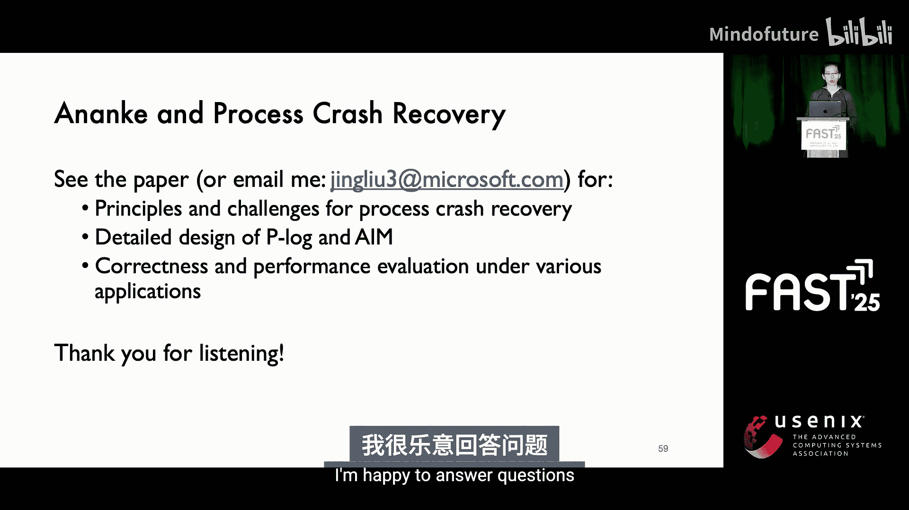
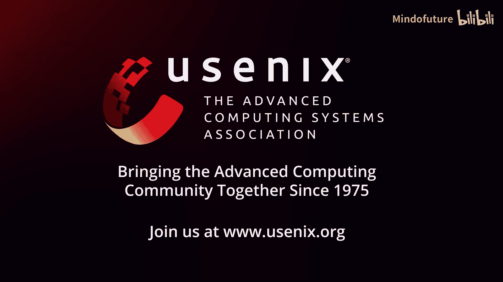

# FAST25存储大会-｜-USENIX-Conference-on-File-and-Storage-Technologies-p02-P02-Fast,-Transparent-Filesystem-Microkernel-Recovery-with-Ananke--BV1HmVXzME4J_p2-

。

My name is Jane。Today I will present our work， fast。

 transparent F System microconnal recovery with a Nikki。This ist trying to work with EFan。

And my advisors are R Ramsay。This is work when I was done while at University of Wisconsin Madison。

File system microchs build a file system service and the user space process。

So the file systems are running user space without OS kernel involvement。

This kind of power system recently gained more traction because of several benefits。

Without the OS kernel involvement， such micro kernels offer better performance for modern iOS devices and CPUs。

And the un level process， they are easy to develop and upgrade and also leads to better photo isolation。

😊，Examples include our work， UFS， which was published in SP 21。

 and more general micro kernels like Holman。😊，Fel says the Micons also offer great opportunity for a new paradigm of crash recovery。

 process crash recovery。😊，Because the file system process crash differs much from the classic four system crash。

When the kernel file system fails， it leads to a first system crash。

 the OS and all the application crash。Applications lose their progress。

So the file system crash is treated the same as power failureing。In four system crash recovery。

 only the on disk states are used。 So what happens when the file system is a process。

When a microconnal file system fails， it only courses a process crash， not a first system crash。

We have a completely new crash model and more opportunities to continue。😊，So firstly。

 we can see that the OS and other implications naturally continue， which is great。😊，The question is。

 can applications that are using the file system also continue and why it is hard？

The main challenge of process crunch recovery is to recover the state gap。

Because file system above update in memory， there is a state gap between the on estate and application view。

In addition， the state gap can be changed errically by subsequent operations or background behaviors。

 particularly in a non sequentialequial order。In this work， we build a Nik。

 a valve system micro kernelnel that supports process crash recovery。Central to Ananke is the PO。

 a data structure designed for process crunch recovery。

PilO is the in memory log emed into the file system process。

 it records operation and other information。When the file system crash。

 the OS coordinates the control transfer， notify a new file system process。

 and then the PO is used to recover the state gap。In a Nik， we design several new mechanismss。😊。

Pillog and M algorithm to recover the state gap， K coordinated speculative restart for fast recovery。

And lightweight detection of corruption for more robustness。Aan is implemented in UFS。

 or state of the art followss the micro kernelnel。We performed thorough evaluation of aanke。

 demonstrating that it offers failing transparency in over3 thought injection experiments。

We also show that a Nik incur low common pass overhead， less than 2% in most cases。Finally。

 the recovery is fast， not over 400 million， even for challenging workloads appear as a momentary performance drop to applications。

In the rest of the talk， I will talk about the challenges for process crash recovery and our mechanisms focusing on peelO and M and algorithm。

 then present evaluation and conclude。😊，A N is designed to perform principal process crunch recovery。

 The challenges are first to recover the state campm correctly and increasecur law overhead in the common purse。

The recovery also needs to be robust， such as tos。We propose novel mechanisms。

 P and M algorithm to recover the state gap， and robust restart mechanism called kernel coordinated speculative restart that also reduce the recovery time。

Light weight detection of corruption further improve the robustness。

I will focus on PO and M in this talk。PL is an im memory log designed for process crunch recovery。

It logs operations and other information。😊，Recur state ga by P is challenging。

 So the first reason is naively replaying each operation is not sufficient。

 assuming we run several operations and then a sink flashes some of the state to disk。

 This is common due to all of all the durability。😊，During the replay。

 we need to ignore them operations and sometimes only part of the operations update is needed。

There's a trade up between recovery time and common path overhead。If we cannot recover the state gap。

 the results will be incorrect， likely many efforts I did it。Causing long recovery time。

The second challenge of PeO is to control the common past overhead。Intuitively。

 extra flashes can simplify the state gap， but incur large overhead。😊，For example。

 flushing every operation easily ensures correctness and low recovery time。

 but leads to large common path overhead。😊，By contrast， our work in Nike provides both fast。

 transparent recovery and low common pass overhead。😊，Specifically。

 P log and M allow us to recover the stickamp without incurring extra flushes。

The state gap is complicated for two reasons。 Firstly， given an operation sequence。

 the subsequent operation may remove some operations update from the state gap。

 including close and sink。Clos removes file descriptors in this example。

 a close remove the file descriptor 3， and thus the first three operations do not need to be replay。

😊，A sink of bank sink makes effects durable。Also， remove some operations update。Besides。

 subsequent operation may change the precondition of previous ones。 for example， in this workload。

 open a file， write and rename it and sync the directory。😊。

So the undik states have a file named D slash A。😊，If a crash occurs after this sequence。

 we need to redo the right to the file， but we cannot redo the first open because the past name is no longer valided。

So how to address these two issues？We design a new data structure pillow that addresses the issues。

Plog is the in memory per cr that records the operations and other information。

And showing in the example， a P log entry contains a rate to record the possible target。

 The first element is the file descriptor， and the rest are possible ion numbers。

Including the target， I know， the parent， the destination and destination parent。

It also includes a big map that tracks whether this operations update of those targets are still contributing to the state gap。

For example， in this workload， openW S and close uses file descriptive straight and the iNote number is5。

😊，So the first element in the array3 and the second is5 in the bitm。

 the first bit is set because open initialize above descriptor。😊。

Right also we call file descript of three and I know number five。

The first bit is set because it changes the file descript of。 and second bit。

 because the file size and contents are updated。😊，Up on Eync first for the second operation right。

 the log interest second bit is reset because the Iode update is persisted to the disk。

After the close， the first element of both open and right I reset。

Such design of PO allows us to track how the operation contribute to the state gap efficiently。

Plog works together with an algorithm M， short for， act， ignore or modify。😊。

It enables us to transform the PO into actions that can be executed by the origin of our system implementation。

😊，The first decision for locked operation is ignore or not。😊。

If it does not contribute to the state gap， it needs to be ignored。

 then it designs between Act and modified。A indicate an operation will be directly replay as it is。

 Moify means that an actions needs to be taken， but in a modified form。

 such as different operation type or parameters。😊，Let's take one step back and think about the intuition。

Essentially， applications change the vow system states upon three abstractions。

 including vow descriptor， like the existence of an FD or the offset。😊，Or change the file i。

 like write the contents。 Change the size。 And the third is a mapping from pass to i。

 basically forming the director tree and use for naming。😊。

Amplications can only use the APIs to make the changes。 so we list the commons over there。

We can categorize file system APIs based on the abstractions they change。

 Some operations only change one type， such as open for FD P write for a file。

 Some operations change multiple types or multiple targets。 for example。

 create initialize one FD and one file I note and changes the pass list mapping。😊。

So the P entry records the passport targets in the array。

 such that bids can incorrectly track how a lockedgged operation contribute to the state gap。

 either it is non partial offer。If the none of the bid is said， we can ignore the operation。

 so checking the bit is fast， the common pass overhead is low。

The ignored portion of M is running the common parts， so it has to be very efficient。

The act or Moiv needs more consideration， such as what are the resulting operation types and parameters？

😊，This diagram nicely describes all the possible changes of each operation type。

 so the impact of subsequent operations can be seen removing some of an operation effect from all the possible changes so we it's like moving towards a less overlap region。

For example， for a right operation， if the file I is synced to the disk。

 the file descriptive offset change is realized by L。😊，For a create。

 if directly and the files are both synced。Open is used instead， only to initialize file descriptor。

The decision of act or modify is made during the recovery。

Languaging the mme and the information in the P log interest。

look at this example again with P log and M， the pass name used in the first operation will be D slash share instead。

😊，This is done by keeping an on disk view of paths I know during recovery。

M scan the log entries and find the sync of the rename。

 it will bank track to find operations that depends on the path to an mapping and update them。

And we use Mo open act for write and close， and we ignore rename and sync。Next。

 I present the evaluation and finally conclude。We perform thorough evaluation of a Nik。

 demonstrating that it provides failing transparency and fast recovery with low overhead。😊。

To evaluate the correctness of a N， we run the workload of five real applications。

And inject a four stop crash process crash after each operation in a sequence。

We performed over 30K experiments corresponding to different state gaps to recover in all the cases a N provides feeling transparency。

We compare the Nikke with first system crash recovery。

 the system that flashes every operation to the disk。

 The experiment runs level Dp or cloud X Xs is a timeline，1 xs is a circuit。😊。

A Nik delivers the same level of common past output compared with the vanilla system and shows large benefit over the approach that incur extra flashes。

😊，A ankle recovery is fast。 relying on P4 system crash recovery takes a long time。

 potentially manual effort。😊，Flelashing every operation to the disk in the middle has reasonable recovery time and enable mechanism improved the performance of restart by using the email memory log。

😊，The recovery time is also reduced because we previously start a secondary process and thus hiding the laernency to initialize large airspace and device drivers。

We presented aN， a valve system micro kernelnal service that provide fast and transparent process recovery。

It is implemented in UFS， and we introduce novel mechanisms。

 especially PO and M to recover the state gap。We conducted thorough evaluation of fault injection and overhead analysis。

We showed that the first system crash recovery plus the process crash recovery with PO leads to failing transparency。

😊，We propose to separate process crunch recovery from full system crunch recovery because thousands in process crunch is not the same as power failureing。

 Rather， it is a great opportunity for transparent recovery without losing the state gap。

More broadly， we hope process crunch recovery can improve the guarantee of local file system service in today's large scale system to reduce the burden of global recovery。

😊，Thank you for listening， I'm happy to answer questions。

