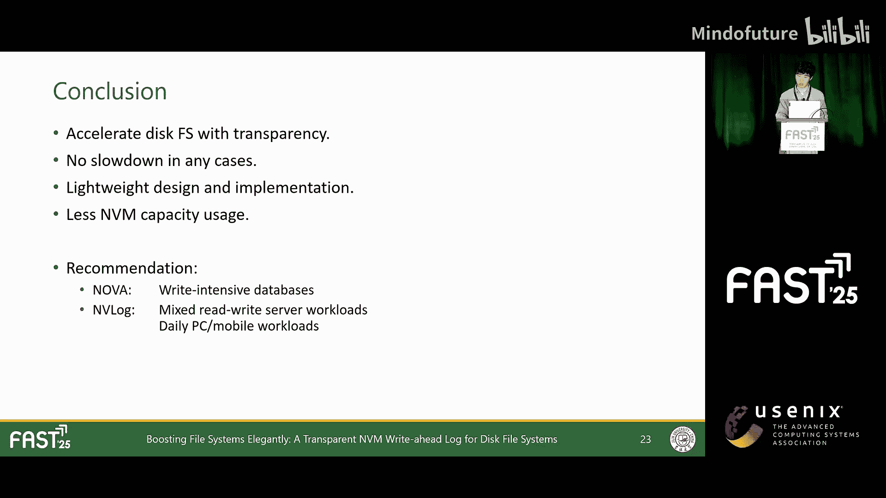
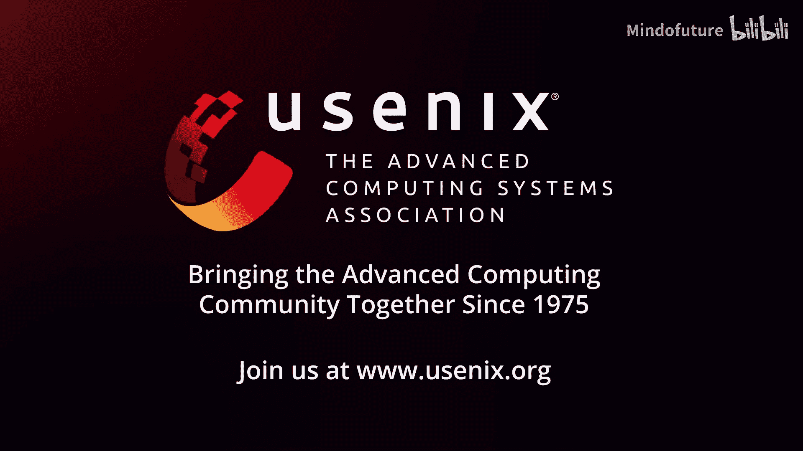

# FAST25存储大会-｜-USENIX-Conference-on-File-and-Storage-Technologies-p03-P03-Boosting-File-Systems-Elegantly---A-Transparent-NVM-Write-ahead-Log-for-Disk--BV1HmVXzME4J_p3-

。

Good morning， everyone。 today， I'm excited to share with you our latest work。

 boosting file system elegantly， a transparent NVM will log for disk file systems。 I am Guo Yu Wang。

 an author of this paper， and I am from Jin University。😊，So over the past decade。

 we have witnessed the rise of non-volat memory also known as NVM or PMM among a large amount of research。

 MVM file systems have become one of the most popular research areas and as we can see。

 various types of MVM file systems have emerged during this period。

 ranging from kernel space to user space and from direct access to MVM to hybrid systems combining multiple storage devices。

Indeed， M M offers higher persistence performance and finer green right support compared to traditional disk disk storage。

 However， M M file file systems are not zero bullets。 Here are some problems with M MF S。First。

 N has limited capacity compared to disk。 For example。

 opting can provide up to 500 GB per module and up to 6 TB per circuitet。

 while a disk can provide petab of storage space。Also。

 redesigning file systems for NVM may introduce several inconvenience to users like we need to copy data from the old disk file system to the new N file system。

 and the consistency semantics of NV M F S is different with disk F S。 with a D catch。Besides。

 a large amount of new code in N MF S may not be as stable as time tested disk disk F S。

And from a performance perspective， although M M is faster than disks。

 N file systems are not always better than disk file systems because disk file systems are often accelerated by Dm catch。

 While most M file systems bypass the Dm catch。Let's take Nova and E X T4 as examples as shown in the figure for read operations。

 the disk F S performs better than the N F S when the cache is warm and the N M S outperforms the disk F S when the cache is cold。

Well， for right operations， the disk F S with D catch performs better than N VMF S。

 While the NF S performs better than disk F S when there are synchronous rights。😊，So to summarize。

 the advantages of N MF S are limited to first， the rate operations when the catch is cold and second synchronous right operations。

For other operations that can be accelerated by DM cache， this KfS offers better performance。

So here's a question。 Can we combine the advantages of both the Sf S and V MF S。

 And I think the answer is yes， we can accelerate synchronous rights in synch M M while retaining the fast parts of a D catch。

And we believe that accelerating these systems with NVM is a good idea。

 but current efforts haven't achieved the best practice。

SPF S accelerate disk file system by taking over some data to NVM through predicting sync events。

 but it fails to provide a efficient acceleration in scenarios when sync operations are irregular or infrequent。

 After taking over the data， it may also slow down subsequent grid and write operations。

Pettoc allows fast reads from D， but the cost is right performance。 It writes all data。

 whether sync or async to an M。 This clearly leads to a performance downgrade for workload with eync rights。

😊，And it is evident that these accelerators vaguely take over a large amount of data。

 rather than precisely accelerating only the slow synchronous operations。Additionally。

 due to the frequent need to access NVM data， S P F S and Pc must establish an index for NVM at runtime。

 which introduces complexity and performance overhead。 Besides。

 they also require continuous and large amount of NVM space。

So we found that two key points have been overlooked by previous work。First。

 D cache already provides an efficient indexing and data retrieval mechanism。So therefore。

 MM should focus solely on persisting synchronous data and should avoid the need of establishing indexes for MVM and retrieving data from MM。

Second， NM rights and disk rights may interlieve in a random order。

Previous work has taken over all operations to on large amount of data to avoid data version in inconsistencies caused by such interlaving。

AndWe found that clarifying the right timing relationships across different devices helps reduce unnecessary data and operation from being taken over so that we can fully leverage the high performance of the Ram。

😊，We want to efficiently integrate M into the current system。

 and it should have the following attributes。 First。

 it should be transparent to both the upper layer applications and the underlying disk file system。

 In this way， we can avoid requiring changes to user programs。 and meanwhile。

 still reuse mature disk file systems。 At the same time， we can avoid the overhead of data migration。

Second， we cannot compromise the consistency guarantees of sync operations in the disk file system。

 At the same time， there's no need to introduce strong consistency into non sync scenarios。

 as this would only reduce performance。In addition， unlike previous work。

 we aim to ensure that there is no performance degradation to the existing disk file system and there any scenario。

 whether it is a read or right， synchronous or asynchronous。 Finally。

 we aim to design and implement a solution that is lightweight and efficient and occupies as little MM space as possible。

So this is already done。We design en log。 unlike like previous work。 en log is not a file system。

 but it is a right hand log designed specifically for disk file systems。

Similar to a right catalog on database， envelope focuses on recording right events so that data that hasn't been committed to disk can be replay after a crash。

And we have all the advantages that a red head log has。Well， unlike a database right log。

 and does not require all data to be written to disk， as that would slow down the performance。

Instead， envelope only records the data affected by synchronous operations in order to bypass the slow disk I O。

So we intercept the sync rights at the VF S layer through V F S of sync range。

 leaving all other operations to be handled by the faster D cache。And at the same time。

 we provide finger green data persistence and address the consistency issues caused by interleaving of M M and disk rights。

So I'm sorry。Before introducing the synchreized step on M log。

 I would like first to introduce the data structure used by M log to store data on M M。

A log adopts log based structure structure。 First， the I log are used to persist sync data for a file。

For each far for each right， the data is divided by page boundaries。

 and each part will be saved by an Iode log entry， like the green blocks in this figure。And second。

 for each I log， its head and tail are stored in a special soup log entry。

 which is the small blue blocks in the figure。And all the super log entries together forms the whole super log。

 And the beginning of this super log is placed at the zero address of the M Ms for the convenience of the recovery。

sorryrry。So note that when the data is divided by page， it's head and tail may not be page aligned。

 which could result in data chunks smaller than the page。

 While the middle part may consist of page aligned data blocks containing full pages of data for the unaligned small data chunks。

 we use an in place log entry to， to， to write the data at by level within the log entry itself。

Like entry 0 and entry 3 in this figure。AndFor the full page data chunks。

 we write the data to separate N VM pages and link them using an out of place entry like the entry 1 and entry 2 in this figure to。

 to make it easier for subsequent garbage collection。

Here is the thing right step for a traditional disk for system。 we can see that once thing happens。

 it needs to wait for a slow disk I O。 And since the minimum right granularity of a disk is block。

 this operations cannot achieve finalr green persistence。So instead of waiting for slow disk O。

 we write sync data to NVM in NV dog and immediately return。

The pages will later be asynchronously written back to disk in the background。

And note that for o things rights， we know the offset and length of the data being written。

 And since NVM supports bi granularity rights， we can achieve fine persistence for small o things。

Here， we further illustrate the correspondence between synchized process and log entries。

 As shown for oynchs， the unaligned portions of the right are handled with an in place entry for F green rice。

 like the yellow parts。And the aligned full page data is written using an out of place entry。

 like the red parts。For standalone sync costs， such as F sync and F data sync。

 since we only know which pages are dirty at the time of the call。

 but not which specific buys are dirty， we can only absorb the synchronous right at the page graularity。

As the figure shows， now we know that in E calls， a small amount of this pink user rights can cause a large chunk of red data to be written to the storage medium。

But since MMM supports spike graularity rice， could we make synchite fine grain？Of course。

 tracking dirty state for each byte is not practical。 However， we also know that in o sync rights。

 envelope can absorb data with sp granularity， right， So from this observation。

 our idea is to predict the files sync pattern and proactively mark or clear the o sync flag for each file By this active sync mechanism。

 we can continue。😊，When continuous small， scatter syncch rise happens on a file。

 analog can absorb most of them with a finer granularity。

And since there are two different right paths， one from D to NVM and another from D to disk。

So any interleaving between them could lead to consistency issues。 In other words。

 if the order isn't known， some outdated NM data might overrite the updated data on disk during crash recovery。

So our solution is to record the necessary disk right back events on M M like these。

 the purple bubbles in in the figure to establish a global clock。

And you can find more details in our paper。 or feel free to ask me later。

To understand the garbage collection process， we need to know which N M records are to say entries are no longer needed。

 since we split the data along page boundaries during rice。

 We can see that each entry corresponds to a single page。If there is an overrite of the entire page。

 meaning there， there's an out of place entry， then all previous entries related to the page can be discarded。

And alternatively， if a page has been written back to the disk。

 it means that all priorized to that page are already same， right。

 So the entry for that page prior to the right back event can also be discarded。And after that。

 we just need to schedule a background thread to reclaim these unused entries and associated data。

 And here are some examples。Like these auto place entries and rep entries will expire the prior entries of that page。

So as for crash recovery， we first need to identify all the relevant entries for each page。

 We perform a full scan of the entire analog linking all the elements related to the same page into a linked list like this。

And then we sequentially access each page and replay the non expired entries onto the disk。

So here's our experimental setup。 due to time constraints， I won't go into detail here。

 but note that all our evaluations are performed under a warm cache because on one hand。

 catch hits are the norm of for most workloads。 And on the other hand。

 we only accelerate synchronous rights。 So we need to avoid performance interference caused by cache misses。

And first， we tested the performance of multiple file systems and accelerators and various read。

 write and sync ratios。Our envelope keeps Ds high performance when there are no synchrons at all。

 in which case we can outperform M M file systems and their full synchronous rights。

 It can match the performance of M M F S， and it achieves the best overall performance across all systems when handling mixed read and asynchronized requests。

 The key reason for this high performance is that envelope precisely accelerates synchrons while allowing D to process all other requests more quickly。

Next， we conduct a pure synchronous rights performance test。

 We can provide up to 15 times speed up to disk file systems。

 and there small synchronized and can even outperform Nola by four times because N supports Fgriin rights。

Well， note that in the case of 16 kB， large bulk synchronous rights。

 envelope performs worse than NoA because Nova only needs to write to NVM once。 Well No well。

 M has to write to both MVM and D。However， we believe that applications that require purely large box synchronous rights are relatively rare。

 and therefore， sacrificing a bit of synchronous right performance for better asynch write and read performance should be worthwhile in a wider range of use cases。

Next， we test the garbage collection performance。 We can see that with the hub of G C。

 and log only occupies a small amount of MM M space temporarily。

And we also tested analog with real world vocal。 The results shows that under various tasks。

 and can at least match the performance of the best among disk F S and M F S。

 demonstrating its broad applicability。And here's the conclusion of our work。

 We propose a new method to use MVM to accelerate disk file systems with transparency by integrating MVM into the system as a ret log。

 we can precisely absorb those slow synch to MVM while leaving other operations to Dm such design ensures that envelope log network causes performance degradation for disk file systems and any circumstances。

Besides， we adopted a lightweight design and implementation using only a small amount of M space。

 we believe we believe this painless use of M M is more likely to be widely accepted by users of legacy storage systems。

 And we recommend that users running right intensive databases or similar applications that require lots of box。

 synchronous rights to choose NovaBeyond that for servers。

 PCs and mobile devices with mixed read write workload。

 We believe unlock log holds greater potential。

And finally， the prototype is open sourced on Github。 as this I'm going share today。 Thank you。

