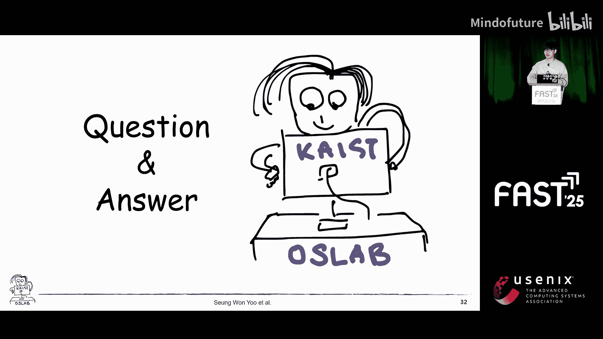
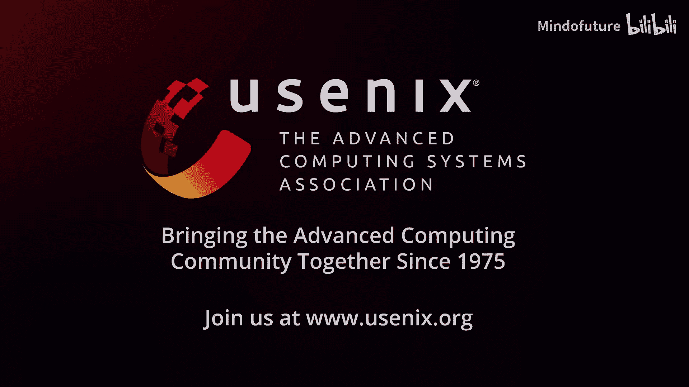

# FAST25存储大会-｜-USENIX-Conference-on-File-and-Storage-Technologies-p04-P04-DJFS----Directory-Granularity-Filesystem-Journaling-for-CMM-H-SSDs--BV1HmVXzME4J_p4-

。

Good morning everyone， my name is Sun Yu fromist South Korea today I will be presenting on directory granularity fall system journaling for CMH SSDs。

A hardware is rapidly evolving。 We examine CPU and storages released between 1990 and the present。

 In the last 30 years， the number of core has increased 128 times for storage。

 the IO latency of storage has decreased by around 10，000 times within a 20 year。

To provide crash consistency of file directory abstraction of journaling or copy on right or widely used。

 However， journaling results in severe per degradation。

 The figure in the slide shows the MD test of file creation benchmark result of both JBD or andF commit which is the state of the journaling or exhibit around 70% performance degradation。

Any application that make use of file directory abstraction can suffer from purpose degradation due to journaling。

 applications such as Aim， Morx Db， a MySQL， Algit and virtual machine or rely on file directory abstraction a file system updates or reflected to the storage through journaling thus application can fully utilize the purpose of modern XXL storage like CMMH。

Although bottlenecks of journal link can be categorized into four aspects as follows。

The first is lack contenttingent on transactions in many journaling techniques。

 or multiple operations insert metada update into a single transaction。😊。

To prevent race conditions between threats or transaction lock must be acquired。

That of second is transaction complex。 or transaction complete occurs when an object to be insert of sorry。

A transaction complete occurs when an object to be inserted into a transaction already belongs to another transaction。

 When a conflict arises， the new transaction must wait for the preceding transaction to commit。

Third is serial commit， a many general file system or serialized transaction commit within the general area。

 or even if a commit request is made or in most to wait for the preceding transaction to commit first。

The rest is Trans Laco， a risk group commit or file operations with no transaction most complete before the transaction commit starts。

To prevent general committee delays， no new file operations can be inserted into the transaction during during this period or threat initiating new file operations must wait。

Many studies have been proposed to address the scalability of journaling。In 2014 and 2015。

 a power partition transaction allocation were introduced by ISFest and Spap。In 2017。

 a per piled transactional allocation was proposed by eye journaling。In 2021。

 a Pocorre transaction allocation was introduced by Z So。

 this pocorre transaction allocation performs well in scenarios where transaction conflict rarely occur。

In 2023， our techniques dedicated to Concord commit was proposed by CJ Air。

This shows the impressive performance in Warro with frequent transaction conflicts。In 2024。

 a F committee incorporate both logical logging and physical logging。

Or this minimize the load size for frequent file operations， thereby reducing right amplification。

However， each journaling has its limitations。 a per partition transaction allocation requires modifications to be on this layout。

OrP transactions or make it difficult to benefit from the group commit effect。

And popcor transactions frequently encounter transaction conflict or requiring a link or multiple shadow pages to resolve them。

 or which increase right amplification。A concurrent comet is designed based on an auto preserving iost or making it usable only on specific devices。

A hybrid to journaling lock of post transaction for any transaction journal commit。

 significantly increasing lock of time。On now， this slide introduce the CMMH。

 an SSD that supports IO operations based on the CXL domain protocol。CMMH supports both Black Iio。

 via cxL。io and Caineio via cxL。m。Although difference between these two IO modes can be an analog stool。

 trailer and a Tesla， a block IO has high bandwidth but high latency。

 or catchine IO has low bandwidth， but low latency。Or by analyzing previous studies。

 we established three objectives to our journaling scalability。

The first is minimize overhead or cost fight transaction lockup。In other words。

 we need to reduce the number of five operations or block during the lockup。

The second is minimize injection conflict。It means we need to prevent unnecessary transaction serialization or caused by transaction conflict。

The third is maximize the compound degree of transactions。

 This is to reduce the cache flush overhead per transaction commit。

OrTo explore a transaction allocation method， then meets the three objectives or we analyze the pile operation patterns of eight applications。

 it includes aim， Lux T， or Mayosscale ecurite， or Gi Merrcurure， or Bmer and hydro file system。

Although first property is dedicated directory， of which we refer to as property D。

 or an application works within its own directory。For example。

 our action performs pile operations in those school and mail directories。

ARx Db operates within a directory specified by the system of administrator。

Mayaquare also executes file operations in a designated or directory。

The second property is directory update， which will report to as a property U。In means。

 updating the contents of a file involves creating and diluing files。

 a well known example of this is Atomic rename。Also。

 with the increasing popularity of log structure writing， or this trend is becoming more pronounced。

For instance， aRx TB does not operate existing assist files。 Instead。

 it creates a new SS file and writes data to it。The third property is shared directory。

 of which we refer to as property S。Or the application updates multipleful filess that belong to the same directory。

For example， in Xim， both the email data and each header are created in the same school directory for each email。

Or based upon this dedicated directory， each application works on its directory。

 exclusive from the rest。Thus， if we allocate transaction in poor directory basis or transaction in a recordco period or does not affect the other applications or stress。

A second， using power directory transactions， or we can carry multiple pile operations that are related to each other or by property UNS。

Or due to this mentioned benefits of poor directory transaction。

 or we decide to set our directory as a unit of journal transaction。In DJ E。

 updated metadata is inserting into the running transaction of the parent directory in of the rust component of the past string。

Here is an time series example。When create a D is called。

 the following object is inserted to Don's running injectionion。Auddeon in。

 audioio each directory entry and Airs in。Then when FOOK or D1pon is called。

 the following object is inserted into D1 transaction。Apppons are not， and it phering。

When link is called， the following object is inserted into D2 Trans， to S node。

 or Dt directory entry and app to S node。This slide analyze the previous work in three axis。

 which is lack of complete and compound degree。Unlike the other journaling techniques。

 we achieve all the three objectives。Or each directory can have up to one running transaction and one committing transaction。

In DJF， or when file operation is called， it identifies the directory and inserts the rule records into the directory'ies running transaction。

The running project can be committed either periodically or by absentync。In DJ E。

 or multiple transactions may be committed simultaneously。

 or if several options are called within a short time interval。Our DJE channels only file metadata。

 for example， our in a file mapping and directory entry。

The file system metadata is reconstructed during the crash recovery。

 or as in eye journaling or anInvest commit。this is to reduce the frequency of transition complex。

For in， DJE uses 256 byte physical logging。For index and directory block。

 it uses a cacheline granularity differentialial logging， which is based on the Bmap。

Although reason DJ Air employees is fine groundroing is to ensure that the journal can fit into the CMH cache。

The graph illustrates the same X dynamic map a randomized output of same image as a function of dataset set size。

As the data set size increase or throughput decrease。Or to realize per directory transaction。

 or there are three challenges。 First， or transaction selection。

An INot can be reported to by more than one directory entry。

Then there can be multiple running injectionions for the same in。

 The journaling module needs to select the projection。Then a second is multi transaction atity。

 a single pi operation can update more than one directory。

Or we need a mechanism to handle multiple directory updates in an atomic manner。

A third is resolving doctor injection complete。The transactions under the conflict need to be properly synchronized。

A file can have more than one link and subsequently can have more than one parent directory。

In this case， we used a technique called pass based transaction selection。

If a file operation requires pass， a file operation selects the running transaction based on the pass。

When the file operation receives a file descriptor。

 it tras the pass by traing the directory entry from the associated file structure。

Our next one is to injection co。A single file operation may update multiple directories。

 In this case， the failure atity of a file operation may be compromised。😊，To address this issue。

 we developed a technical transaction quality。Tranjectctionquelisting merges two transactions into one。

 In this example， O D1 transaction and D2 transaction arequelist。

next one is running to running conflict。A running to running complete occurs when one transaction tries to update the metadata object that belongs to another running transaction。

If the file system detects and running to running conflict。

 the file system quaies the two transactions and updates the existing ro record for the complete operation。

The next one is running to committing conflict。This occurs when the file operation updates them at the data object that belongs to the committing transaction。

If the file system detects and running to committing conflict。

 the file system delays committing the running transaction。

Until the committing transaction under complaint is made durable at the storage。

this is the evaluation setup。Or we used the AA core SPR machine and CM M M H prototype。

OrWe used Ubu 222 or with Renuux corner 5。18 or we used a six journaling module or JBD or F commit or CJ Airpress or jet journal or I journaling and DJ Air。

Among these， OJBD， fast commit I journaling， DJF use CXL dum interface to persist the transaction。

Additionally， we apply fine grain logging of DJ E to JBD and ijoing。

A we used to four macro benchmarkchs， Pa mail， MD test， aim， and Rox TV field sink。

We show the throughput of MD test and Rx sleeve field sync。

 MD test is a metadata intensive benchmark and DJE shows 2 point times throughput compared to F commit。

InR TV， you think it shows almost similar throughput compared to fast cominging。

Then we measure the length of the transaction lockup intervaler in each awkward road in all four benchmarks。

 the DJF shows significant reduction in transaction lockup time due to its final transaction granularity。

Next， we count the number of times where a transaction is blocked due to the transaction conflict。

 or we call it a complete count。This power directory and popeller transaction almost eliminates transaction conflict due to each file system data structure oriented transaction allocation。

Then wecount the number of five operations per transaction。

A power directory transaction or successfully carries more file operations than Po pile transaction does。

Oh， now， let me conclude。OrWe analyze application file data behavior。

 and we conclude that it is centered around a dedicated directory。

And we propose a new unit of file system journaling， as our directory。😊，And for CMMH。

 or we need a new journaling file system that can exploit the excess locality of CMMH。Thus。

 or we propose DJE， or directory grid neuro journal file system。Or thank you for the listening。

 Or if you have any question， or please ask me。 or thank you。

