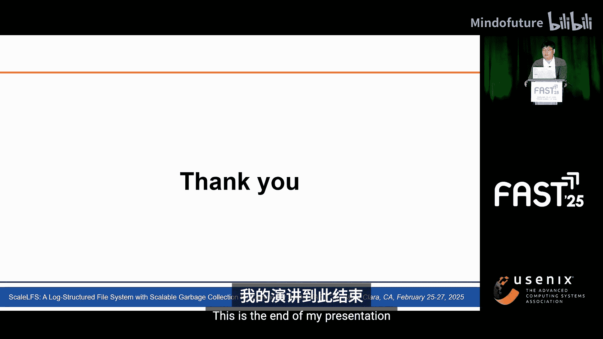
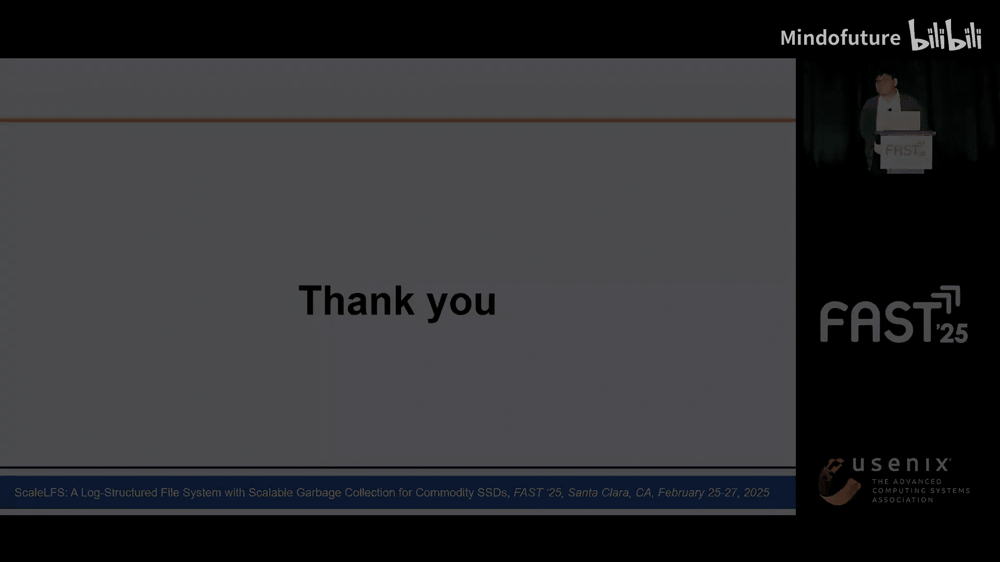
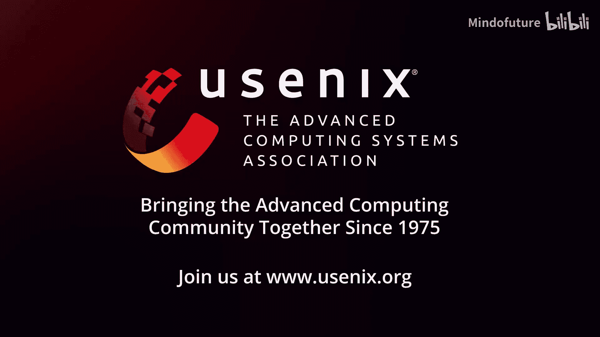

# FAST25存储大会-｜-USENIX-Conference-on-File-and-Storage-Technologies-p05-P05-ScaleLFS---A-Log-Structured-File-System-with-Scalable-Garbage-Collection-for--BV1HmVXzME4J_p5-

。

Good morning。 My name is Jin Yongha， and I am a PhD student at Seoul National University。

It is great honor to present as F 25 today in this talk。 I will introduce my research scale Al。

 a log structured file system with scalable garbage collection for commodity SSDs。 In summary。

 this work enhances the sustained performance of log structured file system by paralyzing garbage collection。

A log structured file system or RFF S is optimized for rights by placing data in an append only manner。

In LFS， new data is written to sequential LBAs， taking advantage of the high performance of sequential rights。

When data is overwritten， the previous pages become stale and are marked as invalid。

If ST pages accumulate leading to insufficient free space。

 NFS reclaims the space through garbage collection or GC During GC RFFS selects a contiguous range of LBAs as a victim segment and migrates valid pages from the victim segment to free space。

However， frequent GC can degrade sustained performance of RFS like significantly。

 since GC operates in a single thread， it creates a bottleck， as shown in the figure。

 application bandwidth drops by up to 68 times after GC is triggered。

A straightforward approach to improving sustained performance is to introduce multi rating in G C。

 however， as shown in the lower right figure。Increasing the number of GC threads did not improve performance。

This result is due to increased lock contention in the current GC procedure。Therefore。

 concurrent and scalable techniques for G C are necessary。From our analysis of FFS。

 which is a widely used log search file system， we identified four keyoff stockers that hinder the scalability of the GC。

 first shared resources， the destination segment and page cache for GC are shared among multiple threads。

 which leads to synchronization overhead， to fix this we need to dedicate resources to each GC thread。

Second， excessive contention in victim selection。The victims selection is exclusively protected。

 resulting in a scalability bottlelegck。If we allow concurrent victim selection。

 this operate can be reduced。Third。Over strict metadata synchronization Sig metadata is protected by a single mut text log。

 which forces all all threats to weight。Instead， we should enable concurren segment metadata updates。

And finally， course grained data protection。GC threads and I threads compete for excess in file level。

 creating contention by switching it to page level， we can reduce contention。

To scale LGC re propose scale LFS， it is built on three key components， dedicated garbage collector。

 scalable victim manager and scalable victim Proor。First， dedicated garbage collector or DGC。

 DJ C is a G C thread that has its own dedicated paint buffer and destination segment。

 which reduces resource sharing overhead。Next， scale A victimt Manager or SVM。

SVM enables multiple dig to select their victims concurrently using an atomic bitmap。

It also allows loose synchronization updates， so multiple threads can update segment metadata at the same time。

Finally， scal a victim protector or SVP。It enables page level garbage collection using our per concurrent has table to reduce contention。

Now， let's dive into the details of which component first。

DJC includes a per GC thread data buffer and write stream。

 a dedicated data buffer helps avoid expensive page cash overhead。

 As you can see in the figure when GC starts， DJC selects a victim segment from SVM。

Instead of using a globally shared page cache， it loads valid pages directly into its dedicated page buffer。

Then DGC writes the buffer data into its dedicated right stream。 At this point。

 dedicated right stream enables lock free LA management in a sequential manner。

Next is SPM SPM introduces concurrent victim selection or CVS， utilizing two atomic bit mapps。

 one for dirty segment， and the other one for victim segment。

Each DGC selects segments with the fewest valid pages as their victims。During the victim selection。

 the30 segment beatm is used to concurrently identify victim candidates。

 while victim segment beatmap resolves the conflicts from concurrent victim selection。

Data rates among DGCs to select same segment as their victims are resolved through atomic testing setbed operation。

 the DGC that succeeds to set the victim segment Vim wins。By employing CVS。

 DJs can concurrently select victims without encountering law contention。

Another key feature of SVM is loose synchronization updates or SSSU。

 It allows SVM cancurrently update the valid page VMap。

 which indicates the pages for G migration and valid page count， which is regarded as the GC codes。

We employ an atomic bitTMap for VPB and an atomic integer for VPC。However。

 LSU introduces two side effects， less of tumor victim selection。

 which increases GC cost and first positive GC rate， which induces necessary red IO。

The example of less optimal victim selection is described on the left side of the figure。

Did youC  zero initially select segment1 as its victim due to the lowest VPC？At the same time。

 Op victim is changed to segment zero since other threats has updated VPC。

 unfortunately it can be invisible to DGC0 since updates to VPC are not tightly synchronized。

 it induces GC right amplification， however， in our evaluation。

 the right amplification caused by NSSU was neg visibleible。The second side effect。

 first positive gy rate is described on the right side of the figure。

When the DDC won with the first fit in VPB of its victim segment as one。

DGC1 begins GC read for the first page of the victim。However， at the same time。

The other thread clears the first bit， indicating that the first page has become stale。

D T C1 cannot recognize this update due to LU。 This first positive juice rate can induce the data consistency violations。

The data from our first positive G read is ST， therefore。

 this style data should not be service to the user to ensure data consistency。

To achieve data consistency， we filter out the step pages by leveraging a node data such as in。

Or direct node。If the LbaA within the node is not same to GC read the LbaA。

 Sc Al determines the corresponding funding page as T1 and skip GC rights for it。

This procedures are protected by the node level log。

 which is already employed in FT F S to protect node data from concur updates。 Therefore。

 it does not cause additional log overhead。The last component is SVP。

SVP enables page leverage you see by leveraging a per file concurrent has table with comparing swap operation。

Its red inserts the file offset of a page before accessing it。When the when the access finishes。

 the inserted entry is removed to prevent reading delocated memory space。

 logical deletion is adopted。Loically deleted entry is removed fixedly by the other thread which firstly discovered it。

If a thread finds that same file offset has already been inserted in SVP。

 the thread waits for its removal。To reduce contention。

 SVP distributes requests across multiple buckets based on the file offsets。Through SVP。

 DGC performs GC at the page level， which result in lower contention。

We evaluate scale F S on the machine equipped to wear an interxion CPU， 160 GBy of DM and Samsung 9。

 a3 SSD。We use 4 kilobyte random rights for micro benchmarkching。

 Furthermoremore we employ file server， bar mail and OTP workloads for micro benchmarkching as a real world application we evaluate MIa scale with YCSB on workloads。

For comparison， we use FTFS in the Linuxux kernel and FTFSL， which operate in pure FFS mode。

Additionally， we evaluate Macs as a state of the art scalable L Fs and PGC as a parallel C scheme。

 Sc L S is prototyped on F F S in L S mode。In micro benchmarknching。

 we evaluate our idea with two capacity configurations。

 30 gig of small partition and the full assist capacity。

 the evaluation with the small partition isolates the five system performance by minimizing the impact of SS leverage see。

In this configuration， we saw made to 120 gig of random rights。As shown in the figure on the left。

Scale Ls outperforms other RFs this by up to seven times in execution time。

While other RFSs experience significant bandwidth degradation。

 scale RFS maintains relatively high bandwidth， this results demonstrate that scale RFFS efficiently scales LGC inuring virus sustained performance under how I heavy workloads。

Furthermore， to assess how effectively scale L utilize the SSD。

 we will measure the right bandwidth is submitted to the SSD。As depicted in the figure on the right。

 scale FS achieves up to 19。6 times higher bandwidth compared to other S RFs。

 This result will that scale RFS efficiently utilize SSD even with the frequent juy。

To evaluate on a more practical storage configuration。

 we also use the full SSD capacity In this evaluation， we submit 10。 3 terabytes of random rights。

 as shown in the figure scale at ofs reduces execution time by 37 minutes compared to FTFs。

LFS is operating with pure LFS modes such as FFSL and PGC exhibit 11 megabytes per second of  sustained right bandwidth after both LFS and SSD GC have started。

In contrast。Scale NFS achieves the highest performance without significant performance degradation。

 this result implied that scale NFS is efficient even alongside with SSDGC。For macroben marking。

 we use three right intensive syn workloads from F benchnch in this evaluation scale RFFS improves surrupput by up to 83。

1% compared to the other RFSs。The performance improvement is lower than the result in microbechmarking due to the less frequent you see caused by lots of file deletions or contention among application threads。

To show the performance in real application， we use MyosQ database under the YCSP workloads。

Initially，6。5 million records are inserted to be 70% of total part capacity。In World called A。

 which is very intensive， execution time is reduced by up to 70。4%。In World B。

 which is very intensive， execution time decreases 27。3%。

Although with intensive workloads presents a more challenging condition for scale atS。

 the results demonstrate that it still chips performance improvement。In this paper。

 we propose scale RFs RFs designed to accelerate G through multi thread friendly optimizations。

Sca Al leverages multiple GC threads with dedicated strategies and enhances G concurrency using concurrent data structures and luxury victim management。

Additionally， it introduces a page leverage procedure to mitigate conflict among threats。

 Evalation result demonstrates that scale LFs improves performance by up to seven times compared to existing Ns。

This is the end of my presentation， thank you for listening。

