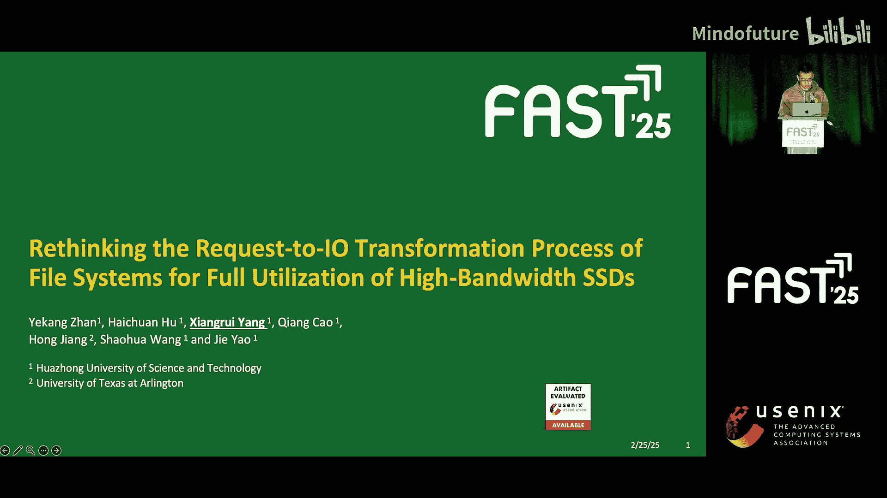
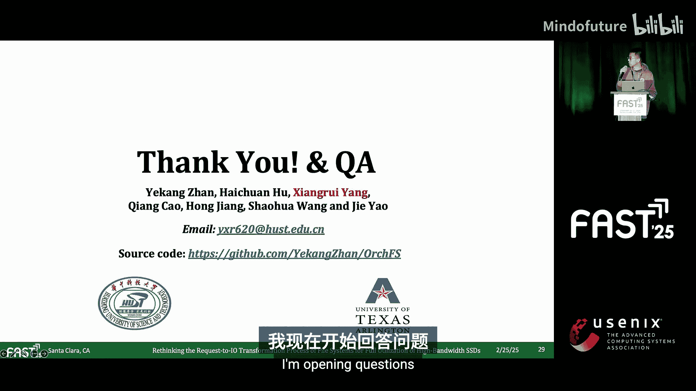
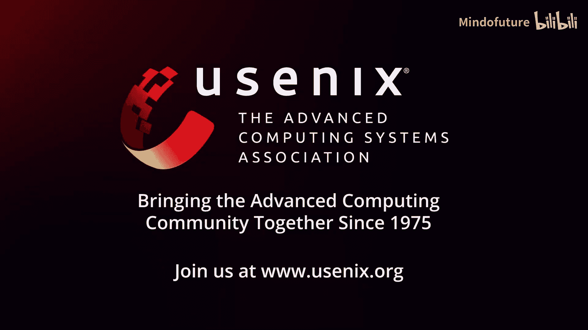

# FAST25存储大会-｜-USENIX-Conference-on-File-and-Storage-Technologies-p06-P06-Rethinking-the-Request-to-IO-Transformation-Process-of-File-Systems-for-Full--BV1HmVXzME4J_p6-

。

Hi everyone。 My name is Shaang Rui Yang。 I'm a graduate student from Huaazhou University of Science and Technology。

 and today I will talk about our work rethinking the request to IO transformation process of high system for a full utilization of hyp N SD。

Well， over the past few years， we have witnessed the explosion in UnitedD and。

 we have moved from the days of SA SD with less than 1 gig per second to today with PCe 5。

0 SD with over 10 gig per second。What's more， the cost per has remained relatively stable。

This makes high bandwidth viity a costly efficient solution。

 widely deploy in many industries like I O T devices， mobile mobile devices and larger data centers。

This bes the question， how can today's diverse application truly leverage these high bandwidth wide SSD。

Well， as we all know， like the today's data intensive application like graph processing。

 scientific computing and cloud computing often generate requests with various sizes and offsets。

Despite the tenfold increase in SSD bandwidthwise， our storage system are still using legacy I O Ss。

So we have to ask， is this improved SD performance really directly translating to high。

 a better application performance， Let's take a look。

we run a single threaded test focusing on random rise between 1 B and 2 MBby。

And here's what we found。 the throughput of the 4，5 system we tested only reach a third or quarter of the underlying SSD。

Naturally， we thought maybe the small rights are to blame， right。

 Maybe the small rights are the bottlene。So， we tweaked our test。Focusing on rights between 0。

9 MB to 1。1 MB。 Even then the improvement was minimal。

And we were still far from the SDs rule bandwidth wise。 Clearly， here's more。

 there's more going on here。The file system use page cache to transform user request into memory page aligned B Is。

 but consider non page aligned the right。 The online portion requires a slow read modify rights operation。

 That means reading from the S D， modifying in memory page and then writing back。

Because of the long latency of XD access， these small res are incredibly slow。

 and this becomes a a major bottleneck。Now， remember。

 our previous test has sufficient memory and no sync cause。

 This this means that rights were beingchronously flushed and our performance result were primarily from the page cache。

So no matter how high the bandwidth of the underlying SD is。

 the performance is limited in this scenario。This LED us to investigate actual right performance hung hidden by the page cache。

 We added everything think for each right。The results are striking。

 the right latency was almost nine times higher than raw SD I O latency。

 This confirms our hypothesis。 Fire system are failing to failing to deliver the full potential of high this。

 and we call this phenomena right inef。And this is not only for unaligned rights。

 This is also true for aligned large rights。So we really want to know what is the root cause of this writing inefficiency。

 First， we use direct I O mode to exclude the impact of page cache and compare the aligned and un direct I O right for the un for the unaligned rights。

 we use read modified right operation similar to what SSD what page cache deals。To。

 to align the rights on the whole side。The result shows that the latency of un right is almost nine times higher than the aligned ones。

 This is because each online right requires one or two small SSD read。

 and as the right size increases， the SSD read latency become less significant。 However。

 even with one MBby large rights， small SSD can still cause 80% increase in the right latency。

To analyze the page cache overhead， we， we performed a breakdown analysis for X S T4 and F two F S。

 As he expected， the alignment overhead matches what we discussed earlier。

And this is shown by the tailbar on the top。We also found that as the right size increases。

 the page catchover had becomes more significant。For example， for the 1 MB rights。

 the pageca overhead is accounts for almost 40% of the overall overall right time。

 which is equal to the time spent on SD Is。 Additionally。

 the F S cost overhead is also significant in the1 MB rise case over 60% of the time is spent on page catch management and B I Os assembly of F things。

And we think these are the key factor contributing to writing efficiency。For comparison。

 we use the direct I O mode for aligned rise to observe the time composition and the result shows that most of the time is spent on block aisles。

 Moreover， the F core over hass its minimal in this case。

 because there was no need to look up the dirty pages。However。

 despite avoiding page catch overhead directly I also strict alignment requirements are hard to meet。

 So we will discuss this later。Next， we examine a commonly overlooked factor。 S I O concurrency。

 Most the store storage system passively utilize the internal parallelism of SSD。However。

 due to the internal complexity of I scheduling， a single I threat can hardly maximize the SSD performance。

To verify this， we test two I O patterns。 First， a single thread with large aligned aisles。 Second。

 multi multi threads handling smaller 32 kB I O for each large request。

The result shows that whether for reading or writing。

The multi threaded I pattern was able to better utilize the SSD performance。

 The higher the SSD bandwidth is， the more noticeable this effect became。However。

 mostly existing storage system does not con consider actively providing sufficient I O con concurrency。

Naturally， we are motivated to design a solution that maximize the performance of high bandwidth SD。

 And from our early analysis， we identify three key issues to address First high I alignment overhead and second high page cash overhead and last insufficient I concurrency for the first issue。

 an intuitive idea is to merge rights in memory and a synchronously write them back。 However。

 this sacrifice the persist and waste high bandwidth provided by SD。

 What we really want is to maximize the use of the online SS。For the second issue。

 a straightforward approach is to use direct I O mode to bypass the batch cash。 However。

 this is not clear how efficient how， how to efficiently meet its strict strict alignment requirements of direct I O。

For the third issue， an obvious solution is to activate it actively I split splitting and multi threaded I processing。

 But again， the implement， the implementation isn't trivial。

The I alignment issue is widespread and cannot be avoided as its application driven。

 We can't change the user behavior， and we cannot change the fact that SSD required alignment access。

 So we need to bring some help。specific， our solution is to introduce N VM S a auxiliary story to assist with I O alignment。

Specifically， we transform any fire rights into aligned SSD Is and un N VM Ios。Furthermore。

 we will we will use direct I O mode and multi threaded I processing to handle SSD Is。

These transformed SSD I O are always aligned， making it easy to enable direct I O mode。

 Our key idea is to part rights instead of merging them and directly directly leverage the underlying SSD high high bandwidth wise。

Therefore， we propose or as an S D NVM heterogeneous orchestrated file system。

 The key techniques includes heterogeneous data layout， fire right partition。

Unified profile mapping structure and a a parallel I O N。First。

 let's look at a heterogeneous data layout。Our file in our file system。

 all metadata is located on the NVM side。 while the data is placed across both NVM and SD。

 We introduce three is type of storage unit， NVM pages， NVM U pages and SD blocks。

The SD blocks are used for 32 kB data segment aligned data segment。

 NVM pages are used for 4 kB aligned data segments。

 and NVM U pages are used for the remaining in unaligned data segment。Next。

 we design in a fire fire right partition strategy。

 It partition writes into block aligned SD Ios page aligned O VM Ios and online chunk ios。

 It then sends these ios to their respective respective storage units。

 That is to say SD blocks O VM pages and MVM U pages。

Due to the complex user par U user right patterns and a combination of various the right requests。

Yeah we， we proposed to， to policy to guide our， to guide our split partition strategy。

 First is the alignment， prioritizing policy and second is fragment fragmentation， minimizing policy。

The alignment prioritizing policy means partition request in the order of priority from block to pages and u pages。

 The fragmentation minimizing policy means placing files in as few storage units as possible。

 You can refer to our paper for details。Because we are using three types of storage units。

 This complices a file mapping。 So we introduce a unified profile mapping structure called HR tree。

 HR tree is used to map a biological offset to to to block pages and new pages simultaneously。

 It consists of a legacy radical tree and a heterogeneous layer a layer at the bottom。

The radical tree part maps a fire logical offset to a logical block。

 The heterogeneous layer records the data composition of a logical block。 We research with HR tree。

 or ca has only need to perform a single tree traveral to locate all storage units associated with a file request。

To efficiently and transparently handle the partition heterogeneous I Os while ensuring data consistency。

 we develop a parallel I O engine。First， the parallel engine process SD Is and O V M L in parallel。

 Secondly， it actively use multi threaded I O processing to handle SD Is。To ensure data consistency。

 each I O thread uniquely executes I O within its exclusive data range。 Furthermore。

 O F S develops tri data files for I O execution， using direct I O mode for SSD rights and using buffer I O mode for SSD reads using and using popular memorymatic path for NVM access。

 We will show the benefit of the SSD read pass choice later in our evaluation part。In addition。

 we have incorporated several other designs and optimizations， including file data deation。

 index optimization， file system， architecture optimization and more。

 Please refer to our paper details。Now， let's look at the experimental results。

 We set up three category of five system as baseline for comprehensive comparison。

For the SD file system， we choose E X T4 and F two F S for N file system which Nova Oing F S and A F S for hybrid file system。

 we choose strata， S P F and P H F X。Note that we implement PHF S based on or F S。

It place all metadata on the NVMs and use NVM to handle small rights and SSD to handle large rights。

 P H F， S used to demonstrate the design advantage of all K F S。First。

 let'sly examine the single thread at the random right performance。

 This graph shows the average right latency。Compared to the three categories of five system， O K F。

 S consistently show significant advantages。And let's further dive。

 let's further verify the source of archive as a performance， as the table shows。

The larger the right to request， the more data is written directly to SSD。 For example。

 in1 MBby case， over 90% of the data is written directly to SSD。

 And this means that in large right case， most of or F S performance stem from the underlying SD in this is different from the sort of I system like strata and S P F S。

 where most of the performance comes from from the expensive M VMs。Now。

 let's look at O F S read performance。The testifier rises with corresponding right size。

 and then perform random re。You can see in figure A and B peak throughput。

 the peak read throughput of or S is significantly higher than the baseline file system。

This indicate that O S SSD read passively benefit from align prefield rights。

Because data policeman in SSD side is always 32 kB aligned。

It allows page has to work much more efficiently。 And this explain why we choose buffer I O mode for SSD reads。

Let's move on to multi threaded random right performance。 The result shows that in large right case。

 Oca has needs a small number of user threat to maximize SD performance。

 This demonstrate that Oca has utilized the full performance SD by actively increasing I O concurrency。

Finally， let's see how O F perform in with real world applications。

levell D B workload is full of small requests。 or F S use NVM to handle the majority of the request。

 while the large compaction rights are handled quickly by the SSD as a result。

 or F S perform exceptionally well across all workload for graph processing workload it has a mixture of large and small request。

 our five system significantly reduce processing time by over by up to almost7070%。In summary。

 we reported and identified writing efficiency of file system on high bandwidth。

 and we explore its root causes。 We present or F S a normal system designed to overcome its writing efficiency and maximize S performance。

 All F S achieve a significant improvement on both write and read performance。And first all。

 our work has been open source。 and you can check it out on this link。

 And thank you for your time and attention。 I'm opening questions。

