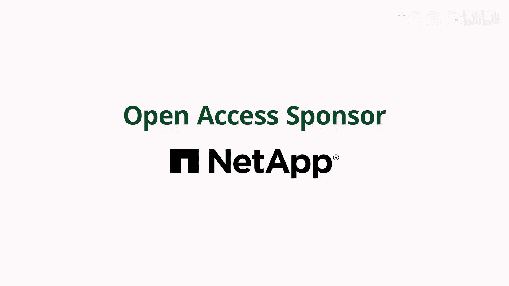
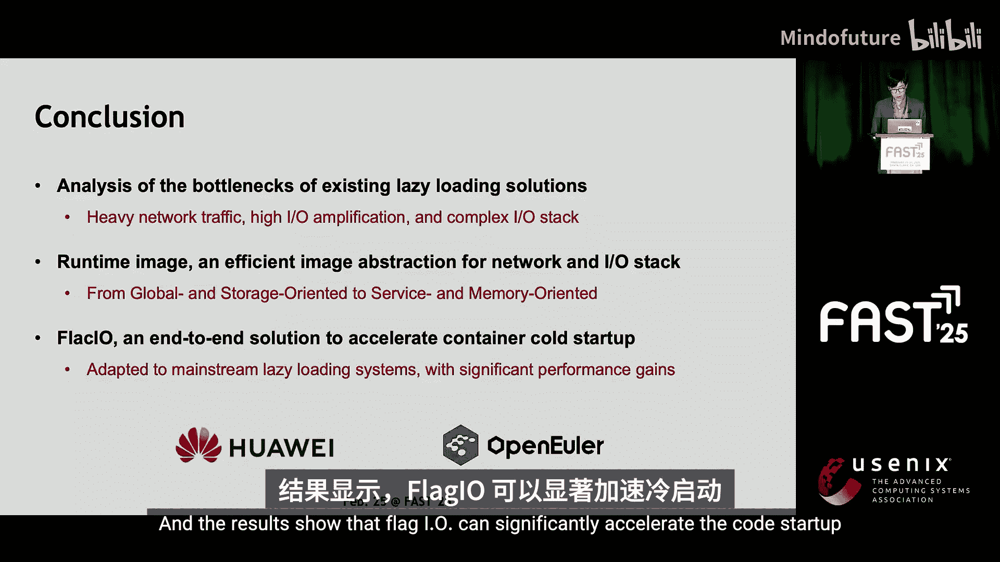
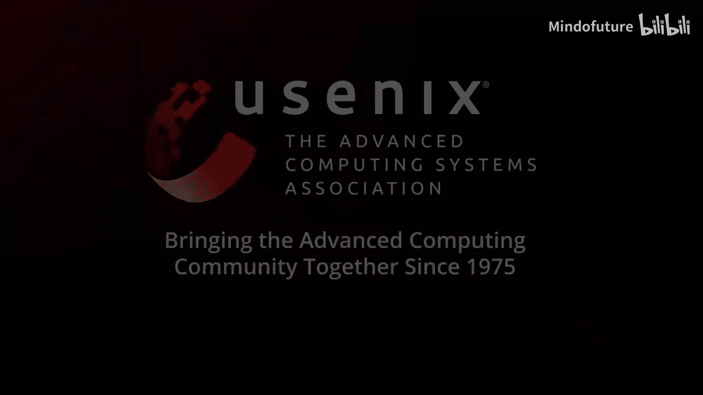
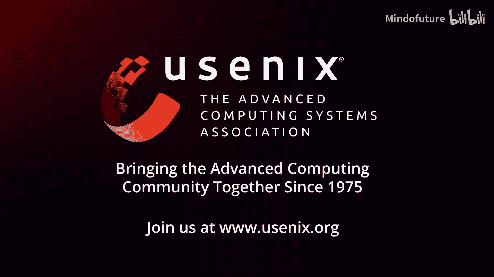

# FAST25存储大会-｜-USENIX-Conference-on-File-and-Storage-Technologies-p07-P07-FlacIO---Flat-and-Collective-I-O-for-Container-Image-Service--BV1HmVXzME4J_p7-

。

Okay， thanks， thanks for introduction。 my name is Yu bo Liu from Huawei and very happy to be here to put in our work。

 The flag I O， a flag and collective I O solution for container image3。😊，Okay， at the beginning。

 I want to introduce the traditional storage stack of the container image。

 so we can see the container will build their file system on the overlay。

 which it used to merge multiple layer of the image and show a unique base for the container。

 and a Navy solution of of starting a container is to load full image to the snow。 However。

 this solution is very efficient because it will bridge a dozen of time the I O application and the the first in current what is to accelerate the cost。

 For example， the lazy loading is mainstream solution。

 It only fetch the metada of the image to the snow and start the container essentially while they perform the data I O on demand。

During their running。And another automation is to mitigate the cost startup。

 such that work use the host size catching， sharing。

 or maybe the for and P to P loading to remove the cost startup overhead from the system。 However。

 such that world need the horse resource and the host resource is limited， as we know。

 so they cannot fully solve the cost problem。 And this work will focus on the cost acceleration。Okay。

 let's take a look of the typical process of laing。At the first stage。

 it will obtain the metadata required for building the container run time。

 Then it will create run time in the holes， such like creating the Si group。

 creating the file system。 And in the last stage， it will launch the service and execute entry points in the container。

 And as we can see， the data will be pull to the prefech cache in the laser loading module first and then load to the local file system。

 at the same time， it will it will trigger a lot of I O in this stage。Okay。

 now let's break down the over half of the cost startup up in existing solution。

 And in our experiment， the C F S and Lindas are fell level loading system。

 While the daddi is a block level loading system。 And from our result， we can see。

The laser loading solution can speed up the deploy stage。

 but they suffer from a very long latency in the ready stage。

And when we go deep to analyze the I O behavior of existing system。

 we found that they suffer from a severe I O application and inefficient network assess in their ready stage。

Okay， now we found that the key course， the root cause of the of of that that bottlene is the image option。

 So in the traditional image option， it's a global oriented。

 It means that one image is used for multiple service and its also a storage oriented。

 It means that it it recall disk stay。 So the shortcoming of this objection is that。

It make the laser loading system hard to aggregate I O due to random access on the image。

 and it will lead a high I O application due to the mismatch between the laser loading unit and the container size。

 At the same time， the I O local is difficult to optimizeize because the I O behavior are different across the V。

 And finally， it need a complex I O pass to convert the this state to the memory state。Okay。

 so we propose runtime image option。 And the key idea of the runtime image option is to preview the memory state for each service。

 So it is a service oriented。 means that one image is used for one service and it memory oriented。

 It only recall the memory state rather than the disk state。Okay。

 so the benefit of this option is that it is never friendly because it can accurately roll the data for for cool startup by a single network I O。

 And it also give us opportunity to support fast loop file system construction because the runtime image already contain the both the index and the data of the memory day。

 So which allow the loop file system can directly be mount on the given runtime image。However。

 the flag I design is non tri。 We meet two challenge。

 The first challenge is how to organize the runtime image in an efficient manner。

 and we should consider the correct accurate I O chasing during the container startup and it should be compatible in the size and also to to be compatible to the ecosystem。

 And the second challenge is how to be a light I stack on the host。 As we know。

 current kernel does not support to mount system from a given memory state。

 So we need some new Opreity for it。 And at the same time。

 the flag I O run upon the laser loading system。 So it should be compatible with the legacyency I stack。

Now， let me introduce the overview of flag I O。 It includes four key components。

 The flag I O driver play as a control plan to bridge another， the other components in the system。

 and the I O checker is used to record the I O during the first time the container is started。

And the run time page cache or RPC for short is is a special file system page catch in the kernel。

 which allow the runtime image to be inject to the kernel and mount to the file system。And finally。

 we have a runtime image service in the register note。 it。

 it used to manage and generate the runtime image。Okay。

 when the user called the runtime image creation API， it will launch the container。

 collect the I O and send the I Os to the registry for offline generation。

 And during the cost startup， the flag driver will get the runtime image metada first。

 and then it will pull the image the image data by a large level I O and then inject it to theP。

AndDuring the container running， the R PCC handle the re and M page full of the page located in the runtime image。

 and also for some for the， for the I O that missed in the wrong time image。

 it will be redirect to the normal process。Okay， now the runtime image generation rely on the accurate I chasing when container is closed up。

 right， So In fact， I O chasing is not a new thing。 For example。

 daddi use a block level chasing mechanism for I O preing。

 and it use a B L K trace and F I O to record and replay the I O respectivelyly。However。

 we use the the pop base and file level I O chasing mechanism。

 and the end user may use the R T create API to generate the runtime image。

 and it includes three parameter the image name and entry point I used to calculate the unit service I D and the pop。

 it use used to tell the I O checker when to stop chasing。Okay。

 and and the pop has two types in the type is such like is a program run outside container like the H TP detection。

 and this is very useful for some network service container like redis and M and another type is internal pop internal pop is run inside a container like entry point of the container。

 for example， we can use importing the core library as the pop。

 So this way is very efficient for some framework container like the andflow and and the other one。

So when the city create is called， it will start the container for chasing。

 and we use the E BP F to record the re and the page for I O under the container name base。

 Then finally， the I O chase was send to the re for the offline generation。

And the advantage of this design is that it's more accurate than the previous solution。

 because we can stop chasing when the pop captures the corresponding even at the same time。

 it's suitable for any laser loading system because it it implemented in the V F S layer。Okay。

 here is the runtime image organization because the runtime image is per。

 So if we don't concern the data duplication between the runtime image。

 it may dramatically increase the memory usage in the host right， According to our analyst。

 the duplication rate duplication rate is very high between the service use the same base image。

 But it is very low if the service use a different base image。 So we propose the group structure。

 it consists of the service that belong to the same image。

 and the data belong to the same group will be duplicated and then and stored in the in the in the in the data zone。

And the data of the runtime， the service met data is private for each runtime image。

 and it recall the file index and the page mapping of the group data zone。 And to support。

 it use a bit map to record the distribution of its data on the group data zone。Okay。

 the runtime image generation is performed in the offline。 and when it receive I。

 it will will initial the relative metadata and and the group met datata。

 then it will face out the page in the record from the base image。

 then calculate fingerprint out the page and check it it exists in the data zone。

 And if the page is a new page it will update the duplication fingerprint and add it to the data zone。

 Finally， it will the page table and in the meta data will be update。Okay。

 during the cold startup up the， I first get the service met data for register and call a new OS the to obtain the prediction of the mistake page as the figure shown each group relate to in and each PC maintain a be to which page are already load the will be return will return a be by comparing the zone be in the service met data and be in the host。

And by sending the to the re， the page will be pulled to the host and inject to the kernel。

 Then by we use the inject to load the service met data and page to the to the kernel。 Finally。

 the container platform we use a special mountain to build f based on the run time image and it search the run time image and then point the file system super to it。

Okay， the file system in the PC is simple because the PC only cache。

 So we need only need to handle the and page for the page that locate in the image in the file open it will search the file index in the service met and point know to the corresponding page table and in the in the file read and page it will search the page table and then return the result or if the page is not exist in the it will roll back to the traditional V f process。

Okay， let's put the put everything together now。Flaag I O is impplace in the open oiler。

 and we it to two mainstream loading system and C S and Ins。

 and we customize the parking snap structure in the container D for each system。

 The process in the figure show the workflow and flag I O can start to load the metada。

 The data and perform the injection only after the image manifest is load。

 And so many flag I O process can be overlapped by the container platform process。

existing laser load system use also use some pre optimization correspondbone to compared to the pre。

 It just simply explain the loading unit。 So it is rely on the I O behavior of the container to be strong locality。

 and compared to the prioritized file pre。 It is strong relies on the user experiments and it has a very large loading unit。

And compared to the trace replay， it does not well address the problem of accurate tracing and efficient aggregating。

In contrast， flag I O is more accurate， more efficient for I O education and more lightweight。

Oh okay， now I show some evaluation。 we run the host on the server with 24 calls and connect to the re by  gig network and flag I O。

 We use the internal pop for touch andflow set the pop as loading their core framework library which means the tra window will end of the successful loading the core library for other container will use the H T T detection as the external pop。

 which means the tracing window and of the successful assess of their service port like the return the H T TP okay and result so that flag I O can improve the performance by by up to 2。

7 times in core compared to the second best system and in addition for warm up comparing the system with and without flag it almost no additional cost。

Okay， so next way I I I show the network and memory overhead from the result of TP dump。

 we can see flag reduce the network data volumes and the in the package number by more than 1。

6 times in the container and in the in the different footprint flag also different friendly we can save more than 70% memory footprint compared to other system。

 And the the reason is that the we have a lower i O amplification and we have a shorter catch layer。

Okay， now let's take about talk about the trade of。

 The main of the flag I O is the backend storage overhead。

 So we generate the runtime image  for9 mainstream container and calculate overhead。

 and the results show that the runtime image account for 9% and 4。

7% of the total size for the and industry respectively and we can that flag can pay around five percent of storage overhead for up to 2。

4 times speed up in the and at the same time the storage overhead can be further reduced by the compression。

 finally， we evaluate in some real application in the object storage scenario we launch the and the object and the results show that the flag can the object storage faster and in the machine machine learning training scenario we start a1 container and the minutes data with in and we can。

the on demand loading cost during training。 So finally reduce the training time and in the auto auto scaling scenario。

 we start 64 container in a cluster and the results show that flag reduce tail latency of dynamic expansion by more than 22 percent okay。

 conclude this paper the bottlene of the existing loading solution。

 and then we propose runtime image。 then we design and flag I O based on the runtime image。

 and we adopt the flag to two mainstream loading system and the result show that flag can significantly the cost。

Okay， thank you。

