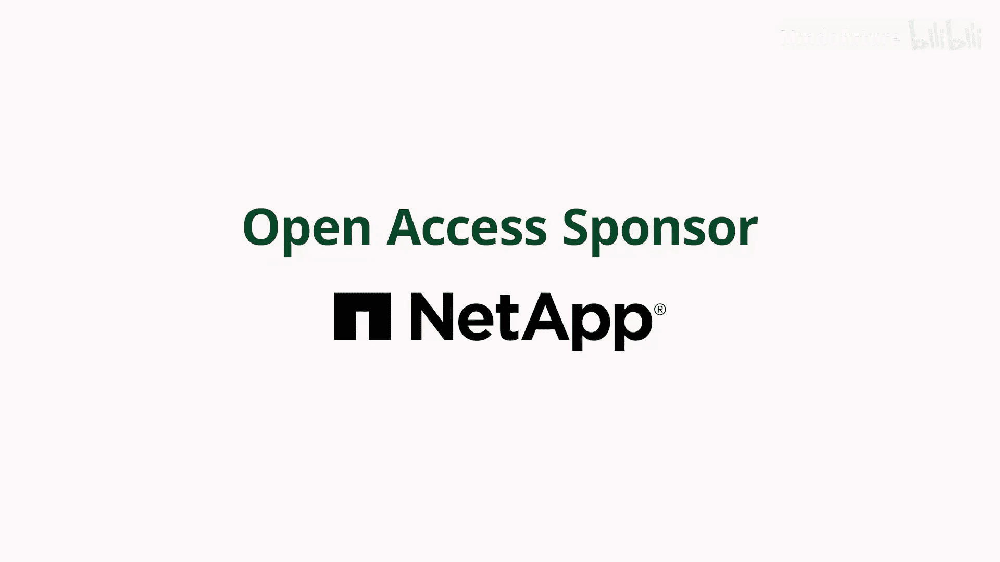
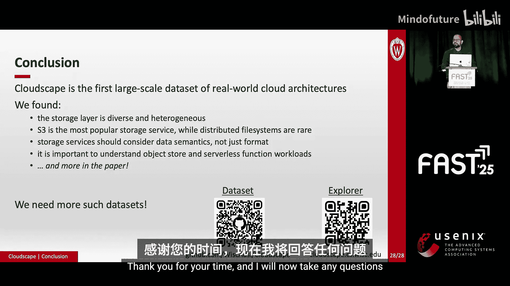

# FAST25存储大会-｜-USENIX-Conference-on-File-and-Storage-Technologies-p08-P08-Cloudscape---A-Study-of-Storage-Services-in-Modern-Cloud-Architectures--BV1HmVXzME4J_p8-

。

Hi everyone， I'm Samhove， I'm a PhD student with Andrea and Rammsey or Pa Doso， Artduda Madison。

I'm presenting our work on understanding the usage of storage services in modern cloud architectures。

This is joint work with collaborators from U Madison and NeApp。So today。

 cloud is the dominant deployment platform。 Most companies build their software on public cloud。

 making it a $600 billion industry。In fact， a staggering 4 million companies use AWS。

 which is the largest cloud provider。This includes big companies like Netflix， Samsung， and Snapchat。

Now， despite the cloud being widely used， there is a scarcity of data sets that describe how real world cloud architectures are built。

😊，Cloud providers like AWS do have that information。 but outside， we are mostly in the dark。

Any data set also needs to be mindful that nowadays， cloud development is heterogeneous。

By heterogeneous， I mean that architectures are using specialized cloud services instead of just V Ms。

Consider Snapchat， it uses Eks for compute， Cloudfront for networking and three different storage services。

So we need a data set that grants insights into the usage of different cloud services。

And we strongly believe that us academic researchers in particular would benefit from such a data set because we lack insights into which cloud services are even popular。

 right。In this work， we build the first such data set that should hopefully help inform future research directions。

Now， in order to construct this data set， we use a playlist of videos maintained by AWS called This is my architectureect。

In each video， a developer from a different company comes and describes how they use AWS。

 For example， this video describes how Snapchat uses and combines AWS services。

A key contribution of a paper is converting these videos into a structured data set。In a few slides。

 I'll describe our methodology in doing so。The key thing to note， though。

 is that the output of a process is a graph that researchers can then。

 can then run their analysis on。We apply a methodology to most of the videos in this playlist。

 which results in a data set， which we call cloudscape。

This is the first large scale data set of real world architectures。

We think it has to tremendous diversity， capturing nearly 400 architectures across 380 different companies。

 both big and small。Also， these are fairly recent architectures spanning the last five years。

Moreover， we find a staggering number of different AWS services being used in the wild。

 which highlights the heterogeneity of cloud development in the real world。😊。

Cloudscape is built using descriptions provided by real users。

 And we think that these facts demonstrate the breadth of architectures captured。So in our paper。

 we use this data set to understand cloud storage。In the talk， Ill discuss four of our main findings。

Our first finding is that the storage layer of cloud applications is both diverse and heterogeneous。

😊，Applications can choose from a large pool of specialized services， and they often use two or more。

Second， we find that S 3 is perhaps unsurprisingly the most popular story service。😊，On the flip side。

 we do find that distributed file systems are rare in these web deployments。Third。

 we also unearth unique characteristics of the data that is actually being stored in these storage services。

In particular， for S 3， we make the we make the observation that not all the data stores is equally important。

We also find that data stored in dynamo D sometimes refers to data on other storage services。

 which hints a tight coupling happening in the storage layer。

Our final question is to determine which cloud services interact with storage。😊，Perhaps surprisingly。

 we find that serverless functions do off any other compute services。😊。

The paper itself includes many more findings。 I'll just present these in the interest of time。

Now that you have a high level overview of the data and the results， lets dig into details。First。

 I'll describe a methodology for constructing cloudscape。Now。

 the source of our data is YouTube videos。 and we need to extract information from these。

These videos are unstructured by definition。 They are six minute long on average。

 and they contain dense technical in information。This information is fed to the viewer via both audio and visual channels。

 for example， the developer might either orally describe how to services interact or they might draw a line between them but do not say it out loud。

Finally， these videos also talk about a breadth of different topics。

Our goal is to reliably extract the data that is available in all of these videos。Now。

 to turn these videos into a structure data set， we apply the practice of iterative coding。

In this context， coding does not mean programming， it refers to the systematic process of assigning a code for classification。

Our methodology derives from the well studied collaborative qualitative coding practices。

In particular， three different team members attempted to understand what we can reliably extract from the videos。

Each team member independently coded the same five videos and came up with guidelines to extract data。

Now， the core of iterative coding is coming up with common guidelines by incorporating different views。

 So we discussed each other's approaches and we achieved consensus on a set of preliminary coding guidelines。

😊，For example， we realized we could format that is format this as a graph。

 and we decided to store nodes as services。We then take these guidelines as a starting point and apply it to a larger subset of the videos。

This leads to further refining the guidelines， some rules get dropped while others get added。

We reiterate multiple times constantly refining the coding guidelines until there were no updates。

We then use this final coding guideline for the rest of the data。Finally。

 due to the large size of the data set， we also inducted three more codes。

They also refined the annotations we trained them for the coding guidelines and their additions to the data set were verified。

Now that we understand the process， let's look at how architectures appear in our data。As an example。

 I'll walk through how the Snapchat architecture looks like。As I said。

 architectures and cloudscape are encoded as graphs。

The nodes of the graph are the AWS services used and also any other entities in the system like the user mobile phone。

Interactions between services are captured as edges。

We also distinguish between interactions that carry data and those that merely act as a request trigger or an acknowledgement response。

Additionally， we capture workflows， which is the set of interactions necessary to complete one unit of work。

And this notion of workflow is unique to each architecture。😊，In this case。

 Snapchat is a messaging service。 So when a sender wants to send a photo。

 it follows the red workflow to store the image。 It then takes the blue path to trigger a notification at the receiver end。

😊，Finally， we also impart sequence number to edges。

 which provides ordering between these interactions。😊。

So we've covered a methodology for constructing the data and gone through an example of what a dataset looks like。

We now move on to what we learned about the storage layer by studying these 400 different architectures。

The first question we ask is， how would we describe the storage layer of modern cloud applications？

 What is it composed of。It turns out that the storage layer is incredibly diverse。

 Architectures and cloudscape use up to 14 different storage services。😊，Next。

 we consider how many different storage services that does each architecture use。

This table shows that 10% architectures do not use any particular cloud storage its service。

Which also means that 90% architectures do use a specialized cloud storage service。

More than a third of the architectures use one storage service to fulfill their needs。

The table also reveals that the storage layer is heterogeneous。

 More than half of the architectures depend on two on。

 depend on two or more different storage services。So we found that modern cloud architectures have indeed embraced these specialized cloud storage services。

 and they are offloading the storage needs to them。😊。

Thus any ongoing work on building cloud native and multiten storage services should have considerable impact and they should see deployments。

😊，The next question we seek to answer is among all these different storage services。

 which is the most popular。Now， for ease of analysis。

 we club these services that provide the same schema。In this graph。

 each thin bar shows the percentage of architectures that use that particular service。

The outer lighter bounding box is the union。 It shows the number of architectures that use any service of that type。

So overall， we find that object stores are the most popular。

 followed by no sql stores and then sQL stores。Also， the three most popular services are S3。

 dynamod DB and RdiS。S 3 is so popular， in fact， that it is twice as popular as the next service。

Finally， despite tons of research on distributed file systems。

 it sadly appears that they are not that important in this context。Now。

 this high usage of S3 is intriguing， and we use cloudscape to study it a bit more。😊。

The left graph shows what we already know that S3 is used in 68 percentage of the entire data。

One thing that Cloudscape does is that it categorizes architectures based on their key goals。

Consider the x axis of the second graph。We have broadly classified architectures into those that does data ingestion heavy workloads or architectures that are latency sensitive or those that run compute heavy workloads。

😊，We find that S 3 is adopted across all of these architecture goals。呃。

We also find it surprising that across the board， many architectures do not use any other service beyond S 3。

That being said， a large fraction do pair S3 with some other storage service。

So we found that object stores have seen strong adoption while distributed file systems are rare in this context。

Thus any ongoing research on object stores will continue to have tremendous impact。

This also highlights the need to capture realistic workloads imposed on cloud service。

 imposed on object stores running on the cloud。😊，Next。

 we dig a bit deeper into what is the data that is stored in these storage services。

 Can we better understand it semantically。😊，To do so， we looked at the two most popular services。

 S 3 and dynamo D。Unsurprisingly， we found that S3 stores a rich variety of data spanning media logs。

 configs， analytics files in the form of CSV parque format and much more。😊，We were also， however。

 able to understand the context of how this data is used。

And we observed that the seemingly same looking piece of data can have different importance or different availability requirements。

Consider logs and configs。 Both appear as text to the object store。However。

 logs are often used for analytics and downstream analytics engines can perhaps tolerate data and availability。

 and they can defer their work until it becomes available without sacrificing any throughput。

A confi file， on the other hand， might be used to spin up a cluster。 And if it's unavailable。

 it might stall the entire setup。Thus， we find that S3 strives for high availability for all pieces of data。

 it treats them equally。😊，So it might be fruitful for services to learn about these availability requirements of the downstream services and thereby potentially even build cheaper systems。

We also looked at the data stored in dynamo TV。As expected， most often。

 Dymo D was used to store business specific data。However， we unearthed two interesting use cases。

 First， some architectures were running these long cross service jobs and the status of the job itself was being maintained in dynamo D。

Second， we found cases where dynamo Db was toor a stripped down version of some retro data。

 For example， it to the metada of an object that was stored in S 3。

 and it also pointed to that object in S 3。This reveals tight coupling happening in the storage layer。

We feel that the time is ripe for outlining some principle frameworks and guidelines for referring to this data that is spread across services。

 while still maintaining data validity and consistency。Finally。

 we consider which services read from and write to storage most often。😊。

This graph shows the top 10 services interacting with the storage here。

The compute services are mapped in orange。So unsurprisingly。

 we find that compute services are the ones that primarily interface with storage。

What is interesting， though， is the popularity of Lada。This。

 we feel highlights the importance of understanding how stateless functions deal with state。

This high usage of lambda is interesting。 And as systems researchers。

 we were curious to understand this adoption。So similar to S3。

 we found that Lambda is used in 65% architectures again across all the goals。Additionally。

 Lambda is complete enough to be the only compute service in roughly 20% of all the architectures that we looked at。

So we found that compute services。 and in particular， Lambda stresses the storage layer of the cloud。

This highlights the need to start capturing realistic serverless storage workloads。To conclude。

 Cloudscape is the culmination of many months of manual work resulting in a data set that captures how cloud architectures are built。

We make all of this data set publicly available。 researchers can run queries to motivate and ground their future problems。

😊，We also provide an interactive web based explorer so that you can quickly understand the data。

I want to end this talk on a note that we hope our work is the first step。

We feel that our community needs more such data sets to better understand the reality of how these services are being stitched together。

😊，We are open to collaborating with other cloud providers in repeating this study and extending it to include more dimensions。

😊，More generally， we welcome discussion on how we should be solving this problem systematically。😊。

Thank you for your time。 And I will now take any questions。

