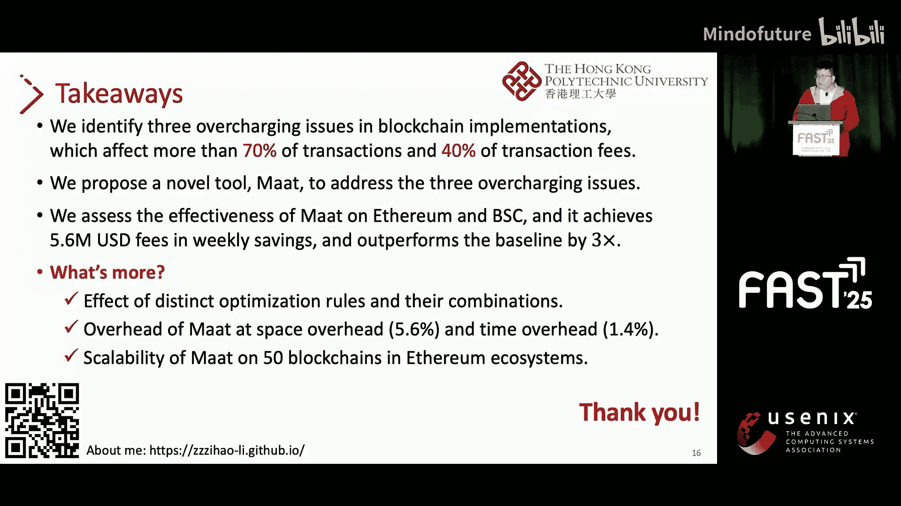
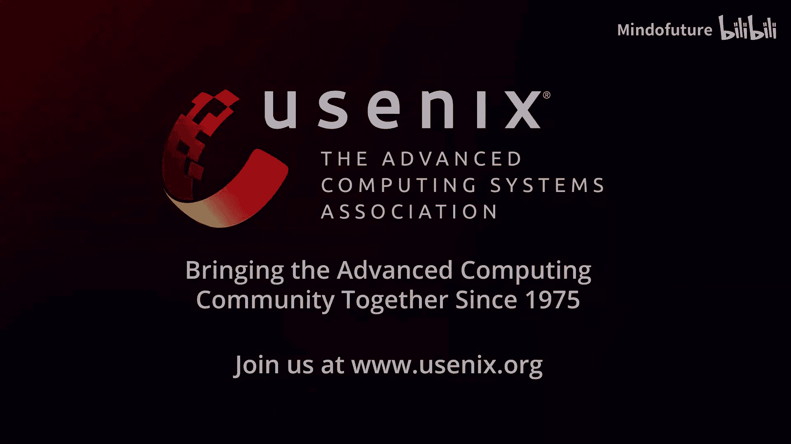

# FAST25存储大会-｜-USENIX-Conference-on-File-and-Storage-Technologies-p09-P09-Maat---Analyzing-and-Optimizing-Overcharge-on-Blockchain-Storage--BV1HmVXzME4J_p9-

。

I'm Z Hali from the Hong Kong Polytechnic University。

 I'm going to be here to share a study on analyzing and optimizing the overchar issues on blockchain storage。

😊，First， I will introduce some basic concepts about blockchain and the worst data of blockchain。

 as well know， blockchain is a distributed which consists of channel blocks and each of block contains the transactions that will interact with the blockchain data as for blockchain data it contains all the information about the account and control data and it is organized as MP structure with the MP node are stored on the hard disk。

To improve efficiency， there will be a practical blockchainverse data。

 which will be studied on the memory caches and shared by several adjacent blocks。

As for the read operations on worst data transactions will the execution they will first fetch data from the memory caches。

 If the cache cache is miss， the transactions will first will then assess the data stored on the hard disk for the corresponding empty notes As for the right operations on worst data transactions will first write the updated data to the memory caches after the transactions in a block are finished the updated data will be written to the hard disk。

Next， I will introduce the transaction transaction fee mechanisms and the problem problem with folks to prevent unlimited access and modification on the worst states。

 Pro will introduce a transaction fee mechanisms to charge users with some transaction fees based their usage of the on resources like the disk of the miners。

 which is measured in the gas for the gas cost every transaction and contract operations will be will be gas coast。

 you can see the red table and gas cost is designed to reflect the actual resource consumption。

 For example， reading a country data from the memory caches will cost about 100 gas units and reading the country data。

 country data from the hard disk will cost about 2000 and 100 gas units。And in our work。

 we focus on the storage rated gas coast by two reasons。

 First blockchain like the eium blockchain has been suffering from the high trans phase。

 which is recognized as a huge problem。For example， in your results， users paid for2。

4 billion dollars in transaction fees on in 202723 and second。

 the storage rate gas cost accounted for more than770% of this transaction fees。

And the first part of our work is to analyze the overcharging issues。

 and we first identify three overcharging issues by investigating the specifications and of blockchain silence In our context。

 the overcharging issues refer to the cases that the cost the gas cost for account and operations is higher than the actual resource consumption。

 For example， we consider the situation when when when when blockchain charges memory load operation as the of a disk load operation。

 we consider this situation， this case is a overcharging issue。Next。

 I will detail the three charging issue identified bias for the first issue。

 it happens when two transactions continuously read and write the same object in a block。

 In this case， Bachan will charge the guest code of discrete and right operation for memory and operation on the intra block memory cache you can see the the example in the right figure and there are two transactions in a block in the in the two transactions。

 at least send either to Bob and cat。In the first transaction。

 the the banks of Alice is loaded from the hard disk and written to the intra memory cache。

 And in the second transaction， the of Alice is loaded from the intra memory cash。

 but the blockchain the blockchain mistakenly consider that the banks of Alice is loaded from the hard disk and for a disk fee。

The second issue happens when two transactions continuously read the same object within 128 box。

 In this case， will charge the guest of discrete operation for memory operation on the crossbook memory cache there is also an example in the red figure and Alice to Bob and cat respectively in the first transaction。

 the best Alice is also loaded from the hard disk and and it it is written to the crossbook memory cache and in the second transaction the best Alice is loaded from the crossbook memory cache and and also the mistake consider that the best Alice is loaded from the hard disk and will for for a dys。

The third issue happens when two transactions deploy contracts with contain duplicated bad code。

 In this case， Bchan will charge an unnecessary disk fee for storing the duplicate bad code on the hard disk。

In there there is also an example in the right figure and there and there are two transactions deploy that deploy contracts with the same bad code in the first transaction。

 the bad code and the highest value back code will be stored on the key value store on the disk and in the second transaction。

 the bad code of the second contract already already exist in the key value store but the blockchain will still will still charge the fee for writing the back code to the key value store。

 and although there is no state related。We further we further explore the financial impacts of the three over issues and we measure the the financial impacts on and B blockchain for the B blockchain each the code or。

 So it will also suffer the three over issues and our data contains about 1 million blocks and results there are over 70% of transactions and 40% of transaction fees are affected on easier for B there there are over 90% of transactions and 40% of transaction fees are are affected。

The next part of the next part of our work is to optimize the overcharging issues identified bias in blockchain。

 and we propose to named meat。 and the key methodology of meat is to the actualloads of storage operations with their corresponding gas phase。

 and there are two major components in the meat the first component component will gather the storage operations and the five grade gas phase of of these storage operations from the execution of the blocks and transactions in in the and the second component will apply for optimization rules propose the bias to optimize the gas phase in the actual cases of overcharging issues collected by the first component。

Next I will detailed the four optimization rows for the first two rows。

 they target the first issue where repeated memory radar and write operation operations are incorrectly charged as disk rate and write operations with the within the intra block cache。

Our solution is to replace the incorrect charges of the discrete and rate operations with the fail of memory and rate operations。

 and the third third is proposed to address the second issue where repeated memory read operations are mistakenly charged as the discrete operations in the crossbook cache and our solution is to replace the incorrect charges of discrete operations as the fail of memory operations。

And the last rule is is aims to mitigate the the third issue where deploying a contrast with duplicate bad code will will incur redundant disk phase。

 and our solution is to eliminate the charges of deploying contrast with duplicate better code。

Next I will answer two questions to highlight the design considerations of it for the first question。

 we ensure that the optimize gas charges are consistent across all blockchain settings by using the inherent data structures of the blockchain blockchain to formalize the conditions of the four optimizationization rules and the inherent data structures include blocks。

Tsactions accounts， contraver and contras。 the execution of blocks and transactions transactions over these data structures will be deter across all blockchain segments。

 which are guaranteed by the blockchain consensus mechanisms。For the second question。

 the first three rule dependent on the intra block and crossbook caches to conduct the optimization。

 However， the different configuration and and science may vary the contents in the caches。

 and we assure that the storage operations are consistent across all blockchain by using a resource location technical technical can the data assessed in previous 128 blocks to assign contents across all blockchain in advance in our estimation。

 the maximum memory consumption is will be 200 million in this case。

 deployment in will not introduce memory overhead。evaluation evaluation， we choose EP2929 as a。

 which is designed to address the overchar issues where repeat memory rate operations are incorrectly as rate operations in the intra block cash。

 which are the particle problem which the particle by the first and evaluation we also use1 million blocks to performance of and results achieves significantly of over1100 million dollars in and perform about three times of7 million in and also perform the about three times。

So finally， we identify three overcharging issues in blockchains。

 which affect more than 70% of transactions and 40% of transaction fees and we also propose tool named mate to address to optimize the overcharged gas phase by the three overcharging charging issues and we evaluate the performance of mate un by the busy blockchain and our results show that Me can achieve about 5 million US dollars transaction fees in weekly savings and outperform the baseline by three times。

If you are interested to our work， we also assess the effective distinct optimization rules and their combinations on the three overchan issues。

 and we。Msure the performance of metter and the space overhead and the time average results meet will not introduce a huge space all time。

And we also explore the scability of mate on other 50 blockchains that reuse the code oferium and results show that the metater can also optimize the overcharging issues in this blockchain。

 Thankss all Thank you。 Thank you for listening。

