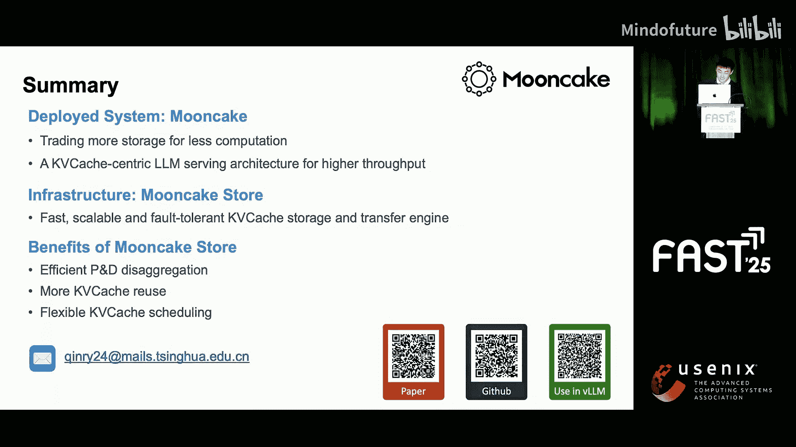
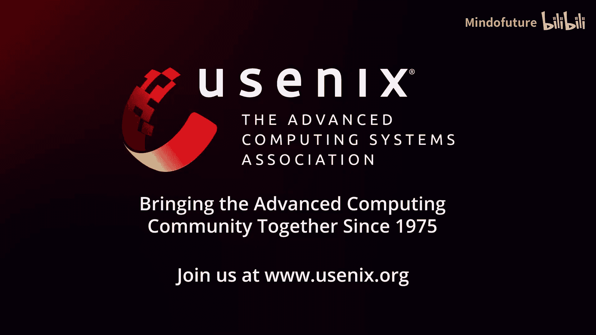

# FAST25存储大会-｜-USENIX-Conference-on-File-and-Storage-Technologies-p11-P11-Mooncake---Trading-More-Storage-for-Less-Computation-—-A-KVCache-centric-Arc--BV1HmVXzME4J_p11-

。

Good afternoon， everyone。 I'm Ro Yu。 I will。 I will introduce our paper titled Mooncake trading More storage for less computation。

 A Kwi cache centric architecture for serving chatbot。 Mooncake is the serving platform for Kimmi。

 a leading service provided by moonshot AI。 Mooncake was jointly developed by moonshot AI and the Kwic AI team of Qinghua University。

 Currently， it handles over 80% of traffic for Kimmi and has reduced cost by more than half compared to our previous system。

😊，First， let me provide some background on I am inference in transformer based large language models。

 request processing is divided into two stages。 Pre and decocode。

 The pre stage computes all input tokens and generates the first output token while the decoding stage is autoregressive。

 processing one token at a time。We use two latency metrics for I inference。 One is T T F T。

 which measures the time from input to the generation of the first output token。

 That is the peripheral time。 The other is T B T。 The time interval between the generation of each output token corresponding to the decoding time。

Since the profile time completes all calculations at once。

 it is relatively computationally intensive。 It compute time grows quickly with the input lens。

 For example， with 128 k inputs， it would take more than 5 seconds to get the first out token of the response。

😊，The decoding stage， on the other hand， is more bandwidth intensive and has a lower computational resource utilization。

 but its latency must meet at least the user's reading speed， for example，10 tos per second。

Therefore， I am serving face huge challenges。 Firstly， the。

 the long contact profile consumes a substantial amount of GPU compute time。 Meanwhile。

 the stringent G TBT limits the computational efficiency of requests in a pre deco mixed batch。

When we apply the inference process across multiple instances and introduce a central scheduler。

 which we call conductor， we get an online I M serving system。The system provides a streaming API。

 meaning that each generated token is returned to the user in real time。

 and as a service quality guarantee， the T T FT and TBT laencies should not exceed predefined threshold。

Mooncake is just the online I M serving system that powers Kmi。 Currently。

 Kimmi serves a million of users， processes over 100 billion tokens daily and delivers smooth real time responses。

😊，One of Kim's most popular features is its support for a context lens of up to 1 million tokens。

According to the scaling law， large models and longer contexts can lead to higher intelligence。

However， this also increases interest costs and response licenses。

 especially during the peak usage times。Therefore， a natural question arises。

 how can we improve computational resource utilization and overall system throughput in large scale long contact service scenarios while compromising the user's experience。

😊，An important optimization for long contact I is prefication。

TV cash can be shared across requests with the same prefix to reduce the computation。 For example。

 if there were a previous request like what day is it today。

 then a followed up request like what day is yesterday what they is it tomorrow would only require computing the TV cash for the last token reusing the TV cash for the first four tokens。

We conducted an analysis of Kim's online workloads to our surprise。

 approximately 50% of the tokens Kwi cash in the real world workloads can be reused。

 This means that if we have sufficient space to store all the QV cash。

 we could save nearly half of the GPU computation。😊，However。

 the catch hit rate significantly drops when we only using the local cache of a single note。

 which has a capacity of about 3 million tokens。 This implies that we should expand the QV cache capacity to trade more storage for less competition。

😊，Although the idea is simple， Qwic presents greater challenges to the storage system compared to traditional caches。

 Each token， which may only be a few B， can expand by thousands of times after being processed by a large model。

 reaching a size of tens or even hundreds of kiloB。 Moreover。

 KV cash grows linearly with the sequence length， for example， with the Lamma 3，70 B model。

 even with techniques like group query attention that help reduce Q cash。

 The K cache volume for a 1 million token contacts， still reaches 320 G B。

So in order to fully leverage preficication to reduce computation costs。

 the KV cache storage required would be far greater than the available capacity of a single node。

What's more， the Q cash transfer speed requirements are very high。 If I O becomes a bottleneck。

 it could lead to idle GPU resources with invaluable computational power。😊。

To build an efficient I M serving system， we need to achieve large capacity Ki cash storage。

 low latency and high bandwidth weight Q cash transfer。 And at the system level。

 we also need to implement QV cash aware schedule to balance cash locality and the instance load。

In summary， the K catcentric architecture is all you need。According to this。

 we have design and built moon cake Kc centric I am serving architecture。

 Mooncake builds an underlying infrastructure mooncake store， which provides a fast。

 scalable and foot tolerant K cash storage and transfer engine。Based on this。

 we have construct a large scale peripheral decocode deaggregation inference cluster。

 greatly improving throughput while maintaining real time responses。😊。

Let me first introduce the workflow of processing requests in one cake。

 There are many scheduling algorithms for I inference。

 such as pre prioritizing decoding prioritizing and chunk pre。

 which segments the pre execution to reduce the interference with the decoding stage。 However。

 all of these approaches face challenges in meeting both MFU and the TBT requirements。

 MF is the model flows utilization。Therefore， we use the pre deco desegregation architecture。

 separating the two stages onto two different instances as shown in the figure on the right。

 after the pur instance has complete the incremental pre。

 the key cache is transferred to another instance for the decoding stage。

This disaggregation architecture avoids the interference between per and deco in a mixed batch。

 And at the same time， each stage can use different resources and parallel methods based on their own computational characteristics。

 further improving MF and throughput。In large scale deployments。

 the P And D dissegregation is expanded to two node pools。

 The pre pool and the decoding pool Ki cash from any node can be quickly transferred。

 enabling more flexible request scheduling。The infrastructure that supports this is monkey store。

Which provides large capacity， high bandwidth weight， keep catch storage。

It builds a global cache pool on V D and SSD of inference nodes and supports high bandwidth cable cash transfer between inference engines and storages。

As a deployed system， monkeykey store offers high scalability and full tolerancele。

 supporting elastic scaling of the online inference system。 in terms of design。

 Moonkey store is independent of the inference engine and provides a flexible API structure。

The inference engine， such as V I I， which is the most widely used open source I M inference framework。

 can implement previous cash offloading and PD D desegregation features on its own。Internally。

 Mooncake store uses prefix h object storage for K cash。

 where each block consists of 16 to 512 tokens。 Each block is attached with a hush key determined by both its own hush and its prefix for duplication。

When a new request arrives， the system matches token blocks one by one until a mismatch occurs。

 identifying the reusable Q cache blocks and the new Ki cache blocks。

The preview instance generates the incremental key cash blocks and then transfers them to the decoding instance。

When the number of node key cache blocks reaches the capacity limit。

 we use the L U policy to evict the old cash blocks。

Mooncake store provides a high performance for tolerant K cash transfer engine that supports multiple transport methods such as GP PU direct IM A TCP and MME over fabric。

😊，This it is optimized for multi RDM network card scenarios。

 making it more efficient in utilizing network card bandwidth compared to other protocols in comparison to protocols like NCC L。

 The metric transfer engine is more flexible because it doesn't require the construction of precise groups。

 enabling support for the elastic scaling of deployment nodes。

As an intermediary layer between the upper level I M engine and the lower level hardware。

 monkeykey store excels in external integration for the upper level。

 monkeykey store provides zero copy object， put and get interfaces。

 supporting not only inference engines like V IM， but also training engines such as Mactro for its checkpoint of loading and transferring。

For the lower level， Mooncake store supports local memory， remote memory。

 SSD and other third party memory storages。😊，According to our historical statistics of Kimmi。

 Mooncake enable Kimmi to handle 115% and 107% more requests on a 800 and H800 GP PU clusters respectively。

To validate the results in the experimental section。

 we conducted a series of N to end and abl experiments on monkey to address the following questions。

1， does monkey outperform existing inference systems in real world scenarios，2。

 compared to conventional prefixching methods。 Does the design of monkeys store significantly improve moon cake's performance。

To resemble the online request distribution， we constructed three trees datas through sampling them from the online online requests。

 their conversation to an agent and synthetic。 The average input length of this data size is around 10 k tokens。

 which is different from the commonly use the short request data size and more closely resembles the real world distribution。

To compare the performance of moon and other engine inference systems in real world scenarios。

 which choose the effective request capacity metric。

 which refers to the number of requests in a given workload that meet the latency requirements。

This metric reflects the system's real effective throughput， also known as goodput。

The results show that the three baseline systems cannot avoid the interference between per and decoding in a mixed batch。

 resulting in huge laency violations。At the other hand。

 moon cake through P And D disaggregation and keep cache memory pullinging achieves flexible disaggregated s。

 thus avoiding the aforementioned interference。As a result。

 Moonke's effective request capacity is much higher， with an improvement of up to 498%。Next。

 we measure the GPU computation time during the pre stage。

 which reflects the MF and the actual utilization of the prefix cache。

 The lower GPU costs imply the higher MF and the higher proportion of reusable K cash from the bar chart。

 we can see that V IM and VM with chunk pre have two to three times higher GPU costs compared to while VM with prefix can reuse the cash。

 It limits its cache to a single node， making it suitable only four scenarios with highly concentrated hot caches such as the two and agentable load。

Moncake， by implementing cable cash pooling greatly improve improve pre cash utilization across all traces。

 As a result， we can save 29% to 61% on GPU computation costs during the previous stage。

Due to the time constraints， I didn't go into the detailed implementation of the monkey inference engine and the scheduling part。

 For more information， please refer to our paper。 We also welcome you to read the ablition experiments in the paper to gain a more comprehensive understanding of the monkeycake system。

In the final moment， I want to introduce our roadm for integrating mooncake store on into V IM。

 which we have planned into two stages In the first stage。

 we use mooncake transfer engine for VM's disaggregated inference。

 which currently only supports one pre instance and one decoding instance。

 This part has already been merged into V IM。 and you can refer to our repository for the tutorial In the second stage。

 we will support disaggregated inference with any number of pre and decoding instances based on mooncake's distributed K cash and a central scheduling service。

We are working on this to make VM support more flexible， dissegregated inference。😊。

This is a summary of our paper。 We propose trading more storage for less computation to reduce the cost of large scale long contact I am serving for Kimi。

 based on this， we built mooncake。 A K cachecentric I am serving architecture。

 which saves more than half of the costs in our real world deployments。

 The core infrastructure of mooncake is mooncake store。

 which provides a fast scalable and for tolerant K cash storage and transfer engine。

Based on mooncake store， Mooncake implements efficient P Dsegregation。

 large KV cash storage and flexible KV cash scheduling。

 thus significantly improving I am serving throughput while ensuring real time responses。Oh。

 that's all。 We welcome you to check out your paper for and Gi upub ripple for more details。

 Thank you for listening。😊。

