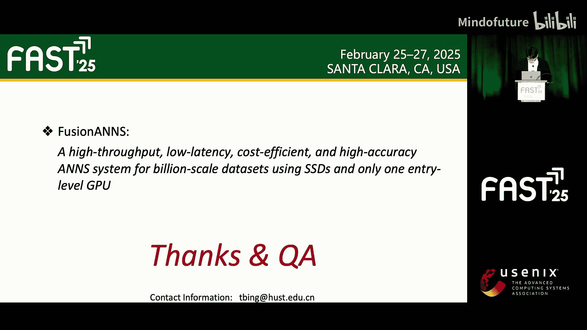

# FAST25存储大会-｜-USENIX-Conference-on-File-and-Storage-Technologies-p12-P12-Towards-High-throughput-and-Low-latency-Billion-scale-Vector-Search-via-CPU--BV1HmVXzME4J_p12-

。

I'm Bing Tian from Huaazhou University of Science and Technology。 Today。

 I'm going to present our work towards high support and low latency billing skill vector search via CPU and GPU collaborative filtering and re ranking。

 This work was conducted in collaboration with Huawei。😊，The。

 the content of this talk is divided into four parts from the beginning of background to the end of conclusion。

The vector search also called top K nearest neighbor search。

 refers to finding the closest vector to a given query vector within a data site in this contest。

 as consider a data site consisting of N vectors where each vector is represented by a de dimensional vector。

 given a query vector， the goal is to identify the top K vectors in the data site says that the distance is main must。

Since the curse of dimensionality of N N S， many approximately nearest neighbor search of them has been proposed。

 We called NN S， which can be divided into 4 k。 brute force。

 h based tree based and graph based graph based approaches have have demonstrated promoting performance and accuracy for N S service。

 It constructs a proximity graph。Victors are abstracted as notess。

 and ages are dim as the distance between two notess。For each query vector。

 the algorithm navigates the graph from a given node and sequentially traverse neighboring nodes that are likely candidates of approximately nearest neighbors。

😊，With the rapid development of large language models。

 N S applied to retrieve augmented generation has become a common and powerful move to expand the knowledge base of large language models。

However， with with the explosive growth of vector from embedding a structured data。

 N S algorithms need to possess data sites containing billions of vectorsConsequently。

 in memory N S such as graph based approaches， demand substantial memory speeds。

 which significantly increase the total cost of ownership of data centers。😊。

To reduce the memory consumption in large scale N S， Microsoft's commercial N S system。

 SPN introduced a higher index and saw the majority of the index SDs。😊，Specifically。

 during the offly， SPN employs a cluster algorithm to partition the data into multiple person。

 Additionally， to ensure the quality of cluster。It replicates boundary vectors into a decent posting list。

 Then it all posting list on SDs while maintaining a century rows of this posting list in memory using a graph index upon a query SPN travels the in memory graph to identify top M nearest posting list and allows them to host the memory。

😊，Then it found the top key nearest neighbors when this I am posting list via decent calculations。

 However， we find that although SPN achieves low laency comparable to in memory as approaches。

8 through is quite limited as showing the left figure。

 SPN achieves the peak through using only four CPU threads and count skill with more threads。

 further， we count the query latency in two stages First。

 the graph traal in memory and second is processinging posting list from SSDs。😊。

As showing the right figure， the latency of graph traveral increased significantly with the number of stress。

 The reason is that the multiple queries can currently read many and less post list from SSDs。

 resulting in several air condition and high latency。😊。

The the product quantization we called PQ is a promising way to comprise the raw vectors from high dimension to low dimension。

 thus's reducing the size of I request。 However， P Q converts a distance calculation between vectors into multiple memory access operation and thus pose a significant challenge for traditional CPU based computing architectures due to the relatively low balance of D and limited parallelism。

 Therefore， the PQ is usually accelerated by GP because it can fully utilize their massive GP kernels and high bandwidth memory to improve the query performance。

😊，Intuitively， one can adopt theoretical indexing product quantization and GP P acceleration techniques together to achieve an optimal N S solution。

 While we have found that it is no easy task。😊，Here。

 we first discuss the straightforward solution using GPU accelerated N S solution using P Q and here indexing techniques。

 Up upon a query， the N S engine first traversed the navigation graph to identify top M nearest posting list and lost this raw posting list or compressed posting list to CPU main memory of GPUs HBM for decent calculation。

😊，Since P Q has a negative impact on query accuracy。

 we add a re ranking process to improve the query accuracy。During ranking。

 the audit of the top N candidate vectors should be compared with the query vector to find the final talking nearest neighbors。

Disappointingly， we find that above solutions don't achieve expected high performance。

 including the latency using signal thread and the peakthrough code using multiple threads。😊。

The first challenge is that the extensive data transmission across devices。

 we first measure the I numbers and the data volume transferred across SDs main memory and GPU HBM required by H N as query on average。

😊，As showing the left figure。Although the P Q technical can reduce the all size of posting lists from multiple page to one page granularity。

 it increases the number of error request by 17% due to the re ranking size。 Moreover。

 a large volume of posting list are are transferred between CPU and GP。

 thereby offsetting the benefits of GP acceleration。

The root case is that the GPUs HBM still can't accommodate all post list Comed by P Q。

 allowing extensive data transmission between CPU and GP to become a new performance spotlink。Second。

 to achieve the same level of query accuracy， a re ranking process is usually required to refine intermediate results。

 However， we found that the minimum ranking number are very distinct for different N S queries。

This significant variance usually causes unnecessary I operations and distance calculations。

 If the number of re ranked vector is fixed for all queries。😊，Third。

 the re rankingking process introduce a number of I requests to raw vectors on SSDs。

 but the size of a raw vector generates hundreds of bets。

 While the smallest operating unit of modern MM SSD is typically a page。

 This means match in granularity causes significantly red amplification result in extremely low every during re ranking。

To tackle the above challenges， we propose futureion N S。

 It is a CPU and GPU cooperative processing architecture for billion scale N N S。

Fuion X includes three key designs， multitailered In and the CPU GPU collaborative filtering。😊。

Huristic ranking based on the lightweight feedback control model。

Rden aware I duplication based on the opt storage， each addressing a specific challenge。At first。

 we adopt the hiarchical balanced cluster algorithm to it iterly part the data side to several post lists。

 Each posting list contains multiple vector I Ds and the corresponding vector content。😊。

After the data side is clustered， we build a navigation graph index using the central of all person and store it in main memory。

😊，More importantly， unlike SPN that stores all person list IDs。

 we extract only Victor I Ds of each person list as merge date and store it in memory。😊。

When the graph date and merge data are generated， the intermediate posting list can be discarded。😊。

Since the memory footprint of the graph and me data is relatively small。

 we can support billion given us in a memory cost efficient cost efficient way using general proposed servers。

😊，Since P Q can significantly reduce the memory footprint of high dimension vector will lose compression。

 Even an intrale GPU can accommodate all compressed vectors in its E PMM for business school data sets。

😊，In fusion S， we paint all compressed vector in in HM， avoiding data swapping between GP。

BetweenGPU andCPU。Upon a query。The CPU transfer traversed the in memory navigation graph to identify the top M posting list nearest to the query vector。

Then the CPU consoles the me data to collect vector I D within this candidate posting list。

After that， the CPU Traverse transfers these vector Is to the GPU and invokes GPU kernel for further processing。

😊，When the GPU received vector I Ds， it first read the corresponding PQ vector for each vector I D from the HM and compute the PQ distance between aid and the query vector。

Subsequentially。The GPU source all distance in a sitting order and returns the top top N vector I D to the CPU。

Since the intermediate result obtained using PQ vectors are not precise。

 the CPU read the raw vector according to these vector Is from SSD for further re ranking。Finally。

 the CPU returns the final top K nearest the neighbors。😊，This CPU， GPU。

 this CPU G and GPU collaborative filter mechanism can filter out the most irrelevant vectors while avoiding the transmission of vectors contained between CPU and GP。

To reduce unnecessary air operations and computations， we propose a heuristic ranking mechanism。😊。

The key idea is that when all top K phones， the subsequent re ranking will not change the top result。

We first divided the ranking process into multiple mini batchs and execute them sequentially。

During this process， we use a priority queue to maintain the current top nearest neighbors。

 When a mini match is finished， we calculate the change rate change rate of the period crew and terminate the re ranking process。

 If the change rate for successive mini batch are smaller than a given threshold continuously。😊。

To further improve air efficiency， we first store high high similar vector on same page to improve special location on SSDs。

😊，We descend two L data duplication mechanism， including merging air operations mapped to the C page within a mini batch and exploiting the different buffer to eliminate redundancy air operations in subsequent mini batches。

😊，Here we use a simple example to to describe these mechanismss。Ause that。

There are two mini batchs in the reacting process where the task of mid batch 0 is to rank Victor 2。

 Victor 4 and vector 6。 The task of mid batch 1。Is to rank rank Victor 5， Victor 8 and Victor 9。

 When mini by 0 is executed， it first consults the mapping table to obtain the SSD page I D corresponding to the request vector。

Since both vector 2 and vector 6 are stored in the similar SSD page 0。

 we can these two I operations and only read one SSD page to get vector 2 and vector 6。😊。

Since page 0 and page 2 don't exist in D buffer， we directly read them to the D buffer via two operations。

In mini batch 1， although Victor 5， Victor 8 and Victor 9 are stored in different assets pages。

 the during buffer already contains page 2， which includes vector 5。 Therefore。

 mini batch 1 only needs to rate page 1 and page 3， via are two operation。😊。

This is fusion as architecture with CPU and GPU cooperative architecture。

 including offline these construction and online query processing。Next， we conduct extensive permits。

 and I will show the key result here。We compare fusion as with three3 representative N solution decent for billion skill data science。

 including two SSD based solutions and a GPU accelerated in memory solution。

 Besides the native S BN and disk， we also compare fusion as with GPU accelerated SBN and disk。

 which exploit GPU to accelerate decent calculations。😊。

Our experiments are conducted on server equipped with V V 100， and a sasungs SSD。😊。

And we picked three billion school real world vector data sets。For SN。

 Fusion has achieve same low latency while achieving up to 3 times improvement in through port。

Compared to disk， which treats latency for throughput fusion as still improve the throughput up to four times。

The SPN GPU and disk N GPU show even lower performance than the native SPN and disk。

 since the cost of extensive data movement offsetss the benefits of GP acceleration。More importantly。

 for the GP accelerate in memory solution， Remi Fusion achieves up to five times higherger through port with similar low latency。

😊，To evaluate the performance scalability of different N system。

 we increase the number of stresss potentially by a factor of 2。

 The result shows that fusions demonstrates the best of scalability。

We further compare fusion as with other N systems in terms of cost and memory efficiency。

 as shown in the table， fusion as demonstrates the best cost and memory efficiency。Okay， in summary。

 Fusion N S is a CPU and GPU cooperative processing architecture for billion Q N S。

 It achieves high support， low latency， cost efficiency and high accuracy simultaneously using only one entry GPU。

 Thank you for listening。😊。

