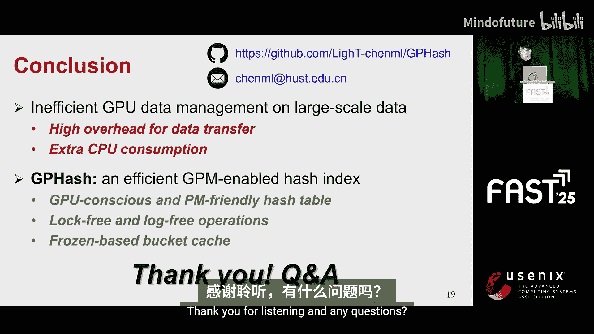
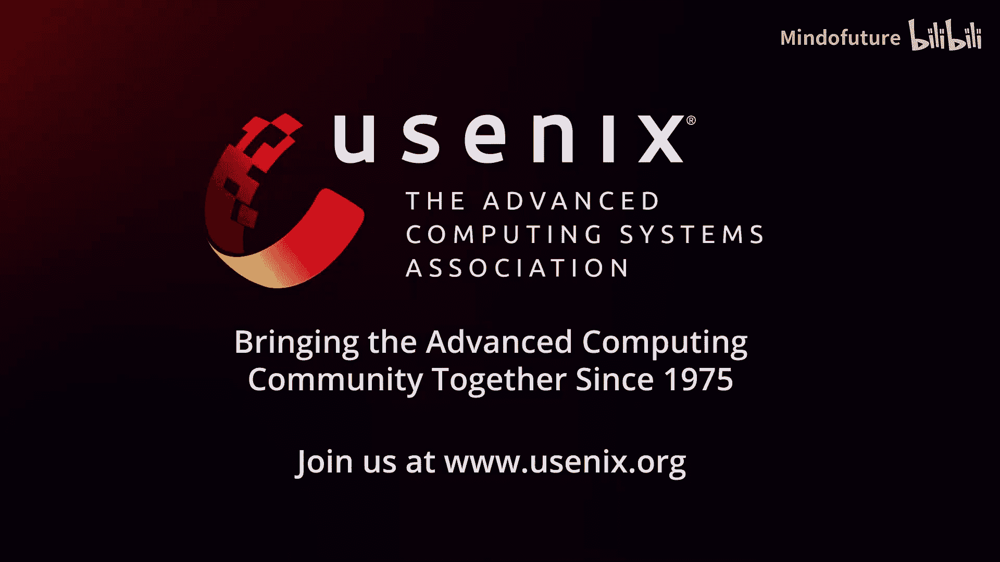

# FAST25存储大会-｜-USENIX-Conference-on-File-and-Storage-Technologies-p14-P14-GPHash---An-Efficient-Hash-Index-for-GPU-with-Byte-Granularity-Persistent-Me--BV1HmVXzME4J_p14-

。

Hello， everyone。 I'm M Len from Huazong University of Science and Technology。 Today。

 I am going to introduce introduce our work。 G P Hsh。

 an efficient h index for GPO with better graularity persistent and memory。😊。

With dramatic increases in computing throughput and memory bandwidth。

 GPSUs have been widely used in various applications to enhance performance。 For example。

 deep neural networks， scientific computing and autonomous driving。

GPU powered applications are typically driven by large scale data， for instance。

 to achieve higher recommendation accuracy。 deeper recommendation systems store billion scale embeddding vectors for richer future representations。

To accommodate data of ever increasing scale while ensuring data reliability。

 GPU applications typically store the data in large capacity precision storage devices。 for example。

 SSD and rely on the CPU to manage the data。Specifically。

 the data first be transferred to CPU D and then transferred to GPU。

While such data management enables large capacity and persistence。

It introduces high overhead for data transfer and extra CPU consumption。

To alleviate data transmission overhead and eliminate extra CPU consumption。

GPO direct storage technology provides a direct path between GPO memory and storage devices。

 providing block level projects like interfaces。😊，Data can be directly transferred to GPU。

This direct data access approach provides more。Eco efficient的 data transfer。However。

 it is hard to program data structure with G S。Besides。

 it can lead to external data transfer due to its block graity。In recent years。

 betterity precision memory has emerged， which provides attractive features。

 including large capacity。😊，Beter granularity， persistence and high performance。

GPU with precision memory systems provides betterity load and store instructions thus enabling direct data access from GP。

😊，2 PM， at the back level。GPN systems can be implementeded by leveraging the unified virtual addressing technology to map PM onto the GPS's virtual address space。

GPN systems not only offers large capacity， but and persistence。

 but also cost efficient and fine grain data transfer。Moreover。

 it is easy to program data structure with G。Hush indexes are widely used to manage data。

 which provides constant scale point queries and is good for parallel accesses。

GPN enabled Hu indexes become promising to boost a data management performance in GP applications。

However， it is non trivial to implement an efficient GPS h index due to the following challenges。

First， GPO achieves high parallelism by using thousands of GPO threats。

 which exhibits unique characteristics。The smallest scheduled unit in the GPU is the warp。

 which consists of3 32 threads。 Here will only show show 8 threads for clarity。

When encountering branch instructions， the thread in the same warp may be civilized if executing different instructions called warp divergence。

In addition， when a warp loads and stores data let fall in the same GP cache line。

The GPU hardware collapsees them into a single cache access called collapseed memory access。😊。

However， in the hush index， the threats access keys whose addresses are scattered。

 hence leading to uned memory excesses。Overall， the severe warp divergence and uned memory accesses lead to performance degradation。

😊，Since GN hush indexes directly manage data in PM。

It is important to guarantee data consistency in the presence of crashes。

The size of low atomic memory right of P is limited by the memory bus width。 For example。

8 bys for 64 B CPU。As a result， it can cause partial updates when writing the data whose size is larger than 8 Bs。

If a season failure occurs， the data will be corrupted。By using techniques such as sloging。

 the data can be recovered from crashes。However， it introduce introduces double rights。Typically。

 a crush consistency guarantee introduces high overhead。When performing index operations。

 the GPO needs to concurrently access the PM。While the bandwidth of GPO memory in Invidia。

 for example， in Invidia 1 V 100 can reach 900 GB per second。

The rate and right benefits of PM are only tens of gigabys per second。Theres。

 there is a significant bandwidth gap。The Bways limited PM fails to efficiently handle massive concurrent excesses from GPO kernels。

Such a huge bandwidth gap limits the utilization of GPU's high parallelism。

To address these challenges， we propose G Hsh， which is an efficient hush index for GPSN systems。

To tackle challenge 1 and2， we propose a GPO conscious and PM friendlyly h table。

 which supports log free and log free operations。To further mitigate the bandwidthway gap。

 we leverage the frozen based bucket catch to catch hold buckets in GPO memory。😊，Thus。

 in reducing PM accesses。In G P hush， each bucket contains multiple slots。

 each of which stores a key value item。GPHush follow leverage inter sharing to handle more harsh collisions for higher memory efficiency。

😊，Moreover， G hush features multiple harsh collections and one soap war accesses。😊。

A leverage par of a war。GP hush can access all slots of candidate buckets for a given key at one time。

Besides conventional point based key placement course， scattered addresses。

GP hush leverages leverages in place key placement to facilitate collapseed memory accesses。😊。

The structure of GPS H is simple and efficient on GPS systems， exhibiting strengthes。

 including GPO friendly， write optimize and memory efficient。Based on this h table skin。

 Ghu supports log free and log free operations。 here will briefly introduce the insertion operation。

😊，The threat of a warp coerate to perform one insertion operation at a time。

 Each thread first raises corresponding slot to check if the key exists。

And then find find empty slot belong into the less loaded bucket as a target slot。😊。

One dedicated thread tries to set the slow states to insert， using cast primitive。😊，It fails。

 the war needs to go back to the first step。If succeed。

 the dedicated threat continues to write the key and the value pointers。When finishing writing。

 the thread sets the slow state to the harsh value of the key by also using the customer primitive。

After a crash， Gi hush detects slots whose states are insert and recovers them by setting the slow state to empty。

To me the bandwidthway gap between GPO and PM， G hush catches hold buckets in GPO memory。

When performing index operations。Thres will check whether buckets are cacheed。If hits。

 threats directly rid the kids from the crash。Otherwise， threats access the PM to read the kids。

To avoid severe threat contentions， G H periodically identifies them and loads hot buckets into the bucket catch。

The membership of catch the buckets is frozen。 That is no change between the two adjacent loading faces。

To reduce the overhead of the catch loading， Deep concurrently loads the hot buckets。

 including first invalidating the old catch bucket， then fetch the new bucket。

 and finally validating the new catch buckets。😊，In terms of more details of G。

 including warp co exclusion manner and more index operations。Please， refer to our paper。

We evaluate GPSR shown a server with two intel，26 core CPU。1 invidia V 100 GPU and 768 GB In 10 DCPM。

We compare GH with。Conventional CPU assisted approaches。

 which use the CPU to render write data with P h indexes。

We further compare G with GPN enabled approaches。Let leverage GN has indexes to manage data。

We use the YCSB benchmark and multiple real world were close to evaluate its GPS and comparisons。

These two figures show the throughput and latency of different schemes on Y A and C clothes。😊。

The results demonstrate that GPSR shot performs CP assisted baseline by 4。7 and 3。

7 times under SB A and C respectively。 This is because GPS reduces the data transfer costs by directly access data。

On piano at the background graularity。Overall， G P h improves the throughput by 1。9 to 6。3 times。

The improvement stem from that GPS can efficiently leverage the high of GPO。

 while ensuring crush consistency with modest overheads。

We further dive into the detailed latency breakdown of different approaches。

The results show that the CPU assisted approaches suffer from high transmission overhead。

 while naive GN enabled approaches suffer from severe work divergence and high overhead consistency guarantee。

GP hush fully leverages the high of GPO and provides a low overhead consistent guarantee。

 hence leading to better performance。😊，In summary。Existing data management approaches for GPO applications suffer from high overhead for data transfer and extra CPU consumption。

To address these problems， we propose G harsh。An efficient GPSN enabled hush index with several designs that are tailored for GPSN systems。

We have released the open source code for public use on Github。Thank you for listening， and。

Any questions。

