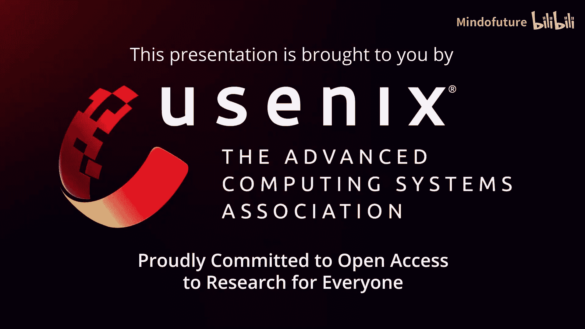
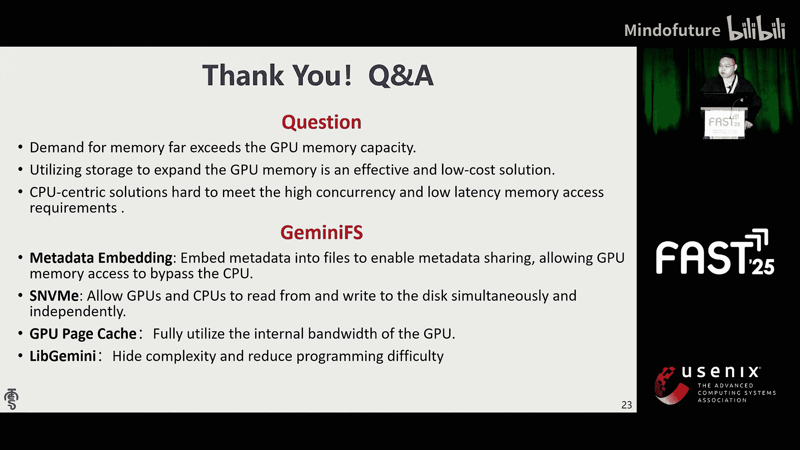
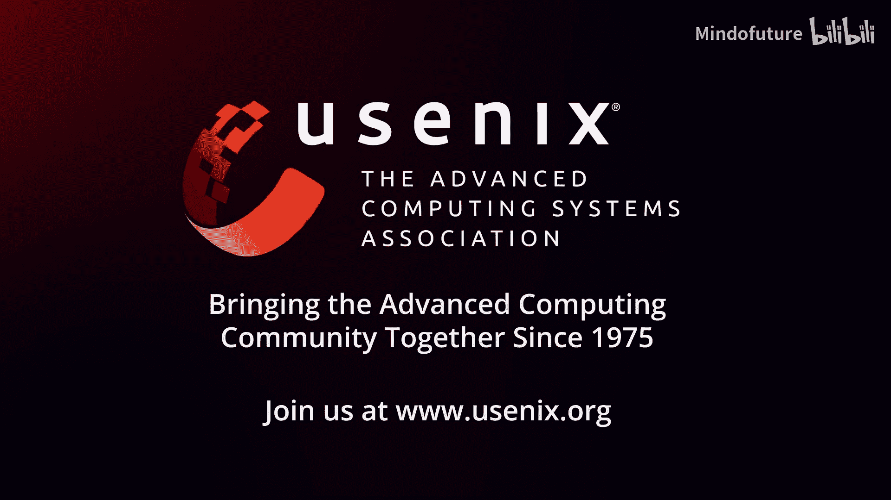

# FAST25存储大会-｜-USENIX-Conference-on-File-and-Storage-Technologies-p15-P15-GeminiFS---A-Companion-File-System-for-GPUs--BV1HmVXzME4J_p15-

。

Hello， everyone。 My name is Qiu Shi。 I come from Xiamen University。

 and our paper type is a gem knifeface a companying file system for GPS P。Okay， first。

 let us see the background of this work。 We all know that GPU applications is become extremely large and needs more memory。

 such as large language model。And however， GPpU HBM capacity is growing a very slow rate。

And to fit to fit the application， we must expand GPU memory。 One way is memory based expansion。

 such as pull together with multi GPU or use host direct。

And this waste is quite expensive in a forible future。 Another way is use storage。

 extend a GP P memory access range to storage such as M V me。

 and with the development of high performance O me storage， such as。

the SD and P P series in Intel storage based expansion has been proved be efficient and cheap way。

Okay， let us review the evolution of GP PU storage system to see our motivation。

At the very beginning， we use a bonus buffer on only host to transfer data from CPU to GP。

 We first read the data frommy to CPU and invoke the GP API to transfer data from CPU buffer and GP buffer。

 This will increase programming complexity and additional memory copy。

 increase I latency and CPU costs。And then some work such as GP P F S and Dr provides6 line55 interfaces for GPO kernel。

 It it makes program more easier。However， they rely still rely on a da process on CPU to。

To pulling in the I request from GPU process and submit them to host the file system。

And to get the data from V me and then still need memory copy to transfer data。

The additional control plan problem the I pass and memory copy still exists。

The another popular solution called GPU direct storage GD S。

 It leverage peer to peer memory copy to skip the bonus buffer and decrease CPUU costs when when perform mile。

However， they still， they need a non interface called cool file Li and hard to。

 and it makes hard to programming。And it needs a modify women driver。

And this way is still rely on CPU O stretch I O。The above all are CPUcentric GPU solutions。

 They finally rely CPUU to all orchestra GPU I O， and they face common questions。

 The first one call is complex storage software， great increase I latency。

And the second one is when performing high con GP， it's bounded by the limit CPU core。

We evaluate this problem by test GPU F S and GDS。The left left left picture shows the tele latency GPU F S。

 its tele latency increase dramatically when the GPU series increase and beyond the CPU core。

The right side， the right side。Shows the G GS latencies is decrease when the base size get larger。

However， the software overhead still take account about 90%。

To solve the problem of CPUcentric solutions， some problem so solutions like Ben provides the Gcent solution。

They create ras on the T P H BM。And register them using a a process level driver。

 They use a device like a S B DK control plan and that plan totally managed by a C GP process。

It makes。Programming extremely simple。呃But it's车呃。Still face some problems。When use GDS use S B DK。

The first one is S B DK S B K like usage， exclusive access to M device。

 prevented device sharing between CPUU and GPU。As well as among GPU process and the second one due to lack of file system management。

 make it difficult to process the data。And the third one is one accessing data management。

M by the host file system， many memory copy is still required。So what is an idea AI or solution。

Combine the CPU and GP solution。 We think the ideas GPU storage software should have the following features。

 First， it must base on a GP centric architecture and totally avoid a CPU。

And it also provides file system management capabilities。

And the third one is it offer a unified namespace to both CPU and GPU。

And these features makes us have to build a file system on GPU。However。

 the fundamental problem is that GPUs are not suitable for building a file system。

A fascim typically need to have the following core capabilities。First。

 it it need providing directories and file abstraction and maintain related main data， such In。

The second one is it should provide disk space management and implementing efficient address mapping。

 such as ecent in X 4。This require software with complex logic and brand jumps。

But GPU are not granted。GPU are primarily designed to conclude conclude and simple mass mass calculation。

Thus， we propose a new type of file system for GPU called companion and file system。

 We call it Ge life S。We separate the responsibility of CPU and GPU in five season design。

It's based on these ideas。 The first is GPU use hybrid programming pattern such as video use C plus and coa。

 Thus， file access by the GPU can be manage by the CPU。Such as creation， modification and delete。

And thus， we can implement a light lightweight file system on the GPU that co exists with host file system。

And wish。And file systemada can be management on the CPU and shared with GPU。

 allowing GPU to submit file I O request directly。However， this design still faces such challenges。

 The first is made data think。The main data are hard to be synchronized efficiently due to the hardware isolation。

The， the hosts and the GPU actually total two different systems， and they need communications。

And the second is file operations always be close interwined with the data operation。

And second challenge is emination of the device driver now cannot be shared among the multi device。

And third is inefficient of GPU page cache。 It come two aspects First。

 page cache can only constructed within within the GPU process and second higher parallel of GPU lead to a higher contention when a query pages。

Finally， GPU programming complexity。 This solution needs a complex memory and environment sitting on CPU and GPU make it hard to program。

And here is the gem life F overview。 It contains four key design。 The first is met data em。

Second is S M is short for share M me。The third is GPU specific page cache and find the the last one called lip gi。

First， first of all， we realize efficient data sharing by emvadding emvaddding my data in the file。

It's just like the specific file format used in a virtualized information， virtualization。

 such as Q Q2 or VM D K。In in our scenarios。CPU and GPU using the five format called GV DK。嗯。

The difference is that the embedded me datata contains the physical women of。 thus。

 GPU can obtain five datata and address mapping by passing the file。

This strategy based on our observation on AI applications。

The first short term data need no positions， such as activation。 generated in training。

 second one is long term data is pen only， such as key chip point and keep cash。

 They are generated andend only and never change again。

last one is most storage access has predictable patterns。The。

 the file size is usually determined by the model size so we can pro allocate the file and its met datata。

 This avoid the met data sink during the GP P GP P processing running。

And we only em private met data specific to each file。

 such as file type file type file size and index structure and the other complex structure like directories still managed by CPU to lower the complexity。

And we use simple two level mapping table other， otherwise a tree structure such such as extension tree to lower the complexity of address translation。

And then we provide a CPU GP share with me driver。To share a we in between CPU and GP。

The key insight is that the GPU only needs the I O Q not the amin Q。

 We modify the driver to make I O Q and is to GPU memory during the in initializing phase and reduceuse GPU and driver provide them so that the GP and CPU can construct control plan concretely。

And third， we provide a G basic pitchca design。We first enable page case sharing during a GPU process。

To， to to minimize memory cost when multi G open the same file。Second。

 we also lower the low contention。First， we acquire page at the warp level as rather than the serial level。

We also design a constant time container for insert， delays and lookup operations。

Gman has also allow user can se the pay size and pre policy for。

For page cash to touring their applications。And finally。

 Germany has provided a Lib called Lib Germany， which contain a series of politics like interface to hide complexity and reduce programming difficulty。

We evaluate the German files on its I O performance， pitch catch performance and an energy test。

First， the I performance， we compared to GP PU F S and GDS German F S submits file system and request directly from GP PU efficiently reducing I O laencyency as the right page size shows。

And the。Left left page shows that the the I O of GP is not limited by the CPU and like can also maximize the band of device as the44 k granularity just like。

We also discover the page cache performance from the prefi strategy， parallel and page size。

The first picture shows that pre fish can fully， fully utilize pageca bandwidthwise。

And second shows with a higher warp number。 Pcas can deliver more than 600 GB bandwidth wise。Its。

 it was。 It was been a。It would not been a bottletanneck for the system。

And the last picture shows if the pitch size is set to 256 kB。

 the pitch cash bandwidth can be maximum。P比 max。We also evaluate F S on G2 training。

The left picture show we disable overloading activation。Gen generate generates on training。

To show the benefit on two points。The results show that the chippoint latency is reduced by 65% compared to the native just copy and write and 50% compared to G S。

The right picture show the。We enable the offloading activation to show the benefits for training with large batch size。

And the total training time is 94% and 91% lower than the native way and GPS S respectivelyly。

Compared to remain the active activation on the HBM， F S is only four times higher。

 The gap can be future narrowed by expanding the number of M device。O， thank you。啊そ。

