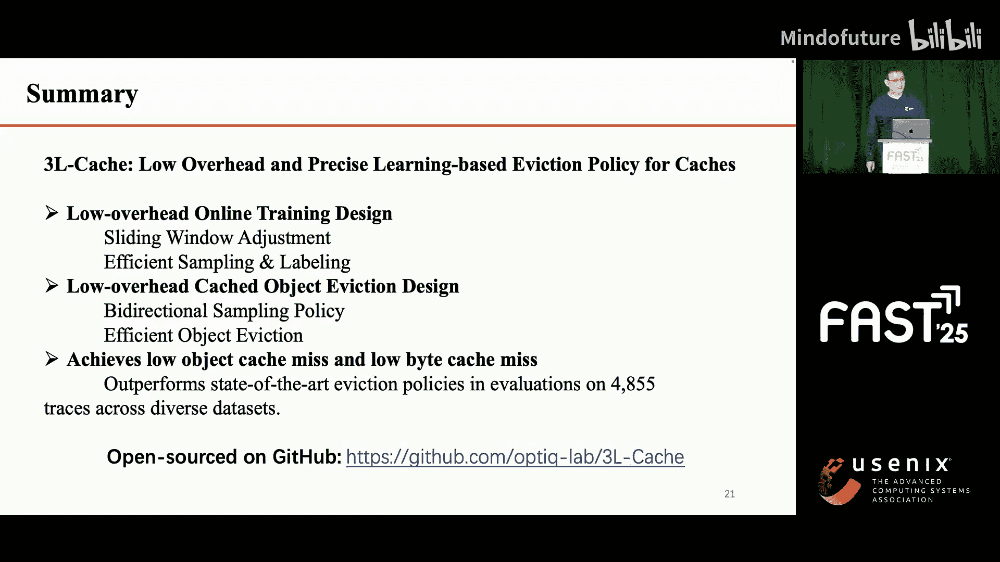

# FAST25存储大会-｜-USENIX-Conference-on-File-and-Storage-Technologies-p16-P16-3L-Cache---Low-Overhead-and-Precise-Learning-based-Eviction-Policy-for-Cache--BV1HmVXzME4J_p16-

。

Good morning， everyone。 My name is Zhu Xing Niu from MRA， and I'm very happy to present our paper。

 Silver catch lower overhead process learning based eviction policy for catches。

 This work is a joint work between Beijing University of Technology and Microsoft Research。

 So let's get get started。😊，First， let'svisit what is a cache system。 Actually。

 when user has a request， it first goes through to the near age closer closer or closer cache system。

 if this got a hit the catch response the the request directly without visiting the original server。

 Its not only accelerate the response times for users。

 but also significantly reduce network traffic for the network operators。However。

 the catch space is limited compare with the tones of the data on the Internet。

 The catch eviction policy is critical here to determine which data should be removed from the storage。

 the catch catch storage when the space is full。 So there are two key metrics。

 The first one is the object mis ratio。 and the second one is the bite mis ratio to reflect the response speed to request and reduce the natural traffic respectively。

 Both metrics are very important in the in evaluating the the eviction policies。Over time。

 people have come up with various ways to improve the catch eviction policies。

 looking at the recent trend， We found that the learning based policy have gained a lot more attention than the traditional heuristic approaches over the past five years。

The main reason of the shift that is the learning based method can adapt to different workload and fine tuning the parameters。

 which helps lower the mission ratio compared to the heuristic based method。

 This is why in this work， we focus on learning based eviction policies。In the community。

 we classify learning based eviction policy into three categories。

Based on their learning granularity。The first one that is the pause policy level learning U R to slack among expert strategies such as between L R U or F LF U。

The second one， that is the group level learning。We predict the eviction ways of groups and eviction objects based on the group level。

 eviction ways。And the last one that is the object object level learning。

 We sample the multiple objects and predict individual eviction ways to make the eviction decisions。

We evaluate the performance of these three categories by selecting the representative policies from each In the figure。

 it shows that the mission ratio reduction from every ever you。

 the higher the better are finding that is the policy level and group level approaches can exhibit worse misracs in certain cases。

 but the object level learning performs well on the two misss， and they are still very stable。

But there is a very big downside。 That is the objective learning comes with highest computation cost。

 Let's take R R B。 As example， its computation cost can be 172 times higher than R R U。

On the top of that， we analysis the real time CPU overhead using a Twitter data set of HLB and HLB。

 We saw a huge fluctuations。 The CPU usage could be swing anywhere from 1。5 times to three times。

So given these observations and analysis， we want to ask a question。

 can we significantly reduce the CPU head of object learning while maintaining the missracial advantage。

 If so， it will become ideal learning based eviction policy。

We first analysis the computation overhead of the objective learning policies。Actually。

 our conclusion， that is the training and prediction dominates both dominate the competition overhead。

 but they shift the， the impact are shift with the size catch sizes with the which the different catch sizes in small catch sizes the higher mis ratio make prediction83% of the overhead。

In large cat sizes， prediction dropped to 45 a percent。

 while the training remains steady and it becomes the main overhead。

This highlights the need to reduce both training and prediction cost for efficiency。

Let's go into the details。We found that we found both the CPU waste from the training and prediction。

 for sure， firstly。Reducing the training frequency from2 to power 3 and2 to power minus cuts overhead by a half with no big impact on this ratio and further predict production and further prediction。

 We found eviction ratio is ready for low can causing large CPU overhead。 The RB has 1。

56 eviction ratio。 The HLP improve that to to 25%， but it is also very small。

 This insight reveals the key challenge and our solutions for our further optimization。So we。

 we summarize our key challenges here。The first， this first one that is how to reduce the overhead waste in the training without reducing the model accuracy。

 The second one that is how to reduce the production prediction overhead without sacring the mis issues。

 And last one that is how to improve the generalability across the traces。In the figure。

 you can see actually in our world， we need low overhead。

 low bite mis ratio and low object misra policy。 So we call our solution through our catch。

So this is design overview of our3 C L catch。First。

 to achieve the low frequency without harming the miss。

 we introduce our train data collection mechanism。And second。

 we design our more efficient sampling and eviction method。 Third。

 we develop a very efficient parameter auto mechanism。

 which efficiently adjust parameters on the fly to enhance the overall system performance。

 So let's dip into the details step by step。First， our training data collection should fill filter unnecessary catch requests。

 reducing the train the training frequency while ensuring the high prediction accuracy。

So we have a a sliding window adjustment。 We use a skating factor。 This is a hyper parametermeter。

 the sliding window to dynamic adjust the window size rapidly。

And in the efficient sampling and labeling， we have four steps In the sampling。

 we randomly sample one object per request。 and in the re ordering in the， in the recording。

 we store。the sample time。 and theres we， we deny the duplicate record recording until it re requested。

 This is one of the key of our design。 And in the labeling。

 we mark the re request objects and record the interval。 and in the updating。

 we reted the model after a accumulating M samples in our experiment。

 We found the M should be between 32 k and 1 and 22 k。

 This approach ensures efficient and lightweight weight training。

We use GL to predict our the log of next real time interval for an object。

 Why the reason we choose GB， GBM is， is because it's effectively handled the missing missing historical features without requiring expensive imputation。

And3 Lca use 6 input features to predict future arrivals。

 The experimental result shows they are sufficient to maintain the high model accuracy。

Our second key design is the。bidirectional sampling policy。

 which improves the eviction efficiency by priorizing nonpop objects。

 reducing the prediction overhead in an L U catch the queue， the popular and unpopular objects mixed。

 but nonp ones tend to be accumulate as a tail。 We leverage this distribution with two sampling strategies。

First one is we sample it from the tail。 We sample all objects in the last8 percent of the Q and the remaining objects are sampled only if they。

 their access frequency is less than or equal to F。The second one， that is we sample from the hat。

 This is because the newly arrived objects follow the Z F distribution。

 meaning that most of them actually are nonpopular。 So， since new and heat objects mix at the hat。

 we use a record queue to track the new arrivals for faster identification and sampling。

This continued until newly objects occupy less than 2% of the catch。By combining the two approaches。

 we optimize the eviction decision by， by sampling unpopular objects。

So further enhance the efficiency and eviction accuracy。

 We introduce accumulate accumulated precision prediction result for objects that were not evicted。

This increased the number。Of the eviction candidates leading to more precise eviction decisions。

 However， the accumulate accumulated position results can grow into minutes。 We hence。

 we also propose an efficient management method to handle the large scale accumulated data efficiently by combining the he and the hash table。

With these optimization， we successfully increase our eviction ratio to 50。

 Sign reduce the position overhead， while also maintaining high eviction precision。😊。

To achieve the generalization to different traces of our parameter。

 we also design a parameter auto tuning in serial cache。 But there are two details in the。

 in the table。 So if you are interested， maybe you can refer the paper。

For the eviction in the in the evaluation， actually， we use 8 open source data set。

Covering more than 4K traces to evaluate the performance of the， of the。Performance。

 we use 12 cash eviction policies。Actually，9， sorry。

6 of them are heurtic based are heurtic based policy， and six of them are learning based policy。

For the best bite mis ratio， in summary。In small size data， small catch sizes。

 the serial catch achieved the lowest miss ratio in around 30% of the old traces as we present in the previous page and we and in the 10 cent CBS small catch size。

 we reduce the R U compare with L U， we reduce the miss ratio by an average of 12%。

And for the large catch sizes， actually， we can also find some benefit as shown in the figure。

And for the objects， mis show。For， for the small catch sizes， the through our catch。

objectject measure zero catch are chief lowest emission ratio ratio in 66% of all data traces we we tested。

 The zero catch reduce L U object ratio by more than448% at the 9th percent with an average of2。

2023% in tencent small catch sizes evaluation。We have a very detailed evaluation in the paper。

 Please check them if you are interested。And for the CPU hat， which is our main goal of this paper。

We can the mean CPU overhead ahead of serial catch is only2。6 higher than R H D and 6。

4 higher than R U on average in small data sizes in large datas when compare with R U。

 the mean CPU overheadhead of of serial cachees is only 3。4 times。

So I think this is all of our zero catch presentation。 I think in summary， actually。

 zero catch has the low overhead online training design and a low overhead eviction design。

 It achieves a low overhead catch misses and low low， low low object catch misses。

 a low bite miss catch low bite catch misses。 and it outpers the state of art。

 eviction evictions in a lot of scenarios So if you have if you want to check the code。

 please visit our Github rap。 and thank you。 This is all my presentation。 Any questions。

