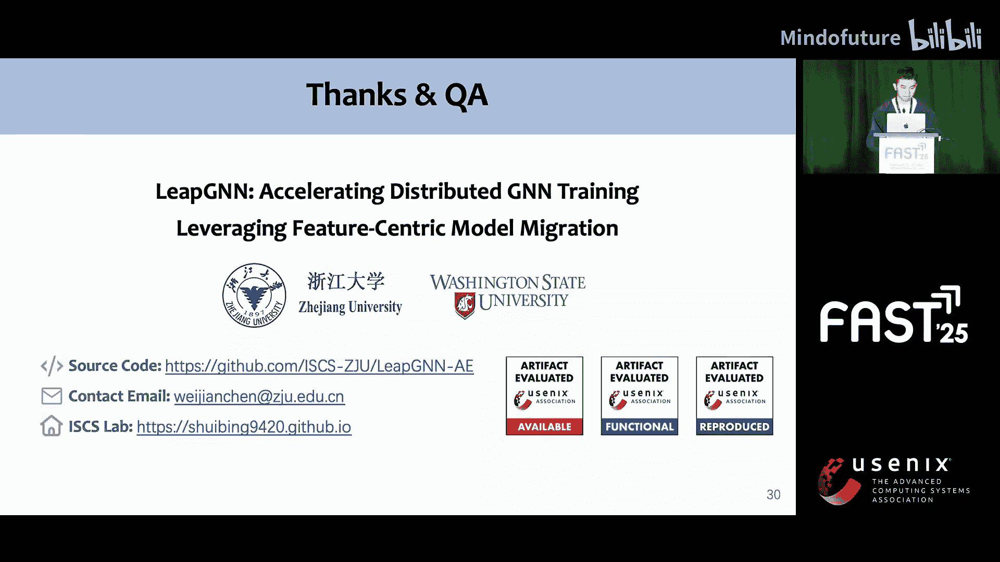

# FAST25存储大会-｜-USENIX-Conference-on-File-and-Storage-Technologies-p17-P17-LeapGNN---Accelerating-Distributed-GNN-Training-Leveraging-Feature-Centric-M--BV1HmVXzME4J_p17-

。

Good morning， everyone。 This is Wei Jiancheng from Zhejiang University。 My advisor is Xhui Binghe。

 I'm honored to introduce our work， Li Jan， a framework for accelerating distributed graph neural network training。

 This is a joint work with Washington State University。😊，Unlike other neural network models。

 GNs are specifically designed for training and influence on graph data in our daily life。

 relationships between people or between people and products can all be objected into graphs as a result。

 GNs are widely used in recommendation systems， social network analysis and other fields。

Sampling based G N training is a standard approach for large scale graph training。

 Let's quick work through the G N training process with a simple example of a text label prediction。

The training data consists of two parts。 First is the graphalpology。

 which denotes connection between vertices and ages。 Some vertexes have labels， for example。

 representing user preference， while others does not。 Additionally。

 each vertex has an embedding vector called a feature。

A G model is a multilayer neural network for a two layer gen with a mini batch size of one training starts by randomly picking one labeled vertex。

 say vertex 5。 Then it does a twoho sampling to create subgraph。

 The worker then collects the features of the vertexes in the subgraph。

 Both the subgraph toology and get features are sent into the G model。

 through forward and backward propagation， the G model parameters are updated。

 The trained G model can then be used to predict the unknown vertex labels。However。

 real world graphs are often too large to fit into the memory of a single machine。

 utilizingtizing distributed memory across multiple machine is an effective solution。

 In this scenario， the graph topology is partitioned into two parts red and blue。

 The red topology and its corresponding features are stored in server0。

 and the blue part is stored in server1。 A small portion of the topology is redundantly stored to reduce sampling connection time。

😊，Let's illustrate a distributed training iteration and highlight the performance bottlenecks。

 Suppose the graph and features are positioned across two servers， marketing red and blue。

 The mini batch sizes too， which means each servers worker randomly selects two labeled vertes for training。

First， each worker generates a subgraph through two hop sampling。

Then each work collects the features of all vertexes in its subgraph。

 If a vertex feature is stored locally， it is directly collected from the local machine。

 Otherwise you take fetch from remote machine。 We use the bold circles around the vertex numbers to indicate the vertes whose。

😊，Features has been collected。Oh， sorry。Each worker's model then performs forward and backward propagation using its subgraph topology and collected features followed by gradient synchronization and parameter updates。

 This completes one training iteration。😊，We found that the process of training fetch features from a remote machine is the performance bottleneck of the entire training process。

Tests on various data sets and J models show that this part of communication time accounts for more than 44%。

😊，Recent work has proposed many methods to alleviate this bottleneck。

 such as purchasinging optimization， sampling more verexes from local server or caching vertex features in GPU memory and introducing new training schemes。

 However， all of them have some limitations。 We refer to these methods as model cent approaches。

 because in their systems when the model requires features that are located on remote machine。

 They fetch these features to the local machine。Next， we introduce our observation and design。

We observed that in G N， the amount of data fetched from the remote server is significantly larger than the model parameters themselves。

 Based on this observation， we are inspired to leverage model migration to reduce the amount of data transfers during G training。

 Our goal is to move the model to the servers where the vertex features are located rather than fetch features from remote servers。

😊，Because this is a naive motor migration method。Let's use the same example to illustrate the naive model model migration method。

 Let's first focus on the computation of one model。

 The model 0 is still assigned to be training using vert 6 and 3。

 So the worker first generates subgraph 0。Through sampling。

Then Model 0 collects the features of vertices in the first layer of subgraph that are stored locally and performed partial forward computation。

 We label these vertices as red circles。😊，Next， model 0 and its intermediate result migrate to server one。

 where it collects the features of prove taxes and complete the forward computation of the first layer。

😊，Finally， model 0 and its intermediate data migrate bag。😊，To serve 0。

 to complete the forward competition of the secondary year and the entire model backward propagation。

😊，These two models move alternatively between the two machines and performs computations in parallel。

 After forward and backward propagations of both models are completed。

 The gradients are synchronized， and parameters are updated at the end。

Compared to the existing model centric methods， the naive model migration method completely eliminates feature data transmission between two machines。

However， this naive model migration method is only more efficient than the original method in some cases。

 but not in others。 This is mainly because naive model migration introduce intermediate data transmission。

 which are needed by back propagation。 Therefore， we need to further improve the naive model migration。

First， we introduced we noticed that when the sampled subgraph is divided into smaller subgraphs。

 data locality can be improved， specifically we first defined a micrograph as a special subgraph。

 with only one root of attacks。 For example， subgraph 0 sampled from mini batch 6 and 3。

 comprises micrograph 6 and micrograph 3。 We noticed that most ver features in the micrograph are on the same machine where the root text is located。

 For example， in the micrograph 6， most of the ver features are on the same machine as the root oft 6。

 which is why they are all in red。We found that the locality of micrograph is always higher than that of cellgraph using various graph part algorithms。

 sampling algorithms， number of sampling layers or number of servers。

 We believe this is because G part algorithms tend to place a adjacentcent vers on the same machine。

Based on the enhanced locality of the micrograph， we proposed the the micrograph based G training。

Let's focus on one of the model model 0 compared to naive model migration。

 There are two key differences。 First， the forward and backward propagations of one micrograph are completed on the single machine。

 For example， micrograph 6 is only used for training on server 0。

 and micrograph 3 is only used for training on server 1。

The advantage of this is that after the backward propagation is completed。

 all intermediate data except gradients are released。

 This avoid the overhead of transferring large amount of intermediate data in the naive model migration。

Second， it allows fetch features of veres that are not locally in the micrograph from remote servers。

 note that only a small number of features need to be fetched from remote due to the enhanced locality of the micrograph we mentioned before。

Overall， it combines model migration with the locality of micrograph to reduce the amount of data transferred across servers。

😊，At the same time， model 1 follows a similar process， but on the other machine。

 after both models complete training， gradients are synchronized and model parameters are updated。

 Moreover， since this method does not change the random assignment of training vers and training process for each model。

 it maintains motor accuracy。Furthermore， we made two additional improvements。 First。

 we found that feature transmission between different time steps on the same server is redundant。

 For example， the features over text 1 and4 are fetched twice。Therefore。

 we designed our text feature pre gatheringther technique to reduce redundant transmission。

 The key idea is to proactively check which were will be needed in the next few time steps and fetch the features of multiple taxi from remote together。

Thereby reducing redundant official requests。Second， when the cluster scale is large。

 an iteration involves more time step computation and synchronization。

 leading to increased time overhead。 For example， three servers requires three time steps to complete one iteration training。

 as shown in figure A。To address this， we propose micro me micrograph me technique。

 which reduce the synchronization time overhead between time steps by merging some groups of micrographs。

After merging， an iteration of training requires only two time steps， as shown in figure P。

2 question arises which micrograph should be merged and how many micrographs should be merged。

 We designed a a simple greedy algorithm to solve these questions for more details。

 Please refer to our paper。Our experiments were conducted on fourth servers with a single 800 GPU。

 We selected five popular G models with various hidden sizes and number of layers and five data sets of different sizes。

 We compare Li G with DGL P cube and neutral star in terms of performance。 Additionally。

 we compare Li G with the naive model migration method to demonstrate the effectiveness of our optimization。

The experimental results show that under both many batch training and four batch training。

 Li J outperformed the other systems by 1。1 times to 4。8 times across various data sets and models。

Moreover， we sequentially enable each technique， and the results show that each technique further accelerated distributed Jian training。

Here are more details。 the first technique significantly reduce the local miss rate of features。

 The second technique minimize redundant feature requests。

 and the third technique adaptively adjusted the number of time steps in an iteration。

 automatically balancing performance improvement and additional overhead。😊，Additionally。

 we tested Lib G by varying feature dimensions， batch sizes。

 find out sizes in sampling and number of distributed servers。

 The results show that LibG consistently outperformed the alternatives for more evaluation results。

 Please check out our paper。In summary， we identify the problem that feature transmission has become a bottleneck in distributed gene training。

 address this to address this we introduced a feature centric model migration approach to reduce the amount of feature transmission to make it truly effective we develop three key techniques。

 including micro micrograph based gene training or text feature pregaing and micrograph me。

These innovations enable Li Jian to achieve up to a 4。

2 time speedup compared to the state of the R counterpart P cube。

We have open source our code and successfully pass the artifact evaluation。

 Thank you for your attention。 I'd be happy to take any questions and comments。😊。

