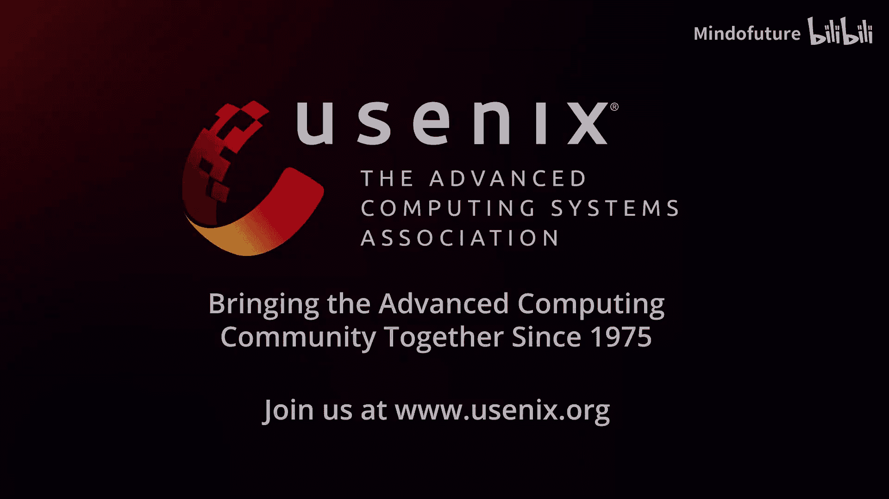

# FAST25存储大会-｜-USENIX-Conference-on-File-and-Storage-Technologies-p20-P20-HaSiS---A-Hardware-assisted-Single-index-Store-for-Hybrid-Transactional-and--BV1HmVXzME4J_p20-

。

As mentioned， I'm Ke Chenghuang from the Chinese University of Hong Kong。

 I'm the final year PhD student。 And yeah， today is my pleasure to be here at fast representing our。

 our work team to present our new work hass a hardware assisted single index for hybrid Transal and analytical processing。

Well this work， I think we will start from the H TP， the He traditional and analytical processing。

H TP， which is a well known data processing architecture for simultaneous execution for both O T P and O A P。

 which is a very critical component in modern applications。 and it affect many domains like finance。

 advertisement and also the e-commerce。And as for the key criteria of the H TP system。

 normally we focus on the performance of O TP and O。 and as for the O TP。

 which normally encounters the small random records updates or search operations。 And as for the O。

 it typically involves some kind of large scale attribute or column scans。

 So basically there are some conflict between such two workloads。

 well as for another key criteria of the H TP system。

 I think the real time and data analytics is a very important metrics for modern H TP system。

 because currently， we want to， as soon as possible to execute the newly ingested O O T updates by the O real time query。

Well， yeah， in detail， as for this work， we focus on the well known con of storage of optimal storage format between the O TP and O A P inside the H TP system。

 So basically as for the O TP system， it prefers the row based storage format because it could mitigate the Iplification when they ingest the small sized updates or search operations and they can maintain better update efficiency。

On the other hand， as for the O TP system， basically they do not like the robustbased format。

 they they favor the column based store story format for better I O efficiency， because as mentioned。

 as for the O A request， they will normally involve the the batch the batch scam or batch load operations。

So as for existing work， basically multi index H TP designs。

 the mainstreamstream of the existing H TP system。 they primarily follow a mixing design to mix the row based index and the column based index altogether to provide the H TP service and to achieve the real time data analytics。

 they rely on the data synchronization， or to say the cross index data cross index domain data migration to achieve that。

And in a more detailed way， as for the multi index H H T P design。

 they can be categorized into the multi index multi store and the multi index single store design。

 And there are many representative work focusing on optimize such two approaches。

So specifically as for the first category， the multi index， multi store design。

 Basically they will separately maintain an O TP engine with robust index and another O engine with the column based index and separately provide the O TP and O service。

 and they rely on the cross domain data migration to provide the realtime data analytics。

 but this design， it is very traditional and very typical it fit several limitations。

 The first is the resource consuming data moment because they maintain the data in the two engines。

 they need to periodically migrate or to emerge the data from one from another。

 So it is very resource and time consuming。And this consuming work can also introduce another data freshness problem because the data may cannot be immediately applied to the roll store column when you want to perform the over real time query。

 So as for this design， there are some process and counts。

And another category is about the mar index single store design， basically。

 they will kind of rather than separately maintain two engines。

 They will only preserve one single system， but build a robust data tier top of the primary column store that maintains the column data and this design。

 it is kind of novel and also widely deployed in modern h system， but this design。

 they also face some limitations like because now we maintain all the data in a single system。

 which means for either O T or query or request you need to go through all the data。 for example。

 for the O query， you need to not only access the primary column store but also you need to access data in the data space that maintain data in a robust format。

 and correspondingly， they will cause kind of performance degradation within the larger than memory data because normally。

Will maintain the upper layer inside the memory。Well。

 as for our work we identify the problem here is that data in the existing designs are separately managed in distinct index domains。

 and the cross index data migration essentially introduce significant overhead。

And the challenge here is that we want to simultaneously achieve the optimal O TP performance and the O EP performance。

 and meanwhile， provide the instant data freshness for O P quarries。And here in this work。

 the key here is rather than relying on the original distinct index design。

 we want to leverage the new story hardware to our bring some opportunity to rethink this problem。

Well， basically in this work， we focus on the CD with building transparent compression。

 So here it is a special computational story drives with the data compression functionality。😊，Okay。

 so the first feature of the CD with transparent compression that it has the low cost compression。

 It can transparently provide the compression or decompression capability inside the SD without affecting the normal routine and the critical path of the data service and such an operation or deeper operation engines very efficient and with low las when they conduct the compression and decompression operation。

And another key feature of the CD with building transparent compression that it could provide the virtualized logical story space。

 and this could further enable the sparse data management。

 which is very important and bra opportunity to rethink。

 How do we design a new H TP system to simultaneously achieve the goal we propose originally。😊，Well。

 based on the new CSD devices， we have several insights。

 the first one is that the CSD could decouple the random amplification from the page size。Originally。

 as for an OL TP system， basically， they rely on small size page to maintain data because they want to mitigate the Ipl。

 If not， if you do not want to that that small size page。

 you need to maintain a huge monolithic log to accumulate the updates to the pages。 but the log here。

 we have a tradeoff like the log is too big， the recovery performance could be worse because we need to replace many log records during recovery。

 but if the log size is small， we could not sufficiently accumulate such updates。But here。

 after involving the CD this problem disappears like we could distribute the originally monothic。

 huge log for each pages to convert the original original monolithic log as the per page logs。

 this could mitigate the recovery overhead， but meanwhile。

 provide the optimal performance for O TP request。 In other words， in our H TP design。

 we will not rely on the small size to to guarantee the optimal performance for O TP。

We are another insight that the C could mitigate the redempplification for O A quaries。

 Or as for the typical O A P design， they prefer to tightly assign the data into the data block like the page to save the story space。

 but this layout could introduce the redempplification when they perform the column oriented query。

So in CD here， the idea is kind of the same。 like we could sparsely manage the column based data column by column instead of tightly align them inside each 4 kB data blocks。

 So here， the redempification could be avoided。And the third one is that the multi version record in the system that provide the concurrency capability。

 So here， because we have the CD， originally， the separated managed temporary data here could follow the same idea to be assigned with each page such that we will not face the performance degradation and extra re retrieval for O E P and also the garbage the garbage collection could be simpler than before。

So based on such in insights， we propose our has design hardware assisted single index store。

 And here there are three major components like the hybrid buffer pool。

 the small global log and hybrid page format with per page logs based on such component。

 we want to deliver the insight and the the opportunities provided by the CD and to achieve the goal。

So firstly， as for the hybrid page layout， basically。

 it follows our inside analysis like we want to use largely relaxed B page to provide efficient service for your TP and O E P and for the column based page。

 we will sparsely align the column data into each data block instead of the original way we tightly align them into data blocks。

 and for the rubbi data page， which is a assigned for each column page as like distribute the original mono log as per page logs。

And then we have the log and compassion mechanism to efficiently ingest the O TP updates into the main storage。

 and then we want to achieve such ingeesttion and meanwhile。

 provide the O A request with the optimal performance。

 So here we want to better utilize the the the high bandwidth of contemporary SD。

 So here we propose the major and manual to like deepen the the Q depth of the the SD devices to efficiently ingest such operations。

And also， we have the buffer pool to isolate the performance between the O TP and O E P。

 and we utilize a validation based approach to achieve that。

 And more details for the hybrid buffer pool and also the details for other tennis could be found in the paper。

Well for the evaluation， we have implement a fully functional prototype and also a benchmark tool。

 and our evaluation is build a top volume production skyfl， CD devices。

And as for the evaluation result。 So basically， we first compare with contemporary O TP and O performance to figure out our performance potential。

 So basically compare to the contemporary O TP O TP system。 Basically。

 we have the comparable performance compared to my CQ and post CQ and we also implement a role store baseline。

 which is a B plus based store。 And as for the A performance。

 basically the the conclusion is the same。 we could deliver the comparable performance compared to the park and also column store baseline。

And then we compare with representative H TP system， the TD B。 So basically。

 the conclusion is that we could deliver the more stable and instant data freshness for OL A P request。

 And meanwhile， our performance to both OL TP and O A P is comparable to the TD B。

And finalists about the effects of optimization， like the story usage of our design。 So basically。

 because we have the transparent compression， we will not obviously like occupy the actual physical story space。

So as for the conclusion， we propose the hass， which is CD enabled single index design。

 and we want to address the longstanding tradeoff between the data freshness and the performance in the H TP system。

 and we conduct our evaluation on a top of a commercially available CD platform by leveraging its capability of sparse data management。

Yeah， I think that's all。Thank you。

