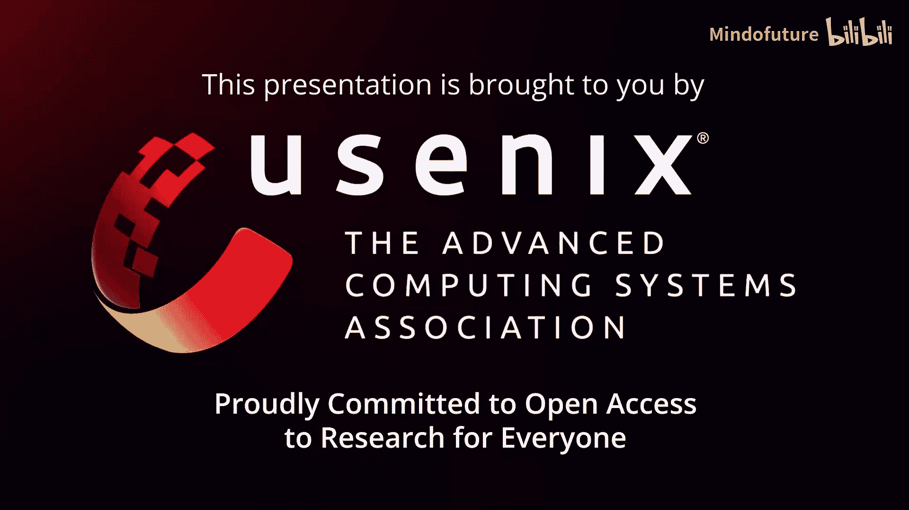
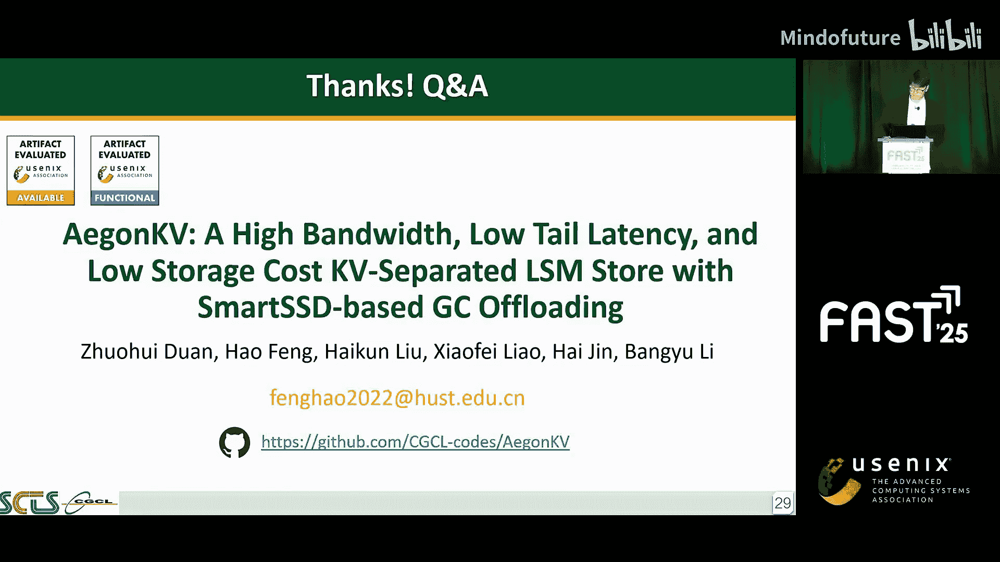
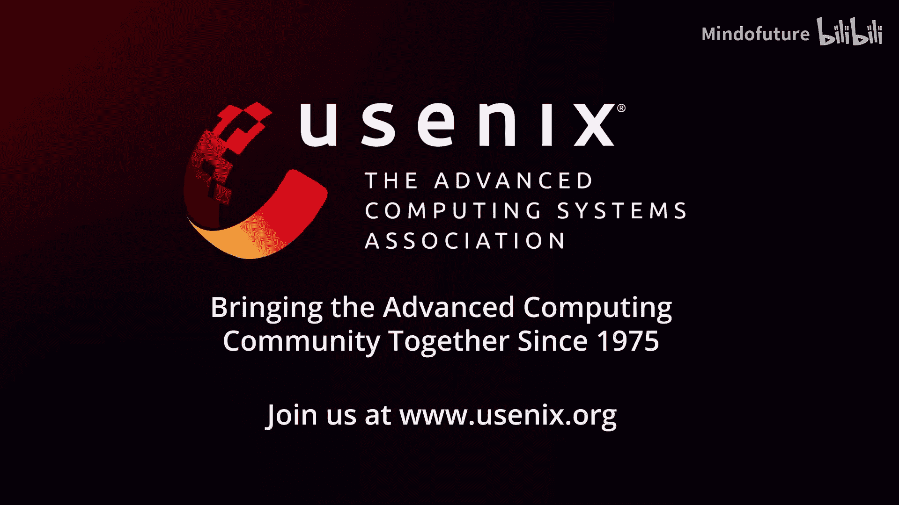
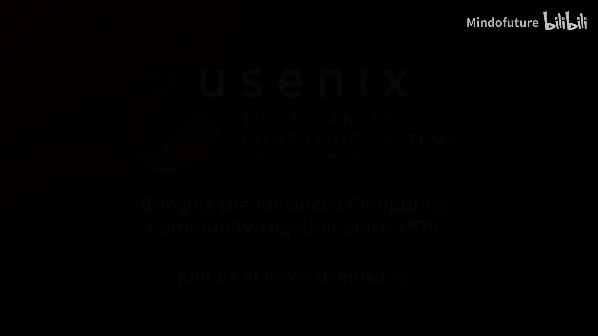

# FAST25存储大会-｜-USENIX-Conference-on-File-and-Storage-Technologies-p21-P21-AegonKV---A-High-Bandwidth,-Low-Tail-Latency,-and-Low-Storage-Cost-KV-Separa--BV1HmVXzME4J_p21-

。

Hello， everyone。 I'm Bing Tian from Huaazong University of Science and Technology。

 The authors of this paper couldn't join us join us today。

 so I will be sharing the insight on their behalf。 Well， let's start。

 Our paper focuses on how to solve the G C bottleneck in the TV separated I S M store using smart SSD。

😊，Here is the outline。 Let's begin with the background and motivation。In TV separation system。

 the value ranging is deco from the IRSM architecture and contains multiple b fields that actually store the key value pairs while SS tables store keys and reference to the address of their value in the b fields。

The size of the RM ranging is significantly reduced。

 thus mitigating the read and write amplification problems。However。

 the value ranging confronts the challenge of accumulating expire data。

To mitigate to mitigate space redundancy， the system incorporates garbage collection mechanism During G C。

 the entire b fuel is scanned， and the L SM isque to determine whether to future invalid date or rewrite valid ones。

 However， it it introduce additional I O and a competition overhead。

A widely used G C G C moves is to divide value ranging and select b fields with the with a high percentage of garbage for G C。

 This moves represented by T10 and P。 is called direct G C。

 Such projects helps to select areas with high benefits， but still needs to check areas M。

 which actually causes performance spotlink。Another body of work represented by D K and Bb D B seeks to transfer the signal layer of block fields to a multi structure。

 When compaction is performed on SS tables， The valid value will be directly mitigate to a new b。

 This move is known as compaction triggered G， C。😊，Although it increased the overheads of compaction。

 it reduced the bandwidth usage for checking RM， thus improving system performance。😊。

To understand the characteristic of TV separation， we first conduct a right performance test on Titan Blob D B and D K in comparison to traditional IM store rockx D B。

😊，The results are。are shown in the table。 We further visualize these metrics in the figure。

Compared to rockx D B， B D B and D T B have over 17% in a higher support and over 50% lower till latency。

 But this is a significant increase significant increase in space amplification。

Rox D B require only 9 G B speed to store expire date， but Bb D B and D TV require 135 G， B and 53 G。

 B respectively。 However， we see that Ti10 Excelel in terms of space usage。

 only 2 G B hang than drop D B。 Titan also shows the best result in terms of compact I O and red style。

 but has a 18% drop in support compared to rock D B。In summary。

 we get the first observation is that performance result of of existing TV separated system exhibit trade offs and don't achieve simultaneous advantages in throughput to latency and space usage。

😊，Based on the fact that the， the optimization direction of D TV and Bb D B is to release G C operation。

 We further turn off the G C option in Titan。Table A shows that without G C。

 T 10 improves 67% in support， indicating that G C operations are still a bottletanic for T10。

Then we set the number of available CPU calls to 162 to to examine the results competition。

The results show that there is no significant change in T1 without G C dropping only 6%。

But T 10 further encounters a sudden drop of 20，23%。

To further determine whether D C condition arises， we analyze with urban trees。

Tple B shows that the primary product arises from the read and write of the I S R S competing for compute and bandwidth resources。

Fortunately， we observe that direct G C operations can be optimized through near data processing on smart SSD。

😊，Samsung's smart I Z device is the industrial first customized and programmable conditional storage。

 Smart I Z integrates an IPG inside the SD， and data transfers can be done through internal balances。

 So the fuel processing can be can bypass the comp aisle stack and system bus。😊，However。

 several challenges hinders the efficient of loading of G C operations on smart SSD。 First。

 the logic of querying R SM during G C is challenging to implement due to the hardware constraints。

 which needs to be avoid。 Second， the computational resources within smart SD are not comparable to the host。

Therefore， resource control is essential。Third， when hardware G， C is completed。

 the results need to be transferred back to the host， which compete for bandwidth。

 requiring the design to reschedule data movement。So here is our design。

 This is the architecture of A TV to tackle the challenge of data rendering。

 We propose the valid map structure in the G C manager。 Moreover。

 to overcome the limited resource of smart SSD。 We designed the G C schedule to coordinate data movement between and resource allocation。

 Furthermore， we introduce an install moves without validation to address the bandwidth condition of G C。

 Finally， we designed and deploy the G C computational in on smart SSD。😊。

This is the design of G C manager。For each block view。

 we create a bit map called valid map to indicate the validator of each K pair。

 where bit0 and one mark valid and invalid re。😊，G C manager use the result information of compaction to update the valid map and create G C test by monitoring the garbage ratio in each valid map。

There are three key units in J schedule。The I control unit makes full use of the smart SSD inter to transfer block fuel between SSD and FBGAT T M。

As well as the transfer of valid map and red pack mirror data over the system bus。

We moved the scheduling of computer related to the software layer manage the number of C in use and the allocation of IPG G for each。

The problem with Mer install is the competition from concurrent call for the right interface。

 So we add a barbecu， which helps coordinate the combination of multiple desk into a unified channel。

😊，Although the me data install unit optimizes with batch processing。

 it still needs to perform a lookup on each me date to avoid the version conflict shown in the figure。

Where an， an entry containing old data is insert to insert through date and overrdes the latest version。

 which is written near G C。 However， this lookup size causes serious bandwidth condition。

 we propose to insert without validation in order to blast performance。😊。

To cope with the this data consistent problem， we defer the lookup validation to the get and compact processes。

In the get process， the first time a key is found。 it may be normal date or G C measure date。

 When query to the normal date， there is no problem of di。😊。

But when query to the merge data as shown in the figure。

 we are not sure whether a new new value is written during G C。For this version， or， for。

 for this reason， we continue to query backward to an older version。

And compare it value address the original address stored in the merge date to determine which is the latest version。

This situation is out encountered during compaction。

 where we also adopt the strategy of continuing to read the next version。In addition。

 we promote merge it to normal during compaction to minimize the frequency of deferred validation。

We abstract the Hollywood process into three separate states。

During import the code of blog fields and validate map。Since the data is adjusted within the fields。

 the hardware implementation is highly parallel。During actual computation。

 the future module travels the valid map in a discrete stream manner。

 producing signal for feature module to choose its whether rewrite or ignore。😊。

During output in code stage， it retrieves it from feature module and arrange it in the few formats for writing to the SSD without host site iteration。

😊，We conducted a number of experiments to evaluate the design of Ang TV。

Our experiments are conducted on a server equipped with Samsung's first generation or smart SSD。😊。

We compare anchor TV with Titan， Blob， D B， D K and rockx D B。

 We use the YC SB benchmark and to open source protection work， Facebook。

 social G work and Twitter cast trace。Figure shows the result under YC SB， or write inten cause。

Angon TV exhibit through enhancement， ranging from 1 tot1 to 4。

610 and closely approaches to the scenarios of no G C。😊。

Agen Ki also achieve the low lowest till latency with reductions ranging from 14% to 85%。

Teaching and icon TV require only 0 dots，7，75 times more additional redundancy。

Sp through the updated speed。The amount of compact date for TV separation is significantly reduced。

 and Ang K also have no right skills。😊，Under the read intensive clause。

The support and two latency of A K are very close to that of the other systems because the read streams are essentially the same。

 and G C operations are not triggered frequently。And Smith usage is similar due to the low percentage of update。

Although the performance of all systems remains relatively similar and the scan cloud。

 give K output performanceforms by introducing additional G C to regulate the value ranging through compaction trigger G C。

😊，We also present the cap capability performance in the figure。 In summary。

 A K implements a full range of optimization for the TV separation architecture。😊。

For the social graph and cluster of cloud， the performance result of A TV is generally consistent with Y C SB right in clause with  one dot 122 do2 times higher support and 31 to 55% loyalty latency。

 making A K well suitable for real world scenarios。😊，Under the mix and the read intensiveten clause。

 we observe similar results for the YCSB Read cause。

 where all systems are closed in all aspects of performance。😊，In addition to the low G C frequency。

 the large amount of small value in these two cloud are also affect the results。

Table A reports the hardware source。We fully utilize the hardware and deploy H C。

 which is enough to support the system to run normally。 Table B shows the CPU CPUU utilization。

 Ang K achieves approximately a 20% saving， which indicates the G C uploading effectively resolves the competition competition bottle。

😊，Table C shows the power efficiency， while Android TV improves 15% to 17%。

We next analyze the parameter sensitivity and YCSPA in terms of system parameters。For Android TV。

 as we detach G C from the system crucial pass， the performance remain unchanged and different garbage ratio。

Throughrow task of loading。Contrary to Titan， an increased number of G C threats doesn't impact A Ks performance。

 and we observe no impact on system performance as we just the batch size parameter。In summary。

 the performance advantage of A K is not affected by the system parameters。

In terms of work cloud related parameters for value size。

 smaller values implies a reduction in read and red overhead。 A TV is less sensitive。

 sensitive to changes in value。For the data size， the data size size has little effect on each system。

For different work cloud ratio， the result is consistent with the YCSB valuations。For7 strides。

 A TV suffers the least from multith conflicts。In summary。

 Ang TV has opt workload adaptability and modest scalability。😊，Finally， to conclude。

 we observe existing TV separated system It competition and air tradeoffs in G C。

 So we introduce A TV that comprehensively enhance the throughhold Q latency and space usage。

 It permit demonstrate that A K achieved through improvement of $1 3 to $33 times。😊。

A reduction of 37 to 66 per percent in till latency and 15 to 85% in spaceiss overhead。

That's that's all for the introduction of our work。 For more detailed information。

 Please check our paper。 since the author couldn't come to the scene。 If you have any question。

 you can contact the author through email。 Thank you for listening。😊。

