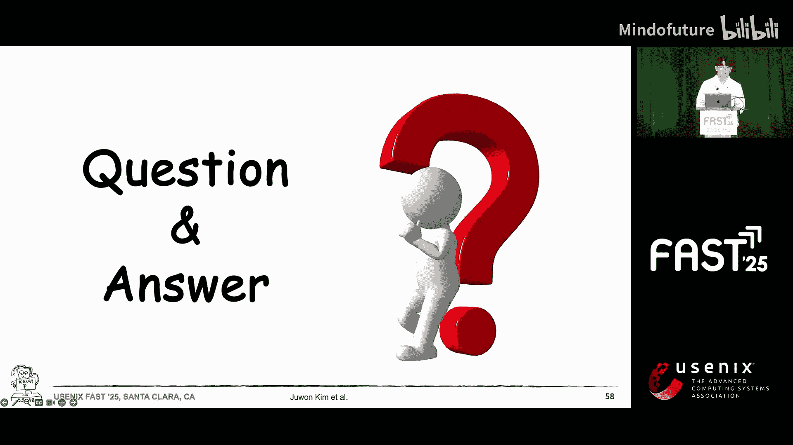
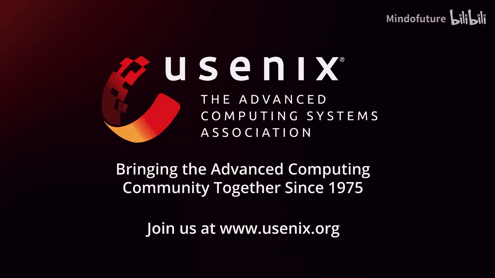

# FAST25存储大会-｜-USENIX-Conference-on-File-and-Storage-Technologies-p22-P22-D2FS---Device-Driven-Filesystem-Garbage-Collection--BV1HmVXzME4J_p22-

。

Hi， this is Zong Kim from Kaist， and my advisor is Yuf Wang， who leads O lab in Ka。

 I will present D2 F S device driving five system garbage collection。😊。

Let me start with the background and motivation。A log structural file system or LFS was first proposed by Resemlum in 1991。

 the LFS is right optimized file system。 it traces the file system partition as a single log and writes the dial blocks at the end of the log。

 for example when updating a five block， the LFs of the new block at the end of the log and invalids the old block。

It efficiently handles the render white workload by converting the render right on a file into the sequential right。

Over the years， there have been many low structural file systems designed full of vest storage。

 including JFFS， Es， FFS， and so on。The L is preferred for flash storage because its app only nature aligns well with the characteristics of land flash。

 which requires sequential page white。However， when the L is used with the flash storage。

 the right amplification increases because both the file system and the flash storage redundly perform their own garbage collection routines。

😊，This figure shows the mappings in the IO stack。There are two mappings to locate the physical position of a fire block。

 F TL mapping and L2 P mapping。 The F TL mapping maps the file block to the logical block address called the LBA and the file system partition。

The LP mapping maps the L B to the physical page address called P， A In space。

The FA system garbage collection reclaimps the invalid file system blocks。

It consolidates the valid logical blocks into a free segment。

And update the F2 mapping for the updated Lbas。Then the victim segment becomes free and reclaimed。

The device garbage collection， on the other hand， reclaims the in F pages。

It consolidates the valid flash pages into a free flash block。

And it updates the LTP mapping for the updated PPs。As a result。

 victim flash blockss are freed and reclaimed。Garage collection has a severe negative impact on the application performance。

We perform random whites on the Ls and with the flash storage。

When both the file system and the device run garbage collection。

 the application performance decreases by up to 80%。

There have been numerous studies to elevate the garbage collection overhead。

Some works focus on clustering the fire blockslocks with similar lifespan together to reduce the right amplification。

Many rocks proposed making the file system directly clean the storage device by exposing the device's internal geometry to the host。

The recently proposed IPLFS takes the opposite approach。

 It eliminates the need for the file system garbage collection by excessively expanding the file system partition。

However， to manage such a large fire system partition。

 the LP mapping structure becomes huge and complex， making it hard to deploy in the real world。

To summarize， some works rely on the file system for garbage collection。

 while another work relies on the device for the garbage collection。This LED us to question。

 which is better for system garbage collection or device garbage collection。

We compared their overhead and found that the file system garbage collection is much more costly than the device garbage collection。

The reason behind this is the file system garbage collection involves too many sub operations。

 including checkpoint， formatac traversing， metadata update， host device data transfer。

 and page allocation while the device garbage collection does not。

So our key idea is letting the device clean the file system partition。

Re free the system from running the gauge collection and make the device clean both storage space and the file system partition。

Let me explain the basic concept of our work。 The left figure is after mapping in the host file system。

 and the right figure shows the LTP mapping in storage device。When no device runss Sc collection。

 it consolidates valid flash pages， so the corresponding PPAs are updated and the strategy device updates the logical block addresses of the consolidated flash pages so that the corresponding logical blocks are consolidated。

So device updates both E mapping and autotop mapping。As a result。

 the device garbage collection cleans both the flash blockss and logical space。

Will device synchronize the updated at to the host file system。

Then the host file system updates corresponding after a mapping for the updated LbaAs。

And reclaims free file system segments without explicitly migrating the file system blocks。

We call this concept a device driven and far system garbage collection。Now。

 I will discuss the challenge of the device driving fire system gauge collection。

There are three key challenges in total。 First， the legacy I tax allows only the host to update the F mapping。

Second， theian interface mechanisms such as Inter and polying are a so opt for synchronizing the updated F mapping。

😊，Third， the device garbage collection must run on time before the file system runs out of three segments。

In the first challenge， the device must be able to update the FT mapping without interfering with file system activity。

😊，Since both the holes and the device allocates Lbas。

 there is a potential conflict in allocating LbaA。In the second challenge。

 we need to design an optimal interface for the device to host synchronization。

Pulling waste host CPU cycles， defining a new dedicated interrupt for device to host synchronization requires significant changes to the existing audio steps。

 such as adding a new interrupt or new interrupt factor table or new interrupt handler if we are lucky to find an unused interrupt number available。

In the third challenge， the device garbage collection must run on time before the file system runs out of three segments。

Since the device runs garbage collection on its own schedule。

 the fire system can run out of three segments， suspending its operation till the synchronization of the garbage collection。

Now， let me introduce D to FS device Dr For System Gar Collect。Here's the design overview。

 D2 FS consists of three design ingredients， Co garbage collection。

 migration optical and virtual overproing。In Co gauge collection device updates FTL mapping。

 migration outputcro is deviced I interface that synchronize updated FTL mapping to the host in virtual overproing。

 we virtually expand the file system partition to prevent the file system running all of threepl。

Let me explain the detail of the couple G collection first。

Cporate G collection is a device garbage collection， and corporate G collection。

 both LB and P P are coupled and updated together。When the garbage collection once runs。

 flash pages and corresponding logical blocks are consolidated together reclaiming both the flash block and the file system segment。

To prevent the device from conflicting fast system in allocating L V A。

 we divide the fast system partition into two regions。

 regular region and the garbage collection region。In the regular region。

 only the host can allocate LbaA from the garbage collection region。

 Only the device can allocate LBA as a destination region of the garbage collection。

Crate garbage collection proceeds in three steps。 The first is selecting a victim flash plug。

 Second is migrating the value pages in the victim flash plug to a free flash plug。

 The third is remapping the destination flash plug to a free segment in to a free segment in the garbage collection region。

😊，Now， I will explain the migration of coal。Migration of is device driven I for sending the A updates to the host。

A single migration optical contains a set of old LB and new LB pairs。

The device sends the migration occurred to the host。

Dandal device updates the F mapping with respect to the updated Lba。After that。

 the whole send a completion signal to the device by using a program mechanism。😊。

When the migration of is ready。 The device needs to signal this to the host。😊，For I signal link。

 the device piggybacks the outcome notification on the completion signal of the other I command。😊。

We call this mechanism ofpy backing。The optical piggybacking。

 neither with CPU cycles nor requires defining a new interrupt。

When using the Leg Iostax interface mechanism， the device signals are your completion and output solution emission separately。

😊，In Out piggybacking， the device piggybacks the output notification onto the completion signal of the other I command following that up。

To this end， the device sets a newly defined optical flag in the I your completion signal。😊。

The host receives the optical and extracts the updated after mapping from the optical。😊。

Then the host updates the file system state with respect to the updated F mapping。

 creating the free segments。Now I will present the virtual over provisioning。

The concept of virtue over provisioning is separating the file system partition size from the storage capacity and virtually expanding the file system partition size。

In the Le IO stack， the file system partition size is limited by the storage capacity。

So the device must run garbage collection on time before the file system runs out of three segments。

 Otherwise， the file system operation is suspended until the synchronization of the garbage collection。

In the virtual over provisioning， the file system partition is virtually expanded。

 it provides the file system with enough free virtual segments allowing the device to run garbage collection on its own schedule。

Vure virtual over provisioning does not mean that the file system can store data blocks beyond the storage capacity。

There are three types of blocks in the file system partition。

 valid invalid and free block in a legacy Iost， the total size of valid invalid and free blocks is limited by the surge capacity。

 in virtue over provisioning， only the size of valid blocks is limited by the surge capacity。

 ensuring that the file system does not right beyond the surge capacity。

We examine how much we need to virtually overrevis of file system partition。We determine the 2。

4 times the storage capacity is sufficient。Record that the D2 F S5 system partition consists of the regular region and the garage collection region。

 We experimentally determined that 1。4 times the storage capacity is sufficient for the regular region。

If it first below 1。3， the file system is likely to run out of three segments。

 degrading the application performance。We set the size of the garbage collection region equal to the storage capacity as the storage capacity is large enough to accommodate logical blocks migrated by garbage collection。

Next， I will discuss the evaluation。Here is an evaluation setup。

 we use a 256 GB emylulated SSD which has been presented in F 23 with a garbage collection unit size of 32 mebyte。

 and we use5 workload， FIO TPCC， mySQ on mySQ， YCSP A andF and Fire server。

We compare four file systems。 The first is F Fs， which involves both file system gauge collection and device garbage collection。

 The second is zoned FFS， a version of FTFS with CNNS approach where only the file system performs garbage collection and the remaining two are ILFS and D2 Fs where only the device drone garbage collection。

All of them have the same garbage collection unit size， 32 MBbytes。

This graph shows the performance of a 4 kB render white workload。

 The performance of all for five systems start decreasing around 300 seconds due to the garbage collection。

 and by eliminating costly file system garbage collection due to F S are perform performs F F S by three times and zoned F F S by 1。

7 times。😊，DaFS also outperforms IPLFS by 15%， IPLFS periodically reorganize its L2P mapping structure to reduce its memory footprint。

 and this activity interferes with the IO rees from the host。The2 F S is free from this overhead。

In macro benchmarkchmark， the2 FS is still superior to the other five systems。

 the2 Fs are performed after F by 2。6 times zoned afterF by 1。4 times， and IPLFs by 1。5 times。

We compared the overhead of the device garbage collection and the file system garbage collection。

 The graph shows the latency of each garbage collection for different workloads。

 We found that the file system garbage collection takes about three times longer than the device garbage collection。

 and we observed that the main source of the file system garbage collection overhead are checkpoint。

 page allocation and fileac Trar。😊，To summarize our work。

 we observe that the fast system garbage collection is more expensive than the device garbage collection。

 Thus， we make the device garbage collection clean the file system partition。

 taking the opposite approach to the widely used ho driver garbage collection。😊，As a result。

 D F S performs F F S by three times and zoned F F S by 1。7 times respectively。

Thats over my presentation。 Thank you for your attention。 and please feel free to ask any questions。

😊。

