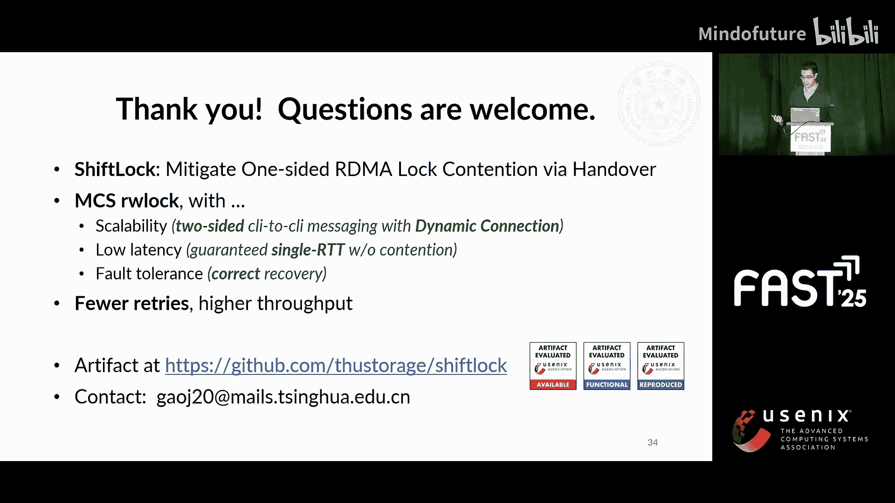
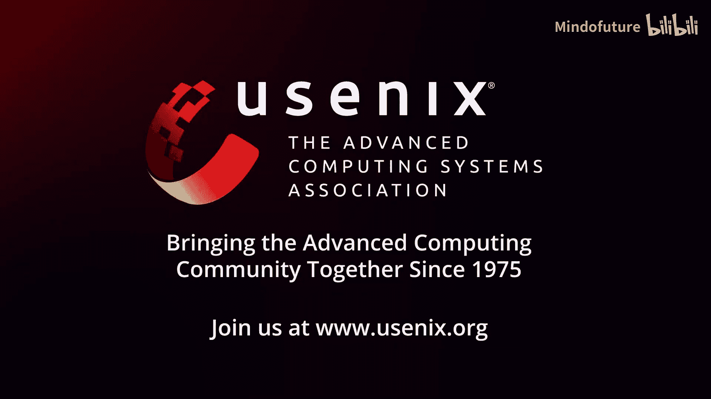

# FAST25存储大会-｜-USENIX-Conference-on-File-and-Storage-Technologies-p23-P23-ShiftLock---Mitigate-One-sided-RDMA-Lock-Contention-via-Handover--BV1HmVXzME4J_p23-

。

Good afternoon， everyone。 My name is Xianang Gao。 It's my pleasure to be here to introduce Shilock。

 a work done in collaboration by me and my colleagues from Qinghui University。😊。

As part of the hardware assist session， this work focuses on leveraging hardware features of RDMA to accelerate distributed log protocols。

So I guess I will first need to give a brief introduction to the RDM RDMA technology。

 because our paper is the only one in this conference that has RDMA in the title。

SoRDMA means remote direct memory access。 It is a user space networking technology that allows you to directly access remote memory while sidestep remote CPU。

Without CPU intervention， ourA becomes blazingly fast and network round trip can be finished within two microseconds。

So RDMA requests are called verbs。 There are one sided verbs that will size stack remote CPUs。

 including read， write and anatomics。 Also， there are conventional two sided verbs。

 including send and receive。 that still require CPU assistance。So why are we doing research in RDMA。

 Because RDMA hardware is evolving rapidly， and recent products provide many fantastic opportunities In this work。

 we mainly focus on the rich semantics of the verbs they provide。😊，Specifically。

 RMA atomic verbs can operate on larger than 8 byte values while providing bit mask semantics that allow you to modify an arbitrary part of the opera while keeping the remaining parts intact。

So I guess it is safe to say that RDM A atomics are much more powerful than their CPU counterparts。

 This fact drives us to develop new distributed protocols with the help of RDM May， for example。

 lock protocols。😊，In RDMA logs， clients directly read and write log entries stored on the server。

 They coordinate with each other as if in a single machine。

 except except they access access the memory with RDMA verbs。

This scenario is also called a one sided lock because only client CPU are active。

 while server CPUs just do nothing。Compared to traditional locks。

 RDMA logs are good because they benefit from RDMA advantages， including microsecon level latency。

 very high throughput and low CPU usage。But everything has two sides because these servers inactive client do not get any feedback when they fail to acquire log。

 and they must retry。The RDMA Nick is not that good at handling so many concurrent re。

 especially when they have conflicts。As a result， if there is high contention。

 you may expect a significant performance drop of RMA locks。 If we have 200 containing clients。

 they will cut the throughput by about 95%。😊，The ultimate problem here is that there are too many retries coming from clients that relentlessly try to acquire a lock that was occupied by others。

 These retries will， dis Iop resources and cost performance degradation。

With the typical comparison swap implementation， more than 85 of the retries will fail in a high contain。

 highly contended scenario。Good news。 this is not a new problem。

A solution is to let clients queue up and hand over locks。

 which is an existing idea in the well known M C S and CH logs。

Handover means that a client directly gives the lock to another client via peer to peer messaging without involving the server。

With handover， clients can just wait locally for the receipt of the lock instead of performing reries。

D news， we find that very few RM locks adopt this idea， although it is already 34 years old。

What's the problem here， Well， in fact， there are some challenges that make it a bit hard to implement the MC C S lock in the RDM network。

First， RNAA control path is very slow compared to its data pass。

 it takes milliseconds to configure a new connection between two clients。This results in a dilemma。

 If we want to connect all clients beforehand， it will be unscalalable。 but if we don't。

 it will be slow。Second， RDM is much more slower， about 20 times slower than local memory accesses。

 This makes it hard to add useful features， such as reader writer semantics to the M S log。😊。

If you look at existing reader writer variant of the MC S log。

 you will notice that they need to touch the lock for multiple times to acquire or release it。

 This will translate into multiple network round trips and add higher latencies in the context of RDMA。

Finally， MCS Lock assumes that clients will never die。

 but this is not the truth in a distributed system。There are two questions to answer。 First。

 how to detect the failure。 Second， how to correctly recover from it。To address these issues。

 we developed shift lock， it adopts the idea of M S lock while introducing several key designs。

 including skateable client to client communication， single round trip。

 reader ridder protocol and fall tolerance mechanism。To begin with。

 we first take a quick look at the MC S log protocol itself。

The principle of M S is to organize clients in the queue。 The log entry is a point to the Q tail。

To acquire lock， a client simply appends itself to the tail。 If it is also the queue head。

 for example， the client A here， it can happily acquire lock。 Otherwise， for example， client B here。

 it will have a predecessor in the queue that is A B writes to the memory of a to update its successor information。

 and then wait until a has already lock to it by updating a flag in its memory。😊，Now。

 we start to introduce our contribution。 First， we discuss how to implement client to client communication required by MC S log in an RDIA network。

In a distributed scenario， clients will run different nodes。 They must communicate via our DNAMA。

 and we need to choose proper words for for them and solve scalability issues。

MC S lock wants client to write to each other's memory， but to perform a write over our DNAMA。

 we need a large amount of metadata， which must be embedded in the lock entry as a part of a remote pointer to a client。

😊，To save space， we point out that since the ultimate goal of client to kind client communication is to send a message that will eventually be processed by remote CPU。

 We can use two sided send verbs instead of the one sided rice to perform such communication。

Sends have similar performance with rights as long as the opponent is ready to receive。 Also。

 these send are not R PCC calls， and clients do not need to spare CPUus to monitor them all the time。

 Instead， they handle these received messages only when needed。😊，For scalability issues。

 since it's unsable to maintain conventional connections。

 we tend to use RDMA dynamic connections instead。Dynamic connection allows a client to connect to different remote endpoints on the data pass。

 It is very fast。 The reconnection overhead is less than 1 microsecond。 And as we have said before。

 client's root information is embedded in the log entry as part of the Q Q tail pointer so others can use that information to dynamically connect to that client。

😊，Second， we introduce Shelock's Read writer Lock Pro。Previously。

 we are assuming that only writers exist， and the lock is a mut text。When they are readers。

 we must find a way to maintain them and transfer the log ownership between readers and writers to avoid bad things such as starvation。

Due to the high networking latency， mixing all clients in the same queue is definitely not a good idea。

Instead， we only maintain writers in the queue and use three new fields in the log entry to maintain readers。

 First， we use the counter to cut active readers that are trying trying to acquire or actively holding the lock。

😊，Thus， clients can detect whether readers or writers exist and acquire a lock if there are no conflicts。

The remaining two fields are to solve the case when there are conflicts。

To help a writer acquire a lock when readers are holding it， we introduce the second field。

 a lock release counter。Clients increment discount whenever they release the lock。Now。

 let's consider a writer at the Q head。 When it pans itself to the Q tail， it will。

 it will also atically read the entire log entry。It will then know how many readers are holding the lock before it and can spin on the lock release counter until it becomes a value that signals all previous readers have left。

And this value is simply the sum of the reader counter， and the release counter。The third field。

 apple。Helps reader acquire a lock when a radar is holding it。To explain the meaning of this name。

 we know that the entire lifetime of a cube based reader writer log can be divided into many applepos with each apple consisting of three steps。

 First，0 or more readers acquire and release logs。 Second， a writer appears and takes the lock。

 Third， writers hand over the lock in the queue。Now。

 it becomes obvious that giving the locked to readers is equivalent to starting a new Apple。

As a result， when a writer is holding the lock， we let readers spin wait on epoch field。

When the writer releases the lock， it also autoically raises the number of readers and release counter。

And it changes the current apple to pass the lock to readers。Now。

 the situation for the next writer is similar to what we have discussed before。

 The current writer can do some calculation and send a message to the next writer。

 asking it to spin weight on the release counter until all previous readers have left。In this design。

 the signal for readers to acquire is the change of the epo， not its absolute value。

 The epo is not like a mode， but it like a clock in digital circuits。

It guarantees single round trip block acquisition without contention because clients can acquire in any airportpoch。

Also， to avoid reader starvation， readers must must proactively transfer the lock to readers。

We set the transfer cr as the number of consecutive handovers。 If it reaches a threshold。

 which is 16 hour implementation， thelock will be given to readers。Finally。

 we discuss how shouldlock To failures。 We focus on client failures because if the server fails。

 the only choice is to let all clients switch to the new server and retry from from the beginning。😊。

Although shift lock introduces lock handover among clients。

 it has no extra complexity in failure detection。 If a client fails。

 then eventually all clients will be blocked and no one will release the lock。

 The release counter will stop changing so we can adopt the idea of leasing and detect a failure If the release counter keeps unchanged for a certain period of time。

When the release counter is unchangeded for decades， clients can detect the failure。 However。

 it is the server that is responsible for performing the recovery。Specifically。

 the server maintains an error， which counts how many recoveries have occurred。

 The client that detects the failure asks server for recovery in the current era。

The server will bump the release counter for a very large value。

 clear all other fields in the log entry and increment the era。

The leap of the release counter will make other clients aware of this recovery so they can retry acquiring the lock。

This design effectively prevents clients from performing outdated recoveries that would that would otherwise be possible due to the ABA problem for a small chance。

 which will cause the system to explode。Now have finished with the major major design points of shiftlock。

 In summary， it achieves scalable and efficient client to client communication with two side verbs and automated dynamic connection。

 It develops a low laency write log protocol that guarantees single round trip acquire and release。

 if without contention。😊，Also， it provides for tolerance。

Please see our paper for more technical details。We have implemented shiftlock in around 7000 lines of rust code。

 and compare it to some existing RMA logs in the test well testbed of six nodes。Overall， shiftvlock。

 the dark blue line in the figures， deliver the highest performance。😊。

It improves the throughput and latencies for reader writer logs at different scales。However。

 compared to a mu text。Some writers might wait longer in shiftlock because。

 as we have discussed before， writers need to proactively give the locked readers to avoid starvation。

This can result in somewhat higher tail agenciesencies。By picking the hardware counters。

 we find that the reason behind Shilock's performance at advantage is that it effectively reduces retries and has the lowest pressure to the serverside RDM mini。

Effect analysis on the catalog shows impressive effects of the backup strategy。

 which is a conventional mechanism to reduce the number of rep。

 but also prove that it can only partially allevte the problem instead of solving it entirely。

Shilocks advantages do come with some overheads in terms of recovery with the same least time。

 clients must wait longer than existing RA logs to be sure of the previous failure。

 This is because shiftlock allows clients to hand over locks。

 so we must consider the time spending handover。 As a result。

 its recovery performance is slightly lower than previous work。 but they are still similar。

To save time， we only show major performance results here and please see our paper for more detailed analysis。

This concludes my talk today。 If you are interested in our work。

 please feel free to raise any questions or try our artifact。 Thank you very much。😊。

