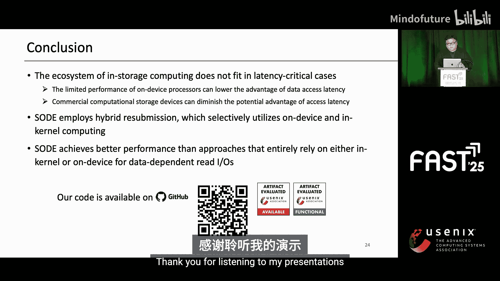
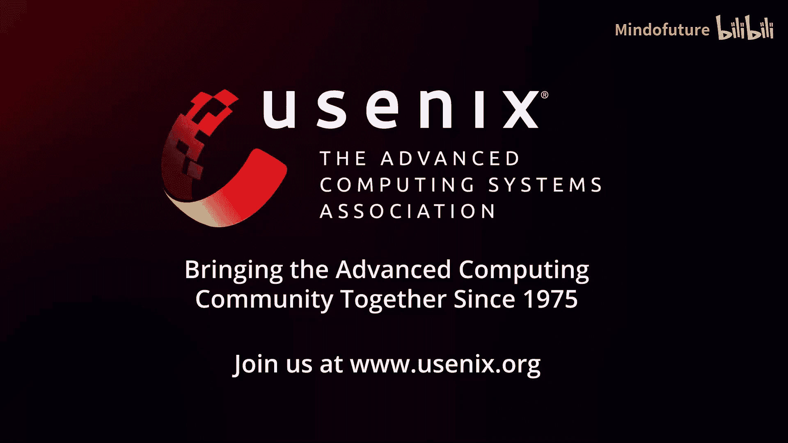

# FAST25存储大会-｜-USENIX-Conference-on-File-and-Storage-Technologies-p24-P24-Selective-On-Device-Execution-of-Data-Dependent-Read-I-O--BV1HmVXzME4J_p24-

。

Hello， my name is Shanon Park from Uniist。 I will briefly introduce our work on select table and device execution of data dependent Le Ios。

Moooern storage devices have a significant quantity of advance in speed and bandwidth。

The evolution introduces two issues that were not present。

The first issue is that there is a bandwidth gap between PCIE and3G tens。

This graph shows a significant increase in internal storage bandwidth。 But while the。

PCIA interconnect boundaries has been un。So the data movement becomes a battle legck。

 even with high internal storage bandwidth。To solve this issue in storage confering over the data intensive computations into the storage device to reduce the data transfer between through the PCIE。

Intorage computing leverages the high， high internal storage bandwidth for through workload such as Grab and K N N。

And Inage computing implements computational storage devices by integrating high parallel。

On device processors， such as Apple PGA。One of the。One of the in computing examples is Insider。

 which propose FPG based programmable computation of roing。another example is called Lambda Ao。

It also afford frauds。Overall， the data incentive computations into the storage， similar to insider。

 but enhance its efficiency by enabling。At fast data access， particularly in areas like page caches。

And the second issue from the evolution of modern storage devices is that。

The corner of stack emerges as a bottle legck as storage as storage devices become faster。

When we checked the con super stack latency on an MM storage device。

 nearly 48% of the latency came from the con superos stack。To tackle this issue。

 in hostst Ne storage computing reduces the con of stack by offering latency critical computationnots closer to the storage device。

For instance， XRP analyze the performance of data dependent reader Is。

 which refer to read only large on disk data structures commonly used by strategy engines。

Ex few repeats executing on EBTF function within the corner and submitting necessary read operations to bypass the corners of Pat stack。

We call these operations that requires consecutive lead reader requesters as a re task。Impressibly。

 we observed that existing insurance storage computinging primarily focus on threeic workerss。

 not latency critical cases。So our research explore the topic of whether initch campaign can expedite data dependent lead Is as an example of latency critical cases。

However， we found that the characteristics of in con do not fit in in latency critical cases。

The first characteristic is that competition three devices have low computing power。

 common approaches optimize throughcentric workers by using high pattern on device processor。However。

 this kind of processor can increase the on deviceice computing latency since the low computing power reduces the advantage of lower data access latency。

The second characteristic of in switch computing is that commercial。

Computation streets devices are not designed for the potential advantage of access latency。

For example， in the Samsung smart SSD。The ApplePJ and the SSD controller are connected via PCIE。

 eventually their SS latency is not significantly lower than that from the host processor。

Because the， because of the communication cost between the controller and the own device processor。

These two characteristics creates two constraints， making making it difficult to consider Raton's critical workros。

First， we must consider the limited computing power because moving heavy tasksers to one device may negatively impact over couple months。

Second， the O device processor must be located possibly closer to the controller。In other words。

 this device should not have a considerable communication cost between the controller and the own device processor。

So in this time， considering this constrain， we propose select table and device execution of data dependent to lead I called sold。

So it shows how on device computing can be effectively in data dependent lead ions where a reader data transfer is not beneficial。

And so to introduce hybridly that selectably balances on device and in storage。😊。

Incon executions to consider the limited computing power。Moreover。

 S assumes that the on deviceevice processor is located possibly within the same system on chip as the switch controller to eliminate the communication cost between the controller and the O deviceice processor。

Let me show how， how hybrid the resolution works。When an application submit or request to the storage。

 So prepares metadata to handle on device and incon resubmission tasks。

And so sends the metadata by extending an MBM command and the storage device performa with the operation。

Once the reader request is completed， own device alone time can perform an own device lease mission within the storage。

If the further res is needed， the run time completes the request。However。

 the own device processor can have no resources because of the low computing power。 in this case。

 performing in computing can be more effective in terms of latency rather than waiting for a task to complete。

We call this overloading process， reverse overloading。

The overroed task taskcus can execute faster on the host CPU。

 which has better compute power than the on device processor， however。

 these overloaded tasks experience about 500 non sequenceds to one microseconds of PI around theitude penalty。

Interestingly， we observed that the， the high submission can have latent secret cases despite the penalty of reverses of flooding。

😊，This is an example of how so operates during people+3 index logups。

 so can tuts lid only larger on disk data structures similar to XRP and so patches node and parse them and lipid at these data typically literallycast。

If the OD processor has no resources， or reversal protein can complement the low computing power of the OD processor。

Our paper present more design choices we made for sold as shown here。In this case。

 So it cachees prior metadata to translate py for onD and inal resubmissions。

 and so supports power execution for heavy OD resubmission tasks。And also。

 Emily'mily to send the boxing overhead with MPK today。

 I will skip this part due to the limited time。To implement the Z prototype。

 we extend and we a linearo defined emimulator for MMM storage devices。

 we select Intel obtained DCSSD model to use Uro latency storage devices and we choose the arm cortex A50c as a reference for our own device processor because the arm CPUU has been used。

As a switch controller， as a switch controller in the prior world。诶。Imersonly。

 we eliminate CPU performance to emulate win P on device processor based on the resultsard。

From our micro benchmarkchs， which mimic keyo store ro of operations。In the experiment。

 we found that roaring the CPU frequency to 1。2GGahertz is a reasonable way to emulate a WinPO device processor since the result of the arm CPU has a similar performance as the In CPU with limited frequency。

We evaluate salt in this environment。Especially， we use 102。

A 92 GB of memory and a singleneode for computational storage emulation。😊。

And we find four cores similar to our reference processor， on Codetex A53。

We assign one lease emission worker to each one。And we use a simple P plus three kilo store called PPF KV for our evaluations。

 and we also test so on wirered tiger for real world evaluations。

The first takeaway from the evaluation is that so effectively eliminate corners to put the stack overhead and PCI around the trip。

When we evaluate sold an XrRP in BPF per cable with spraying thread in the closed loop load generator。

 so achieves higher through foot and lower latency than XrRP。Notably。

 O device handles story 8% of reers， while Inconor handles the remaining 62%。

The second takeaway is that sold perform are better than the own device execution alone and the In execution alone。

When we evaluate sold on BP cable with an openopot generator suitable for stress testing。

 so this hybrid re delivers higher performance than one device execution alone and using a own device execution alone can better performance than XrRP。

 which is similar to our in execution alone。This leisure highlights the disments of on device comfort for latent security workros due to its characteristics。

And so it has 10。8% better performance than X I P。 We can understand that this hybrid approach can have latent critical cases。

We also evaluate sold on wired tiger， why uses uses the logo structure Mary based key store。

We test wire tiger with YCSB or Cros。The research shows that soD reduces re an existing colatency by up to 9。

4% compared to XIP。However， sword does not reduce the latency when learning worker D。

 because the on three。Is a swallow resulting in a small number of emissions。

It means that so can achieves more optimistic resubmission inside the own device side because of the small number of resubmissions。

Here is the conclusion of this talk。We observed that the characteristics of in computinging do not be in latency critical cases。

Soword is designed under some assumptions due to these characteristics。

Thus so provides a new design with hybrid laser emissions， which selectively utilizes。

On device and internal computing。In the evaluations。

 so achieves better performance than approaches that are entirely relying on either on device or in computing。

Thank for listening to my presentations。

