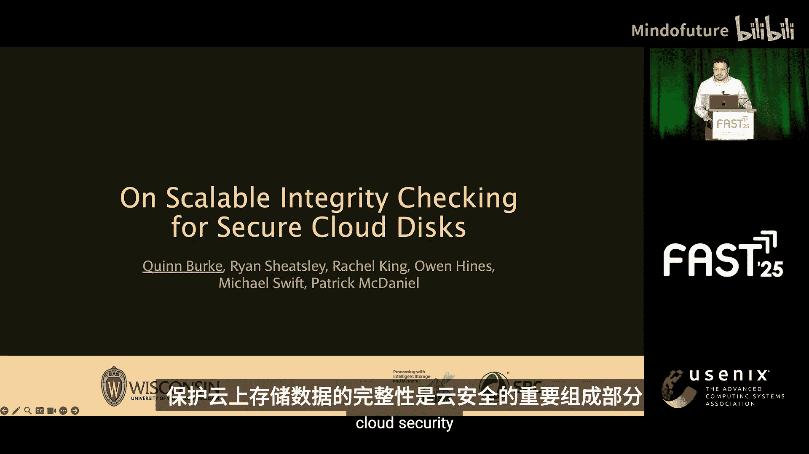
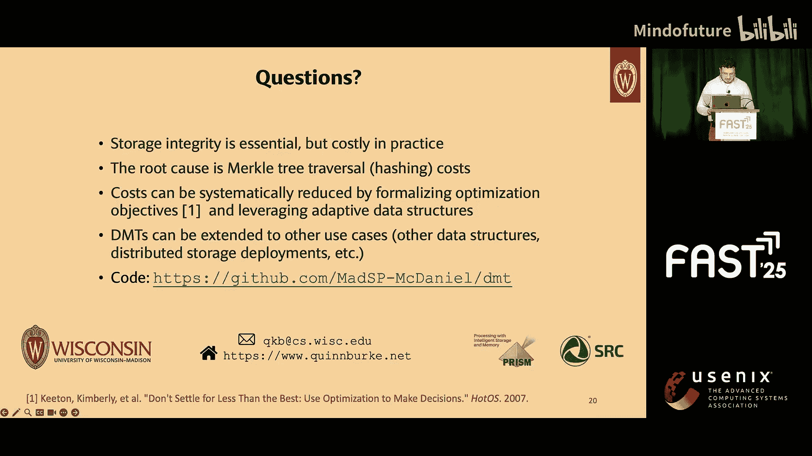

# FAST25存储大会-｜-USENIX-Conference-on-File-and-Storage-Technologies-p25-P25-On-Scalable-Integrity-Checking-for-Secure-Cloud-Disks--BV1HmVXzME4J_p25-

。

Thanks for the introduction， my name is Quinn I'm a PhD candidate at University of Wisconsin Madison。

 I'm excited to be here today to tell you about our work optimizing security protocols for storage。

So to start， it's no secret that protecting the integrity of data stored on the cloud is an important element of cloud security。

But unfortunately， integrity comes at a cost。To give you a concrete example。

 this graph shows the cost of integrity in practice， so it compares V embarity。

 which is a device map or target in the Linux kernel that implements state of the art integrity protections against two baseline。

We have a disc with no encryption， no integrity protection， and a disk with encryption。

 but no integrity protection。 So the y axis is throughput X axis capacity。

 The general trend that we see is that throughput decreases with respect to capacity。

4terabyte disk sees about a 75% loss and even a small 16 mebyte disk sees about a 50% throughput loss。

So the takeaway is that the cost of providing integrity can become prohibitive。

Our work addresses this performance problem by developing optimized integrity data structures that adapt to workload patterns。

 that exploit workload patterns to reduce integrity costs。

We tackle this by answering three research questions。The first。

 what is the root cause of integrity overheads？The second， in an ideal world。

 can we model an optimal integrity data structure and I'll say more about what that means later。

And the third， if so， can we realize the optimal or approximate it in a real system？

To foreshadow a bit， the answers are here， the root causes hashing costs。

 we can construct an optimal if we have some AR knowledge and we can approximate the optimal by learning from workload patterns。

But let's start with some background。Suppose you have a typical infrastructure as a service deployment where you provision a virtual machine。

 you run an application inside of it， and the application requires some access to some fast local storage。

 so the application communicates the file system through system calls which translates those into a series of block operations handled by the block layer。

In this scenario， if an attacker manages to gain control of the storage device or storage interface broadly。

Then they can inject bad data into the VM and compromise the integrity of the system。In practice。

 the way that we prevent this kind of attack is by adding a security layer。

 a di interface that performs some integrity checks before you return any data or acknowledgement up the call stack。

The security layer handles two high level routines， update and verify。

So whenever you write a block to disk， you push the data out to the disk and you update some associated security metadata。

 and whenever you read data， you check that the data is consistent with the associated security metadata。

Informally， this is known as a cryptographic proof system。Now let's unpack this a bit more。

The security metadata itself is composed of two things。

We have message authentication codes or Mac and Merkel hash trees。

Max give us an authenticity guarantee that any data you read off of the disk is legitimate data that you put there。

 and Merkel treeses give us a freshness guarantee that any data you read off of the disk is not only legitimate。

 but is also the latest version of data that you put there。

So to be more precise about what we mean when were reading or writing blocks。

 we come back to the security layer。When we write a block， first we compute a new block Mac。

 and then we update the Merkel tree using that Mac。When we read a block。

 we check that the Mac is consistent against the data like we would any other checksum。

 and then we verify the Mac in the Merkel tree for freshness。Now the Merkel tree works as follows。

The max of the data blocks are the leaves in the tree。

And the process of updating or verifying a Mac involves recursively fetching sibling nodes。

 concatenating them， and hashing them at each level in the tree。Until you get to a single root。

The roots typically stored on chip or sealed in a TPM and is out of control of the attacker。

So for an update， you go through this recursive process， generate a new route and save it。

And for a verifier， you do the same thing， but you compare a computed route against the known good route。

And so the guarantee that you get is that whenever you read some data。

 if an attacker tries to inject stale or otherwise invalid data into the VM。

 then the integrity check would fail。Now in the paper。

 we provided an analysis showing that the time spent doing computing hashes during this recursive process dominates the time spent simply doing a data access on a fast disk。

So we measured it to be about 2 to 300 microseconds doing an update of verification versus doing a data access can be in the order of tens of microseconds depending on what kind of disk you use。

So we concluded that hashing is the bottleneck and to reduce overheads。

 we need to reduce hashing costs。The key insight in our paper is that there's an opportunity to reduce hashing costs by exploiting reference locality。

It's known that storage workloads often exhibit a high degree of reference locality where a small number of blocks is accessed most of the time。

So our idea is that we can exploit this by breaking away from a balanced tree structure。

Allowing the tree to become unbalanced。And keeping the max that are associated with hot blocks closer to the root。

So the result is this tree structure where MAs associated with hot data have shorter update and verification paths。

 which means less number of hashes and therefore lower hashing costs。

For both frequently accessed data and overall in general。Now the intuition is simple。

 and so this raises the question why now and what were we doing before？Well。

 prioror works mostly largely focused on offline integrity checking。

Where performance was not a primary concern。 and so using a balanced tree was sufficient to meet their needs。

In our case， we assume the applications running inside of a confidential virtual machine， right。

 cloud VM and requires。Real time integrity checks as the applications reading and writing data from the disk。

Now， more importantly。We're only。Beginning to become aware of the fact that hashing is a bottleneck because emerging storage devices have very low data access latencies。

 right and so。The ratio of time spent computing ashes versus doing a data axis is only growing。

 growing substantially。So our work builds on this new idea of using an unbalanced tree structure in two parts。

First， we recognize that achieving a minimum hashing costs is ideal。

 so we first develop a definition of an optimal hash tree structure。

And then we design a heuristic approach that addresses some of the limitations of the optimal definition。

So we provide the reduction and the full technical details in the paper。

 but at a high level we define the optimal by tying it to a parallel problem in compression。

In compression， prefix trees are used to map set of symbols onto code words。

Encoding process works by traversing a path down to a leaf in the tree and appending either a zero bit or one bit to the code word bit string depending on which direction you move during traversal。

The goal is to find an encoding that produces a minimal representation of some original data。

And so the guarantee that we get when we construct an optimal prefix tree。

With an algorithm like Kuffman Coin。Is a tree structure where hot symbols are assigned shorter code words。

So in this example on the right。B3， simple B3 occurs 30% of the time it is encoded with two bits。

 while B7 occurs 5% of the time is an encoded with four bits。

So we modeled the leaves in the hash tree in the same way because it gave us a very clear guarantee。

Which is that。Max and or their associated blocks。That are accessed more frequently will be placed higher in the tree。

 leads to shorter update verification passs and therefore lower hashing costs。

Now a condition of building an optimal tree in this way is that you need some knowledge about the workload ahead of time。

You need to know the pro so that you can construct the tree。

This is a limitation because it's rarely feasible to have that kind of knowledge in practice。

Now the optimal is still useful as an evaluation tool， because if you do have that knowledge。

 then you can construct the tree。And that allows you to establish an upper bound on performance。

 maximum throughput， minimum overhead。In the paper we call this the optimal tree Oracle。Ideally。

 in a real system， we want to move away from this assumption though。So in our second contribution。

 we approach this by drawing a connection to a data structure that's widely used for tasks like garbage collection and IP routing lookup。

 display trees。We designed an adaptation of display trees called dynamicymic Merkle trees or DNTs that are tailored to our use case of a hash tree。

The key mechanism that drives the tree is that whenever you access a leaf in the tree。

 you perform a series of rotations to move the node all the way up to the root or at least part of the way there。

And so over time you end up with this tree structure where hot data tends to accumulate higher in the tree and cold data tends to fall lower in the tree。

Now there are several desirable properties of the trees that made them a good candidate data structure to build the DMTs from。

To summarize， display trees are inherently unbalanced tree structures。Unlike the optimal。

 they require no knowledge about the workload ahead of time。

We can start from any initial state and the structure of the tree will be completely driven by the workload pattern。

And this adaptivity is particularly useful because it allows you to capture temporal patterns and dynamically adapt to changes in workloads over time。

So while intuitively， it makes sense that we should be able to exploit reference Oe in this way。

 we had to address several challenges。The primary challenge being that doing these rotations can be costly。

So when Spre is used for search， rotations might be cheap because you only need to update some pointers。

But in the context of a hash tree。Whenever you do a rotation， you change the structure of the tree。

 and we need to commit that change by essentially recomputing all the hashes from the rotation point up to the root。

So we need to reduce those costs。We do that by introducing two heuristic parameters。

The first is display probability P， which says that。Rather than displaying on every axis。

 we'll only display on a certain percentage of accesses， for example，  one% of the time。

And the second is play distance D， which says that。On those axises that we do decide display。

Rather than splaying the note all the way to the top of the tree will' only splay it half of the way there or fourth of the way there and so on。

Together， these help to reduce costs。Now the DMMTs work in three steps。

We attach integer hotness counters to each node to track the relative access frequencies。

As the block layer begins receiving IO requests。On the axises that we do decide display。

We perform the rotations per the standard display rules。So looking in this figure。

Depending upon the arrangement of the nodes at the time of the access， it might either be a zig case。

 a zig zig or zigzag。And finally， when we decide display。

 we rotate upon parent nodes rather than the actual leaf node。

 and that helps us to avoid some hazards that can result from rotations。

So we implemented the DMT and the optimal tree， about 5，000 lines of C++。

 it's a block device driver using BU framework。The driver intercepts。

 read and write IOs perform and calls the update and verify functions before we return any data or acknowledgement of the call stack as an optimization。

 we also introduce a small hash cache。That allows us to avoid some metadata IO during the update and verification process。

The driver runs on standard Linux systems， and we did the evaluation with EC2 instances with local MVME disks。

In the paper， we looked at a variety of different workloads， some synthetic generated with FIO。

 an Alibaba trace data set and F benchch workloads。Today I'll focus on two key evaluation questions。

 the first can DMT scale better with respect to capacity。

 and second can they adapt quickly to workload changes？

This graph compares DMT against DM Verity and several other baselines。

So let's take a look at what's in the legend verse。We have a disc with no encryption， no integrity。

 a disc with encryption， no integrity。And we also have four，8 and 64 airy trees。And for reference。

 Dmbarity here's a binary tree。Now we looked at these other trees for juxtaposition。

 I won't say much more about them， but I'll mention that we in the paper we provided another analysis where we showed that simply using a wider tree was not sufficient to reduce hashing costs。

And it's because there's some unique challenges in the context of storage level hash trees where essentially when you use a wider tree。

 the actual input to the hash function is larger， and so the actual per hashing costs are larger so they don't break even on the tradeoff。

Finally， we have the optimal， which we construct by recording a workload trace ahead of time and building the tree from it。

So looking in the graph from the top， y axis is throughput X axis capacity。

The general trend that we see is that the performance of the baseline decreases with respect to capacity。

Meanwhile， performance of DMTs remains about constant。And in fact。

 we see that DMTs consistently provide about 85% of the optimal throughput。

And this is precisely the scalability guarantee that we are looking for。

Graph on the bottom we look at tail latency and the key takeaway is that DNTs provide up to a 40% improvement in tail latency。

So although spplaying can be costly through our design， we can reduce those costs over time。

And this next experiment， this graph shows a 150 second snapshot of throughputs observed under a workload that alternates between uniform and zipian phases。

Each ZPM phase is centered on a different region of the address space。

So the y axis is throughput X axis is time。The key takeaway is that DMTs at the start of the Zian phases。

The DMTs can quickly adapt。To capture the skewed workload pattern and provide a speed up。

And during uniform phases provide comparable performance otherwise。

So the significance is that DMTs can adapt to both changes in workload shape。

And changes in workload regions of interest over time。To summarize storage integrity is important。

 but costly， Merkel tree traversals are the root cause of overheads。

 and we can reduce those by using optimization and designing adaptive data structures the codes available for other researchers to use thank you and I'm happy to take any questions。

