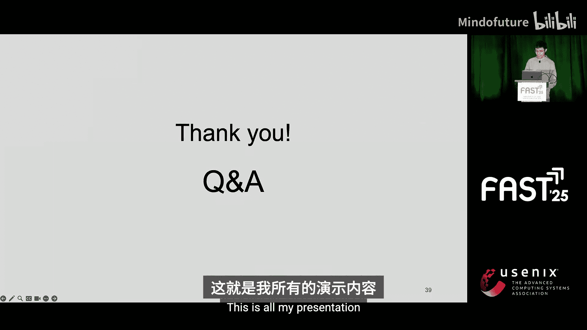

# FAST25存储大会-｜-USENIX-Conference-on-File-and-Storage-Technologies-p26-P26-Silhouette---Leveraging-Consistency-Mechanisms-to-Detect-Bugs-in-Persistent--BV1HmVXzME4J_p26-

。

Hi， good afternoon everyone。 My name is B Jo， the final year PhD student from Florida State University。

 Today， I'm going to present Sililloway leverage to leverage consistency mechanism to detect bugs in precise memory best systems。

 This work is a collaboration work between Florida State University and University of Toronto。😊。

A persistent memory system promise high performance。

 but they are prone to subtle bugs due to the out persistency。 In this talk。

 I will explain the challenges of detecting these bugs in file systems and how Silil address them and the results we've achieved。

Its challenge to detect bugs in p memory based file systems。

 First p memory program are prone to bugs due to the out order persistency。 second。

 the number of possible quest scenario schools sequentially with the number of P flash stores。

 We call those infl stores are the stores that are not guaranteed to be persisted to the device。

 and suppose we have n infl stores at fence point there could have at most due to the power of N cross scenario scenarios we rename cross plan。

So it's prohibitive to explore them exhaustively because the large space， such search space。

To address this， we propose。 it first check whether a pmified system implement is consistent mechanism correctly。

 If so， then all stores associated with this consistent mechanisms are not reorder during testing and which we can only focus on rest of stores and dramatically reduce the search space。

😊，So first， were going to talk about the other order persistency in P memory programming。

 This slide illustrates the concept of out order persistency In this figure。

 we have the CPU CPU catch and P memory Initially， there are verbal A and B in the system and both are0 at the beginning。

😊，On the left side， we have four instructions。 First install A with number two。 then flash A。

 Then we stop B with number 3 and fans。So first we start a with number two。

And verbal A in the CPU cache will be updated as2。However。

 due to the incoherence between the CPU K and P memory， the verbal a could be either zeros or two。

 It had been determinedd。Then we are trying to flush verbal a from the CPU K to the P memory at this moment。

However， flag doesn't guarantee verbal A is persisted to p memory。

This is because the flash instruction might be reordered by either the compiler or the CPU。

 so it doesnt take effect immediately。Next， we update verbal B with number three。Similarly。

 when be in the cache it's updated， but in P memory， it could be either zero or three。

If a cross occurs before the fence injection in P memory， we have verbal A is either 0 or2。

 and variable B is either0 or3， which creates four possible cross plans。Includes and B are persisted。

 or only A persisted， or only B is persisted， or both and B are not persisted。

Suppose we have Nfl stores。 It could yield at most due to the power of N crisis plans。

And only the fence injection can prevent injection reordering and guarantees all flashed variabless are persisted to p memory。

In this diagram， the phase structure guarantees verbal A is updated at 2 in p memory。 However。

 since B is not flushed， it still could be either 0 or 3。If we have more instructions after line 4。

 for example， we have store C D， flash C D and fans。And here。

 if a crash occurs before line 8 before the fence， we will have three in stars。 We have B， C And D。

 They are both in fact。 They are both haven't been proceeded to be memory。

 which could yield as crash plans to to the power of three。So if there are in in stores。

 that could be into the power of。 So how to avoid such space explosion when we testing when we reorder the infl stores。

Also， this issue becomes more challenging in p memory5 systems。

We observe that P memory5 systems can have up to 20 or 40 inflflat stores at fence points。

 which could yield million or tri billionion crash plans。

 So tighten them exhaustively is prohibitive。This figure shows the a cumulative distribution function of in plus stores in the three test5 systems。

We can see that there more than 60% of fence points has fewer fewer than 10 in stores。

Especially for PM M F S and Nova， it's 90% of fast points has less than 10 in stores。 However。

 they both have the long tails， and the long tail can dominate the number of quest plans。Fortunately。

 we also observe that P memory 5 systems use well known quite consistent mechanisms。

 such like journal to guarantee the automaticity and durability of operationss also。😊。

And the real vulnerabilities lies in stores that are not associated with any cross mechanisms。

 We call it unprotected stores。 And these unprotected stores are fewer than 10 in our observation。

 and which can only have 10 of crash plans generated。

So here we updated the figure with the unprot stores。 The doted line shows the unproed stores。

 It shows that at at most95% of fast points has fewer than five inflatux stores。

 which eliminate long tails。😊，And meanwhile， with 10 inflat stores。

 we still need to test 1000 quest plans。 Can we further reduce this number。

By studying p memory programs， we observe that P memory programs often use one critical store to indicate the consistency of n infl stores。

 such as flag， atomic variables， applepos。 So if if the critical store is not ordered with respect to other flash stores。

 it might be a bug。However， the issue is that we don't know whether store is a critical star。

 So we have a heuristic that we simply assume each unprotect store could be this critical stall and test only two cross plans for。

 for it。 First， we persist only this unprotect store and leave other stores unproisted。A second。

 we persist all other stores， but leave this unprotect store unproisted。So with this heuristic。

 we reduce the search space。 So， for example， with n in stores。

 a traditional comb approach will generate to the power of N cross plans。

 but our heuristic approach generates only two n Que plans。

 which dramatically reduce the search space。😊，Based on these observations and studies。

 we proposed Sililhouway， the key ideas are detecting quite consistent mechanisms and checks their environment to ensure the associated stores are also quite consistent respect to reordering。

Then we use the heuristic to test unotic stores。But here we still have some challenges。 So first。

 how to define the environmentvari of quite consistent mechanisms。

 how to check these environmentvari。We， the more detail are in the paper， So we。

Just briefly introduce them here。SoQu consistent mechanisms are well defined and order rights in multiple phases。

 Take an under journal， as example， the right figure is a generic under journal in P memory file systems。

 It has a header and tail pointer to indicate the logging space。

 and both journal and block are in p memory。😊，The first phase is the log space allocation。

 The journal simply moves the tail pointer to indicate the allocated space。😊。

Then it use the flash and fence suggestion to guarantee the persistency of the pointer。second phase。

 the the under journal locks old data because it's under journal。

 So it allowss old data to the allocated space。 then flash fans to ensure the persistency。 Also。

 sometimes they have the commit right to indicate these logging rights are have been persisted。

In the surface。The it conducts the imp update， which write new data to the final destination address to make this and make them persisted。

And last， it moves the header to the head point point to the tail to reclaim logs to complete or to commit this transaction。

With these clear phases， we define three consistency environmentvaris for this journal。

 So it includes the order environmentvari that faces must persist in sequence。

 which means the precise time of right in one phase cannot now be up must proceed the update time of the right in the next phase。

And location environment logs must stay with some valid regions。

Indicating log space is allocated within a valid journal area。

And log rights are performed within the located space between the header and tail pointers。

And last one， data invari， which means loggged rights must match the imp update because there went to un match。

 We log it that we update it。Silloin will check stores based on these environment and report warnings if any checks failed。

Additional time limit， we briefly describe this the how to check consistent。 The steps are。 so first。

 we use pass to instrument the file system source code so that we can dynamically trace instructions。

 and we support the fine grain trace。 We can see any instructions here there。

 And then we take stores in the the dynamic trace with the data type。

 The data types means what's the structure name Whats the structure field name。😊，Next。

 we use a lightweight an attention to determine the stores associated with consistent mechanisms。

Next， we apply invari checking on these associated stores。 If invari checks passed。

 then we mark this store as protected。 and rest of stores are the onproect store。

This table shows the annotation for PM memory PM F S under journal。

 The first column is the attribute emit met data of the Android journal， such as a header pointer。

 tail pointer， destination address and size that will be logged in the logging space。

 The second column is a structure field that correspond to these attributes。In P memory F， S。

 the header the head point are computed by the best address plus the header address。 Also。

 the tail pointer is the best address plus the tail address， a tail variable。

 and the destination address and size are the are stored in one variable。

Why we say the annot is light weight。Because it doesn't require source code adaptationnotation modifications。

 it just acts as a configuration file， and it only needs the structure name and field to to specify with respect to the metadata。

 and it supports simple or arithmetic operations and only require less than1 lines per structure in our systems。

We implemented Sililhouway in C plus+ and Pass， and we tested repair systems， PMF S。

 Nova and win F S。The test ran on QM U waves in in a dare machine。

 and the P device is emulated where the kernel command line with the workloads generated by I 6，1，62。

6，3 and some custom test cases。 We compared Siway with winter and chipm。

 winter reorders stores that are read during recovery to reduce search space and chipm use keep to trace centralize the flash functions and reorder use the comb approach。

😊，And our Siilway is open source on GiHub。We test test these three pifier systems and found 15 new bugs。

 for example， in Nova， an incorrect pointer persistency calls the segmentation fault。

 Another bug in Nova calls the data leak since the truet function is not atomic。

And the data loss in P F S and when F S due to reusing inots in the often list。

The full details of bug report and reproduction steps are on a repository。

We also evaluated the scability of silhouy。 This graph compares the bug finding time of sily in month and winter with S E63 will close Sililloy found more bugs in less time compared to other two schemes。

 This is contribute to silhouways finding grand traction mechanism detection。

 heuristic approach and the new framework， which makes this faster and more effective。😊。

Here is table。 We also compared the number of quest plans generated by Sililhouy winter chipm。

 This number shows that Sililhouy produce orders of magnitude fewer quest plans than winter chipmunk。

So by focusing on on protect stores， we reduce the overhead withoutifying by finding power。嗯。

In summary， Sililloway is a novel2 designed to detect bugs in P memory Best systems by leveraging consistent mechanisms。

 it checks the implementation consistent mechanisms。

 it reorder stores not associated with this consistent mechanisms and further reduce the bug search space with the two CPU heuristic。

Sise efficient， efficient， scalable and unperform existing approach and found 15 new bucks with 10 times speed up。

 and we are opensourced GiHub。😊，Thank you for listening。 this all my presentation， Any questions。

Okay。

