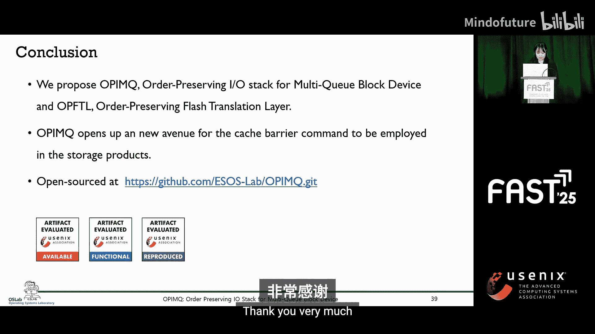
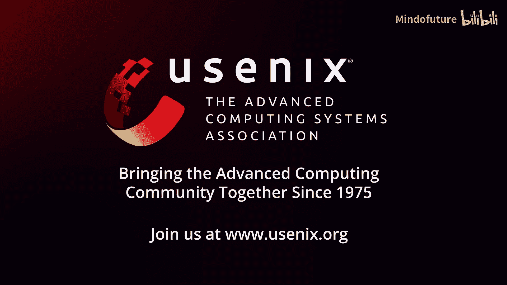

# FAST25存储大会-｜-USENIX-Conference-on-File-and-Storage-Technologies-p27-P27-OPIMQ---Order-Preserving-IO-stack-for-Multi-Queue-Block-Device--BV1HmVXzME4J_p27-

。

Good afternoon， my name is Jeanan Kim from OS Lat Kist。

 and today I am going to present OPIMQ on ordinary preuming Ios Tech4 MultiQ block device。

Here's what I'll cover today， I'll start with why storage order better。

 explain the problems with existing solutions， introduce OPIMQ and wrap up with our evaluation results and key takeaways。

Worden storage system adopt multiQ architectures to efficiently process parallel IO requests at the OS level。

 multiple request queuees let each CPU core submit IO separately avoiding contention at the device level multiple command queuees such as those in MBM and UFS help fully utilize storage bandwidths。

When an application issues are right， the request travels through the request queue in the host site before reaching the storage device in a single queue system。

 all requests are processed sequentially naturally preserving order， but in multiQ systems。

 requests are distributed occurs multiple request queues。

 each request queue that dispatches its request to each corresponding command queue。

The distributed IO at the Common Q can be reordered by the storage controller or FTL。As a result。

 the border Iiot is inherenttly orderless as requests may be completed in a different sequence than they were issued。

Applications are responsible for enforcing right order known as storage order。

 the sequence in which data becomes trouble in storage。

In database logging and file system journaling， enforcing storage order is needed to ensure durability and cartoontoniness in the event of a crash。

Applications must enforce a storage order using costly mechanism。

To ensure the right are berrovable in the correct sequence。

 an application must wait until our preceding rights are fully persisted before dispatching the next one。

 this strict enforcement limits parallelism and increases latency。

The Cash barrier command offers a more efficient way to enforce storage order。

 first introduced in 2005 as part of ENMC storage， the cashsh barrier command guarantees that right become trouble in order。

With a cash barrier， if rights are dispatched sequentially。

 following rights cannot be doubled until our preceding rights are fully persisted。

 this prevents out of order durability， reducing the need for applications to enforce storage order manually。

To reduce the overhead of enforcing order， several approaches have been explored。

 which can be broadly classified into two types， the first is in order rights。

 where rights are performed sequentially using a cache barrier， the second is out of order rights。

 which initially write data without order and later we the correct order in the event of a crche or system failure using global right identifiers or PMR and VME。

While these methods help invo storage order， they have significant limitations Beer Iostec works only on single Q devices。

 making it incompible with multiQ storage architectures。

 La barrier is restricted to UFS and OPTR supports only a single right stream。Horay。

 CCMVmi and RIU required specialized hardware resources were rely on inefficient ordering mechanisms。

These limitations highlight the need for a solution that efficiently enforces a storage order in multiq strategy systems。

Now I will outline the problems we aim to solve。This slide illustrates the core problem in a single QIo stack。

 a cache barrier naturally preserves the storage order， however in a multiQIo stack。

 dependent right request may be distributed across different queuees。

 allowing the storage controller to reorder them。This can cause a following right to reach the storage media before an earlier one breaking the expected order。

Even with a cash credit， straight order may still be compromised in multiQ systems。

To understand the problem in the multiQ system， we define two key concepts， stream and output。

 a stream is a set of I requests issued by a single thread。Within a stream。

 an APO is a group of write requests that can be reordered internally but must be persisted in creation order。

Each apo is delimited via a cash barrier。The core issue is that storage order is not naturally enforced between white requests in different queuees。

 enforcing order becomes challenging when request with dependencies are assigned to separate cues。

 a problem we call Inter queuee storage order。This occur in two cases when dependent requests confirm the same thread or different threats。

The first challenge is guarantee intra stream storage order with core migration due to work stealing right request from a stream may be distributed occurs multiple cues。

 causing epo split， where requests from the same e end up in different queuees as a result。

 the cache barrier may reach the storage controller before other requests in the same epo。

 prematurely delimiting the eO and misplacing requests compromising the storage order。

The second challenge is guaranteeing inference stream storage order when right requests with ordering constraints originate from different threads。

 especially on separate CPU courses， each thread registers its right request in its assigned queue。

 requiring the system to enforce order across Qs， potentially compromising the storage order。

To address these issues， we introduce OPI and Q on order preserving on your stack for a multiQ block device。

This is the key concept of OPIMQ OPIMQ ensures storage order through collaboration of cost and storage at the host level。

 each IO request is assigned a pair of stream ID and Apple ID。

 defining its ordering constraintss and passing them to the storage。

 at the storage level these IDs enable correct persistence order， even occurs multiple cues。

This is a design overview of OpPIMQ at the host level。

 the order preserving file system determines the placement of cash barriers according to ordering constraintsst。

OPIMQ structures are your request into streams and apps。

 assigning its request to the corresponding IDs at the storage level。

 OPF TL ensures ECbased persistence order while drillstream rights and sibling aware delayed mappings guarantee interstream storage order。

In OPIMQ， right request from the same thread belong to a single stream。

 the stream ID is derived from the Strs process ID。Within each stream。

 apples are delimited by cache barriers and assigned unique identifiers。

 the block device layer assigned a pair of stream and Apple IDs to each IO request。Now。

 let me explain how OPIMQ addresses the first challenge， guarantee intra streams storage order。

To prevent epo split， OPIMQ introduces epoch pinning。

 ensuring all rights in the same epo are placed in the same queue。

 If a thread migrates before EpoC delimmination， it dispatches right request to its original queue New requests are placed in the migrated course queue only after the cache barrier delimits the epoC。

This prevents premature epoch delimination at the storage level。

The second challenge is ensuring storage order across stress。

 which requires preserving the order between apos from different strings。

OPIMQ introduces dual stream right， a write request that belongs to two streams simultaneously。

When enforcing interest stream order， OPIMQ designate rights from the preceding output as dual stream rights。

For example， in the diagram， E 12 from thread A must persist before E 6 from thread B to enforce this OPIMQ marks W1 and W2 as dual tor。

 meaning they belong to E 12 in stream A， while also being part of E 5 in streamam B。

A drill streamr carries two pairs of stream and E IDs in addition to its original stream and E ID。

 it is assigned a secondary stream and E ID in the diagram。

 a write request in E 12 of stream A is marked as a drill stream right carrying two pairs of IDs stream A E 12 and streamam B E 5。

OP upTL insurers write or persisted in EC order within each stream by referencing the stream and E ID in the request。

 the key idea is that data can be flushed to flash media in any order to maximize parallel lesson while the mappingtting table is updated strictly in E order。

Now let's see how to enforce infer stream storage order a dual stream right carries two pairs of stream and Apple IDs representing two ordering constraints or PFT interpret these constraints and persists the right only when both contingents are met。

If only one condition is met， OPFTL delays the mappingping update until both are satisfied。

 this is called sibling or rare delayed mappinging。In the top diagram。

 a single stream right A5 has only one ordering constraint。

 so each LTP mapping is updated in the table immediately after A4 is persisted in the bottom diagram。

 the LTP of the dual streamam right remains delayed， even if a4 is already persisted。

 the mapping is updated in the table only after B10 is persisted。

 thereby ensuring interest stream storage order between stream A and stream B。

Now let's move on the evaluation。We tested all workload on a vertical core server with a Samsung 980 pro as the storage device OPIMQ is implemented in the Linux Con for evaluation we selected EX4 as a representative file system and referred to it as OPX4s throughout our experiment。

 we compared OPIMQ with three configurations EX4 with Le IosStack barrier Iost with a single command Q MQF in CCM Realmi。

First， we compare a single latency between OPX4 and the legacyacy EX4。

When Epync is called in EST4 journaling， file data and journal log blockss must be written before the Journalomic block to maintain consistency。

To enforce this order， the legacy EX4 wait until file data and journal logs are fully written to the storage device before dispatching the Jon Com block。

OPIMQ eliminates the DMA transfer delays and the overhead of v flag associated with enforcing disorder。

As a result， Ey latency in opPque EX4 is reduced to one third of that in EX4。

For the macro benchmarknchmark， we evaluate O PINQ in a cloud environment using filebench per mail。

 D benchch， and Si Bench OLTP insert。We measure IOs while increasing the number of running containers to assess scalability。

 O P I M Q outperforms the vanilla Linux Iost2。9 times in bar mail，2。8 times in D benchch and 2。

9 times in si benchch。We also measure the overhead of e pinning of Cur benchmarks。

 running 40current Docker containers， excluding workloads simultaneously。

The results show that Applepin has minimal impact on performance。

 demonstrating its efficiency in managing ordering without significant overhead。Finally。

 the overhead of allPFTL is as follows， we use Comos open SSD board and generate the4 kilobyte random right followed by ESync。

 the overhead of ensuring the storage order in OPFTL is negligible because it can flush the right by cash in any order while preservibing the mapping update in order。

With this design feature， OFTL can ensure the storage order among the appss while fully exploring the internal hardware parallel lesson inside SSD。

I will now go over the conclusion。In summary of PINQ enforces storage order in MultiQ block devices by coordinating between the host and storage。

 it preserved both interest stream and interest stream order using E pinning and dual stream rights。

OPIMQ opens up a new avenue for the cashsh barrier command to be employed in the general storage product。

OPIMQ is open source， so feel free to test and explore it， thank you very much。

