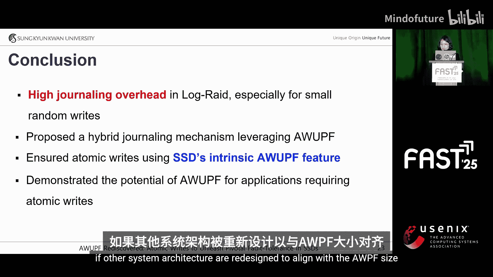

# FAST25存储大会-｜-USENIX-Conference-on-File-and-Storage-Technologies-p28-P28-AWUPF-Rediscovered---Atomic-Writes-to-Unleash-Pivotal-Fault-Tolerance-in-SSD--BV1HmVXzME4J_p28-

。

To welcome everyone， my name is Yan Zhang from Sanngyangun University and today I'm going to introduce our paper。

 our research explores the possibility of AWP on MM feature for shifting the atium light so to the SSD。

Let's begin with a brief overview of how we assess the handlelight， as you may know。

 then the first memory in SSD does not support direct Uberite。

 instead first translation layer manages to logical to physical mapping of data。

When a right operation occurs on the host side， the data is written to a new physical location in the fridge。

If an overide operation is issued， the new data is stored elsewhere。To ensure accessibility。

 the table must be updated with the new making information。😊。

Since the mapping table of is crucial for accessing new data。

 it must be automaticomic at the mapping Unil to maintain data consistency。Due to this mechanism。

 assessD inherently provide autoity。To formalize this behavior。

 the MBA is standard introduced a feature called AWPM。

 which defined the smallest right unit that assess the most guarantees atomy。Through our analysis。

 we found that most SS provide a 4 kiloby AWUPM。This leads to an important question。

 do we still need optimize for journaling， as you know fire system and database rely on journaling or right or loging to prevent partial update instead of writing changes directly to stories update or first load in a journal area and later apply to the main storage through checkpoint operation。

However， this approach introduced significant performance overhead due to the double light process。

But what if we could label the AWUP instead of traditional onlying。

Since AWP already guaranteed automity， we could eliminate the need for dog rights significantly reducing overhead and potentially improving performance。

Now， let's take a look at how previous studies have taken this problem。

Some approach have modified SSF ti to enable transactional lights。

 while other have explored overloading hostide on link to SSD。However。

 while this study labels the atity characteristic of SSD。

 they all require modification at the SSD level。But as I mentioned earlier。

 Sis already provide native automized support through AWUPF。

If you turn some fit within a single page， we can label the SS the at line capability to guarantee automationity。

Rather than modifying the SSD itself， our approach aimed leaders journal overhead by utilizing an existing SSD feature AWEP。

But this leads to another key question。Which system can efficiently update metadata with a single autoite command。

Based on this crition， we selected logo structure rate as our case study。

Online conventional aid logade follows on open only right strategy。

Due to its outer place update method， radio metadata， which with the location of radio data。

 must be updated with each right operation。For example， let's say data， A， B。

 C and D are already stored and their location are recorded in the mapping table。

If your B is updated to B prime， low grade write B prime to the next available location on SS0 instead of operating the existing B。

Since the location of B has changed， the mapping table must also be updated or coding name like this。

But， what happened if。Cre occurs during this update， it could lead to a corrupt mapping table。

 potentially causing data inconsistency in late the data。

If the rate metadata update is only partially completed。

 the system might reference outdated or incorrect location。To prevent this。

L me data of this must be autoomy。To ensure autoity。

 low rate employees journaling for rate metadata allowing to recover correctly in case of a crash。

However， Jon Li enjoyed this a significant performance overhead head。When journal is disabled。

 metadata updates are handled in memory and only periodically flourishes strategy。In this case。

 the performance difference between sequential and random lines remains minimal thanks to ro a on the right scheme。

However， when journalist is en， the performance of birds increased dramatically by up to 25 times。

This impact is particularly severe for a small random light。The reason is that during a checkpoint。

 randomon might update multiple metadata pages significantly increasing the number of metadata pages rights。

As a result， this list multi higher performance costs。

 making generally a major bottle leg for low blade。For our study。

 we just positioned waste as our target log system。This is an open source through grey system。

 built by Samsung。トポセードウエスト connectネイニク viaオ。When one or more block devices are set up on the inator。

 they get connected to multiple em SSD in the Poon。In this setup。

 rate useradata is as managed as low grade 5 or log grade 6， while red metadata is center as Ra 10。

Let me briefly introduce the metadata structure of PoonOS in PoseonOS data is written sequentially in robot structure manner。

Let's go through an example to understand how this works。When data is written。

 it is first stored in Ports strip， which is allocated in memory。And then return to logical type。

 which represent the actual twist space used in necessity。At this point。

 to map the strip to the rot type， because I don't always manage the strip map。Next。

 the waste map update is committed to journal area after this。The memory with man is updated。

 accordingly。Here， the policeman refers to the mapping of。

Both read user data and red metadata based on the host address。

Each entry in the breast milk contains a breast I D， vitamins， water typepe I D， and ania。

Since each virtual strip is directly mapped the logical strip。

 knowing the base ID and offset within the strip， allow us to determine the exact physical location of the data on the assist。

The same process is followed for data B。And是。Finally， when the journal error becomes。

 a checkuppoint is triggered at this point since we have updated three metada pages。

Refer to as end pages， these endage are checkpointed and returned to the metadata area to ensure consistency and durability。

In Puon ways one MPage is equal to AWP， allowing us to leverage AWP to ensure autoity while simultaneously reducing double light let's look at an example if you write a。

Opdateates only one endage。 it can be directly written to storage by patient don。 In contrast。

 if you write to operation B update two end pages， it must be committed。And later。

 check appointed to maintain consistency。However， if you sub contract to operation C update only one end page。

 it can also be directly written。Poten셜ally including a portion of 에이스 메타 데이터。As a result。

 previously all three man required override due to journaling。

 but with our approach only oneMph requires solid override。

This significantly reduce generally overhead and improves。

Write performance by minimizing unnecessary copyrightright。

While AW repair enables directate to metadata， applying both directorate and journal to the same MP page can lead to consistent issue。

The figure below lost how the voice map in memory and storage is updated during the right operation。

When write a modify M page0 and M page1 in memory to maintain consistency。

 it must be fully committed before any further of these take place。However， if you write the be。

Opdate which made in memory before writing a committed， it directly writes MP page1， including a1。

As a result， a portion right A metadata is stored in SSD prematurely。Now。

 if your question occurs at this moment， M page1 is tall， but M page0 is roast。Since right。

 A was never fully committed。This result in an inconsistent state because write A data was only partially up。

To ensure consistency， the width map in memory should only be updated after committee is complete。😊。

First， right A is successfully committed。😊，Only after this， the voice map in memory is updated。Now。

 when right to be arrives， it can safely rip at page1 to strategy。

Since a one has already been committed。If a question occurs in this scenario。

 recovery is straightforward。MP1 already contains both A 1 and B， ensuring their persistence。

AA0 can be restored from the comm， maintaining autoity and preventing data corruption。

The second issue arise in the following scenario after right A and right B are complete。

 right C will write the same location as right A as a result。

 the base map in memory is updated with right C's latest information and then directly returned to those story。

However， if a question occurs at this moment， a critical issue emerge because the system restores the right a or the data from the。

Commerlo， effectively overring the latest of right to see information is lost during recovery。

This leads to data inconsistency is the most recent right operation is unknowndone by outdated communal。

To address this issue， we introduced a burden number for eachM and implemented the burden every time。

Or director or comment， of course。This ensures that higher burden always represent the most of the date and page preventing outdated data from being restored during recovery。

When the right operation required commit arrives， the MP version is implemented by one。

And the comment loop is recorded with the updated version information。After right A is committed。

 and the we map is updated。Right， the fee arrives。The version is implemented again。

And direct right is per point。Later， when light C modified the voice map in memory。

 the version is implemented was more。Followed by another director， right。If you ch your course。

The recovery process proceeds as far。The system compares the version in the common log with the current version of each corresponding and page。

If the common law version is similar， no recovery is needed because the MP page already contains a newer version。

In this case， since the commonunal version of a0 is not greater than the current version of M page 0。

Similarly， the common log version of a1 is now greater than the current version of page 1。

Since all basins are properly managed， no or recovery is required ensuring consistency and preventing data loss。

We implemented our approach in Poon waste， and we configured the experimental environment as follows。

We tested three configuration journal used a different Poon with journal option。

 Our approach selectively applies journaling or directorized based on the number of updated input。

Directctor always write modified and pays directly without ensuring data consistency。First。

 we compare the performance of our approach with the conventional journal technique using the same number of reactors。

Pose don't always utilize the storage performance development kit。

 a user label storage IO framework to efficiently manage the IO operation to SSD。

The reactors are split into metadata reactors， which handle metadata journal and checkpointing。

And U datata director which handlender U datataology。

The performance of genre remain constant in random level cloud。

 even as the number of metadata director increase。This is because checkpoint overhead becomes the dominant。

Bterly， limiting the performance improvement from additional reactor。In contrast。

 our approach improves。Perperma by 3。3 times， increasing the number of metadata react leads to better performancefuma scaling unlike the genre approach。

Since only one MPage is updated with4 kilobyte rides， direct shows the same result as our approach。

 however， in sequential right across both direct and our approach experience performance degradation。

Once the number of reactors exist。诶。This decline is caused by conditiondenion to endage excess。

 where multiple reactors compete for the same metadata pages leading to increased latency and reduce efficiency。

This is based on1 meby rocket size since standard B more like sequential light。

 its performance in random level code is similar to sequential light per。However。

 our approaches still are soonered by an average of 20%。Additionally。

 all three methods were saturated。Perpermon starting from six metadata reactors at this point。

 increasing the number of metadata reactors no longer in perus as the system becomes bated by contention in metadata access。

To assess the impact of right side， we tested performance across different sites using APIu。

Sequential light performance is similar across all three configuration。In random line workers。

 our approach achieved up to 3。6 times higher performance。As the rates become more sequential。

 check a point to overhead decrease。Bringing our approach code to direct at2 megabyte right size。

We evaluate benchmark across where our approach first advantage。

Bar may dominate by small random line show up to 14%。

Irovement at sorry to thread innova TP D issue small oceanronous random light。

 our approach or to 73% improvement at sorry to thread。

Significant performance improvement was observed in random domino workers growth。

A W U has traditionally been。Filed as an interesting asset feature， however。

 this study demonstrate its potential for affording wateride data consistency management to assistD。

By leveraging AWPA for low grade metadata update， we achieved significant performance improvement by reducing journal overhead and minimizing redundant rights。

 we believe this approach can be further extended if the order system architectural redesign to align with the AWP size。

Thank you for listening。

