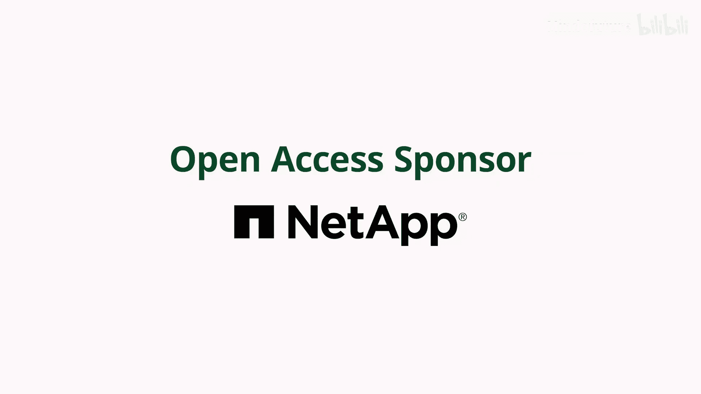
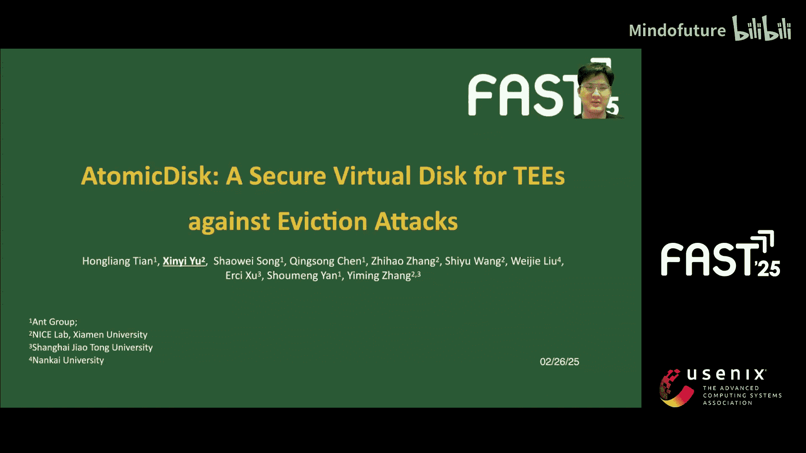
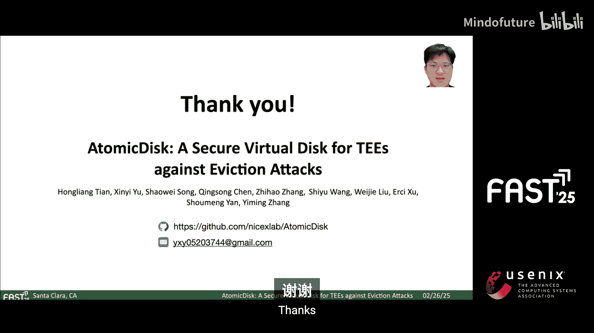
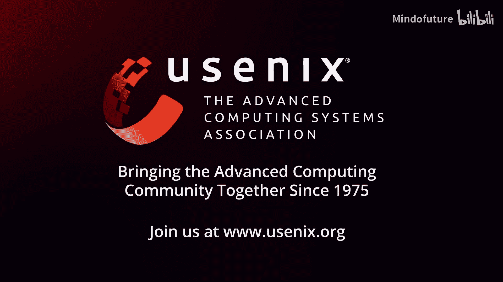

# FAST25存储大会-｜-USENIX-Conference-on-File-and-Storage-Technologies-p29-P29-AtomicDisk---A-Secure-Virtual-Disk-for-TEEs-against-Eviction-Attacks--BV1HmVXzME4J_p29-

。

Hello everyone I'm Ci， sorry for not attending conference in person today。

 I prepare this video to introduce our work， atomic disct， a secure water disc against eion attack。

I will start by providing some essential background information。

 Then we will talk about the eion attacks that we have identified following that I will introduce the key design of atomic disk。

 And finally， I will show the evaluation result and our conclusions。Nowadays， trust。

 execution environment or Ts are widely used in cloud environment。

They can protect sensitive code and data within from within from privileged aversary outside。

 like host operating system， Hyvisor and other applications。Now let's define our threat model。First。

 we trust T E， hardware and software like Intel S G X to protect confidentiality and integrity of memory and CPU。

 Therefore， we place our trust in all software executing within the T E boundaries。However。

 we must also consider powerful adversaries within our cloud environment。 They are privileged。

 online and active。 This means they process several critical capabilities。

They they have complete control over all house resources outside T E。

 They can launch attack at any point during T execution。

 They can manipulate any I O requests and response between the T E and the horse block device。

This leads us to a critical point is that T is lacks oil protection。

And this is why a secure water dish is essential。It it addresses the critical IO protection gap we just discussed the security disk can protect a disk IO of T by providing these security attributes。

 and it can free the file system from worrying about T security risks。

 and it can also simplify security analysis and reasoning because it only provide simple interface like read right think。

Let's now explain the security attributes we mentioned before。To counter such a strong adversary。

The secure waterd should provide a minimal security guarantees of confidentiality， integrity。

 freshness and consistency。 confidentiality protects written data from unauthorized access integrity guarantees that data is not tempered or corrupted。

Freshness prevents replay attack and ensure latest data is always provided。Consistency。

 maintain data consistency。Even after system crashes on Linux。

 the state of art solution is device Ma by using a combination of DMM script and DM integrity。

 However， this set up only addresses confidentiality and integrity。On Intel SJX SJ X。

 PF S deliver all four attributes， confidentiality， integrity， freshness and consistency。

 or C IFC for short。Now let's dive into how the state of our solution。

 Intel SGSPFS deliver those CFC security attributes we discussed。

SJXPFS is built around three key components， a modified Merha tree or MHT。

F sets cash and a journal to achieve both confidentiality and integrity。

 Intel has enhanced a classic MHT by employing authenticated inclusionion。In detail。

 each internal MHD node stored the encryption key and message authentication code or Mac。

Of his channel， freshness is ensured through machine verification， guarantee the latest data。

 and the cache residing within secure memory stored meta node MH T node， data nodes。

 boosting I O performance。And finally， the journal maintains a previous version of 30 notes before eion。

 thereby ensuring consistencys。These three components work together。

 allowing SGXPFS to achieve all four CFC security attributes。Before we delve into eion attacks。

 let's clarify the concept of snapshots and snapshots。

 we define snapshots as a persistent system state at a specific time。

 think of Docker container snapshot。Where file chains are saving using Docker commits， Similarlyly。

 enclaves also have snapshot， which are protected file that preserve the enclave states。

 An anticipated snapshot are snapshots not expected by the application logic。

Let's consider SJXPFS as an example。Imagine an application within an enclave writing a series of data blogs to an SJXPFS Pro file ideally from the application viewpoint。

 these blocks should be written and persist as a single unit。However。

 here is where the problem arises when the cash within SJ PFS reaches his capacity。

It initiated an eviion process。The eion leads to the creation of a partial persistent states。

 which is blocked from B1 to B4。 And this is what we define as an anticipated snapshot。AndSub。

When a single command is executedd， the complete and consistent snapshot are expected by the application is created。

 which is blocks from B1 to B8。In normal environment， these eion generated snapshots are harmonless。

But in Ts， these snapshots are vulnerable。Now let's break down the three primary reason why these snapshot are wearable within Ts。

 Firstly， they can generate it by Ts because the post extender put little constrain on the ordering and automatic guarantees。

Allowing the cache layer of T E to perform erection at any time。 Secondly。

 they can captured by adversary because adversy control everything outside eclaves。

 including monitor or I O。Thirdly and perhaps most critically。

 these captured snapshot can be replay by the adversary。

 a snapshot that generated by SJ X PFS share the same root key。

 so the eclave cannot distinguish them。To illustrate the practical implication of these vulnerabilities。

 let's examine a concrete attack using Reddis as our example。

 deploying a Reddis service typically in what two essential steps， first。

 creating and initializing a reddis configuration file if it doesn't already exist。Secondly。

 start the register server to handle user request。Now。

 the eviion attacks unfold in four key stage during the first steps。

 SG X PF due to the MHT catch eion generates an anticipated snapshot。 Criically。

 these snapshot may lack the necessary password requirements。

The adversary can control over the environment outside enclaves captures these vulnerable snapshots。

And then the advisor can restart or initial a new enclave using these snapshots。So， consequently。

The asary gains complete unauthorized access to the register by passing any authentication mechanism。

And it's practical to explore this on a deep snapshot to attack more application。

 Popular databases like Mongo D B and Casthedra use similar configuration based authentication。

And more interesting， unantip snapshot can involve multiple files。 We leave it for future work。😊。

To prevent ection attacks， we propose a new security attributes named Sity。

 These attributes guarantees that all evicted right before a think are committed in an all or nothing manner。

And as we can see， atomic this is the only security solution that achieve all security attributes。

To achieve think autoity， we have developed atomic disk by extending S J X P。

F S with the following key modification。 Firstly， we have introduced a dual state system for data blocks。

 committed and uncommted。 This allow us to track the commitments， status of this image。

And we introduced a operation called commitmit。To transaction blocks from oncom to committee。Thirdly。

 we have reflected the recovery procedure upon reboots。

Atomicomics can now identify and reject any oncoming rights。The commit operation transaction。

 or data blocks of Ds image to committed state to support this。

 we extend the Pf metadata node with a committed flag by default。

 The flag is set to forth as shown the figure the commit operation is triggered by a user initially think think。

And proceed as follow。 Firstly， it executes the standard P F S flash procedure。

 which involves writing dirty notes to the journal and flushing them to persistentence storage。

 Secondly， it updates committed flag to true and flush the modified met datata node to disk。

This signifies that the entire disk image has now been committed。And finally。

 as the journal is no longer required for recovery， it can safely delete it。Conversely。

 the internal flash operation may be triggered by right command Sa the committed flag back to forth。

 This indicates that the dis image represents an anticipated snapshots generated as a result of cash eviion。

If the flag is set force indicating an uncommit， uncommit state。

The disk image cannot be open directly。 Instead， we we rely on the journal to recover the disk image to the latest synchronized states。

Within the journal， each block are assigned one of two status committed or uncommitted。

B's first appearance in the journal is marked as a committee because the journal stores previous version of block。

 this signifies either a new right to an empty block or the first overrite of a committed block。

Subsequence overrs of the same block within the journal are then marked as uncommitted。

During the recovery process。Toomic De reads the journal from its beginning to the end for each logical blog encountered for the first time。

 which， as we discuss is marked as committed。Atomic disks restore these blocks to the disk image。

An memory bit map is used to record and restore blogs。And identify the subsequent oncom blocks。Uon。

Completion of journal replay auto Atomics update the committed block to4 to true， and then。

All data blocks within the Ds image has been successfully committed。Now we talk about evaluation。

 we compare atomic disk with two baseline PFSDs and cry disk PFSD is a secure block device redirecting IO to a SGX protect file。

And PfS and crypto disk is a mirror version of Linux DMm in SGX。Firstly。

 we show the security results， we use trace driven benchmarks where each trace conclude with a single sync request。

 as we can see， atomic disk is atomic disk only generates one wireless snapshot caused by the sink and PFS disk generates hundreds of thousands of snapshots per。

 thus being vulnerable to eviction attacks。Now let's move on the performance evaluation。

 the FIO configuration is listed here in FIO benchmark。

 Atomic disks and PFSDs has similar right performance as atomic disks save both committed and unchem block to the journal。

So having the same right applicationpl as PF SD， Atomic disk and PF IDs also have similar read performance because they process read requests exactly the same。

Cripes is outperform， because its。It only perform data encryption without an MHT structure avoiding right applicationpl。

 but lacking freshness and consistency。In stream benchmark， the result are similar to FIO。

 while the performance gap narrows as these workloads are dominated by small I operation。

AndNs end is a YSB benchmark， we choose two application， Reddis and betterger Db。

 which is an absenttry based key value store for Redis， all three these achieve similar performance。

Due to register with I I O patterns。 and for betterger D， the gap。

For better D B autoies and PFS still achieve similar performance。

The gap between atomic disks and cryto disks narrowed due to its uniform rate distribution。

 causing frequent small random ray that bottleneck the performance of crypt disk。In summary， firstly。

 we identified eion attacks， a new type of attacks against Intel SGX。 Second。

 we have introduced S Autoity， formal security properties as a fundamental defense mechanism against eion attacks。

Third， we have developed atomic disk， a secure water disk that achieve achieves sink autoity while maintaining SGSPF S comparable performance。

Thank you for listening Autoomy this has been open source on GiHub。

 you can check the link here for more details if you have any questions please contact me。Just all。

 thanks。

